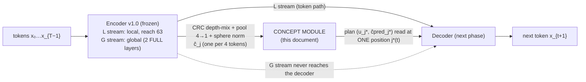
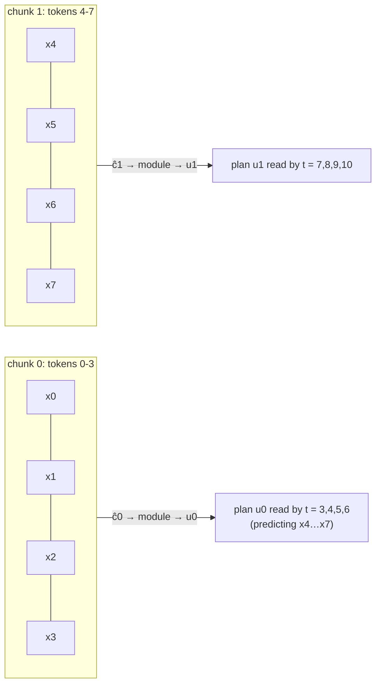
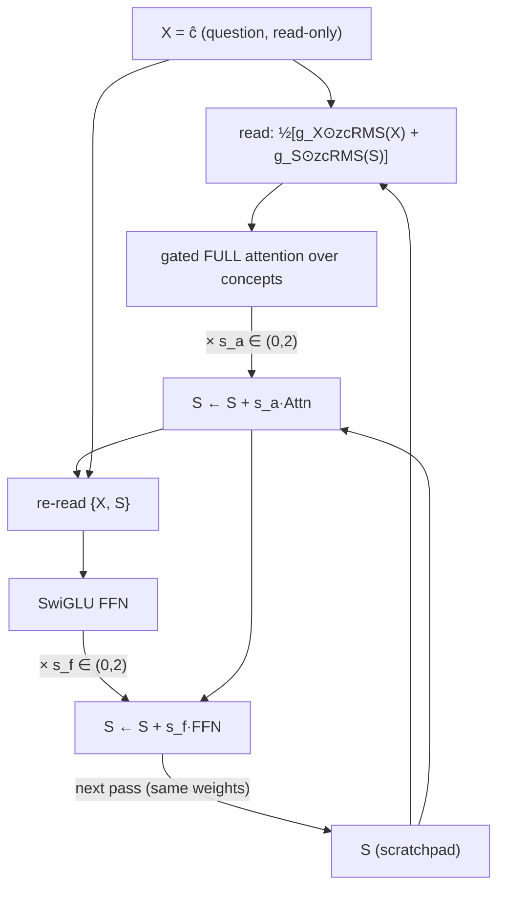

# HRM THINKER — The Concept Module (frozen spec v2)

*A first-principles derivation of the concept module that sits between the frozen encoder v1.0 and the (not yet designed) decoder. Every equation is derived, every symbol is unpacked, and every design choice is tied to either a derivation or a measurement from our own experiments (listed in §13). Measured numbers are from the CPU test benches built during the design (d = 64, 1 seed per arm unless stated).*

---

## 0. The module on one page

| item | frozen choice |
|---|---|
| **input** | pooled concepts ĉ₀ … ĉ_{M−1} from encoder v1.0, one per 4 tokens, on the sphere of radius √d_c, gradient flows back |
| **computation** | **one shared layer, looped R times**, over two streams: X (the input, re-read every pass, never written) and S (the state, starts at a learned input-independent vector s₀ of norm ≈ √d_c — review amendment A1, §19) |
| **layer anatomy** | gated-residual read → gated FULL attention over concepts (NoPE, per-head temperature, QKV short conv, GQA) → gated-residual write; then the same with a SwiGLU FFN |
| **passes** | training R ~ Uniform{1,2,3,4}; inference R = 4 by default, more when a task needs depth |
| **outputs** | the plan state u_j = zcRMS(S_j), and the next-concept prediction ĉpred_{j+1} from the NCP head |
| **objective** | L = NTP + α·NCP + β·VQ, α = 0.1; NCP = cross-entropy over product-quantised codes of the next concept |
| **read rule** | the decoder reads (u, ĉpred) at exactly one concept j*(t) = ⌊(t+1)/4⌋ − 1, through a gate that can never close |
| **test-time tools** | extra passes (free); latent steering on the X stream (GradCuit) when a verifier exists |
| **M2 size (d_c = 512)** | ≈ 3.2 M core parameters; ≈ 12 MFLOP/token in training (mean R = 2.5); inference ≈ 6.4 MFLOP/token at R = 4 (forward only) |

---

## 1. Why a concept module at all — the job, derived

### 1.1 What the decoder can see without it
The decoder continues the encoder's local stream L, whose reach is 63 tokens (proved bit-exact in encoder v1.0); the decoder's own sliding-window layers add a little more. Call the total local reach R_loc. Write

- **H(A | B)** — conditional entropy: the best achievable cross-entropy (nats) for predicting A when B is known;
- **I(A ; B | C)** — conditional mutual information: how much B reduces uncertainty about A once C is known.

A model that sees only the last R_loc tokens can reach at best H(x_{t+1} | x_{t−R_loc+1..t}). A model that sees everything can reach H(x_{t+1} | x_{≤t}). By the chain rule of mutual information the gap is exactly

$$\Delta_{\text{far}} \;=\; I\big(x_{t+1}\,;\,x_{\le t-R_{loc}}\;\big|\;x_{t-R_{loc}+1..t}\big)\;\ge 0 .$$

In words: Δ_far is what the far past tells you about the next token that the near past does not. **The concept module is the only channel that can deliver Δ_far to the decoder** (the encoder's global stream G is forbidden from reaching the decoder directly — that bypass is what made the core unread in HRM-NCP, failure F6).

### 1.2 Three candidate jobs
| job | meaning | who else can do it |
|---|---|---|
| J1 transport | carry far information to the decoder | partly the encoder: ĉ already contains G |
| J2 composition | chain lookups ("A→B, B→C ⇒ C") | the encoder's 2 FULL layers do ≈ 1–2 hops; **more hops only the module** |
| J3 prediction | predict the next concept (NCP) | only the module |

**Frozen decision:** the module's jobs are J3 (NCP, as in NCP-ArchPreview) and J2 (composition beyond the encoder), with J1 as a by-product. Every later choice is judged by whether it serves J2 and J3 *without* being bypassed.

### 1.3 The use principle (the one rule behind every decision)
> *A module is used only if the rest of the network cannot reach the loss without it.* (Established by F1–F7 in the programme; confirmed again in §13.)

---

## 2. Causality — when may the decoder read the module?

Number tokens t = 0 … T−1. Chunk j holds tokens 4j … 4j+3, so there are M = T/4 concepts. The encoder guarantees ĉ_j depends only on tokens ≤ 4j+3.

The module is causal over concepts (§5.3), so its output at concept j, u_j, depends only on ĉ₀ … ĉ_j, hence only on tokens ≤ 4j+3.

The decoder at position t predicts x_{t+1}. It may read u_j only if u_j contains nothing at or after x_{t+1}:

$$4j+3 \le t \;\Longrightarrow\; j^*(t)=\Big\lfloor \frac{t+1}{4}\Big\rfloor-1 .$$

| t (predicting x_{t+1}) | 2 | 3 | 4 | 5 | 6 | 7 | 8 |
|---|---|---|---|---|---|---|---|
| j*(t) | null | 0 | 0 | 0 | 0 | 1 | 1 |
| last token inside u_{j*} | — | 3 | 3 | 3 | 3 | 7 | 7 |
| plan age (tokens) | — | 0 | 1 | 2 | 3 | 0 | 1 |

Consequences:
1. **u_{j*} is exactly "the concept before the chunk that contains x_{t+1}"**, so the natural thing for it to predict is the *next* concept, j*+1 — the NCP target is forced by causality, not chosen.
2. **The plan is 0–3 tokens stale**; the decoder's local path fills the gap. This is the price of k = 4.
3. **Null plan at every document start** (found as a bug in testing): for the first 3 tokens of *every* document, j*(t) points into the previous document, so the decoder must read a learned null vector instead. Condition: use u_{j*} only if chunk j* belongs to the same document as t.

**Tested (bit-exact, float64):** editing token p changes the plan first at the end of p's chunk and never earlier; editing a far fact changes the answer only through the plan (with the plan switched off, the effect is exactly 0).

---

## 3. The input — what the encoder hands over

(Frozen in encoder v1.0; recapped here because the module's design depends on it.)

$$m_t=\sum_{s\in\{e_0,\,L,\,G\}}\alpha_{t,s}\,\mathrm{rms}(h^s_t),\qquad c_j=W_{\text{pool}}\,[m_{4j};m_{4j+1};m_{4j+2};m_{4j+3}],\qquad \hat c_j=\sqrt{d_c}\,\frac{c_j}{\|c_j\|+\epsilon}.$$

- **e₀, L, G**: raw token embedding (exact identity), local stream (reach 63), global stream (2 FULL layers).
- **α_{t,s}**: softmax depth-mix weights (init 0.11 / 0.11 / 0.79).
- **W_pool ∈ ℝ^{d_c × 4d}**: initialised to mean pooling ¼[I I I I] (option A: learned, starts exactly as NCP's mean pooling). Geometrically, mean pooling projects the 4d-dimensional chunk onto the "all four equal" diagonal and discards the 3d-dimensional subspace where the four states sum to zero (e.g. token order within the chunk). Learning W_pool lets the model keep what it needs from that subspace; it cannot start worse than NCP.
- **Sphere norm**: every ĉ_j has length √d_c (RMS 1 per dimension), so only its *direction* carries information and its scale can never drift (failure F3).

The module consumes ĉ **without** stop-gradient — the encoder learns what to pool only from gradients that come back through the module.

---

## 4. From results to principles — why the computation looks the way it does

The computation was not guessed; it was forced by four measured facts.

| # | measured fact (§13) | principle |
|---|---|---|
| P1 | a loop with un-looped layers beside it (prelude + 2 shared layers ×2 + coda) solved 2-hop at 99% **with its second pass removed** | unrolled depth beside a loop makes the loop idle |
| P2 | NCP's 4-layer stack learned hops 1–3 but scored 17.6% on hop 4 | a stack has exactly the depth of its layers and cannot extend it |
| P3 | a DiscoLoop channel read from an unsupervised pass-1 state was co-adapted away (bridge decoded 2–5% vs 35–62% without it) | never design around the *meaning* of an unsupervised intermediate state |
| P4 | a loop over the whole module (no input re-read) learned 2× slower: pass 2 sees a different input distribution than pass 1 | every pass must see the same *kind* of input |

Derivations that follow from them:

1. **From P1:** no prelude or coda layers — every attention layer sits inside the loop.
2. **From P1 + P2: one shallow layer per pass.** One attention layer performs ≈ one content lookup (with the QKV conv, one lookup = one induction step, §5.3). If a single pass could solve a task, the loop would idle again; with one layer per pass, pass r can only add hop r, so the loop becomes a **step operator** T and R passes compute T^R.
3. **From P4: two streams with the input re-read every pass.** Pass r always sees "the question (X) + what I have found so far (S)" — the same kind of input at pass 2 and at pass 7, so one operator serves every pass (this replaces DiscoLoop's fix for the same mismatch).
4. **From P3:** nothing unsupervised is given a meaning — no decoded-concept channel between passes, no deep supervision of intermediate passes, no stochastic latent.

---

## 5. The computation, piece by piece

### 5.1 Streams and initial state

$$X_j=\hat c_j\ \ (\text{read-only}),\qquad S_j^{(0)}=s_0\quad(\text{one learned vector, the same at every position; init }s_0\sim\mathcal N(0,I),\ \|s_0\|\approx\sqrt{d_c};\ \text{no weight decay}).$$

- **X** holds the question — what the text says. It is re-read on every pass and never written.
- **S** holds the scratchpad — what the module has computed so far. It is the only stream that passes write to.
- **Why not S⁽⁰⁾ = X:** if the state started as the input, the state's own residual would carry the input past every pass (the F1 bypass inside the core).
- **Why a constant s₀ keeps that guarantee:** s₀ is the same for every input, so it carries zero information about the text. Everything in S that *depends on the input* was still computed by passes.
- **Why s₀ ≠ 0 and why its norm is ≈ √d_c (review amendment A1, derived in §6.3, measured in §13.7):** the layer reads S only through rms(S) = √d_c·S/‖S‖, whose Jacobian has norm √d_c/‖S‖. Starting from 0, ‖S‖ stays far below √d_c for many passes. The read then *amplifies* the first small writes: early passes dominate the gradient (25–49× more than pass 4) and later passes turn S less and less. Starting at ‖S‖ ≈ √d_c keeps that factor ≲ 1 from the first pass. (*Original frozen spec: S⁽⁰⁾ = 0.*)

### 5.2 One pass = one layer = two sublayers

For pass r = 1 … R, at every concept position j (all positions in parallel during training):

**Read (gated residual read over the two streams):**

$$x=\tfrac12\Big[g_X\odot \mathrm{zcRMS}(X)+g_S\odot \mathrm{zcRMS}(S)\Big],\qquad g_i=\sigma\!\big(U_iV_i\,\mathrm{rms}(Z_i)+b_i\big),\quad Z_i\in\{X,S\}.$$

- **rms(v) = v / √(mean(v²) + ε)** puts every stream on the unit-RMS sphere, so the read is independent of how large a stream has grown.
- **zcRMS(v) = (1+γ) ⊙ rms(v)**: zero-centred RMSNorm; γ starts at 0 (so the gain starts at exactly 1) and is weight-decayed toward 0 (Qwen3.8's choice).
- **g_i ∈ (0,1)^{d_c}**: a per-channel read gate for stream Z_i (computed from that stream alone), low rank (U_i V_i with rank 32), bias b_i = +2 so it starts ≈ 0.88 open. It lets the layer choose, per channel, how much of the question vs the scratchpad to read.
- rms(0) = 0, so on pass 1 the read is just the question — **at half scale** (½·g_X⊙X̃ instead of an average of two unit-RMS vectors). This is a pass-to-pass input mismatch; see review finding R1 (§19).

**Mix (attention over concepts), then write:**

$$S\leftarrow S+s_a\cdot \mathrm{Attn}(x),\qquad s_a=2\sigma(u_a^\top x+a_a)\in(0,2),\ \ u_a=0,\ a_a=0\ \Rightarrow s_a=1\text{ at init}.$$

**Re-read, FFN, write:**

$$x'=\tfrac12\Big[g'_X\odot\mathrm{zcRMS}(X)+g'_S\odot\mathrm{zcRMS}(S)\Big],\qquad S\leftarrow S+s_f\cdot \mathrm{FFN}(x').$$

The carry is exactly the identity (S ← S + …); the gates only scale the *branch*. §6.3 shows why that matters for gradients.

### 5.3 Attention over concepts (the lookup)

Let H query heads, H_kv key/value heads (GQA), head width d_h. For position i:

$$q_i=\mathrm{Conv}_q(W_qx)_i,\quad k_i=\mathrm{Conv}_k(W_kx)_i,\quad v_i=\mathrm{Conv}_v(W_vx)_i,$$

$$\ell_{ij}=\tau_h\,\frac{\mathrm{zcRMS}(q_i)^\top\mathrm{zcRMS}(k_j)}{\sqrt{d_h}}\quad (j\le i,\ \text{same document}),\qquad a_{ij}=\mathrm{softmax}_j(\ell_{ij}),$$

$$\mathrm{Attn}(x)_i=W_O\Big[\Big(\sum_j a_{ij}v_j\Big)\odot\sigma(W_\theta x_i)\Big].$$

Every piece, and why:
- **Causal mask over concepts (j ≤ i)** — required by §2.
- **Document mask** — no concept attends across a packed-document boundary (tested bit-exact).
- **NoPE** (no rotary position): the module retrieves by *content*; order comes from the causal mask and the conv. NoPE also generalises to longer contexts (RNoPE-SWA, Kimi K3).
- **Per-head QK-norm** puts q and k on spheres of radius √d_h, so at unit gain the largest possible logit is √d_h (= 8 at d_h = 64). To put probability p on one key among N near-zero keys you need a logit gap Δ = ln N + ln(p/(1−p)) — 14.0 for N = 128k, p = 0.9 — which exceeds 8. Hence the **learnable per-head temperature τ_h** (log τ_h starts at 0, no weight decay) that lets sharp retrieval scale with context.
- **Output gate σ(W_θ x)** (Gated Attention, NeurIPS 2025 best paper): a softmax average can never output "nothing", so ungated heads dump attention on a sink; the gate lets a head switch itself off and adds a nonlinearity between W_V and W_O.
- **Short causal conv on q, k, v (kernel 4 over concepts = 16 tokens), residual form, weights start at 0:**

$$\mathrm{Conv}(z)_i=z_i+\sum_{\ell=0}^{3}w_\ell\odot z_{i-\ell}\quad(\text{same document only}).$$

  With w = 0 at init this is exactly the identity. Its job: a key at concept j then already contains concept j−1, so **one attention layer can do a full induction step** — "find the concept that matches mine and read *the one after it*" — which is one hop. Without it, one hop needs two layers (a previous-token head, then the match).

### 5.4 The FFN

$$\mathrm{FFN}(x)=W_2\big(\mathrm{SiLU}(W_1x)\odot W_3x\big)\quad(\text{SwiGLU; } W_1,W_3\in\mathbb R^{f\times d_c},\ W_2\in\mathbb R^{d_c\times f}).$$

Dense at M2 (f = 1408 ≈ 2.75 d_c); at scale this is where parameters grow (wider f or MoE), because the loop shares one layer's weights across all passes (§12).

### 5.5 The readout

$$u_j=\mathrm{zcRMS}\big(S_j^{(R)}\big).$$

Because u is normalised, **only the direction of S matters**. One consequence (observed end-to-end with S⁽⁰⁾ = 0, §13.6): if every pass adds the same vector v, then S^{(R)} = R·v and u is identical for every R — the loop is then behaving like a single layer. That is the signature of recurrence that is not (yet) being used.

With S⁽⁰⁾ = s₀, an idle loop gives S^{(R)} = s₀ + R·v, whose direction *does* drift with R. So "u independent of R" is no longer the idle test. The robust test is that **consecutive steps are parallel**: cos(ΔS^{(r)}, ΔS^{(r+1)}) ≈ 1 at every pass means idle.

---

## 6. Passes — training, inference, stability

### 6.1 Training: sampled depth
Each training step draws R ~ Uniform{1,2,3,4}, runs R passes, and back-propagates through all of them (full BPTT; truncation made collapse worse in E2).

Why sample: (i) every depth ≤ 4 is trained, so the operator must be useful at any depth — the property that lets extra passes help at test time; (ii) mean cost 2.5 passes instead of 4. Measured: sampled and fixed-R training both extrapolated hop depth, but sampling was more stable late in training (hop-6 accuracy at 8 passes, end of training: 77% vs 31%).

### 6.2 Inference: depth as a dial
Default R = 4. For a task that needs more composition, run more passes: at concept level, a loop trained on ≤ 3 hops solved hop 5 at 93.7% and hop 6 at 77.1% with 8 passes (best checkpoint 98.5% / 96.9%), and extra passes did not hurt shallow hops (hops 1–4 stayed at 99.5–100%).

Autoregressive inference at concept rate: when chunk j completes, run R passes for position j only; each pass attends to that pass's cached keys/values of earlier concepts. R passes ⇒ R KV caches, each over M = T/4 positions. **R is fixed per sequence:** pass r at concept j attends to the pass-r keys of earlier concepts, so raising R mid-sequence means computing the missing passes for the earlier concepts (cheap: only the module reruns, on ¼ as many positions). The QKV conv also caches the last 3 pre-conv projections per pass.

### 6.3 Gradient flow through the passes (corrected in the review, §19 R2)
Write one pass as S ← S + B(S), where B is the gated branch (both sublayers). The Jacobian of pass q is I + A_q with A_q = ∂B_q/∂S, and through the passes

$$\frac{\partial S^{(R)}}{\partial S^{(r)}}=\prod_{q=r+1}^{R}\big(I+A_q\big).$$

If ‖A_q‖ ≤ a_q < 1, the singular values of the product are bounded on both sides:

$$\prod_{q}(1-a_q)\;\le\;\sigma_{\min}\;\le\;\sigma_{\max}\;\le\;\prod_q(1+a_q)\;\le\;e^{\sum_q a_q}.$$

So the identity carry does **not** by itself prevent vanishing or explosion; both are controlled by Σ a_q.

**Where a_q comes from.** The branch sees S only through rms(S) = √d_c·S/‖S‖, whose Jacobian (√d_c/‖S‖)(I − ŝŝᵀ) has norm √d_c/‖S‖. Hence a_q ≈ λ·√d_c/‖S^{(q)}‖, with λ the branch's sensitivity to its normalised input (times the write gate). Two regimes follow:

- **‖S‖ ≫ λ√d_c (large state):** a_q is small. If every pass writes a step of size δ, then ‖S^{(q)}‖ ≈ qδ and Σ_q a_q ≈ (λ√d_c/δ)·ln R. Gradients then change *polynomially* with depth (like R^{±c}), not exponentially: the loop is stable at any R.
- **‖S‖ ≲ λ√d_c (small state):** the normalised read *amplifies* a small state, a_q can exceed 1, and early passes become very sensitive.

**Measured on the engaged concept-level loop** (v2, hop-6 chains; d_c = 64, so √d_c = 8):

| pass q | 1 | 2 | 3 | 4 | 6 | 8 | 12 |
|---|---:|---:|---:|---:|---:|---:|---:|
| ‖S^{(q)}‖ | 0.38 | 0.86 | 1.30 | 1.71 | 2.55 | 3.48 | 5.37 |
| step ‖ΔS‖ | 0.38 | 0.55 | 0.66 | 0.62 | 0.61 | 0.57 | 0.50 |
| turn of S (degrees) | — | 22.3 | 24.0 | 14.3 | 8.3 | 4.3 | 1.5 |
| ‖∂L/∂S^{(q)}‖, R = 12 | 0.29 | 0.11 | 0.020 | 0.012 | 0.0034 | 0.0014 | 0.00035 |
| *with A1 (S⁽⁰⁾ = s₀):* ‖S^{(q)}‖ | 4.98 | 6.79 | 9.21 | 12.4 | 20.9 | 31.9 | 55.6 |
| *with A1:* step ‖ΔS‖ | 4.74 | 3.00 | 3.65 | 4.51 | 5.88 | 6.15 | 5.96 |
| *with A1:* turn of S (degrees) | 40.7 | 20.1 | 16.5 | 14.9 | 13.2 | 4.8 | 0.9 |
| *with A1:* ‖∂L/∂S^{(q)}‖, R = 12 | 4.0e-4 | 3.4e-4 | 2.7e-4 | 2.2e-4 | 1.1e-4 | 2.9e-5 | 8.0e-6 |

The state stays in the small regime (‖S‖ < √d_c) for all 12 passes. The gradient reaching pass 1 is 44× that reaching pass 4 at R = 4, and 840× that reaching pass 12 at R = 12, growing about 1.4–1.7× per pass backwards late in the unroll. Training was nevertheless stable at R ≤ 4 (global clip 1.0).

The end-to-end figure quoted earlier (flat 0.0125 → 0.0109 over 16 passes) is correct but was measured where the loop was **idle** (S = r·v, zero turn), so it is not evidence about the engaged regime.

**With review amendment A1 (S⁽⁰⁾ = s₀, ‖s₀‖ ≈ √d_c)** the loop starts in the large-state regime:
- It learns steps about 10× larger (3–8 instead of 0.2–0.6).
- The gradient ratio pass 1 : pass 4 falls from 25–49× to 1.8–12× (two seeds each).
- S keeps turning 13–24° per pass *for as long as hops remain* (passes 2–6 on 6-hop chains), then settles below 2°. The loop converges once the work is done, so extra passes are harmless — the property "depth as a dial" needs.

Accuracy consequences are in §13.7.

---

## 7. The output head — Next Concept Prediction

### 7.1 Why cross-entropy on codes, not MSE on vectors
NCP-ArchPreview predicts ĉpred = Σ π·e and minimises MSE to the next concept. For any prediction ĉ,

$$\mathbb E\,\|\hat c-c\|^2=\|\hat c-\mu\|^2+\mathrm{tr}\,\mathrm{Cov}(c\mid\text{context}),\qquad \mu=\mathbb E[c\mid\text{context}].$$

The second term does not depend on ĉ, so MSE's minimiser is the **conditional mean** μ — and with 128 codes in an 8-dimensional segment, many different π give the same μ, so π means nothing. Cross-entropy on the code indices has a unique optimum: π equal to the true conditional distribution over codes. The vector handed to the decoder is still the π-weighted codeword (essentially μ), but π is now a real distribution with a meaningful entropy.

### 7.2 The head

$$q^\kappa=(P_q\,u_j)^\kappa,\qquad \pi^\kappa_{j,n}=\mathrm{softmax}_n\Big(-\frac{\|q^\kappa-\mathrm{sg}(e^\kappa_n)\|^2}{\tau_\kappa}\Big),\qquad \hat c^{\,pred,\kappa}_{j+1}=\sum_n\pi^\kappa_{j,n}\,\mathrm{sg}(e^\kappa_n).$$

- **κ = 1 … G** indexes the product-quantisation segments (G · d_s = d_c); **n = 1 … N** indexes codes; **e^κ_n ∈ ℝ^{d_s}** is a codeword; **P_q ∈ ℝ^{d_c×d_c}** projects the plan state into query space; **sg** is stop-gradient.
- **Distance logits** tie the head to the codebook's geometry: a moved or new code is scored immediately. Geometrically ĉpred lies inside the convex hull of each segment's codes — on a code when confident, near the centre when unsure.
- **Temperature init τ_κ = 2d_s**, derived: for two independent vectors with unit-variance entries, 𝔼‖a − b‖² = 2d_s, so logits start O(1) and π starts near uniform. (With τ = 1 the initial CE was 8.0 nats against a uniform 4.85; with τ = 2d_s it was 4.90.)

### 7.3 The loss

$$\mathcal L_{\text{NCP}}=-\frac{1}{|\mathcal J|\,G}\sum_{j\in\mathcal J}\sum_{\kappa=1}^{G}\log\pi^\kappa_{j}\big[n^\kappa_{j+1}\big],\qquad n^\kappa_{j+1}=\arg\min_n\big\|\mathrm{sg}(\hat c^{\,\kappa}_{j+1})-e^\kappa_n\big\|,$$

where 𝒥 = positions whose next concept is in the same document. Applied **after the last pass only** (P3). Measured end-to-end: NCP CE 1.50 nats/segment against a code-frequency entropy of 2.65 — the head predicts 1.15 nats per segment better than the unconditional code prior (it uses context).

---

## 8. The concept vocabulary (working spec; refined in the vocabulary phase)

Product quantisation splits ĉ into G segments of d_s dimensions and quantises each with its own N-code codebook. Capacity: G · log₂N bits per concept (M2 plan: 64 × 7 = 448 bits for 4 tokens, against 4·log₂V = 52 bits of raw token identity at V = 8 192).

**Learning the codebook — only from VQ, with stop-gradient on the encoder:**

$$\mathcal L_{\text{VQ}}=\frac1{G}\sum_\kappa\big\|\mathrm{sg}(\hat c^{\,\kappa})-e^\kappa_{n^\kappa}\big\|^2 .$$

**Keeping it healthy (F3: 68–79% dead codes in earlier runs).** Measured on a clustered, drifting distribution (8-dim segment, 128 codes):

| codebook | codes used | variance explained |
|---|---:|---:|
| plain, random init | 38/128 | 0.83 |
| SimVQ (e = B·W) | 46/128 | 0.62 |
| SimVQ with bias | 83/128 | 0.68 |
| **k-means++ init from data + re-seed codes unused for 100 steps** | **128/128** | **0.94** (also under drift, Adam or EMA) |

Frozen recipe: k-means++ initialisation from the first batch of encoder outputs; every 100 steps re-seed any code that received no assignment to a random current segment vector; the head reads a **copy** of the codebook (the restart rewrites it in place — without the copy, back-propagation crashed). End-to-end: 100% of codes used, 57–71% variance explained on real encoder outputs.

---

## 9. The objective and the gradient contract

$$\mathcal L=\mathcal L_{\text{NTP}}+\alpha\,\mathcal L_{\text{NCP}}+\beta\,\mathcal L_{\text{VQ}},\qquad \alpha=0.1,\ \beta=1 .$$

**Why the NCP target must be stop-gradient.** If the target c_{j+1} could move, the easiest way to reduce ‖prediction − c_{j+1}‖ is to make every concept the same vector: prediction becomes perfect and concepts carry nothing (representation collapse, as in JEPA-style methods). sg removes that escape.

**Why β is irrelevant under Adam.** Only the codebook receives the VQ gradient, and Adam's update Δθ = −η m̂/(√v̂ + ε) is invariant to multiplying a parameter's gradient by a constant (both m̂ and √v̂ scale by it). α, by contrast, matters: the NCP gradient reaches shared weights (module and encoder). (Diagnostic: α = 0.1 vs 1.0 learned 1-hop far retrieval at the same speed.)

*Caveat found in review (§19 R5):* the invariance holds only if nothing couples the parameter groups. **Global-norm gradient clipping does:** the VQ gradient enters the global norm, so a large β triggers clipping that shrinks every other gradient. Fix: clip the codebook's gradient separately (or exclude it from the global norm). Then β is truly irrelevant.

| loss | reaches encoder | reaches module | reaches codebook | reaches decoder |
|---|---|---|---|---|
| NTP | yes — **only through the plan** for far information (FULL layers included) | yes | no | yes |
| NCP | yes — through the history ĉ_{≤j} (target is sg) | yes | no | no |
| VQ | no | no | **only** here | no |

(All rows verified by explicit gradient checks.)

---

## 10. The plan interface to the decoder

$$p_t=\begin{cases}W_p\big[u_{j^*(t)};\ \hat c^{\,pred}_{j^*(t)+1}\big] & \text{if } j^*(t)\ge 0 \text{ and chunk } j^*(t) \text{ is in } t\text{'s document}\\ p_\varnothing & \text{otherwise (learned null plan)}\end{cases}$$

$$D^{(0)}_t=L_t+s_p\cdot\mathrm{rms}(p_t),\qquad s_p=0.5+1.5\,\sigma(a_p)\in[0.5,\,2].$$

- **Two vectors:** u (rich, continuous: what the module computed) and ĉpred (discrete-vocabulary prediction — the interface that VQ-only adaptation steers). In IHN the rich path carried +0.185 nats vs +0.025 for the plan alone.
- **Floored gate, derived:** a sigmoid gate σ(a) has gradient σ(1−σ), which vanishes as the gate closes. If the decoder learns its local path first (it always does), a closable gate on the *only* long-range route can close and never reopen — the Q-LoopNCP feedback gate went 0.119 → 0.01. A floor of 0.5 makes closing impossible.
- **One read position, never attention across concepts:** if the decoder could attend over all past module states it would compose them itself and the module's computation would go unused (F7, IHN). All combining happens inside the module.
- **Scale note for the decoder phase:** a tied LM head on RMS-normalised states needs logits = h·Eᵀ/√d (without it, initial logits had std 8).
- **The floor is only meaningful relative to the scale of L_t** (review §19 R6): s_p·rms(p) has unit RMS per dimension, so if the decoder's residual L_t grows much larger, the plan is drowned however the gate is set. For the decoder phase: bring the plan in as its own stream read through the gated-residual read (which normalises every stream), not as an addition to L.
- **Chunks must not straddle documents** (review §19 R4): the pooled ĉ_j mixes its 4 tokens, so a chunk holding the end of document A and the start of B leaks A into B, and the rule "chunk j* is in t's document" becomes ambiguous (the test harness checks only the chunk's first token). Rule: pack every document to a multiple of 4 tokens (≤ 3 pad tokens per document).

---

## 11. Test-time tools (no extra parameters)

1. **More passes** — free, needs no verifier; always try first.
2. **Latent steering (GradCuit) on the X stream** — when a verifier exists: freeze the model, add an offset Δz to the X vectors of the last prompt concepts, and update it with the reward-weighted log-likelihood of the model's own continuation (reward 0 if accepted, −1 if rejected; Adam; ≤ 10 updates; stop when accepted). The concept stream is an ideal slot: it sits mid-network (GradCuit's best layers are 25–50% depth), it is the only long-range route so every later token's log-probability is differentiable with respect to it, and each concept slot steers a whole 4-token plan.

Measured (frozen v2 core, failures only, 11 verifier calls): steering fixed 26–38.5% in 3.6–4.4 calls, 2.2× better than random directions of matched size, and kept intermediate hops correct 92–100% of the time; extra passes were stronger (66–99.7%, no verifier); after passes saturate, steering fixed 43.6% (6 hops) and 74% (5 hops) of what remained.

---

## 12. Scaling

Per-token cost of one module layer application relative to one encoder token layer: a layer of width d_c on M = T/4 positions costs ≈ 12 d_c² · T/4 multiply-adds, i.e.

$$\frac{12\,d_c^2\,T/4}{12\,d^2\,T}=\frac14\Big(\frac{d_c}{d}\Big)^2 \quad\text{(4 module applications at } d_c=d \text{ cost one encoder layer).}$$

| configuration | core params | train FLOP/token | KV numbers/token |
|---|---:|---:|---:|
| **M2 (d = 512, T = 1024)** NCP 8 untied layers | 25.2 M | 38.5 M | 512 |
| v2, 1 shared layer, E[R] = 2.5 | **3.2 M** | **12.0 M** | 160 |
| v2 trained at fixed R = 4 / R = 8 (train FLOP; forward-only inference is ⅓ of this) | 3.2 M | 19.3 M / 38.5 M | 256 / 512 |
| **8.9B width (d = 4096, T = 8192)** NCP 8 untied layers | 1 556 M | 2 429 M | 4 096 |
| v2, 1 shared layer, E[R] = 2.5 | **195 M** | **759 M** | 1 280 |
| v2, 2 layers per pass, E[R] = 2.5 | 390 M | 1 518 M | 2 560 |

Scaling rules:
- **Compute scales with passes; parameters scale with the width of the looped block** (wider FFN or MoE; 2–4 layers per pass at scale — measured at concept level: 2 layers per pass still did exactly one hop per pass).
- **Long context:** attention over M = T/4 concepts is O(M²); at 1M tokens (256k concepts) switch the looped block's mixer to a 3:1 linear-attention (Gated DeltaNet-2) : FULL hybrid, as Kimi K3 does — the linear layers also add state tracking (composing permutations), which fixed-depth attention cannot do.
- **Streams:** one scratchpad stream at M2; Qwen3.8-style 4 streams at scale (stable at 4× learning rate).
- **Optimiser:** per-head Muon at scale (QK-norm is already per head).

---

## 13. Evidence ledger (every number the design rests on)

### 13.1 Concept-level, first design (v1: prelude + 2 shared layers ×2 + coda), in-context 1–2-hop chains
| arm | 2-hop ≥ 90% at step | 2-hop with 1 pass |
|---|---:|---:|
| NCP 4-layer stack | 3 500 | — |
| v1 subset loop (2 seeds) | 3 250 / 3 500 | **99.3% / 99.1%** (P1) |
| v1 + DiscoLoop (2 seeds) | 4 000 / 4 250 | 96.7% / 93.7% |
| full loop, 3 layers ×2 | 6 750 | 4.4% (P4) |
| full loop + DiscoLoop | 5 250 | 14.8% |

In-weight two-hop (DiscoLoop's task, ≈ 700 epochs): every arm 15–27% ID, ≤ 1.5% OOD. DiscoLoop removed bridge decodability at pass 1 in all four variants (2–5% vs 35–62%), with exact-vocabulary heads and learned gates alike (P3).

### 13.2 Concept-level v2 (one shared layer, X re-read, S⁰ = 0), compositional chains, train hops 1–3
| arm | params | hop 4 | hop 5 | hop 6 |
|---|---:|---:|---:|---:|
| NCP 4-layer stack | 241k | 17.6% | 3.5% | 3.6% |
| **v2, R sampled, 8 passes** | **72k** | **99.7%** | **93.7%** | **77.1%** |
| v2, best checkpoint | 72k | 99.5% | 98.5% | 96.9% |

Exactly one hop per pass (R passes solve exactly R hops). Curriculum check: after 1 500 steps of 1-hop only (loop idle), the loop used its state again within 500 steps of multi-hop data and extrapolated (hop 5: 94.7% with 8 passes).

### 13.3 Test-time steering (GradCuit on the X stream) — §11.

### 13.4 Explorative Modeling latent (considered, dropped)
Concept level (branching graph): coherence 59.0% → 87.7%, coverage 30.7% → 92.0% with relaxed winner-take-all (per-latent accuracy on unambiguous chains 93.6–98.7%). End-to-end: latents partly collapsed (win shares down to 0.3–4%), no likelihood gain within budget (mixture NLL 2.04 vs 2.07, both near chance), leak check showed the latent unused, and training cost ×4 on the module. **Not integrated → removed.**

### 13.5 End-to-end correctness (tokens → encoder v1.0 → module → contract decoder)
Bit-exact, for four module variants: causal at every position; far facts reach the answer only through the plan (plan off ⇒ effect exactly 0); no leakage across packed documents; gradient paths as in §9.

### 13.6 End-to-end learning (answers ≥ 89 tokens from every fact; beyond the local path)
| | hop 1 | hop 2 | hop 3 |
|---|---:|---:|---:|
| **v2 loop (step 9 000)** | **100%** | **80–85%** | 22–27% |
| NCP 4-layer stack (step 9 000) | 100% | 27–32% | 22–24% |
| either, plan switched off | 0% | 0% | ≈ 2% |

- Learnability needed a curriculum (1-hop first); from scratch on hops 1–3 both stayed at chance for 2 500 steps.
- **v2's accuracy was identical from 1 to 16 passes and its state grew as S = r·v:** the 2 hops were done by the encoder's FULL layers (hop 1) plus a single module pass (hop 2); the recurrence itself was not yet engaged, and hop 3 was not reached in the budget (§15).
- Chunk-aligned facts learned 1-hop ≈ 3× faster but did not change 2-hop at 4 500 steps: fixed-chunk straddling slows retrieval, not composition.

### 13.7 Review A/B — initial state of the scratchpad (concept-level v2 task, 6 000 steps, 2 seeds per arm)
Same task, sizes and schedule as §13.2 (train hops 1–3, R ~ U{1..4}; hops 4–6 never trained). Accuracy on 6-hop chains at the end of training:

| S⁽⁰⁾ | seed | final ‖s₀‖ | hop 4 @ R=4 | hop 5 @ R=8 | hop 6 @ R=8 | hop 6 @ R=16 | best hop 6 @ R=8 (step) | grad pass 1 : pass 4 |
|---|---|---:|---:|---:|---:|---:|---:|---:|
| 0 (original) | 0 | — | 95.4 | 93.7 | 77.1 | 92.5 | 96.9 (3 000) | 25× |
| 0 (original) | 1 | — | 80.5 | 53.4 | 21.6 | 39.5 | 73.1 (2 500) | 49× |
| learned, tiny init (‖s₀‖ ≈ 0.16) | 0 | 0.50 | 77.1 | 81.3 | 33.6 | 75.7 | 92.4 (2 750) | 25× |
| learned, tiny init | 1 | 0.46 | 98.8 | 95.8 | 68.0 | 88.6 | 84.2 (5 500) | 23× |
| **learned, unit-RMS init (‖s₀‖ ≈ √d_c) — A1** | 0 | 7.27 | **99.9** | **99.8** | **99.2** | **98.5** | 99.6 (5 000) | **1.8×** |
| **A1** | 1 | 6.87 | **99.3** | **98.5** | **84.0** | **96.9** | 97.9 (4 250) | **12×** |

Means over seeds: hop 6 @ R=8 is 49% (original) vs 51% (tiny s₀) vs **92%** (A1); hop 6 @ R=16 is 66% vs 82% vs **98%**.

Reading:
- **The half-scale pass-1 read (R1) is not what hurts.** The tiny-init arm fixes the read scale and changes little.
- **The small-state regime (R2) is what hurts.** Only the arm that starts with ‖S‖ ≈ √d_c improves, on every depth metric in both seeds.
- **Cost: none clear.** Hop 6 @ R=8 first passed 90% at step 2 500 / 3 250 with A1, vs 2 500 / never with the original. At step 2 000, A1 briefly lagged on the deepest hops (14% vs 72% for seed 0). A1 adds one d_c-vector of parameters.
- **Caveats:** two seeds per arm, and the seed-to-seed spread is large (original: 77% vs 22%). The direction is consistent, but the size of the gain is uncertain.

---

## 14. Rejected alternatives (and the evidence)

| alternative | why rejected |
|---|---|
| HRM two modules H/L | F1 (L bypassed, collapsed); never solved the 4-block task; separate weights save no parameters |
| TRM two states (y, z) | its transferable parts (one network, carried state, full BPTT) are already in v2; the answer-refinement split targets puzzles |
| prelude + loop + coda (v1) | P1: the loop's second pass idle |
| looping the whole module without input re-read | P4: 2× slower learning |
| DiscoLoop decoded-concept channel | P3: co-adapted away; slowed learning in 2 seeds |
| GRAM stochastic latent (VAE) | with an autoregressive decoder the latent adds no expressivity ⇒ posterior collapse (PRISM measured it); the posterior sees the future |
| Explorative-Modeling latent stream | §13.4: collapsed and costly end-to-end |
| SWA inside the module | would bound the only long-range route |
| linear attention at M2 | no fast kernels on the M2, no gain at small scale (LFM2); kept for long context at scale |
| NCP IRC / Kimi AttnRes / Delta AttnRes / mHC | replacement-style mixing has no clean "off"; routers were inert in F2; at 1 layer × R passes there is little depth dilution; the gated residual matches the encoder's grammar |
| MSE NCP loss | minimiser is the conditional mean; π meaningless (§7.1) |
| SimVQ codebook | fewer live codes and less variance explained than data-initialised k-means with restarts (§8) |

---

## 15. Known risks and the pre-registered M2 gate

1. **Recurrence not yet engaged end-to-end.** The encoder's FULL layers supply the first hop, so the loop is exercised only by tasks needing more hops than encoder + one pass. **Gate:** include far-context chains of ≥ 3 hops; the loop passes only if (a) accuracy rises with the number of passes (state used), (b) it beats NCP's stack on those chains, (c) language loss is within 0.02 nats of the stack. **Kill rule:** if the pass count never matters, use NCP's plain stack.
2. **Learnability needs a curriculum or depth-rich data early** (§13.6) — a training-recipe item.
3. **Parameter-light core** (3.2 M at M2): the language-loss arm of the gate guards it; the fix, if needed, is width/MoE in the looped block, not more unshared layers.
4. **Single seeds** for most comparisons; the M2 gate uses ≥ 2 seeds for the loop-vs-stack decision.
5. **Small-state regime / dilution** (§6.3, §19 R2): with S⁽⁰⁾ = 0 the state stays below √d_c and early passes dominate the gradient. A1 is the fix, but it has been measured only at concept level. **Gate item:** at M2, check the pass 1 : pass 4 gradient ratio and consecutive-step angles for both S⁽⁰⁾ choices on the ≥ 3-hop far-context chains.
6. **Decoder plan shift at R > 4** (§19 R3): the decoder is trained on plans from R ≤ 4. At concept level the readout extrapolated to R = 8–16, but end-to-end this is untested in the engaged regime. **Gate item:** report NTP loss and chain accuracy at R = 4, 8, 16 with the decoder frozen; the loop fails the gate if R = 8 is worse than R = 4 on the language loss by more than 0.01 nats.

---

## 16. M2 specification sheet

| parameter | value |
|---|---|
| d_c | 512 (= encoder d) |
| layers per pass | 1 (shared across passes) |
| attention | 8 query heads, 2 KV heads, d_h = 64, NoPE, causal + document mask over concepts, log τ_h init 0 (no WD), output gate, QKV conv kernel 4 (init 0, no WD) |
| FFN | SwiGLU, f = 1408 |
| gated residual | read gates rank 32, bias +2 (≈ 0.88 open); write gates s_a, s_f = 2σ(uᵀx + a), u = a = 0 (= 1 at init) |
| streams | X = ĉ (read every pass); S⁰ = s₀, one learned d_c-vector, init 𝒩(0, I) (‖s₀‖ ≈ √d_c), no WD — **review amendment A1** (original: S⁰ = 0) |
| passes | train R ~ U{1..4} with full BPTT; inference R = 4 (8+ on demand) |
| readout | u = zcRMS(S^{(R)}) |
| NCP head | P_q ∈ ℝ^{512×512}; distance softmax over codes; τ_κ init 2d_s (no WD) |
| codebook (working) | 64 segments × 128 codes × 8 dims; k-means++ init; restart unused codes every 100 steps; head reads a copy |
| losses | NTP + 0.1·NCP (CE on codes, last pass only) + 1·VQ |
| plan | W_p[u; ĉpred] ∈ ℝ^{512×1024}, learned null plan, gate s_p = 0.5 + 1.5σ(a_p) |
| optimiser (M2) | AdamW; weight decay on matrices and zero-centred gains; none on τ, conv kernels, codebook, s₀; clip the codebook's gradient separately from the global norm (§9) |
| packing | every document padded to a multiple of 4 tokens (§10) |

## 17. Contract tests that must stay green
1. Causality: editing token p never changes any output at t < p; the plan first changes at the end of p's chunk.
2. Far route: with the plan switched off, a far edit changes nothing at the answer positions (exactly 0).
3. Documents: an edit in document A leaves document B bit-identical (attention, convs, n-grams, null plan).
4. Gradients: codebook only from VQ; NCP never through its own target; NTP reaches the encoder's FULL layers only via the plan.
5. Init: π near uniform (CE ≈ ln N); all write gates = 1; read gates ≈ 0.88.
6. Dynamics telemetry: accuracy vs number of passes. Per pass, record:
   - the angle between consecutive steps ΔS^{(r)}, ΔS^{(r+1)} (≈ 0° everywhere ⇒ every pass adds the same vector ⇒ recurrence idle);
   - the turn of S;
   - ‖S‖ against √d_c;
   - the gradient reaching each pass (ratio pass 1 : pass 4).

   Step *size* is not a signal: it is ≈ constant in the engaged loop too.
7. Packing: every document starts at a token index divisible by 4 (§10).
8. Pass-1 read scale: RMS of the read at pass 1 vs passes ≥ 2 (§19 R1).

## 18. Glossary
| symbol | meaning |
|---|---|
| t, T | token index, tokens per row |
| j, M | concept index, concepts per row (M = T/4) |
| ĉ_j | encoder's pooled concept on the sphere of radius √d_c |
| X, S | question stream (read-only), scratchpad stream (written) |
| R, r | number of passes, pass index |
| g_i, Z_i | read gate of stream i, the stream itself (X or S) |
| s_a, s_f, s_p | write gates (attention, FFN) and the plan gate |
| rms, zcRMS | RMS normalisation; zero-centred RMSNorm (1+γ)⊙rms |
| τ_h, τ_κ | attention temperature per head; NCP head temperature per segment |
| u_j | plan state (readout) |
| π^κ_j, e^κ_n, κ, G, N, d_s | code distribution, codeword, segment index, number of segments, codes per segment, segment width |
| ĉpred_{j+1} | predicted next concept (π-weighted codewords) |
| j*(t) | concept the decoder reads at token t |
| sg | stop-gradient |
| Δ_far | far-past information beyond the local reach R_loc |

---

## 19. First-principles review of this document

### 19.1 Method
Each equation was re-derived against the running code (`e2e.py`, `encoder_v1.py`, `exp_v2.py`), and every index and every piece of arithmetic was re-checked. Two kinds of claim got extra scrutiny: claims that rested on an argument rather than a measurement, and claims measured only where the loop was idle. Those were re-measured on the *engaged* concept-level loop (§6.3). The one design question this raised was then settled by a 2-seed A/B (§13.7).

### 19.2 What was checked and holds
- **Causal read index:** j*(t) = ⌊(t+1)/4⌋ − 1 is the largest j with 4j + 3 ≤ t, and the chunk table matches.
- **Induction argument:** a key that holds concept j−1 (through the conv) matches a query, and the value returns concept j — one hop per attention layer.
- **Retrieval temperature:** ln(131 072) + ln 9 = 13.98 > 8 = √d_h, so τ_h is needed.
- **NCP head:**
  - τ init: 𝔼‖a − b‖² = 2d_s for independent unit-variance entries;
  - uniform CE is ln 128 = 4.852;
  - the MSE bias–variance split behind §7.1.
- **Gradient contract:** stop-gradients sit where the table in §9 says; verified by explicit gradient checks.
- **Cost arithmetic (M2):**
  - attention 3.5 d_c² (q, O and gate d_c² each; k, v d_c²/4 each) + SwiGLU 8.25 d_c² = 11.75 d_c² ≈ 3.1 M;
  - plus read gates (0.13 M) ≈ 3.2 M for the looped layer; the NCP head's P_q adds 0.26 M;
  - train FLOP/token = 6 × 11.75 d_c²/4 × 2.5 ≈ 11.6 M (12.0 M with attention scores);
  - KV numbers/token = 2 · 2 · 64 / 4 · R.

### 19.3 Findings

| # | finding | severity | action (status) |
|---|---|---|---|
| R1 | With S⁽⁰⁾ = 0, rms(0) = 0, so the pass-1 read is half-scale: measured read RMS 0.31 at pass 1 vs 0.41–0.48 later. This is a P4 violation in principle. | low — measured harmless: fixing only the scale (tiny s₀) changed little (§13.7) | none beyond A1, which also narrows the gap (done) |
| R2 | **The loop runs in the small-state regime.** ‖S‖ stays below √d_c for 12 passes, and the rms read amplifies small states (Jacobian √d_c/‖S‖). Early passes get 25–49× the gradient of pass 4, and late passes turn S only 1–4°. The §6.3 claim "A_q is small" was wrong for this regime. | **high** for "depth as a dial" | **amendment A1:** S⁽⁰⁾ = learned s₀ with unit-RMS init. Hop 6 @ R=8 49% → 92%; @ R=16 66% → 98% (2 seeds). **Recommended; needs your approval** |
| R3 | The decoder learns W_p on plans from R ≤ 4; inference at R = 8+ shifts the plan distribution. The concept-level readout tolerated it; end-to-end this is untested in the engaged regime. | medium | M2 gate item (§15.6) |
| R4 | A chunk that straddles two packed documents mixes them in ĉ_j. The same-document rule then becomes ambiguous (the harness checks only the chunk's first token), and the contract tests used a 4-aligned boundary. | medium — silent leakage on real packed data | pack documents to multiples of 4; contract test 7 (done in the doc) |
| R5 | "β irrelevant under Adam" breaks under **global-norm clipping**: the VQ gradient inflates the global norm and shrinks every other gradient. | low–medium | clip the codebook separately (done in the spec) |
| R6 | The plan gate's floor protects nothing if the decoder residual L_t outgrows the unit-RMS plan. | medium (decoder phase) | the plan enters the decoder as its own gated-residual stream (carried to the decoder phase) |
| R7 | Idle telemetry was wrong. Step size is ≈ constant in the engaged loop too, and with s₀ ≠ 0 "u independent of R" no longer detects idling. | low | use the consecutive-step angle (§5.5, §17.6) |
| R8 | The flat-gradient evidence (0.0125 → 0.0109) came from the idle end-to-end loop. | low (evidence mislabelled) | §6.3 rewritten with two-sided bounds and engaged-regime measurements |
| R9 | Document hygiene: | cosmetic | all fixed |
| | • Δ_R/R clash (Δ_R → Δ_far); | | |
| | • gate input R_i → Z_i; | | |
| | • PQ index s/S_g clashed with the state S and gates s (→ κ, G); | | |
| | • two §5.4 references that meant §5.3; | | |
| | • "×6 MAC, training-equivalent" relabelled (inference is forward-only, ⅓ of it); | | |
| | • NCP "better than chance" → "better than the unconditional prior"; | | |
| | • the logit bound holds at unit QK-norm gain; | | |
| | • 52 bits assumes V = 8 192; | | |
| | • R is fixed per sequence at inference (per-pass KV caches). | | |

### 19.4 Amendment A1 — why it is principled, not a patch
The rms read makes the layer see only the *direction* of S. The sensitivity of that direction to a change in S is √d_c/‖S‖. The design needs every pass — including pass 1 — to be one application of the *same* operator T (P4; §4, derivation 3). With S⁽⁰⁾ = 0, however, early passes live where T is extremely steep, and late passes live where it is nearly flat. The trained loop then spends its gradient on passes 1–2 and does little with the passes that extrapolation depends on.

Starting the state at a fixed vector of norm √d_c puts every pass in the same, well-conditioned regime. Because s₀ is identical for all inputs, the bypass argument of §5.1 is untouched.

What the measurements show:
- The loop learned larger steps.
- It kept turning while hops remained, then converged — extra passes stopped hurting.
- It extrapolated to hops 5–6 in both seeds.

Cost: one vector of d_c parameters.

### 19.5 What the review did not change
- the one-layer loop;
- X re-read every pass;
- the gated-residual read/write;
- gated FULL attention with QKV conv;
- sampled R with full BPTT;
- the NCP head and loss;
- the gradient contract;
- the single-position floored-gate plan read;
- the scaling path.

Every principle P1–P4 still stands. A1 is in fact a stricter application of P4.

### 19.6 Verdict
The architecture holds up under review. The one substantive weakness — the loop's small-state regime — was invisible in the end-to-end run (where the loop was idle) and appeared only when the engaged loop was probed. A1 fixes it, pending your approval. The remaining risks are the same as before plus two new gate items (R3 and the M2 dynamics check), and all are pre-registered in §15.

Confidence moves from 7.5/10 to **8/10 with A1** (7/10 without it, now that R2 is known).
