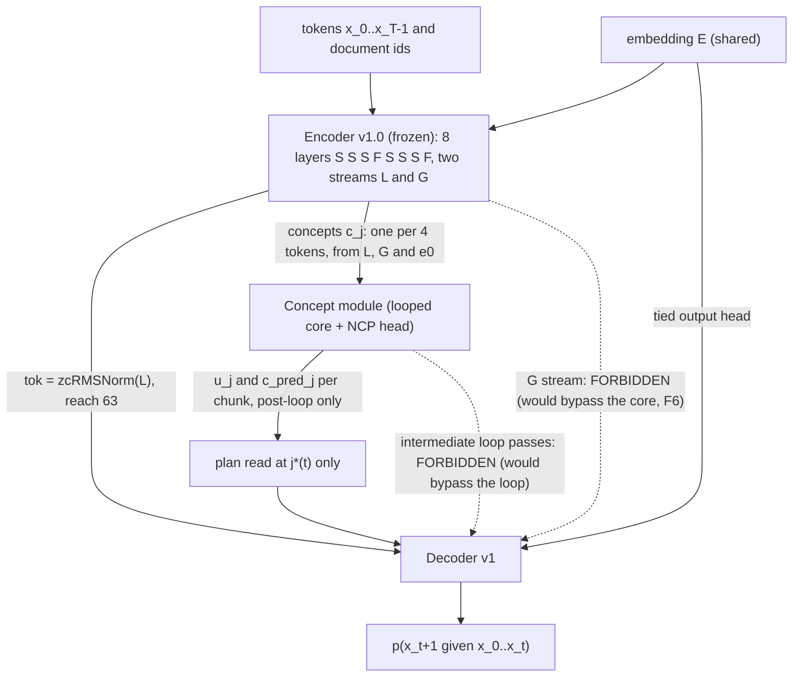
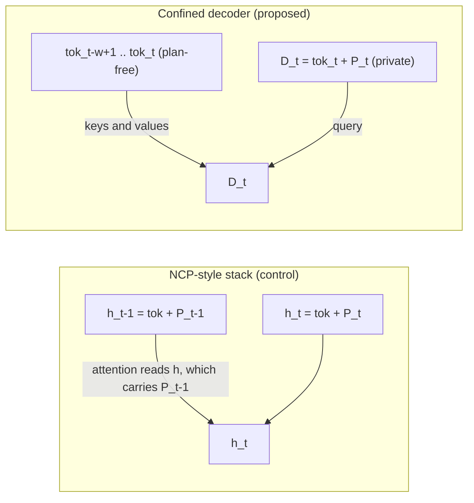
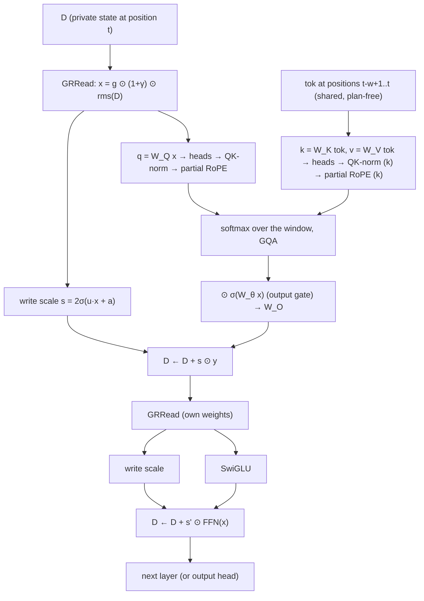
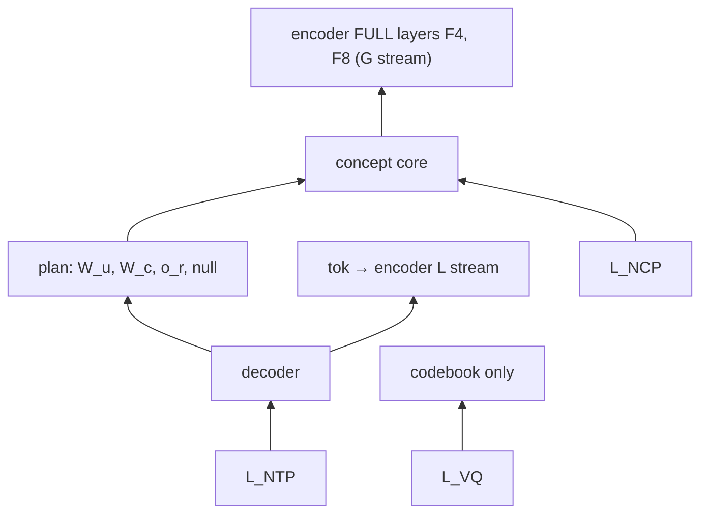

# HRM THINKER — Decoder v1 · From first principles to a tested specification

*Written 2026-09-27. Status: **design candidate** (not frozen; the open decisions are in §20). Target: MacBook Air M2, 16 GB, PyTorch on MPS; scale path to frontier size in §19. The reference implementation is Appendix A (`hrm_decoder.py`). Every test in §14 passes. If prose and code ever disagree, the code and its tests win, and the disagreement is a bug in this document.*

---

## 0. How to read this document

- **§1** gives the whole decoder in one paragraph, **§2** shows where it sits in HRM THINKER and what it may touch.
- **§3 to §11 are the derivation**, one decision per step. Each step asks one question, answers it from what we already know (the frozen encoder, the concept module's contract and the measured failures F1–F7), writes the equation with every symbol unpacked, gives the geometric picture, and ends with the decision.
- **§12** lists what was deliberately left out, **§13** is the full forward pass with shapes, **§14** the unit tests, **§15** the end-to-end experiment, **§16** cost, **§17** initialisation, **§18** pitfalls, **§19** scale path, **§20** open decisions and gates.
- **§21** is the first-principles review of this document, done after it was written.
- **Appendix A** is the complete reference code; **Appendix B** says how to run everything.

### Notation (used everywhere below)

| symbol | meaning | M2 value |
|---|---|---|
| $B, T$ | batch size, row length (tokens) | 4, 1024 |
| $t$ | token position, counted from 0 | – |
| $x_t$ | the token id at position $t$ | – |
| $k$ | chunk size (tokens per concept) | 4 |
| $j$ | chunk index; chunk $j$ holds tokens $4j,\dots,4j+3$ | – |
| $M = T/k$ | concepts per row | 256 |
| $d$, $d_c$ | decoder width, concept width | 512, 512 |
| $V$ | vocabulary size | 8192 |
| $H, H_k, d_h$ | query heads, key/value heads, head dim | 8, 2, 64 |
| $d_{ff}$ | SwiGLU hidden width | 1408 |
| $w$ | decoder attention window (keys $t-w+1\dots t$) | 8 |
| $L_{dec}$ | decoder layers | 4 |
| $\mathrm{rms}(x)$ | $x/\sqrt{\tfrac1d\sum_i x_i^2+\varepsilon}$, $\varepsilon=10^{-6}$; output has RMS 1, i.e. length $\sqrt d$ | – |
| $\mathrm{zcRMSNorm}(x)$ | $(1+\gamma)\odot\mathrm{rms}(x)$, $\gamma$ starts at 0 and is weight-decayed | – |
| $\sigma$, $\odot$ | logistic sigmoid, elementwise product | – |
| `tok` | the encoder's token output, $\mathrm{zcRMSNorm}(L)$, reach 63 | $(B,T,d)$ |
| $c_j$ | the encoder's concept for chunk $j$ (`c_hat` in the code), on the sphere of radius $\sqrt{d_c}$ | $(B,M,d_c)$ |
| $u_j$ | the concept module's output state for chunk $j$ (after its last loop pass) | $(B,M,d_c)$ |
| $\hat c_j$ | the concept module's NCP prediction of $c_{j+1}$, made at chunk $j$ (`c_pred` in the code) | $(B,M,d_c)$ |
| $E$ | the token embedding matrix (shared with the encoder) | $(V,d)$ |

---

## 1. The decoder in one paragraph

The decoder turns two inputs into the next-token distribution: `tok`, which knows the last 63 tokens exactly, and one **plan** vector per position, built from the concept module's output for the newest chunk that has already been completely read. The plan is added into a **private per-position state** $D_t$. Each of the $L_{dec}$ layers asks a question with $D_t$ (the attention query) and answers it by looking at the last $w$ tokens of `tok` (the keys and values), then refines $D_t$ with a feed-forward network. Because keys and values come **only** from `tok`, no position ever reads another position's $D$, so **each position sees only its own plan**, and the decoder's reach is $63+(w-1)=70$ tokens **whatever its depth**. Everything older than 70 tokens can reach the prediction only through the concept module. That is the guarantee that the earlier architectures lacked (F6, F7).

---

## 2. Where the decoder sits, and what it may touch

### 2.1 The whole model



### 2.2 Interface contract

**Inputs** (nothing else may enter the decoder):

| name | shape | meaning |
|---|---|---|
| `tok` | $(B,T,d)$ | encoder token stream; `tok[:, t]` depends only on $x_{t-63..t}$ of the same document |
| `u` | $(B,M,d_c)$ | concept state per chunk, after the last loop pass |
| `c_pred` | $(B,M,d_c)$ | NCP prediction $\hat c$ made at each chunk (about the next chunk) |
| `doc` | $(B,T)$ | document id per position; documents are padded to multiples of 4 |
| `E` | $(V,d)$ | embedding matrix, used as the output head |

**Outputs:** `logits` $(B,T,V)$ where `logits[:, t]` scores $x_{t+1}$; auxiliary `h` $(B,T,d)$ (the pre-logit state, used by the optional NextLat loss) and `P` $(B,T,d)$ (the plan, for tests).

**Rules the decoder obeys** (R1–R6 are inherited from the encoder spec §4.3; R7 is derived in §7):

| # | rule | why |
|---|---|---|
| R1 | read `tok` (the L stream) only; never G | G has unbounded reach; reading it recreates F6 |
| R2 | position $t$ reads the core only at chunk $j^*(t)$ (§4) | any later chunk contains $x_{t+1}$ |
| R3 | read only post-loop core outputs $u$, $\hat c$ | an intermediate pass would bypass the rest of the loop |
| R4 | no attention beyond a bounded window over tokens | its reach adds to the 63 of `tok` |
| R5 | the plan's route cannot be switched off (no saturating gate on it) | it is the only long-range route |
| R6 | the null plan wherever chunk $j^*(t)$ does not exist or belongs to another document | otherwise packed documents leak into each other |
| R7 | **no position reads another position's plan** (confinement) | otherwise the decoder composes over concepts and the core's recurrence goes unused (F7) |

---

## 3. Step 1 — What job is left for the decoder?

### 3.1 Start from the objective

The model is trained by next-token prediction: at every position $t$ it must output a distribution $p(x_{t+1}\mid x_{0..t})$ and pay $-\log p(\text{true } x_{t+1})$. Split the past into two parts: the **near** past $N_t = x_{t-70..t}$ (the tokens the decoder will be able to see directly: reach 70, §7) and the **far** past $F_t = x_{0..t-71}$. The chain rule of mutual information says

$$I(x_{t+1};\,x_{0..t}) \;=\; \underbrace{I(x_{t+1};\,N_t)}_{\text{what the near past tells}} \;+\; \underbrace{I(x_{t+1};\,F_t \mid N_t)}_{\text{what only the far past adds}}.$$

- $I(a;b)$ is the mutual information: how many nats of uncertainty about $a$ disappear once $b$ is known.
- The first term can be captured through `tok`, which holds the near past.
- The second term (a name introduced 300 tokens ago, the value bound to a key, the state of a long computation) can only be captured through the **plan**, because nothing else in the decoder's input depends on $F_t$.

So the decoder's job is to **combine** a detailed picture of the last ~70 tokens with a compressed message from the concept module about everything, and turn the pair into one distribution over 8192 tokens.

### 3.2 The use principle decides what the decoder must *not* be able to do

The failure ledger (F1–F7) is one rule seen from different distances: **a module is used only if the rest of the network cannot reach the loss without it.** Two measured cases fix the decoder's boundaries:

- **F6 (HRM-NCP):** the decoder had full-attention layers and read the encoder's global stream. Switching the core's plan off cost +0.015 nats; switching the decoder's own long-range path off cost +4.29. The core was healthy and unread.
- **F7 (IHN):** the decoder was bounded but cross-attended to *all* past core states. It composed concepts itself, and a model with the recurrence removed tied at 0.65× the FLOPs.

So the decoder must (a) see the far past **only** through the plan, and (b) not be able to **combine several plans**. §6 enforces (a), §7 enforces (b).

### 3.3 The unrolling problem

The concept module speaks once per 4 tokens; the decoder must speak once per token. So a single plan must be **unrolled** into up to 4 tokens: the decoder at each position must work out *which* token of the planned chunk comes next, given what has already been written. §4 shows that the plan read at position $t$ is always about the chunk containing $x_{t+1}$, and §5 gives the decoder the one extra number it needs for this: its offset inside that chunk.

**Decision 1.** The decoder is a local combiner: input = `tok` (near past) + one plan (far past, compressed); output = next-token distribution. It must not see the far past any other way, and it must not combine plans.

---

## 4. Step 2 — When may position $t$ read the core? (the concept shift)

### 4.1 The derivation

Chunk $j$ holds tokens $4j,4j+1,4j+2,4j+3$. The concept module's output $u_j$ is computed from the concept of chunk $j$ and all earlier concepts, so $u_j$ **depends on token $4j+3$**; it exists only once that token has been read.

Position $t$ predicts $x_{t+1}$, so it may use $u_j$ only if $u_j$ contains nothing from $x_{t+1}$ or later:

$$4j+3 \;\le\; t \quad\Longleftrightarrow\quad j \;\le\; \frac{t-3}{4}.$$

The newest usable chunk is the largest such integer:

$$\boxed{\,j^*(t) \;=\; \Big\lfloor \tfrac{t-3}{4}\Big\rfloor \;=\; \Big\lfloor \tfrac{t+1}{4}\Big\rfloor - 1\,}$$

(the two floors are equal because $\frac{t-3}{4} = \frac{t+1}{4}-1$).

**What does $u_{j^*}$ talk about?** Its NCP head predicts chunk $j^*+1 = \lfloor (t+1)/4\rfloor$. And $x_{t+1}$ lies in chunk $\lfloor (t+1)/4\rfloor$. So **the plan read at position $t$ is always about exactly the chunk that contains the token being predicted.** The shift is not a convention; it is the latest legal read, and it happens to be perfectly aligned with the target.

### 4.2 The four positions of one chunk

The four positions that predict the tokens of chunk $n$ (tokens $4n..4n+3$), plus the next one:

| position $t$ | predicts | chunk of the target | $j^*(t)$ | plan is about chunk | offset $r(t)$ | tokens of the target chunk already written |
|---|---|---|---|---|---|---|
| $4n-1$ | $x_{4n}$ | $n$ | $n-1$ | $n$ ✓ | 0 | none |
| $4n$ | $x_{4n+1}$ | $n$ | $n-1$ | $n$ ✓ | 1 | $x_{4n}$ |
| $4n+1$ | $x_{4n+2}$ | $n$ | $n-1$ | $n$ ✓ | 2 | $x_{4n},x_{4n+1}$ |
| $4n+2$ | $x_{4n+3}$ | $n$ | $n-1$ | $n$ ✓ | 3 | $x_{4n..4n+2}$ |
| $4n+3$ | $x_{4n+4}$ | $n+1$ | $n$ | $n+1$ ✓ | 0 | none |

Two facts fall out of the table:

- **The offset** of $x_{t+1}$ inside its chunk is $r(t) = (t+1) - 4\lfloor (t+1)/4\rfloor = (t+1)\bmod 4$.
- **Staleness equals offset.** The plan covers tokens up to $4j^*+3$, so the tokens the plan has *not* seen are $x_{4j^*+4..t}$: that is $t-4j^*-3 = r(t)$ tokens, exactly the target chunk's tokens already written. They are all inside the decoder's window (§9 requires $w\ge k$), so the decoder always has in view precisely what the plan is missing.

### 4.3 The version NCP-style code usually writes, and why it is worse

The simple form "every token of chunk $n$ reads $u_{n-1}$" (used in our encoder harness) agrees with $j^*(t)$ at three positions out of four. At the fourth, $t=4n+3$, it hands the decoder a plan about chunk $n$ (already fully read) while the plan about chunk $n+1$ is legal and available. That position is the **first token of every new chunk**, the one the plan was built to predict. The target-aligned read fixes this at no cost.

### 4.4 Documents and the null plan

Rows are packed with several documents, each padded to a multiple of 4 tokens, so no chunk straddles two documents. A document starting at $s$ (a multiple of 4): positions $s,s+1,s+2$ have $j^*=s/4-1$, a chunk of the **previous** document; position $s+3$ has $j^*=s/4$, the document's own first chunk. So the rule is:

$$\text{valid}(t) = \big[j^*(t)\ge 0\big]\ \wedge\ \big[\text{doc}_{4j^*(t)} = \text{doc}_t\big],$$

and wherever it is false the decoder reads a learned **null plan** instead. That is exactly the first 3 tokens of every document (test D3).

**Inference consequence.** At $t=4j+3$ the core must already have processed chunk $j$ before $x_{4j+4}$ can be predicted. So at generation time the concept module runs once every 4 tokens, on the critical path, right after the last token of each chunk.

**Decision 2.** Position $t$ reads $(u_{j^*(t)},\hat c_{j^*(t)})$ with $j^*(t)=\lfloor (t+1)/4\rfloor-1$, or the null plan where invalid.

---

## 5. Step 3 — What exactly is read: the plan vector

### 5.1 The equation

$$\boxed{\,P_t \;=\; \begin{cases} W_u\,u_{j^*(t)} + W_c\,\hat c_{j^*(t)} + o_{r(t)} & \text{if valid}(t)\\[2pt] p_{\text{null}} + o_{r(t)} & \text{otherwise}\end{cases}\,}$$

| symbol | shape | init | meaning |
|---|---|---|---|
| $u_{j^*}$ | $d_c$ | – | the core's continuous state for chunk $j^*$ (RMS 1) |
| $\hat c_{j^*}$ | $d_c$ | – | the core's prediction of chunk $j^*+1$: $\sum_n \pi_n\,\mathrm{sg}(e_n)$ per code segment |
| $W_u, W_c$ | $d\times d_c$, no bias | PyTorch default | map concept space into decoder space |
| $o_r$, $r\in\{0,1,2,3\}$ | $d$ each | 0 | which token of the target chunk is being predicted |
| $p_{\text{null}}$ | $d$ | $\mathcal N(0,1)$ (RMS ≈ 1) | "there is no plan yet" |
| $P_t$ | $d$ | – | the plan seen by position $t$ |

The linear maps are applied **once per chunk** ($W_u u$ and $W_c \hat c$ have shape $(B,M,d)$) and then gathered to positions, so their cost is $1/4$ of a per-token map.

### 5.2 Why two vectors, $u$ and $\hat c$

- $u$ is the rich continuous state: it can carry anything the core computed. In the end-to-end test it carried the answer (switching $u$ off dropped the answers to chance, §15).
- $\hat c$ is the core's *discrete* statement about the next chunk, a mixture of codebook vectors. It is the handle through which the concept vocabulary can be steered without touching weights (NCP's VQ-only adaptation), and through which XM's $K$ candidates differ. In our tests the proposed decoder barely used it (switching it off cost 0–1 point of exact match; it mattered more, up to 20 points, only in the rejected read arm). It costs one $512\times512$ matrix; whether to keep it is open decision O3 (§20).

### 5.3 Why the offset $o_r$ is *necessary* (not a nicety)

The same plan serves four positions (§4.2). To emit the right token, position $t$ must know $r(t)$. Where could it get it?

1. **From `tok`?** The encoder uses only relative positions (RoPE inside the window, causal convolutions, n-gram hashes, NoPE in the FULL layers). Far from a document start, shifting the text by one position shifts `tok` by one position and changes nothing else. So `tok` carries **no information about $t \bmod 4$**. Measured on a randomised encoder in float64: two rows with the same text, one shifted by a single position, give token states that differ by at most $1.2\times10^{-5}$ beyond position 64 (the float32 rounding of RoPE's angle tables), against $4.3$ near the document start, where the start acts as an anchor.
2. **From neighbouring plans?** In a plain stack a position could see where the plan changes and infer its phase. The confined decoder (§7) forbids reading any other position's plan.

So without $o_r$ the confined decoder would be *unable* to tell offset 0 from offset 3 in running text. $o_r$ supplies exactly the missing $\log_2 4 = 2$ bits.

### 5.4 Geometric picture

Think of $d$-dimensional space. $W_u$ and $W_c$ project the core's message into the decoder's space; the four offsets are four fixed translation vectors. Adding $o_r$ moves the same plan into one of four "slots", so a later linear read (an attention query, an FFN row) can respond to "plan + slot 2" differently from "plan + slot 0". The null plan is one fixed point in the space that means "no information from the core yet". At initialisation $\lVert W_u u\rVert_{\text{RMS}}\approx 0.58$ against $1.0$ for `tok` (measured), so the plan enters as a substantial but not dominant part of $D^{(0)}$.

**Decision 3.** $P_t = W_u u_{j^*}+W_c\hat c_{j^*}+o_{r(t)}$, null plan where invalid.

---

## 6. Step 4 — Which token mixer? (derived from reach)

### 6.1 Reach

The **reach** of a state at position $t$ is the largest $r$ such that changing $x_{t-r}$ can change that state (within one document). Along a chain of computations reaches **add**; where branches merge, take the **maximum**. The encoder guarantees reach$(\texttt{tok})=63$. Whatever the decoder adds is the "shell reach": everything beyond it must come through the core.

### 6.2 Three candidates

**Full causal attention.** Position $t$ attends to every $j\le t$. Reach $=t$: the whole past. This is F6.

**Linear attention / state-space layers** (GDN, Mamba, RetNet). The state is a running memory

$$S_t = \alpha_t\,S_{t-1} + k_t v_t^{\top},\qquad \alpha_t\in(0,1],$$

where $k_t v_t^\top$ writes token $t$'s key–value pair into a $d_k\times d_v$ matrix and $\alpha_t$ is a learned decay. Unrolling the recursion $t-j$ times:

$$S_t = \sum_{j\le t}\Big(\prod_{i=j+1}^{t}\alpha_i\Big)\,k_j v_j^\top .$$

Every past token keeps a weight $\prod\alpha_i>0$, and the model can learn $\alpha\approx1$. So the reach is again the whole past: a compressed bypass, but a bypass. Bounding it would need a hard reset every $w$ tokens, which is a worse version of the next option.

**Sliding-window attention (SWA)** with window $w$: position $t$ attends only to $j\in[t-w+1,t]$. It adds exactly $w-1$ to the reach of whatever it reads. Bounded, exact, and a local copy mechanism (it can fetch a specific recent token).

**Decision 4.** The decoder mixes tokens only with sliding-window attention. (Linear attention remains a candidate *inside the concept module* at scale, where long reach is the point.)

---

## 7. Step 5 — The hidden leak in a plain SWA stack, and plan confinement

### 7.1 The leak

The natural NCP-style decoder adds the plan to the token state and runs a stack of SWA layers:

$$h^{(0)}_t = \texttt{tok}_t + P_t,\qquad h^{(\ell)} = \mathrm{Layer}_\ell\big(h^{(\ell-1)}\big),\ \ \ell=1..L.$$

Layer $\ell$ at position $t$ reads $h^{(\ell-1)}$ at positions $t-w+1..t$ (and, with the encoder's kernel-4 convolutions on $q,k,v$, three more), so each layer adds $(w-1)+(4-1)=10$ positions. After $L$ layers position $t$ has read $h$ at positions $t-10L..t$, and **each of those carries its own plan**. Those positions read chunks $j^*(t-10L)..j^*(t)$, i.e. about $10L/4+1$ different plans:

| stack depth $L$ | reach added | distinct plans visible at one position |
|---|---|---|
| 1 | 10 | ~3 |
| 2 | 20 | ~6 |
| 4 | 40 | ~11 |

Each plan $u_j$ contains what the core retrieved from far away. A decoder that sees 11 of them can *combine* them: a miniature of IHN's F7, where the decoder's cross-attention over past core states did the composing and the recurrence was left idle. (Test D2 measures it: in a 3-layer stack, changing one chunk's plan changes 34 positions, 4 of its own and 30 later ones.)

### 7.2 The fix: two kinds of state

Separate what is **shared** between positions from what is **private** to a position:

- **`tok`** is shared and plan-free. Every position may read it within the window.
- **$D_t$** is private: it starts as $D^{(0)}_t=\texttt{tok}_t+P_t$ and is only ever read at position $t$.

In every attention layer the **query** comes from $D_t$ (it knows the plan, so it can ask a plan-directed question: "where in the last 8 tokens is the name the plan refers to?"), while **keys and values come from `tok`** (so the answer is plain local text, never another position's plan):

$$q_t = W_Q\,x_t,\ \ x_t=\mathrm{GRRead}(D_t);\qquad k_j = W_K\,\texttt{tok}_j,\quad v_j = W_V\,\texttt{tok}_j,\ \ j\in[t-w+1,t].$$

It differs from the NCP-style stack in exactly one place: **where keys and values come from.**

### 7.3 Proof of confinement and of the reach formula

**Claim.** After any number of layers $\ell$, $D^{(\ell)}_t$ is a function of $P_t$ and $\texttt{tok}_{t-w+1..t}$ only.

**Proof by induction on $\ell$.**
- *Base:* $D^{(0)}_t = \texttt{tok}_t + P_t$. ✓
- *Step:* layer $\ell$ computes, at position $t$: the read $x_t$ from $D^{(\ell-1)}_t$ (same position); the query from $x_t$; keys and values from $\texttt{tok}_{t-w+1..t}$; the attention output, the write scale and the FFN from $x_t$ and $D_t$ (same position). No term involves $D$ or $P$ at any other position. So $D^{(\ell)}_t$ depends on $D^{(\ell-1)}_t$ (a function of $P_t,\texttt{tok}_{t-w+1..t}$ by hypothesis) and on $\texttt{tok}_{t-w+1..t}$. ✓ ∎

**Consequence 1 (R7, confinement):** position $t$ sees exactly one plan, $P_t$. Changing chunk $j$'s plan changes exactly the four positions $4j+3..4j+6$ (test D2, bit-exact).

**Consequence 2 (reach independent of depth):** with the core switched off, $D_t$ depends on $\texttt{tok}_{t-w+1..t}$, and `tok` at position $t-w+1$ reaches back 63 more tokens:

$$\boxed{\ \text{reach} = 63 + (w-1) = 70\ \ \text{for } w=8,\ \text{at any } L_{dec}\ }$$

against $63 + 10\,L_{dec}$ for the stack. Depth can be chosen for capacity alone (test D1 at depths 1, 2 and 6; test P2 through the real encoder at depth 3; both bit-exact).

### 7.4 What confinement costs

Positions no longer share decoder computation: position $t$ cannot reuse work done at $t-1$ while spelling out the same plan; it recomputes from its own plan, its offset and the local tokens. Measured (§15): on the 3-token carry task the confined decoder was slightly slower early (exact 0.68 / 0.67 at step 500 vs 0.72 / 0.73 for the stack, two seeds) and equal by step 1,000 (0.969 / 0.984 for both), with total next-token loss within 0.004 nats. Whether the slower start is *caused* by the lost sharing was not isolated.



**Decision 5.** Confined decoder: private $D_t$, queries from $D_t$, keys/values from `tok` only.

---

## 8. Step 6 — How the plan enters $D$: an ungated add

### 8.1 Two ways to put $P_t$ into position $t$

- **(a) Add:** $D^{(0)}_t = \texttt{tok}_t + P_t$ (NCP's own injection, ungated).
- **(b) Separate read-only stream:** keep $D^{(0)}_t=\texttt{tok}_t$ and let every sublayer read $\{D_t,P_t\}$ through the gated-residual read, with the plan's gate floored, $g_P = 0.5+0.5\,\sigma(\cdot)\in(0.5,1)$.

Both are confined (only position $t$ reads $P_t$), both pass every exact test.

### 8.2 "Cannot be switched off" — what it really means

Rule R5 exists because a **saturating gate** can close a route in a way training cannot reopen. For $g=\sigma(z)$, $\partial g/\partial z=\sigma(z)(1-\sigma(z))\to0$ as $z\to-\infty$: once closed, the gradient that could reopen it vanishes. Option (a) has no gate on the plan. The only thing between $u$ and $D$ is the linear map $W_u$, whose gradient $\partial\mathcal L/\partial W_u = (\partial\mathcal L/\partial P)\,u^\top$ does **not** shrink when $W_u$ is small. So (a) satisfies R5 by construction, with nothing to tune. Option (b) needs the floor to satisfy it.

### 8.3 The measurement decides

On the 3-token carry task (§15), two seeds each:

| injection | seed 0 | seed 1 |
|---|---|---|
| (a) add | exact 0.969 | exact 0.984 |
| (b) separate stream, floored gate | exact 1.000 | **0.000** (at chance for all 1,000 steps) |

(b) learned in one seed out of two. A plausible reason (not isolated): in (b) the plan only ever enters through normalised reads that average it with $D$, whereas in (a) it sits in the residual stream at full strength from layer 1.

**Decision 6.** $D^{(0)}_t=\texttt{tok}_t+P_t$, ungated. (b) stays in the code as `plan_in="read"` only to reproduce the rejected runs.

---

## 9. Step 7 — The decoder layer, equation by equation

Each layer has two sublayers, attention then FFN, each doing **read → compute → write** in the gated-residual grammar the encoder and the concept module already use.



### 9.1 Read

$$n = \mathrm{rms}(D_t),\qquad g = \sigma\big(W_{\uparrow}W_{\downarrow}\,n + b\big),\qquad x_t = g\odot(1+\gamma)\odot n .$$

| symbol | shape | init | meaning |
|---|---|---|---|
| $W_{\downarrow}$ | $d\to r$, $r=32$, no bias | default | low-rank down-projection (`V` in the code) |
| $W_{\uparrow}$ | $r\to d$, with bias $b$ | weight 0, $b=+2$ | so $g=\sigma(2)=0.881$ exactly at init (`U` in the code) |
| $\gamma$ | $d$ | 0 | zero-centred gain (weight-decayed) |

Geometry: $\mathrm{rms}$ puts $D_t$ on the sphere of radius $\sqrt d$ (so the sublayer's input scale never drifts with depth); $g$ is a per-channel, per-token "how much of each coordinate to look at" in $(0,1)$.

### 9.2 Attention (queries from $D$, keys/values from `tok`)

1. **Projections** (no bias):
   $q = x W_Q\in\mathbb R^{H d_h}$ (from the private read), $k=\texttt{tok}\,W_K\in\mathbb R^{H_k d_h}$, $v=\texttt{tok}\,W_V\in\mathbb R^{H_k d_h}$. At M2: 512, 128, 128 channels.
2. **Heads:** reshape to $H=8$ query heads and $H_k=2$ key/value heads of $d_h=64$.
3. **QK-norm:** $q\leftarrow\mathrm{zcRMSNorm}(q)$, $k\leftarrow\mathrm{zcRMSNorm}(k)$ per head. Every query and key then has length $\approx\sqrt{d_h}$, which bounds the logits and keeps attention stable.
4. **Partial RoPE** on the first 16 of the 64 dimensions of each head, in pairs $(a_i, b_i)=(\text{dim } i,\ \text{dim } i{+}8)$, $i<8$, frequency $\theta_i=10000^{-i/8}$:
   $$\begin{pmatrix}a'\\ b'\end{pmatrix}=\begin{pmatrix}\cos t\theta_i & -\sin t\theta_i\\ \sin t\theta_i&\cos t\theta_i\end{pmatrix}\begin{pmatrix}a\\ b\end{pmatrix}.$$
   Why it gives *relative* position: writing $R(\phi)$ for the rotation, $\langle R(t\theta)q,\,R(j\theta)k\rangle = q^\top R(t\theta)^\top R(j\theta)k = q^\top R\big((j-t)\theta\big)k$, which depends only on $j-t$. Inside an 8-token window the decoder can therefore say "the token 3 back". The other 48 dimensions match on content alone.
5. **No temperature is needed.** After QK-norm the largest logit is $q\cdot k/\sqrt{d_h}\approx\sqrt{d_h}=8$. If one key has logit $\Delta$ above the other $N-1$, its probability is $p=e^{\Delta}/(e^{\Delta}+N-1)$, so it needs $\Delta=\ln(N-1)+\ln\frac p{1-p}$; for $N=w=8$, $p=0.9$: $\Delta=1.95+2.20=4.14$, well inside the reachable range (logits span $-8..8$). (The encoder's FULL layers needed a learned temperature because their $N$ is up to 128k.)
6. **GQA:** each key/value head is shared by $H/H_k=4$ query heads.
7. **Masked softmax** (boolean mask, True = may attend: $j\le t$, $t-j<w$, $\text{doc}_j=\text{doc}_t$; every row contains $j=t$, so no row is empty):
   $$a_t=\sum_{j=t-w+1}^{t}\mathrm{softmax}_j\!\Big(\frac{q_t\cdot k_j}{\sqrt{d_h}}\Big)\,v_j .$$
8. **Output gate and projection:** $y_t = W_O\big(a_t\odot\sigma(x_t W_\theta)\big)$, $W_\theta\in\mathbb R^{d\times Hd_h}$. The gate lets a head return ≈0 when the window holds nothing useful, which removes any need for attention sinks (a sink would leak the document's first tokens into every position).

### 9.3 Write

$$s_t = 2\,\sigma(u^\top x_t + a)\in(0,2),\qquad D_t \leftarrow D_t + s_t\,y_t,$$

with $u$, $a$ initialised to 0, so $s=1$ exactly at init: every layer starts as a plain residual block.

### 9.4 FFN (SwiGLU), with its own read and write

$$x=\mathrm{GRRead}'(D_t),\qquad \mathrm{FFN}(x)=W_2\big(\mathrm{SiLU}(xW_1)\odot xW_3\big),\qquad D_t\leftarrow D_t+s'_t\,\mathrm{FFN}(x),$$

with $\mathrm{SiLU}(z)=z\,\sigma(z)$, $W_1,W_3\in\mathbb R^{512\times1408}$, $W_2\in\mathbb R^{1408\times512}$. The product of two linear views of $x$ makes the FFN quadratic in its input, which is exactly what lets it multiply "which slot" ($o_r$) by "what the plan says" ($W_uu$): the unrolling of §3.3 happens here and in the plan-directed query.

### 9.5 Two things the layer does *not* have, and why

- **No short convolutions** (the encoder has them on $q,k,v$). A convolution on the query would mix $D_{t-3..t}$, i.e. read neighbours' plans (breaks R7). On keys/values it would only add 3 to the reach: `tok` already carries 63 tokens of context, so there is nothing for it to add.
- **No depth routing** (IRC, Kimi AttnRes, Delta AttnRes). They fix dilution in deep stacks (each of $L$ residual writes is ~$1/L$ of the stream); at $L_{dec}=4$ there is little to fix, and every such router we measured was inert (F2: +0.0005 to +0.008 nats).

### 9.6 Window size

Two bounds: $w\ge k=4$, so that the $r(t)\le3$ already-written tokens of the target chunk are exactly retrievable (§4.2); and $w$ small, because it adds $w-1$ to the shell reach, which must stay far below the distances the long-range evaluations use. $w=8$ matches the encoder's window. It was not tuned.

**Decision 7.** $L_{dec}$ layers of [GR read → plan-directed SWA over `tok` → gated write → GR read → SwiGLU → gated write]; $w=8$, $L_{dec}=4$ at M2.

---

## 10. Step 8 — The output head

$$h_t=\mathrm{zcRMSNorm}\big(D^{(L_{dec})}_t\big),\qquad \text{logits}_t = h_t\,E^\top\in\mathbb R^V .$$

- **Tied:** the output head is the encoder's embedding matrix (saves $V\cdot d=4.19$M parameters and puts inputs and outputs in one space).
- **Scale at initialisation, derived.** $h_t$ has RMS 1 in each of $d$ coordinates and $E_{v,i}\sim\mathcal N(0,0.02^2)$, so each logit $h_t\cdot E_v=\sum_i h_{t,i}E_{v,i}$ has standard deviation $\sigma_\ell=0.02\sqrt d=0.453$ (measured 0.4525). For random logits of spread $\sigma_\ell$ the expected loss is $\mathbb E[\log\sum_v e^{\ell_v}]-\mathbb E[\ell_{\text{true}}]\approx\ln V+\sigma_\ell^2/2 = 9.011+0.103=9.11$ nats (measured 9.16). The model starts essentially at the uniform guess, as it should.

---

## 11. Step 9 — The objective, and where every gradient lands

### 11.1 The loss

$$\mathcal L = \underbrace{\mathcal L_{\text{NTP}}}_{\text{next token}} + \alpha\,\underbrace{\mathcal L_{\text{NCP}}}_{\text{next concept}} + \beta\,\underbrace{\mathcal L_{\text{VQ}}}_{\text{codebook}}\ \Big(+\ \lambda_h\,\mathcal L_h+\lambda_{KL}\,\mathcal L_{KL}\Big)_{\text{optional NextLat}}$$

- $\mathcal L_{\text{NTP}} = -\frac1{N}\sum_t\log\mathrm{softmax}(\text{logits}_t)[x_{t+1}]$, over positions whose target is in the same document.
- $\mathcal L_{\text{NCP}}$ (concept module): cross-entropy of each code segment's distribution at chunk $m$ against the code indices of the **encoder's** next concept, $\mathrm{sg}(c_{m+1})$ (not the prediction $\hat c$); $\alpha=0.1$.
- $\mathcal L_{\text{VQ}}=\lVert\mathrm{sg}(c_m)-e\rVert^2$ (per segment, $e$ the nearest code) trains only the codebook; because only the codebook sees it and Adam is scale-free, $\beta$ does not matter (1 by default).

### 11.2 Gradient routing (verified in tests P4 and D5)

| loss | reaches | never reaches |
|---|---|---|
| NTP | decoder, $W_u$, $W_c$, offsets, null plan, $E$; the core **through the plan**; the encoder's L stream through `tok`; the encoder's FULL layers F4/F8 **only through the path plan → core → the encoder's concepts $c$** | the codebook |
| NCP | the core; the encoder through earlier concepts (target is stop-gradient) | the codebook |
| VQ | the codebook | everything else |
| NextLat | its dynamics network $\psi$, the decoder and (through $h$) the plan and core | $E$ (the head is frozen inside the KL) |

With the core switched off, NTP sends exactly zero gradient into F4 and F8 (test P4): the only way the global stream can learn from next-token prediction is to be useful to the core.



### 11.3 NextLat: why it is optional

NextLat (Teoh et al., 2025) trains a small network $\psi$ to predict the next pre-logit state: $\hat h_{t+1}=h_t+f_\psi(\mathrm{LN}[h_t;\,\mathrm{rms}(E x_{t+1})])$, with $\mathcal L_h=\mathrm{SmoothL1}(\mathrm{sg}[h_{t+1}],\hat h_{t+1})$ and $\mathcal L_{KL}=\mathrm{KL}\big(p(\cdot\mid\mathrm{sg}\,h_{t+1})\,\|\,p(\cdot\mid\hat h_{t+1})\big)$ through a frozen head. Its argument: if the head reads the next-token distribution off $h_t$, and $h_{t+1}$ is a function of $(h_t,x_{t+1})$, then $h_t$ determines the whole future (sample a token, update, repeat), so $h_t$ is a **belief state**. In our decoder $h_t$ sees the far past only through the plan, so NextLat's pressure lands on the plan; and it cannot open a bypass, because the reach bound is structural.

Measured here (§15): no speed-up and 0.014–0.019 nats worse loss on the carry task; the paper itself reports about +0.03 nats (FineWeb-Edu and WikiText perplexity) at 1.3B with gains on planning tasks, which our test tasks do not contain. **It stays an optional arm** for the M2 run, judged on hop tasks and language.

**Decision 8.** $\mathcal L=\mathcal L_{\text{NTP}}+0.1\,\mathcal L_{\text{NCP}}+\mathcal L_{\text{VQ}}$; NextLat off by default.

---

## 12. What was deliberately left out

| candidate | why not |
|---|---|
| FULL or linear attention in the decoder | unbounded reach (§6) |
| attention over past core states (IHN, CED-style) | composes concepts in the decoder (F7) |
| short convolutions on $q,k,v$ | on $q$ it reads neighbours' plans; on $k,v$ it adds nothing `tok` lacks (§9.5) |
| IRC / Kimi AttnRes / Delta AttnRes / CDR | little dilution at 4 layers; measured inert (F2) |
| CRC from the encoder's depths into the decoder | `tok` is already the sum of every L-stream write; reading G is forbidden |
| the plan as a separate floored stream | learned in 1 of 2 seeds (§8) |
| a gate or learnable gain on the plan | a saturating gate can close the only long-range route (R5) |
| HiLP's abstract latent | our concept module *is* that latent, on the forward path |
| GLU-cross fusion of plan and state | SwiGLU already multiplies them |
| a decoder Engram | the encoder's Engram already writes into `tok` |
| per-head temperature | 8 keys need a gap of 4.1, inside the reachable range (§9.2) |

---

## 13. The full forward pass, with shapes (M2: $B=4$, $T=1024$, $M=256$)

```python
# inputs: tok (4,1024,512), u (4,256,512), c_pred (4,256,512), doc (4,1024), E (8192,512)
t      = arange(1024)                                            # positions
j_star = (t + 1) // 4 - 1                                        # (1024,)
valid  = (j_star >= 0) & (doc[:, 4 * j_star.clamp(min=0)] == doc) # (4,1024)
r      = (t + 1) % 4                                             # (1024,)
per_chunk = W_u(u) + W_c(c_pred)                                 # (4,256,512)  once per chunk
P = where(valid, gather(per_chunk, j_star), p_null) + o[r]       # (4,1024,512)
D = tok + P                                                      # (4,1024,512)  private per position
for layer in range(4):
    x = GRRead(D)                                                # (4,1024,512)
    q = qk_norm(heads(W_Q x)); q = rope(q)                       # (4,8,1024,64)
    k = qk_norm(heads(W_K tok)); k = rope(k); v = heads(W_V tok) # (4,2,1024,64) -> repeat -> (4,8,1024,64)
    a = SDPA(q, k, v, mask = causal & window 8 & same doc)       # (4,8,1024,64) -> (4,1024,512)
    D = D + write(x) * W_O(a * sigmoid(W_theta x))               # write(x): (4,1024,1)
    x = GRRead'(D); D = D + write'(x) * SwiGLU(x)                # hidden (4,1024,1408)
h = zcRMSNorm(D)                                                 # (4,1024,512)
logits = h @ E.T                                                 # (4,1024,8192)
```

---

## 14. Verification: exact unit tests

All run in float64 on CPU with randomised parameters (so zero-initialised paths cannot hide a leak), comparing with **exact equality**. `python hrm_decoder.py` runs D1–D5; `python e2e.py --test` runs P1–P4.

| id | test | expected | result |
|---|---|---|---|
| D1 | edit `tok` at $p$; farthest changed output | $p+(w-1)=p+7$ at depths 1, 2, 6 (confined); $p+10L$ (stack) | PASS |
| D2 | edit chunk $j$'s plan; which positions change | exactly $4j+3..4j+6$ (confined); 34 positions in a 3-layer stack | PASS |
| D3 | plan index; null plan; documents | chunk $j^*$ ends $\le t$ and $j^*+1$ contains $x_{t+1}$; null exactly at each document's first 3 tokens; no plan crosses documents | PASS |
| D4 | rejected read arm: gate floor | gate $\ge0.5$ even when driven to $-10^4$; the plan still reaches the logits | PASS |
| D5 | init and gradients (M2 size) | read gate 0.881, write scale 1.000, NTP 9.16 nats; NTP reaches $u$, $\hat c$, `tok`, $W_u$, offsets, $E$; NextLat never reaches $E$ | PASS |
| P1 | whole pipeline: edit token $p$ | nothing before $p$ changes | PASS |
| P2 | core off: farthest changed output; core on | exactly $p+70$ (confined), $p+93$ (3-layer stack), bit-identical beyond; core on: the change reaches the row's end; the plan first changes at $4\lfloor p/4\rfloor+3$ | PASS |
| P3 | two documents in a row | document 1 bit-identical when document 0 is edited (encoder → core → decoder) | PASS |
| P4 | gradient routing | NTP → core and F4/F8 only via the plan (zero with the core off); NCP → core + encoder; VQ → codebook only | PASS |

Also measured for §5.3: `tok` is shift-equivariant beyond position 64 (difference $1.2\times10^{-5}$, float32 RoPE tables) and not near the document start (4.3).

---

## 15. End-to-end experiment

### 15.1 Setup

Pipeline: frozen encoder v1.0 → concept module stand-in (v2 as tested in the concept test bench: one shared FULL layer looped $R\sim\mathcal U\{1..4\}$ times, input re-read every pass, $S^0=0$, product-quantised vocabulary 16 segments × 64 codes, NCP cross-entropy; $K=1$, no XM latent) → decoder. CPU (2 cores), $d=128$, 2 decoder layers, $w=8$, AdamW (0.9, 0.95), lr $10^{-3}$, 100 warm-up steps, cosine to 10%, batch 16. Training loss: NTP + 2·(answer-position CE, a test device to speed learning) + 0.1·NCP + VQ. Every answer is farther from its evidence than the token path reaches (70 confined, 83 for the 2-layer stack), so it can **only** come through the core.

| task | layout | what it tests |
|---|---|---|
| single | 4 facts `[F k v S]`, Markov filler, 4 queries `[Q k P P][P P P v]`, $T=128$ | one-token long-range recall |
| carry | 1 fact `[k v1 v2 v3]`, filler, query `[Q k P P][P v1 v2 v3]`, $T=128$, answer ≈117 tokens away | **unrolling**: 3 tokens (32³ strings) from one plan |
| multi4 | 4 facts `[k v1 v2 v3]`, 4 queries, $T=144$ | retrieval + unrolling |

Arms: **confined** (proposed), **stack** (NCP-style control), **confined-read** (rejected, §8), **+NL** (NextLat, $d=1$, $\lambda_h=\lambda_{KL}=1$). Interventions at evaluation: *core off* (null plan everywhere), *u off* ($W_uu$ removed), *ĉ off* ($W_c\hat c$ removed), $R=1$ and $R=8$ loop passes.

### 15.2 Results (exact = all 3 value tokens right; single: value accuracy)

| run | @250 | @500 | @750 | @1000 | loss | filler loss | core off | u off | ĉ off |
|---|---|---|---|---|---|---|---|---|---|
| carry confined s0 | 0.11 | 0.68 | 0.91 | **0.969** | 1.0174 | 0.9882 | 0.000 | 0.000 | 0.961 |
| carry confined s1 | 0.04 | 0.67 | 0.86 | **0.984** | 1.0174 | 0.9913 | 0.000 | 0.000 | 0.984 |
| carry stack s0 | 0.05 | 0.72 | 0.93 | 0.969 | 1.0135 | 0.9867 | 0.000 | 0.000 | 0.969 |
| carry stack s1 | 0.02 | 0.73 | 0.92 | 0.984 | 1.0157 | 0.9889 | 0.000 | 0.000 | 0.984 |
| carry confined+NL s0 | 0.01 | 0.72 | 0.93 | 0.984 | 1.0368 | 0.9973 | 0.000 | 0.000 | 0.953 |
| carry confined+NL s1 | 0.00 | 0.60 | 0.88 | 0.953 | 1.0317 | 1.0010 | 0.000 | 0.000 | 0.938 |
| carry confined-read s0 | 0.00 | 0.52 | 0.96 | 1.000 | 1.0250 | 0.9863 | 0.000 | 0.000 | 0.805 |
| carry confined-read s1 | 0.00 | 0.00 | 0.00 | **0.000** | 1.0813 | 0.9762 | 0.000 | 0.000 | 0.000 |
| multi4 confined-read s0 | 0.00 | 0.00 | 0.00 | 0.00 (1500: 0.00) | 1.4098 | 0.9847 | 0.000 | 0.000 | 0.000 |
| multi4 stack s0 | 0.00 | 0.00 | 0.00 | 0.00 (1500: 0.00) | 1.4109 | 0.9860 | 0.000 | 0.000 | 0.000 |

Single task (500 steps, evaluated every 100; the "confined" arm of these runs was the read variant):

| run | @100 | @200 | @300 | @500 | loss | filler loss | core off | u off | ĉ off |
|---|---|---|---|---|---|---|---|---|---|
| single confined-read s0 | 0.06 | 0.93 | 1.00 | 1.00 | 1.0076 | 1.1161 | 0.000 | 0.023 | 0.998 |
| single stack s0 | 0.83 | 1.00 | 1.00 | 1.00 | 1.0035 | 1.1181 | 0.000 | 0.033 | 0.986 |

### 15.3 What the runs establish

1. **The proposed decoder unrolls a plan as well as the NCP-style stack.** Carry task, two seeds: exact 0.969 / 0.984 for both; loss difference +0.004 / +0.002 nats (inside the ±0.02 tie band); filler loss equal. The cost of confinement is a slightly slower start (0.68 / 0.67 vs 0.72 / 0.73 at step 500).
2. **The core is the only long-range route.** Switching it off drops every arm to 0 exact (single task: 0 value accuracy).
3. **$u$ carries the answer; $\hat c$ is almost unused on these tasks** (u off → 0; ĉ off → 0.96 / 0.98).
4. **The separate plan stream is unreliable** (1 of 2 seeds), which settled Decision 6.
5. **NextLat did not help here** (no faster learning; loss +0.019 / +0.014 nats; filler +0.01).
6. **$R=1$ and $R=8$ equal the trained model** on these tasks: they need a single retrieval, so they do not exercise the loop. The loop is tested by the concept module's own gates, not here.

### 15.4 The limit found upstream of the decoder

On **multi4** (four facts, each a 3-token value) both arms stayed at chance for 1,500 steps with identical accuracies, which is what two models predicting the same constant would give. Linear probes on the confined-read checkpoint locate the loss:

| probe | accuracy (chance 0.031) |
|---|---|
| fact concept → its key | 0.945 |
| fact concept → its first value token | **0.393** |
| query concept → the queried key | 1.000 |
| core output at the query chunk → value tokens 1 / 2 / 3 | 0.022 / 0.040 / 0.027 |

The key is in the concepts and the query finds its key, but the core never retrieves, and the fact concept holds its value tokens only partly. That is the concept module's retrieval plus the encoder's concept capacity (encoder gate G-E1), not the decoder. An earlier layout that put the values in the chunk *after* the key (concept-level induction) was also at chance at 750 steps.

**Caveats.** CPU, $d=128$, 1–2 seeds, synthetic tasks, a stand-in core, 1,000–1,500 steps. The runs verify mechanics, routing and unrolling; they say nothing yet about language quality. The *core off* intervention replaces every plan with the null plan, which the decoder has only seen at document starts, so the change in filler loss under it is not a skill measure (in one carry run it rose from 0.99 to 4.5).

---

## 16. Cost at the M2 size

### 16.1 Parameters (exact, read off the instantiated model)

| component | count | detail |
|---|---:|---|
| one decoder layer | 3,148,930 | $W_Q$ 262,144 · $W_K$ 65,536 · $W_V$ 65,536 · $W_O$ 262,144 · $W_\theta$ 262,144 · QK-norm 128 · SwiGLU 2,162,688 · 2 reads × 33,792 · 2 writes × 513 |
| 4 layers | 12,595,720 | |
| plan builder | 526,848 | $W_u$ 262,144 · $W_c$ 262,144 · null 512 · offsets 2,048 |
| output norm | 512 | |
| **decoder total** | **13,123,080** | output head tied to $E$ (4.19M, counted in the encoder) |
| NextLat $\psi$ (optional, training only) | 2,626,048 | |

With 8 layers the decoder is 25.72M parameters and its reach is still 70.

### 16.2 FLOPs per training token (derived)

Every weight matrix is applied once per token, so multiply-accumulates (MACs) per token per layer = the layer's matrix parameters (917,504 attention projections + 2,162,688 FFN + 65,536 reads + 1,024 writes) + attention over the window ($2\,w\,H\,d_h=8{,}192$: $QK^\top$ and $AV$) = **3,154,944**. Four layers: 12.62M; plan: $2\cdot d_c\cdot d/4=131{,}072$; tied head: $d\cdot V=4{,}194{,}304$. Training costs about 6 FLOPs per MAC (2 forward, 4 backward):

$$6\times(12.62+0.13+4.19)\,\text{M} \approx \mathbf{102\ MFLOP\ per\ training\ token}\ (76.5\ \text{without the head}).$$

With the encoder (≈165) and the looped core (≈12 on average in training), the whole model is ≈280 MFLOP per training token.

### 16.3 Memory and inference

- Parameters + gradients + AdamW states: $13.1\text{M}\times16$ B ≈ 0.21 GB.
- Activations (analytic, float32, $B=4$, $T=1024$): ≈0.3 GB per layer if SDPA uses its math path with the boolean mask (it stores $B\cdot H\cdot T^2$ probabilities, 134 MB), plus ≈0.27 GB for the logits and their gradient. About **1.5 GB** for the decoder; measure on the M2 with `torch.mps.current_allocated_memory()`.
- Inference: per token ≈16.8M MACs; KV cache = $w$ entries × 2 × 128 channels × 4 layers = 8,192 floats (32 KB). The core runs once every 4 tokens, on the critical path (§4.4).

---

## 17. Initialisation and weight decay

| parameter | init | weight decay |
|---|---|---|
| $W_u$, $W_c$ | PyTorch default (Kaiming-uniform); $\lVert W_uu\rVert_{\text{RMS}}\approx0.58$ | yes |
| null plan $p_{\text{null}}$ | $\mathcal N(0,1)$ | no |
| offsets $o_r$ | 0 | no |
| GR read $W_{\uparrow}$ weight / bias | 0 / +2 ($g=0.881$) | weight yes, bias no |
| GR read $W_{\downarrow}$ | default | yes |
| GR read $\gamma$, QK-norm $\gamma$, output-norm $\gamma$ | 0 | yes (zero-centred) |
| GR write $u$ weight / bias | 0 / 0 ($s=1$) | weight yes, bias no |
| $W_Q,W_K,W_V,W_O,W_\theta$, SwiGLU | default | yes |
| NextLat last layer | 0 (so $\hat h=h$ at init) | yes |

Optimiser as the encoder: AdamW (0.9, 0.95), weight decay 0.1 on the decay group, gradient clipping 1.0.

---

## 18. Pitfalls (each breaks a guarantee silently)

1. **Chunk-aligned shift** ("chunk $n$ reads $u_{n-1}$"): wastes the plan at the first token of every chunk (§4.3).
2. **Keys or values from $D$** instead of `tok`: the decoder becomes the stack; plans leak (R7).
3. **A convolution (or any token mixing) on $D$ or on the query**: reads neighbours' plans.
4. **Dropping the offset $o_r$**: the confined decoder cannot tell its position inside the chunk (§5.3).
5. **No null plan in packed rows**: the first 3 tokens of every document read the previous document's last concept.
6. **Documents not padded to a multiple of 4**: chunks straddle documents.
7. **A sigmoid gate or learnable gain on the plan**: the only long-range route can close (R5).
8. **Reading intermediate loop passes** or the encoder's G stream (R3, R1).
9. **Treating the null-plan "core off" loss as a skill share**: it is off-distribution; use a plan swap (§20, G-D2).
10. **Editing the codebook in place between forward and backward** (dead-code restarts, k-means init): do it before the first forward and after `optimizer.step()` (a bug the harness hit).
11. **NextLat's KL through a trainable head**: detach $E$, or NextLat reshapes the embeddings.
12. **Tolerance-based reach tests**: edge contributions are ~$10^{-13}$; use float64 and exact equality.
13. **Boolean-mask SDPA at long $T$**: may materialise $T^2$ scores; use a sliding-window kernel at scale.

---

## 19. Scale path

| component | M2 | toward Kimi K3 / DeepSeek-V4 scale |
|---|---|---|
| width | 512 | 4–7k |
| depth | 4 | chosen for capacity (8–16+); reach unaffected |
| window | 8 → reach 70 | the encoder's window (e.g. 64) → reach ≈ encoder reach + 63; keep it far below the long-range evaluation distances |
| attention | GQA 8/2, boolean-mask SDPA | GQA or MLA with a sliding-window kernel; since every layer's keys/values are projections of the same `tok`, layers can share one K/V projection (one bounded KV cache for the whole decoder) |
| FFN | dense SwiGLU | MoE; experts act per position, so confinement and reach are unchanged |
| plan | $u$, $\hat c$ at $d_c=d$ | $d_c=2d$; $W_u,W_c$ map $d_c\to d$ |
| residual | one-stream gated residual | same; depth routing only if depth ≥ 16, and only over the private stream |
| optimiser | AdamW | per-head Muon |
| generation | decoder per token, core every 4 tokens | same; the core call is the latency-critical step; the chunk plan (or NextLat's $\psi$) can draft several tokens for self-speculative decoding (future work) |

---

## 20. Open decisions and gates

**Decisions for the user**

| # | question | recommendation |
|---|---|---|
| O1 | adopt the confined decoder (add injection) with the stack as control arm? | yes |
| O2 | NextLat: default or optional arm? | optional arm |
| O3 | keep $\hat c$ in the plan? | keep (0.26M parameters; the steering handle), revisit if still unused on language |
| O4 | M2 size: $L_{dec}=4$, $w=8$? | yes; depth is the free knob |

**Gates for the M2 run**

- **G-D0** unit tests D1–D5 and P1–P4 pass (float64, exact).
- **G-D1 language:** confined within ±0.02 nats of the stack at equal FLOPs on held-out language.
- **G-D2 routing:** a *plan swap* (each row reads another row's plans) must drop long-range items to chance; the loss increase should match the gap between full context and a context truncated to 70 tokens (the encoder's G-E4 truncation curve).
- **G-D3 upstream (concept module):** the multi4 task (4 facts × 3-token values) must be learned before the M2 run; it isolates core retrieval and concept capacity.
- **Kill rule:** if the stack beats the confined decoder by more than 0.02 nats on language or on hop tasks at equal FLOPs, the leak is doing useful work that the core should be doing; examine the core before accepting the stack.

---

## 21. First-principles review of this document

The review re-derived every step from the definitions and checked every number against the code, not against this text.

### 21.1 Re-derivations (all hold)

| claim | check |
|---|---|
| $j^*(t)=\lfloor(t+1)/4\rfloor-1$ is the latest legal chunk | $4j+3\le t\iff j\le(t-3)/4$; $\lfloor(t-3)/4\rfloor=\lfloor(t+1)/4\rfloor-1$; test D3 checks $4j^*+3\le t$ and $j^*+1=\lfloor(t+1)/4\rfloor$ at every $t$ |
| staleness = offset | unseen tokens $x_{4j^*+4..t}$ number $t-4j^*-3=(t+1)-4\lfloor(t+1)/4\rfloor=(t+1)\bmod4=r(t)$ |
| null plan exactly at the first 3 tokens of each document | derived in §4.4; D3 checks the full validity pattern |
| confinement | induction in §7.3; D2 bit-exact (only positions 43–46 change for chunk 10) |
| reach $=63+w-1$ at any depth | follows from the same induction; D1 at depths 1, 2, 6 and P2 through the real encoder (exactly 70) |
| stack reach $63+10L$ and ~$10L/4+1$ visible plans | D1 (10, 20, 60), P2 (93 at $L=3$), D2 (34 = 4 + 30 positions) |
| `tok` has no phase | shift-equivariance measured ($1.2\times10^{-5}$ beyond position 64; 4.3 near the start) |
| no temperature needed | $p=e^\Delta/(e^\Delta+N-1)$ gives $\Delta=4.14$ for $N=8$, $p=0.9$; logits span $\pm8$ |
| init loss ≈ 9.11 | logit std 0.4525 measured; $\ln 8192+0.4525^2/2=9.113$; measured 9.16 with random inputs |
| parameter and FLOP counts | read off the instantiated M2 model (13,123,080; 3,154,944 MACs per layer per token) |
| gradient routing | P4 and D5 |

### 21.2 Errors this review found in the draft, and the fixes

1. **Wrong NCP target (substantive).** The draft wrote the NCP target as $\mathrm{sg}(\hat c_{m+1})$, the core's own prediction, because the notation used one symbol for two things. The target is the *encoder's* concept $c_{m+1}$ (`c_hat` in the code); training toward one's own prediction would be a fixed point that teaches nothing. The notation table now separates $c_j$ (encoder concept) from $\hat c_j$ (prediction), and §11.1–11.2 and the §2.1 diagram use them consistently. Checked against `concept_core_v2.py`: `vq_loss(c_hat)` assigns codes to the encoder's concepts, and the cross-entropy targets are those codes shifted by one chunk.
2. **Off-by-one in §3.1.** Reach 70 means $x_{t-70}$ *is* visible, so the near past is $x_{t-70..t}$ and the far past $x_{0..t-71}$ (the draft had 69 and 70).
3. **The logit-gap formula was approximate.** The draft copied $\ln N+\ln\frac p{1-p}$ from the encoder spec. Deriving it from $p=e^{\Delta}/(e^{\Delta}+N-1)$ gives $\ln(N-1)+\ln\frac p{1-p}=4.14$; the conclusion (no temperature needed) is unchanged.
4. **$\hat c$-off numbers were overstated as "0–3 points"**; for the proposed decoder they are 0–1 point (0.969 → 0.961, 0.984 → 0.984). The 20-point effect was in the rejected read arm only.
5. **Symbol clash:** the read's projections were called $U,V$, and $V$ is also the vocabulary size. Renamed $W_{\uparrow},W_{\downarrow}$ (with the code names noted).
6. **A probe was attributed to the wrong checkpoint.** The multi4 probes ran on the *confined-read* run (the runs predate the switch to the add). §15.4 now says so. It does not change the reading: the core's output carried nothing, whatever the decoder.
7. **"Language-modelling loss" was used for the synthetic task's total next-token loss**; corrected. No language data was used.
8. **Two claims were stated without their limits:** that confinement *causes* the slower start (not isolated; now said), and that both multi4 arms predicted a constant (inferred from identical accuracies; now said).

Found earlier, during the design and the runs, and already reflected in the text: the "robust local modelling under core-off" reading (contradicted by the carry task, §15.4; gate G-D2 now uses a plan swap); rule R5 given its gradient derivation (§8.2); the offset $o_r$ shown to be *necessary*, with the shift-equivariance measurement (§5.3); the lower bound $w\ge k$ (§9.6).

### 21.3 Items checked and left as they are

- The loop is not exercised by these tasks ($R=1$ = $R=8$). The document claims only that the decoder cannot *replace* the recurrence (R7), not that it makes the recurrence useful; that is the concept module's gate.
- The multi4 failure is attributed upstream by probes. A decoder share cannot be excluded until the core retrieves; the carry task, where the core does carry the value, is the evidence that the decoder can unroll a 3-token plan (both seeds).

### 21.4 Remaining risks

- Everything is measured at $d=128$ on CPU with 1–2 seeds on synthetic tasks. Language quality, MPS execution, memory and speed at $d=512$ are unmeasured.
- The decoder learns the plan mapping slightly slower than the stack. If the gap grows with task difficulty, a bounded fix exists that keeps R7: let a position also attend to the $D$ of positions that share its plan (same $j^*$), which adds at most 3 to the reach per layer and exposes no new plan. Not built, because nothing yet requires it.
- $\hat c$ may stay unused on language; the plan would then be $W_u u+o_r$.

### 21.5 Score

**8.3 / 10** as a design candidate. Strong: every structural guarantee (causality, confinement, depth-independent reach, document isolation, gradient routing) is derived and bit-exactly tested; the one design choice the experiment contradicted was replaced by a simpler one that matched the control in both seeds. Missing for a higher score: language-model evidence at $d=512$ on the M2, the plan-swap and truncation gates, and a concept module that passes the multi4 retrieval gate so the decoder can be tested on multi-fact recall.

---

## Appendix A. Reference implementation `hrm_decoder.py`

Save next to `hrm_encoder.py` (the frozen encoder). `python hrm_decoder.py` runs tests D1–D5.

```python
"""HRM THINKER - Decoder v1 (design candidate).  Reference implementation + exact unit tests.

What the decoder receives (and nothing else):
  tok      (B, T, d)   encoder token stream = zcRMSNorm(L), reach 63
  u        (B, M, dc)  concept-core output state per chunk (post-loop only)
  c_pred   (B, M, dc)  NCP prediction of the NEXT chunk, made at each chunk
  doc      (B, T)      document ids
  E        (V, d)      the encoder's embedding matrix (tied output head)

Plan (target-aligned concept shift): position t predicts x_{t+1}; it reads chunk j*(t) = floor((t+1)/4) - 1, the newest
chunk whose last token 4j*+3 <= t.  P_t = W_u u_{j*} + W_c c_pred_{j*} + o_{r(t)}; r(t) = (t+1) mod 4 is the index of
x_{t+1} inside its chunk.  A learned null plan replaces W_u u + W_c c when j* < 0 or chunk j* is in another document.

Layout "confined" (proposed):  D0 = tok + P  (ungated add, as NCP injects its concept).  Each layer:
      x = GRRead(D);  q = W_Q x;  k, v = W_K tok, W_V tok  (keys/values from tok ONLY, window w);  D += s * attn;  FFN on D.
  Nothing ever reads D at another position, so a position sees only its own plan, and reach = 63 + (w - 1) at ANY depth.
  It differs from the NCP-style stack in one line: where keys and values come from.
Layout "stack" (control, NCP-style): h0 = tok + P, then n_layers one-stream gated-residual SWA layers (encoder S-layer
  anatomy, q/k/v convs).  Reach = 63 + n_layers * (w - 1 + 3); later positions read ~reach/4 past plans.
plan_in = "read" (rejected arm, kept to reproduce its runs): P as a separate read-only stream with a floored gate
  instead of the add; it learned the 3-token carry task in 1 of 2 seeds, the add in 2 of 2.
Output: logits = zcRMSNorm(D) @ E^T.   Optional NextLat auxiliary (training only).
Run `python hrm_decoder.py` for the unit tests (CPU, float64, exact equality).
"""
from dataclasses import dataclass
import math
import torch
import torch.nn as nn
import torch.nn.functional as F
from hrm_encoder import (EncoderConfig, rms, ZCRMSNorm, GRRead, GRWrite, GatedAttention, SwiGLU,
                         apply_partial_rope, rope_cache, build_masks)


@dataclass
class DecoderConfig:
    d_model: int = 512
    n_heads: int = 8
    n_kv_heads: int = 2
    head_dim: int = 64
    d_ff: int = 1408
    n_layers: int = 4
    window: int = 8               # keys t-window+1 .. t (over tok)
    rope_dims: int = 16
    rope_base: float = 10000.0
    chunk: int = 4
    d_concept: int = 0            # 0 -> d_model
    gr_rank: int = 32
    gr_read_bias: float = 2.0
    plan_floor: float = 0.5       # "read" arm only: g_P in [floor, 1)
    layout: str = "confined"      # "confined" | "stack"
    plan_in: str = "add"          # confined only: "add" = D0 = tok + P (default) | "read" = rejected arm
    enc_reach: int = 63
    conv_kernel: int = 4          # used by the "stack" control only
    eps: float = 1e-6

    @property
    def dc(self):
        return self.d_concept or self.d_model

    def reach(self):
        """Exact reach of the decoder output WITHOUT the core (tokens back)."""
        if self.layout == "confined":
            return self.enc_reach + (self.window - 1)
        return self.enc_reach + self.n_layers * ((self.window - 1) + (self.conv_kernel - 1))

    def attn_cfg(self):           # EncoderConfig view, to reuse the frozen encoder's attention block in the control arm
        return EncoderConfig(d_model=self.d_model, n_heads=self.n_heads, n_kv_heads=self.n_kv_heads,
                             head_dim=self.head_dim, d_ff=self.d_ff, window=self.window, rope_dims=self.rope_dims,
                             rope_base=self.rope_base, conv_kernel=self.conv_kernel, gr_rank=self.gr_rank,
                             gr_read_bias=self.gr_read_bias)


# ----------------------------------------------------------------------------- plan
def plan_index(doc, k=4):
    """j*(t) = floor((t+1)/k) - 1 and validity (j* >= 0 and chunk j* in the same document as t)."""
    B, T = doc.shape
    t = torch.arange(T, device=doc.device)
    j = (t + 1) // k - 1
    jc = j.clamp_min(0)
    ok = (j >= 0)[None, :] & (doc[:, jc * k] == doc)
    return jc[None, :].expand(B, T), ok, (t + 1) % k


class PlanBuilder(nn.Module):
    """P_t = W_u u_{j*} + W_c c_pred_{j*} + o_{r(t)}   (null plan instead of W_u u + W_c c when invalid)."""
    def __init__(self, cfg: DecoderConfig):
        super().__init__()
        d, dc = cfg.d_model, cfg.dc
        self.k = cfg.chunk
        self.Wu = nn.Linear(dc, d, bias=False)
        self.Wc = nn.Linear(dc, d, bias=False)
        self.null = nn.Parameter(torch.randn(d))                  # unit RMS, learned
        self.offset = nn.Parameter(torch.zeros(cfg.chunk, d))     # which token of the chunk is being predicted

    def forward(self, u, c_pred, doc, core_off=False, use_u=True, use_c=True):
        B, T = doc.shape
        d = self.null.shape[0]
        idx, ok, r = plan_index(doc, self.k)
        if core_off:
            p = self.null.expand(B, T, d)
        else:
            per_chunk = 0
            if use_u:
                per_chunk = per_chunk + self.Wu(u)
            if use_c:
                per_chunk = per_chunk + self.Wc(c_pred)
            if not torch.is_tensor(per_chunk):
                per_chunk = torch.zeros(B, u.shape[1], d, dtype=u.dtype, device=u.device)
            p = torch.gather(per_chunk, 1, idx[..., None].expand(B, T, d))
            p = torch.where(ok[..., None], p, self.null.expand(B, T, d))
        return p + self.offset[r]


# ----------------------------------------------------------------------------- confined layout
class PlanRead(nn.Module):
    """Gated-residual read of {D, P}:
         x = 1/2 [ g_D * (1 + gamma_D) * rms(D)  +  g_P * rms(P) ]
         g_D = sigmoid(U_D V_D rms(D) + b),   g_P = f + (1 - f) * sigmoid(U_P V_P rms(P) + b),  f = plan_floor.
       P has no learnable gain (a gain could learn to be 0 per channel and close the route)."""
    def __init__(self, d, rank, bias, floor):
        super().__init__()
        self.VD, self.VP = nn.Linear(d, rank, bias=False), nn.Linear(d, rank, bias=False)
        self.UD, self.UP = nn.Linear(rank, d), nn.Linear(rank, d)
        for U in (self.UD, self.UP):
            nn.init.zeros_(U.weight)
            nn.init.constant_(U.bias, bias)
        self.gamma = nn.Parameter(torch.zeros(d))
        self.floor = floor

    def gates(self, D, P):
        nD, nP = rms(D), rms(P)
        gD = torch.sigmoid(self.UD(self.VD(nD)))
        gP = self.floor + (1 - self.floor) * torch.sigmoid(self.UP(self.VP(nP)))
        return nD, nP, gD, gP

    def forward(self, D, P):
        nD, nP, gD, gP = self.gates(D, P)
        return 0.5 * (gD * nD * (1 + self.gamma) + gP * nP)


class ConfinedLayer(nn.Module):
    def __init__(self, cfg: DecoderConfig):
        super().__init__()
        c, d = cfg, cfg.d_model
        H, Hk, dh = c.n_heads, c.n_kv_heads, c.head_dim
        self.cfg = c
        if c.plan_in == "read":
            self.read_attn = PlanRead(d, c.gr_rank, c.gr_read_bias, c.plan_floor)
            self.read_ffn = PlanRead(d, c.gr_rank, c.gr_read_bias, c.plan_floor)
        else:
            self.read_attn, self.read_ffn = GRRead(d, 1, c.gr_rank, c.gr_read_bias), GRRead(d, 1, c.gr_rank, c.gr_read_bias)
        self.write_attn, self.write_ffn = GRWrite(d, 1), GRWrite(d, 1)
        self.q = nn.Linear(d, H * dh, bias=False)                 # queries: from the plan-aware private read
        self.k = nn.Linear(d, Hk * dh, bias=False)                # keys / values: from tok only
        self.v = nn.Linear(d, Hk * dh, bias=False)
        self.o = nn.Linear(H * dh, d, bias=False)
        self.gate = nn.Linear(d, H * dh, bias=False)
        self.q_norm, self.k_norm = ZCRMSNorm(dh), ZCRMSNorm(dh)
        self.ffn = SwiGLU(d, c.d_ff)

    def forward(self, D, P, tok, mask, rope):
        c = self.cfg
        B, T, _ = D.shape
        H, Hk, dh = c.n_heads, c.n_kv_heads, c.head_dim
        read = (lambda R: R(D, P)) if c.plan_in == "read" else (lambda R: R([D]))
        x = read(self.read_attn)
        q = self.q_norm(self.q(x).view(B, T, H, dh).transpose(1, 2))
        k = self.k_norm(self.k(tok).view(B, T, Hk, dh).transpose(1, 2))
        v = self.v(tok).view(B, T, Hk, dh).transpose(1, 2)
        cos, sin = rope
        q, k = apply_partial_rope(q, cos, sin, c.rope_dims), apply_partial_rope(k, cos, sin, c.rope_dims)
        k, v = k.repeat_interleave(H // Hk, 1), v.repeat_interleave(H // Hk, 1)
        y = F.scaled_dot_product_attention(q, k, v, attn_mask=mask).transpose(1, 2).reshape(B, T, H * dh)
        D = D + self.write_attn(x) * self.o(y * torch.sigmoid(self.gate(x)))
        x = read(self.read_ffn)
        return D + self.write_ffn(x) * self.ffn(x)


# ----------------------------------------------------------------------------- stack layout (control)
class StackLayer(nn.Module):
    """One-stream gated residual, encoder S-layer anatomy (SWA + q/k/v convs + partial RoPE + gated output)."""
    def __init__(self, cfg: DecoderConfig):
        super().__init__()
        ac, d = cfg.attn_cfg(), cfg.d_model
        self.read_attn, self.read_ffn = GRRead(d, 1, cfg.gr_rank, cfg.gr_read_bias), GRRead(d, 1, cfg.gr_rank, cfg.gr_read_bias)
        self.write_attn, self.write_ffn = GRWrite(d, 1), GRWrite(d, 1)
        self.attn, self.ffn = GatedAttention(ac, "S"), SwiGLU(d, cfg.d_ff)

    def forward(self, h, doc, mask, rope):
        x = self.read_attn([h])
        h = h + self.write_attn(x) * self.attn(x, doc, mask, rope)
        x = self.read_ffn([h])
        return h + self.write_ffn(x) * self.ffn(x)


# ----------------------------------------------------------------------------- decoder
class Decoder(nn.Module):
    def __init__(self, cfg: DecoderConfig = DecoderConfig()):
        super().__init__()
        assert cfg.layout in ("confined", "stack")
        self.cfg = cfg
        self.plan = PlanBuilder(cfg)
        L = ConfinedLayer if cfg.layout == "confined" else StackLayer
        self.layers = nn.ModuleList([L(cfg) for _ in range(cfg.n_layers)])
        self.out_norm = ZCRMSNorm(cfg.d_model)

    def forward(self, tok, u, c_pred, doc, E, core_off=False, use_u=True, use_c=True, P_override=None):
        c = self.cfg
        B, T, _ = tok.shape
        P = self.plan(u, c_pred, doc, core_off, use_u, use_c) if P_override is None else P_override
        swa, _ = build_masks(doc, c.window)
        rope = rope_cache(T, c.rope_dims, c.rope_base, tok.device, tok.dtype)
        if c.layout == "confined":
            D = tok + P if c.plan_in == "add" else tok          # D is private to its position in both variants
            for layer in self.layers:
                D = layer(D, P, tok, swa, rope)
        else:
            D = tok + P
            for layer in self.layers:
                D = layer(D, doc, swa, rope)
        h = self.out_norm(D)
        return h @ E.T, dict(h=h, P=P)


class NextLat(nn.Module):
    """Training-only latent dynamics (Teoh et al. 2025), horizon d = 1:
         h_hat_{t+1} = h_t + f_psi(LN[h_t ; rms(E x_{t+1})])
         L_h  = SmoothL1(sg[h_{t+1}], h_hat_{t+1})
         L_KL = KL( p(. | sg h_{t+1}) || p(. | h_hat_{t+1}) ), head frozen (E detached).
       Terms crossing a document boundary are masked."""
    def __init__(self, d, hidden=None):
        super().__init__()
        hidden = hidden or 2 * d
        self.ln = nn.LayerNorm(2 * d)
        self.f = nn.Sequential(nn.Linear(2 * d, hidden), nn.GELU(), nn.Linear(hidden, hidden), nn.GELU(), nn.Linear(hidden, d))
        nn.init.zeros_(self.f[-1].weight)
        nn.init.zeros_(self.f[-1].bias)

    def loss(self, h, ids, doc, E):
        Ed = E.detach()
        h_t, tgt = h[:, :-1], h[:, 1:].detach()
        e = rms(Ed[ids[:, 1:]])
        h_hat = h_t + self.f(self.ln(torch.cat([h_t, e], -1)))
        valid = (doc[:, 1:] == doc[:, :-1]).to(h.dtype)
        l_h = F.smooth_l1_loss(h_hat, tgt, reduction="none").mean(-1)
        lp_post = F.log_softmax(tgt @ Ed.T, -1)
        lp_prior = F.log_softmax(h_hat @ Ed.T, -1)
        kl = (lp_post.exp() * (lp_post - lp_prior)).sum(-1)
        n = valid.sum().clamp_min(1)
        return (l_h * valid).sum() / n, (kl * valid).sum() / n


def param_groups(model, weight_decay=0.1):
    """No decay: embeddings, Engram table, log_tau, conv kernels, biases, codebook, null plan, chunk offsets."""
    decay, no_decay = [], []
    for n, p in model.named_parameters():
        if (n.endswith(".bias") or "embed." in n or "engram.table" in n or "log_tau" in n or n.endswith(".w")
                or n.endswith("vocab.e") or n.endswith("plan.null") or n.endswith("plan.offset")):
            no_decay.append(p)
        else:
            decay.append(p)
    return [dict(params=decay, weight_decay=weight_decay), dict(params=no_decay, weight_decay=0.0)]


# ----------------------------------------------------------------------------- unit tests
def _randomize(m, scale=0.2):
    with torch.no_grad():
        for n, p in m.named_parameters():
            p.add_(torch.randn_like(p) * scale)


def _small(layout, n_layers, **kw):
    return DecoderConfig(d_model=64, n_heads=4, n_kv_heads=2, head_dim=16, d_ff=128, n_layers=n_layers,
                         rope_dims=8, gr_rank=8, layout=layout, **kw)


def run_unit_tests(verbose=True):
    torch.manual_seed(0)
    old = torch.get_default_dtype()
    torch.set_default_dtype(torch.float64)
    T, M, V = 128, 32, 50
    E = torch.randn(V, 64)
    doc = torch.zeros(1, T, dtype=torch.long)
    tok = torch.randn(1, T, 64)
    u, cp = torch.randn(1, M, 64), torch.randn(1, M, 64)
    first_change = lambda a, b: torch.nonzero((a - b).abs().amax(-1)[0] != 0).flatten()

    # D1: decoder reach over tok, for several depths
    for layout, pin in (("confined", "read"), ("confined", "add"), ("stack", "read")):
        for nl in (1, 2, 6):
            cfg = _small(layout, nl, enc_reach=0, plan_in=pin)
            dec = Decoder(cfg); _randomize(dec); dec.eval()
            p = 40
            tok2 = tok.clone(); tok2[0, p] += torch.randn(64)
            with torch.no_grad():
                a, _ = dec(tok, u, cp, doc, E); b, _ = dec(tok2, u, cp, doc, E)
            ch = first_change(a, b)
            assert ch.min().item() == p and ch.max().item() - p == cfg.reach(), (layout, nl, ch.max().item() - p, cfg.reach())
    if verbose:
        print("PASS D1 reach over tok: confined (both plan inputs) = w-1 = 7 at depth 1, 2 and 6; stack = 10 per layer (10, 20, 60)")

    # D2: plan confinement. Perturb u of chunk j -> which positions change?
    j = 10
    u2 = u.clone(); u2[0, j] += torch.randn(64)
    own = set(range(4 * j + 3, 4 * j + 7))                          # positions whose j*(t) = j
    for layout, pin in (("confined", "read"), ("confined", "add"), ("stack", "read")):
        cfg = _small(layout, 3, enc_reach=0, plan_in=pin)
        dec = Decoder(cfg); _randomize(dec); dec.eval()
        with torch.no_grad():
            a, _ = dec(tok, u, cp, doc, E); b, _ = dec(tok, u2, cp, doc, E)
        ch = set(first_change(a, b).tolist())
        if layout == "confined":
            assert ch == own, sorted(ch)
        else:
            assert own <= ch and max(ch) == 4 * j + 6 + cfg.reach(), (sorted(ch)[:3], max(ch))
            n_stack = len(ch)
    if verbose:
        print(f"PASS D2 plan confinement: chunk {j}'s plan changes ONLY positions {sorted(own)} (confined, both plan inputs); "
              f"the stack spreads it to {n_stack} positions (= later positions read it as a past plan)")

    # D3: null plan and the target-aligned index
    doc2 = torch.zeros(1, T, dtype=torch.long); doc2[0, 64:] = 1
    idx, ok, r = plan_index(doc2)
    t = torch.arange(T)
    assert torch.all(4 * idx[0][ok[0]] + 3 <= t[ok[0]]), "plan chunk must end at or before t"
    assert torch.all(idx[0][ok[0]] + 1 == (t[ok[0]] + 1) // 4), "u_{j*} predicts the chunk containing x_{t+1}"
    assert ok[0].tolist() == [not (i % 64 < 3) for i in range(T)], "null exactly at the first 3 tokens of each document"
    cfg = _small("confined", 2, enc_reach=0); dec = Decoder(cfg); _randomize(dec); dec.eval()
    u3 = u.clone(); u3[0, :16] += 5.0                                  # edit every chunk of document 0
    with torch.no_grad():
        a, _ = dec(tok, u, cp, doc2, E); b, _ = dec(tok, u3, cp, doc2, E)
    assert torch.equal(a[0, 64:], b[0, 64:]), "document 1 must not read document 0's plans"
    if verbose:
        print("PASS D3 target-aligned index (chunk j* ends <= t, predicts the chunk of x_{t+1}); null plan at the first 3 tokens "
              "of every document; no plan leaks across documents")

    # D4: the plan gate cannot close
    cfg = _small("confined", 2, enc_reach=0, plan_in="read"); dec = Decoder(cfg); _randomize(dec)
    with torch.no_grad():
        for L in dec.layers:
            for R in (L.read_attn, L.read_ffn):
                R.UP.bias.fill_(-1e4)
        _, _, _, gP = dec.layers[0].read_attn.gates(tok, torch.randn(1, T, 64))
        a, _ = dec(tok, u, cp, doc, E); b, _ = dec(tok, u2, cp, doc, E)
    assert gP.min().item() >= 0.5 and not torch.equal(a, b)
    if verbose:
        print("PASS D4 (read arm) plan gate floor: with the gate driven to -1e4 it stays >= 0.5 and the plan still reaches the logits")
    torch.set_default_dtype(old)

    # D5: init values and gradient paths at the M2 size (float32)
    torch.manual_seed(0)
    cfg = DecoderConfig()
    dec = Decoder(cfg); nl = NextLat(cfg.d_model)
    V, T = 8192, 128
    E = nn.Parameter(torch.randn(V, 512) * 0.02)
    ids = torch.randint(0, V, (2, T)); doc = torch.zeros(2, T, dtype=torch.long)
    tok = rms(torch.randn(2, T, 512)).requires_grad_(); u = rms(torch.randn(2, T // 4, 512)).requires_grad_()
    cp = torch.randn(2, T // 4, 512).requires_grad_()
    logits, aux = dec(tok, u, cp, doc, E)
    ntp = F.cross_entropy(logits[:, :-1].reshape(-1, V), ids[:, 1:].reshape(-1))
    R0 = dec.layers[0].read_attn
    gD = torch.sigmoid(R0.U[0](R0.V[0](rms(tok + aux["P"]))))
    sw = dec.layers[0].write_attn(tok)
    assert abs(gD.mean().item() - 0.8808) < 1e-3 and torch.allclose(sw, torch.ones_like(sw))
    g = torch.autograd.grad(ntp, [u, cp, tok, dec.plan.Wu.weight, dec.plan.offset, E], retain_graph=True)
    assert all(x.abs().sum() > 0 for x in g)
    lh, lkl = nl.loss(aux["h"], ids, doc, E)
    gE, gpsi = torch.autograd.grad(lh + lkl, [E, nl.f[-1].weight], retain_graph=True, allow_unused=True)
    assert gE is None and gpsi.abs().sum() > 0
    n_dec = sum(p.numel() for p in dec.parameters())
    n_layer = sum(p.numel() for p in dec.layers[0].parameters())
    n_nl = sum(p.numel() for p in nl.parameters())
    if verbose:
        print(f"PASS D5 init: read gate {gD.mean():.3f}, write scale 1.000; "
              f"NTP at init {ntp.item():.2f} nats (ln V = {math.log(V):.2f})")
        print("     gradients: NTP -> u, c_pred, tok, W_u, offsets, E | NextLat -> psi, never E (frozen head)")
        print(f"     params (M2 config): decoder {n_dec/1e6:.2f}M ({n_layer/1e6:.2f}M per layer x {cfg.n_layers}, "
              f"plan {sum(p.numel() for p in dec.plan.parameters())/1e6:.2f}M) | NextLat psi {n_nl/1e6:.2f}M (training only)")
        print(f"     reach without the core: {cfg.reach()} tokens at any depth (w = {cfg.window})")
    return True


if __name__ == "__main__":
    run_unit_tests()
```

## Appendix B. How to run everything

Files (all in `decoder_v1_bundle.zip`, next to the frozen `hrm_encoder.py`):

| file | what it is |
|---|---|
| `hrm_decoder.py` | the decoder (Appendix A) and tests D1–D5 |
| `concept_core_v2.py` | the concept-module stand-in used for the end-to-end test (looped core, product-quantised vocabulary, NCP cross-entropy) |
| `e2e.py` | encoder → core → decoder; tests P1–P4 (`--test`) and training (`--arm`, `--task`, `--nextlat`) |
| `harness.py` | the encoder harness's task generator (Markov filler, single task) |
| `probe_multi.py` | the linear probes of §15.4 |
| `summarize.py` | builds the results table from `runs/*.json` |

```bash
python hrm_decoder.py                      # D1-D5, float64, exact
python e2e.py --test                       # P1-P4 through the real encoder
# carry task (3-token value, 1 fact), proposed decoder and control, 2 seeds each
for s in 0 1; do
  python e2e.py --task multi --n_facts 1 --T 128 --arm confined --seed $s --steps 1000 --out runs/carry_confined_s$s.json
  python e2e.py --task multi --n_facts 1 --T 128 --arm stack    --seed $s --steps 1000 --out runs/carry_stack_s$s.json
done
python e2e.py --task multi --n_facts 1 --T 128 --arm confined --nextlat --seed 0 --steps 1000 --out runs/carry_confinedNL_s0.json
python e2e.py --task multi --n_facts 4 --T 144 --arm confined --steps 1500 --out runs/multi4_confined_s0.json
python probe_multi.py runs/multi4_confined_s0.pt 144
python summarize.py
```

The harness runs on CPU (`--threads N` sets the thread count); the runs above took about 1 s per step at $d=128$, $T=128$ on 2 cores. `multi4` in §15 was run with the rejected read arm (`--arm confined_read`); the command above reruns it with the proposed decoder.
