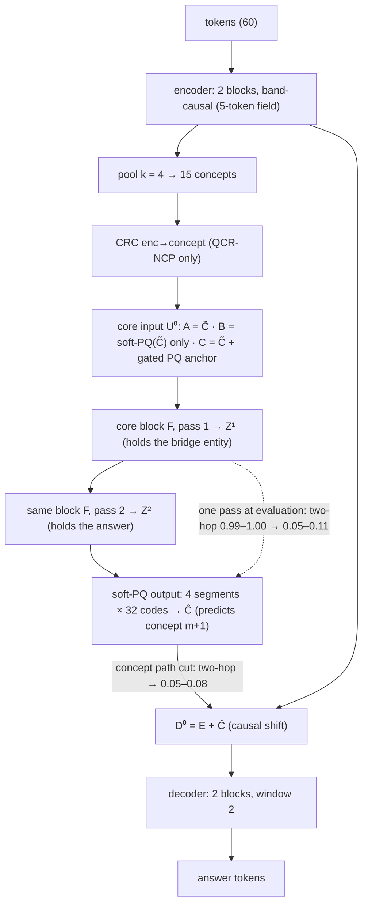
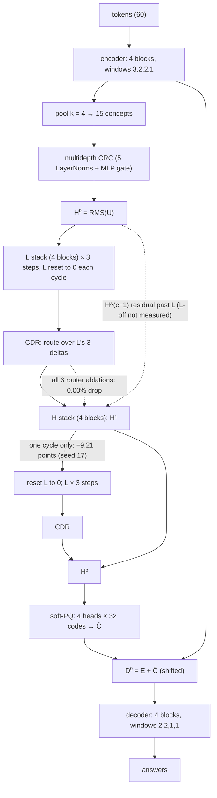
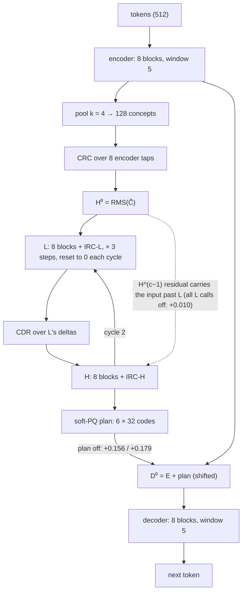
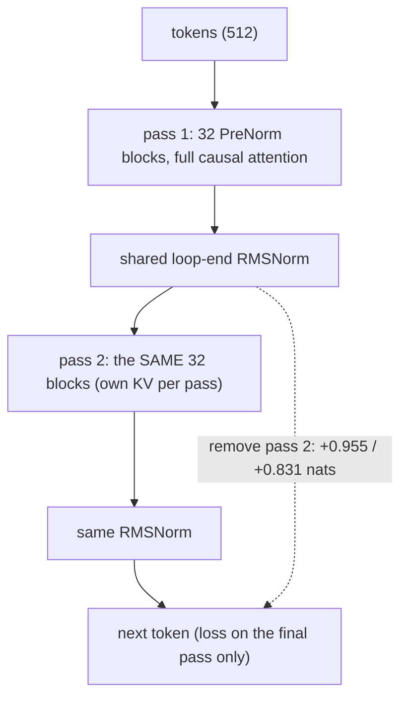
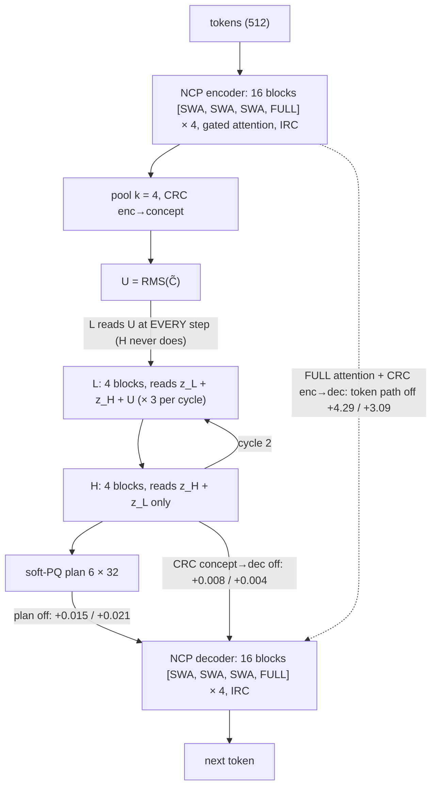
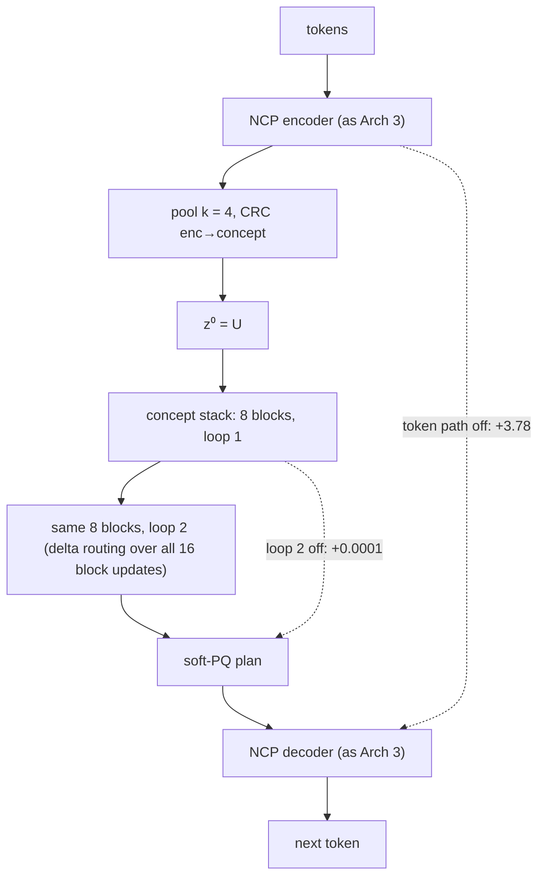
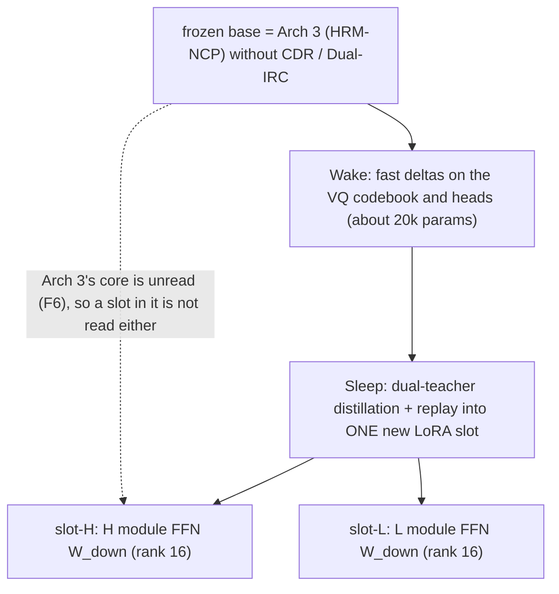
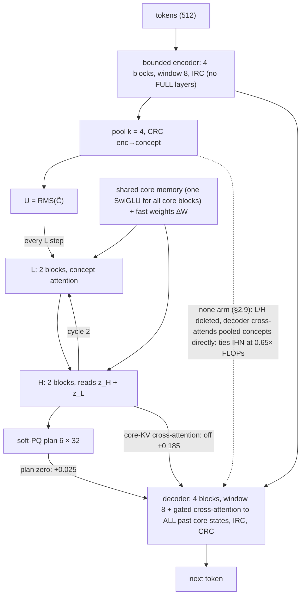
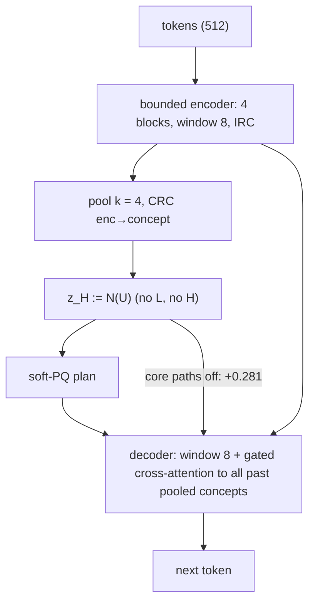
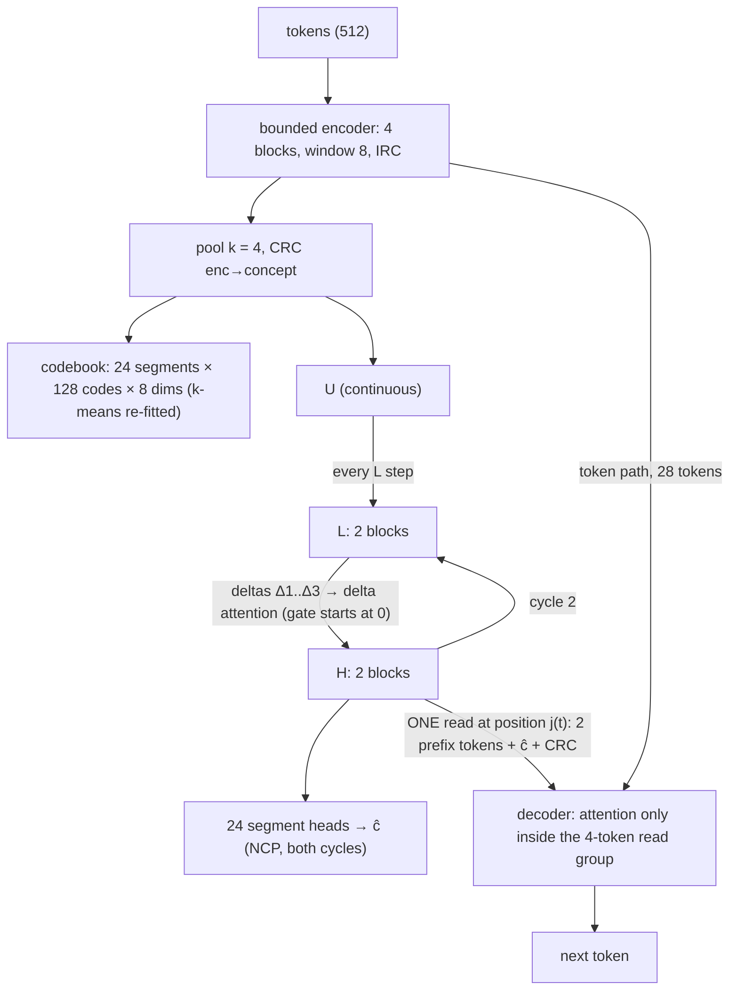

# HRM THINKER: every architecture we built or designed, and every paper we read

*Written 2026-09-24 from 19:49 IST. Purpose: the input for designing the next architecture, after DARWINMINDS was not adopted. Every number is copied from the file named beside it; nothing here is new measurement or new design. Advisor calls for this document are logged in §8 with the true count (the user asked for more than 40).*

**How to read this document**
- §0 covers the programmes before HRM THINKER (Latent Thinker, GRAM, PRISM, ISTHMUS, Q-LoopNCP, QCR-NCP). §1 is the timeline; §1A is the lab notebook (every dataset, the evaluation tools, and every experiment with its training setup, result and verdict). §2 has one section per architecture, all in the same template, so they can be compared side by side:
  - **status**: trained or design only; size; where the files are;
  - **diagram** (mermaid): solid arrows are paths the trained model used; **dashed arrows are paths that bypassed the part we cared about**, labelled with the measured intervention number;
  - **spec**: the equations and sizes that matter;
  - **what the model actually used**: switch-a-part-off measurements (Δ = loss increase in nats, or accuracy drop);
  - **got right / killed it / taught us**.
- §3 compares all of them in one table. §4 is the failure ledger and the measured constraints that any new design must meet. §5 lists every paper and web source, with what each could still contribute. §6 lists open questions. §7 maps the file names.
- **Sources.** §0 and §2.1 come from the reports of the earlier programmes on disk (`~/Desktop/Latent Thinker/`, `~/Desktop/Better Arch/`); §2.2 comes from `till_now.md`, a synthesis written by another agent, checked here only against its own cited files. Everything from §2.3 on comes from experiment folders produced in the last two days and checked when they were written.

---

## 0. Before HRM THINKER: the earlier programmes (Latent Thinker, PRISM, ISTHMUS, Q-LoopNCP, QCR-NCP)

The project did not start with HRM-CC. The order, as reconstructed in `Better Arch/Q-LOOPNCP/Q_LOOPNCP_8H_EXECUTION_REPORT.md` ("Repository Reviewed"), is: NCP → Latent Thinker / GRAM / PRISM (latent branches routed around; constant predictors) → QHR-CED V0 (too many parts) → ISTHMUS V1 (learnability gate failed) → ISTHMUS 12-hour campaign → ISTHMUS V1.1 (proposed) → Q-LoopNCP → QCR-NCP → HRM-CC. All ran on the same MacBook Air M2.

| programme | when | folder | question | architecture (one line) | data | result |
|---|---|---|---|---|---|---|
| **Latent Thinker V1.1** | frozen 2026-09-12; ≈ 15 h of training (start not recorded here) | `~/Desktop/Latent Thinker/` (`runs/REPORT.md`, `PROGRAM_REVIEW.md` §2–3) | does calling one latent "Thinker" 4 times beat calling it once? | causal encoder → strided compressor (k = 5, s = 4) → learned-query abstractor (16 slots) → shared Thinker × T (η = 0.5) → gated readback into H → decoder; **the decoder also sees H directly** | 102k records: transition tables (50%, fresh per-example rules, 8 states, 3 symbols), modular programs (25%), graph distance (25%); single answer token | T4 − T1 = −0.08 points; every model a **constant predictor** (12.22% = the train-majority floor); branch-off changed 0–0.7% of answers: latent branch inert |
| **CPU study** | before V1.1 (first) | `Latent Thinker/latentThinker-CPU/` | independent replication at 1/40 of the budget | independent codebase, same design | 99,944 independently generated records | same two findings; six architecturally different variants reached the same loss to 1 part in 10⁵ |
| **GRAM campaign** | 2026-09-13 04:02–10:31 | `Latent Thinker/latent_thinker_gram/` | does GRAM's recursive core (no bypass, deep supervision, stochastic guidance) fix it? | encoder → h/l recursion (T = 2, K = 3, N_sup = 8) with learned stochastic guidance; decoder reads only h | same as V1.1 | stopped at the pre-registered gate: both arms a constant predictor (12.22%), identical token on all 5,000 records; eliminations: not undertraining, not the bypass, not the mixture, not LR ×3, not test-time width. Survivor: **the task was too hard at this scale** |
| **PRISM pretraining** | between 09-13 and 09-15 (report undated) | `Latent Thinker/PRISM/PRISM-pretraining/PRISM_FINAL_REPORT.md` | do K context-conditioned latent candidates (best-candidate training, Explorative-style soft minimum) + NextLat help? | shared lower stack → proposer of K latent slot arrays + router → shared upper stack per candidate; NextLat + semantic-KL auxiliaries | symbolic suite + two-route grid; 29 runs, 48.6M target tokens, CPU | **candidates hurt, monotone in K** (routed NLL 0.117 / 0.147 / 0.200 for K = 1 / 2 / 4); all K > 1 candidates collapsed to the same vector (cos ≥ 0.999999); latent inert at K = 4, used at K ≤ 2; the NextLat + KL auxiliaries alone helped at 3 of 3 seeds |
| **QHR-CED V0 → ISTHMUS V1** | before 09-15 | `Better Arch/proposed Arch/QHR_CED_V1_ARCH.md` | make a compact slot memory the **only** long-range path | windowed-local encoder → pool k → slots → shared core R cycles (causal over slots) → decoder cross-attends slots; no PQ, no H/L | multi-fact chains | Experiment 1 failed its learnability gate (an information-free relation token put values 2 positions from keys) |
| **ISTHMUS 12-hour** | 2026-09-15 23:53 → 09-16 11:53 | `Better Arch/isthmus/` (`ISTHMUS_12H_EVIDENCE_LEDGER.md`) | is R a sequential-composition budget (a staircase in hops)? | ISTHMUS V1 as above | chain retrieval, H hops | full attention solved 1 and 2 hops (1.00, 0.97); **every ISTHMUS checkpoint was query-blind** (query swap left 99.6–100% of predictions unchanged): the core put query information into the query slot, and the decoder's read never looked at it; the staircase stayed untested |
| **Q-LoopNCP 8-hour** | 2026-09-16 13:28–21:28 | `Better Arch/Q-LOOPNCP/` | does soft-PQ feedback between loops help a 2-pass concept loop? | §2.1 | D-PC (6 facts, 16 entities) | three runs solved two-hop; feedback unused; pass 2 necessary (§2.1) |
| **NEXT-8H** | after Q-LoopNCP | `Better Arch/Q-LOOPNCP/NEXT_CAMPAIGN_CONTEXT.md` | tied vs untied core | §2.1 variants | D-PC | interrupted at wave 2 of 6; one pair: untied solved where tied failed (anecdotal) |
| **QCR-NCP 8-hour** | 2026-09-17 06:32–14:32 | `Better Arch/Exp/QCR-NCP/` | where should quantised concepts enter the thinker? | §2.1, arms A / B / C | D-PC | continuous input 3/4 solved, PQ-only 0/4, hybrid 3/4 (§2.1) |

**What the earlier programmes had already established, before any HRM-CC run:**
1. **A latent branch beside a bypass was inert** (Latent Thinker V1.1: branch-off changed 0–0.7% of answers). But **removing the bypass did not rescue it** (GRAM arm B had no bypass and was the same constant predictor), because the task was not learnable at that scale. So the bypass finding was confounded there; it was established cleanly only later: ISTHMUS (presence is not use), then F6 and F7 in this project.
2. **Removing the bypass is not enough if the task is not learnable at the scale** (GRAM campaign: constant predictors everywhere). Every later experiment needs a learnability gate.
3. **Presence is not use** (ISTHMUS: the query slot carried the query; the decoder never read it).
4. **Multiple latent candidates collapse or hurt** (PRISM, K > 1: all candidates collapsed to one vector, cos ≥ 0.999999, in 10 of 10 cells). Directly relevant to Explorative-Modeling-style best-of-K ideas.
5. **When the concept path is the only route and the loop is the only extra computation, a ~1M model composes two hops** (Q-LoopNCP, QCR-NCP), though only in about half the runs.
6. **An auxiliary predictive loss can help even when the latent machinery does not** (PRISM: NextLat + semantic-KL auxiliaries beat the plain model at 3 of 3 seeds, the only consistent positive in that campaign).

---

## 1. Timeline

| when | what | architecture(s) | where |
|---|---|---|---|
| 2026-09-12 → 09-17 | Latent Thinker V1.1, CPU study, GRAM, PRISM, ISTHMUS, Q-LoopNCP, NEXT-8H, QCR-NCP | §0, §2.1 | `~/Desktop/Latent Thinker/`, `~/Desktop/Better Arch/` |
| 2026-09-21 | Screen 1: HRM-CC v1.3-CDR 4-block, 3,000 updates, 2 seeds × 2 arms | §2.2 | `hrm_cc_v1_3_cdr_4block/`, `ASTRA_TRAINING_REPORT.md` |
| 2026-09-21/22 | Fresh screen (Gemini implementation), 6,000 updates | §2.2 | `hrm_cc_4block_gemini_fresh/`, `HRM_CC_4BLOCK_MASTER_REPORT.md` |
| 2026-09-22 | CDR depth study v2, core depth p ∈ {4, 16} (p = 16 stopped at 1,696 updates) | §2.2 | `hrm_cc_cdr_depth_v2/`, `till_now.md` §6 |
| 2026-09-23 12:38 → 09-24 12:38 | **E1** 24-hour experiment: HRM-CC + Dual-IRC vs a Nanbeige-style loop | §2.3, §2.4 | `experiments/HRM_CC_DUALIRC_vs_NANBEIGE42_M2_10_20M_20260923/` |
| 2026-09-23 evening | **E2** why HRM-CC's L collapsed | §2.3 | `experiments/L_COLLAPSE_INVESTIGATION_20260923/` |
| 2026-09-23 20:50–21:32 | **E3** four-architecture tiny CPU gates | §2.3–§2.6 | `experiments/FOUR_ARCH_TINY_CPU_20260923/` |
| 2026-09-24 05:04–08:57 | **E4** HRM-NCP (Arch 3) on the GPU | §2.5 | inside E1 (`evaluation/hrmncp_final/`) |
| 2026-09-24 07:20–09:05 | **D1** HRM-Sleep design and score (not trained) | §2.7 | `experiments/HRM_SLEEP_20260924/` |
| 2026-09-24 09:40 (design), runs 10:17–15:42 | **E5** Improved HRM-NCP (IHN) vs stack-13, three stages | §2.8–§2.10 | `experiments/IMPROVED_HRM_NCP_20260924/` |
| 2026-09-24 18:00–18:50 | **D2** DARWINMINDS design (not trained; not adopted) | §2.11 | `experiments/DARWINMINDS_20260924/` |

**Two things held constant from E1 on:** the data (93.4M training tokens from TinyStories, WikiText-103 and 22 synthetic generator families; byte-level BPE with 8,192 tokens) and the measurement tool (switch a part off at evaluation and see how much the loss or accuracy moves). E5 used a 13.1M-token subset with four families held out. Hardware for everything: a MacBook Air M2, 16 GB.

---

## 1A. Every experiment, start to end: data, training, evaluation, result

This section is the lab notebook. §2 then describes each architecture in detail.

### 1A.1 Datasets

**D-PC, pointer chasing (used by E0, S1, S2, S3).** Sources: the QCR-NCP report (§4 Task, as quoted in `md/2bff182b-…md`), `till_now.md` §1, §3, §5.
- 60-token sequences (15 concepts of 4 tokens): 6 facts `[F a f(a) PAD]` in random order, where f is a permutation over **16 entities** with every cycle of length ≥ 4 (so copying and hop-confusion shortcuts are excluded); a separator; 4 queries `[Qh PAD PAD x]` asking for f^h(x), h ∈ {1, 2}; answers at positions 31, 39, 47, 55. Vocabulary 23 tokens.
- Floors: uniform over 16 entities 0.0625; uniform over the 6 entities present 0.167; one-hop shortcut 0.223.
- Evaluation (QCR-NCP): held-out 4 × 256 sequences; OOD with 10 facts (T = 76), 2 × 256. In the 4-block screens (S1–S3): development set f6, 1,024 fixed sequences (2,009 two-hop and 2,087 one-hop queries); OOD f10, 512 sequences (982 two-hop queries).
- Curriculum: one-hop only for updates 0–1,499, then mixed one- and two-hop.

**D-MIX, mixture_v1 (used by E1–E4, and as the source of E5's data).** Source: E1 `dataset/DATASET_DESIGN.md`, `DATASET_MANIFEST.json`.
- **93.4M non-pad training tokens** in 194,938 packed 512-token rows, built from scratch and deterministic:

| group | share | content |
|---|---:|---|
| natural language | 43.4% | TinyStories (18.2M tokens) + WikiText-103 (22.3M) |
| symbolic / compositional | 25.8% | pointer_chase, graph_walk, state_machine, permutation, variable_binding, kv_updates, relational, arith_transform, stack_ops, nested_scopes, brackets, seq_transform |
| code / structured | 12.1% | py_exec, json_build, yaml_lookup, sort_trace, expr_eval |
| exact detail / retrieval | 12.8% | kv_retrieval, copy, needle, json_lookup |
| tool trajectories | 6.0% | tool_traj (GOAL → CALL → OBS → … → ANSWER with simulated tools; 20% contain a timeout to retry) |

- Tokenizer: byte-level BPE, 8,192 tokens, digits split, trained on training text only.
- Packing: documents end with EOS and are padded to a multiple of 4; attention never crosses documents; next-token targets exist only inside a document.
- Splits: train, maintenance (codebook calibration, never trained on), validation, test, and an **OOD** split with held-out structure (e.g. pointer_chase ID 8–16 pointers and 1–4 hops, OOD 20–28 pointers and 5–8 hops; variable_binding OOD includes unseen identifier names).
- Leakage: SHA-1 of every generated document; evaluation items identical to a training document are dropped and counted.

**D-TINY, E5 base data.** Source: `IMPROVED_HRM_NCP_20260924/dataset/MANIFEST.json`, `build_tiny.py`.
- Built from the D-MIX generators and tokenizer, **13.1M non-pad training tokens** (27,434 rows), with four families **held out** for continual learning: seq_transform, kv_updates, stack_ops, tool_traj ("CL-4"). Separate `cl_<family>` sets of ≈ 0.6M tokens each for Stage 3; a maintenance split for the codebook.

**D-EVICT, E5 Stage 2.** Source: `IMPROVED_HRM_NCP_20260924/dataset/build_evict.py`. Facts ("The code of Wato is 8 4 4 8.", and chains "A points to B. B points to C.") appear only in segments 1–3 of a 512-token row; segment 4 asks about them (1-hop, 2-hop within one segment, 2-hop across segments). Test names are made of syllables never used in training. 500 test documents.

### 1A.2 Evaluation (the same tools throughout)

- **Language:** next-token cross-entropy (nats) on held-out TinyStories and WikiText; "mean" = their average. E5 uses the first 256 rows of each test set.
- **Items:** teacher-forced greedy exact match on the answer spans, per family (400 items per family in E1, 120 in E5); macro = mean over families; micro with bootstrap 95% intervals in E1; OOD macro on the OOD split.
- **Interventions (the key tool):** switch a component off at evaluation (plan zero, core path off, L off, one cycle, loop pass 2 removed, token path off, IRC or CRC off, router off) and measure Δ loss and Δ items. Share of a skill = drop / intact accuracy.
- **Telemetry:** L's non-common fraction and FFN spike ratio (the collapse detector from E2), router entropy, codebook dead-code counts, probes (ridge/linear) for bridge and answer entities in the pointer-chasing runs.
- **Matching rules:** equal training FLOPs (analytic: 2 per multiply-add, ×3 for training) and, where stated, equal tokens; a pre-registered tie band of ±0.02 nats on language.
- **Pointer-chasing campaigns** used pre-registered decision rules: gradient retention G_s, suffix sensitivity M_s, paired two-hop accuracy gain A_s, confirmed solves, and a stability rule on gradient clipping.

### 1A.3 The experiments

| id | dates | question | data | models (§) | training | evaluation | result | verdict |
|---|---|---|---|---|---|---|---|---|
| **E0** | 09-16 and 09-17 | can a ~1M concept-bottleneck model with a 2-pass loop do two-hop pointer chasing, and where should quantisation sit? | D-PC | Q-LoopNCP, QCR-NCP A/B/C (2.1) | 6,000 (Q-LoopNCP) and 8,000 (QCR-NCP) steps; LR 1e-3 (Q-LoopNCP: cosine over a 10,000-step horizon; QCR-NCP: 200 warmup then constant); QCR-NCP: AdamW (0.9, 0.95), wd 0.01, clip 1.0, batch 128; seeds 17, 29, 41, 53; 8 h each | held-out and OOD two-hop exact every 500 steps; one-pass, concept-cut, gate and PQ ablations; probes | Q-LoopNCP: 3 solves (1.000, 0.989, 1.000), soft-PQ feedback inert; QCR-NCP: continuous 3/4, PQ-only 0/4, hybrid 3/4; one pass → 0.05–0.11 | **positive**: the only solved models in the project |
| **S1** | 09-21 | does Centered Delta Routing (CDR) help a 4-block H/L model? | D-PC | HRM-CC 4-block R0 (no CDR) vs R1 (CDR) (2.2) | 3,000 updates × 2 seeds × 2 arms, M2 GPU, 169 min | G_s, M_s, A_s, solves, stability | ≈ 6% two-hop (chance 6.25%); CDR raised gradient retention ≈ 7–8× | `stability_failure` (a gradient-ratio cap missed by 0.0062) |
| **S2** | 09-21/22 | same question, clean re-implementation, longer | D-PC | same (2.2) | 6,000 updates × 2 × 2; AdamW, LR 1e-3, 200-step warmup; 7 h | + 35 causal interventions, probes, codebook ledger | best 13.1% two-hop; CDR −0.46 points; CDR 100% inert under 6 ablations; one cycle −9.21 in seed 17; 68–79% of codewords dead | `fresh_screen_no_behavioral_signal` |
| **S3** | 09-22 | does CDR start to matter with deeper cores (p = 4 vs 16)? | D-PC | HRM-CC depth v2 (2.2) | p = 4: 4 runs × 6,000 updates; p = 16: stopped at 1,696; 6.5 h | accuracy, clipping, sensitivity | p = 4: CDR −2.0 points; clipping cut 9–13.5× | `incomplete_budget` |
| **E1** | 09-23 12:38 → 09-24 12:38 | is HRM-CC + Dual-IRC better than a Nanbeige-style loop at equal compute? | D-MIX | HRM-CC E1 (2.3), loop (2.4) | 5.0e15 FLOPs each (51.1M vs 23.0M tokens); AdamW (0.9, 0.95), wd 0.01, clip 1.0, cosine to 10%, 100 warmup, 8,192 tokens/step; LR 2e-3 (HRM-CC, from a 120-step probe; E2 found during the run that 2e-3 collapses L, and the run was not restarted) and 1e-3 (loop) | language, items, OOD at equal FLOPs and equal tokens; interventions; 12 milestones | equal FLOPs: HRM-CC 3.392 vs loop 3.717; equal tokens: 3.749 vs 3.729 (tie), items 0.095 vs 0.226; HRM-CC's L collapsed; plan used (+0.16) | **NO** for HRM-CC as specified; conditional yes for the concept path |
| **E2** | 09-23 evening | why did L collapse? | small D-MIX slices | tiny HRM-CC at d = 192 (2.3) | 600-step CPU ablations: LR, truncated backprop, norms, weight decay | L non-common fraction, FFN spike, val NTP | collapse = LR × width × recurrence; LR 1e-3 fixes it (0.907 vs 0.011); truncated backprop makes it worse | theory confirmed |
| **E3** | 09-23 20:50–21:32 | are the recurrent parts used and healthy in four architectures? | D-MIX slice | HRM-CC, loop, HRM-NCP, NCP-Loop (2.3–2.6) | d = 192, 2,048 tokens/step, 600 steps, LR 1e-3, CPU | recurrence-off, plan-zero, token-path-off, FFN spike | loop recurrence-off +0.106; HRM-NCP plan +0.026 vs token path +4.41; NCP-Loop loop-2 +0.0001 | HRM-NCP to GPU; NCP-Loop failed |
| **E4** | 09-24 05:04–08:57 | how does HRM-NCP do at equal compute? | D-MIX | HRM-NCP (2.5) | 1.25e15 FLOPs, 11.0M tokens (stopped: 935 tok/s); LR 1e-3 (the E2 finding), while HRM-CC in the same 4-way table ran at 2e-3, so that comparison is LR-unfair to HRM-CC; first seed crashed | E1's evaluation + interventions | best of four at 1.25e15 (3.772, items 0.265); core unread (plan +0.015; token path +4.29) | **F6**: the shell did the work |
| **D1** | 09-24 07:20–09:05 | a continual-learning design inside the concept core | — | HRM-Sleep (2.7) | not trained | scored by first principles | 7/10 as an experiment, 4.5/10 as specified | redesigned as E5 |
| **E5-1** | 09-24 10:17–12:16 (design from 09:40) | does the improved design (IHN) beat stacked layers, and is its recurrence used? | D-TINY | IHN (2.8), none (2.9), stack-13 (2.10) | 12.0M tokens each (2,930 steps × 8 rows × 512); AdamW, LR 1e-3, cosine to 10%, 100 warmup, wd 0.01, clip 1.0; 37–40 min per run | language (256 test rows × 2), items (18 families × 120), probes | IHN 3.782 vs stack-13 3.964; none 3.781 at 0.65× FLOPs and best items (0.207) | **F7**: the recurrence unused |
| **E5-2** | 09-24 12:16–14:08 | does fast memory + sleep carry evicted facts? | D-EVICT | IHN N = 0 and N = 2 sleep passes; stack-13 cut (floor) and uncut (ceiling) | 1,200 steps, LR 5e-4, 4 evict + 4 replay rows per step | answer exact, token accuracy, answer NLL; memory off | all exact ≈ 0; memory on / off / absent: identical 1-hop answer NLL 1.153; ceiling 0.004 | uninformative; memory unread (pre-registered Stage-1b trigger fired) |
| **E5-3** | 09-24 14:08–15:42 | can new skills be learned by changing only the concept module? | D-TINY + cl_<family> | IHN concept-only, IHN full, stack-13 full | 600 steps per family, 50% replay of seen rows, LR 5e-4 | exact on each new family after each stage; held-in macro; language | concept-only: 0 on all four; full IHN: 0.79 / 0.44 / 0.83 / 0.72 just after learning, kept 0.315 at the end (stack-13 0.215); language +0.22 vs +0.17 | concept-only CL fails at this scale (the tasks needed new skills) |
| **D2** | 09-24 18:00–18:50 | a redesign that forces the recurrence to compute | — | DARWINMINDS (2.11) | not trained; two measurements on IHN checkpoints (M1, M2) | pre-registered 8 arms and gates | — | not adopted by the user |

---

## 2. The architectures

### 2.1 Q-LoopNCP and QCR-NCP: the small models that solved pointer chasing

**Status.** Trained in two 8-hour campaigns in `~/Desktop/Better Arch/`: Q-LoopNCP (2026-09-16 13:28–21:28 IST) and QCR-NCP (2026-09-17 06:32–14:32 IST). About 1.03M parameters (QCR-NCP: 1,036,898). Task D-PC (§1A.1). Sources: `Q-LOOPNCP/Q_LOOPNCP_8H_EXECUTION_REPORT.md`, `Exp/QCR-NCP/QCR_NCP_8H_EXECUTION_REPORT.md`, and the ledger reproduced in `md/2bff182b-…md` (Appendix D).

**Spec.** d = 128, 4 heads, d_ff = 352, RoPE. One core block applied twice (a loop, not H/L). Soft-PQ with 4 codebooks of 32 codes over 32-dimensional segments: the **same shape** (32 codes per 32 dimensions) as §2.2's codebook, which collapsed, and IHN's, which held only 16–20% of concept variance. So codebook shape alone does not explain why these models solved the task and §2.2 did not (Q1, §6). With the concept stream zeroed, the answer logits have exactly zero gradient with respect to every fact token (unit test T12): **the concept path was the only long-range route**. Loss NTP (answer positions only) + 1·NCP (MSE, loop 2) + 10·VQ. Recipe (QCR-NCP): AdamW (0.9, 0.95), weight decay 0.01, clip 1.0, LR 1e-3 with 200 warmup steps then constant, batch 128 sequences, 8,000 steps, seeds 17, 29, 41, 53, identical initial weights and batches across arms.

**Results.**

| campaign | arms | solved (two-hop ≥ 0.90, confirmed) | key measurements |
|---|---|---|---|
| Q-LoopNCP | G full-attention gate; A one block, one pass (no recurrence); B one shared block, 2 passes; C = B + soft-PQ feedback between passes (DiscoLoop-style); U, E, D registered but untested | C17 1.000, C41 0.989, B41 1.000; a gate-clamped C17 solved by step 2,000; 5 of 9 runs never transitioned | removing pass 2: 0.048 / 0.112 / 0.068 / 0.066; the soft-PQ feedback was unused (gate closed 0.119 → 0.01–0.02; ablations changed ≤ 0.001); verdict on "feedback helps": inconclusive, mechanism falsified |
| QCR-NCP | A continuous input, B PQ-only input, C hybrid | **A 3/4, B 0/4, C 3/4** | B never learned even one-hop retrieval (its hard codes collapsed to 4–9 tuples for 240 fact pairs); Z¹ linearly encodes the bridge (1.00), Z² the answer (0.97–1.00); argmax-PQ output costs 0.09–0.36; OOD (10 facts) 0.91–1.00; CRC used in some seeds, inert in others |

Also recorded in the ledger: running the core 3 times instead of the trained 2 *degrades* solved models (0.894, 0.665, 0.967; one fell to 0.599); solving is bimodal and depends on the initial draw (≈ half the runs never cross); the NCP loss does not track the capability transition (flat while answer loss fell from 1.11 to 0.02); PQ segments are redundant (segment NMI 0.71–0.86). `till_now.md` reports a late-grokking trajectory for run C41 (≈ 2% until update 4,500, 83% at 7,500, 95.5% at 8,000).

- **Got right:** the concept path was the only long-range route and the 2-pass loop was the only extra computation; both were used, each pass had its own role (bridge, then answer). Continuous input to the thinker beat quantised input.
- **Killed it:** nothing; the line was scaled up into HRM-CC (§2.2).
- **Taught us:** a tiny concept-bottleneck model with a 2-pass loop *can* compose two hops on our own task, but only in about half the runs and after a long plateau; quantisation belongs at the output (as a target), not the input; more passes than trained hurt.

### 2.2 HRM-CC v1.3-CDR, 4 blocks per stack (Screen 1, Fresh screen, Depth study v2)

**Status.** Trained three times on the pointer-chasing task. 3,256,228 parameters (p = 4); 8,079,268 at core depth p = 16. Sources: `till_now.md` §2–§6, `ASTRA_TRAINING_REPORT.md`, `HRM_CC_4BLOCK_MASTER_REPORT.md`, `Proposed_Architecture_2.md`.

**Spec.** d = 128, SwiGLU d_ff = 352, 16 physical blocks. H2L3 with Reset-L. **Centered Delta Routing** (CDR): Δ_r = L_r − L_{r−1}; β = softmax(q·k/√32) with q from H_{c−1}; S_c = L_3 + λ·b·Σ_r (β_r − 1/3)·Δ_r, λ = 0.1, W_q = 0 at start (identical forward pass for R0 and R1). Direct token reach 7 tokens, as in §2.1, so there is no token-side bypass: local path off changed accuracy by −0.25 points (null). The only bypass is H's own residual past L, and no L-off number was measured.

**What the model actually used** (Fresh screen, 6,000 updates, `till_now.md` §5.7):
- CDR: 0.00% accuracy drop under all six router ablations. Its deltas contracted (RMS 0.97 → 0.025 → 0.0009) and the router's weight collapsed to β₁ = 1.
- Macro-recurrence, in the seed that learned something (seed 17): one cycle only −9.21 points; concept path off −5.33.
- CRC off, hard PQ, local token path off: no effect.
- Codebooks: 68–79% of the 128 codewords were dead and re-seeded every 250 steps.

**Results.**
- Screen 1 (3,000 updates): about 6% two-hop accuracy (chance ≈ 6.25%); verdict `stability_failure` (a gradient-ratio cap missed by 0.0062).
- Fresh screen (6,000 updates): best 13.1% (R0 seed 17); CDR arm on average −0.46 points; verdict `fresh_screen_no_behavioral_signal`. CDR raised backward gradient sensitivity about 8× with no behavioural effect.
- Depth study v2: at p = 4, CDR cut gradient clipping 9–13.5× but changed accuracy by −2.0 points; p = 16 stopped at update 1,696 (`incomplete_budget`).

- **Got right:** the macro-recurrence (H cycles) was the part that carried whatever the model learned.
- **Killed it:** it never solved the task that the 3× smaller §2.1 model solved. The router was inert, and the codebook collapsed.
- **Taught us:** "more gradient through the recurrence" is not "more use of the recurrence". And something between §2.1 and §2.2 broke learnability (open question Q1 in §6).

### 2.3 HRM-CC v1.3-CDR + Dual-IRC (E1, the 24-hour experiment)

**Status.** Trained to 5.0e15 FLOPs (51.1M tokens) on the full language + synthetic mix. 17,423,144 parameters. Sources: E1 `architecture/HRM_CC_EXPERIMENT_ARCHITECTURE.md`, `reports/FINAL_REPORT.md`, `FAILURE_ANALYSIS.md`; E2 `THEORY_L_COLLAPSE.md`.

**Spec.** d = 192, 8 blocks in each of encoder, L, H, decoder. Token reach 65 tokens. H2L3 with Reset-L. L^r = M_L(L^{r−1} + H^{c−1}) and H^c = M_H(H^{c−1} + S^c), with H⁰ = RMS(C̃) = the input. So the H^{c−1} residual carries the input into H without passing through L; that residual is the bypass behind F1, and it is exactly what Arch 3 later removed (H reads only z_H + z_L). CDR (λ = 0.1), Dual-IRC (η = 0.1) inside every L and H call, CRC over 8 encoder taps, soft-PQ plan 6 × 32 codes. Loss NTP + NCP + 10·VQ. 97.78 MFLOP per training token.

**What the model actually used** (`reports/_tables.md`):

| switched off | ΔNTP TinyStories / WikiText | Δ items |
|---|---:|---:|
| plan (concept path) | **+0.156 / +0.179** | −0.056 |
| H cycle 2 | +0.091 / +0.042 | −0.025 |
| all 6 L calls | +0.010 / +0.016 | −0.007 |
| CDR | +0.0001 | 0 |
| IRC-L, IRC-H | ≤ +0.001 | 0 |
| CRC | +0.0005 / +0.001 | +0.002 |
| local token path | +6.00 / +4.68 | → 0 |

Concept-path share of three composition skills: seq_transform 39%, stack_ops 83%, tool_traj 76%.

**Results.** Against the loop (§2.4): better at equal FLOPs (NTP 3.392 vs 3.717) because it processed 2.2× more tokens; tied at equal tokens (3.749 vs 3.729, inside the ±0.02 band); worse on items at equal tokens (0.095 vs 0.226). Verdict: NO for the architecture as specified, conditional yes for the concept path.

**Why L collapsed (E2).** RMSNorm hands every block a unit input and SwiGLU is quadratic in it; aligned hidden units amplify up to ≈ 900× at d = 192; the component feeds itself until each position emits the same vector; recurrence locks it in, and nothing in the loss needs L because H already sees the input. At LR 1e-3 instead of 2e-3 the collapse disappears (L non-common fraction 0.907 vs 0.011) and loss improves. HRM-Text's truncated backprop (K = 2) made it worse.

- **Got right:** the concept path (plan) was used and grew with training (+0.05 at 20% of training, +0.16 at the end).
- **Killed it:** **F1**, L bypassed by H and collapsed; the routers (CDR, IRC, CRC) saturated and were inert (**F2**); codebook scale drift raised the loss (**F3**).
- **Taught us:** the "use" principle in its first form: *a module is used only if nothing else can reach the loss without it.* And learning rate × width is part of a recurrent core's design.

### 2.4 Nanbeige4.2-style 2-pass looped transformer (E1 baseline)

**Status.** Trained to 5.0e15 FLOPs (23.0M tokens), same data and order as §2.3. 17,313,984 parameters. Sources: E1 `architecture/NANBEIGE42_BASELINE_ARCHITECTURE.md`, `reports/_tables.md`.

**Spec.** d = 192, 6 heads, SwiGLU 512, RoPE; 32 blocks run twice (64 executed blocks per token); no KV sharing between passes; 217.13 MFLOP per training token (2.22× HRM-CC). A miniature of the released 3B config, without n-gram embeddings or hyper-connections.

**What the model actually used.** Removing pass 2: +0.955 / +0.831 nats and −0.094 items. Feeding pass 2 another example's pass-1 state: +7.49 / +4.76.

**Results.** Worse than HRM-CC at equal FLOPs (3.717 vs 3.392 NTP) because it saw fewer tokens; tied at equal tokens (3.729 vs 3.749) and much better on items (0.226 vs 0.095). Won nesting and state families (nested_scopes 0.87 vs 0.27, brackets 0.99 vs 0.88). In the equal-FLOPs 4-way comparison at 1.25e15 it was last (4.631), again because it had seen only 5.8M tokens.

- **Got right:** pass 2 is the model's only extra computation, so it was always used.
- **Killed it:** cost per token. Nothing bypassed it.
- **Taught us:** the confirming case of the use principle. Recurrence on the only path is used, at this scale, with no special machinery.

### 2.5 HRM-NCP, "Arch 3" (E3 gate, E4 GPU run)

**Status.** Trained to 1.25e15 FLOPs (11.0M tokens), stopped early because MPS ran it at 935 tokens/s. 17,689,984 parameters. Sources: E1 `architecture/HRM-NCP.md`, `reports/FINAL_REPORT.md` Addendum A, `FAILURE_ANALYSIS.md` F6.

**Spec.** d = 192, SwiGLU 352. The NCP-ArchPreview shell in miniature: token SWA window 256 with FULL attention every fourth layer, gated attention, NCP's IRC (unnormalised mix of all earlier block states), CRC enc→concept, enc→dec and concept→dec at every decoder layer. Concept slot: the original HRM wiring (**H never reads U**, the fix for F1), z_L carried across cycles, fixed random initial states, parameterless exit norms, delta attention residuals inside each module call. LR 1e-3. 113.28 MFLOP per training token.

**What the model actually used:**

| switched off | ΔNTP TinyStories / WikiText | Δ items |
|---|---:|---:|
| plan (concept path) | +0.015 / +0.021 | −0.002 |
| concept→decoder CRC | +0.008 / +0.004 | 0 |
| L (all calls) | +0.028 / +0.044 | 0 |
| cycle 2, H1 skipped, delta routing | ≈ 0 | ≈ 0 |
| **IRC (shell)** | **+5.44 / +3.02** | → 0 |
| **token path + enc→dec CRC** | **+4.29 / +3.09** | → 0 |

Core share of skill vs HRM-CC: seq_transform 5% vs 39%, stack_ops 0% vs 83%, tool_traj 12% vs 76%. L was healthy inside the core (non-common fraction 0.93).

**Results.** Best of the four at equal FLOPs (1.25e15): NTP 3.772, items macro 0.265, OOD 0.049, against HRM-CC 4.041 / 0.051 and the loop 4.631 / 0.031.

- **Got right:** the anti-F1 wiring kept L alive; the NCP shell is a strong language model.
- **Killed it:** **F6**. The shell's FULL attention layers and the direct encoder→decoder path let the decoder solve everything; the core was healthy but unread. The headline lead belonged to the shell. The E3 tiny gate had already shown it (plan off +0.026 against token path off +4.41, a 1% ratio) and should have been a kill criterion.
- **Taught us:** the use principle one level out: *a healthy core is still unused if the shell can reach the loss without it.* The shell must be bounded.

### 2.6 NCP-Loop, "Arch 4" (E3 gate only)

**Status.** Failed its tiny CPU gate; never trained on the GPU. 17,693,152 parameters. Sources: E1 `architecture/HRM-NCP.md` §3 and §11, `FOUR_ARCH_TINY_CPU_20260923/RESULTS.md`.

**Spec.** Arch 3's shell with the concept slot replaced by one 8-block stack looped twice (16 block applications), a shared loop-end norm, and delta routing whose sources persist across both loops. 104.63 MFLOP per training token.

**What the model actually used** (tiny gate, d = 192, 600 steps): loop 2 off +0.0001; plan zero +0.030; token path off +3.78.

- **Got right:** nothing measurable at gate scale.
- **Killed it:** the same shell bypass as Arch 3 (F6). At gate scale its second loop was unused (+0.0001), while the plain loop of §2.4, gated the same way (600 CPU steps, d = 192), already showed recurrence-off +0.106, about 1,000× more. The difference is that §2.4's loop was the only path.
- **Taught us:** the loop's success in §2.4 is about its *position* (the only path), not about looping as such.

### 2.7 HRM-Sleep (D1, design only)

**Status.** Designed and scored; not trained. Sources: `experiments/HRM_SLEEP_20260924/HRM-Sleep.md`, `SCORE_CL.md`; the longer source `Sleep/HRM-CC_v1.4-Sleep.md`.

**Spec.** Memory timescales: activations (within a pass) → optional In-Place-TTT fast weights with a next-concept target (within a document) → VQ/head deltas (within an episode, "Wake") → one frozen LoRA slot per task (across episodes, "Sleep") → frozen base. Arms: frozen, VQ-Wake, direct slot, Sleep, full fine-tune with 50/50 replay, In-Place TTT. Tasks: CL-4 (seq_transform, kv_updates, stack_ops, tool_traj) held out of pretraining.

**Score** (`SCORE_CL.md`): 7/10 as an experiment; 4/10 for the thesis "concept module + sleep suffices" (right for new procedures, wrong for new facts: NCP's VQ-only adaptation got +9.19 on TriviaQA against LoRA's +17.48); 4.5/10 as specified, because its base (Arch 3) never reads its core.

- **Got right:** separating memory by timescale; a novelty taxonomy (new representation → encoder, composition → core, fact → a writable memory on the read path, expression → decoder).
- **Killed it:** it was built on an unread core.
- **Taught us:** continual learning inherits the use problem: *new capacity only helps if the frozen model reads it.* This became C14 in DARWINMINDS. Its task-selection rule (use a family only if the frozen base scores ≤ 0.10 on it) was inherited by E5 Stage 3, and turned out to select exactly the tasks that concept-only training cannot learn (§2.8, §4). The rule needs replacing, not only the base.

### 2.8 IHN, Improved HRM-NCP (E5)

**Status.** Trained: Stage 1 at 12.0M tokens (6.31e14 FLOPs), then Stage 2 (fast memory + sleep) and Stage 3 (continual learning). 8.67M parameters. Sources: `IMPROVED_HRM_NCP_20260924/Improved_HRM_NCP.md`, `evaluation/TABLES.md`, `runs/*/result.json`.

**Spec.** d = 192. Token reach without the core exactly 57 tokens (verified bit-exact). HRM core H2L3 at concept resolution with the anti-F1 wiring, MagicNorm exits, full causal attention over concepts. A Mobius-style shared core memory (SwiGLU, width 1,024) holding fast weights ΔW written at segment boundaries with a next-concept target, read only inside the core. Sleep = N extra core passes before a segment is written. Decoder: window-8 self-attention plus **gated cross-attention from every decoder block to every past core state** (DeepSeek-V4.1 CED style). Loss NTP + NCP + 10·VQ. LR 1e-3.

**What the model actually used** (Stage 1, held-out language):

| switched off | ΔNTP mean | items macro (intact 0.139) |
|---|---:|---:|
| **all core paths** | **+0.235** | 0.076 |
| core-KV cross-attention | +0.185 | 0.109 |
| recurrence (core output := N(U)) | +0.103 | 0.133 |
| H off / L off / cycle 2 off | +0.048 / +0.017 / +0.021 | 0.138 / 0.135 / 0.133 |
| plan zero | +0.025 | 0.139 |
| CRC concept→dec | +0.0007 | 0.139 |
| IRC (shell) | +3.55 | 0.050 |

Core share of skill: brackets 40%, sort_trace 72%.

**Results.**
- **Stage 1.** Language 3.782 against stack-13's 3.964 (−0.18 nats, matched on FLOPs within 2% and parameters within 3%); items 0.139 vs 0.178, almost all of it one family (nested_scopes 0.05 vs 0.83).
- **Stage 2** (facts in evicted segments, 500 test documents): memory on, memory off and a model with no memory all gave the same 1-hop answer loss, 1.153. Even full attention over the whole row reached only 0.004 exact. The memory was never read, and the task was too hard at this size.
- **Stage 3** (four held-out skills learned in sequence): training only the concept module (1.27M parameters) learned none of them; full fine-tuning learned each (0.79, 0.44, 0.83, 0.72) and forgot heavily (seq_transform → 0.02). IHN-full kept more at the end than stack-13-full (0.315 vs 0.215) but lost more language (+0.22 vs +0.17 nats).

- **Got right:** F6 fixed: the bounded shell forced the decoder to read the core (+0.235, against Arch 3's +0.015).
- **Killed it:** **F7**. The trained no-recurrence arm (§2.9) tied it at 0.65× the FLOPs and won items. The decoder's global cross-attention did the composing, so the recurrence had nothing to add. The memory bolted on after pretraining was never read.
- **Taught us:** the use principle a third level out: *forcing the path is not forcing the computation.* And continual-learning results depend on what the task selection allows (§2.7).

### 2.9 IHN without recurrence, "none" (E5 control)

**Status.** Trained, Stage 1 only (12.0M tokens, 4.13e14 FLOPs). 8.07M parameters. Source: `IMPROVED_HRM_NCP_20260924/evaluation/s1_none.json`.

**Results.** Language 3.781 (IHN 3.782), items 0.207 (IHN 0.139), nested_scopes 1.000 (IHN 0.05), at 0.65× IHN's FLOPs. Ahead of or equal to IHN on all 18 held-in families. Best model of E5.

- **Got right:** the bounded shell + 4-token pooling + global cross-attention over *exact* pooled concepts. Structurally close to DeepSeek's long-context recipe (sliding-window layers plus attention over compressed entries), though here every decoder layer attends to the pooled concepts, while DeepSeek-V4.1's CED projects its global KV from one mid-network state. An analogy, not the same design.
- **Taught us:** the HRM core, as configured, *lost* exact token identity that the decoder could use directly (nested_scopes 1.00 vs 0.05). Two untested explanations: 8 normalised module applications from fixed random initial states wash out identity, or the gradient through 8 applications is too weak at 12M tokens.

### 2.10 Stack-13 (E5 baseline)

**Status.** Trained, 12.0M tokens, 6.21e14 FLOPs (0.983× IHN), 8.92M parameters (+2.9%). A plain 13-layer full-attention transformer, the user's baseline. Language 3.964; items 0.178 (nested_scopes 0.833). In Stage 3 it learned the four skills as fast as IHN-full (0.67 vs 0.69 average just after learning) and kept less (0.215 vs 0.315).

### 2.11 DARWINMINDS (D2, design only, not adopted)

**Status.** Designed and reviewed on 2026-09-24 (14 advisor calls); not trained. The user did not adopt it. 9.59M parameters (analytic). Source: `DARWINMINDS_20260924/DARWINMINDS.md`, web viewer `DARWINMINDS_20260924/visual/index.html`.

**The design in five points.**
1. **One read per token.** Token t reads the loop only at j(t) = ⌊(t+1)/4⌋ − 1, through 2 prefix tokens, the predicted concept ĉ and a CRC over loop depths. The decoder attends only inside its read group, so it cannot combine concepts; anything more than 34 tokens away must be composed by the loop (after Block Transformer).
2. **HRM at concept level** with the anti-F1 wiring, MagicNorm, learned start slots, deep supervision of NCP after each cycle, and **recurrence-delta attention** (H attends over what each L step changed; the user's idea, after Delta Attention Residuals).
3. **Codebook sized by measurement**: 24 × 8-dim × 128 codes (k-means on IHN's concepts holds 68% of variance, against 20% for IHN's trained codebook).
4. **Continual learning split by regime**: steer (codebook + heads, after NCP's VQ-only result), compose (freeze encoder/decoder, train the loop, after Google's temporal-abstraction paper), install (sleep into a masked expert in H's FFN, after Behrouz et al.).
5. **Selectors only after pretraining**: a CLM-style contrastive scorer, GradCuit test-time search, GRAM's KL-bottlenecked prior, Google's switch gate.

**Pre-registered, not run:** 8 arms (A, no recurrence, deep untied, stack-12, +CE, +contrastive NCP, leak ablation, wide decoder), gates G0–G4, and a kill rule (if no-recurrence ties A on a hop task whose hops span > 34 tokens, the recurrence adds nothing even as the only path).

- **What it kept from the measurements:** C1–C9 (§4); the two measurements M1 (NCP explains 3.6% of the next concept's variance) and M2 (codebook capacity).
- **What it missed:** PRISM (§0) had already measured best-of-K latent candidates collapsing on this machine; DARWINMINDS deferred Explorative best-of-K on the paper's grounds without citing that result.
- **Why it matters even though it was not adopted:** its constraint list and its three-regime reading of continual learning are independent of its topology. The topology is the part the user rejected; the reasons were not stated, so this document does not guess them. One fact can be stated: every must the user set for DARWINMINDS (encoder → concept → decoder, NTP + NCP, codebook loss with a stop-gradient on the encoder, an HRM or looped concept module with segment heads and discretisation, IRC and CRC) was met by the design. So those musts are necessary but not sufficient for what the user wants from the next architecture.

---

## 3. All architectures side by side

Two columns carry the whole project. **(a)** Is the concept core the only route for information farther away than the token shell reaches? **(b)** Inside that route, is the recurrent part the only thing that can do the multi-step work? The recurrent part was clearly used only where both were "yes".

| § | architecture | params | train MFLOP / token | token reach without the core | (a) core = only long-range route? | (b) recurrence = only computation there? | core-path off | recurrence off | headline | fate |
|---|---|---:|---:|---:|---|---|---|---|---|---|
| 2.1 | Q-LoopNCP / QCR-NCP, 1 block × 2 passes | 1.04M | — | 7 | **yes** | **yes** | — | two-hop 0.99 → 0.05–0.11 | solved pointer chasing (3/4 seeds) after grokking at ≈ 8k updates | retired by scaling up |
| 2.2 | HRM-CC 4-block, H2L3 + CDR | 3.26M | — | 7 | **yes** | no: H's residual carries the input past L | concept off −5.33 pts (seed 17) | one cycle −9.21 pts (seed 17); CDR 0.00 | best 13.1% two-hop; never solved | stopped |
| 2.3 | HRM-CC + Dual-IRC (E1) | 17.42M | 97.78 | 65 | yes | no: H's residual (F1) | plan +0.156 / +0.179 | all L +0.010 / +0.016; H cycle 2 +0.091 / +0.042 | NTP 3.392 at equal FLOPs; tied the loop at equal tokens | verdict NO |
| 2.4 | Nanbeige-style loop ×2 (E1) | 17.31M | 217.13 | whole context | — (no core) | **yes** (pass 2 is the only extra computation) | — | pass 2 +0.955 / +0.831 | best items at equal tokens (0.226) | baseline |
| 2.5 | HRM-NCP, Arch 3 (E4) | 17.69M | 113.28 | whole context (FULL layers) | **no** (F6) | yes (anti-F1 wiring) | plan +0.015 / +0.021 | L +0.028 / +0.044; cycle 2 ≈ 0 | best of four at 1.25e15 (NTP 3.772, items 0.265) | core unread |
| 2.6 | NCP-Loop, Arch 4 (E3 gate) | 17.69M | 104.63 | whole context | **no** | yes | plan +0.030 | loop 2 +0.0001 | — | failed gate |
| 2.7 | HRM-Sleep (D1) | — | — | as Arch 3 | no (as Arch 3) | — | — | — | design scored 4.5/10 | not built |
| 2.8 | IHN (E5) | 8.67M | ≈ 52.6 | 57 | **yes** | **no**: the decoder's cross-attention composes (F7) | **+0.235** | +0.103, items unchanged | beat stack-13 by 0.18 nats | recurrence unused |
| 2.9 | IHN without recurrence (E5) | 8.07M | ≈ 34.4 | 57 | yes | — (no recurrence) | +0.281 | — | NTP 3.781, items 0.207 at 0.65× FLOPs | best in E5 |
| 2.10 | Stack-13 (E5) | 8.92M | ≈ 51.7 | whole context | — | — | — | — | NTP 3.964, items 0.178 | baseline |
| 2.11 | DARWINMINDS (D2) | 9.59M | 52.3 | 34 | yes (by design) | yes (by design, untested) | — | — | pre-registered only | not adopted |

*MFLOP for §2.8–2.10 = training FLOPs ÷ 12.0M tokens (6.31e14, 4.13e14, 6.21e14). "—" = not measured or not applicable.*

**The pattern, stated once.** The two models whose recurrence was clearly used (§2.1, §2.4) are the two where nothing else could do its job. Every model where something else could (H's residual, a FULL-attention shell, a decoder that attends to every concept) ended with an inert or near-inert recurrence, however healthy the recurrence was inside.

---

## 4. What any new design must satisfy (measured, independent of topology)

### 4.1 Failure ledger

| id | where | what happened | the principle it established |
|---|---|---|---|
| F1 | HRM-CC (E1) | L bypassed: H's residual carried the input; L collapsed to one vector through a SwiGLU amplification loop at LR 2e-3 (all L off +0.010 / +0.016) | a module inside a recurrence is unused if another module already carries its input |
| F2 | HRM-CC (E1), 4-block | routers saturated (CDR, IRC, CRC max probability 0.92–1.00) and were causally inert, although CDR raised gradient sensitivity ≈ 8× | routing and gradient flow do not create use; they follow it |
| F3 | HRM-CC (E1) | codebook scale drift raised the total loss; in the 4-block model 68–79% of codewords died every 250 steps | a codebook needs active calibration, and its health must be measured |
| F4 | E1 | operational: session limit, MPS allocator growth, one swap event | long runs on the M2 need guards (atomic saves, memory guard, sequential jobs) |
| F5 | E1 loop | no failures | — |
| F6 | HRM-NCP (E4) | the whole core unread: FULL-attention shell + encoder→decoder CRC (token path +4.29 vs plan +0.015) | a healthy core is unused if the shell can reach the loss without it |
| F7 | IHN (E5) | the core *path* used (+0.235) but the *recurrence* not: the decoder's cross-attention over all concepts composed on its own; a no-recurrence arm tied at 0.65× FLOPs | forcing the path is not forcing the computation |

All seven are one rule seen at different distances: **a module is used only if the rest of the network cannot reach the loss without it.**

### 4.2 Measured constraints (from DARWINMINDS §0, unchanged; they are measurements, not design)

| id | constraint | evidence |
|---|---|---|
| C1 | H must read the input only through L | F1; E2 |
| C2 | the token shell must be bounded, or the concept path is bypassed | Arch 3 +0.015–0.018 vs IHN +0.235 |
| C3 | nothing after the concept module may compose over concept states, or the recurrence computes nothing | F7; IHN vs none |
| C4 | recurrence that is the model's only extra computation is used | loop pass 2 +0.955 / +0.831 (mean 0.893) |
| C5 | a memory bolted on after pretraining is not read; any memory must be exercised during pretraining | IHN Stage 2: 1.153 with memory on, off, or absent |
| C6 | concept-only learning can steer or compose skills the model has; it cannot install new ones | IHN Stage 3: concept-only arm 0 on four new skills |
| C7 | at our scale the codebook holds too little of the concept variance, and the NCP head predicts almost the mean; capacity first, objective second | M1 (R² 0.036), M2 (IHN's codebook 20%, k-means 24 × 8 × 128: 68%) |
| C8 | learning rate is part of a recurrent core's design | LR 2e-3 collapsed L; 1e-3 kept it healthy |
| C9 | the tiny test bed never showed composition (graph_walk, pointer_chase, state_machine < 0.1 for every E5 arm at 12M tokens); a test must include a task the recurrence can be shown to carry | E5 |

### 4.3 Measured facts that a new design should explain or exploit

1. A 1.04M-parameter model with a 2-pass loop, a 7-token reach and a 32-codes-per-32-dims codebook solved pointer chasing after ≈ 8k updates (§2.1). The 3× larger H/L model with the same reach and codebook shape did not (§2.2).
2. The plain loop's pass 2 was used in every run (§2.4).
3. The best language model per FLOP we trained was the bounded shell + pooled concepts + global cross-attention, **without** recurrence (§2.9).
4. The concept path's use grew with training in E1 (plan off +0.05 at 20% of training, +0.16 at the end).
5. NCP's next-concept prediction at our scale explains 3.6% of the next concept's variance (M1).
6. K latent candidates trained with a soft minimum collapsed to one vector in 10 of 10 cells, and more candidates hurt (PRISM, §0).
7. In the GRAM and Latent Thinker campaigns every model was a constant predictor on a task the scale could not learn; a learnability gate must come before any architecture comparison.

---

## 5. Every paper and source we used, and what happened to what we took

Mechanisms and page references: `DARWINMINDS_20260924/notes/PAPER_NOTES.md` (the 12 papers read in full for DARWINMINDS), `IMPROVED_HRM_NCP_20260924/Improved_HRM_NCP.md` §2 (the 30 PDFs in `Papers/`), `md/HRM_CC_PAPERS_AND_ARXIV_CONTEXT.md` (the HRM-CC paper map), `Latent Thinker/docs/SOURCE_NOTES.md`, and the Q-LoopNCP report's "Papers Reviewed". Reading depth differs: the papers in PAPER_NOTES.md and the 30 in `Papers/` were read in full; rows marked "abstract only" or "blog" were not. Columns: which architectures a source fed (§ numbers), what exactly was taken, **what happened when it was measured**, and what it could still contribute. The last column is only a pointer; it makes no claim that was not measured.

### 5.1 Taken into a model that was trained, and measured

| source | fed | what was taken | what happened when measured | could still contribute |
|---|---|---|---|---|
| **NCP-ArchPreview** (arXiv 2609.10715) | 2.1–2.3, 2.5–2.9, 2.11 | the whole concept skeleton: pooling, product-quantised concept vocabulary, NCP (MSE) + VQ with stop-gradient on the encoder, shifted concept injection, IRC, CRC, the [SWA×3, FULL] shell | plan used in HRM-CC (+0.16), unread beside the FULL shell in Arch 3 (+0.015), weak in IHN (+0.025); CRC nearly always inert (+0.0005 to +0.008); the NCP head explained 3.6% of the next concept's variance (M1) | the concept vocabulary as a low-forgetting *steer* interface (its VQ-only adaptation beat LoRA on code and math); NCP + MTP stack at 3B |
| **Hierarchical Reasoning Model** (2506.21734) | 2.2, 2.3, 2.5, 2.8 | L/H two-timescale recurrence and its original wiring (H sees the input only through L) | wiring with H's residual carrying the input → L collapsed (F1); the original wiring kept L alive (Arch 3, non-common 0.93), but Arch 3's core was unread (F6), so its recurrence could not be tested there; in IHN the core was read and the recurrence still added nothing (F7) | the two-step role split measured in QCR-NCP (bridge, then answer) is what H cycles are meant to do |
| **HRM-Text** (2605.20613) | 2.3, 2.5, 2.8, 2.11 | H2L3, MagicNorm, truncated backprop with warm-up, sigmoid-gated attention | truncated backprop (K = 2) made the L collapse *worse* (E2); MagicNorm and gated attention used without an isolated test | its recipe was never tried: constant LR 2.2e-4, EMA 0.9999, ≈ 200k-token batches; task-completion + PrefixLM data format |
| **Delta Attention Residuals** (2605.18855) | 2.2, 2.3, 2.5, 2.6, 2.11 | routing over layer/step deltas: CDR in HRM-CC, delta routing inside Arch 3 and Arch 4 modules | CDR: 0.00% effect under six ablations despite ≈ 8× more gradient; delta routing in Arch 3 ≈ 0 | never tested inside a recurrence that is itself used |
| **Attention Residuals** (Kimi, 2603.15031) | 2.3 | learned softmax routing over depth (Dual-IRC) | IRC-L / IRC-H ≤ +0.001 (inert, F2) | — |
| **MUDDFormer** (2502.12170) | 2.5, 2.8, 2.11 | NCP's IRC form (unnormalised mix of all earlier block states) | "IRC off" removes the residual stream itself (+3.55 to +5.44), so the dense-connection benefit was never isolated | an IRC ablation that keeps the plain residual |
| **Nanbeige4.2 report** (Papers/Nanbeige42_report.pdf) | 2.4 | the 2-pass looped transformer | pass 2 used in every run (+0.955 / +0.831) | the reference that recurrence on the only path is used |
| **DeepSeek-V4.1-Flash** (2609.19969, CED) | 2.8 | CED's decoder global attention over one mid-network state; IHN adapted it as cross-attention to *all* past core positions at every decoder layer (not CED's single-state projection) | read (+0.185); that adaptation is what composed concepts on its own (F7) | long-context KV compression for a concept cache at scale |
| **DiscoLoop** (2607.00341) | 2.1 (Q-LoopNCP arm C), 2.8 and 2.11 (switch) | soft decode → re-encode channel between loop passes | in Q-LoopNCP the soft-PQ feedback was **unused** in both solved models (gate closed 0.119 → 0.01–0.02; ablations ≤ 0.001); switched off in IHN and DARWINMINDS | its pretraining gain appeared only after ≈ 13B tokens at 440M |
| **In-Place Test-Time Training** | 2.7 (design), 2.8 | fast weights on an FFN with a next-concept target | IHN's fast memory never read (1-hop answer loss 1.153 on, off and absent) | only if exercised during pretraining (C5) |
| **Intern-S2-Mobius** | 2.8 | one shared core FFN ("knowledge vector database") | not isolated; its fast-weight use was unread | — |
| **Language Models Need Sleep** (Lee et al., 2605.26099; not the same paper as Behrouz et al. below, despite the shared main title) | 2.8 | N offline core passes before eviction | N = 0 and N = 2 identical (memory unread) | as for In-Place TTT |
| **Explorative Modeling** (2607.27372) | PRISM (`Latent Thinker/PRISM`, §0), 2.11 (deferred) | an XM-*style* soft minimum over K candidates (PRISM's own formulation, motivated by the paper, not a reproduction of it) | PRISM: candidates collapsed to one vector in 10 of 10 cells; K = 1 / 2 / 4 NLL 0.117 / 0.147 / 0.200 | a symmetry-breaking mechanism would be needed first |
| **Next-Latent Prediction (NextLat)** (2511.05963) | PRISM (§0); Q-LoopNCP spec (arm D, untested) | predict the next hidden state (+ semantic-KL) as an auxiliary | **PRISM: the auxiliaries alone beat the plain model at 3 of 3 seeds** (routed NLL 0.135 vs 0.224), the only consistent positive in that campaign | a proven auxiliary for a new design's latent stream |
| **Generative Recursive Reasoning (GRAM)** (2605.19376) | GRAM campaign (§0), 2.11 (stage 2) | h/l recursion, decoder reads only h, deep supervision, stochastic guidance | both arms constant predictors on an unlearnable task (uninformative, not negative) | a KL-bottlenecked prior as a selector; a value head for choosing samples |

### 5.2 Specified in a design, never turned on or never trained

| source | fed | what was specified | status |
|---|---|---|---|
| **Contrastive LMs** (Stanford/NVIDIA blog, 2026-09-23; github.com/Contrastive-LM/CLM) | 2.8 (switch), 2.11 | bidirectional InfoNCE next-concept loss; 40% replay; contrastive selector/verifier | InfoNCE never switched on; E5 Stage 3 used 50% replay of base rows (protected held-in items, not earlier new skills) |
| **qlabs, "Computational depth is all you need"** (qlabs.sh/depth) | 2.8 (switch) | a boundary operator inside deep modules; depth as a scaling axis with model growth | off at IHN's depth |
| **Loopie / Loop the Loopies**, **LoopCoder-v2** (2606.18023) | 2.8 design, scale recipe | layer-loop R = 2; 2 loops best, ≥ 3 regress | QCR-NCP confirmed "more passes than trained hurt" (R = 3 degraded solved models); consistent with the Nanbeige pass-2 result: the *trained* number of passes is used, extra ones are not |
| **TRM** (Less is More, recursive reasoning with tiny networks) | 2.8, 2.11 | deep supervision per cycle | specified; not isolated |
| **Language Models Need Sleep: Learning to Self-Modify and Consolidate Memories** (Behrouz et al., 2606.03979) | 2.7, 2.8 design, 2.11 | consolidation into new low-rank experts by self-distillation; dreaming | the consolidation operator was never run; the arms around it (frozen, concept-only, full fine-tune with replay) were run in E5 Stage 3 |
| **Macaron-V1** | 2.7, 2.8 design | frozen base + mixture of LoRA specialists | never run |
| **Titans**, **Atlas**, **MIRAS** | 2.8 design | memory update rules, forget gates, the associative-memory vocabulary | never run |
| **GradCuit** (2608.02585) | PRISM (motivation), 2.11 | test-time optimisation of mid-depth latents against a verifier | never run |
| **Emergent temporal abstractions ("AI inside AI", Google, 2512.20605)** | 2.11 | freeze the low level, train a controller with a switch; internal RL | never run |
| **Block Transformer** (2406.02657) | 2.11 | a token decoder that reads one global state as prefix tokens | never run |
| **Free Transformer** | 2.8 design | "bound what bypasses the core" (a KL budget on a mid-layer latent) | a principle, not a component |

### 5.3 Read, not adopted

| source | what it shows (short) | could still contribute |
|---|---|---|
| **ConceptLM** (2602.08984) | the original NCP: MSE on the codeword mix, VQ *with* a commitment term | the commitment term, if a codebook will not stay healthy (needs the user's yes: it violates the stop-gradient must) |
| **Jev** (TypeSafe AI, 2026-09-15; vendor blog and press only) | a "System One" model: typed options in, calibrated probabilities out (RL for calibrated decisions); internals unpublished; below random as a long-horizon verifier in the CLM blog | calibration as the target for any selector |
| **SMELT** (arXiv 2609.01343; abstract only, from a web search) | loop the middle half of an MoE model twice, matched on FLOPs, params and KV: 6.8–18% FLOP savings, up to 54B | recurrence inside the only path at scale |
| **Recursive Latent Thoughts (ETD)** | iterate only the middle layers; split chosen by angular distance | where to put a loop in a pretrained stack |
| **Loop, Think & Generalize** | recurrent depth → systematic generalisation after grokking; overthinking at excess depth | fixed training depth; expect a long plateau |
| **Recurrent Looped Transformer** | encoder builds KV memory once; recurrent decoder carries state across tokens | encoder/memory separation |
| **Energy-Based Transformers** | verification by energy minimisation | an alternative verifier |
| **Entropy → Epiplexity** | learnable structure depends on the observer's compute; data order matters | curriculum design |
| **Diffusion as a training curriculum** (2609.01449) | persistent state + noise → an anytime iterative solver | a curriculum for recurrent cores |
| **LoopedWM**, **Metis**, **SMT** (Pretraining RNNs without Recurrence), **BDH-CQ**, **In-Context Learning with Recurrent Latent Reasoning** | looped world models; fixed-size latent memory limits; O(1) credit paths for memory; latent iteration in context | background for memory and credit assignment |
| **DeepSeek-V3.2 / V4 / V4.1**, **Kimi K3**, **Kimi Linear**, **Qwen3.8-Next**, **Native Sparse Attention**, **IndexCache** | frontier attention, KV compression, MoE, gated residuals, stability | the scale path for any design (§6 of DARWINMINDS) |
| **Hierarchical Latent Prediction (Microsoft)** (Better Arch/Papers) | read for Q-LoopNCP | not used |

### 5.4 Foundations cited in the specifications

Universal Transformers (1807.03819), Perceiver (2103.03206) and Perceiver IO (2107.14795), Funnel-Transformer (2006.03236), YOCO (2405.05254) — the Latent Thinker V1.1 design; MegaByte (2305.07185), Block Transformer (2406.02657), Huginn "Scaling by thinking in continuous space" (2502.05171), Feedback Memory (2002.09402), DenseFormer (2402.02622), MUDDFormer (2502.12170), Attention Residuals (2603.15031), Delta Attention Residuals (2605.18855) — hierarchical and depth-routing background for HRM-CC and NCP; Transformer (1706.03762), RMSNorm (1910.07467), GLU variants (2002.05202), RoPE (2104.09864), GQA (2305.13245), identity mappings in ResNets (1603.05027), DeepNet (2203.00555) — block primitives; sparse MoE (1701.06538), GShard (2006.16668), Switch (2101.03961), DeepSeekMoE (2401.06066) — scaling; VQ-VAE (1711.00937) — the codebook; Chinchilla (2203.15556), Grokking (2201.02177), I-JEPA (2301.08243) — scaling rules, delayed generalisation, predictive latent objectives. (Extractions in the session scratchpad `papers2/`.)

---

## 6. Open questions for the next design (each with the evidence on both sides)

**Q1. What broke learnability between the 1M models (§2.1) and the 3.3M 4-block HRM-CC (§2.2)?** Same task, same 7-token reach, same codebook shape (32 codes per 32 dims), so codebook shape is ruled out.
- For "depth / optimisation": 16 physical blocks instead of 5; the one change the QCR line never made.
- For "information evaporation": probes decayed from L₁ (≈ 20%) to H₂ (≈ 14%) in the 4-block model, while QCR-NCP's Z¹ held the bridge at 1.00 and Z² the answer at 0.97–1.00.
- For "the wiring": the 4-block model added H/L, CDR and Reset-L; QCR-NCP used one block applied twice.
- For "Reset-L" specifically: the 4-block model zeroed L before each cycle, discarding the fast state; in QCR-NCP the first pass's state held the bridge (probe 1.00) and was carried into pass 2. The most specific structural difference, and testable.
- For "luck": about half of QCR runs never crossed the transition, and the 4-block screens ran only 2 seeds.

**Q2. Does recurrence compose when it is the only path *at language-model scale*?** Yes on pointer chasing at 1M (§2.1); the loop's pass 2 is used on language (§2.4); never tested for H/L on language, because every H/L language model had a bypass (F1, F6, F7). DARWINMINDS' pre-registration (§2.11) is one untested plan for it.

**Q3. Which kind of continual learning should the concept module do?** Steer (NCP's VQ-only adaptation: works for skills the model has), compose (Google: works over a frozen, competent low level), or install (needs new capacity on the read path; E5's concept-only arm learned nothing new)? E5 Stage 3's task-selection rule picked only install-type tasks.

**Q4. Was the recipe ever right for an H/L core?** Every H/L language run used LR 1e-3 or 2e-3 with cosine decay and 4–8k-token batches; none used HRM-Text's constant 2.2e-4 + EMA + ≈ 200k-token batches, and truncated backprop was tested only at the LR that was already collapsing L (E2, 2e-3); HRM-Text pairs it with 2.2e-4 and EMA, which was never tried.

**Q5. Is the task learnable before the architecture is compared?** The Latent Thinker, GRAM and ISTHMUS campaigns ended at constant predictors or query-blind reads before any architecture question could be answered; C9 says the same for E5's composition families.

---

## 7. File index

| what | where |
|---|---|
| this document and its advisor log | `experiments/ARCHITECTURES_AND_PAPERS.md`, `experiments/ARCHITECTURES_ADVISOR_LOG.md` |
| Latent Thinker V1.1, CPU study, GRAM campaign | `~/Desktop/Latent Thinker/FINDINGS.md`, `PROGRAM_REVIEW.md`, `runs/REPORT.md`, `latent_thinker_gram/runs/REPORT.md` |
| PRISM | `~/Desktop/Latent Thinker/PRISM/PRISM-pretraining/PRISM_FINAL_REPORT.md` |
| ISTHMUS | `~/Desktop/Better Arch/proposed Arch/QHR_CED_V1_ARCH.md`, `ISTHMUS_V1_1_ARCH.md`; `~/Desktop/Better Arch/isthmus/ISTHMUS_12H_EVIDENCE_LEDGER.md` |
| Q-LoopNCP, NEXT-8H | `~/Desktop/Better Arch/Q-LOOPNCP/Q_LOOPNCP_8H_EXECUTION_REPORT.md`, `NEXT_CAMPAIGN_CONTEXT.md` |
| QCR-NCP | `~/Desktop/Better Arch/Exp/QCR-NCP/QCR_NCP_8H_EXECUTION_REPORT.md` |
| HRM-CC specs and the 4-block / depth campaigns | `HRM THINKER/Proposed_architecture.md`, `Proposed_Architecture_2.md`, `HRM_CC_4BLOCK_MASTER_REPORT.md`, `till_now.md`, `hrm_cc_v1_3_cdr_4block/`, `hrm_cc_4block_gemini_fresh/`, `hrm_cc_cdr_depth_v2/` |
| E1 (HRM-CC vs loop), E4 (HRM-NCP) | `experiments/HRM_CC_DUALIRC_vs_NANBEIGE42_M2_10_20M_20260923/` (`reports/FINAL_REPORT.md`, `FAILURE_ANALYSIS.md`, `architecture/`, `dataset/DATASET_DESIGN.md`) |
| E2 (L collapse) | `experiments/L_COLLAPSE_INVESTIGATION_20260923/THEORY_L_COLLAPSE.md`, `RESULTS.md` |
| E3 (tiny gates) | `experiments/FOUR_ARCH_TINY_CPU_20260923/RESULTS.md` |
| D1 (HRM-Sleep) | `experiments/HRM_SLEEP_20260924/HRM-Sleep.md`, `SCORE_CL.md`; `HRM THINKER/Sleep/HRM-CC_v1.4-Sleep.md` |
| E5 (IHN) | `experiments/IMPROVED_HRM_NCP_20260924/Improved_HRM_NCP.md`, `evaluation/TABLES.md`, `runs/` |
| D2 (DARWINMINDS) | `experiments/DARWINMINDS_20260924/DARWINMINDS.md`, `notes/PAPER_NOTES.md`, `measure/`, `visual/index.html` |
| earlier summary of E1–E5 | `experiments/ALL_EXPERIMENTS_REPORT.md` |
| 3D/2D viewers | `experiments/ARCH_BLUEPRINT_3D/index.html` (E1–E4), `experiments/ARCH_ATLAS/index.html` (E1–E5), `DARWINMINDS_20260924/visual/index.html` |

---

## 8. Advisor calls for this document

**9 advisor calls** on this document, against the more than 40 the user asked for. Each call reviewed a finished section, and `ARCHITECTURES_ADVISOR_LOG.md` names what each one changed. No call was made without new content to review.
