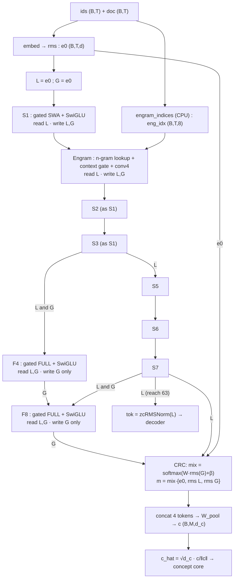

# HRM THINKER — Encoder v1.0 (frozen) · Implementation Specification

*Frozen 2026-09-25. Target: MacBook Air M2, 16 GB, PyTorch on MPS. This document is the single source of truth for the encoder. Appendix A contains a tested reference implementation (`hrm_encoder.py`); if prose and code ever disagree, the code in Appendix A plus the unit tests in §11 win, and the disagreement is a bug in this document.*

---

## 0. How to use this document (for the implementing agent)

1. Read §1–§3 for the picture, §4 for the exact contract (inputs, outputs, shapes).
2. Implement §5 component by component. Every equation has its shape and init next to it.
3. Copy the reference code in **Appendix A** as the starting point; it passes all tests in §11.
4. Before any training run, the unit tests of §11 must pass **bit-exactly** (float64 on CPU).
5. Read §13 (pitfalls) before changing anything. Every item there is a bug that was either made or caught during design.
6. The encoder is one of three modules (encoder → concept core → decoder). The core and decoder are **not** frozen yet; §4.3 gives the interface they must respect. Appendix B gives the stand-in core/decoder used for verification.

Scope: this document freezes the **encoder only**. It does not specify the concept core, the codebook/VQ, the NCP head or the decoder, except for the interface rules they must obey.

---

## 1. What the encoder does, in one paragraph

The encoder reads a packed row of tokens and produces two things: (a) a per-token vector `tok` for the decoder's **token path**, which is guaranteed to depend only on the last **63** tokens, and (b) one **concept vector** `c_hat` per chunk of 4 tokens for the **concept core**, which may depend on the whole past. It keeps two residual streams: **L** (local) receives only local computations (sliding-window attention, short convolutions, n-gram memory) and **G** (global) additionally receives full-attention outputs. The decoder may read only L. Therefore any information from more than 63 tokens back can reach the decoder only by passing through the concept core. This is the design's central guarantee (it prevents the "shell bypass" failure F6 measured in earlier experiments).

---

## 2. Design summary (the frozen decisions)

| # | Decision | Value (M2 config) |
|---|---|---|
| 1 | Width, heads | d = 512, 8 query heads, 2 KV heads (GQA), head dim 64 |
| 2 | FFN | SwiGLU, hidden 1408 |
| 3 | Layer pattern | `S S S F S S S F` (S = gated sliding-window attention layer, F = gated full attention layer), ratio 3:1 |
| 4 | Residual scheme | Gated Residual (Qwen3.8-style) with **two role streams L and G** and read/write masks |
| 5 | SWA | window 8 (keys t−7..t), partial RoPE on 16 of 64 head dims, **no attention sinks** |
| 6 | FULL | NoPE, causal within document, learnable per-head temperature τ_h (no weight decay) |
| 7 | Attention output gate | elementwise sigmoid gate after SDPA (Gated Attention, NeurIPS 2025) |
| 8 | Short convolutions | causal depthwise, kernel 4, dilation 1, residual form, on q, k and v in every attention layer, document-aware |
| 9 | Engram (n-gram memory) | after layer S1; orders {2,3}; 4 hash heads per order; 131,071 rows × 48 dims per table; context gate; conv kernel 4 |
| 10 | CRC to concept core | per-token softmax depth-mix of {e0, L, G} → concat-project pooling over 4 tokens → sphere normalisation |
| 11 | Chunk size | k = 4 (fixed); concept width d_c = d = 512 by default |
| 12 | Token output | zcRMSNorm(L) — reach exactly 63 tokens |
| 13 | Vocabulary | 8,192 byte-level BPE, tied embedding (the decoder's output head reuses `embed.weight`) |
| 14 | Row length | T = 1024 (any multiple of 4 works) |

Parameters (M2 config): **26.84 M non-embedding**, **50.33 M Engram table** (lookup only, no FLOPs), **4.19 M token embedding**. Training cost ≈ **165 MFLOP per token** (T = 1024).

---

## 3. Diagrams

### 3.1 Mermaid (module view)



### 3.2 ASCII (two-lane stream view)

```
                      L stream (local)                 G stream (global)
                      ----------------                 -----------------
 e0 = rms(E[ids]) ──► L = e0                           G = e0
 S1  (SWA)            read L ─► attn ─► +s·y ─────────► +s·y
                      read L ─► FFN  ─► +s·y ─────────► +s·y
 Engram               read L ─► gate·lookup ─► +s·y ──► +s·y
 S2  (SWA)            read L ─► ... writes L and G (as S1)
 S3  (SWA)            read L ─► ... writes L and G (as S1)
 F4  (FULL)           (L is read, never written) ◄──── read L and G ─► attn ─► +s·y
                                                       read L and G ─► FFN  ─► +s·y
 S5  (SWA)            read L ─► ... writes L and G
 S6  (SWA)            read L ─► ... writes L and G
 S7  (SWA)            read L ─► ... writes L and G
 F8  (FULL)           (not written) ◄──────────────── read L and G ─► attn/FFN ─► +s·y
                        │                                   │
                        ▼                                   ▼
               tok = zcRMSNorm(L)           CRC depth-mix {e0, L, G} ─► pool 4→1 ─► sphere
               (B,T,d) → decoder                       c_hat (B,M,d_c) → concept core
```

### 3.3 Reach table (how far back each stream can see after each stage)

| stage | reads | writes | reach of L after the stage | reach of G after the stage |
|---|---|---|---|---|
| e0 | – | L, G | 0 | 0 |
| S1 | L | L, G | 10 | 10 |
| Engram | L | L, G | 13 | 13 |
| S2 | L | L, G | 23 | 23 |
| S3 | L | L, G | 33 | 33 |
| F4 | L, G | G | 33 | whole past |
| S5 | L | L, G | 43 | whole past |
| S6 | L | L, G | 53 | whole past |
| S7 | L | L, G | **63** | whole past |
| F8 | L, G | G | **63** | whole past |

Derivation in §6.

---

## 4. Interface contract

### 4.1 Inputs

| name | dtype | shape | meaning |
|---|---|---|---|
| `ids` | int64 | (B, T) | token ids, 0 ≤ id < V |
| `doc` | int64 | (B, T) | document id of each position in the packed row. Positions with different ids never interact (attention, convolution, n-grams). Padding positions take the id of the document they pad. |
| `eng_idx` | int64 | (B, T, 8) | Engram row indices from `engram_indices(canon_ids, doc, cfg)` (§5.8). Compute on CPU in the data loader. |

Constraints: T % 4 == 0 and **every document length is padded to a multiple of 4** so that no chunk of 4 tokens straddles two documents.

### 4.2 Outputs

| name | shape | meaning |
|---|---|---|
| `tok` | (B, T, d) | token-path vector. `tok[:, t]` depends only on `ids[:, t-63 .. t]` (same document). |
| `c_hat` | (B, M, d_c), M = T/4 | concept vectors, `‖c_hat[b, m]‖ = √d_c`. `c_hat[:, m]` depends on tokens `0 .. 4m+3` (0-indexed), i.e. on its own chunk and everything before it. |
| `aux` | dict | `L`, `G` (B,T,d), `mix` (B,T,3), `engram_alpha` (B,T,1) — for tests and telemetry. |

### 4.3 Rules the concept core and decoder must obey (so the guarantees hold)

1. **The decoder may read `tok` (the L stream) and the core's output. It must never read `aux["G"]` or anything computed from G except through the core.** (Violating this recreates failure F6.)
2. **Causal shift:** the tokens of chunk n (positions 4n..4n+3) may use core outputs of chunks ≤ n−1 only. Chunk n's own concept contains tokens 4n..4n+3, which include future tokens for positions 4n..4n+2.
3. **Latency fact:** under rule 2, a prediction made at position t can use core information only about tokens ≤ 4·⌊t/4⌋ − 1, i.e. 1 to 4 tokens back at best. Anything more recent must come from `tok`, whose 63-token reach covers it.
4. **The core must consume `c_hat` without stop-gradient.** The encoder learns what to put into concepts only through this path (the VQ and NCP losses use `sg(c_hat)` as their target and send no gradient into the encoder).
5. **The decoder must not attend beyond a bounded window over tokens**; its own reach adds to the 63 tokens of `tok` (e.g. two SWA layers of window 8 with kernel-4 convs add 20). The total "shell reach" is a decoder-phase decision.
6. **No closable gate on the only long-range route.** When the decoder injects the core's plan, the injection must not be able to switch itself off (use an ungated add, or a gate with a floor such as s ∈ [0.5, 2]).

---

## 5. Components (equations, shapes, initialisation)

Notation: B batch, T row length, d = 512 model width, H = 8 query heads, H_k = 2 KV heads, d_h = 64 head dim, k = 4 chunk, M = T/k, d_c = 512 concept width, V = 8192 vocabulary. `⊙` is elementwise product, σ is the logistic sigmoid, `rms(x) = x / sqrt(mean(x²) + ε)` over the last dimension with ε = 1e-6.

### 5.1 Configuration

```python
EncoderConfig(vocab_size=8192, d_model=512, n_heads=8, n_kv_heads=2, head_dim=64, d_ff=1408,
              chunk=4, d_concept=0, window=8, rope_dims=16, rope_base=10000.0,
              layer_pattern="SSSFSSSF", engram_after=0, engram_orders=(2, 3), engram_heads=4,
              engram_rows=131071, engram_dim=48, conv_kernel=4, gr_rank=32, gr_read_bias=2.0,
              crc_bias=(-1.0, -1.0, 1.0), eps=1e-6)
```

### 5.2 Norms

**Parameter-free RMS:** `rms(x) = x · (mean_j x_j² + ε)^(-1/2)`. After it, the vector has root-mean-square 1, i.e. Euclidean norm √d: it lies on a sphere of radius √d.

**Zero-centred RMSNorm (zcRMSNorm):**

$$\mathrm{zcRMSNorm}(x) = (1 + \gamma) \odot \mathrm{rms}(x), \qquad \gamma \in \mathbb{R}^{d},\ \gamma_{\text{init}} = 0$$

γ is **weight-decayed**, which pulls the effective scale 1+γ back toward 1 (this is the "zero-centred" idea from Qwen3.8: decay acts on the deviation from 1, not on the scale itself).

### 5.3 Embedding and stream initialisation

$$e_0 = \mathrm{rms}(E[\text{ids}]) \in \mathbb{R}^{B\times T\times d}, \qquad L \leftarrow e_0,\quad G \leftarrow e_0$$

E ∈ ℝ^{V×d}, init N(0, 0.02²), tied with the decoder's output head, no weight decay.

### 5.4 Gated Residual read and write (the block grammar)

Every sublayer (attention or FFN, in every layer) does **read → compute → write**.

**Read** over the set A of streams the sublayer may read (A = {L} for S layers, A = {L, G} for F layers):

$$n_i = \mathrm{rms}(R_i),\qquad g_i = \sigma\big(U_i V_i\, n_i + b_i\big),\qquad x = \frac{1}{|A|}\sum_{i\in A} g_i \odot (1+\gamma_i)\odot n_i$$

| symbol | shape | init | meaning |
|---|---|---|---|
| R_i | (B,T,d) | – | stream i (L or G) |
| V_i | d → r (r = 32), no bias | PyTorch default | low-rank down-projection |
| U_i | r → d, with bias | weight 0, bias +2 | so g_i = σ(2) = 0.881 exactly at init |
| γ_i | d | 0 | zero-centred gain (weight-decayed) |
| x | (B,T,d) | – | the sublayer's input |

g_i is a per-channel, per-token "how much of this stream to read" knob in (0, 1). The average over streams keeps the scale of x independent of how many streams are read.

**Write** to the set W of streams the sublayer may write (W = {L, G} for S layers, W = {G} for F layers), with y the sublayer's output:

$$s = 2\,\sigma(u\,x + a)\in(0,2)^{|W|},\qquad R_i \leftarrow R_i + s_i\, y \quad (i\in W)$$

u: d → |W| linear, **weight and bias initialised to 0**, so s_i = 1 exactly at init (plain residual behaviour). s is a per-token scalar per stream.

**Masks (frozen):**

| sublayer | reads A | writes W |
|---|---|---|
| S layer: attention and FFN | {L} | {L, G} |
| F layer: attention **and FFN** | {L, G} | {G} |
| Engram | {L} | {L, G} |

### 5.5 Short convolution (Canon-style, document-aware)

For a channel vector sequence x ∈ ℝ^{B×T×C}:

$$y_t = x_t + \sum_{i=0}^{3} w_i \odot x_{t-i}\cdot \mathbb{1}[\text{doc}_{t-i} = \text{doc}_t]$$

w ∈ ℝ^{C×4}, **initialised to 0** (so y = x at init; switching the conv off is a clean ablation), no weight decay. Terms with t−i < 0 or from another document are 0. Dilation 1. Why: every key/query/value gets its three predecessors for free, so one attention layer can do what otherwise needs a "previous-token head" plus a matching head (induction in one layer). Cost ≈ 4·C per token, negligible.

### 5.6 Gated attention (S and F variants)

Input x ∈ ℝ^{B×T×d} (from the read).

1. Projections (no bias): q = x W_Q ∈ ℝ^{B×T×(H·d_h)}, k = x W_K ∈ ℝ^{B×T×(H_k·d_h)}, v = x W_V ∈ ℝ^{B×T×(H_k·d_h)}.
2. Short convs (§5.5) on q, k, v separately (channels 512, 128, 128).
3. Reshape to heads: q → (B, H, T, d_h), k, v → (B, H_k, T, d_h).
4. Per-head zcRMSNorm on q and k over d_h (γ ∈ ℝ^{d_h}, init 0). After it ‖q‖ = ‖k‖ ≈ √d_h·(1+γ).
5. **S layers:** partial RoPE on the first 16 dims of each head (pairs (j, j+8) for j < 8), frequencies θ_j = base^{−j/8}, base = 10⁴, angle = position·θ_j:
   $$\begin{pmatrix} a' \\ b' \end{pmatrix} = \begin{pmatrix} \cos\phi & -\sin\phi \\ \sin\phi & \cos\phi \end{pmatrix}\begin{pmatrix} a \\ b \end{pmatrix}$$
   applied to q and k; the remaining 48 dims are untouched.
   **F layers:** NoPE (no rotation) and a per-head temperature: q_h ← τ_h · q_h with τ_h = exp(log τ_h), log τ_h init 0, **no weight decay**. (Scaling q by τ_h multiplies head h's logits by τ_h; SDPA's own `scale` argument is scalar-only, so it cannot do this.)
6. GQA: repeat each KV head H/H_k = 4 times along the head axis (`repeat_interleave(4, dim=1)`).
7. Scaled dot-product attention with a boolean mask (True = may attend):
   $$\mathrm{SDPA}(q,k,v)_t = \sum_j \mathrm{softmax}_j\!\Big(\frac{q_t\cdot k_j}{\sqrt{d_h}} + \text{mask}_{tj}\Big) v_j$$
   - S mask: j ≤ t, doc_j = doc_t, t − j < 8.
   - F mask: j ≤ t, doc_j = doc_t.
   Every position can always attend to itself, so no row is empty (no NaN).
8. Output gate and projection:
   $$y = W_O\big(\mathrm{SDPA} \odot \sigma(x\, W_\theta)\big), \qquad W_\theta \in \mathbb{R}^{d\times H d_h}$$
   The gate lets a head output ≈ 0 when it has nothing to say, which removes the need for attention sinks (sinks would leak the first tokens of the document into the token path).

**Why the temperature (first-principles check):** after QK-norm, the largest possible logit is q·k/√d_h ≈ √d_h = 8. To put probability p on one key among N keys with logits near 0 needs a logit gap Δ = ln N + ln(p/(1−p)); for N = 1024, p = 0.9, Δ = 9.1 > 8; for N = 128k, Δ = 14.0. Weight decay on the zero-centred γ pulls the QK gain toward 1, so without τ the FULL layers could never retrieve sharply. τ_h = 1.75 suffices for 128k keys.

### 5.7 SwiGLU FFN

$$\mathrm{FFN}(x) = W_2\big(\mathrm{SiLU}(x W_1) \odot x W_3\big),\qquad W_1, W_3 \in \mathbb{R}^{512\times1408},\ W_2 \in \mathbb{R}^{1408\times512}$$

No bias. Input from its own read (§5.4); output written with its own write scale.

### 5.8 Engram (n-gram memory), placed after S1

**Canonical ids (offline, once per tokenizer).** For each token id: decode to a string, strip a leading space marker (`" "` or `"Ġ"`), apply Unicode NFKC, lowercase; tokens with the same resulting string share one canonical id. This maps `" Delhi"`, `"Delhi"`, `"delhi"` to one id. Store as an int64 lookup table `canon[V]`; the data loader emits `canon_ids = canon[ids]`.

```python
import unicodedata
def build_canonical_map(tokenizer, V):
    key_to_id, canon = {}, [0] * V
    for i in range(V):
        s = tokenizer.decode([i])
        s = s[1:] if s[:1] in (" ", "Ġ") else s
        s = unicodedata.normalize("NFKC", s).lower()
        canon[i] = key_to_id.setdefault(s, len(key_to_id))
    return torch.tensor(canon, dtype=torch.long)
```

**Keys and hashing (in the data loader, CPU, int64).** For order n ∈ {2, 3} and head h ∈ {0..3} (table index τ = 0..7):

- n-gram at position t: (x_{t−n+1}, …, x_t) of canonical ids, each shifted by +1; any element outside the document (or before the row start) is replaced by the boundary id 0.
- Multiplicative-XOR hash, all arithmetic masked to 61 bits (`& (2**61−1)`) so values stay non-negative:
  `x = FNV_offset & MASK; for i in 0..n−1: x = ((x ^ gram_i) * mult_{τ,i}) & MASK` with `mult_{τ,i}` odd constants (see `engram_indices` in Appendix A).
- Row index = `x mod 131071` + τ · 131071 (all 8 tables live in one `nn.Embedding` of 8·131,071 rows). 131,071 = 2¹⁷ − 1 is prime, hence coprime with V = 2¹³.

**Forward** (L after S1 is the input stream):

$$e_t = \mathrm{concat}_{\tau=0}^{7}\ \mathrm{Table}[\text{eng\_idx}_{t,\tau}] \in \mathbb{R}^{8\cdot48 = 384}$$

$$h = \mathrm{GRRead}(\{L\}),\qquad \kappa_t = W_K e_t,\quad \nu_t = W_V e_t \qquad (W_K, W_V: 384 \to 512)$$

$$\alpha_t = \sigma\!\left(\frac{\mathrm{rms}(h_t)\cdot \mathrm{rms}(\kappa_t)}{\sqrt d}\right) = \sigma\big(\sqrt d\,\cos\angle(h_t,\kappa_t)\big) \in (0,1)$$

$$y = \mathrm{SiLU}\big(\mathrm{ShortConv}_4(\alpha \odot \nu)\big), \qquad L \leftarrow L + s_L\, y,\quad G \leftarrow G + s_G\, y$$

Geometry of the gate: two RMS-normalised vectors have dot product d·cos θ; dividing by √d gives √d·cos θ ≈ 22.6·cos θ at d = 512, so the gate is a sharp switch around cos θ = 0: memory that agrees with the context passes, a hash collision (random direction) is suppressed.

The Engram's ShortConv is initialised **random** (std 0.3), not zero (it is its own module, not a residual on an existing path). Initialisation: tables N(0, 0.02²) (**not zero**), W_V = **0** (output exactly 0 at init), W_K default. At step 0 only W_V receives gradient; W_K and the tables start receiving gradient after the first update (verified). If both tables and W_V were zero, neither would ever get a gradient.

### 5.9 CRC to the concept core: depth-mix, pooling, sphere

**Depth-mix (per token):**

$$\mu_t = \mathrm{softmax}\big(W_\mu\, \mathrm{rms}(G_t) + \beta\big) \in \Delta^3,\qquad m_t = \mu_{t,0}\, e_{0,t} + \mu_{t,1}\, \mathrm{rms}(L_t) + \mu_{t,2}\, \mathrm{rms}(G_t)$$

W_μ ∈ ℝ^{3×d} init 0; β init (−1, −1, +1) → weights (0.107, 0.107, 0.787) at init. e0 is the exact-identity tap (token identity stays linearly available in the concept); L is the local context; G the global context.

**Concat-project pooling (per chunk m = 0..M−1, tokens 4m..4m+3):**

$$c_m = W_{\text{pool}}\,[\,m_{4m};\ m_{4m+1};\ m_{4m+2};\ m_{4m+3}\,],\qquad W_{\text{pool}}\in\mathbb{R}^{d_c\times 4d}$$

Implementation: `m.reshape(B, M, 4*d)` (tokens concatenated in time order) then a bias-free `Linear(4d, d_c)`. Init: W_pool = ¼[P P P P] with P = I if d_c = d (exact mean pooling at init), otherwise P a random semi-orthogonal d_c×d matrix (QR). Geometric meaning: mean pooling projects the 4d-dimensional chunk onto its "diagonal" and discards the 3d-dimensional subspace that encodes which token was where; the learned W_pool chooses which d_c-dimensional subspace to keep.

**Sphere:**

$$\hat c_m = \sqrt{d_c}\;\frac{c_m}{\lVert c_m\rVert + \varepsilon}$$

Every concept has RMS 1; concept scale cannot drift (earlier failure F3). The VQ and NCP targets will use sg(ĉ); the core input uses ĉ **without** stop-gradient.

### 5.10 Token output

$$\text{tok} = \mathrm{zcRMSNorm}(L_{\text{final}}) \in \mathbb{R}^{B\times T\times d}$$

---

## 6. Reach: derivation and invariant

Define the reach of a stream as the largest distance r such that token x_{t−r} can change the stream at position t (within one document). Along a path, look-backs **add**; where two branches merge, take the **maximum**.

- One S layer: its attention query at t uses the conv over x_{t−3..t}; its keys j ∈ [t−7, t] each use the conv over x_{j−3..j}. So the attention adds (8 − 1) + (4 − 1) = **10**; the FFN adds 0.
- S1 alone: 10.
- Engram: its conv (kernel 4, +3) is applied to α⊙ν. ν depends on the n-gram (look-back 2); α depends on h, i.e. on L after S1 (look-back 10). Merge = max(2, 10) = 10, plus the conv 3 → **13**.
- Five more S layers (S2, S3, S5, S6, S7): 13 + 5·10 = **63**.
- F layers write only to G, so they never change L.

**Invariant (proof by induction over sublayers):** L's reach stays bounded because every sublayer that writes L reads only L (S layers, Engram) and has bounded look-back; F sublayers (unbounded look-back) never write L. Hence `tok` has reach exactly 63, and G has unbounded reach. General formula (implemented as `EncoderConfig.reach()`):

reach = max(n_S,before·p, max_order − 1) + (K − 1) + n_S,after·p, with p = (window − 1) + (K − 1).

---

## 7. Shapes, step by step (M2 config, micro-batch B = 4, T = 1024, M = 256)

| step | tensor | shape |
|---|---|---|
| input | ids, doc | (4, 1024) int64 |
| input | eng_idx | (4, 1024, 8) int64 |
| embed | E[ids] → e0, L, G | (4, 1024, 512) |
| read (S) | n_L, g_L, x | (4, 1024, 512) |
| attention | q / k / v after projection | (4, 1024, 512) / (4, 1024, 128) / (4, 1024, 128) |
| attention | q heads / k,v heads | (4, 8, 1024, 64) / (4, 2, 1024, 64) → repeat → (4, 8, 1024, 64) |
| attention | masks (bool) | (4, 1, 1024, 1024) |
| attention | SDPA out → merge heads → gate → W_O | (4, 8, 1024, 64) → (4, 1024, 512) |
| FFN | hidden | (4, 1024, 1408) |
| write | s (S layer) / (F layer) | (4, 1024, 2) / (4, 1024, 1) |
| Engram | table lookup → e | (4, 1024, 8, 48) → (4, 1024, 384) |
| Engram | κ, ν, y / α | (4, 1024, 512) / (4, 1024, 1) |
| CRC | μ / m | (4, 1024, 3) / (4, 1024, 512) |
| pool | m reshaped → c → c_hat | (4, 256, 2048) → (4, 256, 512) |
| output | tok | (4, 1024, 512) |

## 8. Parameter budget (M2 config)

| component | count | per unit |
|---|---:|---|
| 6 × S layer | 18,918,168 | attention 920,704 (q 262,144, k 65,536, v 65,536, o 262,144, gate 262,144, convs 3,072, qk-norm 128) + FFN 2,162,688 + 2 reads × 33,792 + 2 writes × 1,026 = 3,153,028 |
| 2 × F layer | 6,439,188 | attention 920,712 (as S + 8 temperatures) + FFN 2,162,688 + 2 reads × 67,584 + 2 writes × 513 = 3,219,594 |
| Engram (non-table) | 430,082 | W_K 196,608, W_V 196,608, read 33,792, conv 2,048, write 1,026 |
| CRC router + pool + tok_norm | 1,050,627 | router 1,539, pool 1,048,576, tok_norm 512 |
| **total non-embedding** | **26,838,065** | |
| Engram table | 50,331,264 | 8 × 131,071 × 48 |
| token embedding (tied) | 4,194,304 | 8,192 × 512 |

## 9. Initialisation table

| parameter | init | weight decay |
|---|---|---|
| embed | N(0, 0.02²) | no |
| all Linear weights not listed below | PyTorch default (Kaiming-uniform) | yes |
| GRRead U weight / bias | 0 / +2.0 | weight yes, bias no |
| GRRead γ, zcRMSNorm γ (incl. QK-norm, tok_norm) | 0 | **yes** (zero-centred) |
| GRWrite u weight / bias | 0 / 0 (s = 1) | weight yes, bias no |
| ShortConv w in attention (q, k, v) | 0 (identity) | no |
| Engram ShortConv w | N(0, 0.3²) | no |
| FULL log τ_h | 0 (τ = 1) | **no** |
| Engram table | N(0, 0.02²) — **not zero** | **no** |
| Engram W_V | 0 | yes |
| CRC router weight / bias | 0 / (−1, −1, +1) | weight yes, bias no |
| W_pool | ¼[P P P P] (P = I when d_c = d) | yes |

## 10. Training setup on the MacBook Air M2 (16 GB)

**Optimizer.** AdamW, β = (0.9, 0.95), ε = 1e-8, weight decay 0.1 on the "decay" group (see `param_groups` in Appendix A: no decay for Engram table, log τ, embedding, conv kernels, biases). Gradient clipping 1.0. LR 1e-3 peak for d ≤ 256, **6e-4 for d = 512** (encoder is not recurrent; the recurrence-specific LR sensitivity C8 applies to the core), 100–200 warm-up steps, cosine decay to 10%.

**Device.** `device = torch.device("mps")`. Set `PYTORCH_ENABLE_MPS_FALLBACK=1` so any unsupported op falls back to CPU instead of crashing. Do **not** use `torch.compile` on MPS.

**Precision.** Start in float32. bfloat16 autocast (`torch.autocast("mps", dtype=torch.bfloat16)`, macOS 14+) is optional; enable only after a 200-step loss-parity check against float32. Keep the sphere normalisation, softmaxes and losses in float32.

**Data loader.** Produce `ids`, `doc`, and `eng_idx = engram_indices(canon[ids], doc, cfg)` on CPU (int64 bit operations are safest there), then `.to("mps", non_blocking=True)`.

**Memory estimate** (float32, B·T tokens per micro-batch):
- parameters + grads + AdamW states: (26.8 + 50.3 + 4.2) M × 16 bytes ≈ **1.3 GB**;
- activations per layer ≈ 25–30 tensors of size B·T·d plus the attention probabilities; SDPA with an arbitrary boolean mask may use the math path on MPS and store B·H·T² floats per layer (B = 4, T = 1024: 128 MB per layer);
- B = 4, T = 1024 ≈ 4–5 GB total for the encoder alone. Start with B = 2, measure with `torch.mps.current_allocated_memory()`, then raise. Use gradient accumulation to reach 32k–64k tokens per optimizer step.
- If memory is tight: activation checkpointing per layer (`torch.utils.checkpoint`) or lower T to 512.

**Throughput expectation.** ≈ 165 MFLOP per token for the encoder. Earlier E-series runs reached ≈ 0.3 TFLOP/s effective on this machine, i.e. on the order of 1.5–2k tokens/s for the encoder alone; the whole model (core + decoder) will be slower. Measure before planning token budgets.

## 11. Unit tests (must pass before training)

Run in **float64 on CPU** with randomised parameters (so zero-initialised paths do not hide leaks). Compare with **exact equality**, not tolerances: edge contributions at the reach boundary are ~1e-13, and a 1e-12 tolerance wrongly reports reach 62.

| id | test | expected |
|---|---|---|
| T1 | change token p; find the farthest position where L changes | exactly p + 63; `L[p+64:]` bit-identical |
| T2 | same edit; does G change at the end of the row? | yes (G is global) |
| T3 | causality: anything before p changes? | no, in L, G, tok, c_hat |
| T4 | first concept that changes | index ⌊p/4⌋ |
| T5 | two documents in one row; edit a token of document 0 | document 1's L, G, concepts bit-identical |
| T6 | init values at the real size | read gate 0.881, write scale 1.000, mix (0.107, 0.107, 0.787), ‖c_hat‖ = √d_c |
| T7 | Engram gradients at step 0 | W_V gradient ≠ 0 |
| T8 | shapes | tok (B,T,512), c_hat (B,T/4,512) |
| T9 | `EncoderConfig().reach()` | 63 |
| T10 | pooling init with d_c ≠ d (e.g. 1024) | runs, c_hat has width 1024 |

`run_unit_tests()` in Appendix A implements T1–T9.

## 12. Acceptance gates for the encoder (before building the real core)

- **G-E0:** unit tests T1–T10 pass.
- **G-E1:** a linear probe from c_hat recovers the 4 tokens of its chunk at ≥ 99% top-1 (identity preserved).
- **G-E2:** k-means / product-quantisation variance explained on c_hat (codebook capacity).
- **G-E3:** in the harness (Appendix B) the core is used: switching the core off must destroy the long-range task in the two-stream arm and not in the bypass arm (verified in §15).
- **G-E4:** truncation curve: evaluate with the token path truncated to r ∈ {8, 16, 32, 63}; loss should rise as r shrinks, and core-off should cost about the loss gap beyond r.

## 13. Pitfalls (each one breaks a guarantee silently)

1. **Convolutions that ignore document boundaries** leak across packed documents (measured: a change of 25.0 in the next document). Every ShortConv takes `doc`.
2. **Attention sinks** (always attending to the first tokens) leak the start of the document into L. Do not add sinks; the output gate replaces them.
3. **The FFN of an F layer writing L.** Both sublayers of F layers write only G.
4. **Engram n-grams crossing document boundaries.** Use boundary id 0 (see `engram_indices`).
5. **Zero-initialising both the Engram table and W_V** → neither ever learns.
6. **Weight-decaying log τ or the Engram table.** τ must be able to grow; table rows are touched sparsely.
7. **Stop-gradient on the core's input.** The core must consume c_hat directly.
8. **Tolerance-based reach tests.** Use exact equality in float64.
9. **Negative hash values** from int64 overflow. Mask to 61 bits and use `torch.remainder`.
10. **Rows or documents whose length is not a multiple of 4.** Chunks would straddle documents.
11. **Boolean vs additive masks.** In `F.scaled_dot_product_attention`, a boolean mask means True = attend. Do not pass a 0/1 float mask.
12. **RoPE on F layers or on all dims.** RoPE is applied only in S layers and only to the first 16 dims of each head.
13. **GQA repeat on the wrong axis.** Repeat KV heads along the head axis (dim 1 after the transpose) with `repeat_interleave`.
14. **Per-head τ through SDPA's `scale`.** `scale` is a scalar; multiply q by τ_h instead.
15. **Pool reshape order.** `m.reshape(B, M, 4*d)` concatenates tokens 4m, 4m+1, 4m+2, 4m+3 in order; do not transpose.
16. **Engram placed at the input.** It goes after S1 so its gate has context.
17. **Reading G in the decoder** (see §4.3). This recreates F6; the harness in §15 shows the effect.

## 14. Scale path (what changes when scaling toward Kimi K3 / DeepSeek-V4 size)

| component | M2 | scale |
|---|---|---|
| width / vocabulary | 512 / 8k | 4–7k / 128–160k |
| depth | 2 groups of [S S S F] | 3–4 groups |
| window → reach | 8 → 63 | 64 → ≈ 800 with 12 S layers (keep reach ≪ context; decide jointly with the decoder) |
| FULL layers | gated GQA + NoPE + τ | Gated MLA with NoPE (K3) or compressed sparse attention (CSA/HCA, V4); keep τ (or length-aware logit scaling) |
| streams | L, G | 2 local + 2 global; gated residual within a role, masks across roles (mHC's doubly stochastic mixing cannot express one-way flow between roles) |
| Engram | 1 module, orders 2–3 | 2 modules (layer 2 and ≈ L/4), orders 2–4, 8 heads, tables in host memory with prefetch |
| short convs | q, k, v, kernel 4 | same (Inkling keeps 4 convs per layer at 975B) |
| FFN | dense SwiGLU | dense in first layers, MoE after |
| depth routing | none (8 layers barely dilute) | Delta Block AttnRes within each role once depth ≥ 16 (zero-init, gated) |
| optimizer | AdamW | per-head Muon (QK-norm is already per head) |


---

## 15. Verification run (small experiment, 2026-09-25)

Setup: Appendix B (harness) and Appendix C (code). CPU only (the design sandbox has no Apple GPU); small config d = 128, 2.70 M parameters excluding the Engram table; synthetic long-range recall task whose answers lie ≥ 200 tokens after the facts, i.e. far beyond the 83-token token-path reach (63 encoder + 20 stand-in decoder). Chance accuracy on the answers is 1/32 = 3.1%.

### 15.1 Unit tests

All pass (float64, exact equality): reach(L) = 63 exactly, L bit-identical ≥ 64 tokens after an edit, G global, causal, first changed concept = ⌊p/4⌋, zero leakage across documents, init values as specified (read gate 0.881, write scale 1, mix 0.107 / 0.107 / 0.787, ‖c_hat‖ = √d_c), Engram W_V receives gradient at step 0.

### 15.2 Two-stream (frozen design) vs bypass (decoder reads G), 2,000 steps each

| step | two-stream: answer acc | two-stream: core off | bypass: answer acc | bypass: core off | filler loss (both) |
|---:|---:|---:|---:|---:|---:|
| 250 | 0.026 | 0.026 | 0.428 | 0.324 | 1.08 / 1.08 |
| 500 | 0.090 | 0.036 | 0.531 | 0.318 | 1.00 / 1.01 |
| 1000 | 0.155 | 0.037 | 0.559 | 0.383 | 0.98 / 0.98 |
| 1500 | 0.174 | 0.021 | 0.513 | 0.344 | 0.97 / 0.96 |
| 2000 | **0.171** | **0.030** | **0.540** | **0.339** | 0.953 / 0.953 |

### 15.3 Longer two-stream run (3,000 steps, same config, longer cosine schedule)

| step | 500 | 1000 | 1500 | 2000 | 2500 | 3000 |
|---|---:|---:|---:|---:|---:|---:|
| answer accuracy | 0.064 | 0.131 | 0.162 | 0.275 | 0.355 | **0.403** |
| answer accuracy, core off | 0.026 | 0.039 | 0.037 | 0.038 | 0.041 | **0.032** |

Still rising at the end (the schedule, not the model, ended the run).

### 15.4 Linear probes on the 3,000-step checkpoint (where is the answer information?)

| probe | accuracy | reading |
|---|---:|---|
| P1 concept of a fact chunk → its value | **0.999** | the encoder puts the value into the concept essentially losslessly |
| P2 concept of a fact chunk → its key | 0.766 | the key is only partly *linearly* readable (matching may use non-linear features) |
| P4 concept of the query chunk → queried key | 0.927 | the query concept carries its key |
| P3 core output at the query chunk → queried value | **0.421** | ≈ the decoder's answer accuracy (0.403): the bottleneck is retrieval in the 2-layer stand-in core, not the encoder and not the plan decoding |

### 15.5 What the run establishes

1. **The guarantees hold in training, not only in unit tests.** In the two-stream arm, switching the core off drops the long-range answers to chance (0.403 → 0.032); 100% of the long-range skill passes through the concept route.
2. **The F6 failure reproduces when the rule is broken.** When the decoder reads G, it answers 0.34 of the items with the core switched off, i.e. about 63% of its skill bypasses the core.
3. **Local modelling is not hurt by the bounded token path**: filler loss is identical in both arms (0.953).
4. **The encoder side of the concept route works**: the value is 99.9% linearly decodable from its fact concept; the query concept carries its key (92.7%).
5. **Stability**: no NaN, no loss spike; CRC mix moved from (0.107, 0.107, 0.787) to about (0.08–0.15, 0.11–0.20, 0.66–0.81), so the identity and local taps are used; Engram's W_V grew from 0 to ≈ 4.2 (the n-gram memory is active); τ stayed ≈ 1 (as expected at T = 256).
6. **The cost of forcing the route is slower learning**: at 2,000 steps, 0.17 (two-stream) vs 0.54 (bypass). With a longer schedule the two-stream arm reached 0.40 and was still climbing. The probes place the bottleneck in the stand-in core's retrieval, which is the next design phase's job, not the encoder's.

Caveats: synthetic task, CPU, d = 128, one seed per arm; the harness adds a 2× loss term on the answer positions (Appendix B). These results verify mechanics and routing, not language-model quality.

---

## 16. First-principles review of this document

**Checked equation by equation against the tested code:** stream initialisation (§5.3), gated-residual read and write with the exact initialisations (§5.4), masks including the FFN of F layers (§5.4), the residual short convolution and its document mask (§5.5), projections, head shapes, QK-norm, partial-RoPE pair layout and frequencies, per-head temperature via q scaling, GQA repeat axis, boolean mask semantics and the output gate (§5.6), SwiGLU (§5.7), Engram keys / boundary id / 61-bit hash / table offsets / gate geometry / initialisations (§5.8), depth-mix bias, pooling reshape order and init for d_c = d and d_c ≠ d, sphere (§5.9), token output (§5.10). Parameter counts in §8 were read off the instantiated model and add up to 26,838,065. The reach formula (§6) matches `EncoderConfig.reach()` and the measured value, 63.

**Verified by the run:** trainability, stability, exclusive use of the concept route, reproduction of F6 by the bypass arm, identity preservation of the answer-carrying token.

**Not verifiable in the design sandbox (do on the MacBook first):**
1. MPS execution: run `python hrm_encoder.py --mps` (CPU-vs-MPS agreement must be < 1e-3; it also reports memory).
2. The memory estimate in §10 is analytic; measure with B = 2 then B = 4 at T = 1024.
3. bfloat16 autocast: optional; check 200-step loss parity against float32 before using it.

**Open risks carried forward (not encoder defects):**
- The concept route learns more slowly than a direct token path; the core and the plan injection must be designed for learnability (curriculum, core depth, possibly two plan vectors for alignment).
- The key of a fact chunk was only 77% linearly readable from its concept. If gate G-E1 (≥ 99% identity for all 4 tokens) fails at M2 scale on real data, the remedy is a training objective (a small chunk-reconstruction loss from c_hat through the tied embedding), not an architecture change.
- Pre-clip gradient norms were 3–8 throughout (clipping at 1.0 active every step) with no instability; log it on the M2 runs.

**Score after review and verification: 8.8 / 10** (was 8.5 before the run). The routing guarantee, its necessity (the bypass arm) and identity preservation are now measured. The remaining gap is scale-dependent evidence: MPS execution, learnability on real data at d = 512, and the G-E4 truncation curve.

---

## Appendix A. Reference implementation `hrm_encoder.py` (tested)

Save as `hrm_encoder.py`. `python hrm_encoder.py` runs the unit tests (CPU, float64); `python hrm_encoder.py --mps` also runs the CPU-vs-MPS smoke test on the MacBook.

```python
"""HRM THINKER - Encoder v1.0 (frozen).  Reference implementation.

Two role streams:
  L  (local)  : bounded reach (63 tokens at window 8). Only stream the decoder may read.
  G  (global) : includes FULL-attention writes. Read only by the CRC -> concept core.
Layer pattern "SSSFSSSF", Engram after layer index 0 (S1).

Inputs  (all int64, shape (B, T), T % chunk == 0):
  ids        token ids
  doc        document id per position (packing); positions of different docs never interact
  eng_idx    (B, T, n_tables) Engram row indices, precomputed with `engram_indices` (CPU is fine)
Outputs:
  tok        (B, T, d)        normalised L stream  -> decoder token path
  c_hat      (B, M, d_c)      concepts on the sphere radius sqrt(d_c), M = T / chunk -> concept core
  aux        dict(L, G, mix)  for tests / telemetry
"""
from dataclasses import dataclass, field
import math
import torch
import torch.nn as nn
import torch.nn.functional as F


@dataclass
class EncoderConfig:
    vocab_size: int = 8192
    d_model: int = 512
    n_heads: int = 8
    n_kv_heads: int = 2
    head_dim: int = 64
    d_ff: int = 1408
    chunk: int = 4
    d_concept: int = 0            # 0 -> d_model
    window: int = 8               # SWA keys t-window+1 .. t
    rope_dims: int = 16           # partial RoPE on the first rope_dims dims of each head (SWA only)
    rope_base: float = 10000.0
    layer_pattern: str = "SSSFSSSF"
    engram_after: int = 0         # Engram inserted after this layer index
    engram_orders: tuple = (2, 3)
    engram_heads: int = 4
    engram_rows: int = 131071     # prime, coprime with vocab (2^13)
    engram_dim: int = 48
    conv_kernel: int = 4
    gr_rank: int = 32
    gr_read_bias: float = 2.0     # sigmoid(2) = 0.881
    crc_bias: tuple = (-1.0, -1.0, 1.0)   # e0 / L / G -> 0.107 / 0.107 / 0.787
    eps: float = 1e-6

    @property
    def dc(self):
        return self.d_concept or self.d_model

    @property
    def n_tables(self):
        return len(self.engram_orders) * self.engram_heads

    def reach(self):
        """Exact reach of the L stream (tokens back), derived in the spec section 'Reach'."""
        per_swa = (self.window - 1) + (self.conv_kernel - 1)
        n_swa = self.layer_pattern.count("S")
        s_before = self.layer_pattern[: self.engram_after + 1].count("S")
        before = s_before * per_swa                               # reach entering Engram's gate
        engram = max(before, max(self.engram_orders) - 1) + (self.conv_kernel - 1)
        return engram + (n_swa - s_before) * per_swa


# ----------------------------------------------------------------------------- helpers
def rms(x, eps=1e-6):
    return x * torch.rsqrt(x.pow(2).mean(-1, keepdim=True) + eps)


class ZCRMSNorm(nn.Module):
    """y = (1 + gamma) * x / rms(x); gamma initialised to 0 and weight-decayed."""
    def __init__(self, d, eps=1e-6):
        super().__init__()
        self.gamma = nn.Parameter(torch.zeros(d))
        self.eps = eps

    def forward(self, x):
        return rms(x, self.eps) * (1 + self.gamma)


def same_doc_shift_mask(doc, i):
    """(B, T, 1) bool: position t and t-i are in the same document (False for t < i)."""
    T = doc.shape[1]
    prev = F.pad(doc, (i, 0), value=-1)[:, :T]
    return (prev == doc).unsqueeze(-1)


class ShortConv(nn.Module):
    """Causal depthwise conv, kernel K, dilation 1, residual form:
         y_t = x_t + sum_{i=0}^{K-1} w_i * x_{t-i}       (w initialised to 0 -> identity)
       Document-aware: x_{t-i} from another document contributes 0."""
    def __init__(self, channels, kernel=4, zero_init=True):
        super().__init__()
        self.kernel = kernel
        w = torch.zeros(channels, kernel) if zero_init else torch.randn(channels, kernel) * 0.3
        self.w = nn.Parameter(w)

    def forward(self, x, doc):
        T = x.shape[1]
        y = x * (1 + self.w[:, 0])
        for i in range(1, self.kernel):
            xi = F.pad(x, (0, 0, i, 0))[:, :T]
            y = y + xi * same_doc_shift_mask(doc, i) * self.w[:, i]
        return y


class GRRead(nn.Module):
    """Gated-residual read over the allowed streams:
         n_i = rms(R_i),  g_i = sigmoid(U_i V_i n_i + b_i),  x = mean_i g_i * (1+gamma_i) * n_i"""
    def __init__(self, d, n_streams, rank, bias):
        super().__init__()
        self.V = nn.ModuleList([nn.Linear(d, rank, bias=False) for _ in range(n_streams)])
        self.U = nn.ModuleList([nn.Linear(rank, d) for _ in range(n_streams)])
        self.gamma = nn.ParameterList([nn.Parameter(torch.zeros(d)) for _ in range(n_streams)])
        for u in self.U:
            nn.init.zeros_(u.weight)
            nn.init.constant_(u.bias, bias)

    def forward(self, streams):
        out = 0
        for i, R in enumerate(streams):
            n = rms(R)
            out = out + torch.sigmoid(self.U[i](self.V[i](n))) * n * (1 + self.gamma[i])
        return out / len(streams)


class GRWrite(nn.Module):
    """Per-stream write scale s_i = 2 * sigmoid(u_i . x + a_i); u, a initialised to 0 -> s_i = 1."""
    def __init__(self, d, n_streams):
        super().__init__()
        self.u = nn.Linear(d, n_streams)
        nn.init.zeros_(self.u.weight)
        nn.init.zeros_(self.u.bias)

    def forward(self, x):
        return 2 * torch.sigmoid(self.u(x))     # (B, T, n_streams)


def rope_cache(T, rope_dims, base, device, dtype):
    half = rope_dims // 2
    inv = 1.0 / (base ** (torch.arange(half, device=device, dtype=torch.float32) / half))
    ang = torch.arange(T, device=device, dtype=torch.float32)[:, None] * inv[None]
    return ang.cos().to(dtype), ang.sin().to(dtype)


def apply_partial_rope(x, cos, sin, rope_dims):
    half = rope_dims // 2
    a, b, rest = x[..., :half], x[..., half:rope_dims], x[..., rope_dims:]
    return torch.cat([a * cos - b * sin, a * sin + b * cos, rest], dim=-1)


class GatedAttention(nn.Module):
    """kind 'S': sliding window, partial RoPE.  kind 'F': full causal, NoPE, per-head temperature."""
    def __init__(self, cfg: EncoderConfig, kind: str):
        super().__init__()
        c = cfg
        self.cfg, self.kind = c, kind
        H, Hk, dh, d = c.n_heads, c.n_kv_heads, c.head_dim, c.d_model
        self.q = nn.Linear(d, H * dh, bias=False)
        self.k = nn.Linear(d, Hk * dh, bias=False)
        self.v = nn.Linear(d, Hk * dh, bias=False)
        self.o = nn.Linear(H * dh, d, bias=False)
        self.gate = nn.Linear(d, H * dh, bias=False)
        self.conv_q = ShortConv(H * dh, c.conv_kernel)
        self.conv_k = ShortConv(Hk * dh, c.conv_kernel)
        self.conv_v = ShortConv(Hk * dh, c.conv_kernel)
        self.q_norm = ZCRMSNorm(dh)
        self.k_norm = ZCRMSNorm(dh)
        self.log_tau = nn.Parameter(torch.zeros(H)) if kind == "F" else None

    def forward(self, x, doc, mask, rope):
        B, T, _ = x.shape
        c = self.cfg
        H, Hk, dh = c.n_heads, c.n_kv_heads, c.head_dim
        q = self.conv_q(self.q(x), doc).view(B, T, H, dh).transpose(1, 2)
        k = self.conv_k(self.k(x), doc).view(B, T, Hk, dh).transpose(1, 2)
        v = self.conv_v(self.v(x), doc).view(B, T, Hk, dh).transpose(1, 2)
        q, k = self.q_norm(q), self.k_norm(k)
        if self.kind == "S":
            cos, sin = rope
            q = apply_partial_rope(q, cos, sin, c.rope_dims)
            k = apply_partial_rope(k, cos, sin, c.rope_dims)
        else:
            q = q * self.log_tau.exp().view(1, H, 1, 1)          # logits * tau_h
        rep = H // Hk
        k = k.repeat_interleave(rep, dim=1)
        v = v.repeat_interleave(rep, dim=1)
        y = F.scaled_dot_product_attention(q, k, v, attn_mask=mask)   # mask: True = attend
        y = y.transpose(1, 2).reshape(B, T, H * dh)
        return self.o(y * torch.sigmoid(self.gate(x)))


class SwiGLU(nn.Module):
    def __init__(self, d, f):
        super().__init__()
        self.w1 = nn.Linear(d, f, bias=False)
        self.w3 = nn.Linear(d, f, bias=False)
        self.w2 = nn.Linear(f, d, bias=False)

    def forward(self, x):
        return self.w2(F.silu(self.w1(x)) * self.w3(x))


class EncoderLayer(nn.Module):
    """'S': reads {L}, writes {L, G}.  'F': reads {L, G}, writes {G} (attention AND FFN)."""
    def __init__(self, cfg: EncoderConfig, kind: str):
        super().__init__()
        self.kind = kind
        n_read, n_write = (1, 2) if kind == "S" else (2, 1)
        d = cfg.d_model
        self.read_attn = GRRead(d, n_read, cfg.gr_rank, cfg.gr_read_bias)
        self.write_attn = GRWrite(d, n_write)
        self.read_ffn = GRRead(d, n_read, cfg.gr_rank, cfg.gr_read_bias)
        self.write_ffn = GRWrite(d, n_write)
        self.attn = GatedAttention(cfg, kind)
        self.ffn = SwiGLU(d, cfg.d_ff)

    def _apply(self, L, G, y, s):
        if self.kind == "S":
            return L + s[..., 0:1] * y, G + s[..., 1:2] * y
        return L, G + s[..., 0:1] * y

    def forward(self, L, G, doc, mask, rope):
        x = self.read_attn([L] if self.kind == "S" else [L, G])
        L, G = self._apply(L, G, self.attn(x, doc, mask, rope), self.write_attn(x))
        x = self.read_ffn([L] if self.kind == "S" else [L, G])
        L, G = self._apply(L, G, self.ffn(x), self.write_ffn(x))
        return L, G


# ----------------------------------------------------------------------------- Engram
_MASK61 = (1 << 61) - 1


def engram_indices(canon_ids, doc, cfg: EncoderConfig):
    """(B, T) canonical ids + doc ids -> (B, T, n_tables) int64 row indices (already offset per table).
    Order-n key at t = (x_{t-n+1}, ..., x_t); a position in another document is replaced by boundary id 0,
    real ids are shifted by +1. Hash: multiplicative-XOR, masked to 61 bits, then mod rows (prime)."""
    B, T = canon_ids.shape
    grams = []
    for i in range(max(cfg.engram_orders)):
        prev = F.pad(canon_ids, (i, 0))[:, :T] + 1
        ok = same_doc_shift_mask(doc, i).squeeze(-1)
        grams.append(torch.where(ok, prev, torch.zeros_like(prev)))
    out, table = [], 0
    for n in cfg.engram_orders:
        for h in range(cfg.engram_heads):
            x = torch.full_like(canon_ids, 1469598103934665603 & _MASK61)
            for i in range(n):
                mult = (0x9E3779B97F4A7C15 + 0x632BE59BD9B4E019 * (table * 8 + i + 1)) & _MASK61 | 1
                x = ((x ^ grams[i]) * mult) & _MASK61
            out.append(torch.remainder(x, cfg.engram_rows) + table * cfg.engram_rows)
            table += 1
    return torch.stack(out, dim=-1)


class Engram(nn.Module):
    def __init__(self, cfg: EncoderConfig):
        super().__init__()
        c, d = cfg, cfg.d_model
        self.table = nn.Embedding(c.n_tables * c.engram_rows, c.engram_dim)
        nn.init.normal_(self.table.weight, std=0.02)           # small random, NOT zero
        de = c.n_tables * c.engram_dim
        self.Wk = nn.Linear(de, d, bias=False)
        self.Wv = nn.Linear(de, d, bias=False)
        nn.init.zeros_(self.Wv.weight)                          # output exactly 0 at init
        self.read = GRRead(d, 1, c.gr_rank, c.gr_read_bias)
        self.conv = ShortConv(d, c.conv_kernel, zero_init=False)
        self.write = GRWrite(d, 2)
        self.d = d

    def forward(self, L, G, eng_idx, doc):
        B, T, _ = eng_idx.shape
        e = self.table(eng_idx).reshape(B, T, -1)              # (B, T, n_tables*engram_dim)
        h = self.read([L])
        k, v = self.Wk(e), self.Wv(e)
        alpha = torch.sigmoid((rms(h) * rms(k)).sum(-1, keepdim=True) / math.sqrt(self.d))
        y = F.silu(self.conv(alpha * v, doc))
        s = self.write(h)
        return L + s[..., 0:1] * y, G + s[..., 1:2] * y, alpha


# ----------------------------------------------------------------------------- masks
def build_masks(doc, window):
    """Boolean (B, 1, T, T) masks, True = may attend.  SWA: causal & same doc & t-j < window.  FULL: causal & same doc."""
    T = doc.shape[1]
    i = torch.arange(T, device=doc.device)
    causal = i[None, :] <= i[:, None]
    same = doc[:, :, None] == doc[:, None, :]
    full = (causal[None] & same).unsqueeze(1)
    swa = full & ((i[:, None] - i[None, :]) < window)[None, None]
    return swa, full


# ----------------------------------------------------------------------------- encoder
class Encoder(nn.Module):
    def __init__(self, cfg: EncoderConfig = EncoderConfig()):
        super().__init__()
        c = cfg
        assert c.n_heads % c.n_kv_heads == 0 and c.rope_dims % 2 == 0 and c.rope_dims <= c.head_dim
        assert set(c.layer_pattern) <= {"S", "F"} and c.layer_pattern[c.engram_after] == "S"
        self.cfg = c
        d, dc, k = c.d_model, c.dc, c.chunk
        self.embed = nn.Embedding(c.vocab_size, d)
        nn.init.normal_(self.embed.weight, std=0.02)
        self.layers = nn.ModuleList([EncoderLayer(c, kind) for kind in c.layer_pattern])
        self.engram = Engram(c)
        self.crc_router = nn.Linear(d, 3)
        nn.init.zeros_(self.crc_router.weight)
        with torch.no_grad():
            self.crc_router.bias.copy_(torch.tensor(c.crc_bias))
        self.pool = nn.Linear(k * d, dc, bias=False)
        with torch.no_grad():
            if dc == d:
                P = torch.eye(d)
            elif dc > d:
                P = torch.linalg.qr(torch.randn(dc, d))[0]        # (dc, d), orthonormal columns
            else:
                P = torch.linalg.qr(torch.randn(d, dc))[0].T      # (dc, d), orthonormal rows
            self.pool.weight.copy_(torch.cat([P] * k, dim=1) / k)  # mean pooling (projected)
        self.tok_norm = ZCRMSNorm(d)

    def forward(self, ids, doc, eng_idx):
        c = self.cfg
        B, T = ids.shape
        assert T % c.chunk == 0, "pad rows so that T and every document length are multiples of chunk"
        swa_mask, full_mask = build_masks(doc, c.window)
        cos, sin = rope_cache(T, c.rope_dims, c.rope_base, ids.device, self.embed.weight.dtype)
        e0 = rms(self.embed(ids))
        L, G = e0, e0
        alpha = None
        for li, layer in enumerate(self.layers):
            mask = swa_mask if layer.kind == "S" else full_mask
            L, G = layer(L, G, doc, mask, (cos, sin))
            if li == c.engram_after:
                L, G, alpha = self.engram(L, G, eng_idx, doc)
        mix = torch.softmax(self.crc_router(rms(G)), dim=-1)                 # (B, T, 3)
        m = mix[..., 0:1] * e0 + mix[..., 1:2] * rms(L) + mix[..., 2:3] * rms(G)
        M = T // c.chunk
        cvec = self.pool(m.reshape(B, M, c.chunk * c.d_model))               # (B, M, dc)
        c_hat = math.sqrt(c.dc) * cvec / (cvec.norm(dim=-1, keepdim=True) + c.eps)
        return self.tok_norm(L), c_hat, dict(L=L, G=G, mix=mix, engram_alpha=alpha)


def param_groups(model, weight_decay=0.1):
    """No weight decay: Engram table, FULL temperatures, token embedding, conv kernels, biases.
    Weight decay: all matrices and the zero-centred norm gammas (pulls effective scale to 1)."""
    decay, no_decay = [], []
    for n, p in model.named_parameters():
        if ("engram.table" in n or "log_tau" in n or n.startswith("embed.") or n.endswith("conv_q.w")
                or n.endswith("conv_k.w") or n.endswith("conv_v.w") or n.endswith("conv.w") or n.endswith(".bias")):
            no_decay.append(p)
        else:
            decay.append(p)
    return [dict(params=decay, weight_decay=weight_decay), dict(params=no_decay, weight_decay=0.0)]


# ----------------------------------------------------------------------------- unit tests
def _randomize(model, scale=0.2):
    with torch.no_grad():
        for n, p in model.named_parameters():
            if "engram.table" not in n:
                p.add_(torch.randn_like(p) * scale)


def run_unit_tests(verbose=True):
    torch.manual_seed(0)
    old = torch.get_default_dtype()
    torch.set_default_dtype(torch.float64)
    cfg = EncoderConfig(vocab_size=64, d_model=64, n_heads=4, n_kv_heads=2, head_dim=16, d_ff=128,
                        rope_dims=8, engram_rows=1021, engram_dim=8)
    enc = Encoder(cfg)
    _randomize(enc)
    enc.eval()
    T, p = 256, 100
    ids = torch.randint(0, 64, (1, T))
    doc = torch.zeros(1, T, dtype=torch.long)
    ids2 = ids.clone()
    ids2[0, p] = (ids[0, p] + 7) % 64
    with torch.no_grad():
        _, c1, a = enc(ids, doc, engram_indices(ids, doc, cfg))
        _, c2, b = enc(ids2, doc, engram_indices(ids2, doc, cfg))
    dL = (a["L"] - b["L"]).abs().amax(-1)[0]
    dG = (a["G"] - b["G"]).abs().amax(-1)[0]
    R = cfg.reach()
    got = int(torch.nonzero(dL != 0).max()) - p
    assert R == 63 and got == R, (R, got)
    assert torch.equal(a["L"][0, p + R + 1:], b["L"][0, p + R + 1:])
    assert dG[-1] != 0
    assert not (dL[:p] != 0).any() and not (dG[:p] != 0).any()
    first_c = int(torch.nonzero((c1 - c2).abs().amax(-1)[0] != 0).min())
    assert first_c == p // cfg.chunk
    # document isolation
    doc2 = torch.zeros(1, T, dtype=torch.long)
    doc2[0, 128:] = 1
    ids3 = ids.clone()
    ids3[0, 126] = (ids[0, 126] + 5) % 64
    with torch.no_grad():
        _, c3, y1 = enc(ids, doc2, engram_indices(ids, doc2, cfg))
        _, c4, y2 = enc(ids3, doc2, engram_indices(ids3, doc2, cfg))
    assert torch.equal(y1["L"][0, 128:], y2["L"][0, 128:]) and torch.equal(y1["G"][0, 128:], y2["G"][0, 128:])
    assert torch.equal(c3[0, 32:], c4[0, 32:])
    torch.set_default_dtype(old)
    # init values at the real size
    cfg = EncoderConfig()
    enc = Encoder(cfg)
    ids = torch.randint(0, cfg.vocab_size, (2, 128))
    doc = torch.zeros(2, 128, dtype=torch.long)
    tok, c_hat, aux = enc(ids, doc, engram_indices(ids, doc, cfg))
    mix = aux["mix"].mean((0, 1)).tolist()
    assert abs(mix[2] - 0.787) < 0.01 and abs(mix[0] - 0.107) < 0.01
    assert torch.allclose(c_hat.norm(dim=-1), torch.full_like(c_hat[..., 0], math.sqrt(cfg.dc)), rtol=1e-4)
    assert tok.shape == (2, 128, 512) and c_hat.shape == (2, 32, 512)
    (tok.pow(2).mean() + c_hat.sum() * 1e-3).backward()
    assert enc.engram.Wv.weight.grad.abs().sum() > 0
    n_non = sum(p.numel() for n, p in enc.named_parameters() if not n.startswith("embed.") and "engram.table" not in n)
    n_tab = enc.engram.table.weight.numel()
    if verbose:
        print(f"unit tests PASS | reach(L)={R} | mix at init={[round(v, 3) for v in mix]}")
        print(f"params: non-embedding {n_non/1e6:.2f}M, Engram table {n_tab/1e6:.2f}M, embedding {enc.embed.weight.numel()/1e6:.2f}M")
    return True


def mps_smoke_test(B=2, T=1024):
    """Run on the MacBook: CPU vs MPS forward agreement, one backward pass, memory report."""
    if not torch.backends.mps.is_available():
        print("MPS not available on this machine; skipping")
        return
    torch.manual_seed(0)
    cfg = EncoderConfig()
    enc = Encoder(cfg)
    ids = torch.randint(0, cfg.vocab_size, (B, T))
    doc = torch.zeros(B, T, dtype=torch.long)
    doc[:, T // 2:] = 1                                   # two documents per row
    eidx = engram_indices(ids, doc, cfg)                  # computed on CPU
    with torch.no_grad():
        tok_c, ch_c, _ = enc(ids, doc, eidx)
    enc = enc.to("mps")
    dev = lambda x: x.to("mps")
    tok_m, ch_m, _ = enc(dev(ids), dev(doc), dev(eidx))
    d_tok = (tok_m.detach().cpu() - tok_c).abs().max().item()
    d_ch = (ch_m.detach().cpu() - ch_c).abs().max().item()
    (tok_m.pow(2).mean() + ch_m.sum() * 1e-3).backward()
    torch.mps.synchronize()
    print(f"MPS vs CPU max abs diff: tok {d_tok:.2e}, c_hat {d_ch:.2e} (expect < 1e-3)")
    print(f"MPS allocated after backward: {torch.mps.current_allocated_memory() / 2**30:.2f} GiB (B={B}, T={T})")


if __name__ == "__main__":
    import sys
    run_unit_tests()
    if "--mps" in sys.argv:
        mps_smoke_test()
```

---

## Appendix B. Verification harness (stand-in core and decoder)

Purpose: check, before designing the real core and decoder, that (1) the encoder trains stably, (2) information beyond the token-path reach really can travel through the concept route, and (3) the two-stream design forces that route while an NCP-style token path bypasses it (the F6 failure). The stand-ins are deliberately simple; they are **not** the future core/decoder designs.

**Model (d = 128 small config).**
- Encoder v1.0 exactly as specified, with d = 128, 4 query / 2 KV heads of dim 32, d_ff = 352, rope_dims = 8, Engram 4,099 rows × 16 dims, gr_rank = 16. 2.7 M parameters excluding the Engram table.
- Stand-in core: 2 blocks of single-stream PreNorm, gated FULL attention over the M = 64 concepts (NoPE, τ, causal), SwiGLU; input c_hat without stop-gradient; output z (B, M, 128) after zcRMSNorm.
- Plan injection (rule §4.3-2): tokens of chunk n receive W_plan·z_{n−1} (zero for chunk 0 or across documents), repeated over the 4 tokens and **added without a gate** (rule §4.3-6).
- Stand-in decoder: 2 single-stream PreNorm gated SWA blocks (window 8, kernel-4 convs), zcRMSNorm, tied output head. Decoder reach 2 × 10 = 20, so total token-path reach = 63 + 20 = 83.
- Arm `two_stream`: decoder input = tok (L) + plan. Arm `bypass`: decoder input = zcRMSNorm(G) + plan (the NCP-style token path that carries FULL-attention information directly).

**Task (synthetic, V = 512, T = 256, one document per row).**

```
[BOS P P P] [F k1 v1 S] [F k2 v2 S] [F k3 v3 S] [F k4 v4 S]  ~204 tokens of Markov filler  [Q kj P P][P P P vj] x4
 chunk 0     chunks 1-4 (facts)                               chunks 5-55                   chunks 56-63 (queries)
```

- 32 possible keys, 32 possible values (chance = 1/32 = 3.1%); filler from a fixed random sparse bigram chain over 412 token ids (4 successors per token).
- Each value is predicted at the position just before it (last P of its second query chunk), which, by the causal shift, reads the core output of the chunk holding `Q kj`. The fact is ≥ 200 tokens earlier, far beyond the 83-token token-path reach, so in the two-stream arm the answer is only reachable through the core.
- Loss = next-token cross-entropy over all positions + 2.0 × cross-entropy at the 4 answer positions (the answers are 4 of 255 targets; the extra term gives them a usable signal on a CPU budget).

**Training.** AdamW (0.9, 0.95), weight decay 0.1 with `param_groups`, LR 1e-3, 100 warm-up steps, cosine to 10%, clip 1.0, batch 16 rows × 256 tokens, 2,000 steps, float32, CPU (2 threads total).

**Evaluation** (8 fixed batches × 32 rows): filler loss (local modelling), answer accuracy, and answer accuracy with the core switched off (plan zeroed).

---

## Appendix C. Harness code `harness.py` (used for §15)

Run: `python harness.py --arm two_stream --steps 2000` and `python harness.py --arm bypass --steps 2000`.

```python
"""Verification harness for Encoder v1.0: encoder + stand-in concept core + stand-in decoder.

Task (synthetic, V=512, T=256, one document per row):
  [BOS P P P] [F k v S]x4 facts | ~204 tokens of local Markov filler | 4 queries: [Q k P P][P P P v]
The value v is >200 tokens after its fact, far beyond the token-path reach (encoder 63 + decoder 20 = 83),
so it can only be predicted through the concept core (two-stream arm) or through G (bypass arm).

Arms:
  two_stream : decoder reads L (the frozen design)
  bypass     : decoder reads G instead (NCP-style token path; the F6 failure mode)
Eval ablation: plan zeroed ("core off").
"""
import math, time, json, sys, argparse
import torch, torch.nn as nn, torch.nn.functional as F
from hrm_encoder import (EncoderConfig, Encoder, engram_indices, param_groups, rms, ZCRMSNorm,
                         GatedAttention, SwiGLU, ShortConv, build_masks, rope_cache)

PAD, F_, S_, Q_, P_, BOS = 0, 1, 2, 3, 4, 5
KEYS = list(range(10, 42))        # 32 keys
VALS = list(range(42, 74))        # 32 values
FILL0, V = 100, 512
N_FACTS, T = 4, 256


class MarkovFiller:
    def __init__(self, seed=0, branching=4):
        g = torch.Generator().manual_seed(seed)
        n = V - FILL0
        self.succ = torch.randint(0, n, (n, branching), generator=g) + FILL0
        self.prob = torch.softmax(torch.randn(n, branching, generator=g) * 1.5, -1)

    def sample(self, length, g):
        out = [int(torch.randint(FILL0, V, (1,), generator=g))]
        for _ in range(length - 1):
            row = out[-1] - FILL0
            j = int(torch.multinomial(self.prob[row], 1, generator=g))
            out.append(int(self.succ[row, j]))
        return out


def make_batch(B, filler, g):
    ids = torch.zeros(B, T, dtype=torch.long)
    vpos = torch.zeros(B, N_FACTS, dtype=torch.long)
    for b in range(B):
        keys = torch.tensor(KEYS)[torch.randperm(len(KEYS), generator=g)[:N_FACTS]]
        vals = torch.tensor(VALS)[torch.randint(0, len(VALS), (N_FACTS,), generator=g)]
        seq = [BOS, P_, P_, P_]
        for k, v in zip(keys.tolist(), vals.tolist()):
            seq += [F_, k, v, S_]
        n_fill = T - len(seq) - 8 * N_FACTS
        seq += filler.sample(n_fill, g)
        order = torch.randperm(N_FACTS, generator=g).tolist()
        for qi, j in enumerate(order):
            vpos[b, qi] = len(seq) + 7
            seq += [Q_, keys[j].item(), P_, P_, P_, P_, P_, vals[j].item()]
        ids[b] = torch.tensor(seq)
    return ids, vpos


class DecLayer(nn.Module):
    """Single-stream PreNorm SWA block reusing the encoder's gated attention (stand-in decoder)."""
    def __init__(self, cfg):
        super().__init__()
        self.n1, self.n2 = ZCRMSNorm(cfg.d_model), ZCRMSNorm(cfg.d_model)
        self.attn, self.ffn = GatedAttention(cfg, "S"), SwiGLU(cfg.d_model, cfg.d_ff)

    def forward(self, h, doc, mask, rope):
        h = h + self.attn(self.n1(h), doc, mask, rope)
        return h + self.ffn(self.n2(h))


class CoreLayer(nn.Module):
    """Stand-in concept core block: full causal attention over concepts (NoPE, gated), SwiGLU."""
    def __init__(self, cfg):
        super().__init__()
        self.n1, self.n2 = ZCRMSNorm(cfg.d_model), ZCRMSNorm(cfg.d_model)
        self.attn, self.ffn = GatedAttention(cfg, "F"), SwiGLU(cfg.d_model, cfg.d_ff)

    def forward(self, z, cdoc, mask):
        z = z + self.attn(self.n1(z), cdoc, mask, None)
        return z + self.ffn(self.n2(z))


class Harness(nn.Module):
    def __init__(self, cfg, arm="two_stream", n_core=2, n_dec=2):
        super().__init__()
        self.cfg, self.arm = cfg, arm
        self.enc = Encoder(cfg)
        self.core = nn.ModuleList([CoreLayer(cfg) for _ in range(n_core)])
        self.core_norm = ZCRMSNorm(cfg.d_model)
        self.plan = nn.Linear(cfg.dc, cfg.d_model, bias=False)
        self.dec = nn.ModuleList([DecLayer(cfg) for _ in range(n_dec)])
        self.out_norm = ZCRMSNorm(cfg.d_model)

    def forward(self, ids, doc, eng_idx, core_off=False):
        c = self.cfg
        B, T_ = ids.shape
        tok, c_hat, aux = self.enc(ids, doc, eng_idx)
        # concept core (consumes c_hat WITHOUT stop-gradient)
        cdoc = doc[:, ::c.chunk]
        _, cmask = build_masks(cdoc, 1)
        z = c_hat
        for layer in self.core:
            z = layer(z, cdoc, cmask)
        z = self.core_norm(z)
        # causal shift: tokens of chunk n read core output of chunk n-1 (zero for n=0 or doc change)
        zp = F.pad(z, (0, 0, 1, 0))[:, :-1]
        same = (F.pad(cdoc, (1, 0), value=-1)[:, :-1] == cdoc).unsqueeze(-1)
        zp = zp * same
        if core_off:
            zp = torch.zeros_like(zp)
        plan = self.plan(zp).repeat_interleave(c.chunk, dim=1)           # (B, T, d)
        base = tok if self.arm == "two_stream" else self.enc.tok_norm(aux["G"])
        h = base + plan
        swa, _ = build_masks(doc, c.window)
        rope = rope_cache(T_, c.rope_dims, c.rope_base, ids.device, h.dtype)
        for layer in self.dec:
            h = layer(h, doc, swa, rope)
        logits = self.out_norm(h) @ self.enc.embed.weight.T                # tied head
        return logits, aux


def evaluate(model, batches, core_off=False):
    model.eval()
    tot, n, vc, vn, fl, fn = 0.0, 0, 0, 0, 0.0, 0
    with torch.no_grad():
        for ids, vpos, eidx in batches:
            doc = torch.zeros_like(ids)
            logits, _ = model(ids, doc, eidx, core_off=core_off)
            lp = F.log_softmax(logits[:, :-1], -1)
            tgt = ids[:, 1:]
            nll = -lp.gather(-1, tgt[..., None])[..., 0]
            tot += nll.sum().item(); n += nll.numel()
            fmask = (tgt >= FILL0)
            fl += nll[fmask].sum().item(); fn += fmask.sum().item()
            pred = logits.argmax(-1)
            for b in range(ids.shape[0]):
                for p in vpos[b].tolist():
                    vc += int(pred[b, p - 1] == ids[b, p]); vn += 1
    model.train()
    return dict(loss=tot / n, filler_loss=fl / fn, value_acc=vc / vn)


def main():
    ap = argparse.ArgumentParser()
    ap.add_argument("--arm", default="two_stream")
    ap.add_argument("--steps", type=int, default=2000)
    ap.add_argument("--bs", type=int, default=16)
    ap.add_argument("--lr", type=float, default=1e-3)
    ap.add_argument("--seed", type=int, default=0)
    ap.add_argument("--out", default="result.json")
    ap.add_argument("--threads", type=int, default=1)
    ap.add_argument("--value_weight", type=float, default=2.0)
    a = ap.parse_args()
    torch.manual_seed(a.seed)
    torch.set_num_threads(a.threads)
    cfg = EncoderConfig(vocab_size=V, d_model=128, n_heads=4, n_kv_heads=2, head_dim=32, d_ff=352,
                        rope_dims=8, engram_rows=4099, engram_dim=16, gr_rank=16)
    model = Harness(cfg, a.arm)
    n_par = sum(p.numel() for n, p in model.named_parameters() if "engram.table" not in n)
    opt = torch.optim.AdamW(param_groups(model, 0.1), lr=a.lr, betas=(0.9, 0.95))
    sched = torch.optim.lr_scheduler.LambdaLR(
        opt, lambda s: min(1.0, (s + 1) / 100) * (0.1 + 0.9 * 0.5 * (1 + math.cos(math.pi * min(s, a.steps) / a.steps))))
    filler = MarkovFiller(seed=123)
    gtrain = torch.Generator().manual_seed(1000 + a.seed)
    geval = torch.Generator().manual_seed(999)
    evalb = []
    for _ in range(8):
        ids, vpos = make_batch(32, filler, geval)
        evalb.append((ids, vpos, engram_indices(ids, torch.zeros_like(ids), cfg)))
    log, t0 = [], time.time()
    for step in range(1, a.steps + 1):
        ids, vpos = make_batch(a.bs, filler, gtrain)
        doc = torch.zeros_like(ids)
        eidx = engram_indices(ids, doc, cfg)
        logits, aux = model(ids, doc, eidx)
        loss = F.cross_entropy(logits[:, :-1].reshape(-1, V), ids[:, 1:].reshape(-1))
        # extra term on the long-range answer positions (prediction made at vpos-1)
        bidx = torch.arange(ids.shape[0])[:, None].expand_as(vpos)
        vlog = logits[bidx, vpos - 1]                        # (B, N_FACTS, V)
        loss = loss + a.value_weight * F.cross_entropy(vlog.reshape(-1, V), ids[bidx, vpos].reshape(-1))
        opt.zero_grad(set_to_none=True)
        loss.backward()
        gn = torch.nn.utils.clip_grad_norm_(model.parameters(), 1.0)
        opt.step(); sched.step()
        if not torch.isfinite(loss):
            print("NON-FINITE LOSS", step); break
        if step % 250 == 0 or step == a.steps:
            ev = evaluate(model, evalb)
            ev_off = evaluate(model, evalb, core_off=True)
            rec = dict(step=step, train_loss=loss.item(), grad_norm=float(gn), **ev,
                       value_acc_core_off=ev_off["value_acc"], loss_core_off=ev_off["loss"],
                       engram_Wv=float(model.enc.engram.Wv.weight.detach().norm()),
                       mix=[round(x, 3) for x in aux["mix"].mean((0, 1)).tolist()],
                       tau=[round(x, 3) for x in model.enc.layers[3].attn.log_tau.exp().tolist()],
                       sec=round(time.time() - t0))
            log.append(rec)
            print(json.dumps(rec), flush=True)
    json.dump(dict(arm=a.arm, params_non_table=n_par, log=log), open(a.out, "w"), indent=1)
    torch.save(model.state_dict(), a.out.replace(".json", ".pt"))


if __name__ == "__main__":
    main()
```
