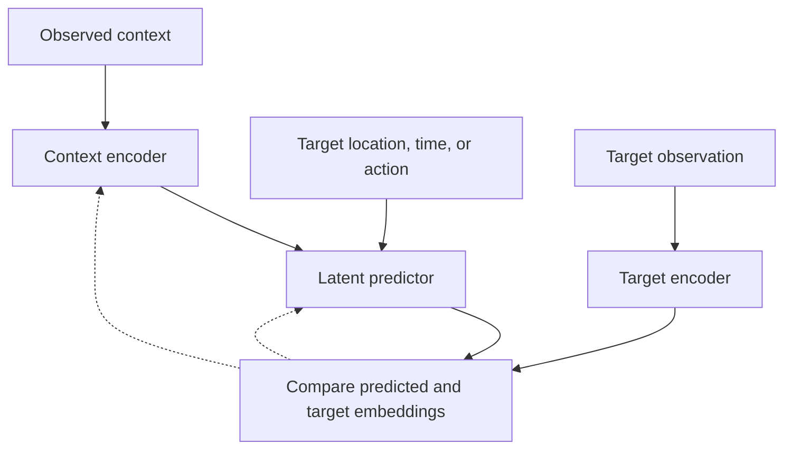

# JEPA Architecture Papers: A Categorized Research Catalog

**Compiled:** 14 October 2026  
**Coverage:** 155 distinct arXiv papers, plus the original 2022 position paper, organized into 19 sections.

This is a broad, curated catalog of the Joint-Embedding Predictive Architecture (JEPA) literature: core architectures, hierarchical models, domain extensions, training theory, probabilistic prediction, world models, planning, adaptation, and evaluation. It also includes a clearly marked selection of related foundations and comparison baselines. It is not a guarantee of every publication that mentions or cites JEPA.

Each paper has a verified primary-source title or version title, a link, and a short description of its role. Descriptions summarize the proposed mechanism or study; they are not independent endorsements of the authors' performance claims. Years refer to initial preprint metadata where available, otherwise to the arXiv identifier year, rather than conference publication year. Different versions of the same arXiv record count as one paper.

## Quick orientation

An **embedding** is a learned vector representation of an observation. A JEPA learns to predict a target embedding from an observed context, rather than making raw pixels or discrete tokens its only prediction target. Depending on the model, that target may describe a masked image region, a future video state, a text answer, a subgraph, or another modality.

A typical training pattern is:

The dotted arrows indicate training updates. Target-encoder updates and collapse prevention vary across papers: moving-average targets, fixed teachers, explicit regularization, or probabilistic objectives are different design choices. Image masking alone does not make a model a simulator of action consequences, and a JEPA training objective does not prevent a larger system from also having a text, image, or action decoder.

## Suggested reading roadmap

| Phase | Question to answer | Starting papers |
| --- | --- | --- |
| 1 — Learn representations | Why predict embeddings, and how do we avoid learning a constant representation? | The 2022 position paper; the energy-based-model tutorial; I-JEPA; V-JEPA; LeJEPA; the slow-feature and noisy-feature analyses. |
| 2 — Predict, plan, and build hierarchy | How do actions affect future states, and how can a planner reason over longer horizons? | V-JEPA 2 including 2-AC; PLDM; LeWorldModel; the JEPA-WM design study; HWM; H-JEPA for visual planning. |
| 3 — Handle language, uncertainty, and adaptation | How do we retain several plausible futures, generate language, and adapt after deployment? | LLM-JEPA; VL-JEPA; JEPA-Reasoner; the language-paradox study; Branch-JEPA; Variational JEPA; ER-JEPA for language; JEPA-TTT. |

This roadmap is an editorial reading order, not a claimed chronological genealogy.

## Contents

- [1. Foundational JEPA and energy-based-model papers](#foundations)
- [2. Core image and video JEPA lineage](#core)
- [3. Hierarchical and multi-timescale JEPA architectures](#hierarchical)
- [4. Representation learning, predictors, training theory, and collapse](#training)
- [5. Probabilistic, variational, and multiple-future formulations](#probabilistic)
- [6. World models, robotics, reinforcement learning, and planning](#control)
- [7. Language, latent reasoning, and recommendation](#language)
- [8. Vision-language and other multimodal JEPA models](#multimodal)
- [9. Audio, speech, and music](#audio)
- [10. Point clouds and 3D scenes](#geometry)
- [11. Graphs, molecules, collider physics, and engineering](#science)
- [12. Time series, trajectories, tabular data, and financial signals](#timeseries)
- [13. Medical imaging, brain/heart signals, genomics, and proteins](#medical)
- [14. Earth observation, remote sensing, weather, and energy](#earth)
- [15. Denoising, diffusion, and generative hybrids](#generation)
- [16. Replay, test-time adaptation, and streaming memory](#continual)
- [17. Evaluation, intuitive physics, and downstream analyses](#evaluation)
- [18. Implementation resources, research platforms, and surveys](#tools)
- [19. Closely related foundations and comparison baselines](#background)

- [Naming and version clarifications](#naming)
- [How to interpret this catalog](#interpretation)

## 1. Foundational JEPA and energy-based-model papers

The original proposal and the tutorial that explicitly explains hierarchical JEPA.

**Original position paper — Yann LeCun (2022):** *A Path Towards Autonomous Machine Intelligence*. Introduces the autonomous-intelligence blueprint and JEPA/H-JEPA proposal. **No arXiv identifier was verified for this original document.** Use its [OpenReview record](https://openreview.net/forum?id=BZ5a1r-kVsf) or [PDF](https://openreview.net/pdf?id=BZ5a1r-kVsf). The arXiv tutorial below is a different paper.

| Year | Paper / architecture | Main idea or relationship | arXiv |
| --- | --- | --- | --- |
| 2023 | **JEPA / H-JEPA foundations** — Introduction to Latent Variable Energy-Based Models: A Path Towards Autonomous Machine Intelligence | Explains latent-variable energy-based models and the hierarchical JEPA blueprint for autonomous intelligence. | [2306.02572](https://arxiv.org/abs/2306.02572) |

## 2. Core image and video JEPA lineage

The main image/video sequence, plus motion-content learning and the LeJEPA training framework.

| Year | Paper / architecture | Main idea or relationship | arXiv |
| --- | --- | --- | --- |
| 2023 | **I-JEPA** — Self-Supervised Learning from Images with a Joint-Embedding Predictive Architecture | Predicts the embeddings of masked image blocks from visible context; establishes the image JEPA recipe. | [2301.08243](https://arxiv.org/abs/2301.08243) |
| 2023 | **MC-JEPA** — MC-JEPA: A Joint-Embedding Predictive Architecture for Self-Supervised Learning of Motion and Content Features | Jointly learns optical flow and semantic content features using a shared visual encoder. | [2307.12698](https://arxiv.org/abs/2307.12698) |
| 2024 | **V-JEPA** — Revisiting Feature Prediction for Learning Visual Representations from Video | Learns video representations through masked spatiotemporal feature prediction. | [2404.08471](https://arxiv.org/abs/2404.08471) |
| 2025 | **V-JEPA 2 / V-JEPA 2-AC** — V-JEPA 2: Self-Supervised Video Models Enable Understanding, Prediction and Planning | Scales video pretraining and introduces action-conditioned latent prediction for robotic planning; 2-AC is part of this paper. | [2506.09985](https://arxiv.org/abs/2506.09985) |
| 2026 | **V-JEPA 2.1** — V-JEPA 2.1: Unlocking Dense Features in Video Self-Supervised Learning | Adds dense predictive supervision, intermediate-layer supervision, image/video tokenization, and further scaling. | [2603.14482](https://arxiv.org/abs/2603.14482) |
| 2025 | **LeJEPA / SIGReg** — LeJEPA: Provable and Scalable Self-Supervised Learning Without the Heuristics | Develops a theory-backed predictive objective with isotropic-Gaussian regularization and a simplified training recipe. | [2511.08544](https://arxiv.org/abs/2511.08544) |

## 3. Hierarchical and multi-timescale JEPA architectures

Hierarchy can mean different temporal horizons, different abstraction spaces, or different structural resolutions. These papers implement distinct versions of that idea.

| Year | Paper / architecture | Main idea or relationship | arXiv |
| --- | --- | --- | --- |
| 2026 | **H-JEPA — visual planning** — H-JEPA: End-to-End Learning of Hierarchical World Models for Visual Planning | Trains a hierarchy of action-conditioned JEPAs, with separate learned latent spaces and top-down subgoal planning. | [2610.06805](https://arxiv.org/abs/2610.06805) |
| 2026 | **HWM** — Hierarchical Planning with Latent World Models | Learns multiple temporal scales in a shared latent space and compresses action chunks into latent macro-actions. | [2604.03208](https://arxiv.org/abs/2604.03208) |
| 2026 | **H-JEPA — networked control** — Hierarchical JEPA Meets Predictive Remote Control in Beyond 5G Networks | Uses high-, medium-, and low-level latent predictors for predictive control over bandwidth-limited wireless networks. | [2602.07000](https://arxiv.org/abs/2602.07000) |
| 2025 | **HiT-JEPA** — HiT-JEPA: A Hierarchical Self-supervised Trajectory Embedding Framework for Similarity Computation | Builds multi-level urban-trajectory representations spanning point details, intermediate patterns, and global semantics. | [2507.00028](https://arxiv.org/abs/2507.00028) |
| 2026 | **HP-JEPA** — HP-JEPA: Hierarchical Partitioning for Multi-Resolution Graph Joint-Embedding Predictive Learning | Predicts masked graph representations across coarse-to-fine partition resolutions. | [2608.00491](https://arxiv.org/abs/2608.00491) |
| 2026 | **ER-JEPA — ECG hierarchy** — A Lightweight Self-Supervised Learning Framework for Multivariate Time Series using Hierarchical-JEPA on ECG Data | Uses a two-stage hierarchical predictive representation for multivariate ECG time series. | [2607.01145](https://arxiv.org/abs/2607.01145) |
| 2026 | **MIDI-RAE-JEPA** — MIDI-RAE-JEPA: Hierarchical Representation Learning and Generation for Symbolic Music | Combines hierarchical symbolic-music representations, equivariance, LeJEPA, and downstream reconstruction/generation. | [2607.14537](https://arxiv.org/abs/2607.14537) |
| 2026 | **Variable-length latent world models** — Beyond the Next Step: Variable-Length Latent World Models for Long-Horizon Planning | Predicts future latents conditioned on variable-length action sequences to support longer-horizon planning. | [2606.21775](https://arxiv.org/abs/2606.21775) |

### What “hierarchical” means in these papers

| Work | What forms the hierarchy? | Latent-space relationship |
| --- | --- | --- |
| Original H-JEPA proposal | Abstract representations and predictive models at different levels. | A conceptual blueprint rather than one fixed released implementation. |
| HWM | Short- and long-horizon dynamics, with action chunks represented as macro-actions. | Temporal levels share a latent space. |
| H-JEPA for visual planning | Separate action-conditioned predictive models at increasing horizons. | Each level learns its own space; predictions become lower-level subgoals. |
| H-JEPA for networked control | High-, medium-, and low-level temporal prediction. | Designed for communication-constrained predictive control. |
| HiT-JEPA | Point details, intermediate patterns, and global trajectory semantics. | Multiple semantic granularities of trajectory representations. |
| HP-JEPA | Coarse-to-fine graph partitions. | Resolution-specific predictions are combined for downstream graph tasks. |
| ER-JEPA for ECG | Time-interval representations and higher-level signal structure. | A two-stage domain-specific hierarchy. |
| MIDI-RAE-JEPA | Multi-scale symbolic-music structure and hierarchical visual encoding. | Representation learning is paired with separately trained downstream decoders. |

A hierarchy of graph resolutions, a hierarchy of encoder layers, and a hierarchy of action-conditioned temporal planners solve different problems. The word alone does not imply identical architectures.

## 4. Representation learning, predictors, training theory, and collapse

These papers change the predictive task, analyze what the model learns, or improve representation quality and training stability.

| Year | Paper / architecture | Main idea or relationship | arXiv |
| --- | --- | --- | --- |
| 2022 | **Slow-feature analysis** — Joint Embedding Predictive Architectures Focus on Slow Features | Shows that latent prediction can favor slowly changing features, including irrelevant static distractors. | [2211.10831](https://arxiv.org/abs/2211.10831) |
| 2024 | **JEPA implicit bias** — How JEPA Avoids Noisy Features: The Implicit Bias of Deep Linear Self Distillation Networks | Analyzes deep linear self-distillation and why latent prediction emphasizes influential, predictable features. | [2407.03475](https://arxiv.org/abs/2407.03475) |
| 2024 | **C-JEPA — contrastive connection** — Connecting Joint-Embedding Predictive Architecture with Contrastive Self-supervised Learning | Combines I-JEPA-style prediction with VICReg-based constraints to improve stability and representation quality. | [2410.19560](https://arxiv.org/abs/2410.19560) |
| 2025 | **Auxiliary-task theory** — Why and How Auxiliary Tasks Improve JEPA Representations | Studies how auxiliary targets constrain which distinctions a predictive representation must retain. | [2509.12249](https://arxiv.org/abs/2509.12249) |
| 2023 | **StoP / stochastic positional embeddings** — Stochastic positional embeddings improve masked image modeling | Models uncertainty in masked target locations and improves masked image modeling, including I-JEPA. | [2308.00566](https://arxiv.org/abs/2308.00566) |
| 2024 | **Image World Models / IWM** — Learning and Leveraging World Models in Visual Representation Learning | Generalizes masked prediction to transformation-conditioned latent prediction, including photometric changes. | [2403.00504](https://arxiv.org/abs/2403.00504) |
| 2024 | **Mask-JEPA** — Joint-Embedding Predictive Architecture for Self-Supervised Learning of Mask Classification Architecture | Adapts joint-embedding prediction to segmentation architectures and uses the transformer decoder as a predictor. | [2407.10733](https://arxiv.org/abs/2407.10733) |
| 2024 | **R-JEPA** — Recurrent Joint Embedding Predictive Architecture with Recurrent Forward Propagation Learning | Combines recurrent visual prediction with recurrent forward-propagation learning. | [2411.16695](https://arxiv.org/abs/2411.16695) |
| 2025 | **DSeq-JEPA** — DSeq-JEPA: Discriminative Sequential Joint-Embedding Predictive Architecture | Predicts image regions in a discriminative sequence rather than predicting every target in parallel. | [2511.17354](https://arxiv.org/abs/2511.17354) |
| 2026 | **BiJEPA** — BiJEPA: Bi-directional Joint Embedding Predictive Architecture for Symmetric Representation Learning | Uses bidirectional, cycle-consistent latent prediction with norm regularization. | [2603.00049](https://arxiv.org/abs/2603.00049) |
| 2026 | **UniJEPA** — UniJEPA: A Unified Joint-Embedding Predictive Architecture for Task-Agnostic Visual World Modeling | Unifies photometric and temporal prediction in a shared visual latent space. | [2608.07409](https://arxiv.org/abs/2608.07409) |
| 2026 | **Factorized latent dynamics** — Factorized Latent Dynamics for Video JEPA: An Empirical Study of Auxiliary Objectives | Studies auxiliary-objective tradeoffs and factorizes appearance and dynamics representations. | [2605.17165](https://arxiv.org/abs/2605.17165) |
| 2023 | **LiDAR — representation-quality metric** — LiDAR: Sensing Linear Probing Performance in Joint Embedding SSL Architectures | Uses linear-discriminant-analysis rank to assess joint-embedding representations without a full downstream evaluation. | [2312.04000](https://arxiv.org/abs/2312.04000) |
| 2026 | **Reusing the JEPA predictor** — The JEPA Predictor: A Transferable Operator for Occluded Feature Completion | Transfers frozen JEPA predictors to other encoders for feature completion under occlusion. | [2607.16274](https://arxiv.org/abs/2607.16274) |
| 2026 | **CI-JEPA** — CI-JEPA: A Counterfactual Analysis of Latent Representations in Joint-Embedding Predictive Architectures for Self-Supervised Learning | Predicts embedding changes under controlled image interventions; studies semantic versus nuisance sensitivity. | [2610.05043](https://arxiv.org/abs/2610.05043) |
| 2026 | **Drive vs. Decay** — Drive vs. Decay: On the Training Dynamics of Joint-Embedding Predictive Architectures | Analyzes drive-versus-decay stability during JEPA training and introduces an identity-biased ResidualPred predictor. | [2610.02344](https://arxiv.org/abs/2610.02344) |

## 5. Probabilistic, variational, and multiple-future formulations

These address uncertainty and the limitation of compressing several plausible futures into one predicted vector.

| Year | Paper / architecture | Main idea or relationship | arXiv |
| --- | --- | --- | --- |
| 2026 | **Variational JEPA / Bayesian JEPA** — VJEPA: Variational Joint Embedding Predictive Architectures as Probabilistic World Models | Models distributions over future latents and connects JEPA to predictive-state representations and Bayesian filtering. | [2601.14354](https://arxiv.org/abs/2601.14354) |
| 2026 | **Var-JEPA / Var-T-JEPA** — Var-JEPA: A Variational Formulation of the Joint-Embedding Predictive Architecture - Bridging Predictive and Generative Self-Supervised Learning | Derives a variational latent-variable formulation and demonstrates it on tabular representation learning. | [2603.20111](https://arxiv.org/abs/2603.20111) |
| 2026 | **Gaussian / mixture joint embeddings** — Gaussian Joint Embeddings For Self-Supervised Representation Learning | Uses explicit joint densities and conditional inference to represent uncertainty and multimodal targets. | [2603.26799](https://arxiv.org/abs/2603.26799) |
| 2026 | **Joint Embedding Variational Bayes** — Joint Embedding Variational Bayes | Develops a reconstruction-free probabilistic joint-embedding objective with uncertainty-aware latent geometry. | [2602.05639](https://arxiv.org/abs/2602.05639) |
| 2026 | **Branch-JEPA / earlier MoP-JEPA** — Branch-JEPA: Finite-Support Predictive Distributions for JEPA World Models | Retains a context-weighted finite set of independently predicted successor latents instead of averaging plausible futures. | [2607.05238](https://arxiv.org/abs/2607.05238) · [Branch-JEPA v3](https://arxiv.org/abs/2607.05238v3) |

## 6. World models, robotics, reinforcement learning, and planning

These combine latent prediction with actions, policies, goals, or planning. A useful representation alone is not an action-conditioned world model.

| Year | Paper / architecture | Main idea or relationship | arXiv |
| --- | --- | --- | --- |
| 2024 | **DINO-WM — close architectural relative** — DINO-WM: World Models on Pre-trained Visual Features enable Zero-shot Planning | Predicts future frozen DINOv2 patch features and optimizes action sequences toward visual goals. | [2411.04983](https://arxiv.org/abs/2411.04983) |
| 2025 | **PLDM** — Learning from Reward-Free Offline Data: A Case for Planning with Latent Dynamics Models | Studies JEPA-based latent dynamics planning from offline, reward-free trajectories and compares it with reinforcement learning. | [2502.14819](https://arxiv.org/abs/2502.14819) |
| 2025 | **DINO-world — close architectural relative** — Back to the Features: DINO as a Foundation for Video World Models | Learns large-scale video dynamics over DINOv2 features and supports action-conditioned adaptation. | [2507.19468](https://arxiv.org/abs/2507.19468) |
| 2025 | **JEPA-WMs — design study** — What Drives Success in Physical Planning with Joint-Embedding Predictive World Models? | Compares architectures, objectives, and planners to identify effective physical-planning recipes. | [2512.24497](https://arxiv.org/abs/2512.24497) |
| 2026 | **LeWorldModel / LeWM** — LeWorldModel: Stable End-to-End Joint-Embedding Predictive Architecture from Pixels | Learns a compact end-to-end action-conditioned world model with latent prediction and Gaussian regularization. | [2603.19312](https://arxiv.org/abs/2603.19312) |
| 2025 | **TD-JEPA — temporal difference** — TD-JEPA: Latent-predictive Representations for Zero-Shot Reinforcement Learning | Learns policy-conditioned, long-term predictive representations for zero-shot reinforcement learning. | [2510.00739](https://arxiv.org/abs/2510.00739) |
| 2026 | **TD-JEPA — temporal distance** — Temporal-Distance JEPA: Plan-Aware Representation Learning for Latent World Model Predictive Control | Learns directed temporal-progress geometry and rollout consistency for latent model predictive control. | [2607.25337](https://arxiv.org/abs/2607.25337) |
| 2025 | **Value-guided JEPA planning** — Value-guided action planning with JEPA world models | Shapes embedding distance to approximate a goal-conditioned value-based reaching cost. | [2601.00844](https://arxiv.org/abs/2601.00844) |
| 2026 | **Causal-JEPA / object-level C-JEPA** — Causal-JEPA: Learning World Models through Object-Level Latent Masking | Masks object latents to encourage interaction-dependent prediction and efficient object-centric planning. | [2602.11389](https://arxiv.org/abs/2602.11389) |
| 2026 | **JEPA-Bisim** — JEPA-Bisim: Learning Robust Visual Representations for Planning with Joint-Embedding Predictive World Models | Uses control-relevant equivalence constraints to improve robustness against irrelevant visual changes. | [2602.18639](https://arxiv.org/abs/2602.18639) |
| 2026 | **Flow-JEPA / F-JEPA** — Flow-JEPA: Robust Latent Dynamics for JEPA World Models via Flow Matching | Uses flow matching to predict stochastic future latent trajectories conditioned on observations and actions. | [2608.29029](https://arxiv.org/abs/2608.29029) |
| 2026 | **JEDI** — JEDI: Joint Embedding Diffusion World Model for Online Model-Based Reinforcement Learning | Learns an end-to-end latent diffusion world model for online model-based reinforcement learning. | [2605.13013](https://arxiv.org/abs/2605.13013) |
| 2026 | **D-JEPA — decision alignment** — D-JEPA: A Decision-Aligned Latent World Model | Aligns latent predictive geometry with the relative quality of candidate actions and their realized outcomes. | [2609.24749](https://arxiv.org/abs/2609.24749) |
| 2026 | **RoboJEPA** — RoboJEPA: Scaling Robotic Latent World Models | Studies scaling of robotic latent world models across multiple embodiments, compute budgets, and planning tasks. | [2610.10515](https://arxiv.org/abs/2610.10515) |
| 2025 | **ACT-JEPA** — ACT-JEPA: Novel Joint-Embedding Predictive Architecture for Efficient Policy Representation Learning | Jointly predicts action sequences and latent observation sequences for imitation learning. | [2501.14622](https://arxiv.org/abs/2501.14622) |
| 2026 | **VLA-JEPA** — VLA-JEPA: Enhancing Vision-Language-Action Model with Latent World Model | Pretrains a vision-language-action model using leakage-free prediction of future-state representations. | [2602.10098](https://arxiv.org/abs/2602.10098) |
| 2026 | **V-JEPA Policy** — V-JEPA Policy: Building Effective World-Action Models on Predictive Visual Latents | Builds an instruction-conditioned future predictor and action expert over frozen V-JEPA 2.1 features. | [2609.37250](https://arxiv.org/abs/2609.37250) |
| 2026 | **JEPA-WAM — stage-level prediction** — JEPA-WAM: Stage-Level Joint-Embedding Prediction for World-Action Models in Robot Manipulation | Adds goal-conditioned stage-level semantic prediction to a world-action model for manipulation. | [2608.10780](https://arxiv.org/abs/2608.10780) |
| 2026 | **JEPA-WAM — generated visual instructions** — JEPA-WAM: Connecting Generated Visual Instructions to World Action Models through JEPA Latent Representations | Encodes generated task-completion images with V-JEPA features to guide instruction-following action models. | [2609.20277](https://arxiv.org/abs/2609.20277) |
| 2026 | **Demo-JEPA** — Demo-JEPA: Joint-Embedding Predictive Architecture for One-shot Cross-Embodiment Imitation | Translates cross-embodiment visual demonstrations into future latent goals realized through the target robot's dynamics. | [2605.20811](https://arxiv.org/abs/2605.20811) |
| 2026 | **AD-E2E-JEPA** — AD-E2E-JEPA: A Joint-Embedding Predictive Architecture For End-to-End Autonomous Driving | Compresses patch features with a learned regularized projector for efficient autonomous-driving planning. | [2609.34085](https://arxiv.org/abs/2609.34085) |
| 2026 | **Physical-state-grounded JEPA** — Is Forward Prediction Enough? Physical State Grounding for JEPA World Models | Adds supervision for physically identifiable states and transitions to improve control-relevant representations. | [2608.06799](https://arxiv.org/abs/2608.06799) |
| 2026 | **Action-conditioned causal identification** — I Act Therefore I Am: When Is JEPA's Action-Conditioning Enough to Learn Causal Mechanisms? | Analyzes conditions under which action-conditioned JEPA can recover underlying causal mechanisms. | [2609.31161](https://arxiv.org/abs/2609.31161) |
| 2026 | **AVL-JEPA** — AVL-JEPA: Preventing Causal Dynamics Information Collapse In Joint Embedding Predictive Architecture World Models | Combines action-grounded dynamics supervision and visual-invariance training to preserve control-relevant information. | [2610.03587](https://arxiv.org/abs/2610.03587) |
| 2026 | **Planning when little of the scene moves** — Keeping JEPA World Models Plannable When Little of the Frame Moves | Diagnoses action-insensitive latent representations and studies an inverse-dynamics repair. | [2610.03137](https://arxiv.org/abs/2610.03137) |
| 2026 | **TwinJEPA** — TwinJEPA: Action-Preferred Predictive Representations for Goal-Conditioned Control | Adds offline-mined action-preference supervision to predictive representations for goal-conditioned control. | [2610.02922](https://arxiv.org/abs/2610.02922) |
| 2026 | **MA-JEPA** — MA-JEPA: Joint-Embedding World Models for Multi-Agent Reinforcement Learning | Uses stochastic latent prediction for multi-agent model-based reinforcement learning with centralized training and decentralized execution. | [2609.33563](https://arxiv.org/abs/2609.33563) |

## 7. Language, latent reasoning, and recommendation

Language JEPA is a separate design problem: several valid linguistic continuations can correspond to different target embeddings.

| Year | Paper / architecture | Main idea or relationship | arXiv |
| --- | --- | --- | --- |
| 2025 | **LLM-JEPA** — LLM-JEPA: Large Language Models Meet Joint Embedding Predictive Architectures | Adds joint-embedding predictive objectives to language-model pretraining and fine-tuning. | [2509.14252](https://arxiv.org/abs/2509.14252) |
| 2026 | **BERT-JEPA / BEPA** — BERT-JEPA: Reorganizing CLS Embeddings for Language-Invariant Semantics | Reorganizes BERT-style sentence embeddings using a JEPA objective for multilingual semantics. | [2601.00366](https://arxiv.org/abs/2601.00366) |
| 2025 | **JEPA-Reasoner** — JEPA-Reasoner: Decoupling Latent Reasoning from Token Generation | Separates a latent reasoning model from a Talker that converts latent states into text. | [2512.19171](https://arxiv.org/abs/2512.19171) |
| 2026 | **The JEPA Paradox in Language** — The JEPA Paradox in Language: The Geometry of Linguistic Alternatives | Analyzes conditional ambiguity and the failure of deterministic latent regression to preserve linguistic alternatives. | [2607.23531](https://arxiv.org/abs/2607.23531) |
| 2025 | **JEPA4Rec** — JEPA4Rec: Learning Effective Language Representations for Sequential Recommendation via Joint Embedding Predictive Architecture | Learns item-text representations for sequential recommendation using masked latent prediction. | [2504.10512](https://arxiv.org/abs/2504.10512) |
| 2026 | **JELAR** — Beyond Textual Chain-of-Thought: JEPA-Conditioned Latent Reasoning for Large Audio Language Models | Uses frozen waveform JEPA representations to supervise latent reasoning in audio-language models. | [2609.34407](https://arxiv.org/abs/2609.34407) |

## 8. Vision-language and other multimodal JEPA models

Cross-modal prediction may connect images, video, audio, and text. These models differ in which modality supplies context and which supplies the target.

| Year | Paper / architecture | Main idea or relationship | arXiv |
| --- | --- | --- | --- |
| 2025 | **VL-JEPA** — VL-JEPA: Joint Embedding Predictive Architecture for Vision-language | Predicts target-text embeddings from visual input and a query, invoking a text decoder when output text is needed. | [2512.10942](https://arxiv.org/abs/2512.10942) |
| 2025 | **TI-JEPA** — TI-JEPA: An Innovative Energy-based Joint Embedding Strategy for Text-Image Multimodal Systems | Uses energy-based joint-embedding prediction for text-image alignment. | [2503.06380](https://arxiv.org/abs/2503.06380) |
| 2024 | **M3-JEPA** — M3-JEPA: Multimodal Alignment via Multi-gate MoE based on the Joint-Embedding Predictive Architecture | Uses a multi-gate mixture-of-experts predictor for multimodal alignment and shared versus modality-specific information. | [2409.05929](https://arxiv.org/abs/2409.05929) |
| 2026 | **TC-JEPA** — Text-Conditional JEPA for Learning Semantically Rich Visual Representations | Conditions image-feature prediction on caption text to reduce semantic uncertainty. | [2605.03245](https://arxiv.org/abs/2605.03245) |
| 2026 | **MJEPA** — MJEPA: A Simple and Scalable Joint-Embedding Predictive Architecture for Audio-Visual Learning | Uses one unified audio-visual encoder and a predictive objective within and across modalities. | [2606.25225](https://arxiv.org/abs/2606.25225) |
| 2026 | **AV-JEPA** — AV-JEPA: Extending LeJEPA to Audio-Visual Self-Supervised Learning | Extends LeJEPA to early-fusion audio-visual representation learning with modality dropout and SIGReg. | [2607.15295](https://arxiv.org/abs/2607.15295) |

## 9. Audio, speech, and music

These apply predictive representation learning to spectrograms, raw waveforms, instrument stems, or sound-producing actions.

| Year | Paper / architecture | Main idea or relationship | arXiv |
| --- | --- | --- | --- |
| 2023 | **A-JEPA — audio** — A-JEPA: Joint-Embedding Predictive Architecture Can Listen | Uses spectrogram latent prediction with a curriculum of time-frequency masking. | [2311.15830](https://arxiv.org/abs/2311.15830) |
| 2024 | **Audio-JEPA design choices** — Investigating Design Choices in Joint-Embedding Predictive Architectures for General Audio Representation Learning | Studies context/target selection and why effective image masking choices do not always transfer to audio. | [2405.08679](https://arxiv.org/abs/2405.08679) |
| 2024 | **Stem-JEPA** — Stem-JEPA: A Joint-Embedding Predictive Architecture for Musical Stem Compatibility Estimation | Predicts compatible musical-stem representations from a musical context. | [2408.02514](https://arxiv.org/abs/2408.02514) |
| 2025 | **Audio-JEPA** — Audio-JEPA: Joint-Embedding Predictive Architecture for Audio Representation Learning | Learns general-purpose audio embeddings through masked spectrogram-feature prediction. | [2507.02915](https://arxiv.org/abs/2507.02915) |
| 2025 | **WavJEPA** — WavJEPA: Semantic learning unlocks robust audio foundation models for raw waveforms | Applies semantic predictive learning directly to raw audio waveforms. | [2509.23238](https://arxiv.org/abs/2509.23238) |
| 2025 | **JEPA neural speech tokenizer** — JEPA as a Neural Tokenizer: Learning Robust Speech Representations with Density Adaptive Attention | Combines density-adaptive latent prediction, quantization, and a separate waveform-reconstruction stage. | [2512.07168](https://arxiv.org/abs/2512.07168) |
| 2026 | **S-JEPA — soft speech anchors** — S-JEPA : Soft Clustering Anchors for Self-Supervised Speech Representation Learning | Predicts soft Gaussian-mixture posteriors at masked speech positions rather than only hard cluster labels. | [2606.19398](https://arxiv.org/abs/2606.19398) |
| 2026 | **Music-JEPA** — Music-JEPA: Learning a World Model of Sound from Action | Models future piano sound as a latent consequence of the current audio state and instrument actions. | [2607.22000](https://arxiv.org/abs/2607.22000) |
| 2024 | **JEP-KD** — JEP-KD: Joint-Embedding Predictive Architecture Based Knowledge Distillation for Visual Speech Recognition | Uses joint-embedding predictive knowledge distillation for visual speech recognition. | [2403.18843](https://arxiv.org/abs/2403.18843) |

## 10. Point clouds and 3D scenes

These adapt JEPA to unordered geometric observations or transfer knowledge between images and point clouds.

| Year | Paper / architecture | Main idea or relationship | arXiv |
| --- | --- | --- | --- |
| 2024 | **Point-JEPA** — Point-JEPA: A Joint Embedding Predictive Architecture for Self-Supervised Learning on Point Cloud | Uses point-cloud token sequencing and masked latent prediction for 3D representation learning. | [2404.16432](https://arxiv.org/abs/2404.16432) |
| 2024 | **3D-JEPA** — 3D-JEPA: A Joint Embedding Predictive Architecture for 3D Self-Supervised Representation Learning | Uses context/target sampling and context-aware prediction for 3D self-supervised representations. | [2409.15803](https://arxiv.org/abs/2409.15803) |
| 2025 | **CrossJEPA** — CrossJEPA: Cross-Modal Joint-Embedding Predictive Architecture for Efficient 3D Representation Learning from 2D Images | Distills image information into efficient 3D representations through cross-modal prediction. | [2511.18424](https://arxiv.org/abs/2511.18424) |
| 2026 | **SR-JEPA** — SR-JEPA: Learning Predictive Latent State in 3D Scenes | Learns a queryable predictive state for completing missing-entity content in 3D scenes. | [2608.05774](https://arxiv.org/abs/2608.05774) |
| 2026 | **Point-cloud JEPA world models** — Does Latent Planning Survive Point Clouds? Action-Conditioned JEPA World Models for Geometric Observations | Tests whether action-conditioned latent prediction and planning transfer from images to point-cloud observations. | [2608.29434](https://arxiv.org/abs/2608.29434) |

## 11. Graphs, molecules, collider physics, and engineering

The predictive target can be a subgraph, an atomistic substructure, particle constituents, or a design-related representation.

| Year | Paper / architecture | Main idea or relationship | arXiv |
| --- | --- | --- | --- |
| 2023 | **Graph-JEPA** — Graph-level Representation Learning with Joint-Embedding Predictive Architectures | Predicts masked subgraph embeddings to learn graph-level representations. | [2309.16014](https://arxiv.org/abs/2309.16014) |
| 2025 | **Polymer graph JEPA** — Joint Embedding Predictive Architecture for self-supervised pretraining on polymer molecular graphs | Pretrains on unlabeled polymer molecular graphs for low-label property prediction. | [2506.18194](https://arxiv.org/abs/2506.18194) |
| 2025 | **HEP-JEPA** — HEP-JEPA: A foundation model for collider physics using joint embedding predictive architecture | Predicts embeddings of unseen particle-jet constituents for collider-physics representation learning. | [2502.03933](https://arxiv.org/abs/2502.03933) |
| 2026 | **Atom-JEPA** — Atom-JEPA: Joint-Embedding Predictive Architecture for 3D Atomistic Systems | Uses atom-level and substructure-level predictive objectives for molecular and crystalline structures. | [2610.08400](https://arxiv.org/abs/2610.08400) |
| 2026 | **D-JEPA — design recoverability** — D-JEPA: Design-Recoverable JEPA Representation with Swappable Physics Decoders | Separates recoverable design information from operating conditions and task-specific physics decoders. | [2609.33110](https://arxiv.org/abs/2609.33110) |

## 12. Time series, trajectories, tabular data, and financial signals

The shared principle is prediction in representation space; the architecture and predictive target depend on the data structure.

| Year | Paper / architecture | Main idea or relationship | arXiv |
| --- | --- | --- | --- |
| 2024 | **LaT-PFN** — LaT-PFN: A Joint Embedding Predictive Architecture for In-context Time-series Forecasting | Combines JEPA with prior-data fitted networks for in-context, zero-shot time-series forecasting. | [2405.10093](https://arxiv.org/abs/2405.10093) |
| 2024 | **T-JEPA — trajectories** — T-JEPA: A Joint-Embedding Predictive Architecture for Trajectory Similarity Computation | Learns trajectory representations for similarity computation without relying on hand-designed contrastive augmentations. | [2406.12913](https://arxiv.org/abs/2406.12913) |
| 2024 | **T-JEPA — tabular data** — T-JEPA: Augmentation-Free Self-Supervised Learning for Tabular Data | Predicts one feature-subset embedding from another within the same tabular sample. | [2410.05016](https://arxiv.org/abs/2410.05016) |
| 2025 | **TS-JEPA** — Joint Embeddings Go Temporal | Adapts joint-embedding prediction to time-series classification and forecasting. | [2509.25449](https://arxiv.org/abs/2509.25449) |
| 2025 | **Koopman-invariant analysis** — Koopman Invariants as Drivers of Emergent Time-Series Clustering in Joint-Embedding Predictive Architectures | Explains dynamical-regime clustering through an idealized JEPA objective and predictor constraints. | [2511.09783](https://arxiv.org/abs/2511.09783) |
| 2026 | **SC-JEPA / earlier MTS-JEPA** — SC-JEPA: Stabilizing Latent Predictive Learning for Time-Series Anomaly Prediction | Uses a soft codebook and multi-resolution objectives for stable time-series anomaly prediction. | [2602.04643](https://arxiv.org/abs/2602.04643) |
| 2026 | **CHARM / multimodal sensor JEPA** — Giving Sensors a Voice: Multimodal JEPA for Semantic Time-Series Embeddings | Uses channel descriptions and channel-aware predictive representations for heterogeneous time series. | [2605.31580](https://arxiv.org/abs/2605.31580) |
| 2026 | **Stock-JEPA** — STOCK-JEPA: Prior-Anchored Latent Revision Representation Learning in Equity Markets | Predicts latent revisions relative to a structured financial prior. | [2610.07006](https://arxiv.org/abs/2610.07006) |

## 13. Medical imaging, brain/heart signals, genomics, and proteins

These are domain-specific research models; their reported results should be interpreted within each paper's data and evaluation setting.

| Year | Paper / architecture | Main idea or relationship | arXiv |
| --- | --- | --- | --- |
| 2024 | **S-JEPA — EEG** — S-JEPA: towards seamless cross-dataset transfer through dynamic spatial attention | Uses dynamic spatial attention for transferable EEG representations across datasets. | [2403.11772](https://arxiv.org/abs/2403.11772) |
| 2024 | **Brain-JEPA** — Brain-JEPA: Brain Dynamics Foundation Model with Gradient Positioning and Spatiotemporal Masking | Learns brain-dynamics representations using gradient positioning and spatiotemporal masking. | [2409.19407](https://arxiv.org/abs/2409.19407) |
| 2024 | **ECG-JEPA** — Learning General Representation of 12-Lead Electrocardiogram with a Joint-Embedding Predictive Architecture | Learns general 12-lead ECG representations by predicting masked latent features. | [2410.08559](https://arxiv.org/abs/2410.08559) |
| 2024 | **JEPA ECG pretraining** — Self-Supervised Pre-Training with Joint-Embedding Predictive Architecture Boosts ECG Classification Performance | Evaluates predictive pretraining as a way to improve ECG classification. | [2410.13867](https://arxiv.org/abs/2410.13867) |
| 2025 | **EEG-VJEPA** — From Video to EEG: Adapting Joint Embedding Predictive Architecture to Uncover Saptiotemporal Dynamics in Brain Signal Analysis | Treats EEG as video-like sequences to learn spatial and temporal representations. | [2507.03633](https://arxiv.org/abs/2507.03633) |
| 2025 | **Imaging-clinical multimodal JEPA** — Self-supervised learning of imaging and clinical signatures using a multimodal joint-embedding predictive architecture | Pretrains on longitudinal CT and clinical records; reports both internal benefits and external-generalization limitations. | [2509.15470](https://arxiv.org/abs/2509.15470) |
| 2026 | **RadJEPA** — RadJEPA: Radiology Encoder for Chest X-Rays via Joint Embedding Predictive Architecture | Learns a language-free chest-X-ray encoder and evaluates it in report-generation systems. | [2601.15891](https://arxiv.org/abs/2601.15891) |
| 2026 | **EchoJEPA** — EchoJEPA: A Latent Predictive Foundation Model for Echocardiography | Learns predictive echocardiography representations designed to emphasize anatomy over ultrasound artifacts. | [2602.02603](https://arxiv.org/abs/2602.02603) |
| 2026 | **US-JEPA / SALT** — US-JEPA: A Joint Embedding Predictive Architecture for Ultrasound | Uses a frozen domain-specific teacher for ultrasound latent representation learning. | [2602.19322](https://arxiv.org/abs/2602.19322) |
| 2026 | **Laya** — Laya: A LeJEPA Approach to EEG via Latent Prediction over Reconstruction | Applies LeJEPA-style predictive learning to EEG foundation-model representations. | [2603.16281](https://arxiv.org/abs/2603.16281) |
| 2026 | **SurgRec-JEPA** — Scaling Video Pretraining for Surgical Foundation Models | Scales surgical-video pretraining and compares predictive and masked-reconstruction variants. | [2603.29966](https://arxiv.org/abs/2603.29966) |
| 2026 | **JEPA-DNA** — JEPA-DNA: Grounding Genomic Foundation Models through Joint-Embedding Predictive Architectures | Adds semantic latent prediction to genomic foundation-model continued training. | [2602.17162](https://arxiv.org/abs/2602.17162) |
| 2026 | **ProteinJEPA** — ProteinJEPA: Latent prediction complements protein language models | Combines masked-position latent prediction with masked amino-acid prediction under matched compute budgets. | [2605.07554](https://arxiv.org/abs/2605.07554) |

## 14. Earth observation, remote sensing, weather, and energy

These adapt context/target design to multiple sensors, acquisition times, spatial scales, or slowly predictable physical processes.

| Year | Paper / architecture | Main idea or relationship | arXiv |
| --- | --- | --- | --- |
| 2023 | **SAR-JEPA** — Predicting Gradient is Better: Exploring Self-Supervised Learning for SAR ATR with a Joint-Embedding Predictive Architecture | Uses SAR-specific gradient targets and local masked contexts for self-supervised radar-image representations. | [2311.15153](https://arxiv.org/abs/2311.15153) |
| 2024 | **AnySat** — AnySat: One Earth Observation Model for Many Resolutions, Scales, and Modalities | Uses JEPA and scale-adaptive encoders for heterogeneous Earth-observation resolutions, scales, and modalities. | [2412.14123](https://arxiv.org/abs/2412.14123) |
| 2025 | **REJEPA** — REJEPA: A Novel Joint-Embedding Predictive Architecture for Efficient Remote Sensing Image Retrieval | Uses masked latent prediction and regularization for remote-sensing image retrieval. | [2504.03169](https://arxiv.org/abs/2504.03169) |
| 2026 | **HQ-JEPA** — HQ-JEPA: Hybrid Quantum Joint-Embedding Predictive Architecture for Cross-Modal Remote Sensing Representation Learning | Adds hybrid quantum/classical similarity regularization to cross-modal remote-sensing predictive learning. | [2605.31068](https://arxiv.org/abs/2605.31068) |
| 2026 | **Mini-JEPA fleet** — Mini-JEPA Foundation Model Fleet Enables Agentic Hydrologic Intelligence | Uses several small sensor-specialized predictive encoders with an agent that routes environmental questions. | [2605.14120](https://arxiv.org/abs/2605.14120) |
| 2026 | **T-JEPA — remote sensing** — T-JEPA: A Temporal Joint-Embedding Predictive Architecture for Learning Better Remote Sensing Representations | Uses elapsed-time-conditioned latent transitions for sparse, irregular Earth-observation sequences, alongside spatial-detail supervision. | [2610.05731](https://arxiv.org/abs/2610.05731) |
| 2026 | **S2S-JEPA** — S2S-JEPA: Predicting the Predictable at Subseasonal-to-Seasonal Timescales | Predicts slowly varying, useful latent information for subseasonal-to-seasonal weather forecasting. | [2610.03106](https://arxiv.org/abs/2610.03106) |
| 2026 | **JEFFNet / JEPA solar-PV classification** — Joint-Embedding Predictive Architecture for Solar PV Panel Fault Classification | Fuses JEPA-pretrained transformer representations with supervised EfficientNet features for thermal-image photovoltaic fault classification. | [2607.09205](https://arxiv.org/abs/2607.09205) |

## 15. Denoising, diffusion, and generative hybrids

These add generation-related objectives or decoders. Their full systems can be generative even when one component uses JEPA-style latent prediction.

| Year | Paper / architecture | Main idea or relationship | arXiv |
| --- | --- | --- | --- |
| 2024 | **D-JEPA — denoising** — Denoising with a Joint-Embedding Predictive Architecture | Combines joint-embedding learning and token denoising for image generation. | [2410.03755](https://arxiv.org/abs/2410.03755) |
| 2025 | **Diffusion-noise JEPA** — Improving Joint Embedding Predictive Architecture with Diffusion Noise | Investigates diffusion-style noise as an improvement to joint-embedding predictive learning. | [2507.15216](https://arxiv.org/abs/2507.15216) |
| 2025 | **JEPA-T** — JEPA-T: Joint-Embedding Predictive Architecture with Text Fusion for Image Generation | Fuses text and visual tokens in a predictive architecture for conditional image generation. | [2510.00974](https://arxiv.org/abs/2510.00974) |
| 2026 | **VR-JEPA** — VR-JEPA: Learning Contrastive-State Latent Guidance for Generation-based Video Reasoning | Adapts V-JEPA latent predictions to guide video generation for visual reasoning. | [2609.40129](https://arxiv.org/abs/2609.40129) |

## 16. Replay, test-time adaptation, and streaming memory

These directly concern adaptation or memory. JEPA by itself does not guarantee retention, rapid online adaptation, or resistance to catastrophic forgetting.

| Year | Paper / architecture | Main idea or relationship | arXiv |
| --- | --- | --- | --- |
| 2026 | **JEPA-TTT** — JEPA-TTT: Persistent Test-Time Training of Latent World Models for Planning under Dynamics Shifts | Accumulates self-supervised predictor updates across test episodes to adapt planning under changed dynamics. | [2610.00722](https://arxiv.org/abs/2610.00722) |
| 2026 | **ER-JEPA — language replay** — ER-JEPA: Experience Replay Improves Joint-Embedding Predictive Learning in Language Models | Adds episodic storage and retrieval of training pairs to LLM-JEPA. | [2609.36952](https://arxiv.org/abs/2609.36952) |
| 2026 | **SPACE** — SPACE: Sparse Predictive Attractor via Counterfactual Eviction for Streaming Video Memory | Uses a frozen multi-horizon JEPA to evaluate memory-eviction choices in streaming video. | [2609.32592](https://arxiv.org/abs/2609.32592) |
| 2026 | **Stratified world-model retention** — What Should World Models Forget? Stratified Retention for Continual Adaptation | Proposes separating invariant knowledge retention from timely revision of facts that change with the environment. | [2610.03713](https://arxiv.org/abs/2610.03713) |

## 17. Evaluation, intuitive physics, and downstream analyses

These evaluate JEPA representations or use them downstream; a benchmark paper is not a new JEPA backbone.

| Year | Paper / architecture | Main idea or relationship | arXiv |
| --- | --- | --- | --- |
| 2025 | **Emergent intuitive physics** — Intuitive physics understanding emerges from self-supervised pretraining on natural videos | Tests whether masked latent video prediction supports violation-of-expectation judgments. | [2502.11831](https://arxiv.org/abs/2502.11831) |
| 2025 | **IntPhys 2** — IntPhys 2: Benchmarking Intuitive Physics Understanding In Complex Synthetic Environments | Benchmarks intuitive physics through object permanence, immutability, continuity, and solidity. | [2506.09849](https://arxiv.org/abs/2506.09849) |
| 2025 | **Minimal Video Pairs / MVP** — A Shortcut-aware Video-QA Benchmark for Physical Understanding via Minimal Video Pairs | Uses minimally differing video pairs to reduce shortcuts in physical-understanding evaluation. | [2506.09987](https://arxiv.org/abs/2506.09987) |
| 2025 | **CausalVQA** — CausalVQA: A Physically Grounded Causal Reasoning Benchmark for Video Models | Evaluates physical cause-and-effect reasoning in video models. | [2506.09943](https://arxiv.org/abs/2506.09943) |
| 2025 | **Intuitive-physics limitations** — Opinion: Learning Intuitive Physics May Require More than Visual Data | Tests V-JEPA with developmentally realistic visual data and discusses remaining physics-understanding limitations. | [2512.06232](https://arxiv.org/abs/2512.06232) |
| 2026 | **Video-model physics probes** — How Do Video Foundation Models Encode Intuitive Physics? Probing Across Pretraining Paradigms | Compares frozen predictive, reconstruction, and generative video representations across layers and probe types. | [2606.09646](https://arxiv.org/abs/2606.09646) |
| 2025 | **Behavioral geometric supervision** — Behavioral Geometric Supervision Aligns Video Foundation Models with Human Social Perception | Adapts video-model embedding geometry to human judgments of social-video similarity. | [2510.01502](https://arxiv.org/abs/2510.01502) |
| 2026 | **V-JEPA facial-expression recognition** — Video Joint-Embedding Predictive Architectures for Facial Expression Recognition | Evaluates frozen V-JEPA features with shallow classifiers for facial-expression recognition. | [2601.09524](https://arxiv.org/abs/2601.09524) |
| 2026 | **Human-JEPA** — Human-JEPA: A Human-Centric Vision Model that Perceives and Anticipates | Extends human-centered representation learning from current-frame perception toward temporal anticipation. | [2608.21160](https://arxiv.org/abs/2608.21160) |
| 2026 | **P-JEPA** — P-JEPA: Procedural Video Representation Learning via Joint Embedding Predictive Architecture | Learns representations of long procedural videos by predicting pooled masked action-space latents. | [2606.23256](https://arxiv.org/abs/2606.23256) |
| 2026 | **Time-series pretraining assessment** — Does Joint-Embedding Predictive Architecture Pretraining Help Time Series Forecasting? | Evaluates how JEPA pretraining benefits or harms different forecasting backbones. | [2609.31680](https://arxiv.org/abs/2609.31680) |
| 2026 | **World-model representation convergence** — Platonic Representation Hypothesis on World Models | Studies alignment and functional compatibility among DINO-WM models with different encoders. | [2608.23720](https://arxiv.org/abs/2608.23720) |

## 18. Implementation resources, research platforms, and surveys

These help reproduce, compare, or understand the literature; they are not all new model architectures.

| Year | Paper / architecture | Main idea or relationship | arXiv |
| --- | --- | --- | --- |
| 2026 | **EB-JEPA** — A Lightweight Library for Energy-Based Joint-Embedding Predictive Architectures | Provides compact image, video, and action-conditioned JEPA examples intended for accessible experimentation. | [2602.03604](https://arxiv.org/abs/2602.03604) |
| 2026 | **stable-worldmodel-v1** — stable-worldmodel-v1: Reproducible World Modeling Research and Evaluation | Introduces a modular world-model platform and standardized environments, including DINO-WM robustness studies. | [2602.08968](https://arxiv.org/abs/2602.08968) |
| 2026 | **stable-worldmodel** — stable-worldmodel: A Platform for Reproducible World Modeling Research and Evaluation | Presents a broader reproducible world-model stack with data handling, baselines, planners, and controlled evaluation factors. | [2605.21800](https://arxiv.org/abs/2605.21800) |
| 2026 | **Predictive-representation survey** — From Alignment to Prediction: A Study of Self-Supervised Learning and Predictive Representation Learning | Compares alignment, reconstruction, and predictive representation learning, with JEPA as a central example. | [2604.13518](https://arxiv.org/abs/2604.13518) |
| 2026 | **JEPA for AI-native 6G** — JEPA for AI-Native 6G: Predictive Representations and Open Challenges | Surveys predictive wireless representations, architecture integration, and open deployment challenges. | [2607.09798](https://arxiv.org/abs/2607.09798) |
| 2026 | **Continual self-supervised learning survey** — Lifelong Representations: A Survey on Continual Self-Supervised Learning for Vision Models | Provides context for evaluating and designing continual predictive representation learning; covers more than JEPA. | [2607.09785](https://arxiv.org/abs/2607.09785) |

## 19. Closely related foundations and comparison baselines

These are useful background, predecessor methods, feature encoders, or comparison baselines. They are not presented here as papers introducing named JEPA variants.

| Year | Paper / architecture | Main idea or relationship | arXiv |
| --- | --- | --- | --- |
| 2020 | **BYOL** — Bootstrap your own latent: A new approach to self-supervised Learning | Establishes online/target embedding prediction with a moving-average target network. | [2006.07733](https://arxiv.org/abs/2006.07733) |
| 2021 | **VICReg** — VICReg: Variance-Invariance-Covariance Regularization for Self-Supervised Learning | Uses variance, invariance, and covariance constraints to prevent collapsed joint embeddings. | [2105.04906](https://arxiv.org/abs/2105.04906) |
| 2021 | **DirectPred / non-contrastive SSL theory** — Understanding self-supervised Learning Dynamics without Contrastive Pairs | Analyzes predictor, stop-gradient, and optimization dynamics in non-contrastive self-supervised learning. | [2102.06810](https://arxiv.org/abs/2102.06810) |
| 2022 | **data2vec** — data2vec: A General Framework for Self-supervised Learning in Speech, Vision and Language | Predicts contextualized teacher representations across speech, vision, and language. | [2202.03555](https://arxiv.org/abs/2202.03555) |
| 2023 | **DINOv2** — DINOv2: Learning Robust Visual Features without Supervision | Provides pretrained visual features used by DINO-WM and related latent world models. | [2304.07193](https://arxiv.org/abs/2304.07193) |
| 2021 | **MAE** — Masked Autoencoders Are Scalable Vision Learners | Provides a raw-input reconstruction baseline for understanding how JEPA-style latent targets differ. | [2111.06377](https://arxiv.org/abs/2111.06377) |

## Naming and version clarifications

| Name | Clarification |
| --- | --- |
| JEPA versus H-JEPA | JEPA is the general predictive-embedding design. H-JEPA denotes hierarchical proposals or implementations; the 2022 blueprint and later domain papers are distinct works. |
| V-JEPA 2 versus V-JEPA 2-AC | The action-conditioned 2-AC model is described in the V-JEPA 2 paper, [2506.09985](https://arxiv.org/abs/2506.09985); it is not counted as a separate publication here. |
| LeJEPA versus SIGReg | SIGReg is a regularization component introduced with LeJEPA, [2511.08544](https://arxiv.org/abs/2511.08544), not an additional paper in this catalog. |
| V-JEPA versus VJEPA | V-JEPA refers to video JEPA. The unhyphenated VJEPA in [2601.14354](https://arxiv.org/abs/2601.14354) means Variational JEPA. |
| Var-JEPA versus VJEPA | These are different probabilistic papers: [2603.20111](https://arxiv.org/abs/2603.20111) and [2601.14354](https://arxiv.org/abs/2601.14354). |
| C-JEPA | Contrastive-JEPA, [2410.19560](https://arxiv.org/abs/2410.19560), differs from the object-centric Causal-JEPA/C-JEPA, [2602.11389](https://arxiv.org/abs/2602.11389). |
| D-JEPA | Denoising JEPA, [2410.03755](https://arxiv.org/abs/2410.03755); decision-aligned JEPA, [2609.24749](https://arxiv.org/abs/2609.24749); and design-recoverable JEPA, [2609.33110](https://arxiv.org/abs/2609.33110), are separate papers. |
| A-JEPA | The audio model, [2311.15830](https://arxiv.org/abs/2311.15830), differs from the action-conditioned causal-identification formulation in [2609.31161](https://arxiv.org/abs/2609.31161). |
| S-JEPA | The EEG work, [2403.11772](https://arxiv.org/abs/2403.11772), differs from the soft-clustering speech work, [2606.19398](https://arxiv.org/abs/2606.19398). |
| T-JEPA | Trajectory JEPA, [2406.12913](https://arxiv.org/abs/2406.12913); tabular JEPA, [2410.05016](https://arxiv.org/abs/2410.05016); and temporal remote-sensing JEPA, [2610.05731](https://arxiv.org/abs/2610.05731), are distinct. |
| TD-JEPA | Temporal-difference JEPA, [2510.00739](https://arxiv.org/abs/2510.00739), differs from temporal-distance JEPA, [2607.25337](https://arxiv.org/abs/2607.25337). |
| ER-JEPA | Event-reconstruction ECG JEPA, [2607.01145](https://arxiv.org/abs/2607.01145), differs from experience-replay language JEPA, [2609.36952](https://arxiv.org/abs/2609.36952). |
| JEPA-WAM | Stage-level prediction, [2608.10780](https://arxiv.org/abs/2608.10780), and generated visual instruction conditioning, [2609.20277](https://arxiv.org/abs/2609.20277), are separate works with the same short name. |
| MoP-JEPA / Branch-JEPA | [2607.05238](https://arxiv.org/abs/2607.05238) appeared under the MoP-JEPA title in earlier versions. [Version 3](https://arxiv.org/abs/2607.05238v3) is titled *Branch-JEPA: Finite-Support Predictive Distributions for JEPA World Models*. Counted once. |
| MTS-JEPA / SC-JEPA | [2602.04643](https://arxiv.org/abs/2602.04643) appeared as *MTS-JEPA: Multi-Resolution Joint-Embedding Predictive Architecture for Time-Series Anomaly Prediction* in version 1; a later version is titled *SC-JEPA: Stabilizing Latent Predictive Learning for Time-Series Anomaly Prediction*. Counted once. |
| BJEPA | Bayesian JEPA is an extension within [2601.14354](https://arxiv.org/abs/2601.14354); no separate paper is counted solely for that model name. |
| Community implementations | A repository called H-JEPA-LM, Micro-JEPA, or a similar name does not by itself establish a separate research paper or arXiv record. |

## How to interpret this catalog

- **Core architectures and extensions** propose a model or predictive training mechanism.
- **Theory and analysis papers** explain biases, stability, uncertainty, or representation geometry.
- **Planning relatives** such as DINO-WM predict learned features and are architecturally relevant, but do not simply reproduce the I-JEPA masking recipe.
- **Evaluation papers and benchmarks** measure particular capabilities; they do not establish that all JEPAs reason, plan, or understand physics equally well.
- **Background methods** such as BYOL, VICReg, data2vec, DINOv2, and MAE are explicitly separated from named JEPA extensions.
- **Continual learning** requires an adaptation and retention mechanism. Predictive pretraining alone is not evidence that an architecture solves catastrophic forgetting.
- **Causal claims** depend on assumptions and experiments. Object masking, controlled image edits, or strong predictive accuracy alone do not establish recovery of causal mechanisms.

**Search and verification approach:** backward discovery from the foundational and core papers, domain-specific JEPA searches, and searches for newer hierarchical, language, probabilistic, planning, and adaptation work. Titles and concise descriptions were checked against primary arXiv records, available arXiv paper text, or the original OpenReview record. Stable abstract-page links are provided throughout; version links are added where a rename could otherwise create confusion. Search coverage can miss papers, and this snapshot is not automatically updated.

**Visual Deliverables Included.**

