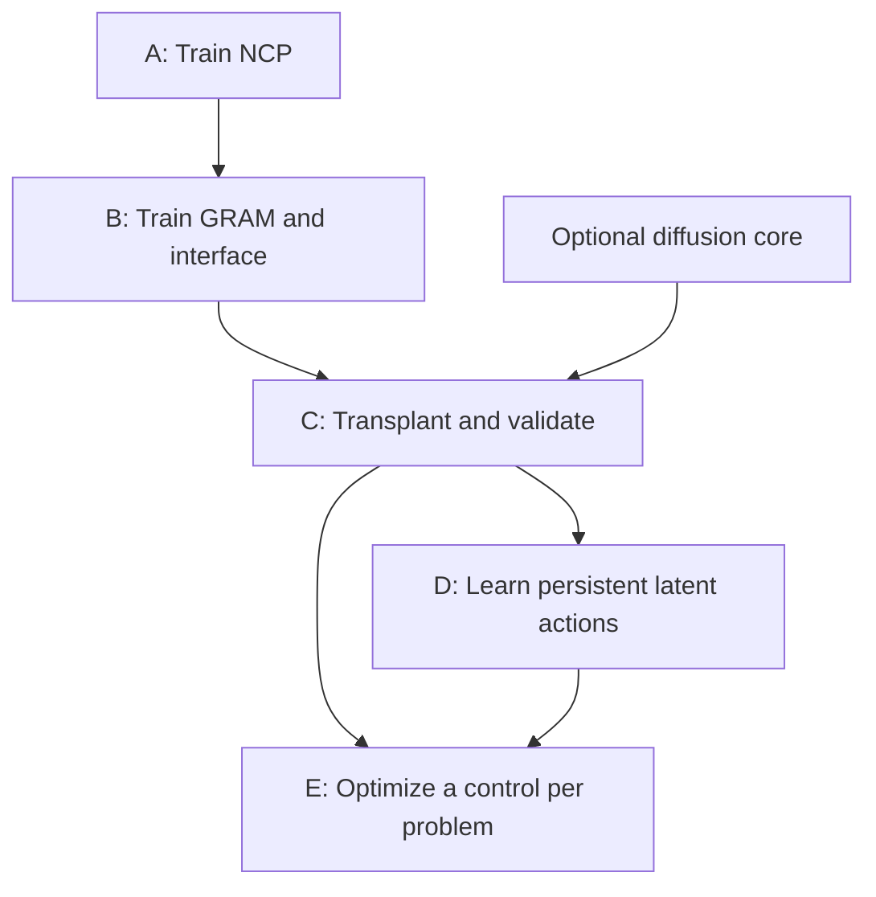
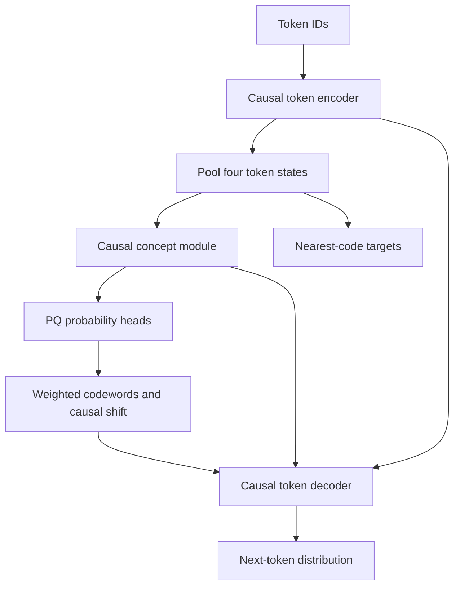
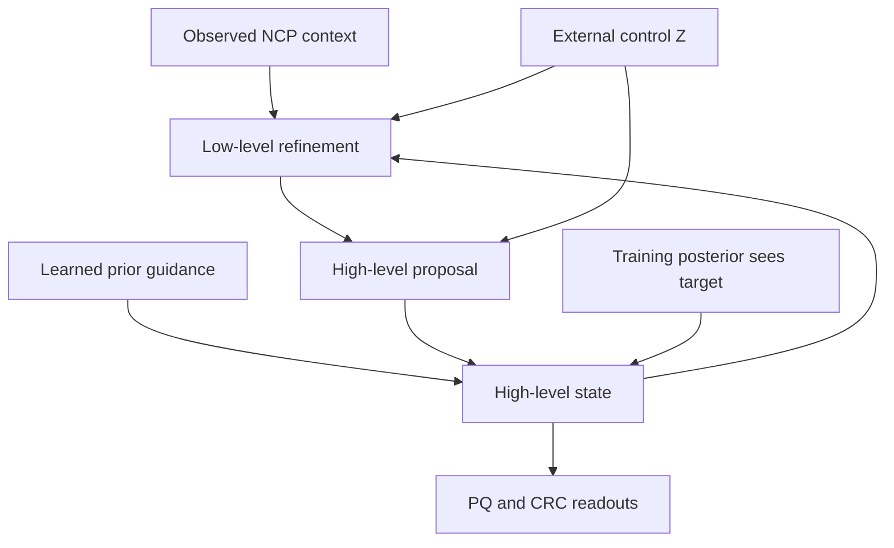
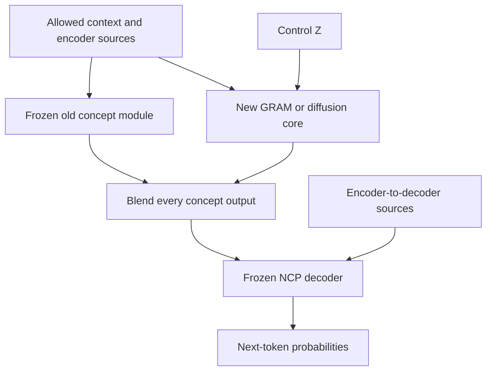
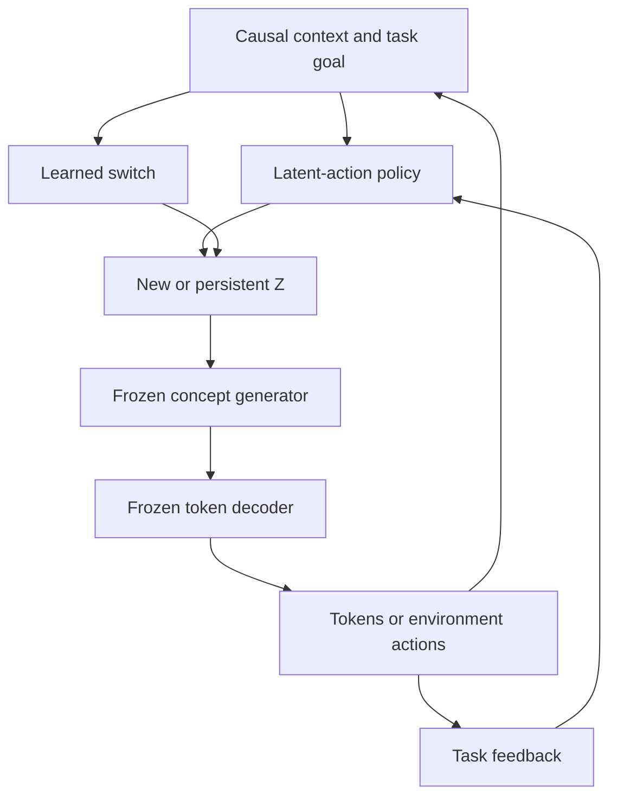
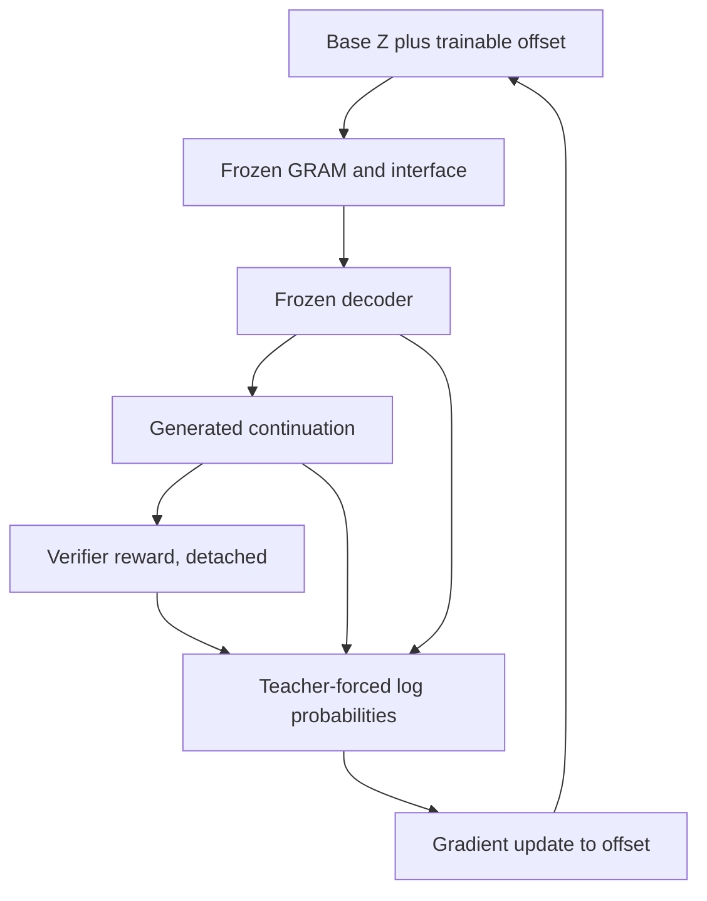
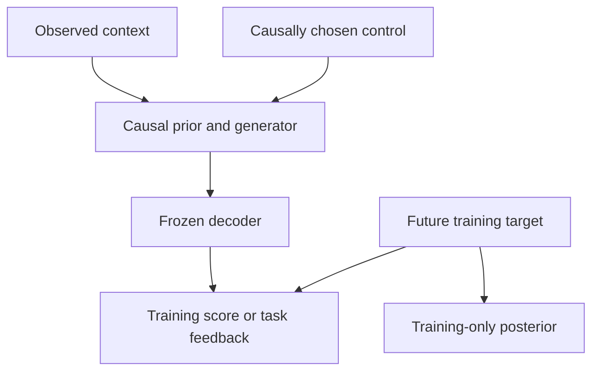

# NCP → GRAM/XM → Internal RL → GradCuit

**Five-phase architecture and training specification**  
**Version:** 1.0, reviewed 2026-10-03  
**Status:** research proposal; the complete system has not been trained or benchmarked.  
**Default local hardware:** MacBook Air M2, 16 GB.

The proposal is to first learn NCP's representation space and token decoder, then train a stochastic concept predictor in that fixed space, transplant it through the complete NCP interface, learn persistent latent actions, and finally optimize those actions for individual problems.

The architectural claim is modest and testable: **a new concept generator may improve planning and control while retaining NCP's encoder and autoregressive token decoder.** A useful gradient path is possible; improved reasoning, interpretable controls, and better efficiency require trained evidence.

This document consolidates the two supplied architecture drafts. Paper mechanisms, our adaptations, and implementation choices are distinguished throughout. The five phases are substantial stages, not five claims that the cited papers already validate this combination.

## Roadmap and reading guide

| Phase | Question | Main paper attribution | Deliverable |
|---|---|---|---|
| **A — NCP pretraining** | Can we learn representations, codebooks, and a decoder that uses concept feedback? | **NCP-ArchPreview Technical Report: Moving towards Latent Space Language Models through Next Concept Prediction** [R1] | Stable NCP checkpoint and recorded interface |
| **B — Supervised GRAM + exploration** | Can a stochastic recursive predictor explain actual future concepts and their text under different controls? | **Generative Recursive Reasoning** [R2]; **Explorative Modeling: Unlocking a Third Pretraining Axis and End-to-End Generation** [R3] | Prior-driven concept generator, posterior for training, calibrated readouts |
| **C — Transplant and optional continued pretraining** | Can the generator replace the old concept module during complete language-model rollouts? | NCP [R1], GRAM [R2]; optional **Diffusion as a Training Curriculum for Timestep-Free Iterative Reasoning** [R6] and **Hierarchical Continuous Diffusion Language Models** [R7] | Pure replacement checkpoint, validated at full replacement |
| **D — Internal hierarchical RL** | Can a causal policy choose useful controls and persist until a meaningful switch? | **Emergent temporal abstractions in autoregressive models enable hierarchical reinforcement learning** [R5] | Latent-action policy and temporal switching mechanism |
| **E — Instance-specific control optimization** | Can feedback improve the current continuation by changing activations alone? | **GradCuit: Credit-Assigned Gradient Flow Enables Robust and Interpretable Test-Time Latent Reasoning** [R4] | Per-problem control update procedure |

Read the shared contract first, then one phase at a time. Each phase gives the mechanism, shapes, objective, gradients, failure modes, and an exit gate. The final review records three independent checks and unresolved empirical questions.



Phase E can be tested before D using a sampled or inferred base control. In the complete five-phase system, D supplies the starting control and E refines it. RL and instance-specific optimization are different learning procedures.

## Shared contract: what the system reads and writes

**Attribution:** the token/concept organization and residual interfaces come from NCP [R1]. The external control and replacement contract are our integration design.

### Symbols and tensor shapes

A token is an integer identifying a tokenizer unit. It is not necessarily a word. An embedding maps that integer to a vector of learned numerical features. A concept is a pooled contextual vector; its name does not guarantee human-readable semantics.

| Symbol | Meaning | Shape or type |
|---|---|---|
| \(B\) | Batch size | Integer |
| \(T\) | Number of input token positions | Integer |
| \(V_{\mathrm{tok}}\) | Token vocabulary size | Integer |
| \(x\) | Observed token IDs | \([B,T]\), integers |
| \(d\) | Hidden representation width | Integer |
| \(H\) | Encoder token states | \([B,T,d]\) |
| \(k\) | Tokens pooled into one concept; default 4 | Integer |
| \(M\) | Number of complete chunks, \(\lfloor T/k\rfloor\) | Integer |
| \(C\) | Pooled concepts | \([B,M,d]\) |
| \(\mathcal C_m\) | Complete allowed conditioning record: prefix tokens, pooled history, encoder sources, positions, masks, and unaffected decoder prefix | Structured record; not a single vector |
| \(S\) | Feature segments in product quantization | Integer dividing \(d\) |
| \(V_c\) | Entries in each segment's codebook | Integer |
| \(Q\) | Product codebooks | \([S,V_c,d/S]\) |
| \(q\) | Nearest-code labels | \([B,M,S]\), integers |
| \(\pi\) | Predicted code probabilities | \([B,M,S,V_c]\) |
| \(u\) | Representation consumed by retained concept heads | \([B,M,d]\), or \([B,d]\) for one query |
| \(J_E,J_C\) | Number of exported encoder/concept source states | Read from the checkpoint interface |
| \(Z\) | External control code | \([B,d_z]\), initially \(d_z=8\) locally |
| \(P_Z\) | Control code lifted to attention-prefix vectors | \([B,N_z,d]\), initially \(N_z=2\) |
| \(K\) | Explored candidates per training example | Integer; distinct from GRAM's low-level update count |
| \(R\) | High-level recursive transitions per concept query | Integer |
| \(n_L\) | Low-level refinements per high-level transition | Integer |
| \(L\) | Continuation tokens in a scored control window | Integer |
| \(H_{\mathrm{win}}\) | Future concept chunks scored under one control | Integer; \(L=kH_{\mathrm{win}}\) |
| \(y\) | Continuation labels | \([B,L]\), integers |

Unless noted otherwise, equations below describe one batch item. Implementations average losses over valid batch items and mask padding. Each codebook segment occupies part of the feature axis; it is not a temporal segment or a separate word.

Mathematical token positions and codebook labels are one-based here. Typical array positions and classification labels are zero-based; convert them consistently. Token IDs themselves follow the tokenizer's convention. Save masks for partial chunks and variable-length windows.

NCP's \(Z\)-free baseline and the controlled model must use the same tokenizer, causal positions, chunk boundaries, encoder visibility, and token loss mask. A comparison that changes those simultaneously cannot isolate the new concept module.

### Ownership and freezing

| Component | A | B | C, default | D, RL stage | E |
|---|---|---|---|---|---|
| Encoder, including its IRC | Train | Freeze | Freeze | Freeze | Freeze |
| Token decoder, including receiving CRC and IRC | Train | Freeze, retain input derivatives | Freeze, retain input derivatives | Freeze | Freeze, retain control derivatives |
| Product codebooks | Train | Freeze | Freeze | Freeze | Freeze |
| Original concept stack | Train | Frozen teacher | Frozen teacher until removal | Removed | Removed |
| Retained concept heads | Train | Freeze initially | Freeze by default; optional named ablation | Freeze | Freeze |
| New GRAM core, prior, control lift, and interface readouts | Absent | Train | Train | Freeze after consolidation | Freeze |
| Target-informed GRAM posterior | Absent | Train | Optional training-only teacher | Not an inference component | Not used |
| Temporal-action discovery networks and switch | Absent | Absent | Absent | Train before RL; freeze for primary RL experiment | Freeze |
| Causal latent policy and value estimator | Absent | Absent | Absent | Train | Freeze |
| Current problem's \(\Delta Z\) | Absent | Absent | Absent | Absent | Optimize; reset between problems |

The encoder-to-new-core routing is owned by the replacement. It can have new learned adapters. The encoder's exported features and the decoder's receiving interface stay fixed. Replacing a module allows changing its internal IRC and input routing; it does not allow silently changing the frozen decoder's expected ports.

### Causal timing and history

For a completed prefix ending at token \(mk\), predict concept \(m+1\) from information available by \(mk\). Hold that prediction across the next \(k\) token prediction positions.

| Consumed tokens, with \(k=4\) | Next token | Concept predicted from the previous boundary |
|---:|---:|---|
| 8 | 9 | \(\hat c_3\), computed by boundary 8 |
| 11 | 12 | Same \(\hat c_3\) |
| 12 | 13 | \(\hat c_4\), computed by boundary 12 |

The concept-to-decoder CRC exports follow the same timing. The decoder can read all already-observed token states at the current token position. The concept query must not use encoder states from the chunk it is predicting.

The primary replacement preserves the checkpoint's concept-history procedure. NCP reports actual pooled histories during training and autoregressive predicted-concept feedback at inference [R1]. Initial prompt concepts come from the observed prompt; subsequent predicted concepts are appended according to the checkpoint schedule. Train on such rollouts as well as clean histories.

**Named alternative:** after a chunk is actually generated, replace its history entry with the pooled encoder states of those generated tokens. This changes the history rule while preserving parameter freezing. Test it separately; it is not automatically an exact reproduction of the original inference process.

For an incomplete prompt chunk, use the guidance already predicted at the most recent complete boundary. Do not pool padding or fabricate a complete observed concept. For a prompt shorter than \(k\), the initial token path has zero concept feedback, as in the causal shift.

## Phase A — Pretrain an almost-exact NCP foundation

**Paper:** **NCP-ArchPreview Technical Report: Moving towards Latent Space Language Models through Next Concept Prediction** [R1], especially Sections 2–3.  
**Faithful mechanisms:** causal encoder/concept/decoder organization, four-token pooling, product quantization, soft concept prediction, causal shifting, IRC, CRC, and the three joint losses.  
**Our changes:** only reduced scale and explicitly declared optimizer/loss-normalization choices for local experiments. No external \(Z\) is added in this phase.

### A1. Forward path and source-scale configuration



The encoder-to-decoder edge includes encoder CRC. The concept-to-decoder edge includes intermediate concept CRC exports. Encoder-to-concept CRC is retained inside the concept path.

| Configuration | Published NCP reference | Local scaling rule |
|---|---:|---|
| Encoder blocks | 16 | Preserve the role; reduce depth |
| Concept blocks | 8 | Preserve a causal concept stack |
| Decoder blocks | 16 | Preserve causal decoding |
| Hidden width | 4096 | Shared width across the three modules |
| Feedforward width | 11008 | Scale down explicitly |
| Attention heads | 32 | Keep width divisible by head count |
| Chunk size | 4 | Keep 4 for the initial comparison |
| PQ segments | 32 | Choose a divisor of local width |
| Entries per segment | 128 | Smaller local vocabulary is allowed |
| Segment dimension | 128 | Always \(d/S\) |
| Token vocabulary | 100278 | Keep the chosen local tokenizer fixed across variants |
| Maximum context | 8192 tokens | Start at 128–256 tokens locally |
| Total parameters | Approximately 8.94B | See the local-scale table below |

A source-scale reproduction must also retain the released backbone's attention, normalization, positional encoding, tokenizer, residual-export convention, and configuration. The report alone is not a substitute for those exact configuration fields. Do not invent unspecified loss weights, initialization constants, or optimizer details and label them paper-exact.

### A2. Deriving pooling and product quantization

The encoder maps integer IDs to contextual vectors:

\[
H=E_{\theta_E}(x),\qquad H\in\mathbb R^{B\times T\times d}.
\]

Here \(\theta_E\) denotes encoder parameters. Causal attention means \(h_t\) can depend only on token positions at or before \(t\). Thus a contextual vector differs from the embedding of an isolated token.

To represent a chunk with one vector, give its \(k\) states equal weight. The weights must sum to one so scale does not grow merely because the chunk contains more positions:

\[
c_m=\frac1k\sum_{a=1}^{k}h_{k(m-1)+a},\qquad c_m\in\mathbb R^d.
\]

For four scalar features \(2,4,6,8\), the pooled feature is \(5\). This saves temporal positions, but averaging can discard distinctions. It is not a learned selector of the most important tokens. NCP's encoder can learn features useful under pooling, and its token/residual paths retain additional information.

Split the feature axis into \(S\) segments of width \(d/S\). Give each segment its own table of \(V_c\) codewords. Assign the closest word:

\[
q_m^{(s)}=\arg\min_{v\in\{1,\ldots,V_c\}}
\|c_m^{(s)}-Q_{s,v}\|_2^2,\qquad d_m^{(s)}=Q_{s,q_m^{(s)}}.
\]

The superscript \(s\) selects a feature segment. The subscript \(v\) selects a codeword. \(d_m^{(s)}\) here is a quantized vector, not hidden width \(d\).

Example: a one-feature segment at \(0.8\), with codewords \(0\) and \(1\), receives the second label because squared distances are \(0.64\) and \(0.04\). Independent choices across \(S\) tables allow \(V_c^S\) combinations. A large count is capacity, not proof of coherent combinations.

### A3. Predicting a soft concept and returning it to tokens

The original concept stack processes preceding concepts and the correctly aligned encoder sources:

\[
u_{m+1}=\mathrm{CM}_{\theta_C}(C_{\le m},\mathcal S_E^{\le mk}).
\]

\(\mathcal S_E\) is the list of encoder CRC source tensors. Each retained head produces logits, one real score per codeword. Normalize them to probabilities:

\[
\pi_{m+1,v}^{(s)}=
\frac{\exp(a_{m+1,v}^{(s)})}{\sum_{w=1}^{V_c}\exp(a_{m+1,w}^{(s)})},
\qquad a_{m+1}^{(s)}=W_su_{m+1}+b_s.
\]

For column-vector notation, \(W_s\in\mathbb R^{V_c\times d}\), \(b_s\in\mathbb R^{V_c}\). Subtract the largest logit before exponentiating in code; probabilities remain unchanged and overflow is avoided.

The feedback is an expectation, formed by probability-weighting codewords:

\[
\hat c_{m+1}^{(s)}=\sum_{v=1}^{V_c}\pi_{m+1,v}^{(s)}Q_{s,v},
\qquad \hat c_{m+1}=\operatorname{concat}_{s=1}^{S}\hat c_{m+1}^{(s)}.
\]

With codewords \(0,1\) and probabilities \(0.2,0.8\), feedback is \(0.8\). The discrete labels supervise continuous computations. An ordinary hard argmax would remove the direct derivative through the selected index; retain the soft readout.

NCP's one-based causal alignment can be written:

\[
b_t=\begin{cases}
0,&t<k,\\
\hat c_{\lfloor(t-k)/k\rfloor+2},&t\ge k,
\end{cases}
\qquad \tilde h_t=h_t+b_t.
\]

The decoder uses \(\tilde h_{\le t}\) and aligned residual sources to predict \(x_{t+1}\). Substituting \(k=4,t=8\) selects concept 3, precisely the timing in the shared table. Removing the shift could expose a target chunk's own information.

### A4. IRC and CRC are part of the foundation

An ordinary residual block computes a change \(F(H)\) and adds it to \(H\). NCP's **intra-module residual connections**, IRC, instead learn a weighted combination of available depth states. Its weights are signed and unnormalized, not softmax attention weights. Their initialization selects the latest residual-updated state, reproducing the ordinary residual path.

For candidate states \(X_j\) at a layer, the mechanism is \(H_{\mathrm{next}}=\sum_j w_jX_j\). Each \(X_j\) has the same shape as \(H\); \(w_j\) is a per-position scalar from that layer's lightweight router. Large signed weights can amplify activations, so inspect both coefficients and output norms.

**Cross-module residual connections**, CRC, mix exported source depths using a target-conditioned router:

\[
\alpha_j=\operatorname{softmax}_j(\mathrm{MLP}(T_{\mathrm{target}})),\qquad
T_{\mathrm{out}}=T_{\mathrm{target}}+
\gamma\odot\sum_j\alpha_j\operatorname{LN}(S_j).
\]

\(T_{\mathrm{target}}\) and aligned \(S_j\) share feature width \(d\). \(\alpha_j\) is nonnegative and sums to one over source depths. \(\gamma\in\mathbb R^d\) is the learned diagonal scaling; \(\odot\) multiplies features elementwise. Layer normalization, LN, standardizes a vector's features before the mixture, with the checkpoint's exact normalization parameters and numerical stabilizer.

The three routes are encoder→concept, encoder→decoder, and concept→decoder. The last route needs the same causal shift as concept feedback. Removing it changes the baseline and the later replacement contract.

### A5. Deriving the three losses and their gradients

For token predictions, the probability of a sequence factors into conditional probabilities. Products become sums under a logarithm; minimizing the negative sum raises the probability of the observed tokens:

\[
\mathcal L_{\mathrm{NTP}}=-\frac1{T-1}
\sum_{t=1}^{T-1}\log p(x_{t+1}\mid x_{\le t}).
\]

For concept prediction, penalize the squared difference between predicted and actual pooled vectors:

\[
\mathcal L_{\mathrm{NCP}}=\frac1{M-1}
\sum_{m=2}^{M}\|\hat c_m-\operatorname{sg}(c_m)\|_2^2.
\]

\(\operatorname{sg}\) preserves a value while stopping its gradient. The actual target is detached. The encoder still receives prediction gradients through preceding concept inputs. The derivative of a scalar squared error \((a-b)^2\) with respect to \(a\) is \(2(a-b)\): it points toward the target under gradient descent.

Fit each selected codeword to the encoder's features:

\[
\mathcal L_{\mathrm{VQ}}=\frac1{MS}\sum_{m,s}
\|\operatorname{sg}(c_m^{(s)})-d_m^{(s)}\|_2^2.
\]

This term moves selected codewords, not the encoder. It differs from adding an encoder commitment penalty. Nearest-code assignments are used as fixed labels for this update; the soft prediction path carries the differentiable token/concept gradients.

The total is:

\[
\mathcal L_A=\mathcal L_{\mathrm{NTP}}+
\alpha_A\mathcal L_{\mathrm{NCP}}+
\beta_A\mathcal L_{\mathrm{VQ}}.
\]

\(\alpha_A,\beta_A\ge0\) trade token prediction against concept forecasting and codebook fit. Setting \(\alpha_A=0\) removes explicit future-concept supervision; setting \(\beta_A=0\) removes the explicit codebook-fit objective, although other gradients can still reach codebooks. Excessive weights can damage token quality. NCP's concept loss is continuous MSE, not nearest-code classification cross-entropy.

| Loss | Gradient route |
|---|---|
| NTP | Decoder and receiving CRC; concept exports/heads/codebooks; encoder inputs and residual paths |
| NCP | Concept core, heads, codebooks, and encoder through preceding concepts; not through detached future target |
| VQ | Selected codebook vectors only |

The equations above retain the report's squared-vector normalization. A local per-feature MSE divides additionally by feature width; declare that change and rescale auxiliary weights. Never transfer numerical weights between different loss normalizations silently.

For source-recipe fidelity, the report uses Moonlight Muon for matrix parameters and AdamW for embeddings, biases, and other non-Muon parameters, with a stated base learning rate of \(6\times10^{-5}\) and cosine scheduling [R1], Section 3.6. Treat optimizer parameter groups and schedules as configuration to reproduce. A local AdamW-only experiment is an explicitly different optimization recipe, and source-scale learning rates are not automatically appropriate for it.

**Exit gate:** held-out token loss is stable, concept forecasts beat a declared simple predictor, codebooks have useful occupancy, and removing concept feedback or CRC has a measured effect. Use these checks to choose the freeze checkpoint. One or two epochs alone do not establish that concepts have matured.

## Phase B — Supervised GRAM on NCP representations, with explorative modeling

**Papers:** **Generative Recursive Reasoning** [R2], Sections 2.1–2.3; **Explorative Modeling: Unlocking a Third Pretraining Axis and End-to-End Generation** [R3], Forward XM and Appendix F.2; NCP [R1] for targets and decoder interfaces.  
**Faithful GRAM mechanisms:** hierarchical recursive states, learned stochastic high-level perturbations, a target-conditioned training posterior, and a target-free inference prior.  
**Our adaptations:** continuous NCP inputs, retained PQ heads, decoder-compatible residual readouts, an external control variable, its variational posterior/prior, and an additional XM objective. Their combination is a proposed hybrid, not the original GRAM objective.

### B1. Extract the right supervised dataset

Freeze the selected Phase A checkpoint and disable dropout for extraction. Run the contextual encoder with exactly the intended positions and context window. For each completed boundary \(mk\), create:

| Record field | Use | Available during deployment? |
|---|---|---|
| Prefix token IDs, document ID, window start, boundary \(m\) | Rebuild context and decoder inputs | Yes |
| \(C_{\le m}\) and aligned encoder source states | Concept predictor inputs | Yes |
| Actual \(c_{m+1}\), or several future concepts | Regression targets | No |
| \(q_{m+1}^{(1:S)}\) from the frozen codebooks | Discrete labels | No |
| Continuation token IDs \(y\) and masks | Frozen-decoder supervision | No |
| Old \(u_{m+1}\), \(\hat c_{m+1}\), all concept CRC exports | Temporary compatibility/distillation targets | Teacher only |
| Tokenizer, encoder, codebook, and interface version/hash | Detect stale or mismatched caches | Metadata |

**Actual future concepts are targets. Old predictions are compatibility teachers.** Training only against old predictions cannot establish better future modeling.

An isolated chunk encoding is generally not the same target as pooling that chunk after a contextual prefix. Do not generate the dataset by encoding each four-token chunk independently.

Storing only pooled vectors is insufficient for decoder training. Keep original tokens, or the complete frozen-encoder inputs/outputs and decoder-prefix state needed to reconstruct the supervised token probabilities. Never give the core future encoder features merely because they are present in the cache.

Store sequences with offsets instead of duplicating entire histories. At source width 4096, one FP16 pooled vector occupies \(4096\times2=8192\) bytes. One billion tokens at \(k=4\) yield 250 million vectors: about 2.048 TB before residual sources. Streaming extraction is the scale-up default.

### B2. GRAM's internal state is different from the external control

The GRAM paper calls its recursive latent state \(z_t\). To avoid confusing that state with the user's steering variable, this specification writes the recursive state as \((h_r,l_r)\), and reserves **\(Z\)** for the external control.

For one future-concept query:

| Tensor | Shape | Role |
|---|---|---|
| Context memory | \([B,M,d]\), plus aligned encoder source depths | Observed information |
| \(Z\) | \([B,d_z]\) | Persistent external code |
| \(P_Z\) | \([B,N_z,d]\) | Control prefix used in attention |
| \(h_r,l_r\) | \([B,1,d_g]\) | High- and low-level future-query states |
| \(\epsilon_r\) | \([B,1,d_g]\) | Stochastic high-level guidance |
| \(u\) | \([B,d]\) | Output accepted by retained PQ heads |
| Each new CRC export \(A_j\) | \([B,1,d]\) | Output accepted by its original decoder source port |

Use \(d_g=d\) initially. Different widths require explicit input/output adapters. A future query is a working vector, not a future concept secretly copied into the inputs.

Lift the small control into prefix vectors:

\[
P_Z=\operatorname{reshape}(ZW_Z+b_Z),\quad
W_Z\in\mathbb R^{d_z\times N_zd}.
\]

Multiplication converts \(d_z\) control coordinates into \(N_zd\) feature values; reshaping creates \(N_z\) attention positions. Initialize the lift with small nonzero weights. A completely zero control pathway can leave all candidates identical.

The read-only context contains only allowed concept positions and causally aligned encoder sources. Prefix controls can be separate keys/values; historical context representations need not be recomputed as a function of every candidate. Predicted concept history can still depend on earlier controls, so cache reuse across changed controls requires care.

In the equations below, \(\mathcal C\) denotes that complete conditioning record, including observed prefix tokens needed by the decoder. \(C\) alone remains the pooled tensor. Conditioning the likelihood only on pooled vectors would omit information the actual decoder uses. Readouts may access the record's allowed encoder sources as well as the final recursive state; otherwise the port interface can introduce an unnecessary information bottleneck. This also creates a possible bypass, which the core/port ablations must test.



The prior and posterior guidance arrows are alternative sampling paths. The posterior arrow is absent at inference.

### B3. Derive one recursive transition

Start from fixed stored initial states, as in GRAM, with an explicit control extension:

\[
h_0=h_{\mathrm{fixed}}+A_ZZ,\qquad l_0=l_{\mathrm{fixed}}.
\]

Here \(A_Z\in\mathbb R^{d_g\times d_z}\) acts on each item's column control vector; batch implementations transpose that multiplication and restore the query axis. The fixed states are not new random samples every call. Initializing \(h_0\) from external \(Z\) and providing control prefixes throughout recursion are our additions.

At high-level transition \(r\), refine the low-level state \(n_L\) times while holding \(h_{r-1}\) fixed:

\[
l_{r,a}=F_L(h_{r-1},l_{r,a-1},\mathcal C,P_Z),
\quad a=1,\ldots,n_L,\quad l_{r,0}=l_{r-1}.
\]

Then form a deterministic high-level proposal and add stochastic guidance:

\[
u_r^{\mathrm{high}}=F_H(h_{r-1},l_{r,n_L},\mathcal C,P_Z),
\quad
h_r=u_r^{\mathrm{high}}+\epsilon_r.
\]

Both functions are shared across transitions. Cross-attention reads the permitted context; attention/MLP updates perform the repeated computation. \(n_L\) controls work per high-level update, while \(R\) controls the number of high-level updates. Increasing either increases computation; useful reasoning is an experimental outcome, not an implication of recursion.

GRAM's guidance prior is a state-dependent Gaussian. Reparameterize a sample:

\[
\epsilon_r=\mu_p(u_r^{\mathrm{high}},\mathcal C,Z)+
\sigma_p(u_r^{\mathrm{high}},\mathcal C,Z)\odot\eta_r,
\qquad \eta_r\sim\mathcal N(0,I).
\]

\(\mu_p\) is a learned direction; positive \(\sigma_p\) sets exploration magnitude. The paper's isotropic variance can be broadcast across features; a featurewise diagonal variance is a separate adaptation. A positive numerical floor on standard deviation is an implementation choice, not a reported architectural result.

At training time, a posterior uses \((\mathcal C,Z,y)\) to supply \(\mu_q,\sigma_q\) in the same update. It helps find trajectories that explain the target. At inference, the prior supplies guidance using \((\mathcal C,Z)\) and previous internal states only.

The main local version uses one supervision step with a short full unroll. GRAM's paper also carries terminal states across deep-supervision steps and uses truncated gradients through only the final transition. Reproducing that practical surrogate is an optional, explicitly labeled memory-saving variant. It is not the exact full-trajectory ELBO.

### B4. Train the complete output interface

From \(h_R\), produce a head-compatible representation and distinct residual exports:

\[
u=B_\omega(h_R,\mathcal C),\qquad
A_j=B_{\omega,j}(h_R,\mathcal C),\quad j=1,\ldots,J_C.
\]

\(\omega\) denotes trainable readout parameters. Retained heads map \(u\) to \(\pi\), and fixed codebooks map \(\pi\) to \(\hat c\), using Phase A's soft expectation.

Count ports from the actual checkpoint. Preserve each port's role, feature width, order, normalization placement, and causal alignment. If an exported port is a raw input state, preserve that exact source directly where appropriate. Do not assume the number of exported states equals the number of Transformer blocks.

Before exploration, fit a temporary interface objective:

\[
\mathcal L_{\mathrm{dist}}=
\frac{\|u-\operatorname{sg}(u_{\mathrm{old}})\|_2^2}{d}
+\frac1{J_Cd}\sum_j
\|A_j-\operatorname{sg}(S_{\mathrm{old},j})\|_2^2.
\]

This uses the old module as a numerical-language teacher. The feature denominators prevent width alone from scaling the loss. Strong permanent matching of every candidate to the old predictor would discourage alternative futures; reduce this weight after interface warm-up.

### B5. GRAM's variational objective, derived from marginalization

For one future chunk, let \(\tau\) contain the stochastic guidance samples and resulting states. A generated continuation has probability:

\[
p(y\mid\mathcal C)=\int p(y\mid\mathcal C,Z,\tau)\,
p(\tau\mid\mathcal C,Z)\,p(Z\mid\mathcal C)\,d\tau\,dZ.
\]

We integrate because we do not observe the hidden control or trajectory that produced the text. Direct integration over all possibilities is expensive.

Introduce a training-only distribution
\(q_\phi(Z,\tau\mid\mathcal C,y)=q_\phi(Z\mid\mathcal C,y)q_\phi(\tau\mid\mathcal C,Z,y)\).
The posterior over **external** \(Z\) is our addition to GRAM. It avoids pretending that a randomly assigned control already has a target-specific meaning.

Multiply and divide the integral by \(q\), making it an expectation. Because the logarithm is concave, the logarithm of an average is at least the average logarithm:

\[
\log p(y\mid\mathcal C)\ge
\mathbb E_q[\log p(y\mid\mathcal C,Z,\tau)]
-\operatorname{KL}\!\left(q(Z,\tau\mid\mathcal C,y)\|p(Z,\tau\mid\mathcal C)\right).
\]

This is the evidence lower bound, ELBO. KL is expected log posterior/prior ratio. It is zero when the distributions agree and nonnegative otherwise. It penalizes relying on target-informed trajectories that the inference prior cannot supply.

Factor the joint ratio into a control ratio and a trajectory ratio. Markov trajectory ratios then split over transitions. The negative bound is:

\[
\mathcal L_{\mathrm{var}}=
\mathbb E_q[\ell_{\mathrm{tok}}]
+\operatorname{KL}(q_Z\|p_Z)
+\mathbb E_{q_Z}\sum_{r=1}^{R}
\mathbb E_{q_{<r}}
\operatorname{KL}(q_{\epsilon_r}\|p_{\epsilon_r}).
\]

\(q_{<r}\) averages over earlier posterior guidance. \(p_Z\) is a causal control prior, initially standard normal or a declared context-conditioned Gaussian. Internal guidance priors also see no future target. The coefficient on each KL is one in the exact negative ELBO; changing coefficients creates a weighted variational objective.

For diagonal Gaussians, subtract their log densities and take the expectation under \(q\). The expected squared displacement from the prior mean is posterior variance plus squared mean displacement. This gives:

\[
\operatorname{KL}(q\|p)=\frac12\sum_a
\left[
\log\frac{\sigma_{p,a}^2}{\sigma_{q,a}^2}
+\frac{\sigma_{q,a}^2+(\mu_{q,a}-\mu_{p,a})^2}{\sigma_{p,a}^2}-1
\right].
\]

Index \(a\) runs over stochastic coordinates; \(\mu\) and \(\sigma\) have matching shapes. Equal means and variances give zero. With unit variances and a mean displacement of one in a single coordinate, KL is \(1/2\). Very small prior variance heavily penalizes displacement; it can also create numerical instability.

The frozen decoder supplies the reconstruction likelihood:

\[
\ell_{\mathrm{tok}}=-\sum_{t=1}^{L}
\log p_D(y_t\mid x,y_{<t},\hat C,A_{1:J_C}).
\]

The encoder/decoder are evaluated on correctly shifted token inputs. Teacher forcing supplies previous observed continuation tokens, not the current target token. Future targets enter only the posterior and losses.

For multiple chunks, the prior at a later boundary may depend on already-observed continuation tokens and previous generated concepts. Do not treat it as a trajectory prior independent of that history. The joint model factors causally as:

\[
p(y,Z,\tau_{1:H_{\mathrm{win}}}\mid x)=p_Z(Z\mid\mathcal C_0)
\prod_{m=1}^{H_{\mathrm{win}}}
\left[
p(\tau_m\mid\mathcal C_m,Z)
\prod_{a=1}^{k}p_D(y_{(m-1)k+a}\mid x,y_{<(m-1)k+a},\mathcal A_m)
\right].
\]

\(\mathcal C_m\) contains only the initial prefix, previous continuation tokens, permitted encoder/decoder-prefix features, and previous allowed concept predictions; \(\mathcal A_m\) comes from the current trajectory. Sum the per-boundary trajectory KL terms in the ELBO for this joint model. The external control is sampled once for the scored interval, so there is one control-prior term, not one new control at every token.

### B6. Add exploration over prior-generated outcomes

**Paper attribution:** Forward XM [R3]. Generate \(K\) complete candidates from the **inference** prior, not the target-informed posterior. Each candidate includes external \(Z_i\), internal guidance, a concept forecast, and its CRC exports.

Define discrete and continuous auxiliary scores:

\[
\ell_{q,i}=-\sum_{m,s}\log\pi_{i,m}^{(s)}(q_m^{(s)}),
\qquad
\ell_{c,i}=\frac1{H_{\mathrm{win}}d}\sum_{m=1}^{H_{\mathrm{win}}}
\|\hat c_{i,m}-c_m^{\mathrm{target}}\|_2^2.
\]

Here \(H_{\mathrm{win}}\) is the number of future chunks scored under one persistent control, \(L=H_{\mathrm{win}}k\), and targets are detached. The code probability product becomes the sum of logarithms because all feature segments belong to the same candidate. In code use names such as `horizon_chunks` and `encoder_states`.

The complete candidate score is:

\[
\ell_i=\ell_{\mathrm{tok},i}+\eta_q\ell_{q,i}+\eta_c\ell_{c,i},
\qquad \eta_q,\eta_c\ge0.
\]

Use one winner for the complete held-control interval:

\[
\mathcal L_{\mathrm{XM,hard}}=\min_i\ell_i.
\]

Its gradient updates the winning candidate's computation. Hard XM encourages coverage; it does not calibrate how frequently the prior chooses each future.

A smooth alternative averages candidate scores in probability space:

\[
\mathcal L_{\mathrm{XM,smooth}}=-\log\left(\frac1K\sum_i e^{-\ell_i}\right),
\qquad
\rho_i=\frac{e^{-\ell_i}}{\sum_j e^{-\ell_j}}.
\]

Differentiate the logarithm: \(\partial\mathcal L/\partial\ell_i=\rho_i\). Candidates that better explain the target receive more responsibility. Compute this with log-sum-exp for numerical stability.

If \(\ell_i\) contains only a normalized whole-text NLL, this scores a finite mixture of text models. Additional code/MSE terms make it a composite objective, not exact text likelihood. With random continuous controls, finite-sample scoring also differs from the exact marginal over the underlying prior. Enumerated prototypes give a simpler exact-mixture diagnostic, but are not the continuous-control model.

For a persistent control, the correct text mixture is \(K^{-1}\sum_i\prod_t p_i(y_t\mid y_{<t},x)\). Moving the mixture inside the product permits a different control at every token. Selecting winners independently per PQ segment has the same defect.

The complete proposed hybrid is:

\[
\mathcal L_B=\mathcal L_{\mathrm{var}}
+\lambda_X\mathcal L_{\mathrm{XM}}^{\mathrm{prior}}
+\lambda_q\mathbb E_q[\ell_q]
+\lambda_c\mathbb E_q[\ell_c]
+\delta_B\mathcal L_{\mathrm{dist}}.
\]

All \(\lambda\) values are nonnegative weights. \(\delta_B\) decreases after warm-up. Only \(\mathcal L_{\mathrm{var}}\) is the stated negative ELBO; the total is our hybrid training objective. Compare variational-only, XM-only, and hybrid versions instead of assuming their gradients cooperate.

### B7. Gradient paths, persistence, and debugging

In this phase the new interface is evaluated through the frozen decoder, initially after distillation. Its token loss uses the new outputs, not a permanently zero replacement gate.

Frozen encoder features can be extracted without gradients when their input tokens are fixed. The decoder must still differentiate with respect to new concept inputs. The old teacher and target vectors are detached. GRAM and its posterior/prior use reparameterized stochastic samples; a small full unroll keeps the control path intact.

Start with one future chunk, then train windows of two and four chunks with the **same \(Z\)**. Update the observed token context causally, and use the selected concept-history procedure. Initialize each new concept query's internal state from its fixed initializer plus persistent \(Z\); carrying internal state between chunks is an optional, separately tested variant.

| Failure signal | Interpretation and next check |
|---|---|
| Posterior excellent, prior poor | Target-informed training is not transferring to deployable sampling; inspect KL and prior generation |
| Different \(Z\), identical outputs | Control collapse; inspect the lift, gradients, candidate assignment, and teacher weight |
| Internal-noise changes dominate \(Z\)-swaps | Stochastic trajectories explain variation without a useful external control |
| Code loss low, token loss poor | Quantized targets are learned but their realization or CRC interface is mismatched |
| Token loss good, concept ablation irrelevant | Encoder/decoder bypass paths may solve the task without concept planning |
| Strong control only through CRC | Useful intervention may exist, but it does not establish PQ-concept semantics |
| Clean history good, predicted history poor | Exposure and accumulated rollout error |
| One candidate wins almost everywhere | Mode collapse, overly strong distillation, or data with insufficient alternative futures |

For control interventions, fix internal base-noise draws and token-sampling randomness while changing \(Z\). Separately fix \(Z\) and vary guidance noise. Nonzero \(\partial\ell/\partial Z\) is a necessary local signal, not proof of useful or interpretable control.

**Exit gate:** prior-generated candidates produce valid alternatives on held-out ambiguous-context tasks; the pure new interface yields acceptable token quality; \(Z\)-swaps cause useful, persistent behavior. Report oracle best-of-\(K\) separately from sampled or causally selected inference. No true continuation may select the deployed control.

## Phase C — Transplant the core and optionally continue pretraining

**Papers:** **NCP-ArchPreview Technical Report: Moving towards Latent Space Language Models through Next Concept Prediction** [R1] for the surrounding architecture; **Generative Recursive Reasoning** [R2] and **Explorative Modeling: Unlocking a Third Pretraining Axis and End-to-End Generation** [R3] for the primary core and learning objectives. The diffusion alternative draws separately on **Diffusion as a Training Curriculum for Timestep-Free Iterative Reasoning** [R6], **Hierarchical Continuous Diffusion Language Models** [R7], and standard DDPM/DDIM construction [R8], [R9].
**Our contribution:** complete-interface blending, an explicit transplant contract, and continued training of the replacement within a frozen NCP skeleton. None of the cited papers validates this particular transplant.

### C1. What is actually replaced?

Replace the old concept stack and its internal processing with the trained core, input adapters, and interface readouts. Retain the encoder and its exported states, the tokenizer, concept pooling, fixed codebook meanings, and the token decoder's receiving paths.

The decoder-facing contract is:

\[
\mathcal A_m=(\hat c_m,A_{m,1},\ldots,A_{m,J_C}).
\]

Each entry has width \(d\); the source list has the original order and alignment. New readouts export raw states when the original CRC expects raw states. Do not normalize twice or blend a normalized new port with an unnormalized old one.



Blend corresponding outputs:

\[
\hat c_m^{\lambda}=(1-\lambda)\hat c_m^{\mathrm{old}}+\lambda\hat c_m^{\mathrm{new}},
\qquad
A_{m,j}^{\lambda}=(1-\lambda)S_{m,j}^{\mathrm{old}}+\lambda A_{m,j}^{\mathrm{new}}.
\]

\(\lambda\in[0,1]\) is the replacement fraction. At zero, every exported value equals the old value; with the same history, positions, precision, and cache procedure, the old model is recovered. At one, the old module contributes nothing. Intermediate values are a training transition, not evidence that the pure new model is good.

At \(\lambda=0\), the derivative of the blended output with respect to the new output is zero. Consequently, token loss cannot train the new core through that blend. Use distillation at zero, then introduce nonzero blending for decoder-driven learning.

A possible progression is \(0\to0.1\to0.3\to0.6\to1\); these are proposed staging values, not paper settings. Advance according to held-out **pure-replacement** quality and rollout stability. A scalar blend can create intermediate states unlike either endpoint, so a smooth schedule is not a quality guarantee.

For whole-generation equality at zero, preserve history updates too. In the predicted-history protocol, append the blended prediction to the concept history. Using another history update at zero forfeits the exact baseline-equivalence claim.

Use independent random-number streams for controls, internal guidance, and token sampling. Otherwise the new module can consume extra draws and change sampled text even when its decoder contribution is zero. Equality of output distributions and equality of a seeded sampled trace are separate checks.

### C2. Continued pretraining on raw token streams

Phase B fits the replacement on a derived dataset. This phase exercises it inside complete token/concept rollouts and can address the resulting distribution shift.

For each training window:

1. Encode raw tokens causally with the frozen encoder.
2. Pool only complete, valid chunks.
3. Select causal prior controls and generate GRAM trajectories.
4. Produce all interface outputs and apply the original causal shift.
5. Score continuation tokens and actual future concept/code targets.
6. Backpropagate through the frozen decoder into the new core.
7. Include predicted-history windows and persistent-control windows.

A default objective retains the Phase B candidate score and exploration rule:

\[
\mathcal L_C=
\mathcal L_{\mathrm{XM}}^{\mathrm{prior}}
+\lambda_{\mathrm{var},C}\mathcal L_{\mathrm{var}}
+\delta_C\mathcal L_{\mathrm{dist}}.
\]

The candidate score already includes token NLL and optional concept/code terms. \(\lambda_{\mathrm{var},C}\) can be zero when using prior-only consolidation; \(\delta_C\) decreases toward zero. Report these choices and the hard/smooth exploration choice in the checkpoint configuration.

An ordinary next-token loss with one control is a useful ablation. It does not ensure control specialization: if all controls are trained to explain every continuation equally, the model may ignore them. Preserve ambiguous-context and control-persistence diagnostics during continued training.

**Default:** update only the new core, priors/posteriors as selected, input adapters, and output readouts. Retained head weights may be unfrozen in a separately named ablation while codebooks stay fixed.

**Optional joint consolidation:** if fixed-decoder compatibility is inadequate, cautiously update encoder/decoder weights as a separate experiment. This changes the frozen-skeleton hypothesis. Updating the encoder invalidates cached concepts and their label distribution; updating codebooks also changes label identities. Re-extract data when required, retain the reference checkpoint, and freeze the consolidated system before Phase D.

### C3. The diffusion alternative has a different training specification

This is an alternative core, not an extra block stacked on the GRAM core by default. It must return exactly the same \(\mathcal A_m\) contract.

For one target concept, define \(v_0\in\mathbb R^{B\times1\times d}\) as the actual future vector, optionally standardized with frozen training-set feature statistics. The context remains the observed prefix. Add Gaussian noise [R8]:

\[
v_s=\sqrt{\bar\alpha_s}\,v_0+
\sqrt{1-\bar\alpha_s}\,\epsilon,\qquad
\epsilon\sim\mathcal N(0,I).
\]

Index \(s\) is a diffusion step, distinct from PQ segment indices. \(\bar\alpha_s\in(0,1]\) is retained signal variance. The coefficients' squares sum to one, maintaining unit variance for a unit-variance target. Small \(\bar\alpha_s\) hides more target information.

Train a denoiser \(f_\theta(v_s,s,\mathcal C,Z)\) to predict the noise. Squared error supplies a direct continuous target:

\[
\mathcal L_{\mathrm{noise}}=
\mathbb E\left[\|\epsilon-f_\theta(v_s,s,\mathcal C,Z)\|_2^2/d\right].
\]

A deterministic DDIM-style reverse step [R9] first solves the noising equation for a clean estimate:

\[
\hat v_0=\frac{v_s-\sqrt{1-\bar\alpha_s}\,\hat\epsilon}
{\sqrt{\bar\alpha_s}},\qquad \hat\epsilon=f_\theta(v_s,s,\mathcal C,Z).
\]

It then combines that estimate and predicted noise at a lower noise level:

\[
v_{s-1}=\sqrt{\bar\alpha_{s-1}}\,\hat v_0+
\sqrt{1-\bar\alpha_{s-1}}\,\hat\epsilon.
\]

Start generation from near-standard Gaussian terminal noise and repeat the reverse updates. This is a conditional diffusion construction with timestep conditioning; it does not reproduce Google's timestep-free curriculum model. Its validity as an NCP replacement requires separate training and evaluation.

Bridge the terminal generated vector and/or denoiser hidden states to the retained PQ heads and distinct CRC readouts. If targets were standardized, restore original coordinates before a readout that expects them. Train the bridge through frozen-decoder token loss; denoising accuracy alone does not establish decoder compatibility.

There are two separate meanings of \(Z\): a noise seed versus an additional conditioning control. The recommended shared interface retains a low-dimensional conditioning code, with separate diffusion base noise. If that conditioning code is sampled independently of the target under ordinary denoising training, ignoring it is a valid optimum. Use a target-informed control posterior with a causal prior and/or XM on **complete prior-generated reverse rollouts**, scored at their final concept and text outputs.

Choosing the smallest teacher-forced single-step noise error is not automatically the same as choosing the best full generated future. Make this distinction explicit in a diffusion-XM implementation. Full-rollout gradients are expensive; a truncated approximation must be labeled and compared against a short full-unroll diagnostic.

Google's curriculum model [R6] contributes persistent hidden memory and ordered-corruption training, with different inference behavior. HC-DLM [R7] couples a continuous trajectory to token readouts and feedback throughout denoising and jointly learns its latent representation. We borrow the concern for token-grounded latent refinement; we do not claim that an unchanged NCP decoder implements HC-DLM's complete parallel generative chain.

### C4. Inference, limits, and exit gate

The transplanted core predicts one future concept at a boundary, supplies its CRC exports, and the decoder emits \(k\) tokens sequentially under that guidance. Repeat at the next boundary. This remains autoregressive in tokens and in the primary predicted-concept history.

A plan containing 125 four-token concepts might span 500 tokens, not 500 words. Generating all of those tokens in parallel requires a separate decoder change. Far-future planning also cannot invent encoder CRC states for tokens that do not yet exist; define an approximation if doing open-loop planning.

**Exit gate:** at \(\lambda=1\), acceptable held-out token loss, valid free generation, bounded multi-chunk drift, stable residual norms, and usable controls. Remove the old module only after this gate. Save the history protocol, all interface metadata, and the learned control prior with the replacement checkpoint.

## Phase D — Internal RL through persistent latent actions

**Paper:** **Emergent temporal abstractions in autoregressive models enable hierarchical reinforcement learning** [R5], metacontroller discovery, temporal integration, and internal RL.  
**Faithful principle:** discover controls over a frozen autoregressive system, make them persist across low-level actions, then train a causal policy in the learned control-code space.  
**Adaptation:** the controlled system is transplanted NCP; its already learned \(Z\)-to-concept pathway replaces the paper's controller-generated low-rank residual intervention. Language reasoning transfer is unproven.

### D1. Why a latent code becomes an action

An RL action is a choice that changes what happens next. Selecting \(Z\) qualifies only if it reliably changes the generated behavior. A vector with a nonzero derivative but no task-relevant effect is an inadequate high-level action.

The source paper uses a low-rank controller \(U_t\) on residual activation \(e_t\):

\[
e_t\leftarrow e_t+U_te_t.
\]

\(e_t\in\mathbb R^{d_e}\), \(U_t\in\mathbb R^{d_e\times d_e}\). Low rank reduces the number of degrees of freedom. A controller decoder maps a smaller code to this intervention. The paper learns temporal control and then freezes the controlled machinery for latent RL.

Our system already has a learned mapping from \(Z\) to concept predictions and CRC interventions. Adding a separate \(U_t\) is unnecessary for the first experiment. Freeze that mapping, the GRAM prior, codebooks, encoder, and decoder. The policy learns **which control to request**, rather than changing what each control means during the same RL run.



The policy receives observations available now: pooled context, permitted internal features, prior control, and task goal. An example policy feature vector concatenates the latest concept, a summary of past concepts, and prior \(Z\); its shape is \([B,2d+d_z]\) before optional additional observations. A recurrent policy can summarize this history. Future targets and the training posterior are absent.

### D2. Discover persistent actions before RL

The source paper learns a metacontroller from demonstrations before RL. Merely adding a switching equation to a pretrained generator does not establish temporal abstraction.

Use higher-quality demonstrations, or explicitly label the same dataset if no improved demonstrations are available. A training-only controller posterior can inspect the full demonstration to propose useful codes. The switching unit reads causal features. Importantly, run the frozen GRAM core using its **inference guidance prior**; using its target-informed trajectory posterior would let a hidden future-informed mechanism solve the demonstration.

At concept boundary \(m\), propose \(\tilde Z_m\) and integrate it with the previous code:

\[
Z_m=(1-\beta_m)Z_{m-1}+\beta_m\tilde Z_m,
\qquad \beta_m\in[0,1].
\]

Use a scalar gate broadcast across the control dimensions initially. At zero, the old action persists; at one, the new action replaces it; at one-half, the codes are averaged. This convex integration is our scalar-gate instance of the source mechanism. Interpolating two useful codes is not guaranteed to produce a useful third behavior.

The discovery objective is demonstration token/action NLL plus prior matching:

\[
\mathcal L_{\mathrm{discover}}=
-\sum_t\log p_{\mathrm{frozen}}(y_t\mid y_{<t},x,Z_{\le t})
+\lambda_D\sum_m\operatorname{KL}(q_D(\tilde Z_m\mid\text{demonstration})\|p_{\mathrm{ref}}(\tilde Z_m\mid\mathcal C_m)).
\]

\(q_D\) is the future-informed discovery posterior; \(p_{\mathrm{ref}}\) is a declared causal reference prior, preferably the Phase B/C control prior. A standard-normal reference is closer to the original paper's choice. Reconstruction rewards useful control; KL limits encoding the entire future in arbitrary codes. Different reference priors are adaptations and must be recorded.

During this stage, gradients pass through the frozen generator and decoder into the reparameterized controller codes and continuous switch. The core's weights do not update. A bottleneck can encourage reusable actions, but meaningful or sparse switching is an observation to test.

Freeze the learned switch for the primary RL experiment. Convert its rate to a discrete switch:

\[
\bar\beta_m=\mathbf 1[\beta_m>\kappa],
\]

where \(\mathbf1\) is an indicator and \(\kappa\) is a saved threshold, initially 0.5 as our local choice. Force an initial action at episode start. While the switch is zero, keep the same code; at a switch, ask the causal policy for a new one. Learning termination jointly during RL is a later, separate variant.

### D3. Derive the high-level policy update

The original future-informed controller posterior is not used to act online. Replace it with:

\[
Z_j\sim\pi_\psi(Z\mid s_j),
\]

where \(j\) indexes **high-level decisions**, \(s_j\) is the causal policy observation, and \(\psi\) contains policy parameters. A Gaussian actor outputs mean and positive standard deviation of shape \([B,d_z]\). The sampled code has that same shape. The fixed controlled language model is part of the environment.

For a finite episode, let its total reward be \(\mathcal R\). Expected performance is \(J(\psi)=\mathbb E[\mathcal R]\). Differentiate the expectation over policy actions. The identity \(\nabla p=p\nabla\log p\), plus the product of action densities, yields:

\[
\nabla_\psi J=
\mathbb E\left[\mathcal R\sum_j\nabla_\psi\log\pi_\psi(Z_j\mid s_j)\right].
\]

The policy receives credit for chosen codes that lead to higher reward. The frozen decoder does not require gradient computation for this RL estimator. It produces outcomes, while policy log densities supply gradients.

A control can last several concept chunks. Let \(t_j\) be elapsed chunks before it starts (zero at the first decision), \(\Delta_j\) its duration in chunks, \(r_m\) a chunk reward indexed on this zero-start time axis, and \(\gamma\in[0,1]\) a per-chunk discount. Account for duration:

\[
\mathcal R_j=
\sum_{a=0}^{\Delta_j-1}\gamma^a r_{t_j+a}
+\gamma^{\Delta_j}\mathcal R_{j+1}.
\]

This is a semi-Markov return: one action can occupy multiple elementary time steps. With duration 2, rewards \(0,1\), \(\gamma=0.9\), and next return 2, it gives \(0.9+0.81\times2=2.52\). At \(\gamma=1\), durations no longer discount the future, suitable for a declared finite-episode task.

Subtract a learned value estimate \(V_\nu(s_j)\) to reduce variance:

\[
\mathcal A_j=\mathcal R_j-V_\nu(s_j),\qquad
\mathcal L_{\mathrm{policy}}=-\sum_j\gamma^{t_j}
\operatorname{sg}(\mathcal A_j)\log\pi_\psi(Z_j\mid s_j).
\]

\(\mathcal A_j\) is an advantage, distinct from interface tensor \(A_j\). For an episode objective discounted from its start, \(\gamma^{t_j}\) restores the absolute-time discount after the return has been expressed relative to decision \(j\). For example, an outcome two chunks after a decision at time 2 has total weight \(\gamma^2\gamma^2=\gamma^4\). The primary local experiment uses \(\gamma=1\), so this factor is one. A state-only baseline does not change the expected policy gradient because the expected score \(\mathbb E[\nabla\log\pi]\) is zero. Train \(V_\nu\) against observed returns with squared error. Treat sampled action values as fixed in the score-function loss; do not confuse it with backpropagation through the environment.

This elementary policy-gradient implementation is our choice, not a claim to copy every optimizer in [R5]. A KL penalty against \(p_{\mathrm{ref}}\) is an optional way to discourage excursions into untrained control regions.

### D4. What would establish temporal abstraction?

Compare learned switching against always-switch and fixed-duration controllers. Record duration distributions, correspondence to task subgoals, reward, and sensitivity to intervention. A four-token pooling rate alone is temporal compression; a useful action must consistently influence several low-level steps.

Use controllable tasks with reliable feedback first: symbolic transformations, verified code execution, or explicit small environments. Longer, novel combinations of subgoals test whether learned controls compose. Separate in-distribution imitation from out-of-distribution planning.

| Failure | Diagnostic |
|---|---|
| Only the discovery posterior succeeds | Evaluate prior sampling and causal policy; future-conditioned imitation is insufficient |
| Single initial switch for every episode | Check whether action bottleneck or frozen-core behavior admits reusable subgoals |
| Switch at every boundary | Compare always-switch; the proposed high-level horizon reduction may be absent |
| Policy exploits extreme codes | Compare against the learned prior and test robustness across nearby controls |
| Reward rises but general language quality falls | Evaluate control-conditioned quality and task-specific exploitation |
| Action meaning changes across contexts | Test reuse and composition; a code need not have a global human label |

**Exit gate:** the causal policy improves reliable task reward over prior sampling and comparable token-level search, while persistent controls outperform appropriate duration ablations. Freeze the policy and switch before Phase E.

## Phase E — GradCuit-style optimization of the current control

**Paper:** **GradCuit: Credit-Assigned Gradient Flow Enables Robust and Interpretable Test-Time Latent Reasoning** [R4], especially the test-time optimization implementation.  
**Faithful mechanism:** keep weights fixed, score a fixed generated continuation, detach tokens and reward, update continuous states, and regenerate.  
**Adaptation:** optimize the external NCP/GRAM control instead of the paper's mid-layer representations of a textual reasoning prefix. This may offer a smaller search space, but that benefit is unproven.

### E1. Set a base control and a clear optimization scope

For one fixed control window, obtain \(Z_0\) from the Phase D policy or the Phase B/C causal prior. Optimize:

\[
Z=Z_0+\Delta Z,\qquad
Z_0,\Delta Z\in\mathbb R^{B\times d_z}.
\]

Initialize \(\Delta Z=0\). This is safe because the already trained projection and generator give \(Z_0\) an active pathway. The paper's native optimized state has shape \([B,N,d]\); this adaptation uses a smaller code, lifted by the frozen control projection.

Initially optimize one control over a fixed window of a length used during persistence training. Keep switch decisions fixed inside that window. Optimizing a buffer of several decision codes with a replayed switch schedule is a named extension, not required for the first experiment. Do not silently hold a short-trained code over an arbitrarily long answer.



Token IDs and the verifier output do not have differentiable arrows back through their discrete selection. The update uses log probabilities from a recomputed differentiable forward pass.

### E2. Derive the reward-weighted loss and its sign

Let \(p_Z(y)\) be the probability of a generated continuation under the current control. For a discrete set of possible continuations:

\[
J(Z)=\sum_y p_Z(y)\mathcal R(y).
\]

Differentiate using \(\nabla p_Z=p_Z\nabla\log p_Z\):

\[
\nabla_ZJ=\mathbb E_{y\sim p_Z}
[\mathcal R(y)\nabla_Z\log p_Z(y)].
\]

A one-trajectory surrogate for gradient ascent minimizes:

\[
\mathcal L_Z=-\operatorname{sg}(\mathcal R)
\sum_{t=1}^{L}\log p(y_t\mid x,y_{<t},Z).
\]

The score-function derivation uses sampling. GradCuit uses greedy generation in its practical procedure, so its update is not an unbiased policy-gradient estimate of the sampling expectation. We preserve that distinction rather than claiming guaranteed improvement.

The paper's verifier uses reward 0 for acceptance and -1 for rejection. On rejection, \(\mathcal L_Z=\log p_Z(y)\); minimizing it decreases the rejected sequence's probability. On acceptance, the gradient is zero and optimization stops. With a current probability of 0.2, the rejected loss is \(\log0.2\approx-1.609\); decreasing probability to 0.1 decreases the loss to about -2.303.

This suppresses the rejected path. It does not establish that the replacement path is correct. An unreliable verifier can steer the control in the wrong direction. Use exact program/symbolic checks for the initial experiment; report verifier error separately when using model-based self-feedback.

### E3. The complete differentiable path

The token IDs and their encoder inputs are fixed during this step. Recompute concept generation and decoder probabilities under the current \(Z\). Keep all weights frozen, but retain derivatives through their computations:

\[
\nabla_Z\mathcal L_Z
=\frac{\partial\mathcal L_Z}{\partial\mathcal A}
\frac{\partial\mathcal A}{\partial(h_R,l_R)}
\frac{\partial(h_R,l_R)}{\partial Z}.
\]

\(\mathcal A\) is the complete interface, including PQ feedback and CRC exports. The final factor differentiates through recursion and control injection. A hard code argmax or detached early recursive state can sever it. Supplying \(Z\) throughout recursion gives a direct control path; full unrolling gives fuller credit assignment.

Reparameterized base-noise draws for GRAM or diffusion should be recorded and replayed for the gradient calculation so it corresponds to the generated trajectory. Fix them across initial control-swap diagnostics. Testing robustness with independently sampled trajectories remains necessary.

Changing \(Z\) invalidates any concept/decoder cache that depended on its old value. Frozen parameters do not make those activations reusable. Encoder features of fixed tokens can be reused when they are independent of the intervention.

At a boundary \(mk\), encoder states through \(mk\) are available, but the decoder computation at position \(mk\), which predicts the first future token, must use the selected control. Reusing a decoder cache already computed at that position with the old control would hide the intervention. Cache only the unaffected prefix and recompute the affected position and continuation.

### E4. Concrete algorithm and debugging

```python
# Specification pseudocode: one fixed control window, not executable library code.
base = causal_policy_or_prior(observed_prefix)
delta = zeros_like(base)                   # the only optimized variable
for step in range(max_updates):
    z = base + delta
    tokens, base_noise = generate(z, fixed_window, record_base_noise=True)
    reward = verifier(tokens).detach()     # 0 accepted, -1 rejected
    if reward == 0:
        break
    logp = teacher_forced_log_probs(
        tokens.detach(), z, replay_base_noise=base_noise,
        rebuild_affected_caches=True, retain_control_gradients=True)
    loss = -reward * logp.sum()
    update_only(delta, gradient(loss, delta))
# Return the accepted or final attempt with its verification status.
```

The source implementation uses Adam, learning rate \(10^{-3}\), at most ten updates, summed continuation log probabilities, and regeneration after every update. Those are source defaults, not tuned defaults for an eight-dimensional control. It disables caches during the gradient computation and does not use latent-norm regularization [R4].

A bounded offset or \(\lambda_Z\|\Delta Z\|^2\) penalty is an optional stability adaptation. The penalty's gradient pulls the offset toward zero; overly large \(\lambda_Z\) can prevent useful movement. Record it separately from the paper recipe.

Log acceptance rate before/after, total attempts, final task accuracy, control displacement, gradient norm, and elapsed time. Compare against equally budgeted regeneration without updates and token-level best-of-\(K\) search. A supervised decrease in a chosen token's NLL is not the same as better reward-driven reasoning.

**Exit gate:** verified success improves on held-out tasks at a comparable inference budget, and controls remain robust across seeds and modest perturbations. Attribution maps or large gradient norms alone do not establish interpretability. Reset \(\Delta Z\) between problems; Phase E does not consolidate lasting learning into model weights.

## Token math primer for the local implementation

**Attribution:** this explains the ordinary Transformer operations inherited by NCP [R1]. It introduces no new architecture claim.

| Operation | Input → output | Purpose |
|---|---|---|
| Embedding lookup | Integer IDs \([B,T]\) → \([B,T,d]\) | Give each vocabulary unit trainable features |
| Causal attention | \([B,T,d]\) → \([B,T,d]\) | Read relevant available positions |
| Feedforward layer | \([B,T,d]\) → \([B,T,d]\) | Transform features at each position |
| LM projection | \([B,T,d]\) → \([B,T,V_{\mathrm{tok}}]\) | Score possible next tokens |

An embedding table has shape \([V_{\mathrm{tok}},d]\); token ID \(i\) selects its row. The integer's magnitude has no semantic distance interpretation. Positional information uses the unchanged backbone's method rather than a newly invented ordering system.

Attention first projects a position's state into a query \(q_i\), and available states into keys \(k_j\) and values \(v_j\). For one head, each vector has width \(d_h=d/n_{\mathrm{heads}}\). The query-key dot product measures learned alignment; normalized weights mix the values:

\[
a_{ij}=\operatorname{softmax}_j
\left(\frac{q_i^\top k_j}{\sqrt{d_h}}+\mathcal M_{ij}\right),
\qquad o_i=\sum_j a_{ij}v_j.
\]

\(\mathcal M_{ij}=0\) for permitted keys and \(-\infty\) for masked keys, giving forbidden positions zero probability. Under roughly independent unit-variance coordinates, a dot product's variance grows with \(d_h\); dividing by its square root moderates that growth. Scores \(1,0\) give weights about \(0.731,0.269\); scalar values \(2,0\) then give output about \(1.462\). Future keys remain masked regardless of their score.

The feedforward transformation combines features within a position. For a SwiGLU-style block, in column notation:

\[
F(h)=W_{\mathrm{down}}
\left[\operatorname{SiLU}(W_{\mathrm{gate}}h)\odot(W_{\mathrm{up}}h)\right].
\]

\(W_{\mathrm{up}},W_{\mathrm{gate}}\) have shape \([d_{\mathrm{ff}},d]\), and \(W_{\mathrm{down}}\) has shape \([d,d_{\mathrm{ff}}]\). The smooth gate \(\operatorname{SiLU}(a)=a/(1+e^{-a})\) modulates one feature expansion by another. This is a representative calculation; a paper-exact reproduction uses the released backbone's specific block.

Layer normalization subtracts a vector's feature mean and divides by its stabilized feature standard deviation, then applies learned feature scales and offsets. This controls numerical scale; it does not make differently oriented features equivalent to the decoder. Residual connections retain the previous representation while adding a learned update. NCP's IRC generalizes how depth states are combined.

Finally, a projection of shape \([V_{\mathrm{tok}},d]\) produces one logit per vocabulary choice. Softmax makes a normalized next-token distribution. Sampling or taking its largest value selects a discrete ID; teacher-forced log probabilities remain differentiable even though that selection is not.

## Local implementation, dry run, and scale-up

**Attribution:** the scaled architecture follows NCP [R1] and GRAM [R2]; these sizes and execution choices are proposed diagnostic configurations, not reported paper settings or measured M2 throughput.

| Setting | Minimal mechanism test | Local language experiment | Source-scale reference |
|---|---|---|---|
| Approximate parameter budget | 1–3M | 10–25M | NCP foundation about 8.94B, plus replacement |
| Token vocabulary | 512, symbolic/small tokenizer | 8192, trained/fixed tokenizer | Original tokenizer |
| Encoder/concept/decoder depths in A | 2 / 1 / 2 | 4 / 2 / 4 | 16 / 8 / 16 |
| Width / feedforward width | 128 / 384 | 256 / 768 | 4096 / 11008 |
| Attention heads | 4 | 8 | 32 |
| Chunk size | 4 | 4 | 4 |
| PQ segments / entries | 4 / 16 | 8 / 32 | 32 / 128 |
| Control width / prefix positions | 8 / 2 | 8 / 2 | Tune after local evidence |
| GRAM high / low updates | 2 / 1 | 4 / 2 | Profile; no assumption that more is better |
| Exploration candidates | 2 | 2, then 4 if justified | Scale according to quality and cost |
| Token context | 128 | 256 initially | Up to source context, with interface validation |
| Control window | 1, then 2 chunks | 1–4 chunks initially | Train the durations intended for deployment |

Parameter ranges are budgets, not exact counts. Count live parameters after constructing the model, including a temporarily retained teacher and posterior networks. Shared recursive weights save parameters; repeated forward calls still cost computation.

Start with float32 and a small microbatch; increase only after measuring peak memory and stable updates on the actual device. Use gradient accumulation for effective batch size. Sequential candidate evaluation can reduce peak memory. Hard-XM two-pass training can first choose a winner without a graph and then recompute it with gradients, but must replay the same control/guidance draws and dropout state under unchanged weights. Smooth XM needs all candidate contributions or an explicitly approximate method.

For float32 Adam-style training, weights, gradients, and two moments alone require approximately \((4+4+8)N=16N\) bytes for \(N\) trainable parameters. At 20M, that is about 320 MB before activations, temporary attention buffers, frozen modules, and framework overhead. Frozen-decoder activations still require memory when differentiating into its inputs. Recursion and exploration multiply activation/computation costs even when parameter count stays fixed.

The 8.94B foundation needs about 17.88 GB for two-byte weights alone. Its source-scale pretraining is outside a 16 GB machine's ordinary training budget. Quantized frozen execution has additional kernel and gradient-support requirements; do not assume it makes the full experiment locally practical.

Scale up only after the small system shows compatibility and useful control. Size accelerator memory from measured peak usage, stream feature extraction, and budget total train/generation FLOPs as well as parameter count. This document makes no unmeasured wall-time or speedup promise.

### A tiny token-to-prediction dry run

Use a shape-only illustration with \(B=1,d=8,S=2,V_c=4,d_z=2,N_z=2\). It is smaller than either recommended training configuration.

| Step | Tensor shape | Meaning |
|---|---|---|
| Encode tokens 1–12 causally | \([1,12,8]\) | Full sequence allows labels to be extracted |
| Pool complete chunks | \([1,3,8]\) | Concepts 1, 2, 3 |
| Supply predictor prefix | \([1,2,8]\) | Only concepts 1 and 2 |
| External code and lifted prefix | \([1,2]\), \([1,2,8]\) | Chosen without future labels in prior path |
| GRAM high/low query states | \([1,1,8]\) each | Repeated future-query computation |
| Retained head input | \([1,8]\) | One future concept |
| Segment logits/probabilities | \([1,2,4]\) | Four choices for each of two feature segments |
| Expected codeword concatenation | \([1,8]\) | Predicted concept 3 |
| Each CRC source export | \([1,1,8]\) | Distinct port readout |
| Decoder's scored prediction positions 8–11 | \([1,4,V_{\mathrm{tok}}]\) | Labels are tokens 9–12 |

Token 12's encoder state may contribute to the **target** concept 3. It cannot help predict token 12 or condition the concept-3 inference prior. In the primary rollout, append predicted concept 3 to concept history. In the named refresh variant, append the actual pooled representation only after tokens 9–12 have been generated.

## First-principles review: three passes and evidence limits

**Attribution:** these reviews are our analysis of the integrated specification; they are not results claimed by any source paper.



The target has no direct path to the inference prior. The posterior helps training only; evaluation must score the causal deployment procedure.

### Pass 1 — Information and causality

Checked chunk indices, next-token labels, incomplete chunks, encoder-source visibility, control initialization, history updates, and affected cache positions. The complete conditioning record is distinguished from pooled vectors, so likelihood equations include the information the real decoder reads. Future labels are separated from predictor inputs. Later chunk priors depend on allowed observed history; the multi-chunk joint factorization records this. Exact zero-blend recovery requires the original history procedure and matched token randomness.

**Unresolved empirically:** how much four-token pooling loses, whether encoder residual sources compensate, and how far predicted-history errors accumulate.

### Pass 2 — Objective and deployment

Checked continuous NCP MSE versus added code CE, actual targets versus old forecasts, full versus truncated GRAM objectives, the external-control posterior extension, and whole-window candidate assignment. The hybrid is labeled as a composite objective. Posterior success and oracle best-of-\(K\) are not deployable success. Diffusion conditioning does not automatically make \(Z\) useful.

**Unresolved empirically:** whether the posterior uses external \(Z\) rather than only internal noise, whether prior sampling retains alternative futures, and whether hard matching distorts their frequencies.

### Pass 3 — Interface, credit, and cost

Checked every decoder-facing export, retained codebook meanings, raw-state normalization, blend gradients, parameter freezing, recursive derivatives, and cache invalidation. Latent RL updates a causal policy; GradCuit changes current controls. Frozen weights still permit derivatives through the decoder. Full replacement and equal-budget comparisons are mandatory gates.

**Unresolved empirically:** whether the frozen decoder can execute new plans, whether controls compose, whether verifier feedback helps, and whether gains justify recursive/candidate cost.

Control coordinates are not uniquely human-interpretable: an invertible coordinate change with a corresponding generator/prior change can preserve observable behavior. Interpretability needs interventions and stable semantic associations, not a name assigned to a latent axis or a large gradient norm.

### Executed checks from the preceding architecture review

These are mathematical checks in this conversation, not a trained NCP/GRAM campaign. The learner used two enumerated continuous-valued prototypes on a two-coordinate target. The separate interface fixture used random weights and finite-difference derivatives.

| Check | Observed result | Supported conclusion |
|---|---:|---|
| Every prototype trained on every target | 50.00% valid coordinate pairs | Controls can collapse |
| Joint mixture with small initial asymmetry | 99.77% valid coordinate pairs | Coordinated latent modes can be learned in this toy |
| Joint mixture with exact symmetry | 50.00% valid coordinate pairs | The objective alone need not break collapse |
| Different winner per coordinate versus one whole-pair winner | Loss 0.013 versus 5.013 | Coordinatewise selection can conceal inconsistent candidates |
| Poison unseen future tokens | Prefix error 0 in the fixture | Tested causal masking behaved correctly |
| Zero interface blend | Logit error 0 in the fixture | Baseline interface was preserved there |
| Change port feature directions without changing shape | Maximum logit change about 1.009 | Shape matching alone is insufficient |
| Optimize only the control, every fixture weight fixed | Target token NLL 2.923 → 1.937 | A fixed-weight pathway can respond to a control update |

The valid-pair result concerns factorized concept labels; NCP's autoregressive decoder already couples words. The fixed-token optimization was supervised, not a verifier-driven GradCuit test. These checks do not establish the new hybrid's language quality, literal GRAM behavior, RL success, M2 speed, or source-scale efficiency.

For this document, additional numerical algebra checks verified the exact-posterior ELBO identity, Gaussian KL against integration, whole-window versus per-position mixing, duration-aware returns and absolute-time discounting, and inversion of the diffusion noising equation. Structural checks verified balanced fences/math, defined reference links, and the diagram/table structure. These checks concern specification correctness rather than model performance.

### Required trained comparisons

| Variant | Isolated question |
|---|---|
| Standard causal Transformer | Value relative to ordinary token modeling |
| Original NCP | Foundation baseline |
| Separately trained deterministic replacement | Replacement capacity and extra recursive computation |
| Variational GRAM adaptation without XM | Value of posterior/prior trajectory learning |
| XM-only recursive adaptation | Value of exploration; label it GRAM-inspired |
| Proposed GRAM + XM hybrid | Whether the objectives cooperate |
| Diffusion replacement, same interface | Whether core choice improves quality/cost |
| Prior controls, learned policy, and instance optimization | Where control gains originate |

For each, report held-out token NLL, task validity/accuracy, prior-versus-posterior gap where applicable, diversity and mode frequencies, multi-chunk drift, control and CRC/PQ ablations, and total compute/latency/memory. Report parameter-matched and compute-aware comparisons explicitly; more candidate passes are not free. Use independent test examples and multiple training seeds for substantive claims.

**Assessment after review:** the corrected computation is coherent and implementable. The evidence establishes limited mechanisms, while the complete five-phase hypothesis remains unvalidated. The next decisive gate is a trained small replacement that preserves decoder quality and supplies a control chosen without the true future.

## References and attribution boundaries

The supplied PDF versions govern the six principal mechanism citations and HC-DLM. Bibliographic links make the Markdown reusable outside this workspace. DDPM/DDIM are supplementary primary references for the optional diffusion equations.

| ID | Paper and version | Mechanism used; boundary of the attribution |
|---|---|---|
| **R1** | **NCP-ArchPreview Technical Report: Moving towards Latent Space Language Models through Next Concept Prediction**, arXiv:2609.10715v1 | Foundation, pooling, PQ expectations, IRC/CRC, losses and timing; no GRAM transplant result |
| **R2** | **Generative Recursive Reasoning**, arXiv:2605.19376v2 | Recursive stochastic trajectories and posterior/prior learning; external-control posterior and NCP ports are our extensions |
| **R3** | **Explorative Modeling: Unlocking a Third Pretraining Axis and End-to-End Generation**, arXiv:2607.27372v1 | Forward matching, hard/smooth distinctions; our hybrid loss is not the paper's complete experimental recipe |
| **R4** | **GradCuit: Credit-Assigned Gradient Flow Enables Robust and Interpretable Test-Time Latent Reasoning**, arXiv:2608.02585v1 | Frozen-weight state optimization, detached trajectories/reward, regeneration; our optimized space is a control code |
| **R5** | **Emergent temporal abstractions in autoregressive models enable hierarchical reinforcement learning**, arXiv:2512.20605v2 | Frozen-model control, temporal integration, discovery then causal RL; language/NCP transfer is our proposal |
| **R6** | **Diffusion as a Training Curriculum for Timestep-Free Iterative Reasoning**, arXiv:2609.01449v1 | Persistent memory and corruption curriculum; distinct from the timestep-conditioned diffusion alternative |
| **R7** | **Hierarchical Continuous Diffusion Language Models**, arXiv:2610.02193v1 | Coupled latent/token refinement and likelihood-based training; not an unchanged NCP parallel decoder |
| **R8** | **Denoising Diffusion Probabilistic Models**, arXiv:2006.11239 | Gaussian noising and noise-prediction construction |
| **R9** | **Denoising Diffusion Implicit Models**, arXiv:2010.02502 | Deterministic reverse-update option |

[R1]: https://arxiv.org/abs/2609.10715v1
[R2]: https://arxiv.org/abs/2605.19376v2
[R3]: https://arxiv.org/abs/2607.27372v1
[R4]: https://arxiv.org/abs/2608.02585v1
[R5]: https://arxiv.org/abs/2512.20605v2
[R6]: https://arxiv.org/abs/2609.01449v1
[R7]: https://arxiv.org/abs/2610.02193v1
[R8]: https://arxiv.org/abs/2006.11239
[R9]: https://arxiv.org/abs/2010.02502

Visual inventory: phase roadmap; original NCP forward path; GRAM prior/posterior recursion; full-interface transplant; hierarchical controller loop; test-time control-update loop; causal review diagram; tensor, ownership, local-scale, dry-run, and evaluation tables.

Visual Deliverables Included.
