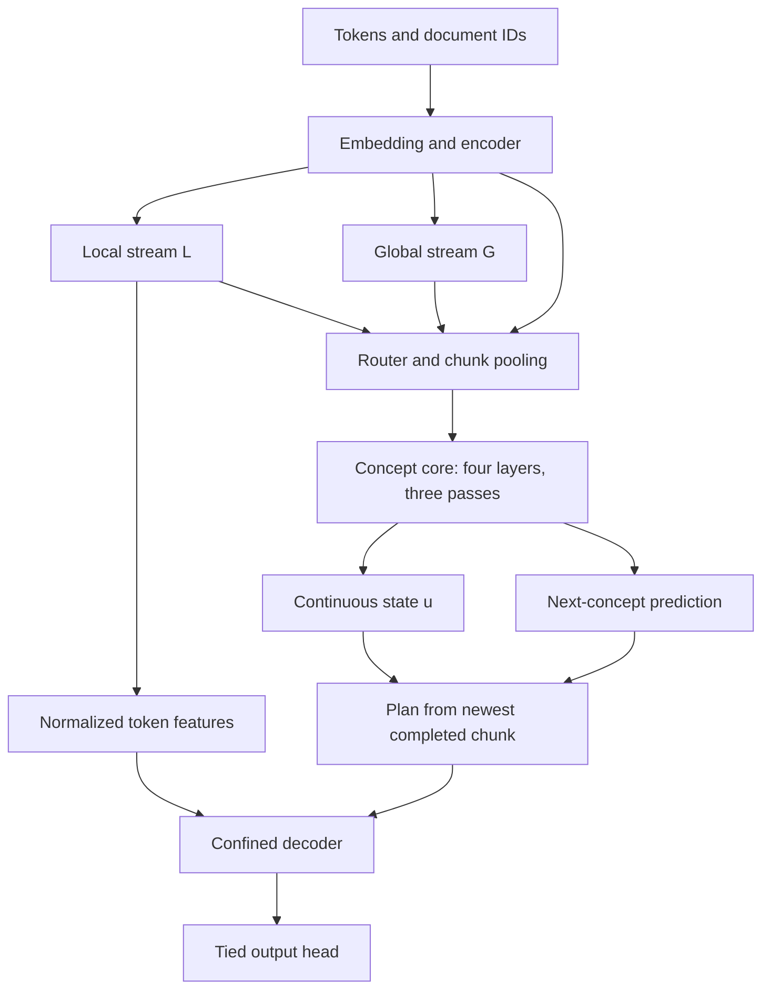

# EncoderConceptDecoder: a first-principles walkthrough

Reviewed on 2 October 2026. This guide describes the code and saved evidence currently in this workspace. It distinguishes whole-model versions, component versions, implemented models, and proposals.

The project investigates whether a language model can put useful long-range computation into a smaller sequence of latent concepts, then translate that computation back into tokens. The completed v3 run demonstrates that this route carries information and supports substantial retrieval. It gives much weaker evidence for general multi-hop reasoning. The latest v4.1 document proposes making the token path more capable while retaining the concept interface.

## 1. Start with the actual problem

A language model learns a distribution

`p(x[t+1] | x[0], ..., x[t])`.

Its next-token loss is the negative log probability of the observed next token. The engineering problem is to predict well within a limited parameter, memory, and training-time budget. The research problem is whether an intermediate representation and repeated computation improve prediction, retrieval, composition, or subsequent controllability enough to justify their cost.

The repository separates four questions:

1. **Information:** can the evidence reach the token that needs it?
2. **Representation:** does the intermediate state preserve the useful information?
3. **Learning:** does the loss send useful gradients to the operations that produce that state?
4. **Efficiency:** does the resulting quality justify the time and memory spent?

A causal connection answers the first question. A readable feature, a healthy codebook, a changing loop state, or a falling auxiliary loss each answers only part of the others. A controlled experiment is needed to establish the value of a design choice.

The information argument can be written precisely. Let `near` be the context available through the bounded token path and `far` the earlier context. The optimal achievable cross-entropy difference is:

`H(next | near) − H(next | near, far) = I(next; far | near) ≥ 0`.

The concept route's information job is to deliver some of what the far past tells us beyond the near past. Random-value retrieval probes make that requirement concrete: local syntax and filler cannot determine an independent value placed outside the token path's reach. Natural-language prediction can benefit from the same route without demanding explicit multi-hop computation.

## 2. The workspace and its sources of truth

This directory has no `.git` repository at the inspected root. It is an experiment workspace with source copies, datasets, checkpoints, logs, papers, reviews, and a dashboard. No `AGENTS.md` was found in the workspace or checked ancestor locations. There is no single top-level application or packaged library entry point.

| Location | Role |
|---|---|
| `Encoder Design/` | Original encoder specification, reference implementation, and small experiments |
| `Concept Design/` | Original concept specification and isolated/end-to-end experiments, including recurrence, latent steering, and multiple latent modes |
| `Decoder Design/` | Confined-versus-stack decoder design, reference code, and experiments |
| `PROMPT.md` | Historical instructions for assembling and training the original whole model |
| `run_m2_25M/` | Whole-model v1, shared tokenizer/data/environment, original run and continuation, and the most developed dashboard |
| `run_v2_19M/` | Whole-model v2 with a recurrent mixture-of-experts concept core and NextLat auxiliary |
| `v3_design/` | v3 reference implementation, parameter accounting, and design checks |
| `run_v3_19M/` | Trainer-grade v3 implementation and completed 48-hour run |
| `v4_tiny/` | Size-parametric v4 implementation, tiny experiments, and a matched transformer comparison |
| `draft_v4_1.md` | Latest proposal; its new retrieval decoder and post-training controllers are not implemented |
| `*_review_*`, `audit_v2_*` | Historical audits with frozen source snapshots, diagnostics, reports, and plots |
| `Loop Papers/`, other paper folders, root PDFs | Literature library and design background |

At inspection, an inventory excluding `.venv` and bytecode caches contained about 1,450 files. Source/documents outside vendor and snapshot directories contained 319 files and 250 distinct byte contents. Inventory coverage is not a claim of line-by-line review of every artifact or every paper.

The encoder, decoder, original `concept_core_v2.py`, `tasks.py`, and `probes.py` have byte-identical copies across their relevant run folders. The important changes are usually in the model wrappers and trainers. The architecture explanation below follows those wrappers, imported primitives, data builders, evaluators, and tests. Existing audits were used as historical evidence, with current results checked directly in JSON.

For an existing run, read its code, `config.json`, and raw evaluation/log files together. A draft or dashboard diagram can describe a different revision. `DECISIONS.md` explains changes but does not replace the executable graph.

## 3. Resolve the version names before reading the code

| Whole model | Implementation | Main architecture |
|---|---|---|
| v1 / THINKER-25M | [model.py](/Users/shubhankankrishna/Desktop/EncoderConceptDecoder/run_m2_25M/code/model.py) | Width 384; original encoder; one shared concept layer with sampled 1–4 passes; confined decoder |
| v2 / THINKER-19M | [model.py](/Users/shubhankankrishna/Desktop/EncoderConceptDecoder/run_v2_19M/code/model.py) | Token width 256, concept input width 384; four concept layers, 16 shared experts, many passes and detached windows; NextLat |
| v3 / THINKER-19M | [model.py](/Users/shubhankankrishna/Desktop/EncoderConceptDecoder/run_v3_19M/code/model.py) | Width 256; two encoder Engram reads; four dense concept layers, three passes, conditioning table and shortcuts; confined decoder |
| v4 | [model_v4.py](/Users/shubhankankrishna/Desktop/EncoderConceptDecoder/v4_tiny/code/model_v4.py) | Default k=6; attention pooler, encoder F loops/shared FFN, two-level codebook, two core passes, optional decoder Engram reads |
| v4.1 | [draft](/Users/shubhankankrishna/Desktop/EncoderConceptDecoder/draft_v4_1.md) | Proposed full-range retrieval layer in the decoder; no pooler FFN or decoder Engram reads |

`ConceptCoreV2` is the component used inside whole-model **v1**. It is not the D6/MoE whole-model v2. Similarly, `proposed_v3.md` and `draft_v3.md` describe distinct designs. The implemented v3 is the width-256 draft lineage.

“Frozen encoder” in the historical documents freezes its design/reference implementation. The whole-model optimizers train encoder weights; it does not mean the pretrained encoder weights were held fixed.

Some original concept-spec amendments describe a learned initial state and a separately gated decoder plan. The assembled original run uses a zero initial carry and additive confined plan, as its code and historical assembly prompt specify. Follow the actual run's implementation when the older design narrative differs.

## 4. Walk one v3 batch through the model

The recorded main configuration uses token length T=1,024, width d=256, vocabulary V=8,192, and chunk size k=4. For a batch of B rows:

| Tensor | Shape | Meaning |
|---|---|---|
| `ids` | B × 1,024 | Token IDs |
| `doc` | B × 1,024 | Document IDs within each packed row |
| `eidx` | B × 1,024 × 8 | Hashed bigram/trigram memory indices |
| `L`, `G`, `tok` | B × 1,024 × 256 | Token-rate streams and decoder-visible local features |
| `c_hat` | B × 256 × 256 | One continuous concept per four tokens |
| `S`, `u`, `c_pred` | B × 256 × 256 | Concept-core carry, normalized output, and predicted next concept |
| `P`, `D` | B × 1,024 × 256 | Token-aligned plan and private decoder state |
| logits | B × 1,024 × 8,192 | Next-token scores |

The compression reduces the **core's** sequence length from T to T/k. Its attention matrices therefore have roughly 1/k² as many position pairs as token-rate attention of the same batch. This reduction does not apply to the encoder's full-attention layers, and it does not imply the entire model is k² faster.

## 5. Encoder: separate local and global information

The shared primitives are in [hrm_encoder.py](/Users/shubhankankrishna/Desktop/EncoderConceptDecoder/run_v3_19M/code/hrm_encoder.py). The v3-specific encoder wrapper is in [model.py](/Users/shubhankankrishna/Desktop/EncoderConceptDecoder/run_v3_19M/code/model.py).

The encoder starts with the RMS-normalized embedding `e0` and two streams initialized to it: `L=e0`, `G=e0`. Its layer pattern is `SSSFSSSF`.

- An **S layer** reads L only. Its sliding-window attention and FFN write both L and G.
- An **F layer** reads L and G. Full causal attention and its FFN write G only.

This read/write rule prevents global information from flowing back into the local stream. An F layer can change the concepts while leaving `tok` exactly unchanged, as the tests verify.

The common attention blocks use grouped-query attention, per-head query/key RMS normalization, an output sigmoid gate, and causal short convolutions on Q/K/V. Local S attention uses partial rotary position encoding. Full F attention uses no explicit positional encoding and learned per-head temperatures. Every attention mask and convolution respects document boundaries.

Gated residual reads combine normalized allowed streams with elementwise gates. Writes use `2*sigmoid(...)`, initialized to scale 1. This is a concrete computation rule; the gates do not independently establish that the state is performing reasoning.

### Derive the local reach

Each S layer adds at most `window−1 + conv_kernel−1 = 7+3 = 10` tokens of backward reach. The first Engram read adds a further three through its convolution. With six S layers, L's maximum lag is:

`10 + 3 + 5*10 = 63`.

This means a token at position p can affect L through p+63, and has no effect beyond that through this path. The second v3 Engram read has no convolution and does not increase this reach. Full attention can carry an edit to the end of its document in G.

## 6. Engram: what “memory” means here

Canonicalized token bigrams and trigrams are hashed through four heads per order into eight tables. Their gathered rows are concatenated, projected into keys/values, gated by the current local features, and written into the streams.

This is a learned n-gram lookup table, not an inference-time database of the current document's facts. Its weights are learned during training. In v3 one gather supplies two encoder reads: after layers 0 and 4. Both value projections begin at zero, allowing the branches to open without changing initial behavior.

The actual v3 table has `8 × 208,333 × 48 = 79,999,872` parameters. It is a major storage/optimizer-memory allocation despite being excluded from the repository's headline parameter count. This implementation uses a regular embedding, with dense-gradient optimizer handling.

v3's recorded ledger is **18,986,871 headline “compute” parameters and 101,116,663 stored parameters**, including the Engram table, 2,097,152 embedding parameters, and 32,768 codebook parameters. The headline is an accounting convention, not a count of all weights or FLOPs. In particular, the excluded tied embedding is also used in the dense output matrix multiplication. v2's MoE ledger counts stored expert parameters, even though only a subset is selected per position.

## 7. Pooling: turn token streams into concepts

At every position the encoder computes a softmax mixture of `e0`, normalized L, and normalized G. The router reads G and initially favors G, with approximately 0.107/0.107/0.787 mixture shares.

v3 concatenates four mixed token vectors and projects them into one concept. Its linear pool begins as a mean. The result is normalized close to a sphere of radius √d.

Two consequences:

1. A concept is not merely a summary of four raw tokens. Its inputs include G, which already contains the document's causal global context.
2. The pooler's coefficients are learned but fixed with respect to the current input. It has no explicit input-dependent token-selection weights; the upstream representations themselves remain content-dependent.

v4 introduces a four-head attention pooler over k tokens, with PAD masking and mean-pool initialization. Its learned weights can vary with token content. The implementation also contains a gated-convolution alternative and the v3 linear control. A plain kernel-k, stride-k linear convolution is equivalent to a concatenation-and-linear pool after reshaping its weights; adding a content gate changes that model class.

## 8. Concept core: recurrence in depth

v3's carry starts at `S0=0`. A pass applies four distinct full-attention layers. Each layer rereads the continuous concepts C and current carry S through gated residual reads, then updates S with attention and an FFN. Each layer has its own FFN and also uses one shared FFN in parallel. The final output is `u=ZCRMSNorm(S)`.

Three passes reuse the same four layers. This is recurrence **in computation depth**. S is reconstructed for each forward call; it is not persistent memory across training batches or independent requests.

The main v3 schedule is `(0,1), (1,1), (2,1)` in thirds. A learned table indexed by `(t, Δ)` modulates seven read/write sites per layer. Shortcut schedules cover a single large step or two differently sized steps. These are discrete, implemented schedules rather than unrestricted continuous-time inference.

At training time a shortcut is sampled with probabilities 0.5/0.25/0.25 for `1/2a/2b`. Main and shortcut trajectories are batched at concept rate, and a common prefix is reused with its gradients intact. The shortcut is trained by NCP and consistency with a detached normalized main state. The decoder's NTP loss is computed on the main trajectory.

There is no structural rule that one pass equals one logical hop. One full-attention pass can already read all earlier concepts, and those concepts already contain global encoder information. Pass usefulness must be measured with outputs and interventions.

## 9. The codebook and NCP head

v3 splits each 256-dimensional concept into 32 eight-dimensional segments. Each segment has 128 codewords. Assignments are nearest-code indices. The head projects u into this space and uses negative squared distances, divided by learned temperatures, as categorical logits.

NCP predicts the code indices of the next chunk. The predicted concept sent to the plan is the concatenation of softmax-weighted codeword averages.

**The continuous `c_hat` is fed directly into the core.** It is not replaced by a quantized vector. Thus the codebook constrains the auxiliary prediction space; it does not impose a mandatory finite-bit bottleneck on all information entering the core. Neither named concepts nor semantic interpretability follow from the codebook construction.

The codebook is detached inside the head. VQ also detaches encoder concepts. Therefore:

- NTP and NCP train the encoder/core/head through their respective paths.
- VQ updates codebook vectors to follow detached encoder concepts.
- NTP/NCP do not train codebook vectors directly.
- VQ does not train the encoder to become easier to quantize.

Codebook usage, entropy, reconstruction variance explained, next-code predictability, and semantic usefulness are different measurements. The targets also move as the encoder and codebook learn.

v4 adds a coarse centroid followed by product-quantized residual codes. Its fine NCP loss conditions on the **true next coarse code inside the loss only**. The plan instead uses its predicted coarse average plus predicted residual average. That distinction is essential to avoid leaking a future target into token prediction.

## 10. Decoder: causality and private plans

The decoder contract and implementation are in [hrm_decoder.py](/Users/shubhankankrishna/Desktop/EncoderConceptDecoder/run_v3_19M/code/hrm_decoder.py).

A concept for chunk j contains tokens through `kj+k−1`. The logit at token position t predicts token t+1. It may therefore use chunk j only after that chunk is complete:

`kj+k−1 ≤ t`, hence `j*(t)=floor((t+1)/k)−1`.

For k=4, positions 0–2 use a learned null plan; positions 3–6 use chunk 0; positions 7–10 use chunk 1. A document boundary also forces the null plan whenever the indexed chunk belongs to another document.

The plan is

`P[t] = Wu*u[j*] + Wc*c_pred[j*] + offset[(t+1) mod k]`.

The offset tells the decoder which token of the target chunk it is predicting. The initial private decoder state is `D[t]=tok[t]+P[t]`.

Every confined decoder layer builds queries from D but keys and values from the fixed encoder `tok` stream within window 8. FFNs are position-wise. No decoder layer reads another position's D. Consequently, adding decoder layers does not expand the token receptive field: the maximum lag remains `63+7=70`.

Perturbing output state u[j] directly changes only the k positions using its plan. Perturbing core **input** C[j] can change all later core outputs through causal attention, and therefore later plans. These are different intervention sites, which explains the latest draft's preference for controlling core inputs.

## 11. One training step and its gradients

The v3 trainer is [train.py](/Users/shubhankankrishna/Desktop/EncoderConceptDecoder/run_v3_19M/code/train.py). The recorded main run uses two rows per microbatch and 16 accumulated microbatches: 32,768 token slots per optimizer update.

For each update it fetches all microbatches first and counts valid token targets, concept pairs, complete chunks, and nonempty chunks. Each microbatch contributes sums divided by the **whole update's** relevant denominator. This preserves proper weighting when microbatches contain different amounts of padding.

Its objective is:

`NTP(main) + 0.1*NCP(main) + 0.05*NCP(shortcut) + 0.1*consistency + VQ`.

| Term/path | Parameters receiving its gradients |
|---|---|
| NTP through local tokens | Decoder, tied embedding, encoder local path and its memory reads |
| NTP through plans | Plan builder, concept core/head, encoder concepts, router/pool, global encoder path |
| NCP | Head/core and encoder concept path; not decoder or codebook |
| Shortcut consistency | Shortcut-producing graph; detached main terminal state has no direct teacher gradient from this term |
| VQ | Codebook only |

Global encoder F layers receive token-loss gradients through the concept route. If the plan is disabled, those F layers lose this NTP route.

The optimizer is AdamW, with gradient clipping at 1. Biases, embeddings/tables, temperatures, codebook vectors, convolution kernels, plan null/offsets, and the core conditioning table have special no-decay handling. Zero-initialized output branches legitimately delay some upstream gradients by a step; this is tested rather than interpreted as permanent dead computation.

The learning rate warms up for 300 steps, then follows a cosine based on the trainer's elapsed session time. The out-of-process 24-hour evaluation and pause intervals are excluded by checkpoint/resume. In-process quick evaluation remains inside `elapsed()`; its duration is subtracted from throughput measurements, not from that clock. This distinction matters when comparing wall-clock and token-matched outcomes.

## 12. Data is part of the architecture contract

[build_data.py](/Users/shubhankankrishna/Desktop/EncoderConceptDecoder/run_m2_25M/code/build_data.py) builds an 8,192-token byte-level BPE, canonical IDs for Engram hashing, packed arrays, frozen evaluation items, and a manifest. Digit splitting is explicit. PAD=0 and EOS=1.

The nominal token-budget mixture is 45% language, 22% symbolic, 10% code-like tasks, 13% retrieval, and 10% dedicated long-range probes. The language allocation is 45% TinyStories and 55% WikiText. Actual counts are recorded in [MANIFEST.json](/Users/shubhankankrishna/Desktop/EncoderConceptDecoder/run_m2_25M/data/MANIFEST.json): 273,797 training rows, 280,368,128 slots, and 264,365,789 non-PAD tokens. Non-PAD tokens and scored targets are not identical because document-boundary targets are also excluded.

Documents begin on chunk boundaries and are padded to multiples of k. Every layer, short convolution, hash, concept mask, and plan lookup must respect the same document IDs. NTP scores a target only when it is non-PAD and belongs to the same document as its predictor.

[data.py](/Users/shubhankankrishna/Desktop/EncoderConceptDecoder/run_v3_19M/code/data.py) memory-maps training arrays, shuffles rows by seed plus epoch, prepares Engram indices on the CPU, and prefetches batches. Its consumed-row cursor is checkpointed.

The original raw corpus location is an absolute path into an earlier `HRM THINKER` experiment outside this workspace. Existing packed data are sufficient for the saved runs, but rebuilding from raw sources is not self-contained. v2/v3 also reuse v1's data and Python environment.

## 13. Evaluation asks which route is doing the work

[evaluate.py](/Users/shubhankankrishna/Desktop/EncoderConceptDecoder/run_v3_19M/code/evaluate.py) supplies language scores, item accuracy, context truncation, codebook telemetry, and loop diagnostics. [final_eval.py](/Users/shubhankankrishna/Desktop/EncoderConceptDecoder/run_v3_19M/code/final_eval.py) combines these with linear probes, gradient audits, and generation.

The dedicated long-range probes are:

- **recall1:** retrieve one value token after a long gap.
- **carry3:** reproduce three value tokens.
- **multi4:** answer all queries for four facts with three-token values.
- **hop:** follow shuffled links for multiple steps.
- **bind:** retain the latest variable binding and apply arithmetic.

Their evidence is placed beyond the 70-token path. In v1/v3, independent far evidence cannot affect the answer through the local stream, so successful retrieval with plan dependence demonstrates use of the concept route.

Interventions replace the plan with a null plan, swap plans between rows, remove u or the predicted concept, alter pass schedules, or disable memory/global/shared branches. Context truncation measures the loss from removing earlier input.

**Item exact match is teacher-forced greedy scoring.** Each answer token is predicted with previous gold tokens still present. For multi4, an item succeeds only if every scored span is correct. These scores are not autonomous rollout success rates. Natural-text generation and pinpad closed-loop rollouts are separate evaluations.

A component switch-off measures dependence at fixed trained weights. A large cost is evidence of use. A small cost does not prove a trained model without that component would be better or equivalent, and neither delta is a bound on how strongly the component could be steered. Trained controls answer those questions more directly.

## 14. What the completed v3 run establishes

The run finished at step 15,588. The launcher records completion on 2 October at 07:22 IST. The following values come directly from [eval_final.json](/Users/shubhankankrishna/Desktop/EncoderConceptDecoder/run_v3_19M/runs/v3_48h/eval_final.json).

| Final v3 reading | Value |
|---|---:|
| TinyStories test NTP | 1.745 nats/token |
| WikiText test NTP | 3.300 nats/token |
| Arithmetic mean of the two language losses | 2.523 |
| Test recall1 exact | 100.0% |
| Test carry3 exact | 96.68% |
| Test multi4 exact | 83.01% |
| Test hop exact | 16.99% |
| Test bind exact | 6.05% |
| OOD recall1 exact | 94.73% |
| OOD carry3 exact | 57.42% |
| OOD multi4 exact | 4.10% |
| OOD hop exact | 0.0% |

With the core disabled, test recall falls to 0.98%, carry3 and multi4 to zero, and language loss rises by 0.736/0.593 nats. Plan swapping similarly destroys retrieval. The main continuous u path carries substantially more of the plan than the predicted code path, but `c_off` still costs 0.021/0.025 nats and lowers multi4 from 0.830 to 0.779.

One pass versus three costs only 0.0078/0.0061 language nats, but multi4 rises from 0.764 at one pass to 0.818–0.822 at two and 0.830 at three. The value of recurrence is task-dependent, with most of this probe gain reached by two passes. Removing the shared core FFN lowers multi4 to 0.666 while producing a small language delta.

All codewords are used in this evaluation; variance explained is 0.658 and NCP CE is 2.815 versus 2.820 at one pass. These are healthy auxiliary measurements, not evidence that codes are semantic subgoals.

The OOD suite jointly changes name syllables, evidence distance, and family-specific complexity. Its degradation cannot be assigned to any single axis. In particular, multi4 keeps four facts; increased fact counts are not a universal OOD change across all families.

v1's saved test losses were 1.977/3.629 after its 24-hour run. v3 is better at its 48-hour endpoint, but that comparison changes model size, training budget, token count, and schedule. It is not a controlled estimate of one architectural change. The v3 decision log separately records matched-step comparisons and throughput changes.

## 15. Why v2 and v3 differ

v2's D6 core uses four layers and a shared pool of 16 SwiGLU experts with top-2 routing. Training samples 8–12 passes, grades every pass with NCP, and detaches carry between windows. NTP/NextLat are terminal objectives.

The saved [underperformance review](/Users/shubhankankrishna/Desktop/EncoderConceptDecoder/v2_underperformance_review_2026-09-28/REPORT.md), its reproduction scripts, and current source show three important mechanisms:

1. Earlier rows claim expert capacity first, so later rows can lose assignments. Evaluation disables capacity drops; training and evaluation therefore differ.
2. NextLat uses detached teacher targets, but its student path still backpropagates into shared decoder/core parameters. Historical diagnostics measured opposing gradients on several of those weights. This supports an ablation hypothesis, not a complete causal attribution of the performance gap.
3. Detaching carry prevents terminal NTP from training the particular earlier carried state across the boundary. Shared core weights still receive terminal gradients in later applications; the whole core is not disconnected.

v3 removes MoE and NextLat, shortens recurrence, restores full backpropagation across its main passes, widens its dense token FFNs relative to v2, and introduces shortcut conditioning/consistency. Several axes changed together. Its better outcome does not isolate which change caused the improvement.

## 16. v4: implemented, with tiny-scale evidence

`model_v4.py` supports both full and tiny configurations. The full default has 19,898,011 headline compute parameters, but the completed experiments in `v4_tiny/` train width-64 models. Building the full configuration and checking its ledger is not a full-scale training result.

The original v4 default adds attention pooling with an FFN, shared encoder FFN, repeated encoder F layers, k=6, two plain core passes, a coarse-plus-residual codebook, and two decoder Engram reads. The later comparison uses revised tiny defaults: attention-only pooling and no decoder Engram reads. Read each run's recorded overrides before attributing its result to “v4.”

The first [tiny report](/Users/shubhankankrishna/Desktop/EncoderConceptDecoder/v4_tiny/REPORT.md) establishes mechanics and content-dependent pooling, but does not reach robust retrieval onset. It identifies repeated filler memorization and decoder-read behavior that hurts unseen probe text. The subsequent harness expands training fillers and evaluates with separate validation fillers.

The [v4-versus-LLM experiment](/Users/shubhankankrishna/Desktop/EncoderConceptDecoder/v4_tiny/VS_LLM_REPORT.md) compares v4 with a 16-layer, 22-application transformer stack using 3:1 sliding-window/full attention, matched headline parameters, identical packed rows, optimizer, and real-token budgets. The LLM uses one token-rate residual stream, window 60 in S layers, and recurrent middle layers. It has no Engram or concept losses; initialization also differs.

At 5M text tokens over two seeds, the saved paired language difference is approximately −0.007 nats for v4 minus LLM: parity at this budget. At 6M pinpad tokens over three seeds, held-out optimal-action rate is 13.3 percentage points lower for v4, and closed-loop pair integrity also favors the LLM. The base concept route is used, but its second pass and encoder F loop contribute little at this scale. The comparison does not isolate compression, local window size, global access, auxiliary objectives, initialization, or FLOPs individually.

Pinpad is an imitation-learning experiment, not the proposed internal RL system. The [environment](/Users/shubhankankrishna/Desktop/EncoderConceptDecoder/v4_tiny/code/pinpad.py) is a 7×7 grid with eight colors and four walls. BFS generates optimal demonstrations. Sixteen color-pair compositions are used in training, twenty are held out, and a longer twelve-visit task tests length generalization. Inputs contain a layout header and action/position tokens; latent subgoal labels are used only for evaluation probes.

## 17. v4.1: the proposed next change

The [latest draft](/Users/shubhankankrishna/Desktop/EncoderConceptDecoder/draft_v4_1.md) retains v4's concept mechanism and proposes replacing decoder layer 2 with a full-causal retrieval layer R. Its query is plan-aware D[t], but keys/values still come from encoder `tok`, never another position's D. It also removes the pooler FFN and decoder Engram reads.

This gives the token path access to the whole document while retaining exact plan privacy. The underlying hypothesis is that long-range content-addressed token access helps where the exclusive concept route struggled at tiny scale. That causal explanation is not established by the existing comparison.

The change sacrifices the old proof that every long-range answer came through the concept route. Component use must instead be measured through plan interventions and trained controls. The draft specifies tiny v4.1, stack, and loop-off arms before a full run. Current `run_vs.py` accepts only `v4` and `llm`; no v4.1 retrieval-layer implementation was found.

The draft also specifies three post-training uses of the concept interface: a controller trained on a frozen base followed by internal RL, verifier-guided latent optimization, and concept-vocabulary adaptation. Those are proposals. Older isolated GradCuit-style toy experiments exist under `Concept Design/`; they are not an implemented controller on the completed full v3 model.

The original concept test benches are useful mechanism studies: they isolate in-context chains, compare initial carry choices and pass counts, test verifier-guided offsets on a frozen toy core, and branch into multiple latent modes for ambiguous graph paths. Their results can show that a mechanism exists in the toy system. The setup, objectives, and data differ from the full language runs, so their successful depth extrapolation or steering results cannot be assigned to v3 without a corresponding evaluation.

## 18. Runtime and dashboard

The run launchers orchestrate training, checkpoints, milestone evaluation, final evaluation, and resume. v3's checkpoint stores model/optimizer state, RNGs, shortcut RNG, consumed-row cursor, elapsed clock, and LR trace. Checkpoints are atomically replaced, and last/best aliases use hard links.

Battery, divergence, and memory guards are in the shell/trainer code. Recorded process-memory growth led to checkpoint-and-reexec handling. Block-local SDPA reduces work in window attention. `torch.compile` is used only in training; a documented MPS key-normalization gradient issue is worked around by running that normalization eagerly. Historical parity tests support those choices; this review reran CPU suites, not compiler/MPS parity.

[compat.py](/Users/shubhankankrishna/Desktop/EncoderConceptDecoder/run_v3_19M/code/compat.py) repairs a reference helper named `_apply` that otherwise shadows PyTorch's device/dtype conversion method. [speed_v3.py](/Users/shubhankankrishna/Desktop/EncoderConceptDecoder/run_v3_19M/code/speed_v3.py) patches module forwards for optimized paths. Import order is therefore part of the runtime behavior.

The primary [dashboard server](/Users/shubhankankrishna/Desktop/EncoderConceptDecoder/run_m2_25M/webapp/server.py) uses Python's HTTP server, incrementally tails logs, exposes JSON endpoints, and serves plain JavaScript/CSS/HTML with Three.js diagrams. It does not import the model or run Torch. It writes dashboard-owned telemetry copies and has an optional analysis endpoint invoking a configured Claude CLI, so “read-only” means it avoids mutating training runs, not that the process performs no writes or external work.

The dashboard is a presentation layer. Its older architecture JSON, copied pages, live histories, and narrative summaries can lag the source and final evaluation. The final JSON and append-only run logs are the evidence to use when a display disagrees.

## 19. Verification performed for this walkthrough

Using the existing `run_m2_25M/.venv` Python on CPU:

| Existing suite | Fresh result |
|---|---:|
| `run_v3_19M/code/test_v3.py` | 49/49 checks passed |
| `v4_tiny/code/test_v4.py --block 60` | 15/15 tests passed |
| `v4_tiny/code/test_vs.py --block 60` | 12/12 tests passed |

The suites check actual architecture contracts: causality, document isolation, bounded reach, private plans, branch gradients, codebook isolation, parameter accounting, reference/optimized-path parity, and matching training rows. The comparison suite includes four-step disposable runner checks and short learnability checks; its temporary run folders were cleaned by the suite.

These results verify the tested CPU implementation. They do not reproduce the 48-hour training, fresh full-checkpoint metrics, full-size learnability, MPS compilation, every historical audit, or the library of paper claims. No existing model source, experiment result, dataset, or checkpoint was edited for this walkthrough.

## 20. A practical reading sequence

1. [v3 model wiring](/Users/shubhankankrishna/Desktop/EncoderConceptDecoder/run_v3_19M/code/model.py): establish the live interfaces and shapes.
2. [Encoder primitives](/Users/shubhankankrishna/Desktop/EncoderConceptDecoder/run_v3_19M/code/hrm_encoder.py): understand L/G streams, masks, residual gates, attention, hashes, and pooling.
3. [Decoder](/Users/shubhankankrishna/Desktop/EncoderConceptDecoder/run_v3_19M/code/hrm_decoder.py): derive completed-chunk alignment and plan privacy.
4. Return to the v3 core in `model.py`: follow one pass, repeated schedules, the detached codebook head, and VQ/NCP.
5. [Trainer](/Users/shubhankankrishna/Desktop/EncoderConceptDecoder/run_v3_19M/code/train.py): trace loss destinations, reductions, optimizer steps, and resume.
6. [Data builder](/Users/shubhankankrishna/Desktop/EncoderConceptDecoder/run_m2_25M/code/build_data.py) and [probe generators](/Users/shubhankankrishna/Desktop/EncoderConceptDecoder/run_v3_19M/code/probes.py): understand the causal evidence available in each task.
7. [Evaluator](/Users/shubhankankrishna/Desktop/EncoderConceptDecoder/run_v3_19M/code/evaluate.py) and [final evidence](/Users/shubhankankrishna/Desktop/EncoderConceptDecoder/run_v3_19M/runs/v3_48h/eval_final.json): distinguish route use, task performance, and recurrence value.
8. [Acceptance tests](/Users/shubhankankrishna/Desktop/EncoderConceptDecoder/run_v3_19M/code/test_v3.py): see executable statements of the guarantees and defects that must be caught.
9. [v2 underperformance review](/Users/shubhankankrishna/Desktop/EncoderConceptDecoder/v2_underperformance_review_2026-09-28/REPORT.md), [v3 decisions](/Users/shubhankankrishna/Desktop/EncoderConceptDecoder/run_v3_19M/DECISIONS.md), and [tiny comparison](/Users/shubhankankrishna/Desktop/EncoderConceptDecoder/v4_tiny/VS_LLM_REPORT.md): reconstruct why the design evolved.
10. [v4.1 draft](/Users/shubhankankrishna/Desktop/EncoderConceptDecoder/draft_v4_1.md): read the proposed next experiment against those verified mechanisms and results.

The current research position is precise: a useful continuous concept route is demonstrated; robust compositional reasoning and the value of the proposed next architecture remain to be established by controlled experiments.
