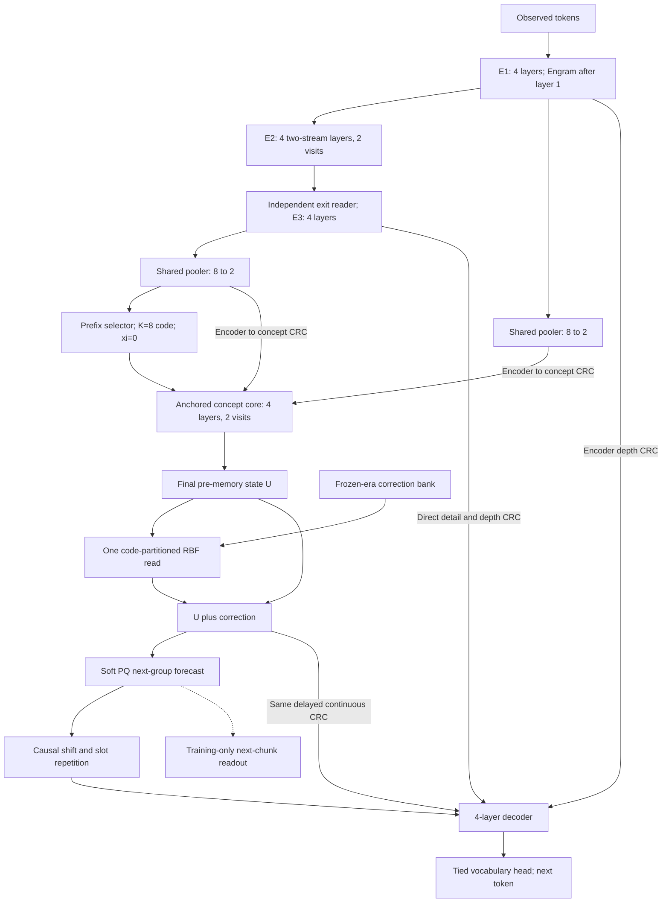

# V10.1 RCDL — architecture, evidence, and critical review

**Status: implemented and tested as an experimental candidate; improved task performance remains unproven.** The original specification was written 11 October 2026; Section 1 preserves its historical checkpoint **50,689** evidence. Implementation, current V10 evidence, data repair, and the user-authorized transition to a **16-hour V10.1 run, extendable to 24 hours**, are documented in [the validation report](v10_1/VALIDATION_REPORT.md) and [run instructions](v10_1/README.md). V10 was subsequently stopped cleanly at step **84,778** on 12 October. Its checkpoint, original source, tokenizer, and corpus are preserved.

**Recommendation:** preserve V10's encoder, compression ratio, two recurrent visits, and final RBF correction. Add both **encoder→concept CRC** and **continuous corrected-concept→decoder CRC**. Give the PQ forecast an inexpensive, separately tested token-prediction responsibility. Change data and evaluation contracts before claiming an architectural improvement.

The complete proposed training model has **5,731,496 dense parameters plus 20,000,320 Engram parameters**. The first architectural comparison needs only **5,516,328 dense parameters**. These counts are now verified against the implemented modules and full-size CPU/Metal integration runs. The budget is less than 10M **dense** parameters; neither configuration has fewer than 10M total learned parameters.

## 1. What the current experiment actually establishes

The proposal is grounded in the source documents, actual implementation, active data, telemetry API, and new checkpoint interventions. The pasted attachment is a prior review to examine critically, not an additional instruction source. Numerical evidence is saved in [the evidence directory](v10_1_design_evidence/2026-10-11/).

### 1.1 Training and evaluation are different measurements

At the telemetry watermark, the trainer was alive at **step 51,460**, with **109,290,528 input tokens**, 7.865 hours elapsed, and 16.135 hours remaining. All losses and dense norms in **2,574 logged records** were finite. No ingestion issues were reported. The recent half-hour median throughput was **3,981 input tokens/s**, and median pre-clip dense gradient norm was **2.851**, with p95 **4.317**.

Every sampled recent norm exceeded the clipping threshold of 1. These are pre-clip norms from the final update in each 20-step logging interval, not all optimizer updates. They exclude the separately clipped sparse Engram gradient. This supports frequent clipping; it does **not** establish exploding gradients, failed recurrence, or a need for CRC. Losses averaged over mixed families must not be compared directly with text-only development loss.

The same routine text sample improved from NLL **5.7652 / perplexity 319.0** at step 3,185 to **4.6765 / 107.4** at step 49,559. Its best earlier logged NLL was **4.6342** at step 46,069. Progress is no longer monotonic; this small fixed set alone cannot diagnose overfitting.

Fresh CPU evaluation used a consistent development selection, greedy generation, committed prefix-selected codes, no answer repair, no optimizer updates, and no memory writes:

| Measurement | Checkpoint 24,868, prior saved review | Checkpoint 50,689, this review |
|---|---:|---:|
| Text train NLL, 32 sampled sequences | 4.1449 | 3.8110 |
| Text dev NLL, same 32 sampled sequences / 11,255 targets | 4.6124 | 4.5742 |
| Text dev perplexity | 100.73 | 96.95 |
| Train/dev NLL gap | 0.4675 | 0.7632 |
| Balanced math, 16 problems per module | 1/64 | **6/64** |
| Easy Sudoku, full valid board with EOS | 0/16 | **0/16** |
| Hard Sudoku, full valid board with EOS | 0/16 | **0/16** |

The six math successes are **2/16 one-variable linear equations and 4/16 sorting**; addition/subtraction and multiplication are each **0/16**. This is modest observed progress on a small set, not reliable broad reasoning. The text train/dev gap has widened on these samples while dev NLL improved slightly. That motivates better coverage and held-out monitoring, not an automatic declaration of overfitting.

All 32 generated Sudoku boards now have the expected 81-digit format. Eleven easy and thirteen hard boards preserve every clue. They still fail global constraints. Format, clue copying, and valid individual rows are diagnostics, never substitutes for solved-puzzle accuracy. The routine 0/8 math evaluation is restricted to addition/subtraction; it is not a balanced math benchmark.

### 1.2 Where useful computation currently stops being useful

The larger fresh text check gives **NLL(concepts off) − NLL(on) = +0.001055**, with descriptive paired-batch bootstrap 95% interval **[+0.000451, +0.001739]**. This is a small measurable effect in that sample. It is not zero, and it is not a compelling benefit relative to the model's cost. Engram removal raises NLL by **0.5084** on eight sequences. That shows reliance on the learned table, not superiority to a separately trained no-Engram model or proof of factual storage.

An additional interface probe used four batches of two dev sequences per family, checkpoint 50,689. Its text results are:

| Intervention or baseline | Result | Interpretation |
|---|---:|---|
| Remove PQ concept guidance | ΔNLL +0.000506 | Weak downstream use on this subset |
| Remove encoder→decoder CRC | ΔNLL +0.060009 | Much greater reliance on encoder depth features |
| Use one concept visit instead of two | ΔNLL +0.000137 | Tiny token benefit from the second visit |
| Forecast MSE, visit one → visit two | 0.25339 → **0.24399** | Second visit improves its latent objective |
| Copy-current / causal-running-mean latent baseline | 0.32220 / 0.27344 | Current forecast beats both on this subset |
| Learned concept fusion scale, RMS | **0.03213**, initialized 0.1 | The trained interface has reduced this scale |

All four families improve latent MSE with the second visit, while token effects remain small. These are interventions on one trained checkpoint, with possible distribution shift, not retrained architecture comparisons. The probe's latent summaries are token-weighted means of batch group-MSE values; future benchmark implementations should also report globally group-weighted values.

The pasted review's earlier observation that running-mean prediction beat the learned forecast is **not true on this newer text probe**. The correct diagnosis is now: some useful latent prediction is learned, but little of its benefit reaches the next-token objective. RMS of one gate alone does not measure information content or causation.

### 1.3 Data findings that architecture cannot repair by itself

This review scanned active train/dev metadata and arrays and validated every train/dev Sudoku reference solution:

| Family | Training records | Training tokens, active tokenizer | Findings |
|---|---:|---:|---|
| FineWeb-Edu text | 26,998 | 35,167,033 | Median document 752 tokens; document-uniform random crops give uneven token coverage |
| Four DeepMind math modules | 239,904 | 10,006,501 | **All answers retain serialized byte-literal wrappers**; median clean answer is 3 characters |
| Sudoku easy source buckets | 12,802 | 2,189,142 | Every record 171 tokens; 82 supervised targets including EOS |
| Sudoku hard source buckets | 37,198 | 6,360,858 | Same lengths; all scanned reference boards satisfy clues and constraints |

The sampled math answer uses **11.30 tokens with wrappers versus 7.30 after cleaning**, excluding EOS, under the same tokenizer. The four redundant tokens are material for short answers. Correcting them will change NLL independently of reasoning. Questions are wrapped too.

No within-family exact train/dev identity overlaps were found; cleaned math question overlap was also zero. This does not prove semantic deduplication or Sudoku-isomorphism separation. The inherited text near-dedup is lexical; Sudoku's official train/test split and the derived dev/test split are different guarantees.

“Easy” Sudoku currently means source names beginning `puzzles0_`, `puzzles1_`, or `puzzles2_`, not a clue-count threshold. Their training clue range is **17–36**; hard's is **18–28**. Even the easy bucket need not be easy for a tiny autoregressive model. Retain source/rating metadata and stratify evaluation accordingly.

At the watermark, supervised exposure was about **95.41M text**, **1.01M math**, **4.30M easy Sudoku**, and **0.78M hard Sudoku** tokens. Batch sampling probabilities are not token proportions. The text exposure is about 2.7 times the stored training-token count, not 2.7 complete epochs because crops repeat and coverage is uneven.

These findings establish a serialization defect and an objective/metric mismatch. They do not establish deliberate reward hacking: this run optimizes supervised losses, not a reward model.

### 1.4 What has not been tested

The RBF bank is empty during pretraining. There is no demonstrated RCDL adaptation, transfer, or retention result in these curves. The new same-code, different-document kernel probe finds median weights at sigma=1 of **0.656 text, 0.410 math, 0.637 easy, 0.635 hard**. These non-independent pair samples show broad neighborhoods; they do not show helpful transfer or harmful interference. Bandwidth must be calibrated through actual adaptation episodes.

## 2. Design from the task's necessary conditions

1. **Prediction needs evidence.** Compression must expose useful observed information to the concept computation. Reading only one final encoder representation makes depth selection unavailable there. Add a small bridge from early and final encoder states.
2. **Computation needs a downstream route.** If token loss can improve through encoder routes while concept output passes through a narrow, weakly scaled interface, latent improvements can remain irrelevant. Add continuous concept access at decoder layers.
3. **A shortcut can defeat an auxiliary objective.** Continuous access may make PQ prediction even less necessary. Give the forecast its own token-level responsibility and measure PQ and continuous contributions separately.
4. **Future supervision must not become future input.** A future group may be a loss target. It must never enter the state used to predict an earlier token. Define release times and masks mathematically, including startup and partial tails.
5. **Recurrence should earn its second pass.** Keep the requested two visits, share weights, supervise both without doubling the auxiliary loss budget, and measure visit-two gains.
6. **Stored corrections need stable meaning.** Freeze representations within an adaptation era, keep queries independent of memory output on an observed trajectory, and differentiate through every downstream correction path.
7. **A small model needs controlled evidence, not extra mechanisms by default.** Keep depth and width fixed; test data fixes, CRC, objectives, and teachers separately under equal wall time.

These are design constraints and hypotheses. They do not guarantee semantic abstraction, mathematical reasoning, or lifelong learning.

## 3. Proposed forward architecture



### 3.1 Fixed dimensions and retained components

| Component | V10.1 specification |
|---|---|
| Vocabulary / width | 8,192 / 128; fit one clean-data tokenizer, shared by all comparison arms |
| Attention / FFN | 4 heads × 32; ordinary GELU FFN 128→512→128 |
| E1 | 4 independent causal Transformer blocks |
| E2 | 4 independent two-stream gated blocks, exactly 2 shared-weight visits; retained streams |
| E3 | Independent gated exit reader, then 4 independent Transformer blocks |
| Encoder attention | S,S,S,F per four-layer stage; sliding causal window 64; full means full causal |
| Encoder depth | 12 distinct blocks, 16 executed applications |
| Engram | Existing 20,000,320 sparse learned table parameters; after E1 layer 1; existing hash/gate/causal convolution design |
| Pooling | One shared two-query pooler applied to E3 and, for CRC, E1; every completed 8 tokens → 2 ordered slots |
| Codes | K=8 learned codes of width 32, projected to 128; prefix-only selector; temporary xi exactly zero |
| Concept core | 4 full **group-causal** blocks, exactly 2 visits; existing fixed anchor and retained state |
| Head | Existing soft PQ: 8 segments × 32 words × 16 coordinates; not K=8 exploration codes |
| Decoder | 4 full causal blocks, tied embedding/vocabulary projection, both CRC source types |
| Memory | One exact code-partitioned Gaussian read after visit two; empty in pretraining |

Retain RoPE, learned RMSNorm gains, existing two-stream read/compute/write gates, and initial gate settings from the current implementation. Do not equate local masking in dense SDPA with a sparse Metal kernel. Engram remains a learned local-pattern lookup; it does not come preloaded with common facts.

### 3.2 Encoder→concept CRC: one reader reused at both visits

Let `H1,H3 ∈ R[B,T,128]` be E1/E3 outputs. For `G=floor(T/8)` define:

```text
P1 = Pool(H1)                  # [B,G,2,128]
P3 = Pool(H3)                  # same pooler weights, two separate forward calls
Z1 = W1 RMSNorm1(P1)
Z3 = W3 RMSNorm3(P3)           # independent norms/projections, cached once per forward
k_g = argmax Selector(P3_g)   # prefix only, retained once committed
A = AnchorNorm(P3 + Wcode e[k])
S = A
for visit in {1,2}:
    S = S + alpha_anchor * A
    w = softmax(Linear_128_to_2(RouteNorm(S)))
    S = S + gamma_ec * (w[...,0] * Z1 + w[...,1] * Z3)
    S = four_shared_group_causal_blocks(S)
    U_visit = ExitNorm(S)
    S = U_visit
```

The two depth weights are per group/slot, broadcast over coordinates. `gamma_ec` is a learned 128-vector initialized to **0.1**. Initialize the new router weights/bias to zero for an equal depth mixture and the two new projections to nonzero Xavier initialization. The same reader and scale are reused at both visits. The anchor is computed once and remains fixed within the forward pass.

Each slot reads depth sources for its **own completed group**; the concept blocks handle mixing across earlier groups. This is a residual depth mixture, not unrestricted cross-attention over raw tokens. Pooler queries are anchored to the first/last four token averages and both can attend all eight observed tokens, as in V10.

Sharing the pooler saves an extra 199,041 parameters and aligns slot conventions, but also couples gradients from the early and final source. That is an explicit design choice to test; do not silently introduce a second independent pooler in the controlled comparison. A–D have the small parameter differences listed here; they are not exactly parameter-matched models.

Concept attention allows source group `h≤g` for query group `g`; both slots within the current completed group are visible. Future groups and padding are not. Source CRC never imports a future group's encoder features.

### 3.3 Continuous corrected-concept→decoder CRC

Let `U=U_visit2`, `Uplus=U+RBF(q,k)` and `F=PQHead(Uplus)`. Keep the existing direct forecast addition:

```text
D0 = H3 + fusion * Align(F)
encoder_source1 = Wd1 RMSNorm_d1(H1)
encoder_source3 = Wd3 RMSNorm_d3(H3)
concept_source  = Align(Wdc Uplus)
D = D0
for decoder layer l in {1,2,3,4}:
    weights = masked_softmax(Route_l(RouteNorm_l(D)), sources=3)
    D = D + scale_l * sum_source(weights * source)
    D = causal_transformer_l(D)
logits = tied_embedding_projection(OutputNorm(D))
```

Expand each existing 128→2 router to **128→3**. Add one shared bias-free 128→128 projection `Wdc`, initialized with nonzero Xavier weights. Keep existing per-layer channel scales initialized at 0.1. The new router row has zero weights and bias **−2**, giving the concept source a small nonzero prior; preserve the original initialization of the two encoder logits. All variant-shared weights must be copied from the same seed-specific initialization so added modules do not shift random-number consumption for the backbone.

**Do not insert a new RMSNorm directly after `Uplus`.** `U` already passed the shared exit norm; project the corrected value directly. This preserves the original correction interface and avoids automatically normalizing away correction magnitude. Existing downstream decoder normalization remains part of the differentiable network. Nonlinearity downstream is compatible with the gradient-write derivation when differentiated correctly.

For rows before any concept is legal, mask the third router logit to negative infinity before softmax. A zero-valued source without masking would still change the denominator and dilute the two encoder routes. For valid rows, allow the model to learn whether the concept source helps. Do not enforce a minimum concept gate or delete encoder information merely to manufacture a positive ablation.

This adds a route around the PQ head but retains the 8→2 compressed interface. It does **not** establish PQ usefulness. Report continuous-only, forecast-only, and both-off ablations, plus a trained no-concept control.

Define those interventions explicitly. PQ-off zeros the decoder forecast input while retaining the continuous source. Continuous-off masks the third router source and renormalizes encoder weights; also report a zero-value/unchanged-router-form variant to expose the effect of renormalization. Both-off combines the two primary interventions. Hold committed code choices fixed to the ordinary pass for paired token-loss tests. Run recurrence and interface ablations with an empty bank; changing recurrence changes the memory key space and cannot reuse a populated bank as a valid frozen-era comparison.

### 3.4 Exact release and alignment rule

Use zero-based token index `i`. Decoder row `i` predicts token `x[i+1]`. Group `g` contains tokens `x[8g : 8g+8]` and becomes available only at row `8g+7`.

For either `F` or `Wdc Uplus`, the source at decoder row `i` is:

```text
i < 7:     zero / concept source unavailable
i >= 7:    g = floor((i-7)/8)
           slot = floor(((i-7) mod 8)/4)
           source = concept[g,slot] if group g is valid, otherwise unavailable
```

| Decoder row | Predicts token index | Latest concept source allowed |
|---:|---:|---|
| 0–6 | 1–7 | None |
| 7–10 | 8–11 | Group 0, slot 0 |
| 11–14 | 12–15 | Group 0, slot 1 |
| 15–18 | 16–19 | Group 1, slot 0 |

Both slots are known at release; repetition is an alignment convention, not permission to observe half of a future group. At each prediction row the chosen group's final observed token is no later than that row. Apply the **same** rule to continuous states and forecasts, using actual lengths rather than padded tensor length. A trailing partial group releases no new concepts, but can still be predicted using the preceding completed group's source.

BOS counts as an observed token. Do not move group boundaries to match symbolic answers or Sudoku rows. Keep one document/window per batch row initially, with separate attention, Engram suffixes, pooling, positional/group clocks, and code histories. If packing is added later, these boundaries need explicit resets. An adaptation episode may batch documents under one immutable snapshot with independent histories; the persistent bank is intentionally permitted to transfer corrections across documents and episodes within the same era.

Generation recomputes or incrementally extends the observed prefix, freezes previously selected codes, and appends a new choice only when another eight-token group completes. Cache work is separate: any later cache must distinguish layer, recurrence visit, token/group position, code history, backbone era, and bank version. A decoder cache from a previous memory snapshot is invalid.

## 4. Give forecasts useful, affordable training responsibility

The architecture-only A–D comparison retains current losses to isolate routing. The following specifies the full **V10.1 predictive candidate**, introduced in separate objective ablations after that comparison.

### 4.1 Main token, latent, and codebook losses

`Ltoken` is ordinary mean next-token cross-entropy over valid text targets or symbolic answer tokens, including EOS. Prompt tokens condition symbolic predictions but are not symbolic token-loss targets. Keep the full sequence and answer; never pad short answers with invented targets.

Targets are initially `stop_gradient(P3[g+1])`, computed without exploration conditioning. They may contain the actual next group because they are **training labels only**. For complete next groups:

```text
Llatent_visit = mean_valid_groups(mean_2_slots_128_coordinates(
                    (PQHead(U_visit[g]) - stopgrad(P3[g+1]))^2))
Llatent = (1/3)*Llatent_visit1 + (2/3)*Llatent_visit2
```

The existing nearest-codeword fitting loss `LVQ` is evaluated **once**, averaging squared Euclidean distance over valid groups, slots, and PQ segments. It is not also divided by segment width 16, and not duplicated for two visits. Latent and VQ losses retain all complete valid next-group pairs, including symbolic prompt groups; the answer-only token mask does not silently replace this group mask. Only the final visit drives the main decoder. Full backpropagation connects both concept visits; no undocumented detach or extra recurrence is added.

The online target is a moving training representation, not a semantic ground truth. Track prediction against copy-current, causal-running-mean, and training-only fitted constant baselines. Measure coordinate variance and effective rank **within slot and within family**; pooling both slots can make fixed slot identity look like useful diversity. Do not declare eight-code uniform usage a necessary condition for learning.

### 4.2 Training-only next-chunk readout

Use one additional width-128, four-head causal Transformer block with a 4× FFN, shared for both visits and all candidate codes. It reads the forecast, a learned start vector, learned eight-position embeddings, and earlier tokens **within the predicted chunk**. It has no encoder state, continuous `U` bypass, memory query, or global prefix-token input.

For completed group `g`, let `b=8(g+1)` be the first index of the next chunk. For `j=0..7`:

```text
previous_j = learned_chunk_start                 if j == 0
             tied_token_embedding(x[b+j-1])     if j > 0
aux_input_j = position[j] + previous_j + Waux F_visit[g, floor(j/4)]
aux_logits = tied_vocab_head(AuxOutputNorm(CausalBlock(aux_input)))
target_j   = x[b+j]
```

The auxiliary attention mask is causal including self, because each input has already been shifted by one token. During teacher forcing, earlier target-chunk tokens are allowed; the current/future token is not. The first position sees no target-chunk token at all. Log first-position CE separately and evaluate the readout with forecast removed or shuffled: a readout can otherwise learn local continuation while ignoring the forecast.

**Sample one eligible boundary per document per update**, rather than materializing an 8,192-way head for every group and both visits. Eligibility requires a fully observed current group and at least one supervised next-chunk target. A partial next chunk or EOS is allowed; complete next-group availability is required for latent loss, not for chunk CE. This distinction prevents dropping short math answers and terminal supervision. Document the fraction of supervised tokens eligible for any released concept.

Use the main answer mask for every auxiliary target. Positions may be computed as causal context even if their loss mask is false. Padded or post-EOS positions contribute no loss. Mean CE over a sampled boundary's valid targets, then mean over eligible documents, defines `Lchunk_visit`. Uniform boundary sampling is unbiased for this declared document/boundary-balanced objective; it is not an estimator of globally token-weighted CE. Set `Lchunk=(1/3)Lchunk_visit1+(2/3)Lchunk_visit2`.

All forecast and readout parameters receive gradients; target token IDs do not. The shared token embedding/output matrix is counted once. This auxiliary objective favors predictive content, including lexical detail; it is not a guarantee of high-level abstraction. Discard this block at deployment if no auxiliary decoding is requested.

### 4.3 Code exploration and selection should earn token utility

Keep K=8 initially to preserve the experiment. On every fourth optimizer update, use the same sampled eligible boundary per document and evaluate all eight codes. Every branch has identical earlier committed codes; alter only the current group. Branches are separate batch elements. Recompute the prefix concept core as needed, using cached pooled encoder sources; never recompute eight token encoders or main decoders.

Implementation optimization: score all K branches without retaining an autograd graph, detach the winning index, then recompute only the winning branch with gradients. For deterministic blocks this has the same piecewise gradient as `min_k`; all-parameter CPU/Metal gradient comparisons test the equivalence. Adding dropout or candidate-dependent batch statistics would require revisiting this contract.

For each candidate at visit two:

```text
utility_k = chunk_CE_k + 0.1 * latent_MSE_k
```

Omit the MSE term if there is no complete next-group target. Chunk CE uses exactly the same permitted earlier chunk tokens and mask for each code. `winner=argmin(stopgrad(utility))`, resolving exact ties by lowest code ID. `Lexplore=mean_eligible_documents(min_k utility_k)` trains the winning branch; `Lselector` is cross-entropy from the prefix selector to detached winners. Future observations provide training supervision, never an inference-time selector input. Argmax code selection does not itself receive token gradients; selected code embeddings, core, and heads do.

Train and deploy the ordinary forward pass with prefix argmax and committed history. Report selector regret against the training-label oracle separately, labelled **oracle diagnostic**. Never score oracle selection as deployable likelihood or answer accuracy. If candidate utilities barely differ, concentrated code usage may be rational; do not add arbitrary uniformity penalties.

### 4.4 Concrete initial objective and ablation flags

For the full predictive candidate:

```text
L = Ltoken + 0.1*Llatent + 0.01*LVQ + 0.1*Lchunk
    + I[candidate_update] * (0.1*Lexplore + 0.05*Lselector)
```

Visit weights sum to one. Candidate coefficients apply on one quarter of updates and are **not multiplied by four**. Empty target sets contribute differentiable zero and an explicit valid count. Cadence logging must distinguish an absent candidate calculation from a measured zero error. These coefficients are starting hypotheses, not tuned optima; retain fixed weights during an experimental arm.

For A–D retain V10's original final-visit latent loss, MSE-only candidate ranking, and no chunk readout. Then test separately: **J** normalized two-visit latent supervision; **H** chunk readout with the original selector ranking; **S** the new utility ranking. S changes both the winning-branch exploration objective and selector labels; a selector-label-only control is needed to attribute those two effects separately. This separates recurrence supervision, forecasting accountability, and utility-based exploration at the main stage level.

### 4.5 EMA is a later control, not the default

The target branch initially stays online and stopped so routing changes do not also change target dynamics. If target drift remains limiting, test an EMA teacher in a separate arm. Specify its decay schedule, extra encoder/pooler forward, and whether the token embedding and **20M Engram table** are copied and EMA-updated. A teacher with shared mutable Engram is not a fully slow target encoder. Sparse lazy EMA requires an exact timestamped update rule, not averaging only currently touched rows without accounting for elapsed steps.

Count teacher storage and execution even though it adds no deployed trainable parameters. EMA does not by itself guarantee useful, noncollapsed language representations. I-JEPA supplies precedent for an EMA target in vision, not validation of this language adaptation. [I-JEPA, §3](https://arxiv.org/html/2301.08243v3)

## 5. RCDL: preserve the proof's conditions and measure its limits

### 5.1 Exactly one final correction

For final pre-memory ordered state `U_g ∈ R[2,128]`, define:

```text
q_g = flatten(U_g) / sqrt(256) = flatten(U_g)/16
K((q,k),(q_i,k_i)) = 1[k == k_i] * exp(-||q-q_i||² / (2*sigma²))
r_g = sum_i K((q_g,k_g),(q_i,k_i)) * value_i
Uplus_g = U_g + reshape(r_g, [2,128])
```

Use `Uplus` for **both** the PQ forecast and the continuous decoder CRC. Queries and selector decisions use pre-memory states. Do not feed corrected states back into either recurrent visit, the code-free pooler, or future concept-history construction. A fixed observed token trajectory therefore has bank-independent queries. Generated trajectories can change after adaptation; the local mathematical statement below is conditional on the replayed trajectory.

Keep an unnormalized exact Gaussian sum, no learned read gate, denominator, hidden value clipping, top-k retrieval, or automatic eviction. Source routing softmax in the decoder is a downstream neural computation; it is not normalization of memory entries. Ordinary decoder nonlinearities are differentiated in the write gradient.

### 5.2 Feedback and write gradient

At adaptation time freeze **all** backbone parameters, including Engram, pooler, selectors, code embeddings, PQ codebook, CRC projections/gates, shared embeddings, norms, and auxiliary readout. Disable stochastic layers; keep xi=0 for the initial experiment. The frozen checkpoint plus tokenizer, preprocessing, architecture, query rule, bandwidth, and scoring configuration identifies a new memory era. Old V10 banks cannot be reused as V10.1 banks.

1. Score the new episode before seeing its feedback, against one immutable bank snapshot.
2. After valid feedback is observed, replay that observed trajectory with the same committed code history and bank snapshot. Use real supervised observations or independently verified feedback; do not turn the model's unverified generated answer into its own target.
3. Create independent correction leaves `r_g` even for an empty bank. Form `Lwrite = Ltoken + 0.1*Llatent_final` using real targets only. Exclude VQ fitting, selector training, chunk loss, and first-visit loss from the initial memory-write objective.
4. Compute `g_g = ∂Lwrite/∂r_g`. Autograd must include **PQ→decoder**, **continuous CRC→decoder**, later causal decoder effects, and final latent loss. Detach the leaf from the memory read for this value-write derivative; do not accidentally take a total derivative through the query.
5. Stage `(q_g, k_g, -eta_eff*g_g)` for each valid nonzero-gradient group. All groups in the episode use one common positive `eta_eff`, the same loss reduction, and the same snapshot. Do not divide gradients by the number of groups a second time.
6. Atomically append once after feedback; record event ID and version. Reject stale snapshot, wrong era, nonfinite tensors, duplicate event, and capacity overflow. Mark even a valid zero-write feedback event as consumed, so replay cannot later apply it twice.

The initial nominal eta is 0.1, subject to development calibration. Preserve the current common maximum new-value RMS of 0.1 by lowering one shared eta if necessary. It is a step-size bound, not clipping the aggregate read. A bank can still accumulate large corrections through many entries.

### 5.3 What the update guarantees locally

For one fixed supervised replay containing n query/correction occurrences, let `G` contain all correction gradients and `K` their code-partitioned Gaussian Gram matrix. Appending the staged entries changes those correction outputs by `ΔR = -eta K G`. The first-order change in the **same episode's declared loss** is:

```text
ΔL = -eta * trace(Gᵀ K G) + O(eta²) ≤ 0 to first order.
```

The Gaussian matrix and same-code block partition are positive semidefinite. Equality is possible, and finite steps can still increase loss. The statement does not guarantee loss reduction at every position, new examples, generated trajectories, or old tasks. Include all downstream routes in `G`; otherwise the update optimizes the wrong function. This is the V10-specific application of the positive-definite-kernel gradient construction, not a reproduction of every RCDL variant. [RCDL, §3.1 and Appendix A](https://arxiv.org/html/2610.03858v1)

### 5.4 Memory evaluation and capacity

Keep capacity **4,096 entries** and fail explicitly at capacity for the first exact experiment. FP32 keys and values cost **8 MiB**, plus code IDs and metadata. Reads are `O(number_of_queries × bank_size × 256)`; execute in blocks such as 512 entries without changing the sum. Tiny storage does not imply negligible retrieval latency.

On a calibration-only adaptation stream, test sigma `{0.25,0.5,1.0,2.0}` and eta `{0.01,0.03,0.1}` with the common value bound. These are a declared initial search grid, not measured optima. Fix the selected values and loss before a separate adaptation stream. Do not tune sigma to a desired similarity histogram alone.

Use prequential evaluation: score episode, observe feedback, commit, score subsequent episodes. Measure (a) immediate feedback replay, (b) held-out examples from the adapted distribution, and (c) retained earlier distributions. Include no-memory frozen model, exact RBF, and a declared-size gradient-trained linear correction control; report their parameter/storage/compute differences. Repeat stream orders and seeds. No feedback from evaluation-only queries is written.

A same-episode improvement alone is memorization evidence, not continual-learning success. Report correction RMS, kernel mass, retrieved effective neighbor count `(sum w)^2/sum(w^2)`, code partition occupancy, and old-task degradation versus bank size. Merging, eviction, normalized reads, trainable keys, or search/refinement need separate algorithms and comparisons.

## 6. Parameter and Mac compute budget

Counts below use the current bias conventions: attention/projection matrices bias-free; FFN and routers with biases; RMSNorm learned gain only. Reused weights are counted once.

| Addition | Calculation | Parameters |
|---|---|---:|
| Existing dense V10 | Verified current model count | 5,465,890 |
| Encoder→concept source bridge | 2 × (128 norm + 128² projection) | 33,024 |
| Shared encoder→concept router and scale | 128 norm + (128×2+2) router + 128 scale | 514 |
| Continuous concept projection | 128², no post-add norm | 16,384 |
| Expand four decoder routers, 2→3 | 4 × (128+1) | 516 |
| **V10.1 CRC dense subtotal** | Both new CRC paths | **5,516,328** |
| Auxiliary causal block | 4d² attention + 8d² FFN + 5d FFN biases + 2d norms | 197,504 |
| Auxiliary input/output pieces | 128² forecast projection + 8×128 positions + 128 start + 128 output norm | 17,664 |
| **V10.1 full training dense** | CRC subtotal + shared auxiliary readout | **5,731,496** |
| Engram table, separate | 32 × (156241+156253+156257+156259) | **20,000,320** |
| **Total learned training parameters** | Dense + Engram | **25,731,816** |

Deep supervision and changed selector targets add no weights. If the auxiliary readout is removed for inference, deployed dense count is **5,516,328**. This is a 0.92% dense increase for CRC alone and about 4.86% for the full training design over V10. A changed vocabulary, untied output head, independent second pooler, post-add norm, or extra block invalidates these totals; recompute them in executable implementation.

Retain context 384, batch 8, one accumulation step, MPS FP32 initially, CPU sparse Engram, and current AdamW/SparseAdam schedule as the matched baseline. Dense peak LR 3e-4, 200-step warmup, time-based cosine to 10% of peak, weight decay 0.1 on matrices, and clipping at 1 remain starting settings. Do not raise clipping or alter LR merely because a global norm exceeds 1. Profile per-family and per-objective gradients before changing optimization.

New compute is one extra E1 pooling call, cached source projections, small depth routers, and sampled auxiliary/candidate readouts. Project concepts at concept resolution before repetition. Do not recompute source pooling each visit. Keep candidate branches restricted to necessary prefixes, preserve identical earlier codes, and batch candidates without attention between them.

Dense parameters, gradients, and FP32 Adam moments alone are about **91.7 MB decimal** for the full candidate. Engram weights plus two dense SparseAdam moment buffers are about **240.0 MB**, before sparse gradients. These exclude activations, logits, allocator reservations, checkpoint copies, application memory, and OS use. “16GB” is shared system memory, not dedicated spare VRAM. Do not add overlapping RSS and MPS-driver counters.

Measure a 10-minute warmed benchmark, then at least a 30-minute sustained pilot before a 24-hour run. Record input and supervised tokens/s, optimizer steps/s, evaluation overhead, allocator/host memory, and swap/page-out **rates**. GPU utilization, power, and temperature must be marked unavailable unless actually collected. CRC's provisional engineering target is no more than 15% sustained throughput loss against A; this is a screening target, not a proven cost or a substitute for quality/hour. Benchmark the auxiliary/candidate overhead separately.

Evaluation must have a wall-time budget and preserve enough reserved time for final checkpointing. A full A–D sweep with multiple seeds is multiple experiments; it cannot honestly be described as one 24-hour training run.

## 7. Data and experimental design before implementation

### 7.1 Clean baseline, with stable identity and splits

Create a **new** corpus and tokenizer artifact. Decode actual UTF-8 bytes and safely parse serialized byte literals with `ast.literal_eval`, never `eval`; strip surrounding field whitespace and verify prompt/answer renderings. Retain original provenance and hashes. Validate all math examples against source data where possible and every Sudoku reference's clues/rows/columns/boxes.

The existing `v10_10M/data_tools/clean_math.py` is a useful normalization helper. **Do not adopt `prepare_v2.py` unchanged as the final experimental builder.** Its base builder recomputes question hashes and derives dev/test parity from those hashes. Cleaning changes hashes and can move previously observed dev examples into a newly labelled test set. Preserve original source-row or raw-identity assignments **before normalization**; use normalized identities only for deduplication. Quarantine collisions across pre-existing partitions rather than moving them. Keep official test-derived examples out of training and preserve the old sealed-test boundary. No post-hoc reshuffling to obtain better results.

Keep one shared clean tokenizer for all arms, individual digits, lossless byte coverage, and an exact 8,192 vocabulary where achievable. Reinitialize every model and Engram table for this tokenizer; never load old token-indexed weights as though IDs were unchanged. Compare architecture arms on the clean corpus. Old/new-tokenizer NLL is not an apples-to-apples model comparison; raw-byte-normalized text loss can supplement it.

Initially retain the same FineWeb-Edu source sample, four math modules, Sudoku source partitions, and family schedule across A–D: 65% text batches, 20% math, 15% Sudoku; easy share within Sudoku decreases from 0.9 to 0.6 over the run. This isolates routing. Then study broader text coverage, token-aware text-window sampling, more independently sourced math difficulty levels, and a rated Sudoku curriculum as separate data arms. Do not introduce a graph toy, align tasks to eight-token chunks, or handcraft four-token answers to favor compression.

Increasing corpus breadth is justified if repeated text exposure continues with a widening generalization gap; do not add nominal “epochs” to a crop sampler. Report source coverage and duplicated-window frequency. A sub-10M dense model can learn text statistics and bounded symbolic operations; strong extreme-Sudoku performance within one Mac-day remains an open empirical question.

### 7.2 Fixed validation and fair comparisons

Before training, freeze development identities and text-window offsets. A practical larger panel is **256 text windows**, **256 math problems (64 per module)**, and **64 Sudoku puzzles per difficulty**, stratified by source/rating. Split development use into tuning and confirmation panels before sweeps; keep confirmation checks sparse. This improves on the current tiny routine panel but is still finite evidence. Keep the sealed test closed until the model and reporting protocol are fixed.

Math primary score is canonical exact answer plus EOS, using a predeclared grammar for signed integers, finite decimals, rational fractions, and comma-separated ordered lists. Exact decimal/rational arithmetic may normalize equivalent numeric spellings; no floating-point tolerance, list reordering, ignored extra prose, or answer repair is allowed. Report raw-string exact match too. This is necessary for the actual dataset: development multiplication answers include decimals, and sorting answers include both decimals and fractions. Sudoku primary score is a complete 81-digit, clue-consistent, row/column/box-valid answer plus EOS, generated from the puzzle alone. Do not force digits, inject a solver, repair the board, or count copied clues as success. If constrained decoding is tested later, label and compare it separately.

Teacher-forced diagnostics include math answer-content versus formatting/EOS loss and Sudoku blank-cell versus given-cell loss. Report accuracy by operand length, module, rating, and clue bucket. For autoregressive outputs, measure first-error position and complete success; do not infer sequence success from low per-token loss.

| Arm | Change relative to clean V10 A | What it answers |
|---|---|---|
| A | Current architecture, original losses, clean corpus | Effect of data correction without architecture change |
| B | Encoder→concept CRC only | Does access to encoder depth help the core? |
| C | Continuous concept→decoder CRC only | Does a stronger downstream route help? |
| D | Both CRC paths | Are the two changes complementary? |
| J | Chosen CRC arm + normalized two-visit latent supervision | Does earlier supervision improve useful refinement? |
| H | J + sampled next-chunk objective | Does PQ acquire predictive responsibility? |
| S | H + chunk-utility exploration and selector targets | Does utility-based code training become more useful? |
| T | Chosen candidate + fully specified EMA teacher | Is target drift worth extra compute/storage? |

The recommended complete candidate is **D+J+H+S**. T is optional. The staged order is an evaluation protocol, not permission to claim all four ingredients are already beneficial. Include a separately trained no-concept encoder/decoder baseline with the same data and Engram for practical cost/benefit; distinguish a matched-wall-time comparison from a matched-parameter one.

Use seeds **1011, 1012, 1013** for short, equal-budget screening where resources permit, then at least two seeds for the surviving design versus A at the intended **24-hour budget per run**. Do not train several MPS arms concurrently on this Mac. Same hardware, data identities, sampler policy, initialization of common parameters, checkpoint cadence, and evaluation budget are required. Primary comparison is quality at equal elapsed training-job wall time, including evaluation/checkpoint overhead; also report tokens, steps, and quality at matched exposure.

For the first screening stage, use the same predeclared curriculum and LR schedule function in all arms. A shortened pilot's cosine schedule differs from a full-day run; label that and verify its winner again under the full 24-hour schedule. Never rank one arm at its best cherry-picked checkpoint against another at its last checkpoint.

**Promotion conditions, declared before the comparison:**

* All causal/prefix, mask, finite-gradient, resume, and memory-era tests pass.
* At matched wall time, the candidate must improve confirmation text NLL or balanced complete-answer accuracy reproducibly, with uncertainty reported across examples and seeds. Treat changes inside sampling uncertainty as inconclusive, not wins.
* As provisional practical thresholds, target at least **0.02 nats text NLL reduction** or **5 percentage points balanced math improvement**, without more than **0.02 nats text regression**; retain these thresholds before opening confirmation results. Sudoku solved counts are reported independently and must not be hidden in an average. A few Sudoku successes require replication and uncertainty, not a solver claim.
* Demonstrate concept dependence with frozen-checkpoint ablations and a trained no-concept control. Positive ablation alone may reflect fragility. Demand contribution from PQ separately if retaining PQ as a claimed benefit.
* Show visit-two benefit on token/answer outcomes, not solely MSE. If that fails, preserve the user's two-visit constraint but report that its reasoning value is unproven.
* RCDL promotion additionally requires held-out adaptation plus acceptable retained-task performance under a predeclared tolerance and memory budget. Pretraining improvements alone do not validate RCDL.

## 8. Telemetry required to judge V10.1 honestly

Extend the telemetry schema without rewriting existing V10 events. Every event needs `schema_version`, `run_id`, architecture/config/source hashes, tokenizer/data/split hashes, checkpoint step, input/supervised tokens, elapsed wall time, family, split, evaluation identity-set hash, and `memory_era/version` when relevant. Missing measurements are `null` with a reason; they are never fabricated zeros.

| Stream | Measurements and cadence |
|---|---|
| Every optimizer update, aggregated for display | Loss numerator/denominator by family and objective; pre/post dense clip norm; sparse Engram norm; applied clip factors; actual LR; nonfinite count; candidate-executed flag; valid groups/targets |
| Every 20 updates | Interval count/mean/p50/p95/max, not one norm relabelled as an interval; input/supervised throughput, padding fraction, corpus coverage, optimizer/eval timing |
| Every 100 updates or bounded probe | Per-module gradient RMS and update/weight RMS; CRC routing weights/entropy, source contribution RMS divided by receiver RMS, forecast scale; separate token-loss and auxiliary gradient probes at a declared lower cadence |
| Fixed dev checks | Family token NLL; per-module math complete accuracy; Sudoku full/format/clue/row/column/box metrics; sample counts, identities, uncertainty, decoding policy, EOS/truncation counts |
| Concept diagnostics | Visit-one/two latent MSE and token NLL; PQ-off/continuous-off/both-off ablations; forecast-off chunk CE and first-position CE; within-slot variance/rank; copy/mean/constant latent baselines |
| Code/PQ diagnostics | Exploration-code occupancy and utility gaps/regret; PQ entropy/max probability/codeword usage per segment; these are distinct dictionaries |
| Memory episodes | Prewrite scores, post-feedback replay, later held-out transfer, retained-task scores, sigma/eta, gradient/write count, kernel mass/neighbors, correction norm, bytes, capacity/rejection reasons |
| Host every 30 seconds | RSS, MPS allocated/driver memory, system available memory, swap/page-out deltas, CPU load, collector/trainer status and measurement ages |

Full gradient attribution is expensive; run it on bounded diagnostic batches and record its cost instead of silently putting multiple backward passes in every optimizer step. A metric card must show whether its value comes from routine evaluation, an older balanced audit, or a fresh CPU probe. The new 50,689 evidence must not be relabelled as a live 51,460 evaluation.

## 9. Review of the pasted proposal and of this design

### 9.1 Attachment decisions, checked against current evidence

| Pasted recommendation | Review decision |
|---|---|
| Preserve overall topology, depth, width, Engram | Adopt; added routes are more targeted than untested extra layers |
| Add both CRC paths | Adopt as the leading architectural hypothesis; specify shared pooling, source masks, initialization, exact counts |
| Concept path appears weak | Supported, but the fresh effect is small positive on the larger text sample, not exactly zero |
| Mean latent baseline beat the forecast | Historical observation only; the newer checkpoint reverses it, so it cannot justify discarding the core |
| Next-chunk readout | Adopt as a separately tested objective; sampled boundaries bound compute, causal shifts and partial tails prevent leakage/omission |
| Train codes against downstream usefulness | Adopt with detached chunk-utility labels and prefix-only deployed selection; log selector regret |
| Supervise both visits | Adopt normalized weights; no extra main-decoder pass during every training update |
| EMA teacher | Defer; full Engram/embedding state and runtime must be accounted for |
| RBF correction feeds both routes | Adopt; write derivative includes both, same pre-memory query and immutable snapshot |
| K=8, small added modules | Retain K=8 for comparison; exact full dense count is 5.731M, not an unverified “probably under 6M” |

### 9.2 Critical challenges and resolutions

**Could continuous CRC make the forecast decorative?** Yes. The auxiliary objective makes forecast information measurable, but cannot prove main-decoder benefit. Separate route ablations, an auxiliary forecast-off check, and trained controls are required. If PQ adds no quality/hour, a later removal study is legitimate; its importance must not be protected by hiding the result.

**Could the new encoder reader just duplicate the anchor?** Yes. E3 is already pooled into the anchor, and shared pooling can reduce source diversity. Measure E1/E3 routing, source similarity, and B versus A. Extra routing that never helps should not be retained merely because NCP used CRC.

**Could chunk teacher forcing create another shortcut?** Yes. Earlier chunk tokens can support local continuation. First-position prediction, forecast removal/shuffling, and full greedy main-model evaluations expose this. Do not add future-group encoder states as auxiliary inputs.

**Does short-answer math lose auxiliary supervision?** It would if all objectives demanded a complete future group. This draft separates complete-current-group eligibility from complete-future-group latent targets and permits partial chunk/EOS token supervision. Some targets before the first group release remain ineligible; report that coverage rather than padding tasks.

**Does the continuous state accidentally leak its own group?** It would if repeated into rows 0–7 instead of first releasing at row 7. Both paths use the same explicit `i−7` rule; all future-group targets stay outside the decoder input. Startup routing must mask unavailable concepts, not merely fill them with zero.

**Does RBF now learn the wrong loss?** It would if the replay kept only the PQ derivative. Differentiate with respect to one shared correction leaf used by both branches. The kernel proof is on a fixed episode and cannot support retention claims. No new normalization is placed immediately after the correction addition.

**Are low symbolic losses enough?** No. Wrapped math targets and teacher-forced Sudoku can produce low loss with poor complete answers. Clean data, content-only diagnostics, blank-cell diagnostics, and strict free-generation scores are part of the experiment, not optional presentation choices.

**Does two-visit V10 replicate TRM reasoning?** No. TRM explicitly refines answer and latent states with deep supervision; V10's two concept passes forecast a latent group for an autoregressive decoder. This design does not add full-board answer-state refinement. If Sudoku remains unsolved, a separate answer-refinement model may be necessary; adding more CRC alone is not a promised solver. [TRM](https://arxiv.org/html/2510.04871v1)

**Can this specification claim a better model already?** No. It is a better specified and testable candidate based on observed weaknesses. End-to-end causality, gradient paths, checkpoint replay, and bounded throughput have now been tested. Trained V10.1 accuracy, sustained thermal throughput, and memory retention remain experiment obligations.

### 9.3 Review validation record

The accompanying [review checks](v10_1_design_evidence/2026-10-11/review_checks.py) and [results](v10_1_design_evidence/2026-10-11/review_checks.json) verify the parameter arithmetic against the current module definitions, **2,145** causal release rows across lengths 1–65, eight auxiliary target-perturbation cases, startup routing, and partial-chunk/EOS eligibility. A toy correction gradient through two nonlinear downstream routes agrees with finite differences to **4.50e-11** maximum absolute error; its Gaussian update has a negative first-order direction and decreases the toy loss at the tested small step. These are specification/interface checks, not an implemented V10.1 training test. The completed review also checks Markdown links, source hashes, and preservation of active source/data-manifest hashes.

Review fixes incorporated into this revision: startup source masking; explicit decoder initialization and router initialization; partial-tail supervision; both-route memory credit; preservation of old dev/test assignments; separation of code-label and exploration-loss effects; and correction of the CRC percentage arithmetic. No implementation-performance claim was promoted from a toy check.

Before implementation is accepted, add end-to-end future-token perturbation tests at rows 6/7/8 and 14/15/16, full-forward/prefix-generation equivalence with committed codes, padded-batch versus unpadded equality, family answer-mask/EOS tests, candidate branch history equality, both-route memory finite differences, empty-bank equality, capacity/era/snapshot/idempotency tests, and interrupted-checkpoint replay. Numerical CPU/MPS agreement requires declared tolerances. These checks were subsequently implemented in `v10_1/tests.py` and passed on CPU and Metal; see the validation report for exact scope and tolerances. The original equation-review artifacts above remain distinct from these later end-to-end tests.

## 10. Evidence, provenance, and research boundaries

Local architectural sources:

* [Original V10 proposal](v10/proposed_v10.md), especially steps 5–32 and editorial appendix: the two extra CRC paths were explicitly outside its original equations. Their addition is a deliberate V10.1 revision.
* [Reviewed V10 RCDL proposal](v10/V10_RCDL_Architecture_Reviewed.md): final read placement, code partition, frozen era, snapshot writes, finite capacity, and local proof obligations.
* [Actual V10 implementation specification](v10_10M/ARCHITECTURE.md), [model](v10_10M/model.py), [trainer](v10_10M/train.py), [memory](v10_10M/memory.py), and [data sampler/scorer](v10_10M/data.py).
* [Pasted review](</Users/shubhankankrishna/.codex/attachments/42b00510-47d9-46d7-a0cc-4a12f65d0ae8/Pasted text.txt>), fully examined; superseded numerical claims are identified above.

Evidence from this review:

* [Telemetry history and snapshot](v10_1_design_evidence/2026-10-11/telemetry_analysis.json): through the 20:04 IST watermark, including routine checks and host status.
* [Fresh balanced evaluation](v10_1_design_evidence/2026-10-11/fresh_evaluation.json): checkpoint 50,689, 32 text sequences per split, 64 math and 16+16 Sudoku generations, about 73 seconds on two CPU threads.
* [Interface interventions](v10_1_design_evidence/2026-10-11/interface_probe.json) and [reproduction script](v10_1_design_evidence/2026-10-11/probe_interfaces.py): checkpoint 50,689; eight dev sequences per family, no optimizer/memory writes.
* [Data scan](v10_1_design_evidence/2026-10-11/data_evidence.json) and [reproduction script](v10_1_design_evidence/2026-10-11/collect_data_evidence.py): train/dev only, safe field decoding, exact overlap checks, reference Sudoku validation, source hashes.
* [Earlier balanced review](v10_10M/telemetry/data/reviews/2026-10-11_1605/REPORT.md): checkpoint 24,868; compare only matching sample protocols.

Active source SHA-256: `3cbaf426badbfc45f723431838c4f5340cbf7ce2c99f1a8438ed8e3b7152a0e9`.
Active data-manifest SHA-256: `eaa15b5604c97015937a714d43d5fedb5485cb36748b81837fdb01d871874253`.
Attachment SHA-256: `da5813d39386bba3ec4bdd7d4c94c2bd570158194bad623054bfd7be524add1d`.

Research precedent is limited and explicitly attributed: NCP describes encoder→concept and concept→decoder CRC, including causal concept alignment. Our shared two-slot pooling, two-visit reader placement, compact parameter allocation, sampled chunk objective, and RBF integration are **this proposal's choices**, not NCP's validated small-model recipe. [NCP, §2.5 and Algorithm 1](https://arxiv.org/pdf/2609.10715) Neither NCP's scale results, I-JEPA's image results, TRM's answer-refinement results, nor the RCDL kernel derivation demonstrates that this configuration will solve extreme Sudoku or retain knowledge on a 16GB Mac. The comparison protocol above is how that claim must be earned.

## 11. Implementation and run update — 12 October 2026

The default executable candidate implements D+J+H+S with 5,731,496 dense and 20,000,320 Engram parameters. No EMA teacher or RBF writes are enabled during pretraining. Dense width is 128; encoder distinct depths are 4/4/4, middle visits two; concept depth four with two visits; decoder depth four. The original encoder attention schedule and 4× FFNs are retained.

A clean train/dev corpus in `v10_1/data` removes math serialization wrappers, trains a new 8,192-token tokenizer on training records only, retains every existing train/dev identity, and does not reassign dev examples by their cleaned hashes. No sealed test is used for selection or training. Because the tokenizer changes, the new run starts with fresh weights. Cross-tokenizer NLL values are not directly comparable.

The user requested a single 16-hour candidate run, with an optional extension to 24 hours before post-training. This is not the multi-seed controlled experiment in Section 8, and cannot establish which added component caused an improvement. The tested resume interface extends the total active wall budget while retaining the original 16-hour cosine schedule; its learning rate remains at the 10% floor beyond that schedule.

Effective batch eight can use objective-normalized microbatch accumulation, with exact gradient equivalence tested. Full batch eight also passed a later test after V10 stopped, under a 45% Metal allocator budget, and was faster than microbatches 1/2/4. A previous concurrent test under a 15% allocator cap failed in the main forward; that resource-limit result is preserved, not attributed solely to candidate branch graphs. Winning-branch recomputation reduces candidate graph retention.

Memory eras bind frozen parameters, implementation, tokenizer, preprocessing, recurrence and bandwidth. Zero-gradient feedback still consumes its event ID, preventing accidental replay. The legacy `ablate=True` interface now disables both PQ and continuous routes; each individual route has an explicit flag. RBF numerical contract tests do not establish retained-task performance or useful continual learning.
