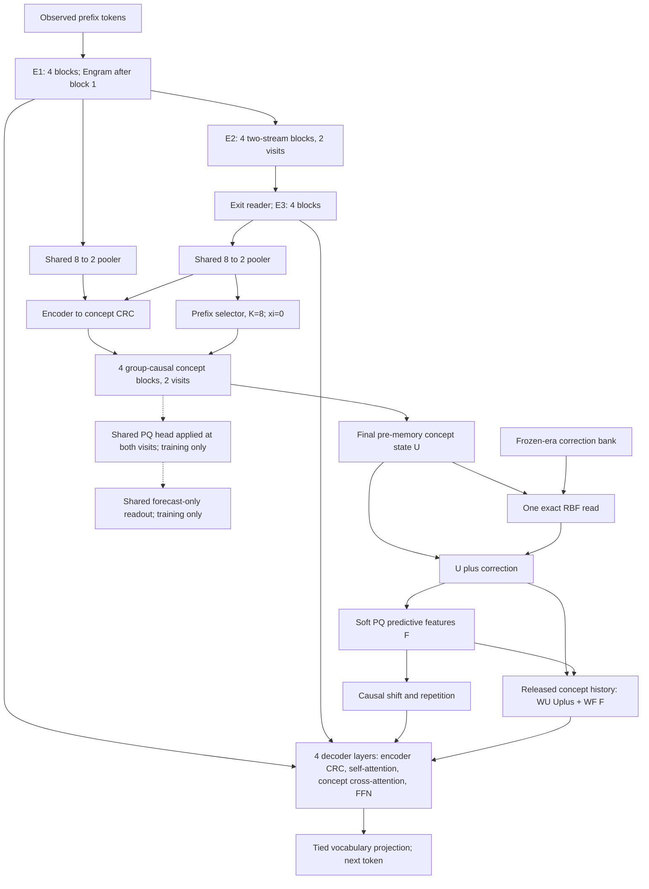

# V10.2 RCDL — predictive concepts with causal decoder retrieval

**Status: reviewed design proposal, 12 October 2026. Not an implemented or trained V10.2 model.**

**Recommendation:** retain the encoder, 8→2 pooling, two concept visits, soft PQ head, and final RBF correction. Replace the weak pointwise concept-to-decoder interface with a separate, content-addressed reader over released concept history. Replace moving-target latent regression and the teacher-forced auxiliary chunk decoder with a compact forecast head supervised directly on future token IDs. Test these changes separately before combining them.

The proposed full training model has **5,944,228 dense parameters plus 20,000,320 Engram parameters**, for **25,944,548 total learned parameters**. These are counts of the specified module layout, not measurements from a working V10.2 trainer. The training-only forecast head accounts for 149,376 dense parameters; the deployed network can omit it. All widths remain 128. The <10M constraint applies to dense parameters, as agreed for V10.

The intended improvement is better predictive information in concepts and better access to that information. Neither architecture wiring nor auxiliary loss guarantees useful reasoning. A meaningful positive concept ablation, complete-answer success, and equal-budget controls must establish the benefit.

## 1. Evidence used for this revision

The evidence capture is fixed at **11:16 IST, 12 October 2026**, rather than following a changing dashboard while writing. It covers **54,480 consecutive optimizer updates, 115,059,825 input tokens, and 9.739 active training hours**. All inspected loss components and dense/sparse gradient norms are finite; no step gaps were found. The most recent completed evaluation in this capture is **step 54,168**.

Sources: [captured telemetry summary](v10_2_design_evidence/2026-10-12/telemetry_summary.json), [captured API overview](v10_2_design_evidence/2026-10-12/overview.json), [latest captured evaluation](v10_2_design_evidence/2026-10-12/evaluation_0054168.json), [V10.1 implementation](v10_1/model.py), [training loop](v10_1/train.py), and [evaluation implementation](v10_1/evaluate.py). Historical documents and the earlier pasted review were examined as research context, not as new user instructions.

### 1.1 What improved, and what remains weak

| Measurement | Captured result | What it supports |
|---|---:|---|
| Text dev NLL | 9.04589 initially → **4.88238** | Substantial language learning; perplexity now 131.94 |
| Recent routine text dev NLL | Approximately 4.85–4.91 since step 23,906 | Progress has slowed on this small fixed panel |
| Strict math generation | **3/16** | Three sorting successes; algebra, addition/subtraction, multiplication each 0/4 |
| Strict Sudoku generation | Easy **0/2**, hard **0/2** | No complete valid boards in these samples |
| Sudoku teacher-forced NLL | Easy **0.21407**, hard **0.14079** | Local prediction improves substantially; not evidence of complete solving |
| Text concept-off ΔNLL | **+0.006166** | Small positive dependence on concepts, about 0.62% perplexity difference |
| Math / easy / hard concept-off ΔNLL | **−0.004091 / −0.001496 / +0.000136** | Mixed, small effects; no robust symbolic contribution established |
| Text one-visit ΔNLL | **+0.000482** | Very small token-level benefit from the second concept visit |
| Text forecast MSE, visit 1 → 2 | 0.701525 → 0.700054 | Small improvement on a moving latent target |
| Recent text code diversity | **7.47 effective codes / 8**, aggregated over 5,000 updates | Blanket code collapse is not the primary current diagnosis |
| Dense pre-clip norm, last 5,000 updates | Median **3.804**, p95 **6.467**; all clipped | Frequent clipping, not proof of divergence |
| Sustained throughput, same interval | **2,910 input tokens/s**, including logged pauses | A useful wall-time baseline, not a GPU-utilization measurement |
| RBF writes | **0** | Continual-learning performance has not been measured |

Positive ablation deltas mean removing the component makes NLL worse. These are interventions on a trained model, not comparisons against a separately trained simpler model. The repeated panels contain only 768 text targets, 14 math targets for NLL, and two boards per Sudoku family. Repeated observations of the same problems are not additional independent examples. The latest losses do not establish that hard Sudoku is easier than easy Sudoku.

Recent training text NLL is about 3.881, versus 7.000 in the first 1,000 updates. These training batches differ from the fixed dev panel; their difference is not a controlled generalization-gap estimate. Similarly, rising latent MSE is not automatically worsening reasoning, because its target representations change during training.

### 1.2 What the current wiring actually does

V10.1 already has both CRC connections proposed in the earlier review. Adding those same connections again is not a new design.

Its continuous decoder route aligns one concept slot to four token rows, then mixes that slot with E1/E3 sources through a three-way router. The decoder also starts from E3, whose full-attention blocks already contain global prefix information. Therefore:

1. Concept access is limited by fixed alignment and competition with strong encoder sources.
2. Restricting decoder self-attention alone would **not** create a true concept bottleneck: E3 already carries global information.
3. The training-only chunk head sees true earlier tokens inside the future chunk. This is causally valid teacher forcing, but it can learn local continuation without using its forecast strongly. We have not yet measured a forecast-off control for that head, so shortcut use is a hypothesis, not a proven defect.
4. Latent prediction targets the next online pooled state; stopping its gradient does not make its coordinates stationary.
5. Two passes over a prefix representation are not two attempts to repair an entire candidate Sudoku answer.

### 1.3 Data and measurement confounders

At the capture, supervised exposure is 101.21M text, 0.722M math, 4.298M easy Sudoku, and 1.004M hard Sudoku tokens. Math is only **0.674% of supervised tokens**, despite roughly 20% of batches. However, losses are normalized within each batch: this does **not** mean math receives only 0.674% of the objective or gradient weight. Short answers provide fewer distinct supervised token positions per update.

Retain the clean V10.1 tokenizer and train/dev identities for the first comparisons. Raw V10 and V10.1 NLLs use different tokenization and are not directly comparable. Do not replace difficult tasks with short compression-matched toy tasks, pad answers with artificial targets, or count formatting as success.

## 2. Derivation from necessary conditions

| Necessary condition | Consequence for V10.2 | Falsifiable check |
|---|---|---|
| Useful concepts must predict observable outcomes | Supervise forecasts on token IDs, not primarily another moving hidden state | Forecast beats a position-only control on held-out data |
| A query must be able to retrieve relevant compressed history | Give each decoder row attention over all legally released concept pairs | Full model beats aligned-only reader at matched budget |
| A side task can be solved through its own context shortcut | Forecast head receives no actual future tokens, earlier target-chunk tokens, or encoder bypass | Corrupting future labels changes loss but not forward predictions |
| Additional computation must improve an outcome | Supervise both visits with the same forecast head and normalized weights | Visit two improves forecast CE and main prediction/task metrics |
| Compression must coexist with exact details | Keep the encoder detail route and encoder-depth CRC | Text and numeric copying do not regress unacceptably |
| Continual corrections need a fixed coordinate system | Keep one post-core RBF read with pre-memory keys and frozen-era updates | Correct finite differences, local improvement, and measured retention |
| A 16-hour experiment has a fixed compute budget | Add small interfaces rather than more token layers | Compare useful held-out progress per active hour |

These steps motivate an experiment. They do not establish that attention, PQ, recurrence, or RBF memory is necessary. The bypass remains deliberate: meaningful benefit must emerge from training rather than a forced minimum gate that makes ablation look impressive.

## 3. Exact architecture



The dashed supervision path uses `PQHead(U_visit)` at both visits; it does not bypass PQ with raw U.

### 3.1 Preserved dimensions and mechanisms

| Component | Specification |
|---|---|
| Vocabulary / width / heads | Existing clean 8,192-token vocabulary / 128 / 4×32 |
| Feed-forward | Ordinary GELU 128→512→128; existing biases and RMSNorm conventions |
| Encoder | E1=4, E2=4, E3=4; E2 exactly two visits; independent exit reader |
| Encoder depth | 12 distinct blocks, 16 applications per forward |
| Encoder attention | S,S,S,F in each four-block stage; sliding causal window 64, full causal fourth block |
| Engram | 20,000,320 learned table parameters; same hashes, gate, causal convolution, CPU sparse table |
| Pooling | One shared pooler, applied separately to E1/E3; eight observed tokens to two ordered slots |
| Concept core | Four full group-causal blocks; exactly two shared-weight visits; full BPTT |
| Encoder→concept CRC | Existing shared early/final pooled reader at each visit |
| Conditioning codes | K=8, code width 32; prefix argmax with committed history; GradCuit xi=0 |
| PQ head | Eight segments × 32 soft codewords × 16 coordinates; width 128 |
| Decoder | Four layers, full causal self-attention, retained encoder-depth CRC, new concept-history attention |
| RBF | One correction after visit two, width 256; empty during pretraining |
| Context / effective batch | 384 / 8 initially; microbatch chosen by measured memory and throughput |

Do not interpret dense masked sliding-window SDPA as an implemented sparse Metal kernel. Engram is trained local-pattern storage; it is not preloaded with facts. K=8 conditioning codes and the eight PQ segments are distinct mechanisms.

### 3.2 Concept computation and recurrence

Reuse the V10.1 anchor, encoder→concept CRC, four shared blocks, and exit normalization. In pseudocode, where P1/P3 are the two pooled depth sources:

```text
code_g = argmax PrefixSelector(P3_g)                  # commit at group release
anchor = AnchorNorm(P3 + CodeProjection(Embedding(code)))
state = anchor
for visit in [1, 2]:
    state = state + learned_anchor_scale * anchor
    state = EncoderConceptCRC(state, cached(P1, P3))
    state = FourSharedGroupCausalBlocks(state)
    state = ExitNorm(state)
    U_visit = state
    F_visit = PQHead(U_visit)
U = U_visit2
```

Both slots of a completed group may interact. A group may read its own and earlier groups, never later groups or another document. No corrected RBF state returns to this loop, the pooler, or code selection. Do not add a third visit, adaptive halting, visit-specific core weights, or answer-generation cycles under the name “two visits.”

Retaining this core isolates supervision and delivery changes. It does not mean the current recurrence is optimal. If two visits remain ineffective, record that finding rather than imposing an artificial monotonicity loss or silently changing the requested recurrence.

### 3.3 Forecast-only token readout

Replace the V10.1 auxiliary causal Transformer with one shared residual FFN. Its only variable content input is a PQ forecast slot. It sees no encoder state, no raw U, no token embedding from the future chunk, and no earlier target-chunk token.

For completed group g, let `b=8(g+1)` and offset `j=0,...,7`:

```text
slot = floor(j / 4)
z = W_aux F_visit[g,slot] + learned_position[j]
z = z + FFN_aux(RMSNorm_aux(z))
forecast_logits[g,j] = E^T OutputNorm_aux(z)
target[g,j] = x[b+j]
```

`W_aux` is bias-free 128→128. The FFN is 128→512→128 with ordinary biases. Both norms have 128 gains. There are eight learned 128-dimensional position vectors. E is the existing tied vocabulary embedding, counted once. Share every auxiliary parameter across offsets, groups, candidate codes, and visits.

Initialize W_aux with Xavier uniform gain 1, positions from Normal(0, 0.02), and norm gains to one. Retain the existing FFN initialization. All relevant attention/FFN dropout remains zero for the reference experiment.

Sample **one eligible boundary per document per optimizer update**. Use the same sampled boundaries for both visits and all K candidates. A current group must be complete; at least one of its next eight targets must be supervised. A partial future chunk and EOS remain eligible. Prompt positions may occur in a chunk, but answer-only symbolic masks apply to their loss. Empty eligible sets contribute differentiable zero with denominator zero.

For the trainer convention `targets[:,i]=x[i+1]`, auxiliary offset j reads the **label** at row `b+j−1`; it never reads that label as a feature. Preserve this distinction at padding, answer starts, and EOS. If `b+j−1 < length`, the target can be valid even when the corresponding next token is the terminal EOS outside `ids`.

Use offset weights `w_j=1/sqrt(j+1)`, normalized over valid supervised offsets **within the sampled document**, followed by a mean over eligible documents. This gives nearer predictions somewhat more weight while retaining supervision of all eight offsets. It defines a document/boundary-balanced objective, not a globally token-weighted estimator. The weight choice is a fixed starting hypothesis; equal weights are a separate loss control.

**Interpretation changes deliberately:** F is now a learned predictive feature whose usefulness is grounded in future tokens. It is no longer claimed to numerically reconstruct the next encoder pool. The soft PQ convex-combination head remains, but moving-target latent MSE and nearest-codeword fitting are not default training objectives. This is a documented departure from the original V10 loss contract.

Predicting eight conditional marginals is not modeling their complete joint distribution, solving an eight-token task, or directly generating a consistent Sudoku board. The auxiliary logits are not used as eight independent inference-time answers. Ordinary generation remains autoregressive through the main decoder.

### 3.4 Decoder access to all released concept pairs

Keep the direct forecast addition and the two-source encoder CRC. Remove the third, continuous-concept row from each V10.1 depth router. Add a separate concept cross-attention sublayer to each decoder layer.

For each completed group/slot form the shared source:

```text
Uplus_g = U_g + RBF(q_g, code_g)
F_g = PQHead(Uplus_g)
M[g,s] = W_U Uplus[g,s] + W_F F[g,s]
D = H3 + fusion * Align(F)
```

`W_U` and `W_F` are distinct bias-free 128→128 projections. `W_U` takes the place of the existing continuous-source projection. No new RMSNorm is inserted on Uplus or M. Correction magnitude can therefore reach both key and value projections; downstream normalizations still exist and are differentiated normally.

Each of the four decoder layers performs:

```text
D = D + EncoderCRC_l(D, H1, H3)                 # two sources, existing mechanism
D = D + CausalSelfAttention_l(RMSNorm_l(D))
D = D + ConceptCrossAttention_l(QueryNorm_l(D), M, release_mask)
D = D + FFN_l(FFNNorm_l(D))
```

Here EncoderCRC_l returns only the scaled residual mixture `scale_l * sum_depth softmax(Route_l(RouteNorm_l(D))) * ProjectedDepth`, not D plus that mixture. After layer four, retain the existing final RMSNorm and tied vocabulary projection: `logits = E^T FinalNorm(D)`.

Each cross-attention has its own bias-free Q/K/V/O projections, width 128, four heads, and one 128-gain query RMSNorm. There is no extra FFN in this sublayer. Initialize Q/K/V with Xavier uniform gain 1 and O with Xavier uniform gain 0.1; use no learned minimum gate or fixed lower bound on concept contribution. W_U/W_F use Xavier uniform gain 1. Attention can still learn an unhelpful or nearly zero output; that outcome counts against the hypothesis.

Use token-clock RoPE: query row i has position i; both keys from group g have position `8g+7`. Slot content is already ordered through pooling/core/forecast construction. Do not add a future-token position to a concept key or an undocumented learned position table. All allowed concept history is visible; this is cross-attention over compressed states, not raw encoder-token cross-attention.

The main decoder retains global encoder information. This is **not a hard information bottleneck**, and it does not guarantee concept dependence. Removing the encoder path to force success is a separate, risky experiment and is not the default.

### 3.5 Causal release, startup and tails

Zero-based decoder row i predicts `x[i+1]`. Group g contains `x[8g:8g+8]` and releases at `e_g=8g+7`.

A real cross-attention key is legal exactly when:

```text
same_document AND query_i < length AND e_g < length AND e_g <= i
```

A fixed zero key/value sentinel is enabled only when a query has no legal real keys, including padded queries. Disable the sentinel otherwise. With bias-free value/output projections, startup produces exactly zero cross-attention contribution and never an all-masked softmax. The sentinel has no learned parameter and no memory entry.

Keep the original forecast shift/repetition:

| Decoder row | Forecast addition | Concept-history reader |
|---|---|---|
| 0–6 | Zero | Zero sentinel only |
| 7–10 | Group 0, slot 0 | Both slots of group 0 |
| 11–14 | Group 0, slot 1 | Both slots of group 0 |
| 15–18 | Group 1, slot 0 | Both slots of groups 0 and 1 |
| 19–22 | Group 1, slot 1 | Both slots of groups 0 and 1 |

Both slots are available together because all eight input tokens have already arrived. Cross-attention need not copy the four-row repetition convention. A partial last group releases nothing new; its predictions can still use prior completed groups. BOS counts as an observed token. Do not flush a partial group with padding at an answer boundary or move groups to match Sudoku rows.

Keep one document/window per batch row initially. Any future packing must reset attention, RoPE/group clocks, Engram suffixes, and code histories at document boundaries. Incremental generation must agree with a full causal forward; caches must distinguish layer, recurrence visit, position, committed code history, model era, and bank version.

The causality argument is compositional: causal encoder rows depend only on their prefixes; pooled group g contains no input after e_g; group-causal core layers preserve that property through both visits; a decoder row reads only groups with e_g≤i and previous decoder rows. Induction through decoder layers then preserves prefix-only logits. A PQ forecast may predict future content, but its actual future training labels are not forward inputs. This argument depends on the masks and cache implementation satisfying the specification.

## 4. Objectives and gradient ownership

### 4.1 Default V10.2 objective

Define J_v as the forecast-only CE above at visit v, and:

```text
L_future = (1/3) * J_1 + (2/3) * J_2
L = L_token + 0.1 * L_future
    + I[candidate_update] * (0.1 * L_explore + 0.05 * L_selector)
```

L_token is the existing main decoder CE: all real text next-token targets, symbolic answer targets including EOS, no padding. Mean by valid token count within the effective batch. Only final-visit concepts enter the ordinary main decoder.

The visit weights sum to one; two visits do not double the auxiliary budget. Dense and sparse gradients propagate through both visits. Future token IDs are labels only. Do not detach the first visit from the second, the selected PQ output from its auxiliary head, or the Engram gather from its CPU table.

**Default weights for latent MSE and nearest-codeword fitting are zero.** Remove their backward graphs in the final arm. They may be retained as clearly renamed, infrequent descriptive diagnostics; their values are not comparable to the old objective after the target semantics change. No EMA teacher, contrastive loss, entropy-balancing loss, forced gate penalty, or Sudoku validity surrogate is silently added.

Weight decay and finite-value checks remain. Soft PQ still gets gradients through token forecasts and the main decoder. Without explicit fitting loss, dictionary diversity and utilization may deteriorate; measure this and test a separately labeled fitting-loss control if necessary. The K-selector usage chart is not a measure of PQ codeword utilization.

### 4.2 K=8 candidate training

Retain every-fourth-update scheduling, beginning with update 1. Score K alternatives for the one sampled current boundary while preserving all earlier committed codes. Cache encoder/pooler/depth sources; branch only the concept core and forecast readout. No eight-way main decoder or encoder replication.

For the base V10.2 arm, `utility_k = J_2(k)` using exactly the same forecast labels, offset weights, and masks. No moving latent-MSE term. Detach candidate scoring, choose `argmin` with deterministic lowest-index tie breaking, and recompute only the winner with gradients:

```text
L_explore = mean_document J_2(winner)
L_selector = mean_document CE(prefix_selector_logits, detached_winner)
```

Winner CE reaches PQ, code embeddings, concept core, pooled sources and the auxiliary readout. Selector CE reaches the prefix selector and its pooled input. Main prediction always uses prefix argmax, never the future-informed winner. The old winner-recompute equivalence must be re-tested for this new head; deterministic operations and no branch-dependent dropout are required.

Hard winner labels can be noisy when codes are nearly equivalent, or when unpredictable future content decides the winner. Log utility spread, best/second-best gap, regret, and selector accuracy. A later optional selector control can distill a soft utility distribution; it is not bundled into the first candidate. Low regret can mean redundant codes, not successful strategy discovery. Uniform K usage is not an objective.

### 4.3 Clipping and objective balance

Start with the existing independent dense and coalesced sparse global clips of 1.0 and existing optimizer settings. A norm above 1 is not a reason to add architecture. Do not raise clipping, lower LR, and change the reader simultaneously.

At infrequent diagnostic checkpoints, compute separate token/forecast/candidate gradient norms and cosine similarities on the same small fixed training probe, before clipping and without optimizer updates. Overall component norms alone cannot identify gradient conflict. If auxiliary gradients oppose main-token gradients, first compare a predeclared lower auxiliary weight or auxiliary-off control. Do not deploy a complicated gradient surgery scheme without evidence.

Accumulation must preserve each loss's own denominator: main valid tokens, auxiliary eligible documents, and candidate eligible documents. Log raw sums/counts, weighted contributions, and null measurements for unscheduled candidate computations. Reuse preselected boundaries across microbatches so batch size does not change the stochastic objective.

## 5. Exact parameter and compute budget

| Change relative to V10.1 | Dense parameters |
|---|---:|
| V10.1 full training model | 5,731,496 |
| Remove old chunk Transformer readout | −215,168 |
| Add forecast-only residual-FFN readout | +149,376 |
| Remove third row of four decoder routers | −516 |
| Retain/reuse one continuous-source projection | 0 net |
| Add shared forecast source projection W_F | +16,384 |
| Four cross-attention Q/K/V/O sets + query norms | +262,656 |
| **V10.2 full dense training model** | **5,944,228** |
| Deployed dense model if auxiliary readout discarded | **5,794,852** |
| Separate sparse learned Engram table | **20,000,320** |

Counts include FFN biases, norm gains, and positional vectors; the embedding/output matrix is tied once. The cross-attention addition is `4*(4*128*128+128)`. The new auxiliary head is `128²+8*128+128+(128*512+512+512*128+128)+128`. Its removal at inference must not remove W_F or the PQ head used by the decoder.

At context 384 there are at most 48 completed groups and 96 real concept keys, plus a sentinel. Per decoder layer, the dense cross-attention score shape is at most `[8,4,384,97]`, about 4.55 MiB in FP32 if materialized. This is **not** the total activation/backward footprint; four layers, projections, gradients, main vocabulary logits, and backend workspaces add cost. MPS SDPA allocation behavior must be measured.

The full learned weights alone occupy about 99.0 MiB in FP32; training also holds gradients, Adam states, sparse optimizer states and activations. Sparse gradients do not imply sparse persistent SparseAdam moment storage. Existing live driver/RSS counters overlap on unified memory and must not be added as independent allocations.

The new head removes its auxiliary self-attention, but four decoder cross-attentions add kernels and work. **No throughput improvement is claimed.** The model remains comfortably within the dense parameter constraint, but parameter count does not establish 16GB memory fit or time efficiency.

## 6. RCDL memory remains an exact final correction

### 6.1 Read semantics

For final, ordered pre-memory U_g with shape `[2,128]`:

```text
q_g = flatten(U_g) / 16
K((q,k),(q_i,k_i)) = 1[k == k_i] * exp(-||q-q_i||² / (2*sigma²))
r_g = sum_i K((q_g,k_g),(q_i,k_i)) * value_i
Uplus_g = U_g + reshape(r_g, [2,128])
```

No denominator, top-k, learned read gate, automatic eviction or independent per-entry clipping is added. Query/code construction stays independent of the bank on a fixed observed trajectory. Corrected states influence the decoder through **aligned PQ, cross-attention PQ, and cross-attention continuous-state routes**, including key and value changes. They never affect subsequent concept-core histories.

Decoder cross-attention normalizes concept attention weights. This does not normalize the RBF dictionary sum: it is an ordinary downstream differentiable operation. Its gradient must be included in the correction write.

### 6.2 Write semantics and limits

Freeze the entire backbone, including Engram, all norms, selectors, PQ words, source projections and decoder. Disable stochasticity. A new checkpoint, tokenizer, positional/release rule, query geometry, sigma, or write objective starts a new era. V10.1 memory entries are not directly reusable.

The V10.2 default write loss is **supervised L_token only**, with the same target masks and reduction as pretraining. Removing latent fitting also removes it from the memory-write objective. The training-only auxiliary head is not needed for deployment or writes. Feedback must be a permitted observed target, not the model's unverified answer.

Predict before learning using one immutable bank snapshot. Replay the observed trajectory with committed codes and the same snapshot; treat each read correction as a detached differentiable leaf. Compute `g_g = dL_token/dr_g`, including every later decoder use and both key/value paths. Stage `(q_g, code_g, -eta_eff*g_g)` for valid nonzero-gradient groups, then commit the whole episode atomically once.

Use one positive eta_eff for the entire episode; a common reduction to bound the largest value norm is allowed. Do not divide by group count again after computing a mean loss. Reject nonfinite values, duplicate feedback IDs, stale versions, wrong eras and capacity overflow. Consume zero-gradient feedback once as well.

For fixed replay queries, the first-order change is:

```text
dL/deta at eta=0 = -sum_i sum_j K(z_i,z_j) * dot(g_i,g_j) <= 0
```

The code-partitioned Gaussian kernel is positive semidefinite. This gives a local descent direction for the episode's measured objective. It does **not** promise a finite-step improvement, future task improvement, retained old-task performance, or stability after generated tokens change the query trajectory. Contradictory feedback at the same key can cause interference even when every stored entry is retained.

Start with exact capacity 4,096 entries, FP32 keys/values and int64 codes: about **8.03 MiB** of tensor payload, excluding metadata and temporary snapshots. Calibrate sigma and eta on separate development adaptation episodes; initial grids `{0.25,0.5,1.0}` and `{0.01,0.03,0.1}` are hypotheses, not optimal values. Report kernel neighborhoods, correction RMS and interference. Do not tune on the final test episodes.

### 6.3 Concrete adaptation and retention protocol

After any supervised post-training, freeze a new era. Use development identities disjoint from the architecture-selection panel. Define seven strata: text, each of the four math modules, easy Sudoku and hard Sudoku. Run four rounds, each visiting all seven strata in a recorded order. Each episode has three new support examples and eight new query examples. At context 384, the 84 support examples release at most 4,032 groups, fitting the 4,096-entry bank without eviction.

Score support and queries before feedback. Reveal only support targets, replay all three support examples against one snapshot and commit once. Re-score the same eight queries after the support update; their targets are used only for evaluation and never written. At the end of each round, re-score all earlier query sets to measure retention and interference. Fix cropping and episode selection before seeing results. Evaluate at least two recorded task orders if the study budget permits.

Compare empty-bank/eta=0, the exact RBF bank, and a control that deterministically shuffles keys within code partitions, with equal episode budgets. Report pre-feedback loss/accuracy, support fit, held-out query change, per-stratum backward transfer, worst-stratum degradation, writes, bytes and runtime. Support improvement alone is not transfer. Choose sigma/eta on separate tuning episodes, then run this evaluation stream with frozen settings. These are proposed future experiments, not results from today's empty bank.

## 7. Data, evaluation, and the 16-hour training plan

### 7.1 Controlled pretraining first

Use the existing clean V10.1 corpus and 8,192-token tokenizer for the first matched runs. Preserve identities and masks; do not sample reserved test data. Keep the same initial family mix: 65% text, 20% math, 15% Sudoku, including the existing easy/hard schedule. Compare exact recorded example/crop streams for equal-update tests and report actual exposures for equal-wall-time tests.

Main optimizer initially remains AdamW LR 3e-4, betas (0.9,0.95), weight decay 0.1 on matrices and zero on vector gains/biases; CPU SparseAdam Engram LR 5×, betas (0.9,0.99). Warm up 200 updates; cosine over 16 active hours to 10% LR. Effective batch 8 and context 384; FP32 MPS first. These are inherited controls, not newly optimized hyperparameters.

The proposed production budget is **16 active hours, optionally 24 total**, including evaluation/checkpoint overhead and excluding stopped downtime. Extending preserves optimizer/RNG state and the original schedule floor. Implementation validation and pilot comparisons are additional, explicitly recorded work; several complete 16-hour arms cannot be represented as one 16-hour experiment.

Do not load a V10.1 optimizer into changed parameter groups or silently continue the same run ID. A warm-started V10.2 is a separate transfer experiment with prior compute charged. The clean architecture comparison uses fresh, seed-matched shared weights and a fresh Engram table in each arm. Initialize new modules separately so their RNG consumption does not change the common backbone initialization.

### 7.2 Better measurement before a stronger claim

Keep the inexpensive routine panel for continuity, labeled “small fixed development diagnostic.” Add a frozen larger panel before implementation tuning: 128 text documents/crops, 64 math problems per module, and 64 Sudoku boards per family. Stratify math by module and observed answer length, Sudoku by source and clue count; source buckets are not calibrated difficulty labels. Save identities, crop offsets, seeds and selection hashes.

Reserve disjoint development partitions for architecture selection and RBF adaptation tuning. Large panel generation can be expensive with prefix recomputation; measure its cost first. Run it at baseline, an intermediate decision checkpoint and the final checkpoint, with planned/actual counts and interruption flags. If it cannot fit the evaluation budget, stage it across a frozen checkpoint and do not mix predictions from changing weights into one score. The final test remains untouched until the design and selection policy are fixed.

Report:

- Text NLL with token numerators/denominators and document-level paired bootstrap intervals.
- Math exact rational/decimal/ordered-list answer with EOS, per module and macro average; extra prose fails.
- Sudoku complete clue-preserving valid board with EOS; also diagnose formatting, clue preservation, row/column/box violations and first error position. Only the complete board score is solving accuracy.
- Free-generation ablations in addition to teacher-forced NLL, with the same greedy policy and compute accounting.
- Main concept interventions: aligned PQ off, cross-reader continuous source off, cross-reader PQ source off, full cross-reader off, and all concept decoder routes off. Value-zero interventions preserve normalizers when appropriate; any changed routing normalization is separately labeled.
- One versus two visits, forecast performance at both visits, and a retrained one-visit control when making a compute-efficiency claim. Empty bank for architecture interventions.
- Forecast-only position baseline, zero/shuffled forecast, and frozen-feature linear readout controls. Do not infer semantic abstraction from either code entropy or one hidden-state loss.
- PQ entropy/utilization per segment, forecast variance/effective rank within slot and family, K-code counts separately, oracle regret/spread, and concept correction effects.

Routine repeated evaluations of the same examples do not increase the number of independent tasks. Report paired differences across independent documents/problems and uncertainty across seeds. A larger interval or inconclusive difference should remain inconclusive.

### 7.3 Post-training addresses complete-answer behavior separately

Finish and assess pretraining before deciding whether to extend it. Improved text NLL alone is not evidence that another eight hours will solve Sudoku.

For a later two-arm pilot, allocate one active training hour per arm: ordinary supervised continuation versus a train-only draft-repair curriculum, both starting from the same pretraining checkpoint. Log draft construction and evaluation time separately; they are additional costs, not part of those two training hours. A starting batch mix is 25% text replay, 50% math balanced by module, 25% Sudoku; record that this changes the task distribution and measure text forgetting. The pretraining comparison above keeps its original mix.

Both arms use the V10.2 loss coefficients and masks above, fresh optimizer states, dense LR 3e-5 decaying to 3e-6 over the hour, and the same Engram LR multiplier and clipping. All backbone weights remain trainable in this supervised phase. Its checkpoint will therefore define a new frozen era for later RBF learning. This pilot is not itself memory-only continual learning.

A repair example conditions on the original problem, a stopped-gradient answer generated by a frozen draft checkpoint, and a plain-text request to revise, then predicts the existing verified reference answer. It does not supply an invented gold reasoning trace, a solved board as input, or a target derived from an unverified model output. Include correct drafts as well as failures so revision does not always change a correct answer. Freeze the draft data version for the comparison. Use existing tokenizer strings; no new vocabulary or answer-aligned pooling is needed. Log and skip over-context repair records rather than truncate answers.

Initially use no target-dependent verifier hint in the repair prompt. A separately labeled Sudoku verifier-assisted mode may report violated constraints without supplying solution digits. Math correctness must not become a hidden inference-time oracle. Never repair evaluation answers using reference targets.

At inference report first-pass greedy accuracy as the primary score. An optional one-revision score uses at most one full additional generation and reports latency/tokens separately; both generations still have exactly two concept visits per forward. This is a generation protocol change, not “free recurrence,” and is not executed in this design task. Keep the RBF bank empty until a separate frozen-era adaptation study.

## 8. Ablations and promotion decisions

| Arm | What changes | Question |
|---|---|---|
| A | Fresh V10.1 reproduction, clean data and same measured implementation optimizations | What does the current design achieve at equal budget? |
| R | A with the released-history decoder reader only; original losses/readout retained | Does better delivery help? |
| F | A with forecast-only head/CE and its candidate utility; legacy latent/VQ fitting off | Does observable forecast supervision help? |
| RF | R + F, the proposed V10.2 default | Do these changes work together? |
| F-fit, optional | F with one legacy fitting term restored at a time | Is dictionary fitting or latent supervision actually helping? |
| C0 | Same encoder/Engram and decoder self blocks, with concept branch/auxiliary losses removed | Does concept computation earn its cost against a trained simpler model? |

F is intentionally an **objective-and-readout package**, not an isolated test of moving-target drift: it changes the auxiliary head, future-prefix access, fitting terms, offset weights and candidate utility. If F helps, attribute the improvement to that package until finer controls are run. Besides F-fit, compare equal offset weights and an otherwise identical head with a shifted previous-token embedding added at j>0. That last control tests a specific teacher-forcing shortcut without changing parameter count; it does not reproduce all context access of the old Transformer head.

For C0 remove all concept-derived decoder inputs and auxiliary objectives; document its smaller parameter count and greater possible throughput. Also consider a parameter-matched nonrecurrent control if a superiority claim depends on capacity rather than wall time. Do not call a one-checkpoint ablation an equivalent baseline.

First run correctness checks, then an equal 30-minute active-wall pilot of A/R/F/RF in sequence on the Mac (two total training hours plus setup/evaluation). Use at least two seeds for a stronger follow-up comparison if resources permit. A single pilot seed screens gross failures, not final architecture quality. Continue only a candidate with acceptable resource use and larger-panel evidence; each branch keeps its own source/data/optimizer provenance. If no candidate qualifies, retain V10.1 or simplify rather than relabeling failure as a new version.

Predeclare final promotion criteria, with these initial practical thresholds:

1. All causality, gradient, memory-era and resume checks pass; no nonfinite or OOM events in a sustained memory test.
2. Against a matched A at the same active wall budget, text NLL degradation is at most 0.02 nats/token on the large panel. Report the interval; this is a selected tolerance, not a statistical law.
3. Balanced exact math improves by at least 3 percentage points **or** strict Sudoku improves by at least 5 points, with paired evidence that the gain is not confined to formatting or a single cherry-picked module. Require uncertainty across examples/seeds before a strong claim.
4. Concept removal has a reproducible harmful effect on a declared target metric, and RF is competitive with the trained C0 at equal wall time. A large ablation alone is insufficient if the full model is worse.
5. The second visit has a useful measured benefit relative to its cost. If not, retain two visits only as the user's constraint and explicitly report the unresolved cost; do not claim recurrence success.
6. Report sustained throughput, latency, driver memory, CPU memory and supervised exposures. Slower steps can be acceptable if held-out progress per hour improves. There is no promised speedup.

All numerical thresholds are proposed decision rules and must be frozen before reading the larger comparison results. No threshold was satisfied by writing this document.

## 9. Metal execution and telemetry contract

CPU-precompute immutable canonicalization and Engram indices before transferring a batch; preserve sparse gradient flow through gathered rows. Keep raw masks/lengths and boundary sampling on CPU where possible. Batch telemetry scalar transfers and aggregate component norms on-device. Benchmark optimizer foreach choices rather than assuming a winner. Do not enable mixed precision, compilation, a new sampling policy, or a cache purge policy in only one comparison arm.

A source-verified optimization must preserve loss/gradient parity, sampled boundaries, candidate cadence and checkpoint RNG. Hash imported helper modules too. Performance work is a separately versioned implementation change; this architecture document does not deploy it to the live trainer.

Telemetry must distinguish:

| Stream | Required fields |
|---|---|
| Run identity | source/dependency/data/tokenizer hashes, architecture arm, seed, initialization/parent checkpoint, phase, active-wall budget |
| Every update | raw loss sums and objective denominators; weighted terms; input/supervised tokens by family; sampled boundaries; LR; candidate scheduled/executed; finite counters |
| Gradients | dense and coalesced sparse pre/post norms, clip factors; component norms every 20; infrequent per-objective probe norms/cosines with their overhead |
| Forecast | per-offset/visit CE counts, first-position CE, no-forecast baseline deltas, code utility gap/regret; unavailable values null |
| Decoder readers | per-layer source contribution RMS, output-gradient norms and ablations; attention entropy alone does not prove usefulness |
| PQ and K | segment-wise PQ usage/entropy and variance; separately K-code counts and selector metrics |
| Throughput | raw update time, data/hash time, measured device time when synchronized for profiling, evaluation/checkpoint time, rolling ratio of token sums to elapsed active time |
| Evaluation | immutable checkpoint/weights identity, panel hash, exact completed/planned counts, per-example outputs/scores, decoding policy, independent-trial count |
| Memory adaptation | era/snapshot/version/event, query/code, writes, sigma/eta, correction norms, pre-feedback score, post-feedback checks and retention |

Jagged raw throughput is expected when text, short math, fixed-length Sudoku and K-way candidate updates alternate. Compare like workloads and report sustained rates; smoothing the chart does not optimize training. The Air is fanless, so sustained trials matter. No temperature or utilization percentage should be invented from timing data.

## 10. Review and validation status

The following review is performed after the first draft. Numerical checks and revisions are recorded in the accompanying evidence directory. This section separates specification checks from tests that require a future implementation.

### 10.1 Design objections and resolutions

| Objection | Resolution in the reviewed specification | Residual risk |
|---|---|---|
| “More CRC will fix it” repeats V10.1 | Keep encoder CRC; replace pointwise concept routing with history cross-attention | Additional reader can still be ignored |
| Decoder windowing would force global concepts | Rejected: global E3 already bypasses that restriction | Detail route remains dominant unless concepts earn use |
| An auxiliary head can exploit the supplied future prefix | New head receives only forecast and offset; no future token input | Position/unigram statistics can still reduce CE; baseline required |
| Direct token supervision proves abstraction | Explicitly rejected | It encourages predictive features, not necessarily abstract reasoning |
| Removing latent/PQ fitting invalidates the old forecast meaning | Rename F as predictive features; document the changed objective | Dictionary degeneracy or loss of useful structure is possible |
| New attention could see not-yet-released groups | Use token-clock release mask and test every boundary, startup and tail | Full model and cache causality tests remain mandatory |
| All-masked startup causes NaNs | Unlearned zero sentinel only when no real keys are legal | Implementation must keep projections bias-free |
| Cross-attention changes the RBF derivative | Include aligned PQ, reader PQ, reader continuous and K/V derivatives | Full V10.2 finite-difference tests remain pending |
| Kernel descent means no forgetting | Restrict statement to a first-order fixed-trajectory episode result | Neighbor interference and finite-step failure remain possible |
| Eight future logits solve a joint puzzle | Explicitly rejected; autoregressive exact-answer evaluation retained | Complete-answer improvement may require post-training or a different solver formulation |
| Low math token share means low gradient share | Distinguish exposure from batch-normalized objective weighting | Few distinct targets and module difficulty still matter |
| A new architecture can resume old optimizer state | Separate run/phase and explicit initialization provenance | Transfer runs cannot support fresh equal-budget claims |
| A 16-hour budget can include every full ablation | Specify a two-hour screening pilot plus separate production budget | Replicated full comparisons may exceed available resources |

### 10.2 Checks completed for this document

The CPU-only [review script](v10_2_design_evidence/2026-10-12/review_checks.py) completed successfully; [machine-readable results](v10_2_design_evidence/2026-10-12/review_checks.json) preserve the scope and numbers.

| Check | Result | Limit |
|---|---|---|
| Parameter layout instantiated with meta tensors | 5,944,228 dense + 20,000,320 Engram | Counts module definitions; no full V10.2 forward exists |
| Release masks for lengths 1–65 and zero real keys | 2,376 query rows checked; all legal sets match | Specification mask, not end-to-end model causality |
| Forecast target masks and offset normalization | 11,016 group/answer cases, including partial chunks and terminal labels | Label arithmetic only |
| Isolated reader startup and future-source perturbation | Exact zero startup contribution; early-row max difference 0 | Does not test encoder/core/cache implementation |
| RBF correction derivative through PQ, aligned input and attention K/V/query effects | Float64 finite-difference error **1.65e-10** | Small mathematical fixture, not production FP32/Metal |
| Code-partitioned RBF kernel and small shared update | Minimum fixture eigenvalue 0.61786; loss decreased at eta=1e-4 | Local example, not a retention result |
| Captured V10.1 source/data-manifest hashes | Unchanged | Does not freeze the ongoing training weights |
| Local document links and code fences | Valid | Not a model test |

The first finite-difference check exposed an inherited RMSNorm `.float()` cast inside the nominally double-precision fixture. The mathematical fixture was corrected to use a true float64 norm; production code was not changed, and a full FP32/Metal check remains pending. Review also removed an ambiguous raw-U arrow from the diagram, specified the final vocabulary head, separated post-training costs from pretraining, and made the F-arm confounding explicit.

### 10.3 Implementation gates still outstanding

- Full-model future perturbation and teacher-forcing/generation-prefix equality, including answer starts, padding, lengths 1/7/8/9/15/16/17, empty concept history and partial EOS chunks.
- All-parameter gradient equivalence for candidate winner recomputation and effective-batch accumulation, including CPU sparse Engram gradients.
- Correct main and auxiliary gradients through both visits, PQ and both new source projections; finite differences of a real correction through all decoder routes.
- CPU/Metal forward/backward agreement; full-size 8×384 ordinary/candidate memory tests; at least 200 mixed updates to expose allocator growth, followed by a sustained thermal benchmark.
- Incremental cache equivalence with per-visit state and bank-version invalidation, if caching is introduced. Prefix recomputation remains the correct reference.
- Stop/resume continuity of model, both optimizers, data/model RNG, exposure counters, phase budget and source/data identities.
- Larger-panel task comparisons, trained C0 control, and a real frozen-era RBF adaptation/retention experiment.

**Review decision:** the proposal targets measured weaknesses, satisfies the retained width/depth/recurrence/parameter constraints, and is specific enough to implement as controlled arms. Its superiority, full-model correctness, memory fit, throughput and continual-learning value remain unverified. Do not stop V10.1 or launch V10.2 on the strength of this document alone.

## 11. Research context and source boundaries

The original [V10 walkthrough](v10/proposed_v10.md), [reviewed RCDL contract](v10/V10_RCDL_Architecture_Reviewed.md), [V10.1 design](V10_1_RCDL_Architecture.md), and [V10.1 validation report](v10_1/VALIDATION_REPORT.md) define the retained mechanisms. The pasted earlier review correctly motivated testing both CRC paths, but those paths are already active; it is not evidence that repeating the same change will work.

Predicting several future tokens from a shared representation has prior research support. Our eight-position forecast from compressed PQ features, shared FFN head, and small-model/Mac setting differ from the published multi-head approach, so its reported gains and speedups do not transfer automatically. [Gloeckle et al., Multi-token Prediction](https://arxiv.org/abs/2404.19737)

TRM explicitly refines an answer state as well as latent state across supervision steps. V10.2's two prefix-concept visits do not reproduce that computation or its specialized training setup. The proposed optional draft-repair phase is a separate generative protocol, not a claim to reproduce TRM. [Jolicoeur-Martineau, TRM](https://arxiv.org/html/2510.04871v1)

GRAM models stochastic latent trajectories and supports multiple hypotheses with variational training. Eight deterministic code alternatives scored using training labels are not a GRAM posterior, stochastic trajectory model, or demonstrated inference-time search policy. V10.2 retains deterministic prefix selection; adding that generative machinery is outside this revision. [Baek et al., Generative Recursive Reasoning](https://arxiv.org/abs/2605.19376)

## Reproduce the evidence and specification checks

From the project root:

```sh
/opt/anaconda3/bin/python -B v10_2_design_evidence/2026-10-12/review_checks.py
```

The capture script reads the live run and API and refuses to overwrite an existing capture. Copy it into a new sibling evidence directory before collecting another watermark. The review script uses CPU-only specification checks and does not modify the running model or its training files; its JSON output records hashes of the reviewed document, script and telemetry summary.
