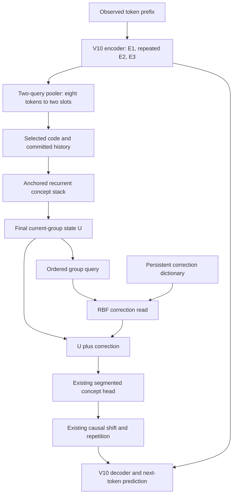
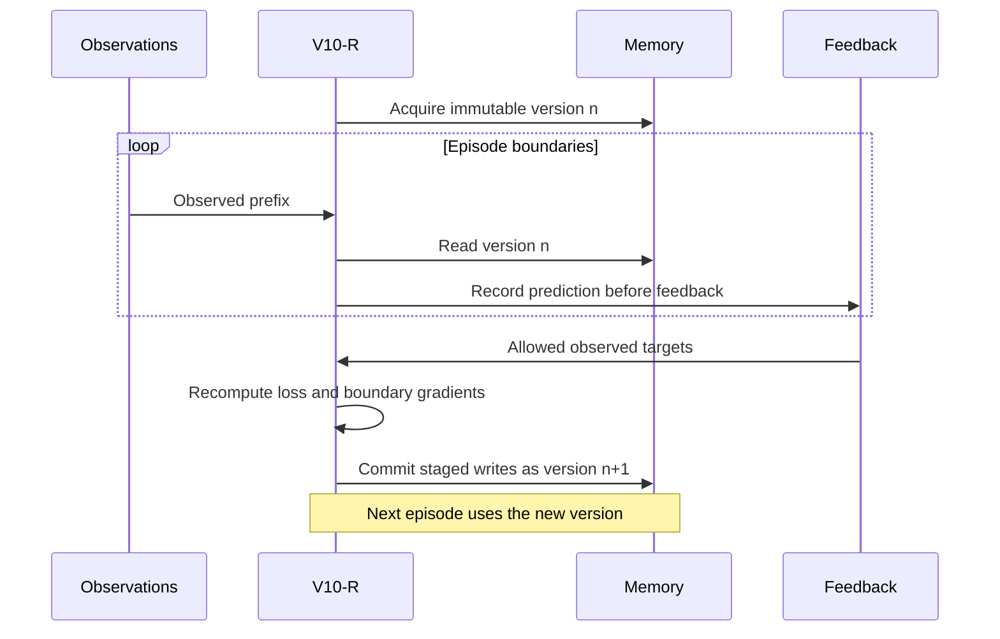
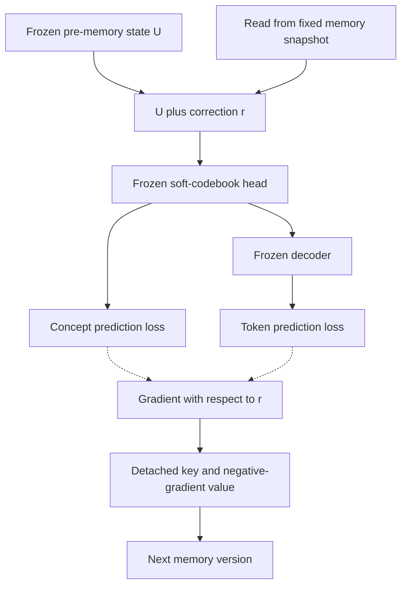

# V10 with a retrieval correction layer

**A first-principles architecture proposal and reviewed experiment specification**  
Prepared 11 October 2026. Working name: **V10-R**. Status: **proposed; no V10-R model has been trained**.

The recommended change is one persistent RBF memory read **after the last concept-core visit and before the existing segmented prediction head**. It adjusts the processed concept group using corrections learned from previous, supervised experience. The encoder, pooler, exploration-code mechanism, recurrent stack, soft-codebook head, concept shift/repetition, and decoder retain their V10 roles.

This is an architectural improvement hypothesis: it adds an explicit place to retain new learning without changing the backbone during adaptation. It does not establish better accuracy, guaranteed retention, or feasibility at three trillion parameters. The included numerical checks verify local mathematics and interfaces, not those empirical claims.

Read the first two tables for the decision. The four phases below supply the derivation, operating rules, experiment plan, and final review.

| Decision | Initial specification | Reason |
|---|---|---|
| Insertion | Once at the concept module's final readout, immediately before the PQ head | Avoid a memory read on every recurrent visit and keep query features independent of the memory output |
| Retrieval | Unnormalized Gaussian/RBF sum | Directly supports the paper's positive-definite-kernel gradient rule |
| Memory key | Both ordered current concept states, flattened and dimension-scaled | Preserve slot distinctions; avoid introducing an untrained retrieval projection |
| Memory value | Negative loss gradient with respect to the correction output | Credit passes through the actual concept head and decoder |
| Exploration branches | Separate logical dictionary per exploration-code ID | Prevent one code's correction from directly modifying another code's output |
| Backbone during initial adaptation | Frozen, including codebooks, gates, code table, selector, and head | Keep both the key coordinates and correction interpretation stable |
| Write timing | Stage writes from one immutable episode snapshot; commit after the episode | Preserve causality, caches, and comparable search evaluations |
| First experiment | Exact reads and append updates, within a declared memory budget | Establish the mechanism before adding lossy memory management |
| Capacity-limited follow-up | Explicit near-key merging and FIFO eviction controls | Measure the cost of approximation and forgetting separately |

| Phase | Question answered | Main deliverable |
|---|---|---|
| 1. Preserve and locate | What exactly changes in V10? | Complete forward path and source-to-design mapping |
| 2. Derive | Why do the read and write rules constitute learning? | Shapes, derivations, geometric interpretation, and toy example |
| 3. Operate | When may memory change, and how does it interact with other mechanisms? | Training, inference, gradient, cache, and capacity contracts |
| 4. Challenge | What would falsify the proposal? | Comparisons, costs, numerical checks, and a critical review |

---

## Phase 1. Preserve the useful V10 interfaces

### 1.1 What the three sources establish

The source hierarchy matters. The latest complete path in proposed_v10.md and Section 26 of V10_NOTES.md takes precedence over earlier exploratory sketches in the notes. Earlier experiments described in the notes are historical evidence, not new V10 measurements. [V10-P; V10-N]

| Source | Supported ingredient | Boundary of the evidence |
|---|---|---|
| RCDL, Section 2 | A gradient-trained linear layer has an exact retrieval representation | This identity alone does not improve the original layer |
| RCDL, Section 3.1 and Appendix A | Append activation keys and negative output-gradient values for a positive-definite kernel | Establishes a functional gradient update, not global convergence or retention |
| RCDL, Section 3.2 and Appendices B–C | Weighted-softmax learning requires its own derivation | Ordinary softmax cannot inherit the linear/RBF append rule unchanged |
| RCDL, Section 3.3 and Appendix F.4 | Conditional growth plus optimization of existing entries | The proposed V10-R bounded variants below are different algorithms |
| RCDL, Sections 5–6 and Appendix F.12 | Small vision/regression results and substantial storage cost | Does not validate continual text agents, concept MCTS, or 3T scaling |
| V10-P, Steps 14–22 | Code-conditioned recurrent computation followed by a segmented soft head | Provides a differentiable location for a correction |
| V10-P, Steps 23–32 and editorial F–I | Causal alignment, committed history, targets, and optional local refinement | These constraints must survive the new memory path |

The following are **our proposals**, not results copied from RCDL: the final-visit placement, group-level key/value, code-separated kernel, frozen-backbone adaptation era, episode snapshots, and V10-specific evaluation plan.

### 1.2 Reconstruct the forward path

An observed token sequence passes through the early encoder stack E1, repeated middle stack E2 with two gated residual streams, and independent exit stack E3. The two-query pooler converts each completed group of eight contextual token vectors into two concept vectors. Both slots are released together after the eighth token.

For a selected exploration code, V10 adds the projected code offset to both current slots. Earlier committed conditioned inputs remain fixed. The anchored recurrent concept stack processes this history with the completed-group causal mask. Its final current-group state is U; the existing segmented head turns U into a forecast of the next concept group. The decoder receives the causally shifted forecast and its encoder detail routes. [V10-P, Steps 5–30]

V10-R inserts one operation between U and that head:

| Existing V10 boundary | Preserved contract |
|---|---|
| Pooler, Steps 11–13 | Two half-group average anchors seed queries; each query attends to all eight tokens, followed by the existing residual/FFN processing |
| Exploration, Steps 14–16 | The offset `(e_k + xi) W_z` is broadcast across both current slots; earlier committed conditioned groups remain unchanged |
| Recurrent core, Steps 17–19 | Completed-group mask and anchored recurrence remain unchanged; U is extracted after the final normalized visit |
| New insertion | Apply `U_plus = U + retrieval(query(U), code_id)` once |
| Existing head onward, Steps 20–30 | Use U_plus in place of U, with the existing soft segmented head, alignment, fusion, and decoder |



The addition belongs to the concept module's output interface. It is deliberately outside the recurrent feedback loop. It changes the forecast-producing state, rather than editing the observed concept history or silently treating a forecast as an observation.

### 1.3 Why this location is the first experiment

Placing a memory inside every shared layer would couple memory to recurrent dynamics, multiply retrieval work, and allow a read to change later queries within the same computation. That design can be studied later, but it obscures the first question: whether reusable corrections help this predictive interface.

The final readout has four useful properties:

1. Its state already includes the chosen exploration code and permitted history.
2. The existing head and decoder provide a real downstream learning signal.
3. Memory does not directly modify the core's future query construction on a fixed observed trajectory.
4. Empty memory exactly recovers the original forward computation. In ordinary inference, use an empty-bank fast path that returns U directly. In the learning pass, create a zero correction leaf so the first write can receive a gradient.

The limitation is equally concrete: a final correction cannot make the earlier recurrent visits reason differently. It can adjust the state they hand to the prediction head. If the failure is missing evidence or inadequate computation inside the loop, this may be the wrong location.

### 1.4 State that must remain distinct

| Object | Lifetime | Meaning |
|---|---|---|
| Two encoder residual streams | Current encoder computation | Carried token representations |
| Recurrent working state | Current concept computation | Evolving intermediate state |
| Committed concept history | Current document or episode | Conditioned representations of observed groups |
| Exploration-code table and PQ codebooks | Backbone checkpoint | Learned global parameters |
| Temporary GradCuit offset | Current problem/branch | Optional local steering variable |
| RCDL correction dictionary | Multiple learning episodes within a fixed model version | Persistent learned correction function |

The new dictionary does not convert any of the first five objects into lifelong memory.

---

## Phase 2. Derive the correction layer from first principles

### 2.1 Begin with ordinary learning

A linear layer maps an input x to an output y through a matrix W. Use column vectors in this derivation:

\[
y=Wx,\qquad x\in\mathbb R^{d_{in}},\quad
y\in\mathbb R^{d_{out}},\quad
W\in\mathbb R^{d_{out}\times d_{in}}.
\]

The i-th output is the sum of W_ij x_j over input coordinates j. Therefore changing W_ij changes y_i by x_j. If the scalar loss is L and g_i is its derivative with respect to y_i, the chain rule gives:

\[
\frac{\partial L}{\partial W_{ij}}=g_i x_j,
\qquad W_{new}=W_{old}-\eta gx^\top.
\]

Here g is the output-gradient vector, eta is a positive learning rate, and the outer product gx-transpose has the same shape as W. The negative sign moves against the local direction of increasing loss.

After n updates, substitute the update repeatedly and collect the additions:

\[
W_n=W_0+\sum_{i=1}^{n}v_i x_i^\top,
\qquad v_i=-\eta_i g_i.
\]

Apply that matrix to a new query q and distribute multiplication over the sum:

\[
W_nq=W_0q+\sum_{i=1}^{n}(x_i^\top q)v_i.
\]

Thus a weight update can be represented by a key x_i and a correction v_i. The dot product controls where the correction applies. This is the paper's linear duality, not yet a more expressive model. [RCDL, Section 2, Eq. 1]

### 2.2 Make corrections local

A dot product can strongly couple different inputs and can be negative. We instead want a smooth notion of proximity: a correction should act most strongly near the state that produced it, with decreasing influence farther away.

Choose the Gaussian/RBF similarity:

\[
\kappa(a,b)=\exp\left(-\frac{\|a-b\|_2^2}{2\sigma^2}\right),
\qquad \sigma>0.
\]

The squared distance sums coordinate-wise differences squared. Dividing by sigma-squared expresses distance relative to a chosen neighborhood width. The negative exponential maps distance zero to one and large distances toward zero. Sigma is a bandwidth, not a learned certainty estimate.

| Distance between query and key | Similarity |
|---|---:|
| 0 | 1 |
| sigma | about 0.607 |
| 2 sigma | about 0.135 |
| 3 sigma | about 0.011 |

A small bandwidth preserves locality but may rarely retrieve useful corrections. A large bandwidth transfers corrections more broadly and increases interference. Geometry only helps if the learned state places behaviorally related situations near each other.

The positive-definite property is what connects this choice to principled learning: there is a possibly infinite feature map phi whose inner product equals kappa. We do not compute that feature vector; evaluating the kernel supplies the same inner product. [RCDL, Section 3.1; Appendix A]

### 2.3 Define the V10-R shapes and kernel

Let p be the number of concept slots and d_c the width of each slot. Set D=p d_c. V10's illustrative settings use p=2 and K_z=8 exploration codes; k identifies one of those codes. At one boundary, for one selected code k:

| Symbol | Meaning | Shape |
|---|---|---|
| B | Number of examples processed together | Scalar |
| U | Current processed concept group, before memory | B x p x d_c |
| u | Flatten U in fixed slot order | B x D |
| q | Dimension-scaled retrieval query | B x D |
| k | Selected exploration-code ID | One integer per example |
| M_k | Number of stored entries for code k | Scalar |
| K_k | Stored query keys | M_k x D |
| V_k | Stored correction values | M_k x D |
| r | Retrieved correction | B x D |
| U_plus | Corrected group supplied to the head | B x p x d_c |

Define:

\[
u=\operatorname{vec}(U),\qquad q=u/\sqrt D.
\]

Flattening concatenates slot 1, then slot 2, and so on. It preserves ordering and does not average the slots together. Division by square-root D makes squared distance equal the mean squared coordinate difference in u-space. It does not force unit norm or remove magnitude information.

No new trainable query projection is introduced in the reference design. The existing checkpoint's geometry is being tested directly. High-dimensional distance concentration and semantically poor neighborhoods remain possible failures.

Use a separate logical bank per exploration code. Equivalently, on states z=(k,q), define:

\[
K(z,z')=\mathbf 1[k=k']\,\kappa(q,q').
\]

The indicator is one when code IDs match and zero otherwise. This is still a positive-definite kernel: its feature map is a separate copy of phi(q) in each code's coordinate block. Cross-code inner products are zero; within a code, they equal the RBF kernel.

This separation is our conservative design choice. It sacrifices cross-code transfer and may fragment data. It ensures that adding a memory for one code does not directly change another code's correction at a fixed input. It does not guarantee global independence across a generated trajectory.

### 2.4 Read and add

For an eligible dictionary snapshot, read:

\[
r(z)=\sum_{i:k_i=k}\kappa(q,q_i)v_i,
\qquad
U^+=U+\operatorname{reshape}_{p\times d_c}(r(z)).
\]

Feed U-plus to the existing head. Each value v_i is an adjustment in the **processed-state coordinates**, with D components. It is neither a predicted future concept nor an answer embedding.

There is no softmax denominator, learned read gate, new normalization after the addition, or hard nearest-neighbor selection in the reference rule. Those changes require their own analysis. The empty dictionary makes r zero without requiring a zero gate that could suppress the initial write gradient.

For batched queries from one code, form an RBF matrix A of shape B x M_k and compute r=A V_k. If B is large, process entries in chunks and sum the partial results to avoid materializing the full attention-sized matrix. Chunking preserves the mathematical sum; floating-point summation order may differ.

### 2.5 Derive the write rule through the real head

Hold the V10 backbone fixed. Let the memory function be represented implicitly by a matrix A acting on phi(z): r=A phi(z). A is a mathematical device; it is not allocated.

Let g be the derivative of the downstream scalar loss with respect to r. Since U-plus equals U plus r, this is also the derivative with respect to the corrected state, flattened in slot order:

\[
g=\frac{\partial L}{\partial r}
=\operatorname{vec}\left(\frac{\partial L}{\partial U^+}\right).
\]

The same outer-product argument used for W gives:

\[
A_{new}=A-\eta g\phi(z)^\top.
\]

At another state z-prime, multiply by phi(z-prime):

\[
r_{new}(z')=r(z')-\eta g\,K(z,z').
\]

Therefore append:

\[
\boxed{\text{key}=\operatorname{stopgrad}(q),\quad
\text{code}=k,\quad
\text{value}=-\eta\operatorname{stopgrad}(g).}
\]

Stop-gradient means storing numeric vectors without retaining the graph that created them. It does not prevent a later query from differentiating through its read.

The gradient must pass through the segmented head and, for token loss, through the decoder. Storing future-target minus predicted-concept directly would skip that chain rule. Equal tensor widths would not make it a valid correction in the U coordinates.

At the same single query, the self-kernel is one. Its correction changes by minus eta g. A first-order Taylor expansion gives:

\[
L_{new}\approx L+g^\top(-\eta g)
=L-\eta\|g\|_2^2.
\]

This predicts a decrease for a sufficiently small step when the gradient is nonzero. A finite large step can increase loss. The statement concerns the current loss, not all previous tasks.

### 2.6 An episode has several memory calls

Suppose an episode has N valid boundary calls to the same memory function. Each call has its own state z_j and gradient g_j. Compute every gradient against the **same pre-update snapshot**. Append all N pairs together with one common positive learning rate.

For fixed observed inputs and fixed committed code choices, the new outputs at those calls change by:

\[
\Delta r_j=-\eta\sum_{i=1}^{N}K(z_j,z_i)g_i.
\]

Let G be the N x D matrix whose rows are g_i, and let K_N be the N x N kernel matrix. The first-order change in episode loss is:

\[
\Delta L_{first}=-\eta\operatorname{tr}(G^\top K_NG)\le0.
\]

The trace adds the quadratic form for every output coordinate. Each is nonnegative because K_N is positive semidefinite. This supplies the episode-level justification; it is stronger than asserting that every independently modified point always improves by itself.

Gradients already include whatever averaging was used in the scalar episode loss. Do not divide them by N or B again. A common step reduction for all writes preserves this direction; arbitrary independently weighted writes do not inherit this particular proof automatically.

### 2.7 Why we start with RBF rather than weighted softmax

If one ordinary softmax memory entry has value 2, its output is 2. Add a second equally scored entry with value zero: the output becomes 1. A nominally zero correction has changed the old function through the denominator.

RCDL addresses this with weighted-softmax learning rules, including separate weights and weighted values and numerical-stability treatments. Its experimental implementation also makes explicit normalization/learning-rate choices. [RCDL, Section 3.2; Appendices C and F.3]

An additive RBF sum lets a zero value have exactly zero contribution, and directly uses the Appendix A derivation. This is a simplicity and auditability choice, not evidence that RBF will outperform weighted softmax.

### 2.8 Tiny manual example and its failure case

For a scalar correction at q=0, let the current output be zero and the desired output be 2. Use squared loss L=(prediction-target)^2/2. Its derivative is prediction-target, so g=-2. With eta=0.2, the stored value is 0.4.

| Evaluation | Correction | Consequence |
|---|---:|---|
| Same query | 0.4 | Loss decreases from 2 to 1.28 |
| Query one bandwidth away | 0.242612 | Partial transfer |
| Query three bandwidths away | 0.004444 | Small, nonzero influence |
| Different code bank | 0 | No direct transfer |

Now give the **identical query and code** a desired output of -2. Its new gradient is 0.4-(-2)=2.4. Another eta=0.2 update stores -0.48, so the total output becomes -0.08. The old target's loss rises from 1.28 to 2.1632.

Every entry was retained, yet behavior was forgotten. Contradictory targets with identical visible state cannot be separated without additional information. Memory retention and task retention are different properties.

---

## Phase 3. Turn the layer into a coherent learning system

### 3.1 Keep the existing forecast and decoder interface

The existing head projects each corrected slot into segment logits, applies a softmax over codewords within each segment, forms a weighted codeword mixture, and concatenates segments. The output remains a predicted next group with shape B x p x d_c. [V10-P, Steps 20–22]

The correction cannot bypass the codebook's representational limits. Each segment forecast remains inside the convex hull of that segment's codewords. If the desired future concept is outside that space, retrieval cannot fix the head's capacity by itself.

The causal timing also remains exact. Token positions below are one-based, as in the source walkthrough; tensor row indices are zero-based:

| Observed token position | Tensor row | Next-token target | Direct concept guidance |
|---:|---:|---:|---|
| 7 | 6 | 8 | None yet |
| 8–11 | 7–10 | 9–12 | Slot 1 of the forecast produced after token 8 |
| 12–15 | 11–14 | 13–16 | Slot 2 of that same forecast |
| 16–19 | 15–18 | 17–20 | Slot 1 of the forecast produced after token 16 |

Both pooled slots for a group are available only after the entire group arrives. A future group's real representation supplies a learning target later, never an earlier forward input. The decoder can still access past permitted token states and the selected encoder-depth CRC routes. [V10-P, Steps 23–26; V10-N, Section 25]

Apply the same documented BOS convention in training and inference. Grouping and attention must respect packed-document boundaries; a partial trailing group does not emit a new concept pair.

### 3.2 A fixed representation era

The first adaptation study freezes the whole V10 checkpoint. This includes the encoder, pooler, concept stack, learned normalization gains, code embeddings, selector, PQ codebooks, head, fusion scales, and decoder.

Only the persistent dictionary changes. This isolates what the new mechanism can learn and prevents its coordinate system from drifting while entries are accumulating. Use deterministic inference settings, or explicitly control stochasticity during prediction and gradient recomputation.

Every bank is associated with a version manifest containing:

- The backbone checkpoint and tokenizer/grouping convention.
- Slot order, query scaling, bandwidth, and exploration-code semantics.
- The write loss and its normalization.
- The dictionary version and learning-event provenance.

Changing the backbone can change both keys and the meaning of old gradient values. Re-encoding old keys alone is insufficient. A new representation era starts with an empty bank or a bank rebuilt by replaying permitted learning episodes under the new checkpoint. Rebuild costs and data availability must be reported.

### 3.3 Predict first, learn afterward

The initial unit of adaptation is a completed supervised episode or document. This is online learning **between episodes**; adaptation inside a single long episode is a later extension with a different cache protocol.



The episode's code choices must come from its allowed prefix policy or explicitly budgeted search. Record them. Gradient recomputation uses the same choices and memory snapshot; it does not retrospectively choose better codes using the future answers.

For supervised text, valid observed next tokens can be labels. For an interactive agent, use the observations, demonstrations, or feedback actually available under the learning protocol. A model's own unverified continuation is not automatically a correct training target. The first experiment uses reliable supervised feedback and leaves reward-only writes for a separate study.

Test performance is recorded before that test episode's feedback can be used. Frozen evaluation never commits test writes. Adaptive evaluation may reveal feedback after scoring an episode, provided that policy is declared and identical across methods.

### 3.4 Write loss and gradient ownership

Use the qualified V10 checkpoint's token and concept objectives, with their normalizations explicit. A reference write objective is:

\[
L_{write}=L_{token}+\lambda_c L_{concept},\qquad \lambda_c\ge0.
\]

The token loss averages negative log probabilities of valid observed targets. If a model assigns probability p to the correct token, negative log p is smaller when p is larger. The concept loss averages squared coordinate differences between the predicted group and a code-free target from the frozen encoder/pooler.

For N_t valid token targets and N_c valid next-group targets:

\[
L_{token}=-\frac1{N_t}\sum_{t\ valid}\log p_t(x_{t+1}),
\qquad
L_{concept}=\frac1{N_c p d_c}\sum_{j\ valid}
\|\widehat C_{j+1}-C^{target}_{j+1}\|_F^2.
\]

The Frobenius norm sums squared errors over slots and coordinates. The divisor makes this a mean coordinate error. The scalar lambda_c balances two objectives with different effects; use a declared development-data choice and a token-only control. Omit any term with no valid targets instead of dividing by zero. If neither term has a valid target, do not write.

No VQ-fitting loss is needed during this frozen-codebook adaptation: it would not provide a gradient to the new correction. The selector is also frozen in the first comparison. Whether a later adapted selector can exploit changed code quality is a separate question.

Gradient ownership is simple:



Freezing model parameters does not remove the need to backpropagate through the head and decoder. For this write computation, each read output can be treated as a differentiable leaf. Preserve all boundary read outputs used by the episode loss so their gradients include downstream causal effects.

### 3.5 Reference prediction, learning, and commit algorithm

The following is implementation pseudocode, not a supplied V10 implementation. It separates the scored causal run from a gradient recomputation with the same observed trajectory, code choices, and memory snapshot.

```python
snapshot = bank.acquire_immutable_snapshot()
trace = predict_causally(episode, backbone, snapshot)
record_score_before_learning(trace, permitted_feedback)

if protocol == "frozen_evaluation":
    return  # No evaluation writes.

calls = []

def correction_during_write_pass(U, code_id):
    # Backbone parameters are frozen; this pass does not refine local codes.
    q = flatten_in_slot_order(U) / sqrt(D)
    r0 = exact_rbf_read(snapshot, q, code_id)
    r_leaf = stopgrad(r0).requires_grad_(True)  # Also for an empty bank.
    calls.append((stopgrad(q), code_id, r_leaf))
    return U + reshape_like(r_leaf, U)

loss = replay_observed_trajectory_and_compute_write_loss(
    trace=trace,
    feedback=permitted_feedback,
    fixed_code_choices=trace.committed_codes,
    correction_hook=correction_during_write_pass,
    backbone=backbone,
)
if not loss.has_valid_targets:
    return

grads = grad(loss.scalar, [r for _, _, r in calls], allow_unused=True)
grads = replace_unused_gradients_with_zeros(grads, calls)
assert_all_finite(calls, grads)
eta_eff = one_common_step_size(grads)  # No second batch/episode averaging.
staged = []
for (q, code_id, _), g in zip(calls, grads):
    for q_i, k_i, g_i in rows_of_batch(q, code_id, g):
        if any_coordinate_is_nonzero(g_i):
            staged.append((q_i, k_i, -eta_eff * stopgrad(g_i)))
check_exact_reference_capacity_before_commit(snapshot, staged)
next_bank = append_or_exactly_coalesce(snapshot, staged)
bank.publish(next_bank, expected_version=snapshot.version,
             learning_event_id=trace.unique_feedback_event)
```

Replay must preserve the original causal masks and permitted prefix inputs. Future targets can enter the loss after prediction; they cannot change recorded earlier code choices or become earlier encoder inputs.

The zero correction leaf is essential: wrapping the entire frozen model in `no_grad`, or returning U without that leaf in this learning pass, prevents the first gradient write. For later GradCuit refinement, use the differentiable query read in Section 3.7 instead of detaching its result.

Serialize commits in the reference implementation. A version mismatch must trigger recomputation or an explicit failed update, never an unnoticed stale-gradient commit. Record feedback event IDs to avoid applying the same feedback twice after a retry. No bank mutation occurs while the scored run or its gradient recomputation is active.

### 3.6 Step size and optional write limits

Begin with a single positive eta shared by every staged write in the episode. Choose eta and bandwidth on development episodes, then lock them for held-out evaluation. Loss normalization must remain fixed; otherwise a learning rate comparison is misleading.

A numerical protection may cap the largest newly added value norm using one common step reduction:

\[
\eta_{eff}=\min\left(\eta,
\frac{\rho\sqrt D}{\max_j\|g_j\|_2+\epsilon}\right).
\]

Here rho is a chosen maximum RMS magnitude for one new correction, and epsilon is a small positive denominator safeguard. RMS magnitude is vector norm divided by square-root D, so this construction bounds each new value's RMS by approximately rho. If every gradient is zero, no write is required.

This does not bound the sum of all old corrections. Monitor the retrieved correction RMS relative to U, and tune the step before expanding capacity. Do not introduce silent output clipping or a post-addition normalization and continue claiming the same unmodified read rule.

### 3.7 GradCuit and MCTS compatibility

The first adaptation experiment uses the ordinary code setting with temporary offset xi equal to zero. When local refinement is studied later, keep memory fixed throughout refinement and differentiate through the smooth retrieval query.

For one key, the query derivative is:

\[
\nabla_q\kappa(q,q_i)
=-\kappa(q,q_i)(q-q_i)/\sigma^2.
\]

To derive it, differentiate the exponent's squared distance: its derivative is -(q-q_i)/sigma-squared. The derivative of exp multiplies that by the original exponential. Then the chain rule continues through q=u/square-root D and through U back to xi.

The full route is xi → code-conditioned core → U → both the direct addition and memory query → head → decoder → local loss. Stored keys and values stay constant, but the current query must remain connected. Very narrow kernels can provide little useful gradient away from their keys. Hard top-k search would introduce a different, piecewise selection behavior.

For MCTS, one search tree uses one bank version. Imagined states and unchosen speculative outcomes do not write to persistent memory. A scored trajectory becomes eligible only under the declared real-feedback learning protocol. All candidate branches share read access but keep their own code-conditioned states and caches.

Cache identities must include the backbone version, bank version, committed code/offset history, recurrent visit, and layer where relevant. A memory update can change forecasts and downstream decoder caches. Publishing it during an active tree would make old and new node evaluations incomparable. If a future system allows within-episode commits, it must rebuild affected downstream state under an explicit protocol.

### 3.8 Capacity: exact reference first, bounded variants second

Full RBF sums have a serious cost: every new eligible gradient can add one group-sized entry. Novelty-only growth is not a complete solution, because an old-looking input can need a new correction after a rule change.

Use three clearly named memory policies:

| Policy | Rule | Scientific status |
|---|---|---|
| Exact reference | Append each eligible update; coalesce only exactly identical keys within the same code/version | Preserves the derived correction function |
| Near-key dictionary | Add a new update value to a sufficiently nearby existing key | Approximates the exact function; quantify its error |
| FIFO budget control | Evict the oldest entry when an insertion exceeds the budget | Deliberate forgetting; no retention guarantee |

For the first M2 study, cap the experiment's number of writes below its allocated budget. If the cap is unexpectedly reached, report it and stop that exact-reference run; do not silently switch algorithms. The bounded follow-up can use near-key merging before FIFO, with FIFO-only as its control.

Exact coalescing follows from distributivity: two values at the same key contribute kappa times v1 plus kappa times v2, which equals kappa times their sum. Nearby-key merging is different.

Suppose a would-be new value v at q is moved to an existing key a. For any future query x, the correction error is:

\[
\Delta r(x)=v[\kappa(x,a)-\kappa(x,q)].
\]

The Gaussian's gradient norm at distance d is d exp(-d-squared/(2 sigma-squared))/sigma-squared. Differentiating this expression with respect to d shows its maximum occurs at d=sigma, with value 1/(sigma sqrt(e)). The mean-value bound therefore gives:

\[
\|\Delta r(x)\|_2\le
\frac{\|v\|_2\|a-q\|_2}{\sigma\sqrt e}.
\]

Here e is the base of natural logarithms. This is a uniform bound on **state-correction error**, not token-loss or answer error. Errors from multiple merges can accumulate; keep an error ledger and measure actual end-task degradation. The ledger concerns compression of a fixed collection of update vectors. Later gradients can change because earlier reads were approximated, so it does not bound divergence from a separately trained exact-bank run. Merge only within the same code and model version.

For discarded entries, a simple bound is the sum of their value norms, since every RBF weight is at most one. A small individual value does not guarantee a small total pruning effect.

### 3.9 Optional consolidation, after the basic mechanism works

The paper's hybrid updates and the user's longer-term sleep idea motivate a later experiment: distill a frozen V10-R teacher into a new parametric checkpoint using permitted replay episodes and a retention set. Then rebuild memory for the new checkpoint.

Do not retain the old dictionary unchanged after teaching the backbone its corrections. That can double-count learned changes, and the old keys and values may be incompatible with the new state space. Consolidation must demonstrate retained behavior after a bank reset/rebuild, not only a smaller file.

This extension is not required for the first experiment. Storage, replay provenance, training cost, and loss of rare knowledge all remain part of its evaluation.

---

## Phase 4. Test the claim and review the complete proposal

### 4.1 What must be true before the experiment is meaningful

The supplied V10 documents define a research candidate, with some training and production choices still open. This extension assumes a reproducible V10 checkpoint; it does not claim one was trained here.

Before adding memory, qualify the baseline's causal timing, incremental-cache equivalence, token competence, usable concept route, and prefix-only code selection. A concept route that the decoder ignores can leave this correction mechanism with little useful token gradient. A saturated PQ head can also attenuate it.

If V10 must be trained from scratch, first fix its existing target branch, loss weights, selector input, normalization/gate initializations, and loop schedule. Use the same choices in every retrieval comparison. Do not change the encoder loop, pooler, head, and retrieval simultaneously and attribute the result to memory.

### 4.2 Minimal local version, stronger local version, and scale-up

The following are experiment configurations, not production prescriptions or runtime forecasts:

| Tier | Backbone and memory | Purpose |
|---|---|---|
| Mathematical check | NumPy float64; tiny fixed soft-codebook head and token readout | Verify derivatives and append identities; completed here |
| Minimal M2 Air | Existing tiny V10 checkpoint, preferably d_c=128, p=2; exact bank up to 4,096 total entries; one selected code per boundary | Test adaptation and interference without capacity approximation |
| Stronger local | Same checkpoint and feedback, up to 16,384 entries; at least three memory-stream seeds; bounded-policy stress tests | Separate capacity, order sensitivity, and approximation effects |
| Single accelerator | Wider backbone; longer held-out streams and multiple backbone seeds; exact versus indexed retrieval | Measure useful transfer and real latency at larger scale |
| Large system research | Versioned, code-sharded storage plus measured routing/compression | A systems research program; no established 3T recipe |

The MacBook Air's 16 GB budget includes model weights, decoder backpropagation, activations, and caches. The dictionary can be small while the episode gradient pass remains expensive. Begin with short episodes and measure peak memory rather than inferring it from parameter count.

### 4.3 Compute and storage accounting

With D=p d_c and M total entries, FP32 keys and values require:

\[
\text{dictionary bytes}=M(D+D)\times4=8MD.
\]

Each entry stores two D-dimensional vectors; each FP32 number occupies four bytes. Provenance, indices, replay, scratch buffers, and any optimizer state are additional. The exact append-only bank needs no Adam moments for its stored entries.

| p | d_c | D | Total entries M | Key/value storage |
|---:|---:|---:|---:|---:|
| 2 | 128 | 256 | 4,096 | 8 MiB |
| 2 | 128 | 256 | 16,384 | 32 MiB |
| 2 | 512 | 1,024 | 16,384 | 128 MiB |
| 2 | 4,096 | 8,192 | 1,000,000 | 65.536 GB, about 61.0 GiB |

For one query, scoring M_k keys costs approximately M_k D multiply-adds, and combining values costs another M_k D. Counting a multiply and an addition separately gives about 4 M_k D FLOPs, plus distance bookkeeping and exponentials.

At D=256 with 4,096 entries in the queried code bank, that is about 4.19 million arithmetic FLOPs per completed group. This is a calculation, not measured throughput.

There are two important qualifications:

- Since code banks are disjoint, querying every code once examines a total of M entries, not K_z M entries. Eight code candidates still require their own concept computations; code separation does not make those free.
- The chosen placement reads once per candidate after the final visit. Moving it inside every visit multiplies reads by the visit count. Repeated refinement of the same code also rereads its bank.

The 8-to-2 pooler reduces query frequency relative to token-level memory. It does not bound lifetime storage or remove memory bandwidth costs. At large scale, reduced key/value precision, compressed values, and approximate retrieval are potential follow-ups that change the reference implementation and require accuracy tests.

### 4.4 Experiments that can actually establish value

Use identical initial checkpoints, ordered feedback streams, permitted supervision, and evaluation episodes. First disable optional local refinement and tree search so the memory contribution is isolated.

| Arm | What changes during adaptation? | Question |
|---|---|---|
| A. Frozen V10 | Nothing | What happens without learning? |
| B. Parametric correction adapter | A small adapter at the same final concept interface | Does retrieval offer value beyond ordinary adaptation capacity? |
| C. V10-R exact | Appended RBF correction entries | Does the proposed mechanism help? |
| D. Linear-kernel correction | Same feedback and insertion, linear rather than RBF kernel | Is nonlinear locality useful? |

Run the capacity approximation study only after C works. Compare exact, near-key/FIFO, and FIFO-only behavior. Compare storage and wall time separately; matching parameter counts does not automatically match memory traffic or compute.

Use three types of sequence:

1. **New factual or transition knowledge:** a previously unseen rule becomes observable; later tasks require applying it to new instances.
2. **Retention:** learn task family A, then B, then evaluate A again on held-out instances with no evaluation writes.
3. **Rule changes with context:** familiar inputs change meaning under an observable environment cue. Include an uncued contradictory version to expose the unavoidable aliasing limit.

Do not evaluate only on exact repeats. Include paraphrases or held-out states, relation/composition variants, and unrelated old tasks. On GraphNav, use the existing legality/success verifier. On text, report held-out token loss and the task's actual correctness metric; text loss alone does not establish planning ability.

Record adaptation curves versus feedback count, retained-task change, transfer to unseen instances, memory entries/bytes, measured latency and peak memory, bandwidth sensitivity, kernel-weight distribution, correction-to-state RMS, code coverage, and oracle-versus-deployed selector performance when relevant.

Pre-register the primary metric and a tolerated retention/latency regression before the held-out run. Do not manufacture a universal threshold from this document. Promote the change only when gains persist across independent streams/seeds and are useful relative to the measured costs.

### 4.5 Diagnostics and predicted failure modes

| Observation | Possible mechanism | Targeted next check |
|---|---|---|
| Low concept loss, unchanged task success | Decoder ignores concept guidance or task metric differs from latent objective | Token-gradient norms and matched token-only adaptation |
| Most kernel weights are almost zero | Bandwidth too narrow or state geometry does not support transfer | Same-code distance distribution and held-out neighbors |
| Similar corrections applied everywhere | Bandwidth too broad | Old-task interference versus bandwidth |
| Only exact repeats improve | Memory memorizes isolated states | New instances, paraphrases, and relation changes |
| Retrieval hurts after backbone training | Coordinate drift | Compare fresh versus rebuilt bank under the new checkpoint |
| Values accumulate while output grows | Repeated correlated writes or excessive step size | Correction norms, feedback duplication, and common step reduction |
| One code adapts, others do not | Code-partition coverage and frozen selector | Usage counts and held-out chosen-code quality |
| Correcting U barely changes the head | Saturated head or missing codebook support | Head Jacobian and codeword coverage |
| Search results vary after a write | Mixed bank versions or stale decoder caches | Snapshot/version contract |
| Familiar contradictory tasks overwrite each other | Same visible key with incompatible targets | Add genuinely available context or acknowledge non-identifiability |

A nearest-neighbor similarity is not a calibrated confidence score. It should not automatically decide that a prediction is correct or replace a trained value model.

### 4.6 Numerical checks performed for this document

The checks used NumPy float64 with random seed 20261011. The toy head used two slots of width four, two feature segments, three codewords per segment, and a seven-class token readout. It used analytic derivatives compared with central finite differences of step 1e-6. No real V10 weights, language training, continual-learning benchmark, or GPU timing was involved.

| Check | Observed result | What it establishes |
|---|---:|---|
| Linear SGD versus stored correction sum | Maximum absolute error 2.22e-16 | Numerical agreement with the linear duality |
| Code-separated RBF matrix on sampled states | Minimum eigenvalue 0.274837 | Sample agrees with the positive-definite construction; not a substitute for the proof |
| Empty memory and different-code read | Exact equality / zero in the check | Local interface identities |
| Soft-codebook head gradient | Maximum finite-difference discrepancy 1.34e-10 | Correct toy downstream chain rule |
| One gradient write through that head | Loss 1.661871 → 1.656470 | A small update can improve this constructed loss |
| Multi-call episode update | First-order change -0.000248520; actual loss 1.630156 → 1.629908 | Snapshot gradients agree with the episode derivation |
| Gradient through the memory query | Maximum discrepancy 5.56e-11 | Smooth read supports local input gradients in the toy |
| Exact-key coalescing | Maximum error 2.17e-19 | Algebraic merge agrees numerically |
| Nearby-key merge | Sample maximum error 0.002915; bound 0.023038 | Observed error stays within the derived bound |
| Immutable copied snapshot | Unchanged read after separate new-version construction | Primitive state-management check only |

The scalar and zero-value-softmax examples in Phase 2 are arithmetic demonstrations. The causal V10 decoder, cache implementation, model checkpoint, and actual memory manager still require implementation tests. The small loss decreases above are not evidence for an architectural score or a training-speed claim.

### 4.7 First-principles review after drafting

The design was reviewed in three passes: algebra and gradients; causal state and lifecycle; then falsification and systems cost. The following corrections are incorporated in the specification rather than left as unresolved inconsistencies.

| Review question | Finding and resulting decision |
|---|---|
| Does the suggested location really preserve V10? | Yes at the interface level: U is corrected before the existing head; committed observed inputs and concept timing remain intact |
| Should memory run inside every recurrent visit? | Not in the first experiment. A final read avoids recursive query dependence and repeated retrieval cost |
| Is a target residual an admissible stored value? | Not generally. Store the gradient in processed-state coordinates, after backpropagating through the actual head and decoder |
| Can ordinary softmax use that same rule? | No. Its denominator changes on insertion; use the RBF rule derived here |
| Can a zero gate provide identity initialization? | It can also suppress writes. Empty memory supplies the identity without that gate |
| Does an empty-bank fast path also work in the learning pass? | Returning U alone loses the correction gradient. Explicitly create a zero correction leaf during the write pass |
| Can all K codes be written toward the observed future? | That risks collapsing alternatives and using unchosen trajectories. The first study writes only actual committed code paths |
| Does preserving entries prevent forgetting? | No. Kernel overlap and contradictory visible states can still cause behavioral interference |
| Can memory change during an active search tree? | That would mix model versions and invalidate comparisons. Keep an immutable snapshot |
| Can gradients be computed with all frozen operations under no-grad? | No. The write needs gradients to correction outputs; refinement needs gradients through the current query |
| Can a frozen encoder alone prevent drift? | No. Core, code embeddings, head, codebooks, and normalization gains also define the bank's coordinate interpretation |
| Does an 8-to-2 pooler imply a fourfold total speedup? | No. It changes concept/query frequency; decoder cost, search, and memory traffic remain |
| Is bounded merging exactly RCDL Appendix A? | Only identical-key coalescing is exact. Near merging and eviction are labeled approximations |
| Does the merge bound prove the whole training run stays close? | No. It bounds state error for fixed update vectors; changed future gradients can produce further divergence |
| Is the proposal already an improvement? | It is coherent and testable; beneficial adaptation and retention remain empirical questions |

The first experiment is justified if the baseline has a useful differentiable concept route and frozen state geometry supports local transfer. It should be rejected or relocated if the head cannot express the required corrections, the decoder ignores them, or memory costs exceed the useful gain.

The recommended implementation order is: establish the qualified V10 checkpoint; add the exact empty-bank-compatible readout layer; validate causal and gradient contracts; run adaptation/retention comparisons; then study capacity control. GradCuit, MCTS, joint backbone learning, and consolidation are subsequent, separately evaluated additions.

---

## Appendix. Reproduce the numerical checks

This self-contained check requires Python and NumPy. Save the code below as `verify_v10_retrieval.py` and run it with `python3 verify_v10_retrieval.py`. It prints the results and writes a JSON record beside the script. The tiny readout intentionally excludes V10's causal decoder and recurrent implementation; it checks only the identities and derivatives named in Section 4.6. Last-digit differences can vary with the numerical environment.

```python
"""Numerical checks for the proposed memory layer; not a V10 training run."""
import json
from pathlib import Path
import numpy as np

rng = np.random.default_rng(20261011)
checks = {}

def kernel(q, keys, code, codes, sigma=0.7):
    q = np.atleast_2d(q)
    keys = np.atleast_2d(keys)
    dist2 = ((q[:, None, :] - keys[None, :, :]) ** 2).sum(-1)
    return np.exp(-dist2 / (2 * sigma ** 2)) * (np.asarray(code)[:, None] == np.asarray(codes)[None, :])

def read(u, code, keys, values, codes, sigma=0.7):
    if len(keys) == 0:
        return np.zeros_like(u)
    return kernel(u / np.sqrt(u.shape[-1]), keys, code, codes, sigma) @ values

def softmax(x):
    z = np.exp(x - x.max(axis=-1, keepdims=True))
    return z / z.sum(axis=-1, keepdims=True)

def finite_difference(fn, x, eps=1e-6):
    out = np.zeros_like(x)
    for index in np.ndindex(x.shape):
        plus, minus = x.copy(), x.copy()
        plus[index] += eps
        minus[index] -= eps
        out[index] = (fn(plus) - fn(minus)) / (2 * eps)
    return out

# 1. Ordinary SGD is exactly the sum of its linear kernel corrections.
W0 = rng.normal(size=(3, 5))
W = W0.copy()
keys = rng.normal(size=(11, 5))
grads = rng.normal(size=(11, 3))
etas = rng.uniform(0.001, 0.02, size=11)
values = -etas[:, None] * grads
for x, v in zip(keys, values):
    W += np.outer(v, x)
query = rng.normal(size=5)
error = float(np.max(np.abs(W @ query - (W0 @ query + (keys @ query) @ values))))
assert error < 1e-12
checks['linear_SGD_duality_max_abs_error'] = error

# 2. Product of code equality and Gaussian is PSD on this sample.
Q = rng.normal(size=(20, 8)) / np.sqrt(8)
C = np.arange(20) % 3
K = kernel(Q, Q, C, C)
mineig = float(np.linalg.eigvalsh(K).min())
assert mineig > -1e-12
checks['sample_kernel_min_eigenvalue'] = mineig

# 3. Empty bank and code partition contract.
U = rng.normal(size=(4, 8))
R0 = read(U, C[:4], np.empty((0, 8)), np.empty((0, 8)), np.empty(0))
assert np.array_equal(U + R0, U)
single_key = U[:1] / np.sqrt(8)
single_val = rng.normal(size=(1, 8))
R = read(U[:1], np.array([1]), single_key, single_val, np.array([0]))
assert np.array_equal(R, np.zeros_like(R))
checks['empty_bank_identity'] = True
checks['different_code_zero_read'] = True

# 4. A fixed segmented soft-codebook head and tiny token readout.
p, dc, segments, words, ds, vocab = 2, 4, 2, 3, 2, 7
D = p * dc
Wh = rng.normal(scale=0.35, size=(dc, segments * words))
Eh = rng.normal(scale=0.5, size=(segments, words, ds))
Wo = rng.normal(scale=0.4, size=(dc, vocab))
target_c = rng.normal(scale=0.5, size=(p, dc))
labels = np.array([1, 5])
lam = 0.2

def loss_grad(h):
    h = h.reshape(p, dc)
    probs = softmax((h @ Wh).reshape(p, segments, words))
    concepts = np.einsum('psn,snd->psd', probs, Eh).reshape(p, dc)
    token_probs = softmax(concepts @ Wo)
    ce = -np.log(token_probs[np.arange(p), labels]).mean()
    mse = np.mean((concepts - target_c) ** 2)
    loss = ce + lam * mse
    dtoken = token_probs.copy()
    dtoken[np.arange(p), labels] -= 1
    dtoken /= p
    dconcept = dtoken @ Wo.T + 2 * lam * (concepts - target_c) / D
    dprob = np.einsum('psd,snd->psn', dconcept.reshape(p, segments, ds), Eh)
    dlogits = probs * (dprob - np.sum(probs * dprob, axis=-1, keepdims=True))
    dh = dlogits.reshape(p, segments * words) @ Wh.T
    return float(loss), dh.reshape(D)

u = rng.normal(size=D)
loss0, gu = loss_grad(u)
fd = finite_difference(lambda z: loss_grad(z)[0], u)
head_error = float(np.max(np.abs(fd - gu)))
assert head_error < 1e-7
checks['segmented_head_gradient_max_abs_error'] = head_error

# 5. Exact one-point functional update and a sufficiently small finite step.
eta = 0.5
vnew = -eta * gu
u_new = u + vnew  # self kernel is one
loss1 = loss_grad(u_new)[0]
assert loss1 < loss0
checks['toy_head_loss_before'] = loss0
checks['toy_head_loss_after_one_write'] = loss1

# 6. Sum gradients for an episode snapshot, including all head occurrences.
us = rng.normal(size=(4, D))
cs = np.array([0, 0, 1, 0])
losses_and_gradients = [loss_grad(x) for x in us]
gs = np.stack([item[1] for item in losses_and_gradients]) / len(us)
Kb = kernel(us / np.sqrt(D), us / np.sqrt(D), cs, cs)
eta_batch = 0.1
dr = -eta_batch * Kb @ gs
directional = float(np.sum(gs * dr))
before = float(np.mean([a[0] for a in losses_and_gradients]))
after = float(np.mean([loss_grad(x + d)[0] for x, d in zip(us, dr)]))
assert directional <= 1e-12 and after < before
checks['episode_first_order_loss_change'] = directional
checks['episode_toy_loss_before'] = before
checks['episode_toy_loss_after'] = after

# 7. Gradient through a smooth memory read remains available for local refinement.
u = rng.normal(size=D)
mem_keys = rng.normal(scale=0.5, size=(6, D))
mem_values = rng.normal(scale=0.15, size=(6, D))
mem_codes = np.zeros(6, dtype=int)
q = u / np.sqrt(D)
weights = kernel(q[None], mem_keys, np.array([0]), mem_codes)[0]
r = weights @ mem_values
_, g_corrected = loss_grad(u + r)
dweight_du = -weights[:, None] * (q - mem_keys) / (0.7 ** 2 * np.sqrt(D))
jacobian = mem_values.T @ dweight_du
g_full = g_corrected + jacobian.T @ g_corrected
def with_memory(z):
    rr = read(z[None], np.array([0]), mem_keys, mem_values, mem_codes)[0]
    return loss_grad(z + rr)[0]
fd_mem = finite_difference(with_memory, u)
memory_gradient_error = float(np.max(np.abs(fd_mem - g_full)))
assert memory_gradient_error < 1e-7
checks['memory_query_gradient_max_abs_error'] = memory_gradient_error

# 8. Coalescing exactly identical keys is algebraically exact.
queries = rng.normal(size=(13, D))
k = rng.normal(size=(1, D))
v1, v2 = rng.normal(size=(2, D))
weights = kernel(queries, k, np.zeros(13), np.zeros(1))
before_merge = weights @ v1[None] + weights @ v2[None]
after_merge = weights @ (v1 + v2)[None]
merge_error = float(np.max(np.abs(before_merge - after_merge)))
assert merge_error < 1e-12
checks['exact_key_coalescing_max_abs_error'] = merge_error

# 9. Nearby-key approximation has the stated Gaussian Lipschitz bound.
sigma = 0.7
k1 = rng.normal(size=D)
k2 = k1 + rng.normal(scale=0.005, size=D)
val = rng.normal(size=D)
queries = rng.normal(scale=0.5, size=(1000, D))
w1 = kernel(queries, k1[None], np.zeros(1000), np.zeros(1), sigma)[:, 0]
w2 = kernel(queries, k2[None], np.zeros(1000), np.zeros(1), sigma)[:, 0]
actual = float(np.max(np.abs(w1 - w2)) * np.linalg.norm(val))
bound = float(np.linalg.norm(val) * np.linalg.norm(k1 - k2) / (sigma * np.sqrt(np.e)))
assert actual <= bound + 1e-12
checks['sample_near_key_merge_error'] = actual
checks['near_key_merge_uniform_bound'] = bound

# 10. A read snapshot is immutable while a new bank version is committed.
snapshot_keys = single_key.copy()
snapshot_values = single_val.copy()
old_read = read(U[:1], np.array([0]), snapshot_keys, snapshot_values, np.array([0]))
new_values = snapshot_values + np.ones_like(snapshot_values)
unchanged = read(U[:1], np.array([0]), snapshot_keys, snapshot_values, np.array([0]))
changed = read(U[:1], np.array([0]), snapshot_keys, new_values, np.array([0]))
assert np.array_equal(old_read, unchanged) and not np.array_equal(old_read, changed)
checks['snapshot_immutability'] = True

# 11. Adding a zero value changes normalized softmax but not an RBF sum.
checks['naive_softmax_before_zero_append'] = 2.0
checks['naive_softmax_after_zero_append'] = 1.0
checks['rbf_before_zero_append'] = 2.0
checks['rbf_after_zero_append'] = 2.0

# 12. Small manual example, before a non-linear readout is added.
checks['scalar_loss_before'] = 0.5 * (0 - 2) ** 2
checks['scalar_loss_after'] = 0.5 * (0.4 - 2) ** 2
checks['scalar_correction_at_distance_1'] = float(0.4 * np.exp(-0.5))
checks['scalar_correction_at_distance_3'] = float(0.4 * np.exp(-4.5))

out = Path(__file__).with_name('v10_retrieval_checks.json')
out.write_text(json.dumps(checks, indent=2) + '\n')
print(json.dumps(checks, indent=2))
```

---

## References and source audit

**[RCDL]** Schlegel et al., *Retrieval-Centric Deep Learning in Growing Nonparametric Neural Networks*, arXiv:2610.03858v1, 2 October 2026. [Paper](https://arxiv.org/abs/2610.03858v1), [HTML](https://arxiv.org/html/2610.03858v1), [author-linked code](https://github.com/paradigms-of-intelligence/rcdl). The supplied PDF is the primary paper source used here; the code repository was not run for this proposal.

**[V10-P]** User-supplied proposed_v10.md, complete 35-step forward path and editorial review, especially Steps 14–33 and editorial F–M. [Source document](https://chatgpt.com/api/library/files/libfile_3e19b4669dd081918f0708a3361c1beb/download).

**[V10-N]** User-supplied V10_NOTES.md, current decision register; Sections 8, 16, 18, 20–26; latest complete path in Section 26. [Source notes](https://chatgpt.com/api/library/files/libfile_6fc3b645bdd4819180722045c75385be/download).

The supplied notes' historical experiment summaries were read as reported history. Their linked local repositories and raw measurements were not available in this workspace and were not independently re-run. No claim here relies on a new V10 result.

| Supplied source | SHA-256 |
|---|---|
| RCDL PDF | a5c6ff17865c0c449ac24dc1f98f57caac63cf83c76246a5e3ad70bc2d5170df |
| V10_NOTES.md | 5e10315884b93c67cfcecd0ca38a724c71c22d96ddf394776eaf32affd26d489 |
| proposed_v10.md | 18311fc099711c27388e7d460695598f159dff0a57b1fa59c49f04037ea791cc |

**Visual Deliverables Included.**
