**Our proposed V10 turns observed tokens into contextual representations, compresses those representations into concepts, repeatedly computes with those concepts, predicts upcoming concepts, and uses those predictions—together with observed encoder information—to predict the next token.**

There are two information routes:

```text
Concept route:
Tokens → Encoder → Pooling → Code conditioning
       → Concept computation → Concept prediction → Decoder

Detail route:
              Encoder ───────────────────────────→ Decoder

Decoder → Vocabulary scores → Probabilities → Next token
```

The concept route provides compact predictive guidance. The detail route preserves access to observed information that compression might lose.

**This is a precise explanation of our current research candidate.** Its dimensions and depths are configurable; its effectiveness at 3T parameters still needs evidence.

I’ll build it step by step, using small numbers for illustration.

---

**1. Understand the shapes before understanding the model**

A vector is a list of numbers:

\[
x=[0.2,\;0.7,\;-0.1,\;0.4].
\]

It has four dimensions because it contains four numbers.

A tensor with shape:

\[
B\times T\times d
\]

means:

> \(B\) examples, each containing \(T\) positions, with \(d\) numbers at each position.

We will use these symbols:

| Symbol | Meaning | Tiny example |
|---|---|---:|
| \(B\) | Batch size | 1 |
| \(T\) | Observed token positions | 16 |
| \(V\) | Vocabulary size | 32 |
| \(d_e\) | Encoder width | 4 |
| \(d_c\) | Concept width | 4 |
| \(d_D\) | Decoder width | 4 |
| \(g\) | Tokens per pooling group | 8 |
| \(p\) | Concept slots per group | 2 |
| \(G=\lfloor T/g\rfloor\) | Completed groups | 2 |
| \(N_c=Gp\) | Released concept positions | 4 |
| \(q=g/p\) | Tokens per anchor/repeated slot | 4 |
| \(K_z\) | Exploration-code choices | 8 |
| \(r_z\) | Exploration-code embedding width | 2 |
| \(r_g\) | Encoder residual-reader bottleneck width | 2 |
| \(S_{\rm PQ}\) | Feature segments in the concept head | 2 |
| \(N_{\rm code}\) | Codewords per feature segment | 4 |
| \(d_s=d_c/S_{\rm PQ}\) | Width of each codeword | 2 |
| \(J\) | Encoder representations exported to CRC | 2 |

Our depth settings are:

| Symbol | Meaning |
|---|---|
| \(L_1\) | Distinct early encoder layers |
| \(L_2\) | Distinct middle encoder layers |
| \(R_e\) | Visits through the middle encoder stack |
| \(L_3\) | Distinct final encoder layers |
| \(L_c\) | Distinct concept-module layers |
| \(R_c\) | Visits through the concept stack |
| \(L_D\) | Decoder layers |

For the simple fixed-span pooling and repetition rules:

\[
g\bmod p=0.
\]

For segmented concept prediction:

\[
d_c\bmod S_{\rm PQ}=0.
\]

These are compatibility requirements. The particular numbers are configurable.

Throughout, vectors multiply matrices from the left:

\[
(1\times a)(a\times b)=1\times b.
\]

---

**2. Text becomes token IDs**

Consider:

```text
I gave Sam a red book today .
He put it inside his blue bag .
```

Pretend that each word and punctuation mark is one token.

A tokenizer might produce:

```text
1 2 3 4 5 6 7 8 9 10 11 12 13 14 15 8
```

The token-ID tensor is:

\[
X\in\mathbb N^{B\times T}.
\]

Our example:

\[
X:\quad1\times16.
\]

**A token ID is an address.** It tells the model which embedding-table row to retrieve. The integer itself does not express the token’s meaning.

Real tokenizers may split words into smaller pieces.

---

**3. Token IDs become embeddings**

The learned token embedding table is:

\[
E_{\rm tok}\in\mathbb R^{V\times d_e}.
\]

Our tiny table:

\[
E_{\rm tok}:\quad32\times4.
\]

The lookup is:

\[
H^{(0)}_{b,t}=E_{\rm tok}[X_{b,t}].
\]

Therefore:

\[
\boxed{
H^{(0)}\in\mathbb R^{B\times T\times d_e}.
}
\]

Example:

\[
1\times16
\longrightarrow
1\times16\times4.
\]

Each token now has a four-number representation.

These coordinates do not come with manually assigned meanings. Training determines which combinations are useful.

The attention layers also need position information. A configurable mechanism such as RoPE can modify queries and keys according to their positions without changing their shapes.

---

**4. Three operations we will reuse throughout the architecture**

Understanding these operations makes the remaining architecture much easier.

**A. Normalization controls numerical scale**

For one \(d\)-dimensional vector:

\[
\operatorname{RMSNorm}(x)
=
\gamma\odot
\frac{x}{
\sqrt{\frac1d\sum_{i=1}^{d}x_i^2+\epsilon}
}.
\]

Here:

- \(\gamma\in\mathbb R^d\) is a learned scale.
- \(\epsilon\) is a small positive constant.
- \(\odot\) multiplies matching coordinates.

The shape stays the same.

I will abbreviate RMSNorm as \(\operatorname{RN}\). Different normalization locations generally have their own learned scales.

**B. Attention lets positions read other positions**

Suppose:

\[
X_{\rm in}\in\mathbb R^{B\times n\times d}.
\]

For ordinary multi-head attention, choose \(h\) heads with:

\[
d_h=d/h.
\]

For head \(a\):

\[
Q_a=X_{\rm in}W_{Q,a},
\qquad
K_a=X_{\rm in}W_{K,a},
\qquad
V_a=X_{\rm in}W_{V,a},
\]

where:

\[
W_{Q,a},W_{K,a},W_{V,a}
\in\mathbb R^{d\times d_h}.
\]

Thus:

\[
Q_a,K_a,V_a\in\mathbb R^{B\times n\times d_h}.
\]

Attention weights are:

\[
P_a=
\operatorname{softmax}_{\text{keys}}
\left(
\frac{Q_aK_a^\top}{\sqrt{d_h}}
+\mathcal M
\right).
\]

Their shape is:

\[
P_a:\quad B\times n\times n.
\]

The head output is:

\[
O_a=P_aV_a
\in\mathbb R^{B\times n\times d_h}.
\]

Combine the heads:

\[
\operatorname{Attention}(X_{\rm in};\mathcal M)
=
\operatorname{Concat}(O_1,\ldots,O_h)W_O,
\]

with:

\[
W_O\in\mathbb R^{d\times d}.
\]

The final output is:

\[
B\times n\times d.
\]

**Attention changes the representations while retaining the number of query positions.**

The mask \(\mathcal M\) determines which reads are permitted:

\[
\mathcal M_{a,b}
=
\begin{cases}
0,&\text{read permitted},\\
-\infty,&\text{read forbidden}.
\end{cases}
\]

After softmax, forbidden reads have zero weight.

**C. An FFN processes each position**

A simple FFN is:

\[
\operatorname{FFN}(x)
=
\phi(xW_1+b_1)W_2+b_2.
\]

Its dimensions are:

\[
W_1\in\mathbb R^{d\times m},
\qquad
W_2\in\mathbb R^{m\times d},
\]

\[
b_1\in\mathbb R^m,
\qquad
b_2\in\mathbb R^d.
\]

At every position:

\[
d\longrightarrow m\longrightarrow d.
\]

For a fourfold expansion:

\[
m=4d.
\]

The FFN changes features within a position. It does not reduce the number of positions.

---

**5. E1: the early encoder stack**

A basic pre-normalized Transformer layer can be written:

\[
H_a
=
H+\operatorname{Attention}(\operatorname{RN}(H);\mathcal M_{\rm tok}),
\]

\[
H_{\rm out}
=
H_a+\operatorname{FFN}(\operatorname{RN}(H_a)).
\]

The additions are residual connections: preserve the incoming representation and add an update.

For the causal encoder:

\[
\mathcal M_{{\rm tok},a,b}
=
\begin{cases}
0,&b\le a\text{ within the same document},\\
-\infty,&\text{otherwise}.
\end{cases}
\]

Padding must also be excluded.

E1 contains \(L_1\) distinct layers:

\[
H_{\rm early}=E_1(H^{(0)}).
\]

Shape:

\[
B\times T\times d_e
\longrightarrow
B\times T\times d_e.
\]

Example:

\[
1\times16\times4
\longrightarrow
1\times16\times4.
\]

The representation of “book” can now incorporate permitted context such as “Sam,” “red,” and “gave.”

---

**6. E2 begins by creating two residual streams**

Initialize:

\[
R_0=H_{\rm early},
\qquad
R_1=H_{\rm early}.
\]

Each stream has shape:

\[
B\times T\times d_e.
\]

Together:

\[
R\in\mathbb R^{B\times T\times2\times d_e}.
\]

Example:

\[
1\times16\times2\times4.
\]

**Copying creates no new information.** It gives the middle encoder two carried representations that can receive different updates.

These two residual streams exist **for every token**. They are separate from the two pooled concept slots created later.

---

**7. Each middle sublayer performs read → compute → write**

The middle encoder uses our proposed two-stream gated residual adaptation.

We apply the following mechanism separately to attention and FFN.

**First: read from both streams**

Normalize:

\[
N_0=\operatorname{RN}_0(R_0),
\qquad
N_1=\operatorname{RN}_1(R_1).
\]

Concatenate features:

\[
J_{\rm read}=[N_0;N_1].
\]

Shape:

\[
J_{\rm read}\in\mathbb R^{B\times T\times2d_e}.
\]

Generate feature-wise read gates:

\[
a=
\sigma\left(
\operatorname{SiLU}(J_{\rm read}W_\downarrow)
W_\uparrow+b_{\rm read}
\right),
\]

where:

\[
W_\downarrow\in\mathbb R^{2d_e\times r_g},
\qquad
W_\uparrow\in\mathbb R^{r_g\times2d_e},
\]

\[
b_{\rm read}\in\mathbb R^{2d_e}.
\]

Split:

\[
a_0,a_1\in\mathbb R^{B\times T\times d_e}.
\]

The read result is:

\[
\boxed{
X_{\rm read}
=
\frac12
\left(
a_0\odot N_0+a_1\odot N_1
\right).
}
\]

Shape:

\[
X_{\rm read}:\quad B\times T\times d_e.
\]

In our example, the gate network performs:

```text
8 input features → 2 bottleneck features → 8 read gates
```

**Second: compute one update**

For attention:

\[
Y_{\rm attn}
=
\operatorname{Attention}(X_{\rm read};\mathcal M_{\rm tok}).
\]

Shape:

\[
Y_{\rm attn}:\quad B\times T\times d_e.
\]

We compute one attention update.

**Third: write into both streams**

Generate two scalar write strengths per token:

\[
\beta
=
\sigma(J_{\rm read}W_{\rm write}+b_{\rm write}),
\]

where:

\[
W_{\rm write}\in\mathbb R^{2d_e\times2},
\qquad
b_{\rm write}\in\mathbb R^2.
\]

Thus:

\[
\beta:\quad B\times T\times2.
\]

Update:

\[
R_0'=R_0+\beta_0Y_{\rm attn},
\]

\[
R_1'=R_1+\beta_1Y_{\rm attn}.
\]

Each scalar \(\beta_i\) broadcasts across that token’s \(d_e\) features.

For one coordinate:

```text
R0 = 10, R1 = 10
Update = 4
Write strengths = 0.25 and 0.75
```

Then:

\[
R_0'=11,
\qquad
R_1'=13.
\]

The FFN sublayer next reads the **updated** streams, computes one FFN update, and writes that update into both streams.

Its reader and writer have separate parameters from the attention reader and writer.

The original carried streams retain their additive identity paths. Normalizing a read does not overwrite the carried state.

---

**8. Repeat the middle stack while retaining its state**

E2 contains:

\[
M_1,M_2,\ldots,M_{L_2}.
\]

Repeat this stack \(R_e\) times:

```text
Visit 1: M1 → M2 → ... → ML2
Visit 2: M1 → M2 → ... → ML2
...
```

Each middle layer has its own parameters. Another visit reuses those parameters.

**The streams continue evolving. They are not reset between visits.**

Therefore:

\[
\boxed{
\texttt{enc\_layers}=L_1+L_2+L_3
}
\]

counts distinct layers, while:

\[
\boxed{
L_{\rm encoder,executed}
=
L_1+R_eL_2+L_3
}
\]

counts layer applications.

For example:

\[
L_1=2,\quad L_2=3,\quad L_3=1,\quad R_e=2.
\]

Then:

\[
\text{Distinct layers}=6,
\]

\[
\text{Executed applications}=9.
\]

More visits add computation without adding another stored copy of the middle stack.

---

**9. Merge the streams, then use independent E3 layers**

An independent gated reader combines the final streams:

\[
H_{\rm merged}
=
\operatorname{Read}_{\rm exit}(R_0,R_1).
\]

It can use the same reader structure from Step 7 with its own parameters.

Shape:

\[
B\times T\times2\times d_e
\longrightarrow
B\times T\times d_e.
\]

Then:

\[
H=E_3(H_{\rm merged}),
\]

where E3 contains \(L_3\) distinct, independent encoder layers.

Output:

\[
\boxed{
H\in\mathbb R^{B\times T\times d_e}.
}
\]

E3 is outside the middle loop in this topology.

Its role is to prepare the refined representation for the next interface.

We can also export selected single-stream encoder representations for decoder CRC, for example:

\[
H^{[1]}=H_{\rm early},
\qquad
H^{[2]}=H.
\]

Each exported representation has shape:

\[
B\times T\times d_e.
\]

**There is still one encoder vector per token. Compression has not happened yet.**

---

**10. Form completed pooling groups**

For group size \(g\):

\[
G=\left\lfloor\frac{T}{g}\right\rfloor.
\]

The complete groups form:

\[
H_{\rm grouped}
\in\mathbb R^{B\times G\times g\times d_e}.
\]

Example:

\[
1\times16\times4
\longrightarrow
1\times2\times8\times4.
\]

The groups are:

```text
Group 1: I gave Sam a red book today .
Group 2: He put it inside his blue bag .
```

A partial trailing group remains available to the token-level encoder and decoder, but does not release a complete concept group yet.

Grouping must respect document boundaries.

---

**11. Build average anchors for the pooling queries**

Let:

\[
q=g/p.
\]

For group \(j\), anchor \(a\) is:

\[
\boxed{
M_{j,a}
=
\frac1q
\sum_{i=(a-1)q+1}^{aq}H_{j,i}.
}
\]

Here:

\[
a=1,\ldots,p.
\]

For one group:

\[
M_j\in\mathbb R^{B\times p\times d_e}.
\]

For \(g=8,p=2\):

```text
Anchor 1 = average of positions 1–4
Anchor 2 = average of positions 5–8
```

For one coordinate, averaging:

\[
1,\;3,\;5,\;7
\]

produces:

\[
(1+3+5+7)/4=4.
\]

We perform that operation independently for every coordinate.

These anchors provide simple initial summaries.

---

**12. Let the pooling queries read the whole group**

An average gives equal weight to every input. Learned attention allows each output slot to emphasize useful information.

Define learned slot embeddings:

\[
S_{\rm slot}\in\mathbb R^{p\times d_e},
\]

and within-group position embeddings:

\[
P_{\rm group}\in\mathbb R^{g\times d_e}.
\]

Query inputs:

\[
Q_{\rm in}
=
\operatorname{RN}(M_j)+S_{\rm slot}.
\]

Memory inputs:

\[
X_{\rm mem}
=
\operatorname{RN}(H_j)+P_{\rm group}.
\]

For each pooling head:

\[
Q_a=Q_{\rm in}W_{Q,a},
\]

\[
K_a=X_{\rm mem}W_{K,a},
\qquad
V_a=X_{\rm mem}W_{V,a}.
\]

The shapes are:

| Tensor | Shape |
|---|---|
| Queries | \(B\times p\times d_h\) |
| Keys/values | \(B\times g\times d_h\) |
| Attention weights | \(B\times p\times g\) |
| Head output | \(B\times p\times d_h\) |

The head computation is:

\[
O_a
=
\operatorname{softmax}
\left(
\frac{Q_aK_a^\top}{\sqrt{d_h}}
\right)V_a.
\]

Combine the heads:

\[
\Delta_j
=
\operatorname{Concat}(O_1,\ldots,O_{h_p})W_O.
\]

Output:

\[
\Delta_j\in\mathbb R^{B\times p\times d_e}.
\]

For our candidate:

\[
8\text{ input positions}
\longrightarrow
2\text{ output positions}.
\]

**Both queries can read all eight vectors.** Consequently, both concept slots become available only after the eighth token.

---

**13. Add the average residual and output FFN**

Combine the anchors with the learned correction:

\[
Z_j=M_j+\alpha_{\rm pool}\Delta_j.
\]

Here \(\alpha_{\rm pool}\) is a learned scalar.

Then:

\[
\boxed{
C_j^{\rm pool}
=
\operatorname{RN}
\left(
Z_j+\operatorname{FFN}_{\rm pool}(\operatorname{RN}(Z_j))
\right).
}
\]

Our preferred pooling FFN expands features fourfold:

\[
d_e\longrightarrow4d_e\longrightarrow d_e.
\]

Its weights are:

\[
W_1^{\rm pool}\in\mathbb R^{d_e\times4d_e},
\]

\[
W_2^{\rm pool}\in\mathbb R^{4d_e\times d_e}.
\]

Example:

\[
1\times2\times4
\longrightarrow
1\times2\times16
\longrightarrow
1\times2\times4.
\]

The distinction is:

```text
Pooling attention:
8 positions → 2 positions

Output FFN:
4 features → 16 features → 4 features
at each of those two positions
```

If the concept width differs from the encoder width, use:

\[
C_j=C_j^{\rm pool}W_{\rm bridge},
\]

\[
W_{\rm bridge}\in\mathbb R^{d_e\times d_c}.
\]

Otherwise, omit the bridge.

The result is:

\[
\boxed{
C_j\in\mathbb R^{B\times p\times d_c}.
}
\]

Across all complete groups:

\[
C\in\mathbb R^{B\times G\times p\times d_c}.
\]

Our example:

\[
1\times2\times2\times4.
\]

Sixteen token vectors have become four concept vectors.

Compression can lose information. The architecture does not assume otherwise.

---

**14. Introduce the exploration-code table**

This is the first of **two different codebook mechanisms**.

The exploration table is:

\[
E_z\in\mathbb R^{K_z\times r_z}.
\]

Example:

\[
E_z:\quad8\times2.
\]

Selecting code \(k\) retrieves:

\[
e_k\in\mathbb R^{r_z}.
\]

A shared projection maps it into concept width:

\[
W_z\in\mathbb R^{r_z\times d_c}.
\]

We also allow an optional temporary adjustment:

\[
\xi_{j,k}\in\mathbb R^{B\times r_z}.
\]

Initially:

\[
\xi_{j,k}=0.
\]

The projected offset is:

\[
\boxed{
\delta_{j,k}
=
(e_k+\xi_{j,k})W_z.
}
\]

Shape:

\[
\delta_{j,k}\in\mathbb R^{B\times d_c}.
\]

The global code vector broadcasts across the batch when appropriate.

- \(e_k\): globally learned parameter.
- \(\xi_{j,k}\): temporary adjustment for this problem and branch.
- \(W_z\): globally learned shared projection.

The local adjustment does not overwrite the global code table.

---

**15. Inject the projected code into the current concept group**

Apply the same offset to each current slot:

\[
\boxed{
\widetilde C_j^{(k)}
=
C_j+\mathbf1_p\delta_{j,k}.
}
\]

Here:

\[
\mathbf1_p\in\mathbb R^{p\times1}
\]

broadcasts the offset across the \(p\) slots.

For \(p=2\):

\[
\widetilde C_j^{(k)}
=
\begin{bmatrix}
c_{j,1}+\delta_{j,k}\\
c_{j,2}+\delta_{j,k}
\end{bmatrix}.
\]

A small arithmetic example:

\[
e_k=[1,-1],
\]

\[
W_z=
\begin{bmatrix}
1&0&0&0\\
0&0&1&0
\end{bmatrix}.
\]

With zero local adjustment:

\[
\delta_k=[1,0,-1,0].
\]

If:

\[
C_j=
\begin{bmatrix}
2&4&1&3\\
5&1&2&0
\end{bmatrix},
\]

then:

\[
\widetilde C_j^{(k)}
=
\begin{bmatrix}
3&4&0&3\\
6&1&1&0
\end{bmatrix}.
\]

The shape stays:

\[
B\times p\times d_c.
\]

**The code changes the input to the thinker. It does not add another concept position.**

Evaluating all codes gives:

\[
B\times K_z\times p\times d_c.
\]

The candidates use the same concept-module weights. They are separate candidate computations and do not attend to one another.

Eight codes offer eight conditioning choices; training must establish whether those choices produce useful differences.

---

**16. Assemble the concept-module input**

At boundary \(j\), we have \(j\) completed groups.

Earlier selected codes and local adjustments have already been committed. The current candidates share that same earlier history.

Construct:

\[
X_j^{(k)}
=
\operatorname{Concat}_{\rm sequence}
\left(
\widetilde C_1^{\rm committed},
\ldots,
\widetilde C_{j-1}^{\rm committed},
\widetilde C_j^{(k)}
\right).
\]

Shape:

\[
\boxed{
X_j^{(k)}
\in\mathbb R^{B\times jp\times d_c}.
}
\]

At token 16:

\[
j=2,\qquad p=2.
\]

Therefore:

\[
X_2^{(k)}:\quad1\times4\times4.
\]

The four positions are:

```text
Positions 1–2: earlier committed concept group
Positions 3–4: current conditioned concept group
```

This history is the concept module’s input history. It is separate from encoder→decoder CRC.

---

**17. Apply the completed-group attention mask**

Concept positions from the same completed group may read one another. They may also read earlier groups.

Define:

\[
\operatorname{group}(a)
=
\left\lfloor\frac{a-1}{p}\right\rfloor.
\]

Then:

\[
\boxed{
\mathcal M_{{\rm concept},a,b}
=
\begin{cases}
0,
&
\operatorname{group}(b)\le\operatorname{group}(a)
\text{ within the same document},\\
-\infty,&\text{otherwise}.
\end{cases}
}
\]

For four positions with two slots per group:

\[
\mathcal M_{\rm concept}
=
\begin{bmatrix}
0&0&-\infty&-\infty\\
0&0&-\infty&-\infty\\
0&0&0&0\\
0&0&0&0
\end{bmatrix}.
\]

This means:

- Earlier slots can read each other.
- Current slots can read each other and the earlier group.
- Earlier slots cannot read the later group.

Position information distinguishes concept positions. For example, attention can use RoPE over the flattened concept-position index.

The mask remains the same across recurrent visits. The learned attention weights can change.

---

**18. Run the anchored recurrent concept module**

Think of two things:

```text
Anchor = the original question sheet
Working state = the evolving scratchpad
```

Normalize the input:

\[
A_j^{(k)}=\operatorname{RN}(X_j^{(k)}).
\]

Initialize:

\[
S^{(0)}=A_j^{(k)}.
\]

Both have shape:

\[
B\times jp\times d_c.
\]

Let \(F_\theta\) contain \(L_c\) distinct Transformer layers.

Our recurrent update is:

\[
\boxed{
S^{(r+1)}
=
\operatorname{RN}
\left(
F_\theta
\left(
S^{(r)}+\alpha_{\rm anchor}A_j^{(k)};
\mathcal M_{\rm concept}
\right)
\right).
}
\]

Repeat for:

\[
r=0,\ldots,R_c-1.
\]

Here:

- \(S^{(r)}\) retains the accumulated computation.
- \(A_j^{(k)}\) makes the original conditioned input available again.
- \(\alpha_{\rm anchor}\) is a learned scalar.
- \(F_\theta\) combines information using attention and FFN/MoE layers.
- Exit normalization controls state scale.

**The working state is retained between visits.**

The anchor is unchanged during these visits, but it can still receive training gradients.

Parameter and execution counts are:

\[
\text{Distinct concept layers}=L_c,
\]

\[
\text{Executed concept-layer applications}=R_cL_c.
\]

Normalization does not prove that extra visits improve reasoning. That is an experimental question.

---

**19. Extract the current processed concept group**

After the final visit, take the current group’s \(p\) positions:

\[
\boxed{
U_j^{(k)}
=
S^{(R_c)}_{\rm current\ group}.
}
\]

Shape:

\[
U_j^{(k)}\in\mathbb R^{B\times p\times d_c}.
\]

Our example:

\[
1\times2\times4.
\]

This is the processed current state.

**It is not yet the prediction of the next group.** A trained concept head produces that prediction.

---

**20. Introduce the segmented concept-head codebooks**

This is the second codebook mechanism.

We divide each \(d_c\)-dimensional output into:

\[
S_{\rm PQ}
\]

feature segments, each with width:

\[
d_s=d_c/S_{\rm PQ}.
\]

Each segment has \(N_{\rm code}\) learned codewords:

\[
E_{\rm PQ}
\in
\mathbb R^{S_{\rm PQ}\times N_{\rm code}\times d_s}.
\]

For our tiny example:

\[
d_c=4,\quad S_{\rm PQ}=2,\quad d_s=2,\quad N_{\rm code}=4.
\]

Thus:

\[
E_{\rm PQ}:\quad2\times4\times2.
\]

Interpretation:

```text
Segment 1: four possible two-number codewords
Segment 2: four possible two-number codewords
```

These codebooks are shared across positions and candidates.

Keep the mechanisms separate:

| Mechanism | Purpose |
|---|---|
| \(K_z\) exploration codes | Condition alternative concept computations |
| \(N_{\rm code}\) codewords per segment | Construct predicted concept vectors |

This segmented soft-codebook head follows the mechanism that motivated us in the [NCP report](https://arxiv.org/abs/2609.10715).

---

**21. Predict a distribution over each segment’s codewords**

Project each processed state to codeword scores:

\[
L_j^{(k)}
=
U_j^{(k)}W_{\rm head}+b_{\rm head},
\]

where:

\[
W_{\rm head}
\in\mathbb R^{d_c\times(S_{\rm PQ}N_{\rm code})},
\]

\[
b_{\rm head}
\in\mathbb R^{S_{\rm PQ}N_{\rm code}}.
\]

Before reshaping:

\[
L_j^{(k)}
:\quad
B\times p\times(S_{\rm PQ}N_{\rm code}).
\]

After reshaping:

\[
L_j^{(k)}
:\quad
B\times p\times S_{\rm PQ}\times N_{\rm code}.
\]

Example:

\[
1\times2\times4
\longrightarrow
1\times2\times8
\longrightarrow
1\times2\times2\times4.
\]

For each slot \(a\) and feature segment \(s\):

\[
\pi_{j,a,s,n}^{(k)}
=
\frac{
\exp(L_{j,a,s,n}^{(k)})
}{
\sum_{m=1}^{N_{\rm code}}
\exp(L_{j,a,s,m}^{(k)})
}.
\]

Softmax runs over the **codeword axis**.

Importantly, each segment’s scores can depend on the whole processed vector \(U_{j,a}^{(k)}\). We do not require each segment to read only its own input coordinates.

---

**22. Construct the predicted next concepts**

For segment \(s\):

\[
\widehat c_{j+1,a}^{(k,s)}
=
\sum_{n=1}^{N_{\rm code}}
\pi_{j,a,s,n}^{(k)}E_{{\rm PQ},s,n}.
\]

Shape:

\[
\widehat c_{j+1,a}^{(k,s)}
\in\mathbb R^{B\times d_s}.
\]

Concatenate feature segments:

\[
\widehat c_{j+1,a}^{(k)}
=
\operatorname{Concat}_{\rm features}
\left(
\widehat c_{j+1,a}^{(k,1)},
\ldots,
\widehat c_{j+1,a}^{(k,S_{\rm PQ})}
\right).
\]

Across the \(p\) slots:

\[
\boxed{
\widehat C_{j+1}^{(k)}
\in\mathbb R^{B\times p\times d_c}.
}
\]

This is the predicted concept group for the upcoming \(g\) tokens.

A numerical example for one segment:

\[
E_s=
\left\{
[2,0],\;
[0,2],\;
[-2,0],\;
[0,-2]
\right\}.
\]

If:

\[
\pi=[0.6,\;0.2,\;0.1,\;0.1],
\]

then:

\[
\widehat c^{(s)}
=
0.6[2,0]+0.2[0,2]+0.1[-2,0]+0.1[0,-2],
\]

\[
\widehat c^{(s)}=[1,\;0.2].
\]

With suitable distributions for the other segments and slot, an illustrative predicted pair is:

\[
\widehat C_{j+1}
=
\begin{bmatrix}
1&0.2&0.2&1\\
0.2&1&1&0.2
\end{bmatrix}.
\]

**Soft mixtures preserve a differentiable path** from downstream token probabilities back toward the exploration-code adjustment.

If we selected one hard codeword per segment, there would be:

\[
N_{\rm code}^{S_{\rm PQ}}
\]

possible combinations per concept vector.

For example:

\[
128^{32}=2^{224}.
\]

That counts hard combinations. Our soft head produces weighted mixtures; it does not explicitly enumerate those combinations or guarantee that all are meaningful.

---

**23. Shift predictions to the correct token positions**

This is the most important timing rule.

Define decoder row \(t\) as:

> The row that has observed \(x_t\) and predicts \(x_{t+1}\).

After observing group \(j\), ending at token \(jg\), the thinker predicts:

\[
\widehat C_{j+1}.
\]

For \(g=8,p=2\):

```text
After token 8:
Predict concepts for tokens 9–16.

After token 16:
Predict concepts for tokens 17–24.
```

Repeat each predicted slot \(q=g/p\) times:

\[
\boxed{
b_{jg+r}
=
\widehat c_{j+1,\;1+\lfloor r/q\rfloor},
\qquad
r=0,\ldots,g-1.
}
\]

The prediction uses the selected code at that boundary.

For our candidate:

| Decoder rows | Tokens being predicted | Direct concept guidance |
|---|---|---|
| 1–7 | 2–8 | Zero initially |
| 8–11 | 9–12 | First slot of \(\widehat C_2\) |
| 12–15 | 13–16 | Second slot of \(\widehat C_2\) |
| 16–19 | 17–20 | First slot of \(\widehat C_3\) |
| 20–23 | 21–24 | Second slot of \(\widehat C_3\) |

For one predicted group:

\[
B\times p\times d_c
\longrightarrow
B\times g\times d_c.
\]

After placing these blocks at the correct decoder rows:

\[
\boxed{
b\in\mathbb R^{B\times T\times d_c}.
}
\]

**Repeating creates no new information.** It makes the guidance available during several token predictions.

The actual future concepts are training targets. They must not be substituted for these predictions in the earlier decoder inputs.

Alignment restarts for each document. The implementation must also explicitly define how BOS participates in the grouping count.

---

**24. Construct the decoder input**

The decoder receives observed encoder information and aligned predicted concepts:

\[
\boxed{
D^{(0)}
=
HW_E+\gamma_c\odot(bW_C).
}
\]

Projection shapes:

\[
W_E\in\mathbb R^{d_e\times d_D},
\]

\[
W_C\in\mathbb R^{d_c\times d_D}.
\]

The learned concept-fusion scale has shape:

\[
\gamma_c\in\mathbb R^{d_D}.
\]

Therefore:

\[
H W_E:\quad B\times T\times d_D,
\]

\[
b W_C:\quad B\times T\times d_D,
\]

\[
D^{(0)}:\quad B\times T\times d_D.
\]

If widths match, unnecessary projections can be omitted.

A local arithmetic example uses identity projections and:

\[
\gamma_c=[0.1,0.1,0.1,0.1].
\]

If:

\[
H_8=[1,0,1,0],
\]

and the first predicted slot is:

\[
b_8=[1,0.2,0.2,1],
\]

then:

\[
D_8^{(0)}
=
[1.1,\;0.02,\;1.02,\;0.1].
\]

This is a decoder input vector. It is not a token probability.

The direct encoder route is available at every observed token. It does not wait for a pooling group to finish.

---

**25. Add encoder→decoder CRC**

The direct route above uses the final encoder representation.

CRC additionally lets selected decoder layers read a mixture of selected encoder representations.

For example:

```text
Earlier encoder representation ─┐
                                ├→ weighted mixture → decoder
Final encoder representation ───┘
```

Let:

\[
H^{[s]}\in\mathbb R^{B\times T\times d_e},
\qquad s=1,\ldots,J.
\]

Project each selected source:

\[
V^{[s]}
=
\operatorname{RN}(H^{[s]})W_{\rm CRC}^{[s]},
\]

where:

\[
W_{\rm CRC}^{[s]}
\in\mathbb R^{d_e\times d_D}.
\]

Thus:

\[
V^{[s]}:\quad B\times T\times d_D.
\]

At decoder layer \(\ell\), compute source-selection weights:

\[
a_\ell
=
\operatorname{softmax}_{\rm sources}
\left(
\operatorname{RN}(D^{(\ell-1)})W_{\rm route,\ell}
+b_{\rm route,\ell}
\right),
\]

with:

\[
W_{\rm route,\ell}\in\mathbb R^{d_D\times J},
\qquad
b_{\rm route,\ell}\in\mathbb R^J.
\]

Therefore:

\[
a_\ell:\quad B\times T\times J.
\]

The source mixture is:

\[
M_\ell
=
\sum_{s=1}^{J}a_{\ell,s}V^{[s]}.
\]

Shape:

\[
M_\ell:\quad B\times T\times d_D.
\]

Add it through a learned channel scale:

\[
\boxed{
Z_\ell
=
D^{(\ell-1)}
+\gamma_{{\rm CRC},\ell}\odot M_\ell.
}
\]

Here:

\[
\gamma_{{\rm CRC},\ell}\in\mathbb R^{d_D}.
\]

This is a concrete V10 adaptation of the encoder-depth access that motivated us in [NCP](https://arxiv.org/abs/2609.10715). Source selection and CRC placement remain configurable.

For this walkthrough, the projected source representations can be shared across receiving layers, while each receiving layer has its own routing parameters and fusion scale.

**CRC mixes encoder depths at permitted token positions.** Access to a phone number far earlier in the document also requires the decoder’s attention or another specified memory mechanism.

A detail route helps preserve evidence; it does not guarantee perfect copying.

---

**26. Process the sequence through the NCP-style causal decoder**

Our chosen decoder is a causal Transformer stack.

For an explicit initial implementation, use ordinary pre-normalized residual blocks. Additional NCP internal depth-mixing is a separate option.

At a layer receiving CRC:

\[
A_\ell
=
Z_\ell
+
\operatorname{Attention}_\ell
\left(
\operatorname{RN}(Z_\ell);
\mathcal M_{D,\ell}
\right),
\]

\[
\boxed{
D^{(\ell)}
=
A_\ell
+
\operatorname{FFN/MoE}_\ell
\left(
\operatorname{RN}(A_\ell)
\right).
}
\]

At a layer without CRC:

\[
Z_\ell=D^{(\ell-1)}.
\]

Every tensor has shape:

\[
B\times T\times d_D.
\]

Repeat through:

\[
\ell=1,\ldots,L_D.
\]

The decoder can use configurable attention windows:

\[
\mathcal M_{D,\ell,a,b}
=
0
\]

only when the key position is permitted by:

- Causality: \(b\le a\).
- Document and padding boundaries.
- A local-window restriction, when that layer uses one.

For a local window \(w_D\), also require:

\[
a-b<w_D.
\]

Selected layers can instead use full causal attention.

**The chosen decoder does fresh token computation at every position.** A repeated concept vector does not imply repeated decoder outputs.

There is no additional decoder-state feedback recurrence in this starting design.

---

**27. Normalize the last decoder layer**

After layer \(L_D\):

\[
D^{(L_D)}
\in\mathbb R^{B\times T\times d_D}.
\]

Apply the output normalization:

\[
Y=\operatorname{RN}_{\rm out}(D^{(L_D)}).
\]

Shape:

\[
\boxed{
Y\in\mathbb R^{B\times T\times d_D}.
}
\]

The final vector at position \(T\) contains the decoder’s representation for predicting token \(T+1\).

It can incorporate:

- Observed encoder information.
- Earlier permitted decoder context.
- Aligned predicted concepts.
- Encoder-depth information received through CRC.

---

**28. Project into vocabulary scores**

The vocabulary projection is:

\[
W_{\rm vocab}\in\mathbb R^{d_D\times V},
\]

with optional bias:

\[
b_{\rm vocab}\in\mathbb R^V.
\]

Compute:

\[
\boxed{
L_{\rm vocab}
=
YW_{\rm vocab}+b_{\rm vocab}.
}
\]

Shape:

\[
B\times T\times d_D
\longrightarrow
B\times T\times V.
\]

Our example:

\[
1\times16\times4
\longrightarrow
1\times16\times32.
\]

At each position, we now have one score per vocabulary token.

These scores are called **logits**. They can be positive or negative and need not sum to one.

If encoder and decoder widths match, embedding/output weight tying is possible:

\[
W_{\rm vocab}=E_{\rm tok}^{\top}.
\]

That is an optional parameter-sharing choice.

---

**29. Turn vocabulary scores into probabilities**

For vocabulary item \(v\):

\[
\boxed{
p_t(v)
=
\frac{\exp(L_{{\rm vocab},t,v})}{
\sum_{u=1}^{V}\exp(L_{{\rm vocab},t,u})
}.
}
\]

The shape remains:

\[
B\times T\times V.
\]

At the final observed position:

\[
p_T(v)
=
P_\theta
\left(
x_{T+1}=v
\mid
x_{\le T},\text{committed code choices}
\right).
\]

A small numerical example preserves our \(V=32\) vocabulary.

Suppose one token, “Then,” has logit:

\[
\log31,
\]

and the other 31 tokens each have logit zero.

Then:

\[
P(\text{Then})
=
\frac{31}{31+31}
=
0.5.
\]

Each other token has probability:

\[
\frac1{62}.
\]

These probabilities sum to one.

The numbers illustrate softmax; they are not a computed result from trained V10 weights.

---

**30. Choose the next token and continue**

Greedy decoding chooses:

\[
\boxed{
x_{T+1}=\arg\max_v p_T(v).
}
\]

Sampling instead draws:

\[
x_{T+1}\sim\operatorname{Categorical}(p_T).
\]

Append the selected token to the sequence.

Then:

1. Update the causal encoder for the new token.
2. Release a new pooled concept group only when another full group is complete.
3. At that boundary, choose a code and run concept computation.
4. Predict the following group’s concepts.
5. Continue decoder computation and next-token prediction.

For our 16-token prefix:

```text
Tokens 1–16 are observed.
Group 2 is complete.
The thinker predicts group 3 concepts.
Decoder row 16 uses group 3’s first predicted slot.
The vocabulary head predicts token 17.
```

After token 17 is generated, no new complete group has appeared. The decoder continues using the existing prediction according to the alignment rule.

This outer token-generation cycle is ordinary autoregressive generation. It is separate from the encoder and concept-module visits.

---

**31. Where GradCuit-inspired local refinement fits**

Now that we have token probabilities, we can explain the optional refinement fully.

The continuous path is:

\[
\boxed{
\xi_{j,k}
\rightarrow
\widetilde C_j^{(k)}
\rightarrow
U_j^{(k)}
\rightarrow
\widehat C_{j+1}^{(k)}
\rightarrow
b
\rightarrow
\text{decoder}
\rightarrow
\log p_\theta(y).
}
\]

Suppose we generate a candidate continuation:

\[
y=(y_1,\ldots,y_m)
\]

and obtain a score \(R(y)\) from an available verifier or reward mechanism.

An illustrative local loss is:

\[
\mathcal L_{\rm local}(\xi)
=
-\operatorname{sg}[R(y)]
\sum_{i=1}^{m}
\log p_\theta
\left(
y_i\mid x_{\le jg},y_{<i},k,\xi
\right).
\]

Here \(\operatorname{sg}\) means stop-gradient.

The generated token identities are held fixed while evaluating their probabilities.

Update the local variable:

\[
\boxed{
\xi^{(a+1)}
=
\xi^{(a)}
-\eta\nabla_\xi\mathcal L_{\rm local}.
}
\]

Then regenerate or reevaluate the affected continuation.

During this operation:

- Global model weights remain fixed.
- The temporary \(\xi\) changes.
- Gradients pass through the continuous computations.
- We do not differentiate through the discrete token choice or verifier.

This follows the local latent-optimization motivation of [GradCuit](https://arxiv.org/html/2608.02585v1). Its published intermediate latent-prefix mechanism differs from our smaller code-space offset.

Our offset can move only within the projected space:

\[
\operatorname{rank}(W_z)
\le
\min(r_z,d_c).
\]

That limits both its optimization variables and its expressive freedom.

**Refinement is optional.** Ordinary inference uses \(\xi=0\).

The scorer must be available at deployment; it cannot use an unknown future answer. Frozen weights still require a differentiable forward computation to obtain \(\nabla_\xi\). A detached cache may need reconstruction for that gradient pass.

---

**32. How pretraining can teach the system**

The forward architecture needs training objectives.

**A. Next-token prediction**

For valid token targets:

\[
\boxed{
\mathcal L_{\rm token}
=
-\frac1{N_{\rm valid}}
\sum_{\rm valid\ } \log p_t(x_{t+1}).
}
\]

This teaches the complete architecture to predict text.

**B. Next-concept prediction**

During training, a future completed group can provide a code-free target:

\[
C_{j+1}^{\rm target}
\in\mathbb R^{B\times p\times d_c}.
\]

A possible loss is:

\[
\boxed{
\mathcal L_{\rm concept}
=
\operatorname{Mean}_{\rm valid\ pairs}
\left[
\frac1{pd_c}
\left\|
\widehat C_{j+1}
-
\operatorname{sg}(C_{j+1}^{\rm target})
\right\|_F^2
\right].
}
\]

The target-producing branch and its stabilization are still design choices. Stop-gradient alone does not guarantee informative, non-collapsed representations.

A partial future group may lack a valid concept target while still supplying valid next-token targets. Those masks must be handled separately.

**C. Train the segmented codebooks**

Split a target concept into segments \(c^{(s)}\).

Find the nearest codeword:

\[
n_s^*
=
\arg\min_n
\left\|
\operatorname{sg}(c^{(s)})-E_{{\rm PQ},s,n}
\right\|_2^2.
\]

A codebook-fitting loss is:

\[
\boxed{
\mathcal L_{\rm VQ}
=
\operatorname{Mean}_{\rm valid\ segments}
\left[
\left\|
\operatorname{sg}(c^{(s)})
-
E_{{\rm PQ},s,n_s^*}
\right\|_2^2
\right].
}
\]

This nearest-codeword assignment trains the codebook. The prediction path can continue using soft mixtures.

**D. Teach useful exploration choices**

A candidate objective inspired by [Explorative Modeling](https://arxiv.org/html/2607.27372v1) is:

\[
\ell_{j,k}
=
\frac1{pd_c}
\left\|
\widehat C_{j+1}^{(k)}
-
\operatorname{sg}(C_{j+1}^{\rm target})
\right\|_F^2,
\]

\[
\mathcal L_{\rm explore}
=
\operatorname{Mean}_j\min_k\ell_{j,k}.
\]

This is a proposed adaptation. It does not establish that eight codes learn eight useful modes.

At inference, the future target is unavailable. A prefix-only selector could produce:

\[
\pi_z
=
\operatorname{softmax}(q_jW_{\rm select}+b_{\rm select}),
\]

where:

\[
q_j\in\mathbb R^{B\times d_{\rm select}},
\]

\[
W_{\rm select}\in\mathbb R^{d_{\rm select}\times K_z}.
\]

The exact selector input remains open.

It can choose one code or rank candidates for additional search.

**Training-time winner selection using future targets must not be mistaken for a deployable causal selector.** Token performance using the actual selector needs its own measurement.

A schematic combined objective is:

\[
\mathcal L
=
\mathcal L_{\rm token}
+\lambda_c\mathcal L_{\rm concept}
+\lambda_v\mathcal L_{\rm VQ}
+\lambda_s\mathcal L_{\rm selector}.
\]

Exploration can modify the concept-training term. The final combination and weights remain to be selected.

---

**33. How the same architecture generalizes toward 3T parameters**

The topology is independent of the tiny dimensions used above.

We can configure:

\[
d_e,\;d_c,\;d_D,\;
L_1,\;L_2,\;L_3,\;L_c,\;L_D,\;
R_e,\;R_c,\;
g,\;p,\;K_z,\;S_{\rm PQ},\;N_{\rm code}.
\]

But scaling requires separating three quantities.

**A. Stored parameters**

A schematic count is:

\[
\begin{aligned}
P_{\rm total}={}&
P_{\rm embedding}
+P_{E1}+P_{E2}+P_{E3}\\
&+P_{\rm pooling}
+P_{\rm exploration}\\
&+P_{\rm concept}
+P_{\rm concept\ head/books}\\
&+P_{\rm decoder}
+P_{\rm CRC}
+P_{\rm vocabulary}.
\end{aligned}
\]

The middle-stack parameters appear once:

\[
P_{E2},
\]

even when it is visited \(R_e\) times.

The concept-stack parameters also appear once:

\[
P_{\rm concept},
\]

even when visited \(R_c\) times.

Useful component counts, ignoring biases where appropriate, include:

\[
P_{\rm embedding}=Vd_e,
\]

\[
P_{\rm vocabulary}=Vd_D
\quad\text{when untied},
\]

\[
P_{\rm exploration}=K_zr_z+r_zd_c,
\]

\[
P_{\rm head}\approx d_cS_{\rm PQ}N_{\rm code},
\]

\[
P_{\rm PQ\ books}
=
S_{\rm PQ}N_{\rm code}d_s
=
N_{\rm code}d_c.
\]

**B. Active computation**

More visits mean more computation.

Evaluating more codes also means more candidate computation, although the weights are shared and permitted history can be reused.

At compression ratio:

\[
g/p=4,
\]

the concept module processes roughly one-quarter as many positions as the token modules.

At equal width, its position-wise work is correspondingly smaller, and a full attention matrix has roughly one-sixteenth as many entries. Extra visits, different widths, and candidate evaluations change the overall cost.

That is a reason to investigate repeated concept computation, not a guaranteed end-to-end speedup.

**C. Dense versus MoE capacity**

A scalable FFN option is SwiGLU:

\[
\operatorname{FFN}(x)
=
\left(
\operatorname{SiLU}(xW_g)\odot(xW_u)
\right)W_o.
\]

Weight shapes:

\[
W_g,W_u\in\mathbb R^{d\times m},
\qquad
W_o\in\mathbb R^{m\times d}.
\]

Its approximate parameter count is:

\[
3dm.
\]

For MoE, a router selects a subset of experts:

\[
r(x)=\operatorname{softmax}(xW_{\rm router}),
\]

\[
W_{\rm router}\in\mathbb R^{d\times E_{\rm experts}}.
\]

If \(\mathcal T(x)\) contains the selected experts:

\[
\operatorname{MoE}(x)
=
\sum_{e\in\mathcal T(x)}
\widetilde r_e(x)\operatorname{FFN}_e(x).
\]

Every expert returns the same width \(d\), so the surrounding architecture remains unchanged.

Approximate stored expert parameters:

\[
P_{\rm experts}\approx E_{\rm experts}\,3dm.
\]

Approximate expert parameters used per position:

\[
P_{\rm active,experts}\approx k_{\rm active}\,3dm.
\]

Attention, routing and other shared operations still contribute cost.

Thus, a system with approximately:

\[
3\times10^{12}
\]

stored parameters need not activate every parameter for every token.

Its actual allocation among encoder, thinker, decoder and experts must follow measured quality and systems budgets.

**Shared weights also do not imply shared activations.** Different encoder/concept visits generally need distinct logical attention caches because their input states differ.

---

**34. Review of the complete design**

I checked the dimensional arithmetic, the numerical examples, and the causal alignment.

| Check | Resulting rule |
|---|---|
| Encoder residual additions | All updates have width \(d_e\) |
| Stream merge | Two streams merge before pooling |
| Pooling compression | Attention reduces positions; FFN expands features |
| Encoder/concept width mismatch | Use \(d_e\rightarrow d_c\) bridge |
| Exploration-code injection | Broadcast one \(d_c\)-wide offset across \(p\) current slots |
| Concept recurrence | Anchor and working state have identical shapes |
| Concept masking | Same completed group and earlier groups are readable |
| Segmented head | \(S_{\rm PQ}d_s=d_c\) |
| Decoder fusion | Both routes are projected to \(d_D\) |
| Prediction timing | Pair from group \(j\) guides targets after boundary \(jg\) |
| CRC timing | Source encoder states contain only observed information |
| Vocabulary readout | Softmax runs over \(V\) vocabulary items |
| Refinement | Gradients reach the temporary adjustment through a continuous path |
| Parameter sharing | Visits and candidates reuse weights while consuming additional computation |

These checks establish consistency of the proposal. Experiments must establish whether the concept route helps, whether additional visits are useful, and whether the code choices improve outcomes for their cost.

---

**35. Detailed architecture diagram**

Solid arrows show the forward architecture. Dotted arrows show optional refinement or training-only supervision.

```mermaid
flowchart TD

    TEXT["Observed text"]
    IDS["Tokenizer<br/>Token IDs: B × T"]
    EMB["Token embedding lookup<br/>Table: V × de<br/>Output: B × T × de"]

    TEXT --> IDS --> EMB

    subgraph ENCODER["ENCODER — configurable depth and width"]
        E1["E1: early causal Transformer stack<br/>L1 distinct layers<br/>B × T × de"]

        INIT["Initialize two residual streams once<br/>R0 = H_early; R1 = H_early<br/>Together: B × T × 2 × de"]

        subgraph E2["E2: L2 distinct middle layers, visited Re times"]
            RA["Attention reader<br/>Normalize both streams<br/>Concatenate: B × T × 2de<br/>Feature gates → B × T × de"]

            ATTE["One causal attention update<br/>Y_attn: B × T × de"]

            WA["Attention writer<br/>Two scalar write gates per token<br/>Ri ← Ri + beta_i × Y_attn"]

            RF["Separate FFN reader<br/>Read updated streams<br/>Output: B × T × de"]

            FE["One FFN or MoE update<br/>Y_ffn: B × T × de"]

            WF["Separate FFN writer<br/>Ri ← Ri + beta_i × Y_ffn<br/>Retain both streams"]

            MORE_E{"More middle layers<br/>or another visit?"}

            RA --> ATTE --> WA --> RF --> FE --> WF --> MORE_E
            MORE_E -->|"Yes: retain state; reuse weights on later visits"| RA
        end

        MERGE["Independent exit reader<br/>B × T × 2 × de → B × T × de"]

        E3["E3: independent final encoder stack<br/>L3 distinct causal layers<br/>Final H: B × T × de"]

        TAPS["Selected single-stream encoder representations<br/>J sources; each B × T × de<br/>Example: E1 output and final E3 output"]

        E1 --> INIT --> RA
        MORE_E -->|"Finished"| MERGE --> E3
        E1 --> TAPS
        E3 --> TAPS
    end

    EMB --> E1

    subgraph POOL["TWO-QUERY POOLING — generalized g tokens to p concepts"]
        GROUP["Completed groups only<br/>G = floor(T / g)<br/>B × G × g × de"]

        AVG["Average anchors<br/>q = g / p positions per anchor<br/>M: B × G × p × de"]

        QUERY["Queries<br/>RMSNorm(M) + slot embeddings<br/>B × G × p × de"]

        MEMORY["Memory<br/>RMSNorm(group vectors) + group positions<br/>B × G × g × de"]

        PATT["Cross-attention<br/>p queries read g keys and values<br/>Per-head weights: B × G × p × g<br/>Correction: B × G × p × de"]

        PRES["Average residual<br/>Z = M + alpha_pool × correction"]

        PFFN["Output FFN + residual + RMSNorm<br/>Per slot: de → 4de → de<br/>B × G × p × de"]

        BRIDGE["Optional width bridge<br/>de → dc<br/>Code-free concepts C: B × G × p × dc"]

        GROUP --> AVG --> QUERY
        GROUP --> MEMORY
        QUERY --> PATT
        MEMORY --> PATT
        AVG --> PRES
        PATT --> PRES --> PFFN --> BRIDGE
    end

    E3 --> GROUP

    CURRENT["Current complete concept group Cj<br/>B × p × dc<br/>Initial candidate: 8 tokens → 2 slots"]

    HISTORY["Earlier committed conditioned groups<br/>B × ((j-1)p) × dc<br/>Identical history across current candidates"]

    BRIDGE --> CURRENT

    subgraph CODES["EXPLORATION CODES — separate from concept-head codebooks"]
        TABLEZ["Global learned exploration table<br/>Kz × rz<br/>Initial Kz = 8"]

        SELECT["Select code k<br/>Prefix-only selector or budgeted search"]

        LOCAL["Optional temporary adjustment xi<br/>B × rz; initially zero<br/>Global weights remain fixed during local refinement"]

        PROJECTZ["Shared projection<br/>delta = (ek + xi) Wz<br/>Wz: rz × dc<br/>Offset: B × dc"]

        INJECT["Condition current group<br/>C_tilde_j = Cj + broadcast(delta)<br/>B × p × dc<br/>All candidates: B × Kz × p × dc"]

        TABLEZ --> SELECT --> PROJECTZ
        LOCAL --> PROJECTZ
        PROJECTZ --> INJECT
    end

    CURRENT --> INJECT

    subgraph THINKER["ANCHORED RECURRENT CONCEPT MODULE"]
        INPUTC["Join committed history and current candidate<br/>Xj: B × jp × dc"]

        MASK["Completed-group attention mask<br/>Same group and earlier groups allowed<br/>No future groups or other documents"]

        ANCHOR["Fixed anchor for these visits<br/>A = RMSNorm(Xj)<br/>B × jp × dc"]

        SINIT["Initialize once<br/>S0 = A"]

        MIX["Visit input<br/>S + alpha_anchor × A<br/>B × jp × dc"]

        CORE["Shared Transformer stack F_theta<br/>Lc distinct layers<br/>Group-masked attention + FFN or MoE"]

        NORMC["Exit RMSNorm<br/>Updated working state S<br/>B × jp × dc"]

        MORE_C{"Another concept visit?<br/>Rc visits total"}

        U["Extract current processed group<br/>Uj: B × p × dc"]

        INPUTC --> ANCHOR --> SINIT --> MIX
        ANCHOR --> MIX
        MIX --> CORE --> NORMC --> MORE_C
        MASK --> CORE
        MORE_C -->|"Yes: retain updated S"| MIX
        MORE_C -->|"Finished"| U
    end

    HISTORY --> INPUTC
    INJECT --> INPUTC
    INJECT -->|"Selected candidate becomes committed input history"| HISTORY

    subgraph HEAD["SEGMENTED SOFT-CODEBOOK NEXT-CONCEPT HEAD"]
        HLOG["Full-state projection<br/>W_head: dc × (S_PQ × N_code)<br/>Reshape logits: B × p × S_PQ × N_code"]

        HPROB["Softmax over codewords in each segment<br/>Probabilities: B × p × S_PQ × N_code"]

        BOOKS["Learned segmented codebooks<br/>S_PQ × N_code × ds<br/>ds = dc / S_PQ"]

        HMIX["Probability-weighted codewords<br/>Each segment: B × p × ds"]

        PRED["Concatenate feature segments<br/>Predicted next group C_hat_j+1<br/>B × p × dc"]

        HLOG --> HPROB --> HMIX --> PRED
        BOOKS --> HMIX
    end

    U --> HLOG

    subgraph ALIGN["CAUSAL SHIFT AND REPETITION"]
        REP["Repeat each slot q = g/p times<br/>B × p × dc → B × g × dc"]

        PLACE["Place at correct decoder rows<br/>Boundary jg prediction guides targets jg+1 onward<br/>Startup guidance = zero<br/>Aligned b: B × T × dc"]

        REP --> PLACE
    end

    PRED --> REP

    subgraph DECODER["NCP-STYLE CAUSAL DECODER — LD layers"]
        HPROJ["Direct observed-encoder projection<br/>WE: de × dD<br/>B × T × dD"]

        CPROJ["Predicted-concept projection<br/>WC: dc × dD<br/>B × T × dD"]

        FUSE["Initial decoder fusion<br/>D0 = H WE + gamma_c × b WC<br/>B × T × dD"]

        SOURCES["Normalize and project selected encoder sources<br/>Each: B × T × de → B × T × dD"]

        ROUTE["At selected decoder layers<br/>Current decoder state → J source weights<br/>Softmax weights: B × T × J"]

        CRC["Encoder → decoder CRC<br/>Weighted source mixture<br/>Gated residual addition<br/>B × T × dD"]

        DATT["Causal decoder attention + residual<br/>Configurable local or full causal mask<br/>B × T × dD"]

        DFFN["Decoder FFN or MoE + residual<br/>B × T × dD"]

        MORE_D{"More decoder layers?"}

        LAST["Final decoder-layer output<br/>B × T × dD"]

        OUTN["Final RMSNorm<br/>B × T × dD"]

        HPROJ --> FUSE
        CPROJ --> FUSE
        FUSE --> ROUTE
        SOURCES --> CRC
        ROUTE --> CRC --> DATT --> DFFN --> MORE_D
        MORE_D -->|"Yes: next layer; CRC where configured"| ROUTE
        MORE_D -->|"Finished"| LAST --> OUTN
    end

    E3 --> HPROJ
    PLACE --> CPROJ
    TAPS --> SOURCES

    subgraph OUTPUT["VOCABULARY AND NEXT TOKEN"]
        VOCAB["Vocabulary projection<br/>W_vocab: dD × V<br/>Logits: B × T × V"]

        SOFT["Softmax over vocabulary<br/>Probabilities: B × T × V"]

        PICK["Use final observed row T<br/>Greedy argmax or sampling"]

        NEXT["Next token x_T+1"]

        APPEND["Append selected token<br/>Update permitted caches<br/>New concept prediction only at a completed boundary"]

        VOCAB --> SOFT --> PICK --> NEXT --> APPEND
    end

    OUTN --> VOCAB
    APPEND -->|"Autoregressive generation continues"| IDS

    subgraph OPTIONAL["OPTIONAL LOCAL REFINEMENT"]
        SCORE["Generate and score candidate continuation<br/>Hold generated token IDs and reward fixed"]

        GRAD["Backpropagate reward-weighted log-probabilities<br/>Through decoder, soft head and concept computation<br/>Update temporary xi; then regenerate"]

        SCORE --> GRAD
    end

    NEXT -.-> SCORE
    SOFT -.-> GRAD
    GRAD -.-> LOCAL

    subgraph TRAIN["TRAINING-ONLY SUPERVISION"]
        TOKENLOSS["Next-token loss<br/>Compare vocabulary probabilities with observed next tokens"]

        TARGET["Actual next completed group<br/>Code-free target concepts<br/>Stop-gradient target for prediction loss"]

        CONCEPTLOSS["Next-concept prediction loss<br/>Prediction versus future target"]

        VQLOSS["Codebook-fitting loss<br/>Nearest codewords to target segments"]

        TARGET --> CONCEPTLOSS
        TARGET --> VQLOSS
        BOOKS --> VQLOSS
    end

    SOFT -.-> TOKENLOSS
    BRIDGE -.->|"Following group's concepts, during training only"| TARGET
    PRED -.-> CONCEPTLOSS
```



---

**Editorial review and reading guide — added 2026-10-11**

Everything above this divider is the complete, unchanged copy of the supplied attachment, including all 35 steps, equations, examples and the detailed Mermaid diagram. This appendix adds explanations and review notes. It does not replace the original text, select production hyperparameters, or claim that V10 has been implemented or validated at 3T parameters.

**A. How to read this document**

For a beginner, read it in three passes:

1. Read Steps 2–3, 10–16, 19–24 and 27–30 to follow what the information becomes.
2. Read Steps 4–9, 17–18 and 25–26 to understand the computations inside the boxes.
3. Read Steps 31–33 after the forward pass is clear. These explain optional refinement, training and scale.

For Astra, read the whole original walkthrough, then use sections D–M below to check timing, state, training, paper attribution and the remaining decisions. The earlier discussion record is in [V10_NOTES.md](/Users/shubhankankrishna/Desktop/EncoderConceptDecoder/V10_NOTES.md). That file was not modified by this documentation task.

A child-friendly interpretation of the main boxes is:

| Box | Useful analogy | What actually happens |
|---|---|---|
| Token embedding | Look up a word's numbered card | Retrieve a learned vector by token ID |
| Encoder | Read the available sentence carefully | Update token vectors using permitted context |
| Two-stream middle encoder | Carry two evolving sets of notes | Read two residual streams and write differently gated updates |
| Pooling | Make a shorter set of notes | Turn g contextual token vectors into p learned summaries |
| Exploration code | Try a different starting cue | Add a learned projected offset to the current concept group |
| Concept module | Work on the problem using a scratchpad | Repeatedly update a working state while retaining the original input as an anchor |
| Concept head | Predict the next set of notes | Produce p future concept vectors through segmented soft codebooks |
| Shift and repetition | Put the notes beside the right upcoming words | Align already-available predictions with decoder rows |
| Encoder→decoder CRC | Consult selected earlier reading notes | Add a gated mixture of observed encoder-depth features |
| Decoder | Work out the next word | Combine permitted token context, observed features and concept guidance |
| Vocabulary layer | Score every possible token | Project the final decoder vector to V logits |
| Softmax and selection | Choose from those scores | Form a probability distribution, then sample or take its maximum |

These analogies describe intended roles. They do not guarantee that the learned model will specialize in those roles.

**B. Current preferences, configurable settings and optional research**

| Item | Status in this proposal |
|---|---|
| Early encoder E1 → repeated middle E2 → independent exit E3 | Preferred encoder topology |
| Two-stream gated residual adaptation in E2 | Proposed mechanism; not an exact reproduction of a named paper |
| Two-query pooling with average anchors/residual and output FFN | Preferred initial pooler |
| g=8 and p=2 | Initial candidate, generalized by the equations |
| Kz=8 exploration codes | Initial candidate, not a claim of exactly eight semantic modes |
| One anchored recurrent concept stack | Preferred initial concept module |
| Segmented soft-codebook next-concept head | Preferred head direction inspired by NCP |
| Causal shift and fixed repetition | Preferred initial concept-to-token alignment |
| NCP-style causal Transformer decoder | Current decoder choice |
| Direct encoder detail route and encoder→decoder CRC | Preferred decoder interface; exact CRC sources and receiving layers remain configurable |
| GradCuit-inspired temporary code adjustment | Optional; ordinary inference starts with xi=0 |
| MoE FFNs, attention windows and grouped-query attention | Scale-dependent implementation choices, not fixed by the small example |
| Additional encoder→concept depth CRC | Not included in the current forward equations |
| Additional continuous concept-state→decoder CRC | Not included in the current forward equations |
| NCP's full internal residual depth-mixing mechanism | Separate option, not silently required by the phrase “NCP-style decoder” |
| Recurrent final-decoder feedback | Not included in the chosen starting decoder |
| An exact 3T configuration or parameter allocation | Not selected |

This document defines a research candidate and interfaces. It is not yet an executable implementation specification: initialization, positional conventions, target construction, selection policy and training schedules still need explicit choices.

**C. Symbols and operations that are easy to confuse**

- A position is a row of the sequence. A feature is a coordinate inside that row.
- The pooling attention reduces positions from g to p. The pooling FFN expands features from de to 4de and returns to de.
- Two residual streams belong to every encoder token. Two concept slots belong to a completed group. There is no stream-0-to-slot-0 assignment.
- Kz counts alternative exploration codes. N_code counts codewords inside each feature segment of the prediction head.
- S_PQ counts feature segments. S^(r) is a working-state tensor. S_slot is a table of pooling-slot embeddings.
- q=g/p is an integer. The selector state called q_j in Step 32 is a vector; it can be read as q_j_selector to avoid confusing it with the integer q.
- B is batch size. Lowercase b_t is aligned concept guidance.
- J is the number of CRC source representations. J_read is a concatenated feature tensor inside an encoder reader.
- A hat, as in C_hat, means prediction. A tilde, as in C_tilde, means the current observed concepts after code conditioning.
- Concatenating along the sequence axis adds positions. Concatenating along the feature axis adds coordinates.
- Broadcasting repeats an addition across compatible axes; it does not introduce independently learned copies.
- A sigmoid gate lies between zero and one. Separate sigmoid gates need not sum to one.
- Softmax produces weights that sum to one along its specified axis: attention keys, PQ codewords, CRC sources, exploration choices or vocabulary tokens.
- The learned alpha and gamma fusion scales in the walkthrough are not automatically probabilities or sigmoid gates.
- In QK^T, the transpose exchanges the final two axes of each example/head. It does not transpose the batch axis.
- The semicolon in F(x; M) means “run F using mask M.” It is not an additional sequence position.

For ordinary multi-head attention, choose a compatible head count separately for encoder, pooler, concept module and decoder. A width d must be divisible by that module's number of heads h. The pooling head width is de/h_p. Different modules need not share widths or head counts.

**D. End-to-end tensor contract for the tiny example**

The example has B=1, T=16, de=dc=dD=4, g=8, p=2, Kz=8, S_PQ=2 and N_code=4. At the current boundary j=2:

| Tensor or operation | General shape | Tiny example |
|---|---|---|
| Token IDs | B × T | 1 × 16 |
| Encoder input/output | B × T × de | 1 × 16 × 4 |
| Two middle-encoder streams together | B × T × 2 × de | 1 × 16 × 2 × 4 |
| Complete grouped encoder outputs | B × G × g × de | 1 × 2 × 8 × 4 |
| All observed pooled concepts after width bridge | B × G × p × dc | 1 × 2 × 2 × 4 |
| Current code-free group Cj | B × p × dc | 1 × 2 × 4 |
| Exploration-code table | Kz × rz | 8 × 2 |
| One projected code offset | B × dc | 1 × 4 |
| Current conditioned group for one candidate | B × p × dc | 1 × 2 × 4 |
| All current candidate groups | B × Kz × p × dc | 1 × 8 × 2 × 4 |
| One candidate's full concept input | B × jp × dc | 1 × 4 × 4 |
| Anchor and each working state | B × jp × dc | 1 × 4 × 4 |
| Extracted current processed group Uj | B × p × dc | 1 × 2 × 4 |
| Concept-head logits/probabilities | B × p × S_PQ × N_code | 1 × 2 × 2 × 4 |
| PQ codebooks | S_PQ × N_code × ds | 2 × 4 × 2 |
| Predicted next group C_hat_j+1 | B × p × dc | 1 × 2 × 4 |
| Boundary-local repeated guidance | B × g × dc | 1 × 8 × 4 |
| Guidance placed on all decoder rows | B × T × dc | 1 × 16 × 4 |
| Decoder input and layer states | B × T × dD | 1 × 16 × 4 |
| CRC routing weights at one receiving layer | B × T × J | 1 × 16 × 2 |
| Vocabulary logits/probabilities | B × T × V | 1 × 16 × 32 |
| Next-token distribution from final row | B × V | 1 × 32 |

G is the number of all completed groups at the inspected prefix; j identifies the boundary currently being processed. At that last boundary, j=G. Earlier training boundaries have j<G.

Flattening all completed groups gives B × Gp × dc. Evaluating all Kz candidates at boundary j can instead use a logical tensor B × Kz × jp × dc, or batch it as:

\[
(BK_z)\times jp\times d_c.
\]

Each candidate remains a separate batch entry. Candidate batching adds work and memory; it does not create Kz separately parameterized thinkers.

For unequal-length batches, the displayed arrays can be padded, but valid group counts come from each document's observed length, not from padding. Packed documents restart grouping independently. A storage axis G_max can hold the maximum group count in a batch; masks identify the valid groups and slots of each document.

Four tensors can have the same B × p × dc shape while meaning different things:

| Tensor | Meaning |
|---|---|
| Cj | Observed current group, before exploration-code conditioning |
| C_tilde_j | That observed group after code conditioning |
| Uj | Current group's state after concept computation |
| C_hat_j+1 | Prediction of the next group's concepts |

Only the last tensor is shifted and repeated as predictive decoder guidance in this proposal.

**E. The two clocks: observed tokens and completed concept groups**

The walkthrough uses one-based token positions: decoder row t consumes observed token x_t and predicts x_(t+1). The small examples count the listed text tokens; they do not insert an extra BOS into those displayed counts.

A future implementation must document whether BOS is counted inside groups or handled separately, then apply that convention consistently. Padding and packed-document boundaries must not change another document's clock.

For g=8 and p=2:

| Observed token position t | Zero-based tensor row i=t-1 | Next-token target | Guidance directly added at that row |
|---:|---:|---:|---|
| 7 | 6 | 8 | Zero: no completed first group |
| 8 | 7 | 9 | C_hat_(2,1), predicted after token 8 |
| 11 | 10 | 12 | C_hat_(2,1) |
| 12 | 11 | 13 | C_hat_(2,2) |
| 15 | 14 | 16 | C_hat_(2,2) |
| 16 | 15 | 17 | C_hat_(3,1), predicted after token 16 |
| 19 | 18 | 20 | C_hat_(3,1) |
| 20 | 19 | 21 | C_hat_(3,2) |
| 23 | 22 | 24 | C_hat_(3,2) |
| 24 | 23 | 25 | C_hat_(4,1), predicted after token 24 |

For zero-based row i, first set t=i+1. If t<g, use zero guidance. Otherwise:

\[
j=\left\lfloor\frac{t}{g}\right\rfloor,\qquad
r=t-jg,\qquad
a=1+\left\lfloor\frac{r}{q}\right\rfloor,
\]

\[
b_t=\widehat c_{j+1,a}^{(k_j)}.
\]

Here k_j is the code selected at boundary j. Different boundaries may select different codes.

At a 19-token prefix, there are two completed groups and three partial-group tokens. H_19 already incorporates permitted information through token 19, while concept guidance still comes from the prediction made after token 16. The partial group does not release a new observed concept pair.

Both slots pooled from tokens 1–8 become available after token 8. The first anchor's use of positions 1–4 does not make the first pooled slot available after token 4, because its attention query reads all eight positions.

Four direct repetitions per slot do not force four identical token outputs. Later decoder rows can also attend to permitted earlier decoder states carrying the other slot's information.

**F. What “committed history” means, and how to read its diagram arrow**

At a single boundary j, distinguish:

1. The frozen-for-this-decision history of selected conditioned inputs from groups 1 through j-1.
2. One or more candidates for the current group j.
3. The current candidate's temporary working states across Rc visits.
4. The next-group prediction produced by the head.

A straightforward conceptual schedule is:

~~~text
Start boundary j with HISTORY containing groups 1 through j-1.

Compute the observed code-free current group Cj.

For each candidate code being evaluated:
    Form its conditioned current group.
    Join it to the same HISTORY.
    Initialize its anchor and working state.
    Run Rc retained-state concept visits.
    Produce its next-group concept prediction.

Choose a candidate using an available prefix-only policy or budgeted search.

Commit that candidate's conditioned current input once.
Use its predicted next group for the following token targets.

When boundary j+1 is reached:
    HISTORY now contains the committed groups 1 through j.
~~~

The arrow INJECT → HISTORY in the original Mermaid depicts this time advance. It does not append the current group before reading the earlier history of the same boundary, append all Kz candidates, or create an instantaneous circular dependency.

The stored concept-input history is a sequence of selected conditioned observed groups. It is not a concatenation of every recurrent working state, attention KV caches or raw encoder-depth features.

The prediction C_hat_j+1 does not automatically become an observed history group. After the next tokens actually arrive, their encoder/pooler output supplies the observed group C_(j+1), which can then be conditioned and committed. Using predictions as imagined future states would be a separate planning mechanism.

With the same history, fixed weights and the group-causal mask, adding a later group cannot change an earlier group's computed positions. This is the basis for investigating cache reuse across boundaries. Caches must still distinguish layer and recurrent-visit identity.

If a branch is refined after descendants were computed, states and search statistics depending on its old value must be rebuilt or invalidated. Private candidate state must not overwrite another branch's history.

Discrete code branching can provide candidate actions for search. It does not itself define an MCTS algorithm, a qualified critic, a reward function or reliable latent-only dynamics.

**G. The diagram is a logical data-flow map**

Several arrows summarize control flow:

- The E2 loop visits different layers within a stack, then revisits that stack with shared weights. It does not rerun E1 at every visit.
- SINIT runs once for each concept candidate computation. The concept loop feeds the updated S back into MIX; it does not reinitialize S to A on every visit.
- The anchor already contains the selected code-conditioned current input. Reintroducing alpha_anchor × A is the stated anchor mechanism; it is not a new code selection on each visit.
- The decoder's “more layers” arrow advances to the next layer, whose weights are distinct. It does not share all decoder-layer parameters or introduce recurrent final-layer feedback.
- Decoder layers without CRC use Z_ell = D^(ell-1) and bypass the CRC addition.
- The SELECT box needs an allowed prefix-derived state for a learned selector. The code-table arrow alone is not enough to define its selection policy; that selector input remains open.
- NEXT → SCORE abbreviates scoring a generated candidate continuation. A single sampled token is not automatically a complete answer to verify.
- APPEND → IDS means extend the existing token-ID sequence. Generated token IDs need not be converted back to text and retokenized at every step.
- BRIDGE → TARGET means extract the actual next group's code-free representation during training. For a prediction made at j, the target is group j+1, not group j.

The figure is not a requirement to materialize every full-prefix tensor or recompute the whole prefix for every generated token. An implementation may use equivalent caching after its equivalence is checked.

**H. Training, generation and temporary refinement are different activities**

| Activity | What is available? | What changes? |
|---|---|---|
| Pretraining | Observed training tokens and valid future labels/targets | Selected global model parameters under the training recipe |
| Ordinary generation | Observed prefix and its committed choices | Generated tokens, states and caches; xi starts at zero |
| Optional local refinement | Prefix, generated candidate continuations and an available score | Temporary xi for this problem/branch; global weights remain fixed |
| Possible later RL training | Samples and a defined reward/advantage signal | Whatever global policy parameters that separate recipe explicitly selects |

Teacher forcing provides the true previous tokens as inputs and scores the next observed token at every permitted row. Future labels may be available to the loss, but they must not enter earlier predictive features.

The nearest-codeword operation in the VQ fitting loss is different from the soft prediction operation in the concept head. Keeping the latter soft allows the code adjustment to influence decoder probabilities continuously.

An unchanged anchor means its value is retained during visits. It does not mean its gradient is stopped. Conversely, stop-gradient on a target keeps the forward target values but removes that backward route. Neither operation supplies an attention mask.

An explicit batch-normalized form of the concept loss in Step 32 is:

\[
\mathcal L_{\rm concept}
=
\frac{
\sum_{b,j}m_{b,j}
\left\|
\widehat C_{b,j+1}
-\operatorname{sg}(C_{b,j+1}^{\rm target})
\right\|_F^2
}{
p d_c\sum_{b,j}m_{b,j}
}.
\]

The mask m_(b,j) is one only when the complete next-group target is valid for that example. The norm here covers that example's p × dc elements; the outer sum averages examples and valid boundaries without counting the batch twice.

If no complete next-group targets exist in a batch, skip this term or return a well-defined zero. Do not divide by zero. Valid token targets can still contribute to token loss.

Likewise, the VQ mean averages over valid tuples of example, group, slot and segment. The original equation uses a squared Euclidean distance per segment. Dividing that distance additionally by ds would change its normalization; a training recipe should state such a change explicitly when choosing loss weights.

A target branch could be online with a stopped target gradient, frozen, or stabilized with a moving teacher. This document has not selected among those options. None should be silently assumed to solve representation collapse.

A future-target best-of-K winner can teach candidate specialization or supply selector labels. Its oracle token score is not the performance of a deployable selector. Report the prefix-policy result separately, and do not feed future-selected choices into an ordinary causal evaluation while calling it the deployed distribution.

**I. Temporary refinement: what the gradient means**

For one fixed generated continuation y, define:

\[
s(\xi)=
\sum_i\log p_\theta
\left(y_i\mid x_{\le jg},y_{<i},k,\xi\right).
\]

Then the illustrative loss and update are:

\[
\mathcal L_{\rm local}=-\operatorname{sg}[R(y)]s(\xi),
\]

\[
\xi_{\rm new}
=
\xi+\eta\,\operatorname{sg}[R(y)]\nabla_\xi s(\xi).
\]

With a positive score, this step locally encourages the scored continuation. A negative score locally discourages it. A zero score gives no gradient from this term. The usefulness of the update depends on the score, step size and model's sensitivity to xi; an improved surrogate loss does not guarantee an improved answer.

The discrete generated IDs and score are held fixed for that gradient calculation. There is no derivative through the act of sampling or the verifier. This is a sampled reward-weighted likelihood update, not a claim that the black-box reward is differentiable.

Operations independent of xi can stay cached. Operations carrying the scored dependence on xi must remain differentiable or be reconstructed. Freezing global parameters is compatible with calculating gradients to xi; disabling all downstream gradient recording is not.

The projected adjustment has at most min(rz,dc) independent movement directions. Repeating the same offset over p slots does not increase that rank. Using a small rz is therefore a restricted adaptation with a specific expressivity/computation tradeoff.

Code-dependent predicted guidance provides the intended refinement path in this proposal. An encoder-only CRC route cannot substitute for a missing gradient through the code-dependent path. If the decoder ignores the concept signal, the refinement mechanism can become ineffective.

**J. Codebook and feature interpretation**

The head segments coordinates, not token positions. For dc=4096 and S_PQ=32, each segment has ds=128 coordinates. N_code=128 would be a separate choice of 128 codewords per segment. These relationships constrain one another; they are not three independent width settings.

For hard selections there are N_code^S_PQ combinations per concept vector. A p-slot group has a combinatorial upper count of N_code^(p × S_PQ) hard assignments. These counts do not measure achieved reasoning capacity or useful diversity.

The soft head returns one weighted vector per segment. It does not search every hard combination. Nor does a set of segmentwise softmax probabilities explicitly represent an arbitrary joint distribution over every possible combination.

Different exploration codes can change those distributions through the shared thinker. Whether they produce distinct, useful continuations must be measured at the output, not inferred merely from different embeddings.

The two pooled slots also have no guaranteed meanings such as “objects” and “relationships.” Half-group average anchors and matching target slots introduce structure, but both queries can read the whole group.

Similarly, precise digits can be reasoning evidence. Encoder→decoder detail access cannot repair a thinker decision based on a numerical distinction that pooling discarded. The compact interface must preserve task-relevant information; selective thinker evidence access is a possible later extension, not an existing component of these equations.

**K. Generalization and systems budgeting for the 3T goal**

The 3T goal concerns the number of distinct stored parameters. Loop visits, repeated guidance and evaluation of Kz branches are different sources of computation; none multiplies the stored model into independent copies by definition.

For the described candidate:

- L2 is positive when a middle stack is present.
- Re and Rc are positive integers.
- g, p, S_PQ and codebook sizes are positive integers satisfying the stated divisibility conditions.
- Head counts must fit their corresponding widths.
- A width bridge is required whenever an addition or projection otherwise has incompatible feature sizes.
- Residual readers/writers, normalization scales, routers, projections and receiving-layer gates must be included in an actual parameter budget.

If token/output embeddings or other components are tied, count their shared parameters once. The schematic component sum must be adjusted for such ties.

For the normalized top-k MoE illustration, the selected weights can be defined as:

\[
\widetilde r_e(x)
=
\frac{r_e(x)}
{\sum_{e'\in\mathcal T(x)}r_{e'}(x)}
\quad\text{for }e\in\mathcal T(x).
\]

Actual routing policy, expert balance, capacity handling, expert count, activation count and placement across modules remain open.

The 3dm SwiGLU count uses its actual inner width m. That m is not automatically the same fourfold width used in the pooler's simple FFN. Parameter-matched dense/MoE comparisons must account for the different projections.

Reduced concept length helps only the computations operating on that shorter sequence. It does not reduce the encoder's or decoder's token count. The quarter-length and one-sixteenth-attention comparisons assume matched widths and compare appropriate per-visit work; they are not measured speedups for the full system.

Shared weights do not make KV caches interchangeable between recurrent visits. A visit can have different keys and values because its input state has evolved. Changing a branch's xi likewise changes dependent caches.

Storing J raw CRC source arrays at width de and length T requires B × T × J × de scalar values before accounting for projected copies and other caches. Retaining every encoder depth and every loop visit should not be assumed free.

A production plan needs separate budgets for distinct parameters, activated expert work, attention work, visits, candidate evaluations, backward refinement passes, communication, activations, KV caches, CRC storage and training optimizer state.

No particular Kimi model's parameter allocation or performance is established by the 3T design goal in this document.

**L. Paper inspirations and scope of the adaptation**

| Reference | Relevant ingredient | What remains our proposal |
|---|---|---|
| [NCP-ArchPreview](https://arxiv.org/abs/2609.10715) | Segmented next-concept head, concept-to-token interface and cross-module residual inspiration | The joint-release g=8 to p=2 pooler, our recurrent encoder/thinker, chosen code injection and specific configurable CRC interface |
| [Explorative Modeling](https://arxiv.org/html/2607.27372v1) | Best-matching latent-conditioned alternatives during learning | One exploration code at a completed group boundary in this autoregressive architecture and a deployable selector for it |
| [GradCuit](https://arxiv.org/html/2608.02585v1) | Frozen-weight, instance-specific latent optimization using continuation-token credit | A temporary low-rank offset in exploration-code space before our concept module |
| [Earlier V10 discussion record](/Users/shubhankankrishna/Desktop/EncoderConceptDecoder/V10_NOTES.md) | Encoder looping, residual alternatives, pooling, JEPA-inspired prediction, head and decoder discussions | The decisions and open questions are recorded there; they do not constitute experimental validation of this combined V10 |

The JEPA-inspired direction is to learn representations useful for prediction and planning while retaining access to observed evidence. A latent prediction loss alone does not establish a useful world model, calibrated uncertainty, reliable latent rollouts or a planning advantage.

The NCP-style decoder choice selects the current decoder direction. The ordinary residual equations written here do not silently import every NCP architectural setting, and the unchosen recurrent decoder alternative is not part of this candidate.

**M. Review priorities and acceptance checks for a future implementation**

The following are proposed checks, not claims that an implementation has already passed them:

| Priority | Check | What it establishes |
|---|---|---|
| 1 | Change tokens 9 onward while fixing tokens 1–8, parameters and the boundary-1 code/adjustment. C_hat_2 and decoder-row-8 logits must remain unchanged. | Forward causality across encoder, pooling, concept computation and decoder |
| 2 | Check rows 7, 8, 11, 12, 15 and 16 against the alignment table. | Startup and shift/repetition indexing |
| 3 | Check packed documents and partial final groups with separate token and concept-loss masks. | No cross-document leakage or invalid-target averaging |
| 4 | Compare complete-prefix and incremental outputs with the same choices, positions and visit counts, with stochastic layers disabled or equivalently controlled. | Correct cache identity and state retention |
| 5 | Compare the xi gradient with a small finite-difference check on fixed token IDs and score, with the concept route active. | Correct local-refinement computational path |
| 6 | Compare two-stream evolution and inspect gate initialization. | Identical initialization is not accidentally enforcing identical writes forever |
| 7 | Compare trained models with and without the concept route under stated budgets. | Whether concepts improve end-to-end token/task outcomes |
| 8 | Compare additional concept/encoder visits at measured latency and active-compute cost. | Whether repeated computation is useful |
| 9 | Compare actual code-selector performance with oracle best-of-K performance and code-independent controls. | Whether useful choices can be found from the prefix |
| 10 | Compare direct encoder access alone with the added depth CRC. | The incremental benefit of CRC |
| 11 | Monitor target variance, codebook usage, code usage and downstream usefulness. | Detection of collapse or redundant alternatives |
| 12 | Account for unique parameters and measured memory/runtime separately. | A defensible scaling plan |

The largest unresolved decisions for Astra are the target-producing branch, code-selector input and learning recipe, gate initialization and parameter-sharing details, loop visit schedules, positional/BOS conventions, CRC placement, dense/MoE allocation and full training objective.

The original numerical examples are independent demonstrations of local operations. They are not consecutive activations from one trained model. The document review checks their arithmetic, dimensions and timing; no V10 training or model-level evaluation was run for this documentation task.

**N. Copy provenance**

- Source: [Pasted text.txt](</Users/shubhankankrishna/.codex/attachments/ad251419-1441-4924-8b1e-db8b58fe4383/Pasted text.txt>).
- Source length: 51,826 bytes.
- Source SHA-256: d18469b50109dc82af17a2a702821d11a9b041c2c287c3330e744fa419db0a2e.
- The first 51,826 bytes of this file are the original attachment exactly, including its complete Mermaid diagram. The editorial appendix begins after those bytes.
