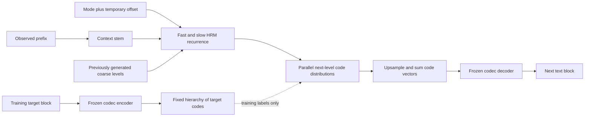

# V15 Astra — A Frozen Multiscale Codec, Explorative HRM, and Bounded Wake–Sleep Learning

**Design revision:** 17 October 2026 (research begun 16 October). **Status:** research specification, analytically checked; no Astra model has been implemented or trained. **Primary prototype:** 9,679,106 stored model scalars including frozen codebooks and two adapter slots. **Smaller control:** 7,553,282. Runtime memory and optimizer buffers are additional.

**Decision:** train a text codec in Stage 1A, freeze it, and train a separate HRM-based next-concept generator in Stage 1B. Give that generator a small set of exploration modes before recurrent computation. Generate text through the codec's retained decoder. During use, optionally search a continuous offset around an exploration mode; later consolidate verified experience into bounded concept-model adapters. Test a small associative memory as a search initializer, after the simpler system works.

This is a new generative architecture, not a renamed V14 auxiliary-prediction model. The user's central idea is sound as a hypothesis: a stable latent vocabulary and a separate iterative generator fit together. Neither HRM nor exploration nor sleep is guaranteed to improve it. The design below makes those claims independently testable.

Companions: [paper reading notes](v15_astra_design/paper_reading_notes.md), [analytical ledger and checks](v15_astra_design/design_checks.json), [check program](v15_astra_design/check_design.py), [source manifest](v15_astra_design/source_manifest.json), and [second-pass review](V15_Astra_Review.md). The supplied screenshot guides the stage table, but its timing, overhead and memory estimates are not adopted.

## 1. What the evidence supports

### 1.1 Design derivation

There are six distinct problems to solve, in this order.

1. **Represent the answer faithfully.** If a codec loses a digit or entity, a perfect concept generator cannot reliably recover it. Establish reconstruction before asking for reasoning.
2. **Predict a distribution over representations.** The next span often has multiple valid continuations. Predict discrete alternatives rather than regress all futures toward one continuous average.
3. **Spend computation where it changes the prediction.** HRM shares parameters across recurrent computation. Parameter sharing saves unique weights; it does not make repeated computation free.
4. **Make extra inference compute useful.** Multiple learned modes, independent samples, extra recurrence, and gradient search are competing ways to spend the same budget.
5. **Separate temporary adaptation from permanent knowledge.** An instance-specific offset should disappear after the request. Cross-request memory needs an explicit update rule, scope and eviction/reset policy.
6. **Turn verified experience into cheaper future behavior.** Sleep should improve later predictions with the search and temporary memory removed. Repeating unverified outputs is not new evidence.

Three time axes must never be conflated: text blocks advance through an answer; codec levels refine one block; HRM iterations refine the prediction of one level. Depth Memory has a fourth, internal axis: sublayers of one encoder/decoder invocation.

### 1.2 Paper-to-design decisions

All nine PDFs in `V15-Papers` informed this specification. The reading notes distinguish the original method, evidence, limitations and Astra's adaptation, with local page references and public primary sources.

| Source | Adopted idea | Boundary of the claim |
|---|---|---|
| Next-Concept Modeling (NCM) | Residual multiscale VQ codec; frozen code targets; parallel predictions within a level; reuse the trained decoder | Its reported speedups do not establish speedups for a recurrent generator with K branches |
| Depth Memory | Separate residual, associative and inverse-covariance streams; RLS across depth | This is within-forward depth aggregation, not persistent continual learning |
| HRM-Text | Fast/slow recurrence, sequential PreNorm blocks, module-exit normalization, explicit truncation schedule | Its instruction/response data and masking changes also matter; its language results are not an architecture-only causal study |
| Explorative Modeling (XM) | Latent-conditioned alternatives; investigate mode specialization | Astra uses an exactly normalized finite mixture; it does not claim the squared-error separation theorem for discrete code heads |
| Generative Recursive Reasoning (GRAM) | Treat stochastic trajectories as a distinct generative-model option; distinguish width from depth | A variational trajectory model needs a posterior, prior and KL objective. Adding random z does not implement GRAM |
| GradCuit | Optimize internal states with outcome-weighted likelihood gradients while weights stay fixed | Astra optimizes code-policy likelihood, not a nonexistent derivative through argmax codes into text |
| Titans | Separate fixed model knowledge, transient attention context and writable fast weights | The baseline does not reproduce an evaluated Titans MAC/MAG/MAL model |
| ATLAS | Window-based associative updates and explicit polynomial features | The proposed small linear memory is an ATLAS-inspired ablation, not a replication of its deep-memory/Muon system |
| Language Models Need Sleep | Transfer fast knowledge to slower parameters; use student-generated contexts and verified rehearsal | Fixed two-slot adapters are a capacity-limited adaptation of its growing, multi-timescale system; no autonomous improvement guarantee |

### 1.3 What V1–V15 change about this design

The detailed historical synthesis is in [the preceding V15 proposal](v15_Architecture.md), checked against the reports and saved results listed below. These versions used different data and budgets; this table is a lesson ledger, not a loss leaderboard. It is not a claim that every checkpoint was rerun.

| Experiments | Evidence relevant to Astra | Consequence |
|---|---|---|
| V1–V3 | Useful concept routes coexisted with small gains from extra passes. V2 substantially increased unrolled work and weakened E/D; the matched-time audit was worse. V3 recovered strong recall/carry/multiplication, while binding remained weak. | Count repeated work; retain codec capacity; compare HRM to a trained nonrecurrent generator |
| V4/V4.1 | Token-fact bypasses helped details; some core-removal interventions also damaged controls trained without concept content. | Protect exact reconstruction; distinguish dependence from beneficial computation |
| V5/V6 | NCP helped one GraphNav recipe and harmed another. V6's GradCuit-minus-retry equal-time intervals included zero and negative effects. | Do not enable search before base competence; always include equal-time ordinary sampling |
| V7/V8 | Failed foundation gates invalidated downstream search claims. The separate V8 12-hour delayed-NCP experiment reached 80.37% standard success versus 76.51% without NCP, but later continual phases collapsed. | Separate competence, acquisition and retention gates |
| V9 | Reduced Q5 was single-seed, development-only and unequal-budget: EI 85.16%/33.01% versus reference 83.20%/33.98% standard/hard. | No inherited search-superiority claim; test format and boundary changes |
| V10/V10.1/V10.2 | Dense counts omitted large lookup tables; tokenization/validation repairs and smoke tests were not equivalent to successful scientific runs. | Count every stored component; distinguish smoke validation from outcomes |
| V10.3 | Mixture repair improved an older objective but did not establish a win over C0. Gated LoRA reduced some forgetting, while new-math exact solving remained 0/64. | Keep a normalized mixture and bounded adapters, but score actual answers and related-skill retention |
| V11 | Clean latent objective made the concept route influential without a net task gain. Auxiliary-only parameters in a shared gradient clip distorted training. A bridge could improve a probe while harming NLL. | No detached latent-regression bridge in the primary model; isolated diagnostic gradients; task-level gates |
| V12 | At 8k updates, ECD / NCP-equipped ECDe / TF7 text NLL was 3.615 / 3.893 / 3.555; math 0.846 / 1.120 / 0.817. Better probes did not imply better generation. | Make predicted codes the actual generation route; still require a strong ordinary-model control |
| V13/V14 | V14 improved the registered Reasoning score 0.2829→0.3725 and text NLL 2.8004→2.6861, but model size and exposure also changed. Global label churn was about 96.36%; teacher/online global agreement about 40.96%. | Freeze the whole target-producing codec, not just centroids |
| V14 continual | Specialized final average 0.3033 versus replay 0.3341; acquisition 0.05945 versus replay 0.11363. Lower forgetting did not compensate. | Sleep must acquire at least as well as a meaningful replay control, with measured memory and compute |
| Prior V15/XHRM-Atlas | Proposals, not experimental successes; earlier review found normalization, decoder-path, gradient and cost problems. | Explicit generative factorization, retained decoder, state lifecycle and full parameter ledger |

Sources: [V2](v2_underperformance_review_2026-09-28/REPORT.md), [V3](v3_design_review_2026-09-29/RESULTS.md), [V4](v4_tiny/REPORT.md), [V4.1](v41_tiny/ASSESSMENT.md), [V5](v5_tiny/REPORT.md), [V6](v6_tiny/REPORT.md), [V7](v7_tiny/REPORT.md), [V8](v8_tiny_12h/REPORT.md), [V9](v9_tiny/runs_q5_12h/REPORT.md), [V10](v10_10M/audit/REPORT.md), [V10.1](v10_1/VALIDATION_REPORT.md), [V10.2](v10_2/README.md), [V10.3](v10_3_tiny/REPORT_TABLES.md), [V11](v11_tiny/REPORT.md), [V12](v12_tiny/RESULTS.md), [V13](v13_tiny/runs/eval/base/results.json), [V14 base](v14_tiny/runs/eval/base/results.json), [V14 continual](v14_tiny/runs/eval/cl/cl_results.json), [V14 diagnostics](v14_tiny/runs/eval/diag/diagnostics_v14.json), [prior review](V15-XHRM-Atlas_Review.md).

## 2. Interfaces and the reference prototype

### 2.1 Notation

| Symbol | Meaning; reference shape |
|---|---|
| p | Observed text prefix; at most 512 subword tokens in the tiny reference |
| x | Next output block; B=16 tokens including EOS/PAD where applicable |
| E, D | Codec encoder and decoder, width d_c=128; four blocks each |
| h=E(x) | Unquantized target features, 16×128; never an input to the Stage 1B predictor |
| L, n_l, N_l | Four codec levels; slots (1,2,4,16), alphabets (256,256,256,1024) |
| C_l | Integer codes at level l, shape n_l |
| a_l | Cumulative decoded latent reconstruction after levels 1…l, shape 16×128 |
| Ctx(p) | Trainable context stem, four blocks at d=256; uses frozen codec token embeddings |
| H, U | Slow and fast HRM states, n_l×256; U avoids overloading the level symbol L |
| F_H, F_U | Two unique blocks each; shared across repeated calls and across codec levels |
| K, e_k | Four learned exploration modes, e_k∈R^256; these are distinct from VQ code IDs |
| δ | Temporary continuous search offset, R^256 in Tiny; zero during ordinary pretraining/inference |
| M, S | Optional fast associative matrix and its momentum, each 256×153 |
| A_old, A_candidate | Two fixed-budget rank-4 adapter slots in the concept model |

The text tokenizer is a deterministic 2,048-entry subword tokenizer with byte fallback and explicit BOS/EOS/PAD IDs inside that count. Train its vocabulary on the training split only and save its hash. No Unicode character is silently discarded. A different vocabulary requires a new parameter ledger and codec identity.

**Canonical blocking:** targets are always the next 16 tokens after an observed prefix. Train across offsets, not just document positions divisible by 16. At the end of a document append EOS and deterministic PAD to fill the block. PAD is a scored target during codec reconstruction and concept training; the true remaining length is never given to the predictor or decoder. At generation, stop at the first EOS; PAD before EOS is an invalid output, not an opportunity to hide errors. Packed documents must have explicit boundaries. No attention or depth state crosses a document boundary.

The prefix includes all supplied prompt tokens and already generated tokens, never the ungenerated target. BOS supplies a nonempty prefix for unconditional generation. Training target construction may see x; prediction may not.

### 2.2 End-to-end flow



The decoder has no token-copy bypass from the target or its unquantized encoder state. This makes the discrete interface a real bottleneck. It does not establish that its codes are human-interpretable concepts.

## 3. Encoder design — Stage 1A

### 3.1 Gated blocks and attention schedule

Use bias-free projections, parameterless RMSNorm with epsilon 1e-6, and head dimension 32: four heads at d_c=128. Each block applies attention and FFN **sequentially**:

\[
 r=\operatorname{RMS}(x),\quad
 t=\operatorname{ConcatHeads}(\operatorname{softmax}(QK^T/\sqrt{d_h}+mask)V),
\]
\[
 x'=x+W_O\{\sigma(W_g r)\odot t\},\qquad
 x''=x'+W_d[\operatorname{SiLU}(W_u\operatorname{RMS}(x'))\odot W_v\operatorname{RMS}(x')].
\]

The channel gate is computed before output projection; W_g is a full d_c×d_c matrix. FFN width is 2d_c. There are no extra residual gates, learned norm scales or biases hidden outside the count. Initialize attention gate logits at zero through W_g=0; its initial sigmoid value is 1/2. The two FFN branches are independently initialized, not both zero.

Encoder and decoder schedules are **[SWA, SWA, SWA, FULL]**. In the 16-token codec, SWA is bidirectional within radius 4, clipped to the block; FULL sees that entire block. This is legal for an encoder of a known training block and a decoder whose entire input is already generated codes. There is no causal-token claim inside the codec. At larger B, choose and report the radius explicitly. RoPE uses block-relative positions; a shared learned B×d_c position table also identifies output slots. The duplicate positional mechanisms are a specified choice to ablate, not an extra uncounted embedding.

### 3.2 Depth Memory: exact scope and update

The proposed codec includes a small grouped RLS Depth Memory, with a plain-residual codec as the mandatory control. It may be removed if four-layer stacks do not benefit.

Each token has G=4 independent groups. Value width d_v=d_c/G=32 and key width d_k=4. Each group maintains M_j∈R^(32×4), P_j∈R^(4×4), plus the ordinary residual x. Initialize M=0, P=I **at each encoder or decoder invocation**. Never carry these states between text blocks or requests.

For a sublayer, form normalized keys and queries from shared projections of SiLU(RMS(x)); zero vectors map to zero. For each group obtain a read gate g=2σ(W_gm·feature), importance ω=2σ(W_ω·feature), and λ=0.9+0.1σ(W_λ·feature). The shared projection sets are separate for E and D. Let γ be a learned d_c-vector, initialized to 0.01. Enrich the sublayer input with:

\[
 \tilde x=x+\gamma\odot\operatorname{concat}_j[M_j(g_jq_j)].
\]

Compute its ordinary attention or FFN residual contribution Δ from the enriched input, but add Δ to the original residual: x_new=x+Δ. Write Δ, split across value groups, with a key computed from x_new. Read and write features use their respective current states; this avoids writing a future sublayer before it has executed. With \(\bar k=\sqrt\omega k\), \(\bar v=\sqrt\omega\Delta_j\):

\[
 a=\frac{P\bar k}{\lambda+\bar k^TP\bar k},\quad
 M_{new}=M+(\bar v-M\bar k)a^T,\quad
 P_{new}=\frac{P-a\bar k^TP}{\lambda}.
\]

Write the input embedding as the initial value before the first sublayer; use the same write rule. After the final sublayer apply one final read and parameterless RMSNorm. This is an explicit small grouped adaptation of the paper, not its complete implementation: the paper's richer read/write feature networks and optimized kernels are not assumed.

The recurrence solves a **decaying-ridge** weighted regression, where old observations and the initial ridge both decay. It is not a fixed-ridge inverse update when λ<1. Use FP32 for M/P, denominator checks, symmetry monitoring and finite checks. An FP64 direct solve is the correctness reference. Symmetrization may correct roundoff; repeated loss of positive definiteness is a failing test, not a reason to silently change the mathematical solver. Gradients through these within-forward updates are enabled in Stage 1A.

Live state per token is G(d_vd_k+d_k²)=576 FP32 scalars, or 2,304 bytes. A batch of eight 16-token blocks requires 0.28125 MiB for one stack's **live** M/P. Training tapes, saved depth states and temporary solves are additional. Fixed live state across depth is not constant training memory.

### 3.3 Multiscale residual quantization

Let a_0=0 and h=E(x). For level l:

\[
 u_l=\operatorname{AvgPool}_{B\to n_l}(h-a_{l-1}),\qquad
 C_{l,i}=\arg\min_{j<N_l}\|u_{l,i}-B_l[j]\|_2^2,
\]
\[
 r_l=\operatorname{Repeat}_{n_l\to B}(B_l[C_l])R_l,\qquad a_l=a_{l-1}+r_l.
\]

All n_l divide B in the reference. R_l∈R^(d_c×d_c) is learned during codec training. Downsampling uses disjoint contiguous averages; upsampling repeats each slot over its corresponding span. The finest level n_4=B performs no spatial downsampling. Tie-breaking chooses the lowest code index, and quantization distances are computed in FP32.

Training uses straight-through code vectors \(q_l=u_l+\operatorname{sg}(B_l[C_l]-u_l)\). To define credit assignment precisely, form each next residual using h−sg(a_(l−1)); the accumulated a still carries its reconstruction gradients. Codebook updates use EMA counts and sums of the corresponding u_l, not optimizer gradients. R_l and E receive reconstruction/commitment gradients. At inference the straight-through construction has exactly the selected code vectors as its forward value.

Use EMA decay 0.99 as a starting configuration, Laplace smoothing 1e-5, and train-only initialization from sampled residuals. Dead-code replacement is allowed only before freeze, after a registered observation window; its seed and replacement IDs are logged. Fine-level cold starts may require staged initialization after coarser residuals settle. Any replacement restarts the stability measurement window.

The code payload is **216 nominal bits per 16-token block**: 1×8+2×8+4×8+16×10. The uncompressed fixed-width subword IDs use 16×11=176 bits. Thus this configuration is **not a storage compression win**. Its purpose is coarse-to-fine generation and a high-fidelity interface. The coarse root is only 8 bits; requiring it alone to preserve all digits would be impossible. A later rate–distortion sweep can reduce payload only after quality is established. Symbolic capacity alone does not guarantee this quantizer can represent every block well.

### 3.4 Codec objective and freeze gate

Train D on cumulative prefixes a_J. For the first 10% of the planned codec updates use J=4. Afterwards use P(J=4)=1/2 and P(J=1,2,3)=1/6 each. D gets a learned level-prefix embedding indicating J; at normal generation J=4. This is nested dropout over refinement levels, not arbitrary erasure of individual codes.

\[
 \mathcal L_A=\mathbb E_J\left[-\frac1B\sum_{t=1}^B\log p_D(x_t\mid a_J,J)\right]
 +\frac{0.25}{L}\sum_l\operatorname{mean}\|u_l-\operatorname{sg}(B_l[C_l])\|^2.
\]

EMA updates replace the explicit codebook-gradient loss; do not apply both accidentally. Record each level's utilization, entropy, dead codes, residual norms and reconstruction contribution. Report token accuracy, exact-block accuracy, character/byte fidelity, digits/entities, EOS placement, per-domain errors and worst groups. Frequent PAD must not inflate the headline accuracy: publish both all-slot and non-PAD metrics.

**One epoch is a checkpoint, not a transition rule.** Freeze only after the full-level codec passes the held-out gate in §11. If one epoch fails, improve codec capacity/training before spending the Stage 1B budget. The transition freezes tokenization, E, D, codebooks, R_l, positional and level embeddings, Depth Memory projections and all update statistics. Save a versioned hash of this entire bundle. Training the prior may not update EMA counts or run dead-code replacement.

A zero-churn test compares the same block under different prefixes, batch packing, padding and process restarts. Because the codec is block-local, its canonical C*(x) must be identical. Training-time code churn before freeze is diagnostic; post-freeze churn is an implementation failure.

## 4. Concept design — Stage 1B

### 4.1 Observed-prefix context

Ctx(p) embeds observed tokens using the frozen codec embedding, projects 128→256, and applies four gated blocks with FFN width 512. Use causal [SWA,SWA,SWA,FULL], with SWA looking back at most 128 tokens and FULL covering the retained prefix. The reference retains the last 512 tokens, including document-boundary information.

This context stem belongs to the new concept generator and is trained in Stage 1B. It is not a second target encoder. It intentionally retains token-level facts at the input side; predicting a concept should not require discarding the known names or digits in the prompt. The output still passes entirely through discrete codes and D.

For the correctness reference, recompute the retained context when its window changes. Causal KV reuse before truncation is possible; cache eviction must match the chosen window semantics. A sliding cache whose old states encode discarded history is a different recurrence from recomputation and must be named/tested separately. No speed claim assumes this optimization already exists.

### 4.2 Level input and early exploration

To predict level l, construct:

\[
 X_l=\operatorname{AvgPool}_{B\to n_l}(a_{l-1})W_a + P^{query}_{l}+e^{level}_l+e_k+\delta.
\]

P_query uses rows at the centers of the appropriate spans from a B×d table. W_a∈R^(d_c×d) resolves codec/core width differences at every scale. Only **previous levels** enter a_(l−1). The true C_l, h=E(x), answer length and later levels are absent.

Initialize H_0=RMS(X_l), U_0=0. The mode and δ enter before the first recurrence. X_l is also reinjected at each fast update; this preserves a direct conditioning path when early recurrent states are detached during training. It is a deliberate adaptation of the HRM family, not a claim to copy HRM-Text exactly.

Default δ=0. A separate noise-robustness arm trains with Gaussian δ of coordinate standard deviation 0.01, bounded to RMS≤0.05, on 10% of batches. It is evaluated at δ=0 too. Its stochastic training loss is an expectation of finite-mixture NLLs conditional on that noise, not an exactly marginalized continuous-latent likelihood. Search can initially be tested without this arm, but its neighborhood is then untrained.

### 4.3 HRM recurrence

For two cycles, each with three fast updates:

\[
 U\leftarrow F_U(\operatorname{RMS}(U+H+X_l),Ctx(p))\quad\text{three times},
\]
\[
 H\leftarrow F_H(\operatorname{RMS}(H+U),Ctx(p)).
\]

F_U and F_H each contain two sequential blocks. Each block has gated self-attention over that level's n_l query slots, gated cross-attention to Ctx(p), then SwiGLU. All three sublayers are PreNorm residual additions. The output of each complete module receives parameterless RMSNorm. Same-level self-attention is bidirectional because the inputs are query states, not true current-level codes. Cross-attention reads only observed context. Context never attends back to target queries. HRM self-attention uses RoPE at the query span-center positions; cross-attention has no additional RoPE. The context stem uses retained-prefix token positions. These conventions must stay identical in training and generation.

Share each module's weights over calls and levels. Reset H/U for each new level and block. Coarse information persists through a_(l−1), not an undocumented recurrent cache. There are **eight module calls per level**, each two blocks: six fast calls and two slow calls. Relative to evaluating the four unique HRM blocks once, this is four times the block applications, before exploration branches.

The final H feeds the level-specific categorical head W_l∈R^(d×N_l). Every code position in the level is predicted in parallel. Sampling the level and constructing its a_l precedes the next level. A smaller 7.55M profile uses one block per module with the same recurrence schedule; it is a separate capacity profile, not equal compute.

### 4.4 Exact exploration objective

Use K=4 learned mode embeddings with a **uniform prior** initially. Each mode defines a normalized hierarchy distribution:

\[
 q_k(C\mid p)=\prod_{l=1}^L\prod_{i=1}^{n_l}
 q_\theta(C_{l,i}\mid p,C_{<l},e_k).
\]
\[
 q_\theta(C\mid p)=\frac1K\sum_{k=1}^Kq_k(C\mid p),\qquad
 \mathcal L_B=-\frac1{23}\log\left[\frac1K\sum_k\exp(s_k)\right],
\]
\[
 s_k=\sum_{l,i}\log q_\theta(C^*_{l,i}\mid p,C^*_{<l},e_k).
\]

The 1/23 normalization is **outside** log-sum-exp. Do not average each mode's code loss before exponentiating, multiply it by arbitrary level weights inside the exponential, or mix levels with fresh prior weights. Those operations change the claimed probability distribution. Different level-balanced objectives can be ablations, labeled as surrogates.

A mode is shared across the complete hierarchy of one block. In ordinary multi-block generation, draw a new mode per block. That is one explicit generative model. A single mode shared across an entire answer is a separate controlled-generation/search policy described later.

The posterior training responsibility is \(r_k=\operatorname{softmax}_k(s_k)\). All modes receive the corresponding weighted gradient. Exact streaming is possible: compute scores without gradients, then recompute each branch with matching randomness and backpropagate −sg(r_k)s_k/23, accumulating before the optimizer step. This recovers the mixture gradient, but costs extra forward passes. A winner-only backward pass is hard XM, a different loss. The primary tiny run uses dropout=0 so score/recompute consistency is straightforward. All loss normalizations use the number of code slots N_C=Σ_l n_l; the explicit value 23 is specific to this prototype.

Initialize each mode embedding independently with coordinate standard deviation 0.02; identical initialization could preserve an unwanted symmetry. No entropy or diversity regularizer is silently included. The uniform prior removes an unnecessary learned selector from the first experiment. A later context-only router π(k|p) can replace 1/K with a learned categorical distribution, trained by the same joint likelihood. It must never see the true target or a best-mode label at inference. If marginalizing mode after observing coarse codes, use posterior mode weights proportional to π(k|p)q_k(C_<l|p); the original prior is generally wrong at later levels.

K learned embeddings do not guarantee K useful behaviors. Log responsibility entropy, mode usage by domain, decoded candidate disagreement, likelihood gaps, best-of-K verified quality and selected quality. Compare against K=1 with the same number of independent samples. Diversity without correctness is not a benefit.

### 4.5 Credit assignment, teacher forcing and exposure shift

Train the frozen codec's canonical target hierarchy with teacher forcing over levels. Each level sees the true earlier levels but never its own true codes. Blocks sampled from the same document must keep their target tensors separate from predictor inputs. If packing all levels into one training call, isolate the level-query groups; the safest reference computes them separately.

Start with the last two module calls differentiable and expand to the last five over the first 10% of Stage 1B updates. Detach **both** H and U at the truncation boundary. X_l and Ctx(p) remain live inputs to subsequent calls. This is biased truncated credit assignment, even though the forward loss is a valid normalized likelihood. Compare full eight-call backpropagation on short controlled runs and check gradients to e_k, W_a and the context stem. Checkpointing is a memory/time tradeoff, not a change to the gradient objective.

Keep extra loss terms off initially. In particular, no continuous next-latent MSE bridge competes with code NLL. Auxiliary probes run detached and have separate optimization/clipping. Clip the deployed concept-model gradient at 1.0 as an initial setting, logging clipping frequency by data family; this can still reweight the effective mixture.

Teacher-forced code accuracy is not free-running generation quality. Evaluate ancestral levels, arbitrary block boundaries and multi-block answers. If error propagation dominates, add a separately labeled denoising curriculum using corrupted earlier levels and clean targets, then measure its effect. Such training is a conditional denoising surrogate; it is not the clean model likelihood. Retargeting residuals under different coarse choices would be another algorithm and requires recomputing all finer residual labels. Neither repair is silently enabled in the reference.

## 5. Decoder design — retained from Stage 1A

After the last predicted level, construct a_L by exactly the frozen upsampling and R_l maps used in training. Add the shared codec position embedding and the J=L embedding, then execute D with its [SWA,SWA,SWA,FULL] schedule and independently reset Depth Memory. Project the normalized output through the **tied frozen token embedding transpose**. All B token distributions are produced together.

D receives no raw target tokens, no teacher encoder h, and no trainable Stage 1B bypass. It uses full attention among code-derived positions; that does not leak future text. The complete-block conditional distribution is:

\[
 p_D(x\mid C)=\prod_{t=1}^B p_D(x_t\mid a_L(C),L),
\]
\[
 p(x\mid p)=\sum_C q_\theta(C\mid p)\,p_D(x\mid C).
\]

For a deterministic encoding C*(x), a computable lower bound is:

\[
 \log p(x\mid p)\ge \log q_\theta(C^*(x)\mid p)+\log p_D(x\mid C^*(x)).
\]

Report its negative divided by the same number of scored tokens as a **text negative-log-likelihood upper bound**, not exact next-token NLL. A negative-log joint includes both terms; code CE alone is not text perplexity. For full-document likelihood, sum block bounds with the observed text prefix. Exact text marginalization is intractable at these code sizes. External-LM generative perplexity is another metric and must name its evaluator/tokenizer.

Sampling codes and sampling D's token distributions samples this block model. Greedy D decoding is a practical decoding rule with a different induced text distribution. Both can be evaluated, but a greedy decoder's score-function search optimizes the code policy followed by that deterministic decoder, not the original stochastic text marginal. Default exact-task evaluation uses greedy D and verifier-scored answers; language generation additionally reports sampled decoding and degeneracy/repetition.

Keep D frozen during continual learning. Adding encoder/decoder LoRA by default would make the stable-interface argument weaker and increase the number of ways to forget. A future codec revision is a new version requiring reconstruction validation, recoding and prior migration, never a silent online update.

## 6. Training and operating stages

### 6.1 Stage table

Numbers below are specifications and accounting, not measured wall-time or quality results.

| Stage | What changes | What is frozen | Primary objective | Compute and memory accounting |
|---|---|---|---|---|
| 0 — data/interface audit | Train-only text tokenizer; dataset split manifest; serialization | Historical snapshots | Round-trip fidelity; disjoint semantic instances and document splits | Hash data/tokenizer; count unique tokens and repeated exposure separately |
| 1A — codec pretraining | E, D, reconstruction maps, Depth Memory projections; codebooks by EMA | Concept model not used | Nested-prefix reconstruction CE + commitment | 1,783,552 gradient-trained parameters + 229,376 EMA centroids; total codec 2,012,928 |
| 1A-F — freeze and encode | Write canonical code cache and codec manifest | Entire codec, including statistics | Exact identity/churn checks and held-out reconstruction gate | Encoding cost and cache storage recorded separately; this is not additional learning |
| 1B — concept pretraining | Context stem, HRM, code heads, four mode embeddings | Entire codec; fast memory disabled | Exact finite-mixture code NLL, with disclosed truncated gradients | 7,608,320 trainable parameters; K branches multiply recurrent work; full bundle 9,621,248 |
| 2 — task calibration / optional adaptation | Same concept parameters for task fine-tuning, or one gated adapter slot; trained verifier only if separately specified | Codec; all sealed evaluations | Correct answer/code likelihood on training tasks; calibrate compute policy on development data | Task data and compute reported separately from pretraining; no hidden use of answer labels during deployment |
| 3A — ordinary wake inference | H/U and depth states evolve; sample mode and codes | All stored model parameters | Generate next blocks | One selected mode by default; four levels and eight HRM module calls per level |
| 3B — optional search | Only δ within a request; optional fast-memory write after valid feedback | Codec and concept weights, mode embeddings, adapters | Reward-weighted code-policy objective with trust bound | Full selected-branch recurrence gradients, regeneration and verifier calls; reset δ at request end |
| 3C — observed-data acquisition | Candidate rank-4 adapter and its gate, on revealed training/feedback records | Base model, codec, accepted old adapter | New-data code NLL + replay + retention anchor | Fixed 1,000-record replay budget; no gradient from unrevealed evaluation labels |
| 4A — sleep consolidation | Candidate adapter/gate, then transactional promotion | Base/codec; previous accepted adapter is the reference teacher | Verified code imitation + conditional distillation + replay | Both adapter slots total 57,858 parameters; temporary teacher graphs and optimizer state still count |
| 4B — optional verified dreaming | Same candidate adapter on checked synthetic variants | All reference snapshots and sealed tests | Learn validated transformations/curricula; same retention constraints | Finite quota and declared verifier cost; no unconstrained self-generated truth |
| 5 — promotion and next wake | Atomically select accepted slot; reset temporary memory | Preserve old snapshot until checks pass | Held-out acquisition, retention and cost gates | No unbounded rank accumulation or unlimited-capacity claim |

### 6.2 Initial training configuration

These are starting settings to test, not settings established by the papers for this model.

- Optimizer: AdamW, β=(0.9,0.95), epsilon 1e-8, weight decay 0.1 on matrices; none on embeddings or gates. Stage 1A peak LR 3e-4; Stage 1B 3e-4. Five-percent linear warmup then cosine decay to 10% of peak. EMA codebooks have no Adam state.
- Effective batch: 256 target blocks, accumulated from a microbatch chosen by measured peak memory. Stage 1B also carries up to 512 observed-prefix tokens per example. Always report both prefix processed tokens and output target tokens; 256×16 is 4,096 target tokens/update, not the complete compute exposure.
- Data: training-only vocabulary and codec; document/semantic-instance disjoint train, development and sealed test sets. Include exact-copy, numbers, entities, code, natural text and the project's reasoning families. Declare the mixture before running, and use the same mixture for controls. Do not claim a fixed historical mixture unless its data manifest is actually reused.
- Sampling: random block offsets, short and long prompts, prompts ending mid-word/subword sequence where legal, and varied task serialization. Response-only scoring for supervised tasks; ordinary continuation scoring for text. Codec learns answer/text blocks, not labels from the evaluation split.
- Seeds: one smoke seed, then three independent paired training seeds for any promotion claim. Pair data streams across controls; split bootstrap units by document or task instance, never correlated token groups.
- Checkpoints: include optimizer/RNG/data position, codec identity, mode initialization and every mutable memory state. Exact interrupted/resumed parity is a required implementation test.

The first codec exposure may be one pass over the available training distribution. Stage 1B starts only if the codec gate passes. Budget selection then follows a measured throughput pilot: record model forward/backward time, code encoding, validation, candidate search, verifier time, sleep and end-to-end wall time. There is no promised “2.2 hours + 8.8 hours” allocation.

A codec trained once is reusable across experiments, but the first-model cost still includes it. Report both first-model cost and marginal prior-only cost. Controls receive equal **total** training resources for the primary efficiency comparison, and a separate equal-exposure comparison diagnoses optimization.

## 7. Inference-time compute and the role of z

### 7.1 Three increasingly expensive controls

1. **Ordinary generation:** one mode per block, ancestral codes, frozen D. No optimization.
2. **Width or depth:** more independent samples, more mode-conditioned trajectories, or more HRM cycles. Extra cycles beyond training are an extrapolation and can worsen predictions.
3. **Latent search:** choose a mode for a candidate answer and optimize an offset using an available verifier. Compare with (2) at the same wall time and verifier-call budget.

For search, sample k uniformly once per candidate answer and retain it for that candidate's blocks. This defines the controlled policy \(Q_{k,\delta}(C_{1:G}|p)=\prod_g q_k(C_g|p_g,\delta)\). It is different from the ordinary per-block mode mixture. The shared δ is injected at every level and block; every block's conditional code likelihood has a direct differentiable path to δ. Observed generated token IDs are treated as fixed when recomputing these conditional scores.

This makes z useful as a **control interface**. Its learned mode component encourages alternative predictions; its continuous offset supplies an instance-level search variable; sleep can imitate successful outputs without requiring that exact offset again. None of these functions follows automatically from naming a vector z.

### 7.2 Correct gradient through discrete concepts

Let an answer's sampled code trajectory be C, its greedy-decoded text y=D_greedy(C), and its reward R(y,p). The codec and model weights stay frozen. The valid score-function identity is:

\[
 \nabla_\delta \mathbb E_{C\sim Q_{k,\delta}}[R(D_{greedy}(C),p)]
 =\mathbb E[(R-b)\nabla_\delta\log Q_{k,\delta}(C|p)].
\]

The probability factorizes across blocks, levels and code positions. Each log-probability is evaluated with the exact prefix and earlier sampled levels that produced that sample. Do not substitute canonical re-encoded codes here: the gradient must score the actual sampled actions. A deterministic decoder is simply part of the reward function, so no derivative through its argmax is required. There is no pathwise token-CE gradient through integer code choices.

**Reference search configuration:** choose one mode, δ=0 or a bounded memory initialization; two stochastic trajectory samples per update, up to four updates; categorical temperature 1 without top-k truncation. Use a moving baseline from prior samples, detached and independent of the current action conditional on its prefix. Use Adam on δ with LR 1e-3, β=(0.9,0.999), epsilon 1e-8; clip its gradient norm at 1 and project RMS(δ)≤0.05 after each step. These bounds are provisional development settings. An optional KL-to-δ=0 term is separately tuned and reported; it is not needed to state the baseline estimator.

Use **full eight-call backpropagation** for each optimized level in the tiny search reference. Earlier truncated training does not justify calling a truncated search gradient exact. Accumulate score gradients through all sampled blocks, or recompute them one block at a time with fixed prefixes to control memory. Model parameters require no gradients, but activations along the δ path still do. Zero persistent parameter gradients and audit that only δ changes.

Keep the best verifier-scored candidate including the original. Stop on a sound verified success or budget exhaustion. Refresh samples after each update; do not repeatedly treat stale trajectories as on-policy samples. Greedy proposal updates can be a heuristic comparison, but the unbiased identity above requires sampling from the scored policy. If temperature/filtering changes, score that changed distribution.

The original GradCuit implementation uses greedy regeneration and a self-verifier with a reward of zero for accepted answers and −1 otherwise. Astra's sampled estimator and trust bound are intentional differences. It does not inherit the paper's accuracy or robustness numbers.

### 7.3 What counts as a verifier

For synthetic reasoning, use the existing simulator or formal task constraints without revealing a hidden reference answer to the search policy. For code, use allowed tests; for mathematical candidates, a sound substitution/checker when available. Hidden test labels may score final evaluation, but may not choose δ, modes or candidates.

A trained or self-judging language verifier is fallible and costs compute. Measure its false-accept rate on held-out examples before allowing its outputs into persistent memory or sleep training. Where no trustworthy reward exists, use ordinary generation/sampling and disable reward-gradient adaptation. Reducing entropy or increasing self-confidence alone is not evidence of correctness.

### 7.4 Compute accounting

For one block and one selected mode, the HRM executes 8×2×(1+2+4+16)=368 query-token block applications, plus context processing, cross-attention projections, quantization reconstruction and four decoder blocks. Four modes execute 1,472 such applications, before any backward pass. These counts are not FLOPs: query lengths, attention sizes and matrix dimensions differ.

A more useful accounting formula is:

\[
 F_{generate}=F_{ctx}(p)+\sum_{l=1}^L K_{eval,l}\{6F_U(n_l,p)+2F_H(n_l,p)+F_{head,l}\}+F_D(B).
\]

Context states and the cross-attention K/V projections for each unique HRM block can be shared across levels, recurrent calls and candidate modes for the **same prefix**. Different generated prefixes generally need different context computation. Mode branching happens before recurrence, so most recurrent work cannot be shared. Batching can improve hardware utilization, not eliminate arithmetic.

Search adds sampled generation, score recomputation, backward passes, verifier calls and regeneration. Sleep adds its own training and evaluation. Report quality versus milliseconds, joules if measured, verifier calls, peak memory, and both total/active model parameters. “Fewer generation steps” is insufficient when each step is much more expensive.

## 8. Continual learning: what changes, and where

### 8.1 Default: bounded gated LoRA in the concept model

The first continual baseline is one rank-4 adapter on the self-attention Q and V matrices and the FFN down projection of each unique HRM block. A scalar gate per adapter is computed from the mean context feature:

\[
 W'x=Wx+g(p)\frac\alpha r BAx,\qquad g(p)=\sigma(w^T\operatorname{mean}(Ctx(p))+b),\quad\alpha=r=4.
\]

Use the same g for that slot's matrices. Gate parameters and A/B are trained together. Start B=0 and A random, with gate bias 0, so the function initially matches the base exactly and B receives gradients. A and gate gradients can initially be zero; that is expected, not a reason to detach them permanently. The gate is not multiplied by an untrained random gain or derived from a hidden task ID.

Keep the codec, mode embeddings, context stem and base HRM frozen during adapter learning. Context features used by the gate consequently stay fixed. Two preallocated slots include 57,858 parameters in the primary profile. Only one slot is deployed at a time; the other is a candidate/rollback slot. Do not continually append new low-rank matrices and still claim bounded size.

Train on observed new examples with 20% replay from a 1,000-record reservoir as the initial control. Store the prefix, canonical codes, text, provenance, codec hash and quality flag. Bound records by both count and bytes; an initial maximum is 64 MiB, evicting whole records deterministically when either limit is reached. Gate/replay quality is measured, not assumed from V10.3.

### 8.2 Optional ATLAS-inspired search-initialization memory

Place fast adaptation **at the concept control interface**, not independently in E, C and D. The small memory predicts a useful δ initialization from observed context and mode. This keeps the target and decoder coordinates fixed and provides a clean memory-off control.

This component is called **Astra window memory** to avoid claiming a full ATLAS reproduction. It borrows a polynomial key map and recent-window associative loss. It does not use deep memory, learned meta-optimizer gates or Muon by default.

Construct an input from the mean and final frozen token embeddings of the observed prefix, concatenated with the one-hot mode. Apply a fixed seeded 260×16 projection and L2 normalization to obtain k∈R^16. Freeze this projection and its seed for the life of the codec/model bundle. This simple feature may be too weak semantically; that is an explicit experimental risk. It has a stable coordinate system even if a concept adapter changes.

Use the exact feature map:

\[
 \phi(k)=[1,\ k_i,\ k_i^2/\sqrt2,\ k_i k_j\ (i<j)]\in\mathbb R^{153}.
\]

It gives \(\phi(k)^T\phi(q)=1+k^Tq+(k^Tq)^2/2\). All polynomial coefficients are fixed and nonnegative. There is no vague quadratic-capacity claim with an uncounted feature dimension.

Memory read: δ_init=clip_RMS(Mφ(k),0.05). Initialize M=S=0, so memory-off equivalence is exact. Do not RMS-normalize Mφ(k) to unit magnitude: that would amplify tiny/noisy corrections. Cap the result instead, preserving its learned amplitude.

A write is allowed only after a successful, externally checked or otherwise calibrated-feedback search. Its key is computed from the original observed request prefix and the retained mode, not from the generated answer. Its target is the **total successful offset δ***, indexed by the frozen-prefix key and selected mode. Store the last c=4 accepted key/offset pairs. At the current M, recompute:

\[
 J(M)=\frac1{2c'}\sum_{i\in buffer}\|M\phi(k_i)-\delta_i^*\|^2+\frac\rho2\|M\|_F^2,
\]
\[
 S\leftarrow\mu S+\nabla_MJ(M),\qquad M\leftarrow M-\eta S.
\]

Here c' is the actual buffer length, ρ=1e-4, μ=0.9, η=1e-2 are initial fixed settings. Project M's Frobenius norm to at most 1 after updating; log clipping. These settings are development hypotheses. The loss already supplies regularization: do not add another unreported weight decay. This is a recent-window gradient rule with momentum; c=1 and different gating choices connect it to simpler Titans-style associative updates, but it is not the paper's exact algorithm.

Persistent M+S uses 313,344 FP32 bytes, **0.2988 MiB**. Add 16,640 bytes for the fixed key projection, a four-pair buffer, counters, metadata and any snapshots. The gradient, M copy, optimizer work and the model's inference/search activations increase peak memory. The complete running system is not a 0.3-MiB system.

Memory is isolated per declared user/task stream; branches use private temporary state. Read before the current answer; write only after allowed feedback. Reset M/S/buffer at experiment split boundaries and after adapter promotion, because even stable keys do not make old offsets valid under changed concept computation. Sleep retains verified examples so useful experience can survive that reset.

A full Titans/ATLAS module with trainable query/key/value projections would require outer-loop training through its update behavior. Do not attach random “learned” gates to a frozen pretrained model and assume they know when to read or write. Test the small explicit memory first against no memory and a bounded nearest-neighbor initializer at the same storage budget.

### 8.3 Clarifying “RBL correction”

The request's “RBL” is ambiguous. Earlier project files use **RBF** retrieval/correction; Depth Memory uses **RLS**. Astra does not pretend these are the same. The default uses gated LoRA, the codec uses RLS across depth, and a bounded RBF/nearest-neighbor initializer is a comparison for the optional window memory. No undefined RBL component is required to implement the design.

## 9. Sleep: consolidate behavior, then test it without memory

### 9.1 State transition

```text
predict with accepted adapter and old fast memory
→ obtain permitted feedback
→ optionally search an offset / update fast memory
→ save verified experience and original provenance
→ clone accepted adapter into inactive candidate slot
→ train candidate on verified experience plus replay and distillation
→ evaluate candidate with δ=0 and fast memory reset
→ accept atomically if acquisition + retention + cost gates pass
→ clear temporary offsets and fast memory; retain bounded replay
```

This is a concrete two-timescale approximation: fast offsets/memory during wake, slower adapters during sleep. The Sleep paper's full continuum memory system has multiple frequency levels and can expand capacity. Astra's two slots deliberately cap capacity; saturation eventually requires replacement, a versioned capacity increase, or admitting that new knowledge will not fit.

### 9.2 Teacher, student and targets

The teacher is a frozen snapshot of the accepted model plus its recorded successful search policies. It is not “the same model while it is being updated.” For each verified answer y, recompute canonical C*(y) with the frozen codec. A sampled search trajectory may decode to y without equaling C*(y): keep both, using **sampled codes for the search policy gradient** and **canonical codes for supervised sleep**.

The student is the frozen base with the candidate adapter, zero δ and no fast-memory assistance. Train:

\[
 \mathcal L_{sleep}=0.8\,\mathcal L_{verified,new}+0.2\,\mathcal L_{replay,old}
 +\beta_{KD}\mathcal L_{KD}+\beta_{anchor}\mathcal L_{anchor}.
\]

All supervised terms use the normalized mixture code NLL from §4.4 and the same outside normalization. Start β_KD=0.1, β_anchor=0.1, LR=1e-4, weight decay zero on adapter/gate, clip norm 1. These coefficients require development calibration. They are not values derived from the Sleep paper.

For \(\mathcal L_{KD}\), compare teacher and student per-mode categorical code distributions at matching prefix, mode and earlier-level codes, using teacher→student KL averaged across slots. Freeze the mode embeddings so mode indices remain aligned. For the recorded winning mode, the teacher may use its recorded successful δ; for other modes it uses δ=0. The student uses δ=0 for every mode. Average across uniformly selected modes, including modes that did not win, rather than silently replacing the mixture by a winner-only likelihood.

Half the distillation histories initially come from verified teacher trajectories; half come from student-generated code histories, with sampling detached. On the latter, query the teacher at **the same** student history. This lets the student see its own errors, as motivated by generalized on-policy distillation. It is a local conditional imitation loss; no claim is made that it exactly equals KL between complete mixture text distributions.

The anchor term compares the accepted pre-sleep model and candidate on dedicated old training/replay contexts, disjoint from retention validation and test instances, and their canonical coarser codes. Use no target information in the predictor. Report anchor utility separately from true old-task retention; matching distributions on a small buffer cannot guarantee global preservation.

Avoid hidden-state MSE as the primary consolidation target. Two recurrent trajectories can produce the same good answer, and their internal coordinates can change under an adapter. Code/text behavior is the relevant interface. Optional δ-to-adapter regression is diagnostic and must demonstrate extra benefit over behavior distillation.

### 9.3 Bounded promotion and failure handling

Run sleep in finite jobs, initially at most 200 optimizer updates per acquisition segment, evaluated at 50/100/200 on a development gate. Commit to this rule before seeing the sealed stream. Promotion compares candidate and accepted adapter on separate, instance-disjoint new/old validation panels. A failed candidate is discarded; the accepted slot and replay remain intact.

After promotion, the former accepted slot becomes the rollback slot. The next candidate is initialized from the newly accepted slot, not added on top of it. This keeps the rank and number of active matrices fixed. It also means long-term capacity is limited. Do not reset the old adapter before validation and do not preserve fast-memory offsets across a changed adapter merely because the key encoder is fixed.

Use a prequential protocol: predict each new example before observing its answer/feedback, then permit adaptation. Sleep validation examples are not later reported as untouched tests. A sealed final stream is evaluated once under a locked schedule. Retention includes related skills, not just unrelated text.

### 9.4 Dreaming is an optional, checked curriculum

Start with replay and verified wake outputs. After they work, synthesize variants that can be independently checked: renamed graph nodes, equivalent arithmetic expressions, fresh simulator states, reordered irrelevant facts, or proof-preserving transformations. Limit synthetic records to 20% of the new-data portion initially, deduplicate against evaluation instances, and retain their generator/checker provenance.

Self-generated claims without a checker remain proposals, not persistent training truth. The Sleep paper's learned edit/curriculum policy and rejection-sampling RL are additional machinery; this design does not claim to implement that outer loop. To test it later, require a held-out adaptation reward, an explicit candidate-data budget and an equally funded random/heuristic curriculum control.

**Success criterion:** after sleep, with δ=0 and fast memory empty, the model achieves more of the verified wake benefit at lower inference cost while retaining old skills. A lower training loss or fewer stored offsets does not meet this criterion.

## 10. Scaling from millions to trillions

### 10.1 The invariant architecture

Keep the interfaces invariant: token block → discrete hierarchy → conditional generator → frozen decoder. Scale codec fidelity, prior capacity, context length, recurrence depth, exploration width and memory budget independently. Do not automatically increase all of them with parameter count.

For width w, FFN width f, a gated self-attention block has approximately **5w²+3wf** parameters under the exact bias-free conventions here. An HRM block with equally wide gated cross-attention has **10d²+3df**. Projection, table and output-head costs are then added explicitly. Recurrence does not multiply stored weights; it multiplies applications.

Codec count:

\[
 P_{codec}=Vd_c+(N_E+N_D)(5d_c^2+3d_cf_c)+d_c\sum_lN_l+Ld_c^2+(B+L)d_c+P_{DM}.
\]

The last term is the two shared depth-map sets. The context input and coarse-code projections each contribute d_cd. Code heads contribute dΣN_l. Query/level/mode embeddings contribute (B+L+K)d. Tied embeddings are counted once. EMA centroids count as stored model scalars even though Adam does not train them.

| Component | Primary Tiny | Small control |
|---|---:|---:|
| Complete codec | 2,012,928 | 2,012,928 |
| Context, HRM, mode/position inputs and code heads | 7,608,320 | 5,511,168 |
| Base model | 9,621,248 | 7,524,096 |
| Two rank-4 adapter slots including gates | 57,858 | 29,186 |
| Total model with both slots | **9,679,106** | **7,553,282** |

The primary codec includes 229,376 centroid scalars. The total is not “9.68M trainable in every stage.” Stage 1A and Stage 1B train different subsets. Optional fast M has 39,168 writable scalars; its momentum and projection are additional runtime state/buffers. Counting M, momentum and projection as stored numeric state adds 82,496 scalars before small metadata/buffers. Training optimizer state is separate again.

### 10.2 Scale roadmap

| Range | Recommended architectural question | Changes requiring new evidence |
|---|---|---|
| 7–10M | Does the hierarchy reconstruct and does HRM beat a simple prior? | Exact tasks, mode utility, local device throughput |
| 100M–1B | Increase width/depth/context and choose a useful rate–distortion point | Codec must preserve rare strings; validate learned versus uniform mode prior; benchmark recurrence |
| 1B–100B | Improve multilingual/code coverage, long-context input and distributed training | GQA, sharding, larger code alphabets, efficient exact sampling and recurrence scheduling |
| 100B–1T stored | Sparse expert FFNs where dense capacity is too costly | Router training, load balance, communication, expert specialization and all-capacity accounting |
| Around 10T stored | A sparse distributed capacity envelope | Active cost, dataset sufficiency, optimizer/sharding/reliability and continual-capacity policy remain open research/engineering work |

No theorem or experiment here establishes that a tiny-model advantage survives any of those transitions. The codec need not grow at the same rate as the concept prior, but its representational ceiling must be revalidated at every domain/quality transition. Increasing B reduces block count while increasing reconstruction difficulty, level dependence and time to first output. Measure the tradeoff.

### 10.3 A concrete near-10T arithmetic example

To show that the interface can be dimensioned coherently, the companion ledger evaluates this **illustrative, untrained** shape:

- d_c=4,096; V=128,000; B=64; six levels with slot counts (1,2,4,8,16,64), N_l=8,192; E/D each 16 blocks; f_c=8,192.
- d=8,192; context stem 32 blocks; 96 unique HRM blocks split 48 fast / 48 slow; f=16,384.
- Replace every HRM FFN with 256 experts, top-2 routing per position/call. Keep attention dense. Router cost d×256 per block is included; load-balance losses and dispatch cost are not free.
- Eight exploration modes are only a shape example; inference normally selects one. Recurrent cycles remain a separate compute knob.

\[
 P_{HRM}=96[10d^2+256(3df)+256d].
\]

Including codec, context, heads and embeddings, this gives **9,991,075,282,944 stored base scalars ≈9.991T**. Replacing all experts by the selected top two in the ledger yields **172,780,044,288 ≈172.78B** as an upper accounting quantity for two-expert parameters per position per unique-layer traversal, including shared components. It is **not** the union of experts touched by a batch or full recurrent trajectory: routing across positions/calls can touch many more, up to all stored experts. It is not a FLOP count either.

At BF16, those base weights alone occupy about **19.98 TB decimal**, before replication, gradients, optimizer states, fast memories or activations. Training state can be many times larger. The 96-block shared HRM still incurs repeated calls at every code level. A parameter-count example establishes shape consistency, not the ability to train a 10T model economically or a promise of its quality.

At large scale, δ can be a bounded 256-dimensional control projected into d through a declared learned d×256 bridge, trained with the concept model. The tiny profile uses identity and pays no bridge parameters. That optional large-scale bridge, adapters, memory and serving machinery are outside the illustrative base count and must be added in a deployment ledger. Fast memory must not expand to a d×d matrix per layer per user by default.

MoE adapters need an explicit expert selection policy and budget; “rank four on everything” can still be enormous. The concrete tiny two-slot adapter count is not extrapolated unchanged to all experts at 10T.

### 10.4 Systems conditions

Parameter, tensor, pipeline and expert parallelism must preserve the same probability/masking contracts. Use deterministic code IDs, codec-versioned caches, explicit stream resets, numerical parity tests and resumable checkpoints. Full attention, expert all-to-all, recursive synchronization and codebook nearest-neighbor search can dominate different regimes. Efficient kernels should follow a correct reference and must pass output/gradient checks on representative shapes.

Do not freeze a vocabulary that cannot represent future text. Byte fallback supports representability; it does not solve compression, semantics or multilingual efficiency. Codec evolution needs a versioned migration: train a new codec, recode replay/corpus, retrain or distill the prior onto the new labels, and retain the old bundle until end-to-end validation passes.

## 11. Experiments, gates and falsification

### 11.1 Implement in this sequence

1. **Codec reference and contracts:** plain residual E/D first, then grouped Depth Memory; frozen round-trip and mask tests.
2. **Simple concept generator:** nonrecurrent Transformer prior over the same hierarchy and retained decoder, K=1. Establish generation.
3. **HRM prior:** same codec/data, K=1; compare equal total parameters and equal total training compute separately.
4. **Exploration:** K=4 exact mixture versus K=1 with four ordinary samples; examine collapse and selected quality.
5. **Search:** sampled score-function offsets versus ordinary sampling, randomized offsets and extra recurrence under equal budgets.
6. **Continual baseline:** gated LoRA plus replay; compare frozen, sequential and plain LoRA.
7. **Window memory:** add only if successful offsets recur in related contexts; compare matched-budget retrieval.
8. **Sleep:** verified behavior distillation, then optional checked dreaming. Evaluate without search/memory assistance.

This sequence is the implementation plan for the full architecture; it does not postpone defining the harder pieces. Each piece above has an explicit interface/objective before experiments begin.

### 11.2 Promotion gates

Thresholds below are proposed preregistration choices, not observed achievements. Fix evaluation sizes before running; uncertainty may require more data. Do not tune these on the sealed test after seeing outcomes.

| Gate | Required evidence | Stop or revise when |
|---|---|---|
| G0 — correctness | Future-target perturbations do not alter predictions; no current-level target leak; no cross-document state; freeze/hash identity; normalized tiny enumeration; exact resume; finite gradients and RLS reference parity | Any contract fails |
| G1 — codec | Non-PAD token accuracy ≥99.9%, exact-block ≥99% on each declared principal domain; ≥99.9% token accuracy on digit/entity stress panels; report sample sizes and confidence intervals | Any domain misses; expand codec/code rate or training before prior experiments |
| G2 — competent generation | Nonrecurrent prior beats trivial code marginals and achieves meaningful verifier success; HRM comparison has at least one task panel where the baseline has ≥20% and ≤90% success | Both models are at floor/ceiling; improve task/data/capacity before interpreting added compute |
| G3 — HRM earns compute | At equal end-to-end training budget, task improvement ≥2 percentage points with paired 95% CI above zero, and no principal-domain decline worse than 1 point; report across three seeds | Only parameter efficiency improves, recurrence gains vanish, or codec-bound likelihood hides worse answers |
| G4 — exploration earns width | K=4 improves selected verified quality over K=1 ordinary sampling at equal inference time and verifier calls, with paired CI above zero | Only oracle best-of-K improves, modes collapse, or selector cannot realize the gain |
| G5 — search earns optimization | Beats ordinary resampling and random-offset controls at equal wall time/verifier calls; verifier false accepts stay within preregistered tolerance | Equal-attempt gains disappear at equal time or gradients cannot reach δ |
| G6 — continual learning | Final average non-inferior to replay within 1 point, acquisition at least 90% of replay, and a demonstrated retention or efficiency benefit | Reduced forgetting mainly reflects reduced acquisition |
| G7 — sleep amortizes wake | With δ=0 and memory reset, retains at least 80% of the teacher's measured gain over pre-wake base on held-out new tasks; old-task degradation ≤1 point; report confidence intervals and cost break-even | Improvement needs old fast state, fails retention, or sleep costs more than saved inference under the actual workload |

For G7, require a strictly positive teacher gain measured on held-out new tasks before forming the 80% ratio; an absent or nonpositive teacher gain makes this gate inapplicable, not passed. Report the numerator and denominator with uncertainty. G1 is demanding because a sole discrete generation route makes codec errors consequential. With an approximate independent token error rate e, 16-token exact probability is about (1−e)^16; dependence can be worse. Report observed block/answer exactness rather than relying on that approximation. Across long answers even a small codec error rate accumulates. Passing G1 is necessary, not sufficient for broad deployment quality.

For a paper-level efficiency claim, benchmark an ordinary autoregressive model and a simple NCM-style prior on the same tokenizer, data and hardware, counting frozen codec cost. A generator with fewer trainable parameters but a large frozen codec is not a smaller complete model.

### 11.3 Required measurements

- **Codec:** per-level reconstruction, full-block exactness, rare-symbol fidelity, code entropy/utilization, nominal and entropy-coded rate, post-freeze identity.
- **Prediction:** clean code NLL, full hierarchy exactness, joint text bound including D, free-running answer success, EOS/format failures, task/domain breakdown.
- **Recurrence:** one/two/extra cycles at fixed weights and matched-trained controls; parameter count, forward and backward applications, gradient norm by module, full versus truncated training.
- **Exploration:** mode responsibilities and diversity, oracle versus realized selection, K=1 matched sampling, multi-block coherence and sensitivity to mode changes.
- **Search:** success per second/call, gradient norms and finite-difference probes, δ magnitude, verifier reliability, repeated-sample controls, zero-offset restoration.
- **Continual:** acquisition/retention matrix A[i,j], forgetting, backward/forward transfer, related-skill damage, replay bytes, total stored parameters, latency and peak memory.
- **Sleep:** gain before/after clearing fast state, verified versus synthetic data fraction, teacher/student gaps, attempted and rejected promotions, cumulative cost versus future inference savings.

### 11.4 Implementation tests still required

The companion program checks algebra and counts only. The following remain unimplemented: autograd reachability to every early mode/offset; masking with adversarial future labels; codec update suppression in evaluation; nearest-code/EMA consistency; mixed-precision RLS stability; batched/streamed mixture gradient parity; one-shot/cached prefix parity; code sampling distribution; sampled-action log-probability replay; checkpoint resume; rollback equivalence; per-stream isolation; GPU/CPU parity and actual peak allocation.

A search unit test must show that freezing parameters still permits δ gradients; wrapping the whole prior in `no_grad` would break that. A mixture test must show that hard-min and soft-mixture updates differ. A sleep test must demonstrate that clearing memory after promotion does not erase the claimed gain. These are requirements, not passes inferred from the analytical checker.

## 12. First-principles review of the completed design

The separate [review](V15_Astra_Review.md) assesses this specification after drafting and records corrections made during the second pass. The decisive reasoning is:

- **Information:** a high-fidelity codec can supply a stable target space, but a frozen finite code hierarchy remains an information and domain-coverage constraint. Astra intentionally begins with a payload above raw fixed-width token IDs; conceptual generation does not imply data compression.
- **Probability:** the per-mode hierarchy, global mode mixture and frozen decoder define a coherent block model. Code loss, text likelihood bound and decoding quality are different quantities.
- **Causality:** future text is used to construct labels only. Current-level codes are absent from predictor input. Target-length information is absent. Bidirectional codec attention and query attention are legal within these boundaries.
- **Optimization:** a valid likelihood does not make truncated gradients unbiased. Early z reinjection supplies a gradient path; an implementation must still test its strength and utility. Discrete-action search uses a score-function estimator, whose variance can make it ineffective at tiny scale.
- **Memory:** depth state, recurrent state, request offsets, fast weights, adapters and replay have distinct update/reset rules. Frozen keys do not freeze the meaning of a search offset after an adapter change; fast memory is reset on promotion.
- **Learning:** sleep is accepted only when verified behavior transfers to the zero-offset, empty-memory student. Fixed capacity cannot retain unlimited new information.
- **Scaling:** the equations accommodate larger dimensions and sparse capacity. Neither the papers nor prior experiments establish a 10T training recipe or a universal scaling advantage.

**Design-specification score: 8.0/10.** This is a subjective review of coherence, explicitness and testability, not a prediction of benchmark performance. The largest unresolved risks are codec fidelity at 2M parameters, recurrent compute cost, mode collapse, high-variance latent search, and fixed-capacity continual learning. The next justified action is the gated implementation sequence in §11, beginning with codec fidelity and a simple concept prior.
