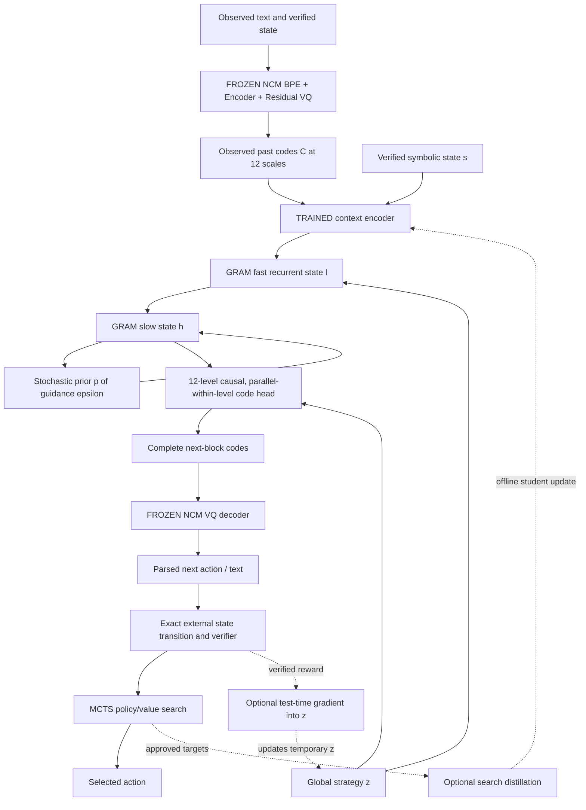

# V15 Astra: Complete Engineer-Implementable Training Specification

**Frozen pretrained NCM tokenizer → deterministic HRM → stochastic GRAM-HRM → strategy latent `z` → reward-guided test-time optimization → verified concept-action MCTS → search distillation → continual learning**

**Version:** 1.0, 17 October 2026. **Artifact type:** research implementation blueprint and design review, **not** a trained checkpoint, a guarantee of bug-free software, or a claim that the proposed integration has already been experimentally validated.

> **Implementation rule:** An implementation MUST either obey each normative `MUST` statement below, or record a new version with an explicit ablation. Values labeled **PROPOSAL** are starting hyperparameters, not published NCM/GRAM settings. Source-derived claims are labeled **SOURCE**. Novel architecture combinations are labeled **ASTRA PROPOSAL**. Any unavailable details of the original NCM API MUST be inspected in the actual pinned repository rather than guessed.

## Contents

0. Executive decision, lineage, architecture and trainability matrix
1. First principles: what learning and planning problems are we solving?
2. Notation, units, tensor shapes, probability distributions and gradients
3. Stage 0: pretrained tokenizer integration, large verified dataset, frozen code cache
4. Stage 1: deterministic HRM baseline
5. Stage 2: GRAM stochastic prior/posterior, exact ELBO and training
6. Stage 3: global strategy codes `z`, probabilistic mixture and XM ablation
7. Stage 4: GradCuit-inspired test-time continuous strategy refinement
8. Stage 5: exact-transition value learning and concept/action MCTS
9. Stage 6: search-to-policy distillation
10. Stage 7: gated LoRA, LSL, retrieval/RCDL and bounded consolidation
11. Unified inference, state lifecycle, computational resource ledger
12. Data/experiment manifests, test harnesses, metrics, promotion gates
13. Paper-to-component citation ledger
14. First-principles design review, failure mode audit and unresolved contracts
15. Implementation work breakdown and acceptance sign-off
16. First-principles numerical dry-run and companion math checks
16. First-principles numerical dry-run and companion math checks

---

## 0. Executive decision and architecture version

### 0.1 This specification supersedes the *old* Stage 1A tokenizer training

The supplied local `V15_Astra.md` describes an earlier four-level, 16-token, self-trained codec. **DO NOT** reuse those old numbers or its tokenizer-training recipe. Our new **published** tokenizer is the official pretrained **HazyResearch Next-Concept Modeling (NCM)** tokenizer; its encoder, BPE vocabulary/merges, codebooks, up/down projections, normalization layers, and decoder stay completely frozen during Stages 0–6 and by default Stage 7. Our newly trained system **replaces NCM's generator**, not its tokenizer.

**SOURCE NCM:** [paper](https://arxiv.org/abs/2610.14162), [source](https://github.com/HazyResearch/ncm), [weights collection](https://huggingface.co/hazyresearch/ncm-checkpoints). The paper uses a residual multiscale VQ-VAE tokenizer and predicts all code positions of one refinement level in parallel. This blueprint adapts that interface to recurrent reasoning.

**SOURCE GRAM:** [Generative Recursive Reasoning](https://arxiv.org/abs/2605.19376), provided PDF: Sec. 2 Eqs. (1)–(14), Sec. 2.3 and App. A/B. The original work introduces stochastic perturbations to high-level recurrent states and a target-conditioned variational posterior. GRAM has **not** validated integration with NCM's frozen text codes.

**Other relevant sources:** [HRM](https://arxiv.org/abs/2506.21734), [Explorative Modeling / XM](https://arxiv.org/abs/2607.27372), [GradCuit](https://arxiv.org/abs/2608.02585), [Local Support Learning / LSL](https://arxiv.org/abs/2610.02126), [LSL reference code](https://github.com/assafbk/local_support_learning), [Retrieval-Centric Deep Learning / RCDL](https://arxiv.org/abs/2610.03858), [RCDL code](https://github.com/paradigms-of-intelligence/rcdl), [MuZero](https://arxiv.org/abs/1911.08265), [Language Models Need Sleep: Learning to Self-Modify and Consolidate Memories](https://arxiv.org/abs/2606.03979).

### 0.2 Trainability is a contract, not a suggestion

| Stage | Purpose | Train/update during stage | Frozen during stage | Go/no-go artifact |
|---|---|---|---|---|
| **0** | Dataset/codec acceptance | **No NN parameter training** | NCM BPE, encoder, VQ, decoder, original generator unused | Immutable code cache + reconstruction audit |
| **1** | Deterministic HRM baseline | New context encoder, HRM fast/slow recurrent weights, coarse-to-fine code heads | Entire NCM tokenizer | Valid free-generated next-block policy |
| **2** | Stochastic GRAM-HRM | HRM (fine-tuned from Stage 1 if useful), prior, train-only posterior, heads | NCM | Prior-only stochastic checkpoint beating matched controls |
| **3** | Exploration `z` | Strategy prior/router, embeddings, conditioning projections; HRM optionally fine-tuned | NCM; posterior never at inference | Noncollapsed *valid* strategy diversity |
| **4** | GradCuit-style | **Only a temporary per-problem `z` tensor at inference**; potentially small calibration hyperparams in *offline validation*, not model weights | NCM, HRM, prior, posterior, code heads, all persistent weights | Verified latent gradient and equal-budget gain |
| **5** | MCTS | Value/reward head and optional calibration | NCM and initially **all** GRAM policy weights | Flat MCTS improves verified closed-loop return over best-of-N |
| **6** | Distillation | GRAM action policy, optionally strategy router/value head | NCM; frozen snapshot of search teacher | Improved no-search student at equal cost |
| **7** | Continual learning | Phase-specific gated LoRA; retrieval correction; later bounded consolidation | NCM by default; frozen protected backbone | New acquisition **and** retention on prior tasks |

**Critical:** Stage 4 and MCTS search itself are **inference/search algorithms**. They are not new full-model training procedures. Stage 5 learns a value function from rollout labels. Stage 6 uses search to train the generator. Stage 7 changes persistent weights only through a staged and reversible protocol.

### 0.3 End-to-end forward path



Training additionally has **a target-informed posterior branch** that sees the *true next codes Y* only in Stage 2/3 training, NEVER in generation, search or value estimation.

### 0.4 Four independent clocks

1. `t`: **external environment/answer time**, one verified action or reasoning step to the next.
2. `b`: **text block time**, one 128-BPE-token block to the next. A single action may span multiple blocks; never assume `b=t` without a tested serializer.
3. `ell`: **VQ refinement level**, one of 12 refinements of **the same block**; NOT an external action.
4. `r` and `k`: **GRAM recursion time**, a slow update and its fast inner updates; NOT text generation length or environment time.

This separation prevents the most costly conceptual implementation error: using 12 quantization levels as 12 MCTS action steps.

---

## 1. From first principles: why each stage exists

### 1.1 Representation is a separate problem from dynamics

Imagine a simulated world with state `s_t`, allowed action `a_t`, next state `s_(t+1)` and terminal correctness reward `R`. We need a representation of language, a model that proposes useful actions, a trustworthy transition and an optimizer/search algorithm. A representation can be learned without being predictive, and a predictive text model can be inaccurate about causal transitions.

NCM gives a learned **discrete representation**, not a guaranteed world state or an exact environment transition. Let `T` be frozen tokenizer:

\[
C_b=T(X_b),\qquad \widetilde X_b=D_{\mathrm{NCM}}(C_b).
\]

`X_b` is a fixed-length text-token block; `C_b` is the 12-level code hierarchy; `D_NCM` is the pretrained decoder; `X~_b` is the decoder reconstruction. We train `P_theta(C_(b+1)|C_<=b)` as a **conditional generator**. For planning we separately define an exact state/action interface `s_(t+1)=F_env(s_t,a_t)` (in verified tasks), and derive candidate actions from generated text.

**Source versus proposal:** NCM trains its original generator with level-by-level parallel code generation; **Astra** inserts HRM/GRAM recursion and search into that role.

### 1.2 Why recurrent reasoning?

A one-pass predictor performs a fixed amount of computation. Reusing a trainable transformation can refine latent state repeatedly with the same parameters:

\[
q^{(r+1)}=F_\theta(q^{(r)},m).
\]

`q` is the latent solution state, `m` is observed memory, `F_theta` is shared across iterations. Repeated depth costs additional **FLOPs** even if it does not add trainable parameters. HRM splits this into fast `l` and slow `h` states.

### 1.3 Why stochastic GRAM?

A deterministic recurrent state repeatedly follows the same path given the same input/seed. In a task with multiple valid paths, we want a *distribution* over reasoning trajectories, not arbitrary noise. GRAM predicts a state-dependent Gaussian correction to the slow recurrent state, and trains an inference prior against a target-informed posterior.

### 1.4 Why global `z`?

Local GRAM perturbations can vary each internal step. A stable global strategy `z` allows high-level control across those steps. If `z` does not improve **verified distinct solutions per FLOP**, eliminate it. `z` is **not** an NCM codebook centroid, a code ID, or GRAM's stochastic noise; it is an additional continuous conditioning state.

### 1.5 Why search and learning from search?

Independent sampling can miss a solution or repeat failed prefixes. MCTS reuses evaluations of shared prefixes and allocates simulations adaptively. However, it helps only if actions correspond to meaningful, checkable transitions; otherwise it can amplify model errors. Once search finds strong trajectories, distillation makes some of that expensive search reusable without running MCTS again.

### 1.6 Why continual learning last?

We first need a strong frozen baseline. Then memory/adapter gains can be evaluated separately from competence failure. Continual learning requires both *new knowledge acquisition* and *old knowledge retention*; solving one and not the other is not success.

---

## 2. Single notation standard and tensor interfaces

### 2.1 Standard symbols

| Symbol | Definition | Unit / sample shape |
|---|---|---|
| `B` | minibatch examples | scalar integer |
| `B_text` | BPE tokens per codec block | `128` for the chosen TinyStories checkpoint |
| `V_text` | frozen tokenizer BPE vocabulary | `8192` for TinyStories checkpoint, verify pinned config |
| `L` | NCM VQ levels | `12` |
| `n_ell` | number of code positions in refinement level `ell` | `(1,8,16,24,32,40,52,64,76,92,108,128)` for chosen checkpoint |
| `N_C` | total discrete codes per text block | `sum n_ell = 641` |
| `V_C` | code IDs available at each level | `4096` for chosen checkpoint |
| `d_NCM` | frozen codec latent width | read actual checkpoint (candidate 384; verify) |
| `W` | past blocks in context | integer `2` pilot; `4` later |
| `d` | new model hidden width | `128` pilot, optional `192/256` expansion |
| `S` | recurrent reasoning slots | `16` pilot |
| `J` | fast updates per slow transition | `2` pilot; `4` ablation |
| `T_R` | slow recurrent transitions per supervision pass | `2` pilot; `4` ablation |
| `N_sup` | deep supervision passes, same target | `1` pilot, `2+` ablation |
| `M_z` | globally conditioning latent tokens | `4` tokens per example |
| `K_z` | candidates for global strategy | `1`, later `2/4` |
| `xi_r` | standard Gaussian draw for GRAM transition | `[B,S,d]` |
| `epsilon_r` | learned stochastic correction to slow state | `[B,S,d]` |
| `theta` | generator, HRM and prior trainable parameters | parameter collection |
| `phi` | train-only GRAM posterior parameters | parameter collection |
| `psi` | value head parameters | parameter collection |
| `C_b` | codes for text block `b` | `[B,641]` integer or list of 12 tensors |
| `X` | observed past codes | `[B,W,641]` integer |
| `Y` | **unknown next-block target** codes | `[B,641]` integer; allowed only in training losses and posterior |
| `s` | authoritative environment state | typed struct, NOT a lossy NCM decoded guess |
| `a` | canonical legal action | typed struct/enum |
| `r_env` | immediate environment reward | scalar |
| `gamma` | discount factor for search and value | `[0,1]`; `1` finite-horizon terminal reward pilot |

**Notational warning:** The letter `z` denotes Astra's strategy latents only. GRAM's paper sometimes denotes the combined `(h,l)` recurrent state by `z_t`; in this document call that combined state `H_r=(h_r,l_r)` to avoid collision.

### 2.2 Source TinyStories interface (verify the release manifest before relying on it)

\[
(n_1,\ldots,n_{12})=(1,8,16,24,32,40,52,64,76,92,108,128),\quad
N_C=641.
\]

Twelve categorical code tables each have `4096` entries. The complete code level offsets, **zero-based**, are `[0,1,9,25,49,81,121,173,237,313,405,513,641]`. `offsets[ell] : offsets[ell+1]` is the slice for zero-indexed level `ell`. This list must be automatically verified against the pinned released config, not hard-coded silently.

### 2.3 Canonical serialized sample

```json
{
  "sample_id": "task-004:transition-03:block-00",
  "episode_id": "task-004",
  "split": "train",
  "domain": "modular_arithmetic",
  "codec_id": "sha256:<frozen-tokenizer-bundle-sha256>",
  "context_block_indices": [92, 104],
  "target_block_index": 105,
  "current_verified_state": {"value": 5, "modulus": 7},
  "legal_actions": ["add_one", "multiply_two"],
  "candidate_action_label": "add_one",
  "next_verified_state": {"value": 6, "modulus": 7},
  "done": false,
  "reward": 0.0,
  "source_program_id": "sha256:<rules-and-instance>",
  "state_visibility": "current_only"
}
```

**Example only:** The sample IDs and values above illustrate the schema; actual samples must be generated and validated. The symbolic record is *ground truth for verification*, not a secret shortcut: models may see the current verified state if the configured architecture explicitly includes it, but must not see `next_verified_state`, target codes, future actions or reward during action prediction.

**Two tracks MUST be reported separately:** (A) *text-only* concept prediction with only observed NCM code context, and (B) *state-conditioned planning* with an explicit observed symbolic state. Track B generally makes validity checking easier but is not evidence that NCM codes alone captured the state.

### 2.4 Tensor shape check at batch 2 (pilot)

- `X`: `[2,2,641]` int64; `Y`: `[2,641]` int64.
- Code embeddings before pooling `[2,2,641,128]` float.
- Level-pooled context memory `[2,24,128]` float.
- Recurrent states `l,h,u,epsilon`: each `[2,16,128]` float.
- Strategy `z`: `[2,4,128]` float.
- Level `ell` output logits: `[2,n_ell,4096]` float, **only one level resident if memory-bounded**.
- Full-block logits: `[2,641,4096]` float (~21.0 MB FP32 for output logits alone). Avoid retaining all levels, all modes and all recurrence tapes simultaneously on small machines.

### 2.5 Parameter freezing and lifecycle invariants

```python
codec.eval()
for p in codec.parameters():
    p.requires_grad_(False)

# Stage 1 optimizer must contain only HRM/context/code-head parameters.
assert all(id(p) not in optimizer_param_ids for p in codec.parameters())

# After every stage checkpoint, prove unchanged codec hash and selected tensor bytes.
```

Calling `eval()` alone is insufficient; `requires_grad_(False)` alone is also insufficient if a frozen quantizer still mutates EMA buffers in train mode. No EMA replacements or dead-code refresh are permitted after freeze. Save tokenizer source commit, full asset hashes, BPE artifact hashes, config and code-cache creation recipe.

---
## 3. Stage 0 — Frozen official NCM and *verified* concept-data construction

### 3.1 Problem → mechanism → math → prediction → construction

**Problem.** Encoder pretraining is expensive and, once code IDs are cached, changing codebooks changes target meanings. We want all generator experiments to share one stable representation. **Mechanism:** load the complete released tokenizer and never train it; produce the next-block targets offline. **Math:** a deterministic code operator `T_v` indexed by codec version `v` maps 128 observed BPE IDs to a 641-ID hierarchy. **Prediction:** successful codec integration yields 100% repeated-encoding agreement, useful reconstruction fidelity, and stable cached targets. **Construction:** pinned checkpoints, exact source matching, deterministic segmentation, verified transitions, typed records, incremental caches and tests.

### 3.2 Acquisition / official integration acceptance

**Recommended released families:** TinyStories is a small initial engineering checkpoint, not necessarily ideal for exact algebra or code. Also evaluate the published LM1B tokenizer (and OpenWebText if available), with the **same** held-out reasoning-state fidelity probes. Using an existing different checkpoint is allowed; retraining one is not part of this plan. **Do not mix code vocabularies/level schemas across checkpoints.** A model trained on TinyStories codes cannot silently switch to LM1B codes.

```bash
# Execute on a network-connected machine. Pin a specific repository commit afterwards.
git clone https://github.com/HazyResearch/ncm.git
cd ncm
python3 -m pip install -r requirements.txt
python3 -m pip install -U huggingface_hub
hf download hazyresearch/ncm-checkpoints --local-dir artifacts

# Prefer retrieving only the selected tokenizer assets in production.
# Verify exact filenames via the official HF tree/repo; never guess a weights format.
```

Record: repo commit SHA, Python/Torch/CUDA/MPS versions, checkpoint `SHA256`, `config.yaml` SHA, BPE vocab/merges SHA, license, platform/dtype, unique `codec_version_id=SHA256(sorted list of these hashes)`. The official repository recommends Python 3.10+ and CUDA-capable PyTorch, but CPU/MPS compatibility must be tested rather than assumed.

**Adapter implementation:** Implement `FrozenNCMCodec` as a thin wrapper around the **actual installed official API**. Do not fabricate a function name if the pinned source changes.

```python
class FrozenNCMCodec:
    def tokenize(self, texts: list[str]) -> TokenBatch: ...
    def encode_ids(self, bpe_ids: LongTensor) -> list[LongTensor]: ...
    def decode_codes(self, codes_by_level: list[LongTensor]) -> TokenLogits: ...
    def decode_text(self, codes_by_level: list[LongTensor], *, mode: str) -> list[str]: ...
    def partial_reconstruct(self, codes_by_level: list[LongTensor], max_level: int) -> TokenLogits: ...
    def hash_bundle(self) -> str: ...
```

**Interface contracts:** `tokenize` returns BPE IDs/actual lengths and a normalized canonical block; `encode_ids` outputs exactly 12 tensors `[B,n_ell]`; `decode_codes` returns `[B,128,V_text]` logits; partial reconstruction must follow *NCM's official quantizer residual upsample/projection path* (NOT concatenate code IDs and decode them as text directly); `decode_text` uses the released special-token conventions and explicit greedy/sampling mode. If a partial-decoding API is not exposed, implement only after a reference-level comparison to the paper/code.

### 3.3 Before mass encoding, test domain fidelity

Generate at least 2,000 **held-out** text blocks from domains: short natural language, integers including sign/leading zeros, operators, graph indices, rules, nested parentheses, multi-step action descriptions, adversarially similar text such as `state=8` vs `state=9`.

For each block, compute:

- **All-token fidelity** `A_all=(# identical BPE positions)/(128*N)`; includes PAD.
- **Nonpadding fidelity** `A_nonpad=(# identical non-PAD positions)/(# non-PAD positions)`. Do not headline `A_all` alone.
- **Exact block reconstruction** `A_block=(# blocks with all scored BPE tokens identical)/N`.
- **Critical-field exact match** `A_field=(# extracted state/action/operator fields exactly correct)/(# fields)`.
- **Valid-state parsing** `% decoded blocks that parse to the declared grammar`.
- **Partial-level fidelity** at levels `1,3,6,9,12`, in the correct cumulative NCM reconstruction path.
- **Code stability** `C(x)` under repeated runs and differing batch arrangements, special token placement, reload and CPU-versus-available-MPS device. Fix dtype determinism policy; report if exact cross-device equality cannot be guaranteed.

**Pass criterion (PROPOSAL):** no critical-field errors in 2,000 audit blocks for first *exact symbolic* experiments, with Wilson confidence bounds; if it fails, choose a different **pretrained** codec, canonicalize serialization/grammar or provide explicit observed symbolic state side-channel. A perfect observed-text reconstruction on only 2K blocks does not prove correctness of all later generated code hierarchies. The true decoder may map off-manifold predicted codes to invalid text.

### 3.4 Source tasks and verified trajectory generation

Train on **one-step transition supervision built from full trajectories** rather than only final answers. A generator must return `(problem_id, initial_state, legal_actions, transition_fn, terminal_check, trajectory, explanations)`; each transition is independently recomputed from the simulator.

**Initial families:** modular arithmetic programs with held-out operation compositions and moduli; shortest-path graphs and general path finding; stack-machine symbolic execution; small planning puzzles with branching; algorithmic traces with exact interpreters. Add natural-language descriptions with randomized surface forms and separate **OOD templates**. For long-horizon tests, require truly 10/20 successful *external actions*, not 10 NCM refinement levels or an arbitrary count of text blocks.

Produce multiple valid continuations for some states (when semantically legal) so a deterministic next-action CE target does not falsely imply a unique correct action. Maintain separate labels for validity and success. A valid action need not lead to success.

**Split rule:** Hash stable task/group identity (graph topology family + rule program + allowed transformations) **before** slicing trajectories into blocks; all steps, paraphrases and segments from the same family must enter one split. Use held-out rule compositions, graph sizes or parameter regimes for genuine OOD testing; exact-example dedup alone is insufficient.

### 3.5 Segment reasoning steps into exactly 128 BPE tokens

Never assume that one reasoning step is exactly one NCM text block. Specify canonical grammar, e.g.:

```text
<STATE> n=5 mod=7 goal=0 </STATE>
<LEGAL> ADD1, MUL2 </LEGAL>
<ACTION> ADD1 </ACTION>
<NEXT_STATE> n=6 </NEXT_STATE>
```

Here tags are conceptual placeholders: the actual tokenizer may split them across several BPE tokens. The codec uses its own BPE tokenization; **one block is exactly 128 BPE IDs**. Serialize complete episodes, tokenize, then either cut into contiguous 128-ID blocks or enforce boundary-aware packing and record explicit `action_to_block_span` start/end positions. For Stage 5 MCTS **each proposed action must be decoded and parsed as one complete action**; generating one 128-token block may not finish an action. Require explicit EOS/action-end marker (existing tokenizer symbols or canonical text understood by parser) and limit max action blocks.

For the static codec test: target block `Y_b` should be the next raw block, not the future **ground-truth state secretly appended to X**. The true next-state text may appear inside `Y_b` as training data but is **never** part of observed policy context before prediction. For the state-conditioned planning track, the model may be given only its *verified current state* `s_t`.

**Padding/EOS:** follow official tokenizer's special-token scheme. Track original sequence lengths separately **for evaluation only**; do not leak target length to model if the NCM generator does not condition on it. If empty PAD and EOS positions are visible as labels, the model must learn to predict them; mask loss only according to an explicitly versioned policy.

### 3.6 Cached codes and storage

Store one unique 641-code block once, in an append-only array `[num_unique_blocks,641]` `uint16`, because `0 <= code < 4096` fits in 16 bits. Each block: `641*2=1282 bytes`. `10^6` blocks: **1.282 GB decimal (≈1.194 GiB)**, before indices, text and checksums. Context-window training records store **integer indices**, not redundant copies of `W` code blocks. Convert to int64 only when making embeddings.

Files:

```text
artifacts/codec/manifest.json                  # hashes, version, actual schema
artifacts/codec/reconstruction_audit.json
artifacts/data/blocks.uint16.npy               # [N,641] memory-mappable
artifacts/data/blocks_meta.parquet              # source, BPE spans, token lengths, hash
artifacts/data/transitions_train.parquet
artifacts/data/transitions_valid.parquet
artifacts/data/transitions_test.parquet
artifacts/data/split_manifest.json
artifacts/data/reconstruction_failures.jsonl
```

Immutable `manifest.json` MUST include dataset source URLs/licenses, generation script SHA, original task split keys, codec checkpoint SHA, entire BPE vocabulary identity, block length/level offsets/code cardinalities, decoder mode, `np.dtype`, byte order, run timestamp, git commit, QA counts, no-target-leak audits and content hashes.

### 3.7 Canonical offline encoding algorithm

```python
codec = load_and_freeze_official_checkpoint(pinned_manifest)
assert all(not p.requires_grad for p in codec.parameters())
assert not codec.training
for split in ("train", "valid", "test"):
    for task_episode in generate_or_stream_split(split):
        verified = verify_every_transition(task_episode)
        bpe_ids, action_boundaries = serialize_and_tokenize(verified)
        for block in pad_and_block(bpe_ids, 128):
            with torch.inference_mode():
                C = codec.encode_ids(block.ids)
            assert len(C) == 12
            for ell, codes in enumerate(C):
                assert codes.shape[-1] == LEVEL_LENGTHS[ell]
                assert 0 <= codes.min() and codes.max() < 4096
            append_unique_codes_and_metadata(C, block, action_boundaries)
write_split_manifest_and_sha256()
assert_no_cross_split_program_episode_or_paraphrase_overlap()
assert_codec_state_hash_unchanged()
```

### 3.8 Stage-0 falsification tests

`test_round_trip_fidelity`, `test_partial_decode_oracle`, `test_determinism_after_reload`, `test_padded_unpadded_agreement` (only if official normalization claims it), `test_no_online_codebook_mutation`, `test_codebook_offset_shape`, `test_cross_split_program_hash`, `test_target_not_in_past_window`, `test_state_verifier_recomputes_output`, `test_action_spans_not_cut_without_metadata`, `test_byte_order`, `test_hashes_after_corruption`, `test_codec_cross_device_differences`.

**STOP if:** official weights not present, target codebook schema mismatches, pad behavior unknown, critical fields reconstructed incorrectly, codec changes between data generation and training, or context windows leak future text. Do not replace the checkpoint with a synthetic/oracle tokenizer and call the result a pretrained NCM experiment.

---

## 4. Stage 1 — Deterministic HRM trained to predict a full future code hierarchy

### 4.1 Problem → mechanism → math → prediction → construction

**Problem:** Frozen codes do not tell us how the *next* codes follow from observed context. **Mechanism:** embed past codes, compress context, repeatedly update fast/slow states, generate first target code level and then 11 refinements. **Math:** a normalized conditional probability distribution over all 641 next-block IDs. **Prediction:** HRM beats a parameter-matched one-pass code predictor at equal train/inference FLOPs on longer reasoning sequences. **Construction:** implement and freeze NCM; create new PyTorch modules below.

### 4.2 Layers and exact forward operations (ASTRA PROPOSAL)

1. **Embedding tables:** for level `ell`, `E_ell ∈ R[4096,d]`; level ID vector `v_ell ∈ R[d]`; position embedding `p_ell,j ∈ R[d]`. Context code embedding:

   \[
   e_{b,\ell,j}=E_\ell[C_{b,\ell,j}]+v_\ell+p_{\ell,j} + t_b.
   \]

   Here `t_b` is observed-block position. `E_ell` is **new trainable HRM input embedding**, not the frozen NCM VQ codebook. Initialize independent levels, test tied input/output head later.

2. **Level summaries:** learned query `a_ell ∈ R[d]`, attention pooling:

   \[
   u_{b,\ell,j}=a_\ell^T W_K e_{b,\ell,j}/\sqrt d,\quad
   \alpha_{b,\ell,j}=\frac{e^{u_{b,\ell,j}}}{\sum_{j'}e^{u_{b,\ell,j'}}},\quad
   m_{b,\ell}=\sum_j\alpha_{b,\ell,j}W_Ve_{b,\ell,j}.
   \]

   `m ∈ R[B,W*12,d]`. This is an efficient baseline; detailed symbol/state IDs may be lost. Test `[B,W*641,d]` raw-code cross-attention and pooled+fine hybrid, reporting RAM/FLOPs.

3. **Context encoder:** `N_ctx` (PROPOSAL 2) pre-norm Transformer layers over level summaries, with **causal across observed blocks**, optionally bidirectional within each observed (fully known) block. For predicting one new block, all past code positions are observed; bidirectional attention among past tokens is legal as long as no target code flows back into context encoder. Model past block order with RoPE or learned temporal positions. Output memory `M_ctx[B,12W,d]`.

4. **Recurrent reasoning slots:** learned `H_init[S,d]`, `L_init[S,d]`, plus projection of pooled context. Initialize `h_0,l_0 ∈ R[B,S,d]` deterministically. Reset at each independent candidate next block; retaining state across external blocks is a **separate** ablation with a documented state/branch lifecycle.

5. **`FastBlock` and `SlowBlock`:** separate trainable pre-norm residual blocks, weight-shared across recursions. Both include slot self-attention, cross-attention to `M_ctx`, and gated SwiGLU FFN; fast block additionally reads `h_prev` through a projection/additive cross-memory, slow block additionally reads completed `l_r`.

   Transformer sublayer (one head shown):

   \[
   \mathrm{Attn}(Q,K,V)=\mathrm{softmax}\bigl(QK^T/\sqrt{d_h}+M_{\rm causal}\bigr)V.
   \]

   `d_h=d/n_heads`; for `d=128`, propose `n_heads=4`, `d_h=32`. The recurrent slots' self-attention is bidirectional because they hold *internal reasoning*, not future ground-truth codes. The cross-attention source is observed data only. Use layer normalization before each sublayer and residual addition afterwards. FFN:

   \[
   \mathrm{SwiGLU}(x)=W_o[\operatorname{SiLU}(W_gx)\odot W_vx],\quad
   \operatorname{SiLU}(u)=u/(1+e^{-u}).
   \]

   Choose FFN hidden width `4d` for initial capacity test; count it explicitly.

### 4.3 Deterministic HRM recurrence

Let `r=1,...,T_R`, `k=1,...,J`; `l_(r,0)=l_(r-1)` and `h_0,l_0` are initialized from context:

\[
\boxed{ l_{r,k}=F_L(l_{r,k-1};h_{r-1},M_{ctx}) },\quad
\boxed{ h_r=F_H(h_{r-1};l_{r,J},M_{ctx}) }.
\]

`J` means *fast* iterations, `T_R` means *slow* updates. **Dry run:** with `J=2`, `T_R=2`: `l_1,1 → l_1,2 → h_1 → l_2,1 → l_2,2 → h_2`: six module invocations. Output code predictions use `h_2`. Weight sharing across repeated modules reduces unique parameters; six evaluations still cost computation.

**Deep supervision later:** `N_sup` phases each execute `T_R` recurrent steps against the **same target block** and detach previous hidden states at declared boundaries if adopting GRAM's truncated surrogate. Never interpret a supervision phase as an additional next text block.

### 4.4 Causal level-parallel output model

Define a *normalized distribution* over the next block:

\[
\boxed{
 p_\theta(Y\mid X)
 =\prod_{\ell=1}^{12}\prod_{j=1}^{n_\ell}
 p_\theta(Y_{\ell,j}\mid X,h_{T_R},Y_{<\ell}).
}
\]

Note **target** levels `Y_<ell` are known at training through teacher forcing but **generated** at inference. Every current-level code position is sampled in parallel conditional on *only* past context, recurrent state, and **earlier** target levels. There is no within-current-level autoregression.

Use learnable *blank* level/position queries `Q_ell[B,n_ell,d]`. Query states are never initialized with correct current-level code embeddings. Add cross-attention memories `(M_ctx, h_TR, summarized prev target levels)`. For previous target codes use their **true IDs** only during training and **sampled IDs** during inference; for oracle loss evaluation use teacher forcing to quantify model quality. Query-to-query self-attention *within level* is permissible because those queries contain no current-level target IDs. Attend to current-level **labels** never; attend to future labels never.

Projection:

\[
H_\ell=\mathrm{LevelDecoder}_\theta(Q_\ell\,;M_{ctx},h_{T_R},Y_{<\ell}),
\quad
A_\ell=H_\ell E_\ell^T/\sqrt d,
\quad P_\ell=\operatorname{softmax}(A_\ell,\mathrm{last}).
\]

Shapes: `H_ell[B,n_ell,d]`, `A_ell[B,n_ell,4096]`. `E_ell` may be shared with input code embedding (tie weights) or independent; specify choice in config. Default **tie**, reducing parameters and ensuring legal logits. Separate level projections are valid too. `12×4096×128=6,291,456` parameters for tied level input/output tables alone. Run a no-tie ablation only if memory permits.

**Root level:** The released NCM TinyStories **generator** may have `predict_level0=false`; that does NOT entitle our new next-block policy to know the target's root code. We MUST explicitly predict the root `Y_1 ∈ [B,1]` from observed context, OR supply a separately trained target-free root prior, and verify it at inference. Default: train the root head with ordinary CE. No ground-truth root at inference.

### 4.5 Exact generative likelihood versus loss scaling

For target `Y` and code probabilities `P_ell`:

\[
\boxed{\mathrm{NLL}_{sum} = -\sum_{\ell=1}^{12}\sum_{j=1}^{n_\ell}\log P_\ell[Y_{\ell,j}] }.
\]

This **sum** is the negative logarithm of a normalized discrete distribution (assuming factorization above). To report *per code* NLL: `NLL_sum / 641`. For optimizer stability one may minimize either (positive scalar rescaling), but log **which**. A *level-balanced* **surrogate** uses

\[
\mathrm{CE}_{level}=\frac1{12}\sum_{\ell=1}^{12}\frac1{n_\ell}\sum_j -\log P_\ell[Y_{\ell,j}].
\]

This is a useful optimization choice, **not** the normalized log likelihood (unless all `n_ell` equal). **Do not put `CE_level` inside a mixture logsumexp and claim an exact mixture probability.** For stage 1, try exact per-code NLL first; if coarse root severely undertrains, ablate the level-balanced surrogate and report both proper held-out NLL and task-level quality.

Toy, two-level example `n=(1,2)`, correct probabilities `0.8`, `0.5`, `0.25`: summed NLL `-ln(0.8)-ln(0.5)-ln(0.25)=2.3026`, per-code NLL `0.7675`, equal-level surrogate `(0.2231+1.0397)/2=0.6314`. These are different objectives.

### 4.6 Generation algorithm (Stage-1 deterministic)

```python
def generate_block(context_codes, *, sampling_seed, config):
    mem = model.encode_past(context_codes)  # no target
    l, h = model.init_states(mem)
    for r in range(config.T_R):
        for _ in range(config.J):
            l = model.fast(l, h, mem)
        h = model.slow(h, l, mem)
    sampled = []
    rng = make_rng(sampling_seed)
    for ell in range(12):
        logits = model.level_head(ell, mem, h, sampled)  # PREVIOUS GENERATED levels only
        ids = sample_parallel_positions(logits, rng, config.temp, config.top_p)
        sampled.append(ids)
    token_logits = frozen_codec.decode_codes(sampled)
    return sampled, frozen_codec.decode_text(sampled, mode=config.decoder_mode)
```

**Decoder caveat:** The frozen NCM decoder produces text-token distributions. If greedy decoding is used, we are testing a code-policy-plus-deterministic-decoder procedure, not fully sampling the NCM decoder's stochastic text distribution. Record decoder mode consistently.

### 4.7 Training algorithm

```python
for X, Y, optional_current_state in loader:
    assert Y_is_not_in_X(X, Y, batch_record_ids)
    optimizer.zero_grad(set_to_none=True)
    mem = model.encode_past(X, optional_current_state)  # current-only state branch
    h, l = model.det_hrm(mem)
    loss_sum = 0.0
    for ell in range(12):
        logits = model.level_head(ell, mem, h, Y[:ell])  # PREVIOUS levels ONLY
        loss_sum += torch.nn.functional.cross_entropy(
            logits.reshape(-1, 4096), Y[ell].reshape(-1), reduction="sum")
    loss = loss_sum / (len(X)*641)
    loss.backward()
    assert_all_codec_grads_None()
    torch.nn.utils.clip_grad_norm_(model.parameters(), 1.0)
    optimizer.step()
```

`Y[:ell]` is conceptual pseudocode; production tensors need level slices defined by official `offsets`, masking and explicit special-token policy. Do **not** compute `Y[:ell]` on flattened `[B,641]`, which would select batch rows instead of levels.

### 4.8 Optimization/config and evaluation

**PROPOSAL:** AdamW LR `2e-4` pilot, weight decay `0.01`, betas `(0.9,0.95)`, cosine schedule with 3% warmup, grad clip `1.0`; batch `2` with grad accumulation `8` on M2 16GB. `d=128,S=16,W=2,J=2,T_R=2,N_ctx=2`, tied embeddings, `dropout=0` until reproducibility verified. Initial seeds `11,21,31` for definitive comparison (two seeds for plumbing only). Actual corpus needs more than 10k for generalization; start 10k smoke, then 100k+, then larger when verified.

**Baseline controls:** nonrecurrent code predictor matched to unique parameter count; HRM at equal FLOPs; plain NCM published generator if compatible and trainable on same data as a reference; copied-input and unigram-root trivial baselines; and a decode-only oracle upper bound from *true target codes* (what reconstruction fidelity permits). Evaluate teacher-forced summed NLL, per-code NLL, exact full 641-code match, greedy/sampled decoded target parsing, actual simulator-correctness, closed-loop 5/10/20 external-step success, and out-of-distribution families.

**Acceptance gate:** free-run candidate parses and succeeds meaningfully more often than trivial baseline; performance reported at exact training CPU seconds, blocks/s, updates, weights, optimizer memory; no train/eval leakage. If free generation fails but teacher-forced CE improves, fix exposure shift or decoder interface before introducing stochastic GRAM.

---

## 5. Stage 2 — GRAM stochastic recursive reasoning with proper variational training

### 5.1 Source and proposed changes

**SOURCE GRAM:** Eqs. (4)–(9) of the supplied PDF define deterministic low-level refinement, a high-level proposal, a learned state-dependent Gaussian perturbation, and the updated slow state. Eqs. (10)–(13) derive a **full trajectory** ELBO; Eq. (14) is a **truncated surrogate** that backpropagates only the last transition in each deep-supervision phase. Appendix B.1: recurring modules use attention+SwiGLU blocks; task decoder predicts puzzle/grid symbols. **ASTRA PROPOSAL:** replace that decoder with the NCM 12-level categorical code predictor, optionally use diagonal rather than isotropic Gaussian variance, and only later add `z`.

### 5.2 Deterministic proposal and prior Gaussian

After `J` fast updates:

\[
 u_r=F_H(h_{r-1};l_{r,J},M_{ctx})\in\mathbb R^{B\times S\times d}.
\]

Prior network `G_p` (trainable SwiGLU MLP) returns parameters `mu_p,r[B,S,d]` and raw scale `rho_p,r[B,S,d]`:

\[
\sigma_{p,r}=\operatorname{softplus}(\rho_{p,r})+\sigma_{\min},\quad
\xi_r\sim\mathcal N(0,I),\quad
\epsilon_r^p=\mu_{p,r}+\sigma_{p,r}\odot\xi_r,\quad
h_r=u_r+\epsilon_r^p.
\]

`⊙` is elementwise multiplication. `sigma_min=1e-4` **PROPOSAL**; clamp `log(sigma)` or raw scale to safe float32 range, monitor min/max. GRAM paper's Eq. (4) uses `sigma^2(u) I` **isotropic variance**, whereas diagonal `sigma[B,S,d]` here is an explicitly labeled adaptation. A paper-matching **scalar/slot variance** ablation is mandatory before claiming GRAM replication.

**Why reparameterize?** Draw independent `xi` and express `epsilon=mu+sigma*xi`. Backpropagation can flow through `mu` and `sigma`, rather than through a nondifferentiable generic random-number draw.

### 5.3 Posterior distribution (training only!)

Construct `y_emb=Y_Embed(Y)`, with learned target code embeddings/attention pool. `Y_Embed` and `G_q` **must not be used anywhere in inference or MCTS**, even as a cached hidden state. The posterior conditions on the true target:

\[
(\mu_{q,r},\sigma_{q,r})=G_q(u_r,M_{ctx},y_{emb}),\quad
q_\phi(\epsilon_r\mid u_r,X,Y)
=\mathcal N(\mu_{q,r},\operatorname{diag}(\sigma_{q,r}^2)).
\]

During training use `epsilon_q=mu_q+sigma_q*xi`, then `h_r=u_r+epsilon_q`. At inference use **epsilon_p** sampled from `G_p`, or prior mean for deterministic ablation. Posterior can provide *training guidance* but cannot supply *inference competence* directly.

### 5.4 Derive full trajectory ELBO from scratch

We want the conditional next-code likelihood after marginalizing internal reasoning states `tau=(epsilon_1,...,epsilon_R)`, where `R=T_R*N_sup` is the total number of slow transitions:

\[
 p_\theta(Y\mid X)=\int p_\theta(Y\mid\tau,X)p_\theta(\tau\mid X)\,d\tau.
\]

Introduce posterior `q_phi(tau|X,Y)` with support wherever prior is positive; multiply and divide inside the integral by it:

\[
 \log p_\theta(Y\mid X)
 =\log\mathbb E_{\tau\sim q_\phi}\left[
 \frac{p_\theta(Y,\tau\mid X)}{q_\phi(\tau\mid X,Y)}\right].
\]

The logarithm is concave, so by Jensen:

\[
 \log p_\theta(Y\mid X)\ge
 \mathbb E_{q_\phi}[\log p_\theta(Y\mid\tau,X)]
 -D_{KL}(q_\phi(\tau\mid X,Y)\Vert p_\theta(\tau\mid X)).
\]

Because prior/posterior factor as Markov processes, the trajectory KL is the **expectation under earlier posterior states** of the sum of conditional-step KL terms:

\[
 D_{KL}(q(\tau)\Vert p(\tau))
 =\sum_{r=1}^{R}\mathbb E_{q(\epsilon_{<r})}
 [D_{KL}(q_r(\epsilon_r\mid u_r,Y)\Vert p_r(\epsilon_r\mid u_r))].
\]

This expectation matters: earlier stochastic samples change `u_r`. Merely summing arbitrary KL values computed from mismatched prior/posterior rollouts is **not** the GRAM ELBO.

Our negative full ELBO, if using the **summed** exact code NLL, is:

\[
\boxed{
 \mathcal L_{\mathrm{NELBO}}
 =\mathbb E_{q_\phi}[\mathrm{NLL}_{sum}(Y\mid X,\tau)]
 +\sum_{r=1}^{R}\mathbb E_{q_{<r}}
 [D_{KL}(q_{\phi,r}\Vert p_{\theta,r})].
}
\]

With coefficient `beta != 1`, or independently reweighted levels, this becomes a **beta-VAE-style surrogate** rather than the exact marginal evidence lower bound. This is allowed, but log the change explicitly. If code NLL is averaged over 641 positions, KL must be scaled consistently to preserve intended relative strength.

### 5.5 Closed-form Gaussian KL and derivation

For each coordinate `i` of the flattened `[S,d]` state, `q_i=N(mu_qi,sigma_qi²)`, `p_i=N(mu_pi,sigma_pi²)`. The normal log density is `log N(x;mu,sigma²)= -0.5[log(2πsigma²)+(x-mu)²/sigma²]`. Take `E_q[log q - log p]`; use `E_q[(x-mu_q)²]=sigma_q²` and `E_q[(x-mu_p)²]=sigma_q²+(mu_q-mu_p)²`:

\[
\boxed{\mathrm{KL}(q\Vert p)=\frac12\sum_i\left[
 2\log\frac{\sigma_{p,i}}{\sigma_{q,i}}
 +\frac{\sigma_{q,i}^2+(\mu_{q,i}-\mu_{p,i})^2}{\sigma_{p,i}^2}-1
\right].}
\]

For `p=N(0,1)` and `q=N(1,1)`, `KL=0.5`. If `p=q` exactly, `KL=0` within floating point tolerance. Unit tests: compare formula with `torch.distributions.kl_divergence(Normal(...),Normal(...))`; check gradients and no NaNs at scale floor.

### 5.6 Posterior-only success is insufficient: training variants

**Variant A full short-unroll reference:** propagate through every `r` for `R<=2` to establish true gradient correctness. **Variant B longer truncated surrogate:** GRAM paper stops gradient through earlier recurrent states, applying last-step loss/KL per supervision phase; this is memory-saving but **biased** and should NOT be labeled the exact ELBO. **Variant C** optional prior rollout CE auxiliary (`lambda_prior>0`) to teach prior-only generations; target `Y` allowed as **label**, forbidden as **prior input**. Datasets with multiple valid next steps should evaluate alternative legal continuations rather than infer that one reference is the only possible future.

Avoid posterior collapse: monitor `KL` mean/raw sum, prior noise standard deviation, prior-versus-posterior decoded success, posterior-target conditional mutual dependence, number of distinct valid prior generations. A naive `beta→∞` will force prior/posterior equal and may suppress informative posterior exploration; `beta→0` can create a great posterior and useless prior. Anneal or calibrate beta on validation only. The GRAM paper reports its own KL balancing and task-dependent coefficients; its numerical choices are **not automatically transferrable to 641-code text blocks**.

### 5.7 Stage 2 training loop

```python
for X, Y in loader:
    mem = context_encoder(X)
    y_mem = posterior_target_encoder(Y)  # STRICTLY TRAIN ONLY
    h, l = init_states(mem)
    nll_terms, kl_terms = [], []
    for phase in range(N_sup):
        for r in range(T_R):
            for k in range(J):
                l = fast(l, h, mem)
            u = slow_proposal(h, l, mem)
            mu_p, sd_p = prior(u, mem)      # sees NO Y
            mu_q, sd_q = posterior(u, mem, y_mem)
            xi = torch.randn_like(mu_p)
            h = u + mu_q + sd_q * xi       # reparameterized posterior trajectory
            kl_terms.append(kl_diag_gauss(mu_q, sd_q, mu_p, sd_p).sum())
        code_nll = sum_code_NLL(complete_level_teacher_forcing(h, mem, Y))
        nll_terms.append(code_nll)
        if truncated_mode:
            # Explicit detached lifecycle; final-transition gradients only
            h, l = h.detach(), l.detach()
    loss = normalize_batch(sum(nll_terms) + beta * sum(kl_terms))
    loss.backward(); clip_gradients(); optimizer.step()
```

**Important correction to pseudocode:** The above outer-loop `detach()` alone **does not implement** the paper's *final-transition-only* gradient flow inside each phase. To reproduce GRAM Eq. (14), earlier transitions inside the **same** phase must execute under no-grad/detach, with only the last transition and its KL evaluated with graph tracking. For a full-ELBO experiment, keep every transition graph until backprop. These two training variants MUST be separate tested routines and named `full_bptt` versus `gram_truncated_last_transition`, not silently mixed. For truncated last transition, use `u_T` derived from states produced by earlier no-grad transitions; gradients still flow to last-step `F_H`, prior/posterior and code head, but do not propagate through earlier transition activations. If desired, use GRAM-style multiple `N_sup` updates, each with a separately normalized objective, rather than assuming one accumulated update is identical.

### 5.8 Exact prior-only inference algorithm

```python
mem = context_encoder(observed_context_only)
h, l = init_states(mem)
for r in range(T_R * N_sup_infer):
    for k in range(J):
        l = fast(l, h, mem)
    u = slow_proposal(h, l, mem)
    mu_p, sigma_p = prior(u, mem)
    xi = sample_standard_gaussian(seed, r)
    h = u + mu_p + sigma_p * xi           # NEVER the train-only posterior here
codes = autoregressive_over_12_levels_parallel_within_each(h, mem)
text = frozen_ncm_decode(codes)
```

**Safety test:** physically remove posterior object from serialized *inference* package, run generation successfully, and confirm result is unchanged by permuting training target labels at evaluation. Performance should be reported for both `xi=0` (prior-mean) and stochastic prior draws `xi~N(0,I)`.

### 5.9 Stage 2 acceptance gates

Compare against Stage 1 deterministic HRM with **identical codec and splits**, matched unique trainable parameters where possible, equal training CPU/GPU seconds and equal inference cost, plus best-of-N sampling. Publish teacher-forced code NLL, posterior-only target fit (diagnostic), **prior-only** NLL estimate (Monte Carlo logmeanexp), prior-generated exact state success, diversity of *valid* solutions, KL trajectories, variance stats and uncertainty calibration. Do not optimize on held-out test problems.

**Stop/rollback** if posterior improves while prior fails, sigma diverges, the model ignores z/noise, recurrence gradients are severed unexpectedly, or raw correct-looking text cannot pass the external state verifier.

---
## 6. Stage 3 — Learn global exploration strategies `z` in the GRAM generator

### 6.1 Problem → mechanism → math → prediction → construction

**Problem:** A stochastic GRAM prior can explore many *local* high-level corrections but may not maintain a coherent strategy across all recurrent steps of a reasoning decision. **Mechanism:** add a persistent conditioning latent `z` (one or several tokens), learn a small set of candidate modes `k`, compare if they cover more distinct **valid** actions than GRAM stochasticity alone. **Math:** a mixture over `k`, with GRAM trajectories `tau` marginalized *inside each mode*. **Prediction:** different strategies will discover different valid action trajectories at a fixed total compute budget. **Construction:** conditional `z` router, explicit early and output attention, noncollapsed training objective, diverse-solution verifier, mode-use diagnostic.

### 6.2 Distinguish three latent sources

1. `z_k` **global strategy** `[B,M_z,d]`: persistent across all `r` within one generated action. Decide separately whether it persists across **an entire external episode**; this is a separate tested setting, not hidden state carried accidentally.
2. `epsilon_r` **GRAM stochastic high-level correction** `[B,S,d]`: resampled/conditioned at **each slow recursion** from prior and posterior.
3. `C_(b+1)^(ell)` **discrete NCM target refinement code** `[B,n_ell]`: produced only after reasoning, 12 levels sequentially. These are *not strategy codes* and cannot be gradient-optimized as continuous `z` vectors.

### 6.3 Construct global mode embeddings and router

Set `K_z ∈ {1,2,4}` after successful Stage 2, `M_z=4`, `d=128` **PROPOSAL**. Learn `m_k ∈ R[M_z,d]`, initialized independently (`std=0.02`). Optional context-conditioned base:

\[
 z_k(X)=G_z(\operatorname{pool}(M_{ctx}))+m_k.
\]

`G_z` is a two-layer MLP output `[M_z,d]`; zero-initialize output projection so each `m_k` starts as distinct small offset. Default base initial mode prior **uniform** `π_k(X)=1/K_z`. Later optional context-only router:

\[
 \pi_k(X)=\operatorname{softmax}_k(R_\omega(\operatorname{pool}(M_{ctx}))).
\]

The router must never read target codes `Y`, true future environment state, verifier reward or posterior trajectory. **An output-dependent responsibility is permitted for training gradients, but not used as inference router input.**

For GradCuit compatibility, `z` must be a **continuous** differentiable set of tokens, not just an integer mode ID looked up as a constant and disconnected from output logits. Inject at **both** (a) fast/slow recurrent blocks as cross-attention or additive gated conditioning and (b) an intermediate layer of the coarse-to-fine code head as additional attention key/value positions. Full symbolic causal mask denies all future target codes while allowing every output query to attend to the global `z` tokens.

### 6.4 Correct generative distribution (two marginalized latents)

For each strategy `k`:

\[
 p_{\theta,k}(Y\mid X)
 =\int p_\theta(Y\mid X,z_k,\tau)
 p_\theta(\tau\mid X,z_k)\,d\tau.
\]

Mix across modes:

\[
\boxed{p_\theta(Y\mid X)=\sum_{k=1}^{K_z}\pi_k(X) p_{\theta,k}(Y\mid X).}
\]

**This expression is exact, but computing `p_theta,k` requires integrating GRAM trajectories; do not claim an ordinary one-sample teacher-forced code NLL is its exact value.**

Define per-mode variational lower bound:

\[
 \mathcal B_k(X,Y)=\mathbb E_{q_{\phi,k}(\tau\mid X,Y)}
 [\log p_\theta(Y\mid X,z_k,\tau)]
 -D_{KL}(q_{\phi,k}\Vert p_{\theta,k}(\tau\mid X)).
\]

Because `log p_k >= B_k`, a **valid lower bound** on the mode mixture satisfies:

\[
\boxed{
\log p_\theta(Y\mid X)
\ge\log\sum_k\pi_k(X)\exp(\mathcal B_k(X,Y)).
}
\]

This is an Astra **variational-mixture adaptation** of two published methods, not the original Explorative Modeling loss. `mathcal B_k` is an expectation and KL; *replacing it with a noisy Monte Carlo sample inside `logsumexp` is a practical estimator whose expectation need not preserve this formal lower-bound property*. Report objective as `MC_ELBO_mixture_surrogate` when using that estimator.

### 6.5 Equivalent variational responsibilities and generalized EM

Define a categorical variational assignment `r_k>=0`, `sum r_k=1`. Jensen gives:

\[
 \log\sum_k\pi_k e^{\mathcal B_k}
 \ge \sum_k r_k\big[\mathcal B_k+\log\pi_k-\log r_k\big].
\]

Holding `B_k` and `π_k` fixed, differentiate with a Lagrange multiplier for `sum r=1`:

\[
 \boxed{r_k^*=\frac{\pi_k(X)e^{\mathcal B_k}}
 {\sum_j\pi_j(X)e^{\mathcal B_j}}}
 =\operatorname{softmax}_k(\log\pi_k+\mathcal B_k).
\]

**Tiny dry-run:** `π=(0.5,0.5)`, candidate bounds `B=(-2,-4)`; the responsibility ratio is `e^2≈7.39`, so `r≈(0.881,0.119)`. This is *soft* credit assignment, not an arbitrary hard switch.

**Implementation:** Estimate `B_k` by multiple posterior samples if affordable, compute stable `logsumexp`, detach responsibilities when using an EM-style weighted gradient, keep KL and full-code-sum NLL on consistent units, update mode `m_k`, router and HRM. If training with exact differentiable `logsumexp` of deterministic `B_k` estimates, autograd automatically produces corresponding responsibility-weighted gradients; avoid accidentally adding a second responsibility weighting.

**Root code likelihood and mode consistency:** The same `k` and the same global `z` MUST condition *all 12 levels of one target block*. Do not resample the strategy for each level. For multi-block episodes, default resample per action; if keeping across the whole episode, log and ablate that variant.

### 6.6 XM best-of-K as an explicit *alternative* experiment

**SOURCE XM:** The paper explores `K` candidate matches between model outputs and data, then trains on a selected best match. A simpler Astra adaptation is:

\[
\mathcal L_{\mathrm{hard}}=\min_k[\mathrm{NLL}_{code,k}+\beta\mathrm{KL}_k],
\]

with one winner per example and nonwinning branches omitted from that update. **This is not equal to the properly normalized mixture likelihood** and is not an exact implementation of the full published XM generation-matching algorithm. Label it `hard_best_of_K_surrogate`; compare it against the variational-mixture objective with **equal FLOPs**, not only equal optimizer steps. A soft temperature-weighted assignment `softmax(-loss_k/tau_match)` is another surrogate, not necessarily the exact E-step above.

### 6.7 Mode collapse tests

Measure mode assignment entropy:

\[
H(K\mid X,Y)=-\sum_k r_k\log r_k,
\]

and aggregate usage `u_k = mean_examples[r_k]`. Low aggregate usage means collapse; high entropy but identical decoded actions can still mean *behavioral* collapse. Compute:

- `unique_valid_actions_per_state` and `unique_successful_complete_traces` after canonical parsing.
- Pairwise edit distance of **canonical action sequences**, not only raw BPE text.
- Difference in outcome reward per strategy, per-seed.
- Difference versus sampling `K` independent prior trajectories with one fixed `z` using the **same** inference budget.
- Conditional mutual influence diagnostic `||logits(z_i)-logits(z_j)||`, plus intervention on each `z` token at several layers.
- KL and sigma statistics by strategy, exposure-shift prior-only accuracy, router calibration.

**Promotion gate:** retain `K>1` only if it raises *correct unique branches per unit compute* over baseline GRAM, with noncollapsed mode assignment and no regression in held-out likelihood or validity. Otherwise keep `K=1` GRAM and reserve memory for search.

### 6.8 Stage-3 pseudocode

```python
for X, Y in loader:
    mem = encode_observed(X)
    pi = router(mem)                     # context only
    mode_bounds = []
    for k in range(K_z):
        z_k = z_base(mem) + learned_modes[k]    # same z across 12 levels
        B_k = estimated_gram_ELBO(X, Y, z_k, posterior_samples=N_q)
        mode_bounds.append(B_k)
    # B_k includes COMPLETE code log-likelihood (summed) and full KL in nats.
    mixture_surrogate = torch.logsumexp(torch.log(pi) + stack(mode_bounds), dim=0)
    loss = -mixture_surrogate.mean()
    loss.backward()
    optimizer.step()
```

Memory strategy: process one mode at a time, optionally use gradient checkpointing or recompute mode likelihoods under pinned stochastic seeds. Do not store `K_z × 12 × 641 × 4096` logits in one materialized tensor. With `N_q=1`, call the quantity a **Monte Carlo training surrogate**. Evaluate robustly with multiple prior samples at validation.

---

## 7. Stage 4 — GradCuit-inspired continuous `z` correction (no model training)

### 7.1 Problem → mechanism → math → prediction → construction

**Problem:** Even a strong policy may commit to a failed strategy. Instead of updating millions of weights per problem, locally optimize a few hundred **instance-specific** continuous values. **Mechanism:** insert `z` into an intermediate attention layer; use the verifier's reward to move `z` in directions increasing log-probabilities of successful proposals. **Math:** expected reward gradient through discrete action probabilities; the hard sample and exact verifier do not need to be differentiable. **Prediction:** a few gradient updates improve verified success beyond simply drawing more samples at the same cost. **Construction:** gradient-path test, score-function estimator, trust region, unbiased baseline, verified decode and budgeted comparisons.

**SOURCE GradCuit:** Original paper optimizes latent states placed at an intermediate Transformer layer, with causal attention providing gradients from future token log-probabilities. **ASTRA PROPOSAL:** place `z` similarly in NCM code-generation attention and propagate a reward-weighted log-probability gradient through 12-level discrete codes. This is *not* faithful GradCuit until paper-equivalent placement/credit rules and ablations are reproduced.

### 7.2 Exact target and score-function estimator

Fix all model weights. Let `c` denote the complete sampled next-block codes (or complete action sequence if optimizing multi-step trace) and `xi` all GRAM standard-Gaussian random seeds. `xi~N(0,I)` is independent of `z`. The model generates `c~p_theta(c|X,z,xi)` and decoder/parser/verifier returns `R(c)∈[0,1]`:

\[
J(z)=\mathbb E_{\xi}\mathbb E_{c\sim p_\theta(\cdot\mid X,z,\xi)}[R(c)].
\]

Apply log derivative identity for *discrete* code selection, while treating `xi` as a reparameterized, independent random variable:

\[
\boxed{\nabla_zJ
=\mathbb E_{\xi,c}\big[R(c)\nabla_z\log p_\theta(c\mid X,z,\xi)\big].}
\]

Subtract a baseline `b` independent of the currently scored sample to reduce variance:

\[
\widehat g=\frac1M\sum_{m=1}^{M}(R_m-b_m)\nabla_z\ell_m,\quad
\ell_m=\sum_{\ell=1}^{12}\sum_{j=1}^{n_\ell}
\log p_\theta(c^{(m)}_{\ell,j}\mid X,z,\xi_m,c^{(m)}_{<\ell}).
\]

**Important:** `ell_m` is the **sum of selected log-probabilities of all 641 sampled codes** under their **actual sampled predecessor levels and stochastic GRAM path**. The sampled code tensors enter as constants, but their log probabilities retain gradient paths to `z`. If the pretrained frozen decoder is stochastic, its own sampled text has conditional probability which may require an additional score term **if optimizing a reward expectation under the fully sampled decoder**. Simpler exact-task initial setting: decode greedily and score the resulting deterministic text from sampled codes; then the objective is explicitly `R(D_greedy(c))` under the code policy.

**Unbiased baseline options:** (i) running reward mean from *previous* candidate groups (detached, no current-sample dependence); (ii) leave-one-out `b_m=sum_{j!=m}R_j/(M-1)` if `M>=2` independent trajectories. Using the **same** current batch mean `b=mean_m R_m` yields a finite-M biased gradient factor; do not claim unbiasedness with that choice.

### 7.3 Practical attention credit circuit

At a chosen Transformer layer `a` of the level head, append the continuous `z` tokens as **keys/values** accessible to all current output blank queries but not as future target IDs. If code query at level/position `(ell,j)` has hidden `q`, then

\[
 \mathrm{head}=\mathrm{softmax}\left(
 \frac{qW_Q [K_{context};K_z;K_{prev}]^T}{\sqrt{d_h}}+M\right)
 [V_{context};V_z;V_{prev}],
\]

`K_z=z W_K`, `V_z=z W_V`; `M` masks any unavailable target codes. Therefore sampled-code log probabilities depend on `z` differentiably through attention:

\[
\frac{\partial\log p_\theta(c_{\ell,j})}{\partial z}
=\frac{\partial\log p}{\partial \text{logits}}
  \frac{\partial\text{logits}}{\partial\mathrm{head}}
  \frac{\partial\mathrm{head}}{\partial z}
 +\text{other legitimate z pathways}.
\]

Do **not** rely only on z injected as a learned discrete mode id before a `detach()` boundary. Add an explicit, late differentiable attention route to all code levels and test its gradient distribution.

**Tests:** compare autograd to finite differences of selected logprobs for a fixed `xi` and fixed sampled code IDs; disconnect the `z` attention keys/values and confirm that the *direct-path* gradient vanishes (allow separately documented earlier z paths); test coarse root and last fine level; reject any update in codec or model weights; perturb each latent dimension and verify low-level logits change. Inspect `z.grad` norm, clipping frequency, feature-space movement and decoder validity.

### 7.4 Trust-region update and lifecycle

Let starting `z_0` be selected by strategy prior. `s` now denotes the **optimization iteration**; do not confuse with environment state `s_t`:

\[
 z^{(s+1)}=\Pi_{\|z-z_0\|_F\le\rho}\left[
 z^{(s)}+\eta\widehat g-\eta\lambda_z(z^{(s)}-z_0)
 \right].
\]

`Π` is projection onto a Frobenius-norm ball of radius `rho`, `eta` step size, `lambda_z` anchor penalty. **PROPOSAL** begin `eta=0.01`, `rho=1.0`, `lambda_z=0.01`, but tune on validation only; the gradient norm depends drastically on whether summing 641 code logprobs. Gradient clipping or normalization should be declared and logged.

One `z` belongs to **one problem or one MCTS expansion context**, not global model memory. It is discarded when the problem completes unless the user explicitly enables a later *learned memory* workflow. Caching an optimized `z` across unrelated tasks would alter the prior and can leak test information.

### 7.5 Precise optimization pseudocode

```python
@torch.no_grad()
def decode_verify(codes):
    text = frozen_codec.decode_text(codes, mode="greedy")
    action = strict_parse(text)
    return verifier(action) if action is not None else 0.0

def optimize_temporary_z(observed, model_frozen, z_initial, budget):
    assert_all_model_params_frozen(model_frozen)
    z0 = z_initial.detach().clone()
    z = z0.detach().clone().requires_grad_(True)
    best = None
    for step in range(budget.num_z_steps):
        rewards, logps = [], []
        for m in range(budget.samples_per_step):
            # xi fixed for this rollout/gradient, but fresh independently per rollout.
            codes, logp_code = sample_prior_codes_and_keep_selected_logprobs(
                observed, z, rng_seed=(step,m))
            reward = decode_verify(codes)
            rewards.append(float(reward))
            logps.append(logp_code)
            best = retain_best_verified(best, codes, reward)
        if len(rewards) < 2:
            b = running_reward_mean_from_previous_steps()
            advantages = [rewards[0] - b]
        else:
            M = len(rewards)
            reward_sum = sum(rewards)
            advantages = [rewards[m] - (reward_sum-rewards[m])/(M-1)
                          for m in range(M)]
        proxy = sum(float(adv) * logp for adv,logp in zip(advantages,logps)) / len(logps)
        g = torch.autograd.grad(proxy, z)[0]
        g = clip_optional(g - budget.anchor_weight * (z - z0), budget.max_grad_norm)
        z = project_to_ball(z.detach() + budget.lr*g.detach(), z0, budget.radius)
        z = z.detach().requires_grad_(True)
    return best
```

The implementation computes **reward minus leave-one-out baseline**, not the baseline itself. The optional anchor penalty and gradient clipping are explicit. Count CPU/GPU forward/backward cost and verifier budget; do not retain prior update graphs; never call `optimizer.step()` on persistent weights during this procedure.

### 7.6 Outcome scarcity and failure controls

With all rewards zero, the estimator with zero baseline also yields zero: GradCuit cannot produce knowledge ex nihilo. Introduce *verified process rewards* (e.g. a legal action passes parser, distance-to-goal decreases) only when mathematically appropriate; potential-based shaping `r'=r+gamma*Phi(s')-Phi(s)` can preserve policies under standard conditions but must be evaluated under fixed task assumptions. Otherwise spend compute on unbiased sampling rather than hallucinated gradients.

**Controls at matching budgets:** fresh GRAM prior samples, fixed random-z strategies, random-walk `z` with same steps, sham gradient that permutes rewards, score-function optimized `z`, optional learned value-guided z. Match both **number of verifier calls** and **actual wall-clock CPU/GPU cost** (backprop through large code heads is expensive). Report attempt success, calibration, invalid outputs, unique legal actions, rate of solver degradation and confidence intervals.

**Gate:** no systematic gain over best-of-N/sham means Stage 4 remains experimental/off, not a mandatory inference tax.

---
## 8. Stage 5 — Verified action proposals, calibrated value learning and concept-level MCTS

### 8.1 Problem → mechanism → math → prediction → construction

**Problem:** Good one-step concept prediction does not guarantee a sequence of decisions reaches a distant objective. **Mechanism:** interpret a fully generated NCM text/action block as an **action proposal**, apply a reliable external transition function to get the true next state, train a value head from verified rollouts, and search over actions with MCTS. **Math:** an environment defines an MDP or finite-horizon deterministic planning problem; the GRAM generator supplies approximate policy proposals and stochastic breadth; PUCT chooses search branches. **Prediction:** search should improve 10–20-action solved rates relative to independent GRAM rollouts at matched compute. **Construction:** strict serializer/parser, legal action API, authoritative simulator, actor proposal adapter, value dataset, PUCT tree, backup tests.

### 8.2 State/action/reward contract, separate from code refinement

Define a task simulator:

\[
 s_{t+1}=F_{env}(s_t,a_t),\qquad
 r_t=R_{env}(s_t,a_t,s_{t+1}),\qquad
 d_t=\mathrm{done}(s_{t+1}).
\]

For deterministic symbolic tasks `F_env` is code implementing actual rules, **not** a hallucinated text continuation. For stochastic environments use `P_env(s'|s,a)` and sample chance outcomes explicitly; ordinary deterministic PUCT without chance nodes cannot be passed off as general stochastic MCTS. Define action legality `Legal(s,a)` and canonical serialization `Serialize(a)` and inverse parser `Parse(text)→Optional[action]`.

**Critical collision test:** Two different legal actions `a1 != a2` may map through **the frozen NCM tokenizer** to identical discrete code hierarchy `T(Serialize(a1))=T(Serialize(a2))` when the tokenizer is lossy. If such collisions occur, the generator cannot represent them unambiguously through its codes. Reject the domain/serialization or introduce a **separate verified action head** trained to disambiguate; that action head is a distinct model/config requiring ablation. No MCTS branch may use unverified `decoded next state` as truth.

Node identity for Markov tasks: `node_key=hash(task_rule_version, canonical_state, remaining_horizon)`. If future legality/reward depends on history, include relevant history in state key. Avoid accidentally merging states that have identical visible text but different hidden constraints or remaining budgets. Store `(s, history_context, legal_set, terminal, value_prior_version)`.

**Action vs block:** One action may require 2+ text blocks; generate until canonical action delimiter or maximum `B_action` blocks; if it cannot be parsed fully, reject the proposal. A 12-level code hierarchy is **one block's representation**, not an MCTS expansion depth.

### 8.3 GRAM-NCM action-policy interface

```python
class ConceptActionPolicy:
    def propose(self, state: VerifiedState, history: History,
                *, num_candidates: int, rng: RNG, z_mode: int|None,
                max_blocks_per_action: int) -> list[Candidate]:
        """Returns complete decoded candidates plus code/logprob provenance."""

@dataclass
class Candidate:
    code_blocks: list[Array641]
    decoded_text: str
    action: Optional[CanonicalAction]
    strategy_mode: int
    prior_noise_seed: int
    code_logprob: float
    valid: bool
    codec_id: str
    policy_checkpoint_hash: str
```

`propose` executes GRAM prior-only recurrence and 12-level code prediction, then calls frozen decoder and strict parser. It **never** consults the training posterior. Invalid or illegal proposals are rejected and counted. The number of generated code blocks and total model forward passes are logged, including failed parses.

**How to form PUCT prior `P(a|s)` without lying about exact likelihood:** Exact action probability requires summing probabilities of *all* code/text sequences that decode to action `a`, and integrating GRAM's stochastic trajectory and `z`. That is generally intractable. For the first implementation sample `M_prop` full prior actions; among valid actions count canonical occurrences `count(a)`. Define a **candidate-conditional empirical prior**:

\[
\boxed{
 \hat P(a\mid s,\mathrm{valid\ proposed})=
 \frac{\mathrm{count}(a)+\alpha}
 {\sum_{b\in A_{cand}}\mathrm{count}(b)+\alpha|A_{cand}|}
}
\]

with smoothing `alpha=0` or `0.1` **PROPOSAL**. This is NOT an estimate of total mass of invalid proposals; separately report invalid fraction `N_invalid/M_prop`. **Do not** sum `p(code)` over samples drawn from that same distribution and call it an unbiased action prior: that double-weights high-probability actions. A later exact action head or importance-corrected estimator is a separate experiment.

If no valid candidates found, allow fallback `LegalActions(s)` uniform only in a special oracle-action-expansion ablation, with labeled extra simulator knowledge; default record expansion failure. If the environment enumerates legal actions, a fair second baseline is exact enumeration + policy ranking (no generation), to isolate benefit of the generative policy.

### 8.4 Value model targets and losses

**Source GRAM:** paper Sec. 2.3/App. A.2 uses a latent process reward model (LPRM) predicting terminal correctness. **ASTRA PROPOSAL:** an action-conditional or state-value head for planning. Input `v_in=[pool(h), EmbedCanonicalState(s), pool(z)]` if a typed current-state encoder is part of state-conditioned track; output

\[
V_\psi(s,h,z)=\sigma(\mathrm{MLP}_\psi(v_{in}))\in(0,1)
\]

for terminal-success probability. With bounded binary outcome `G∈{0,1}`, BCE is a proper scoring rule:

\[
\boxed{\mathcal L_V=-G\log V_\psi-(1-G)\log(1-V_\psi).}
\]

For general discounted real returns, use scalar `V∈R`, squared error or Huber:

\[
G_t=\sum_{j=t}^{T_{term}-1}\gamma^{j-t}r_j,\quad
\mathcal L_V=\operatorname{Huber}(V_\psi(s_t)-G_t).
\]

Do not mix success probability `[0,1]` with signed/bounded returns without calibration. Learn from **actual verified** terminal outcomes of rollouts on training states. To avoid selection bias, collect both randomly sampled GRAM trajectories and tree-search trajectories; split value validation by held-out environment families. If value is trained on post-search labels, report its deployment-policy distribution.

For initial Stage 5 keep all GRAM policy weights frozen; optimize value head `psi` only. `V(s,h,z)` is evaluated with the same deterministic initialization or sampled prior semantics used for training. For reproducibility, make state value expected across a fixed small number of GRAM stochastic seeds or train a head that does not require re-sampling a latent trajectory per node.

**Training record:** `(task_id, s, history_code_indices, policy_hash, z_mode, h_or_recompute_seed, horizon_left, terminal_outcome, discounted_return, episode_split)`. Never fit on final held-out test environments.

### 8.5 Derive PUCT and backups

At state `s` and available candidate action `a`, maintain `N(s,a)` visits, `W(s,a)` sum of backed-up returns and

\[
Q(s,a)=\frac{W(s,a)}{\max(1,N(s,a))}.
\]

Tree policy:

\[
\boxed{
a^*=\arg\max_{a\in A_{cand}(s)}\left[
Q(s,a)+c_{puct}\hat P(a\mid s)\frac{\sqrt{1+\sum_b N(s,b)}}{1+N(s,a)}
\right].}
\]

`c_puct>0` is exploration strength, calibrated only on validation. The `1+` inside square root resolves no-visit behavior; textbook variants differ; pin this one for tests. For unvisited `Q=0` (or configurable `Q_init` with an explicit prior) and break ties deterministically with a seed. Distinguish root visit counts from deeper ones.

For a traversal path `(s0,a0),...,(s_(T-1),a_(T-1))`, leaf evaluation `v_leaf` and known rewards `r_j`:

\[
G_T=v_{leaf};\quad G_j=r_j+\gamma G_{j+1},\qquad
N(s_j,a_j)\leftarrow N+1,\quad W(s_j,a_j)\leftarrow W+G_j.
\]

For terminal leaf set `v_leaf=0` when terminal reward was already delivered on incoming edge; alternatively use terminal `V=terminal_success` **only if no terminal edge reward was counted**. **NEVER double count terminal success**. Pilot success reward setting: `r=1` on reaching goal, else `0`; `gamma=1`, finite `max_steps`; terminal leaf `v_leaf=0`. Failure at horizon gets reward `0`. For penalties/other tasks define signed rewards and use corresponding value scale.

**Tiny numerical tree:** state `s=5`, modulo `7`, goal `0`, legal actions ADD1 and MUL2. ADD1 gives 6, then ADD1 gives 0 and verified reward 1; MUL2 gives 3, whose shortest completion may be longer. After one successful two-step simulation through ADD1, root `N(5,ADD1)=1`, `W(5,ADD1)=1`, so `Q=1`. If a terminal reward 1 is also incorrectly used as leaf `V=1`, backup returns 2; unit test must catch that.

### 8.6 Progressive widening and duplicate handling

Optional only after basic PUCT correctness. If `|A_cand(s)|` is very large, choose allowable children

\[
|A_{expanded}(s)|\le\left\lceil c_w(N(s)+1)^\alpha\right\rceil,
\quad 0<\alpha<1.
\]

`c_w,alpha` hyperparameters. Use a fixed count-based candidate proposal budget and avoid repeatedly sampling invalid actions without recording cost. Canonically identical successor states should merge into one **search state**, but distinct actions with different external costs/rewards must remain distinct edges; transposition tables require horizon/history-aware keys.

**GRADCUIT inside MCTS:** Initially OFF. After pure MCTS wins, permit expensive node-local `z` optimization only on carefully selected high-uncertainty or unsolved nodes. Count all z samples/backward passes in search budget; distinguish `z` persistent across full episode (root strategy) from fresh node-specific `z`.

### 8.7 Correct flat MCTS pseudocode (single-agent deterministic environment)

**Normative algorithm:** Expand the root **before** counting simulations, then every counted nonterminal-root simulation traverses at least one edge and backs up exactly once along its path. Expansion uses only GRAM prior samples and a legality filter; transitions use the exact simulator.

```python
def mcts(root_verified_state, history, policy, value, simulator, n_sims, rng):
    root = Node(root_verified_state, history, remaining_horizon=H_max)
    if simulator.is_terminal(root.state):
        return TERMINAL_NO_ACTION
    expand_with_valid_prior_candidates(root, policy, simulator, rng)
    if not root.edges:
        return NO_LEGAL_ACTION_PROPOSED  # report failure and spent proposal budget

    for sim in range(n_sims):
        node = root
        path = []  # (parent_node, selected_action, actual_immediate_reward)
        while True:
            if node.terminal or node.horizon_left == 0:
                leaf_value = 0.0  # incoming terminal edge already has its reward
                break
            if not node.expanded:
                expand_with_valid_prior_candidates(node, policy, simulator, rng)
                leaf_value = value(node.state, node.history) if node.edges else 0.0
                break
            if not node.edges:
                leaf_value = 0.0  # dead end
                break

            a = select_action_PUCT(node.edges, rng)
            assert simulator.is_legal(node.state, a)
            next_s, immediate_reward, terminal = simulator.step(node.state, a)
            child = lookup_or_make_node(
                state=next_s,
                history=node.history + (a,),
                remaining_horizon=node.horizon_left - 1,
                env_version=simulator.version,
            )
            child.terminal = terminal
            path.append((node, a, immediate_reward))
            node = child

        G = leaf_value
        for parent, a, immediate_reward in reversed(path):
            G = immediate_reward + gamma * G
            parent.edges[a].N += 1
            parent.edges[a].W += G

    assert sum(edge.N for edge in root.edges.values()) == n_sims
    return root_action_by_visits(root.edges, temperature=root_temperature)
```

`expand_with_valid_prior_candidates` records policy/model calls, tokenizer decoder calls, invalid parse rates and search cost. It stores canonical `a` edges with empirical candidate-conditional prior `P(a|state)` computed as in §8.3. The node key includes relevant history/horizon. Above algorithm is exact only under **fully observed deterministic** simulator semantics, correct terminal reward accounting and strict legality. For zero-sum games add player-value sign changes on backup; for stochastic transitions add chance nodes. Do not generalize its guarantees without adapting the algorithm.

**Unit tests**: (i) initial root expansion incurs compute but **zero** counted simulations, (ii) each counted simulation increments exactly one root edge, (iii) a two-move terminal path with reward 1 has backed-up root Q=1, not 2, (iv) no branch mutates another branch's state or latent cache.

### 8.8 Evaluation and falsification

**Controls:** (1) one greedy GRAM policy; (2) best-of-`B` complete independent trajectories; (3) random policy + MCTS with exact simulator; (4) deterministic HRM + MCTS; (5) GRAM + flat MCTS; (6) GRAM + `z` + flat MCTS; (7) selective GradCuit at nodes. Fix the same dataset, policy, terminal verifier, horizon, total simulator calls and actual wall time or FLOPs. A fair sampling baseline must receive extra samples to match MCTS's overhead.

**Metrics:** solved fraction by horizon 5/10/20, unique valid actions, illegal/parse-fail rate, value Brier score and calibration, search visit distribution entropy, candidate branch reuse, exact rollout length, model calls per solved problem, CPU/GPU time, decoder time, verifier calls, MCTS memory nodes, confidence intervals by **environment/episode**, not by correlated steps.

**Stop:** a value head trained on different environment families fails calibration, search exploits simulator mismatches, tree duplicates invalid children, or equal-wall-time best-of-N is as good or better than MCTS. Search is optional if it does not add value.

---

## 9. Stage 6 — Distill verified MCTS search into a cheaper GRAM concept policy

### 9.1 Problem → mechanism → math → prediction → construction

**Problem:** Expensive search can discover solutions but requires repeated calls for similar states. **Mechanism:** treat successful search as a teacher; train a new/finetuned GRAM policy to reproduce verified good action distributions and reasoning traces. **Math:** cross-entropy/KL between search improved action distribution and student policy, implemented through **canonical action code targets**. **Prediction:** student solves more problems with *no MCTS* and fewer model calls, without forgetting ordinary next-concept generation. **Construction:** immutable teacher snapshot, deduped replay dataset, typed action-to-code mapping, distillation loss and preservation terms.

### 9.2 Build an immutable search-teacher dataset

For each training state store `(state_hash, history_context, legal_action_set, normalized MCTS root visit distribution, chosen action, observed successor, verified rollout reward, canonical action text, frozen NCM canonical code IDs, teacher checkpoint SHA, search config/seed, codec SHA)`. Entire search-derived trajectories remain in the original **train split**. Do not regenerate the test set using hidden reference solutions or accidentally store test visits as training data.

Candidate probabilities from root visits with temperature `tau_distill>0`:

\[
\boxed{\hat\pi_{search}(a\mid s)=
\frac{N(s,a)^{1/\tau_{distill}}}
{\sum_{b\in A_{valid}}N(s,b)^{1/\tau_{distill}}}.}
\]

At `tau_distill→0`, this approaches the most visited action; for standard cross-entropy use `tau=1`. With all visits zero, **skip example** or use a specified uniform fallback; never divide by zero. Invalid action branches must never enter `A_valid`.

### 9.3 Action-probability problem and an implementable target

Our student predicts **code hierarchies** and decodes to text. Exact action probability `pi_theta(a|s)` sums probability mass over all code/text outputs mapped by parser to `a`, which is intractable. Do **not** silently replace it by probability of one arbitrary string and claim exact action KL.

Choose a fixed **canonical serializer** `Serialize(a)→text`, then frozen NCM `T(Serialize(a))→C_a`. Verify the action decoder pipeline round trips (including absence of collisions between legal actions) on the whole simulator action vocabulary. Define a **code-space distillation surrogate**:

\[
\boxed{
\mathcal L_{\mathrm{search\to\code}}
=-\mathbb E_{s\sim D_{teacher}}\sum_{a\in A_{valid}(s)}
\hat\pi_{search}(a\mid s)\,
\widehat{\log p_\theta(C_a\mid X_s)}.
}
\]

The hat denotes approximating GRAM marginal code likelihood with an identified ELBO/MC estimate, not an exact action distribution. If the canonical action serializes to multiple 128-BPE blocks, define the complete canonical target as `C_a=(C_a,1,...,C_a,Ba)` and use

\[
\log p_\theta(C_a\mid X_s)=\sum_{b=1}^{B_a}\log p_\theta(C_{a,b}\mid X_s,C_{a,<b}),
\]

with the same coarse-to-fine hierarchy inside every block; the action probability still is not the probability of just this canonical serialization. All blocks in the action are output labels during training and model-generated during inference; there is no unannounced future-block teacher forcing in evaluated action rollouts. If the canonical action serializes to multiple 128-BPE blocks, define the complete canonical target as `C_a=(C_a,1,...,C_a,Ba)` and use

\[
\log p_\theta(C_a\mid X_s)=\sum_{b=1}^{B_a}\log p_\theta(C_{a,b}\mid X_s,C_{a,<b}),
\]

with the same coarse-to-fine hierarchy inside every block; the action probability still is not the probability of just this canonical serialization. All blocks in the action are output labels during training and model-generated during inference; there is no unannounced future-block teacher forcing in evaluated action rollouts. This surrogate trains the model to place mass on **canonical verified action representations**. For simpler pilot use one teacher-chosen action (`argmax visits`) as a supervised full-code target, and report label collapse effects. Exact access to `C_a` for training is legal: they are output **labels**. They cannot be injected into prior/context at inference.

Add protective supervised replay:

\[
\mathcal L_6=\lambda_{search}\mathcal L_{search\to code}
+\lambda_{replay}\mathcal L_{code,old}
+\lambda_{value}\mathcal L_{value}.
\]

Weights are validation-tuned; no universal published recipe exists for GRAM+NCM action distillation. For stochastic prior use posterior training as in Stage 2 plus KL; value auxiliary gradients must be measured so they don't overwhelm generator gradients. Either freeze value or use separate optimizer/clip when diagnosing.

### 9.4 Avoid a self-fulfilling search teacher

Only accept teacher trajectories with verified legal transitions. Do not train on model-generated reasoning rationales that are factually unverified. Maintain old policy snapshot as a baseline; compare student without MCTS to old policy without MCTS at equal sample/compute. The teacher may solve cases using many simulations that student cannot imitate from a single next-code predictor; a drop is possible.

Distill at varying root states, not only first actions. For stateful tasks train on `(state, legal options, action)` records with deterministic recurrent resets. Verify that canonical action syntax is preserved through frozen NCM decoder when the policy is *free-running*, not merely when encoding reference action strings.

### 9.5 Stage 6 algorithm and gate

```python
teacher = freeze(copy_of_validated_MCTS_pipeline)
D_train = collect_verified_search_targets(teacher, train_tasks_only=True)
student = copy_of_stage5_policy()
for batch in mixed_loader(D_train, replay_base_code_data):
    teacher_target = batch.search_visit_policy   # stop gradient
    target_code_examples = batch.canonical_action_codes
    loss = weighted_code_ELBO_surrogate(student, teacher_target,
                                        target_code_examples)
    loss += lambda_replay * baseline_next_code_loss(student, batch.replay)
    backward_update_student_only(loss)
    assert_codec_unchanged()
```

**Gate:** new student without MCTS improves held-out success, success/model-evaluations and robustness versus pre-distillation student. Also rerun MCTS with student to see whether new policy helps search; do not promote if old competence or calibrated validity regresses beyond preregistered tolerance.

---
## 10. Stage 7 — Continual learning through gated adapters, retrieval corrections, consolidation

### 10.1 Problem → mechanism → math → prediction → construction

**Problem:** Ordinary fine-tuning on a new environment may improve the new task while damaging past behaviors, and a retrieval-only patch may preserve old performance but fail to learn new transformations. **Mechanism:** keep core representation stable; add reversible, gated task-support-local LoRA adapters; retrieve verified corrections for rare/local conditions; periodically distill approved experiences into an updated student with old-task replay. **Math:** frozen base function + activation-gated low-rank update + bounded retrieval residual, with retention/new-task losses. **Prediction:** better new-skill acquisition at a specified forgetting threshold than plain fine-tuning, LoRA alone or replay alone. **Construction:** sequential train-only phases with held-out gates and explicit rollback.

**SOURCE LSL:** Local Support Learning [arXiv:2610.02126](https://arxiv.org/abs/2610.02126) pairs ordinary adapters with GMM likelihood gating on per-layer input activations, helping gates remain off on out-of-support inputs. **SOURCE RCDL:** [arXiv:2610.03858](https://arxiv.org/abs/2610.03858) derives functional-gradient learning rules for growing key-value kernel-attention layers; naive normalized softmax retrieval with arbitrary updates is **not** its proven algorithm. **SOURCE Sleep:** [arXiv:2606.03979](https://arxiv.org/abs/2606.03979) discusses memory consolidation, knowledge seeding and dreaming. **ASTRA PROPOSAL:** local adaptations/corrections to the new HRM concept policy after strong search validation, not to the NCM codec.

### 10.2 Formal sequential tasks and retention measures

An ordered stream of environments `D_1,D_2,...,D_T` arrives. A checkpoint after learning task `j` has success `A_(j,i)` on evaluation task `i` for every `i<=j`. Track the triangular **accuracy matrix** `A` using full free-running decoded planning policy with held-out problems:

- **Final average accuracy** `ACC_final=(1/T) sum_i A_(T,i)`.
- **Backward transfer** `BWT=(1/(T-1)) sum_{i=1}^{T-1}(A_(T,i)-A_(i,i))` (negative = forgetting relative to accuracy right after learning each task).
- **Forgetting per prior task** `F_i=max_{j∈{i,...,T-1}} A_(j,i)-A_(T,i)`, including intermediate peaks.
- **Forward transfer** compare learning speed/updates on new `D_j` vs a fresh base on same `D_j` under equal compute, same buffer and identical tokenizer.
- **Acquisition** success on new `D_j` after a fixed budget, with and without replay, **not just** change in training loss.
- **Capacity** total LoRA parameters and memory entries versus tasks, retrieval latency and inference FLOPs.

Treat environments/tasks as different **data distributions**, not random slices of same program. Build OOD variants and adversarial near-boundary tests. Distinguish improvements from extra total training compute.

### 10.3 Gated LoRA from first principles

A base linear weight matrix `W0∈R[d_out,d_in]` maps activation `x∈R[d_in]` to `W0 x`. LoRA adds low-rank `ΔW=BA` with `A∈R[r,d_in]`, `B∈R[d_out,r]`, rank `r << min(d_in,d_out)`:

\[
 y=(W_0+\tfrac\alpha r BA)x.
\]

LoRA alone applies the adaptation everywhere, possibly changing old behavior. Add a gate `g_j(x)∈[0,1]` associated with phase `j`:

\[
\boxed{y=W_0x+\sum_{j=1}^{T}g_j(x)\frac{\alpha_j}{r_j}B_jA_jx.}
\]

Old adapters/base remain frozen when training new phase `T`. Apply adapters to selected GRAM/HRM projection matrices (`W_q,W_v,W_o`, FFN linear maps or code-head projection) with separate ablations per placement. **Do not** LoRA-adapt frozen NCM decoder, encoder or VQ codebooks in the first CL phase.

**Initialize** A small random and B zero, so adapter initially changes nothing. Biases/norms base frozen unless explicitly promoted. In mixed-precision adaptation, store gate density calculations in float32.

### 10.4 LSL-style local support gate based on Gaussian mixtures

We need the gate to activate on new-task activation distributions and stay mostly closed elsewhere. At chosen layer j, collect input activations `x_i`; optionally map them with a pinned random JL projection `P∈R[d_gate,d_in]`, yielding `u_i=Px_i`. Fit:

- **positive GMM** on current new-task activations: `p_pos(u)=sum_{m=1}^{M_pos} w_m N(u;mu_m,Sigma_m)`.
- **negative/background GMM** on generic/previous-stable data: `p_neg(u)=sum_{m=1}^{M_neg} v_m N(u;nu_m,Lambda_m)`.

**ASTRA gate version** (soft differentiable score):

\[
\boxed{g_j(x)=\sigma\Big(\frac{\log p_{pos,j}(Px)-\log p_{neg}(Px)-b_j}{T_g}\Big).}
\]

`T_g>0` temperature, `b_j` calibrated threshold. Fit GMMs with shrinkage/diagonal covariance on limited data; use `logsumexp` for numerically stable mixture densities, cap variances away from 0 and measure false-open rates on held-out older tasks. The LSL reference method and implementation should be consulted before calling an experiment faithful LSL; our soft gate formula is a **specific Astra adaptation**.

**Toy 1D intuition:** new task activation concentrated around `x=4`, old around `x=0`; a positive Gaussian `N(4,0.5²)` and negative `N(0,2²)` give `log p_pos(4)>log p_neg(4)`, so gate turns on near 4, while at 0 the positive likelihood is tiny and gate stays off. But if old/new activations overlap, a support gate **cannot guarantee** both transfer and zero forgetting.

At most a configured number of concurrent gates may be active; either enforce disjoint winner routing or normalized gate sums to limit stacked LoRA interference. **A gate that is nearly always closed** can report excellent retention while new-task acquisition remains terrible: always measure both.

### 10.5 Activation drift, router leakage, and support estimation

If gates are fitted on activations that later change due to other adapters, their learned support can drift. Choose **one** reference activation path for gate fitting/evaluation: initial proposal is **frozen unadapted base activations** at each layer, making support identities stable. This is an Astra engineering deviation from methods that refit support based on adapted activations. A controlled alternative matches [LSL reference code](https://github.com/assafbk/local_support_learning): fit/refit GMM on current phase activations, use generic negative GMM and optional token smoothing. Do not mix these choices silently.

No gate should use `task_id` at inference unless the benchmark explicitly provides task identity; otherwise log this as **task-oracle routing**, not autonomous continual learning. Gate learning may use training phases, but the held-out evaluation must use current features only. Track false opens, false closes, precision/recall of intended activation and latency.

### 10.6 Basic retrieval correction (control) versus principled RCDL

A **baseline verified retrieval correction** maintains a bounded database `M={(k_i,v_i,metadata_i)}` of trusted experiences. Query key `q=Normalize(W_k pool(h))` and read:

\[
 \alpha_i(q)=\frac{e^{(q^Tk_i)/T_{mem}}}{\sum_{j\in TopK(q)}e^{(q^Tk_j)/T_{mem}}},\quad
m(q)=\sum_{i\in TopK(q)}\alpha_i(q)v_i.
\]

Apply gated correction to a **trainable GRAM output projection** `u'=u+g_mem(q) W_m m(q)` or to candidate action/value logits. Keep the frozen codec untouched. A residual retrieval patch is a proposed system component, NOT automatically the paper's RCDL learning algorithm.

**RCDL source-derived idea:** Conventional weight update `W_t=W_0+sum_i v_i k_i^T`, with `v_i=-eta_i ∇_{y_i}L`, gives an equivalent function:

\[
 W_tq=W_0q+\sum_i v_i (k_i^Tq).
\]

Replace dot product by a positive-definite kernel, e.g. RBF:

\[
\boxed{ f_t(q)=f_0(q)+\sum_{i=1}^t v_i\,\kappa(k_i,q),\quad
 \kappa(k,q)=\exp(-\|k-q\|^2/(2\ell^2)). }
\]

Under appropriate RKHS assumptions, adding `k_t=x_t` and a value linked to negative functional gradient yields a principled functional update. **Do not** claim the same guarantee for ordinary normalized softmax memory with arbitrary appended keys/values: its denominator changes and requires its own principled update, as the RCDL paper emphasizes. For Stage 7 run separately (A) bounded ordinary retrieval patch, (B) growing RBF functional correction patterned after RCDL with matched memory/cost, and if feasible (C) faithful weighted-softmax kernel implementation from official reference code.

### 10.7 Memory write eligibility, capacity and security

Memory entry may be written only after **verifier-confirmed** valid improvement, with `(codec_id, policy_version, env_rules_version, original_state, canonical_action, outcome, evidence, source_phase, time_to_live, data_rights)` metadata. If correction stores learned gradient-based values, compute them from trusted labeled loss and log the exact gradient reference; do not turn an unverified model guess into a memory key-value entry.

Set capacity budget `M_max` per task/global, e.g. initial 10k entries, bytes and retrieval-time budgets; use diversity/novelty criteria or task support counts for replacement. `M_max` is PROPOSAL and must be sized from measured CPU/RAM. Disallow insertion of held-out evaluation examples. Data protection: avoid persisting private prompts or credentials in long-term retriever; support deletion/expiration and task-scoped access.

### 10.8 Consolidation / sleep: teacher → student, with explicit promotion gate

**Goal:** Transfer verified temporary improvements into stable adapters without keeping huge inference memory or repeating MCTS. Collect accepted transitions from **training environments only**. Build rehearsal set `D_old` and newly verified set `D_new`; maintain a frozen teacher snapshot that can perform retrieval/search. Train a student adapter with knowledge distillation and direct correctness:

\[
\mathcal L_{sleep}=
\lambda_{new}\mathbb E_{D_{new}}[-\log p_{student}(C^*|X)]
+\lambda_{old}\mathbb E_{D_{old}}[-\log p_{student}(C^*|X)]
+\lambda_{KD}\mathbb E_{D_{replay}} D_{KL}(p_{teacher}^{codes}\Vert p_{student}^{codes}).
\]

The KL term compares **teacher-forced distributions under identical previous-level codes**, properly integrated/approximated over stochastic GRAM paths and modes; computing exact full marginal may be impractical, so a versioned MC/teacher-sampling surrogate is acceptable when labeled. Teacher must never provide inaccessible future-state data. Use task IDs only where allowed by benchmark. Training updates a **candidate** adapter while previous deployed adapter remains frozen.

Promotion decision evaluates (a) new task acquisition, (b) mean old-task retention, (c) worst-task retention, (d) OOD closed-loop success, (e) compute/storage. Compare at equal data/replay exposure versus ordinary LoRA+replay, frozen-base retrieval-only, naive fine-tune, EWC-like constraint if included, and LSL gates alone. If candidate fails any predeclared gate, **rollback**. Do not claim dream-generated data is correct without independent checks.

### 10.9 Proposed sequential CL algorithm

```python
base = freeze(validated_stage6_policy)
codec = freeze(pinned_NCM_codec)
adapters = []
retriever = initialize_bounded_verified_memory()
for phase, task_stream in enumerate(sequence_of_new_environments):
    candidate = init_zero_effect_LoRA(base, rank=r)
    support = fit_positive_GMM(frozen_reference_activations(task_stream))
    bg = fit_or_load_negative_GMM(generic_train_only_data)
    gate = support_likelihood_gate(support, bg, calibrated_threshold)
    train_candidate(candidate, new_data=task_stream,
                    old_replay=approved_replay, gate=gate,
                    base_frozen=True, codec_frozen=True)
    new_results = evaluate_candidate_on_private_stage_gates(candidate)
    if not meets_acquisition_and_retention_criteria(new_results):
        discard(candidate); continue
    adapters.append(freeze(candidate, gate))
    for experience in new_verified_rollouts(task_stream):
        if certified_and_novel(experience): retriever.append(experience)
    sleep_student = distill_verified_teacher_with_replay(base, adapters, retriever)
    if better_on_all_preregistered_gates(sleep_student):
        promote_with_rollback_checkpoint(sleep_student)
    record_accuracy_matrix_and_memory_bytes()
    assert_frozen_NCM_identity()
```

### 10.10 Experimental variants and stop rules

- `CL0`: full fine-tuning (catastrophic-forgetting control).
- `CL1`: full fine-tuning + replay.
- `CL2`: frozen base + ordinary LoRA per task.
- `CL3`: frozen base + LoRA + replay.
- `CL4`: LSL-style GMM gated LoRA, with and without replay.
- `CL5`: retrieval patch only (bounded key-value memory).
- `CL6`: LSL + retrieval.
- `CL7`: LSL + retrieval + validated sleep/distillation.
- `CL8` later optional: faithful RCDL retrieval module, memory matched.

**No updates to frozen NCM tokenizer by default.** Selective VQ adaptation would create **a new codec version**, changing cached targets and possibly decoder reconstruction. It requires a separate adapter/migration project: snapshot old codec, encode old and new replay under both versions, compute code correspondence and decoder fidelity, retrain or remap the new generator, audit catastrophic label drift and only then consider switching. It is **not** an assumed part of the initial CL recipe.

---
## 11. Unified deployment inference, branch state lifecycle, compute/storage ledger

### 11.1 Two deployment configurations

**Configuration A: no search.** Encode only observed history; sample/choose global mode `z`; recurrent prior-only GRAM; generate all 12 levels of next block with correct causality; frozen NCM decode; parse and verify; repeat with newly observed state. Fastest reference. Always keep A as an experimental baseline.

**Configuration B: search.** Freeze all main weights; create root with actual state; generate candidate full action texts from GRAM prior under `z` strategies; simulator verifies legal successor; value estimates terminal outcomes; MCTS allocates simulations; choose root action; execute it *once* in actual environment; append new observation; repeat tree search from newly observed state. Optional node-local GradCuit only if it previously beat sampling controls. `z`, recurrent h/l and any memory snapshot must be **branch-local** and reset/restored correctly; do not let counterfactual child branches accidentally mutate the root state or each other.

### 11.2 Unified reference inference pseudocode

```python
def act(observation, history, task_env, config, frozen_codec, model, value=None):
    assert config.codec_sha == frozen_codec.hash_bundle()
    observed_ctx = encode_only_observed_history(history, frozen_codec)
    root_state = task_env.verified_state(observation)
    if not config.use_mcts:
        cands = prior_only_generate_complete_actions(
            model, frozen_codec, observed_ctx, root_state,
            K=config.num_prior_samples, strategy=config.strategy_selection)
        verified = [strict_parse_and_verify_action(c, root_state, task_env)
                    for c in cands]
        return select_valid_candidate(verified, value=None)
    else:
        root = make_tree_node(root_state, observed_ctx, remaining_horizon=config.H)
        expand_root_with_prior_only_action_proposals(root, model, frozen_codec,
                                                     task_env, config)
        for sim in range(config.num_simulations):
            selected_path, leaf = descend_by_PUCT_with_exact_transitions(root, task_env)
            if leaf.terminal or leaf.remaining_horizon == 0:
                leaf_v = 0.0  # terminal edge rewards already accounted
            else:
                expand_node_with_proposals(leaf, model, frozen_codec, task_env, config)
                leaf_v = value(leaf.verified_state) if value is not None else 0.0
            backpropagate_returns(selected_path, leaf_v, gamma=config.gamma)
        action = root_action_by_visits(root, temperature=config.root_temperature)
        assert task_env.is_legal(root_state, action)
        return action
```

The same typed `action` serializer/parser and simulator must be used for generating evaluation data and for MCTS transitions, with versioned checks. If the environment is partially observable, `verified_state` may be unavailable to the agent; use a belief state and explicit chance nodes, or restrict claims to fully observable tasks.

### 11.3 Model/optimizer/activation memory order-of-magnitude

At `d=128`, 12 input code tables each `[4096,128]`: `6,291,456` scalars. They cost `25.17 MB` in FP32 **parameters**, `25.17 MB` in FP32 gradients, and an additional `50.33 MB` for two FP32 Adam moments, approximately `100.66 MB` for those tables' parameters+gradients+moments, excluding everything else. This is not total model RAM, and mixed precision/weight tying and optimizer variants alter the count.

Per complete output hierarchy `641*4096=2,625,536` logits per example; `10.50 MB` FP32/logit tensor per example, `21.00 MB` at `B=2` for one strategy, `84.02 MB` at `B=2,K_z=4` if all logits materialized. Saved gradients, attention and recurrence tapes multiply activation requirements. A sampled 12-level hierarchy requires **at least 12 sequential code-level head evaluations**, one per level; positions within each level parallel. Extra GRAM iterations/strategies/MCTS rollouts multiply this, so no NCM paper speedup is inherited automatically.

`N=1,000,000` cached unique blocks at 641 16-bit codes is **1.282 GB decimal** excluding text and metadata. With `W=4`, caching copied context arrays naïvely could cost ~4× more; store context block pointers and use memory-mapping/shards. The downloaded frozen tokenizer adds checkpoint/runtime memory (verify actual checkpoint bytes and Torch allocation; disk size is not parameter count). CPU decode may dominate if MCTS generates many candidate blocks.

### 11.4 Compute budgeting and fairness

**Local pilot for M2 Air 16 GB / CPU sandbox:**

| Experiment | Minimum purpose | Initial budget |
|---|---|---|
| Codec audit | verify pretrained code retention | 2k–10k blocks; measure CPU wall time |
| Nonrecurrent and deterministic HRM | code-level plumbing and competence | 30 measured CPU minutes **per arm per seed**, 2 diagnostic seeds |
| GRAM posterior/prior | prior-only competence and KL stability | 30 CPU minutes **per arm per seed** diagnostic, then extended based on loss |
| XM K=1,2,4 | mode specialization/compute ablation | matched total train FLOPs or measured CPU seconds, not same updates |
| GradCuit-style z | test benefit at fixed verifier budget | no model-weight training; measure backward compute |
| MCTS | value calibrate and search test | collect verified rollouts on train only; equal simulation/verifier/wall budgets |
| Distillation | no-search student improvement | fixed accepted teacher records, replay and optimizer updates |
| CL | acquisition and retention | fixed per-task budgets + full triangular test accuracy matrix |

All CPU minute figures are **pilot budgets**; they do not establish enough data/compute for mature model pretraining. Estimate wall time from actual measured block throughput, not theoretical FLOPs alone. For rigorous scientific claims use at least three seeds and bootstrap over **held-out problem groups**, not within-episode transitions.

### 11.5 Parameter budget: what's frozen and what's stored

Count parameters directly from PyTorch model with `sum(p.numel())` and split **trainable**, **frozen pretrained codec**, **frozen historical adapter**, **current adapter**, **value model** and **stored retrieval memory**. Model scale claims that omit large `[12,4096,d]` code lookup tables are invalid. Count EMA buffers, tokenizer vocabulary, optimizer moments, code-cache storage, tree nodes and activation overhead separately.

No speculative throughput claim that retraining the NCM tokenizer is free. Reusing it removes its **training cost**, but every new candidate action still requires a frozen decoder invocation to obtain text, and source code/config must be compatible with the chosen CPU/GPU device.

---

## 12. Experiment and software engineering contract

### 12.1 Canonical repository layout

```text
astra/
  README.md
  pyproject.toml / requirements.lock
  configs/
    codec_tinystories.yaml        # official checkpoint ID and full hashes
    data_audit.yaml
    hrm_baseline.yaml
    gram_full.yaml
    gram_truncated.yaml
    xm_modes.yaml
    gradcuit_latent.yaml
    mcts_flat.yaml
    distill.yaml
    continual.yaml
  astra/
    ncm_adapter.py                # no substitute synthetic codec in real runs
    data/serialize.py             # action boundaries, tokenizer padding
    data/trace_generator.py       # verified domains
    data/splitter.py              # group/OOD split before segmenting
    data/build_cache.py           # unique uint16 blocks + metadata
    models/context.py             # [B,W,641] to [B,12W,d]
    models/attention.py
    models/hrm.py                 # fast/slow recurrence
    models/gram.py                # prior/posterior + KL
    models/code_head.py           # causal level-parallel head, root included
    models/strategy.py            # global z prior/router/modes
    models/value.py               # value calibration
    search/grad_z.py              # only z autograd updates
    search/action_interface.py    # parser/canonicalizer/validator
    search/mcts.py                # exact transition tree
    learn/distill.py
    learn/lora.py
    learn/support_gmm.py
    learn/retrieval.py
    learn/consolidate.py
    train/stage1_hrm.py
    train/stage2_gram.py
    train/stage3_xm.py
    train/stage5_value.py
    train/stage6_distill.py
    train/stage7_cl.py
  tests/
    test_real_codec_api.py
    test_hashes_and_freeze.py
    test_segmentation_and_cache.py
    test_context_future_leak.py
    test_level_attention_masks.py
    test_code_distribution_normalization.py
    test_gram_elbo_gaussian_kl.py
    test_gram_last_transition_truncation.py
    test_prior_posterior_separation.py
    test_mode_mixture_normalization.py
    test_z_finite_difference_grad.py
    test_action_codec_collision.py
    test_mcts_backup.py
    test_root_visit_accounting.py
    test_state_transpositions.py
    test_lora_zero_initial_effect.py
    test_gmm_gate_support.py
    test_retrieval_capacity_and_provenance.py
    test_continual_rollback.py
  run_manifests/
  data_manifest/
  eval/
  reports/
```

### 12.2 Reproducibility manifest

Every run MUST write a manifest containing: run id, stage, parent checkpoint hash, tokenizer bundle SHA and source commit, dataset/split SHA, label grammar/parser SHA, task environment version, model config and exact trainable parameter list, optimizer/scheduler config, RNG seeds for Python/NumPy/Torch/simulator, deterministic-kernel settings, train tokens/blocks/optimizer steps, CPU seconds, wall-clock seconds, GPU time if applicable, checkpoint save/load validation, stage-gate results and source license details. If posterior is in checkpoint, serialize and mark `train_only`, and produce a separate inference package without it.

Avoid training/test leakage by never using test errors for selecting tokenizer, hyperparameters, gate thresholds, reward shaping or task templates. Keep a development split and a final hidden-test split.

### 12.3 Comprehensive test plan and mathematical oracles

**T00 Real pretrained codec identity:** full deterministic bit/hash identity across all stages, no EMA buffer updates; reject `codec_type=synthetic/oracle` in any `real_ncm` run. Verify checkpoint family/level offsets and decode alignment.

**T01 Serializer/inverse parser:** every supported legal `a` yields `Parse(Serialize(a))==a`. Full freeze-code round-trip `Parse(D_greedy(T(Serialize(a))))==a`; test collisions across distinct legal `a` and report failure.

**T02 Past/future information security:** mutate `Y`, keep `X` fixed; `prior_logits(X)` and `context_embedding(X)` must be invariant (given identical seeds). Posterior logits/outputs **may** change during training. With teacher forcing, perturb `Y_<ell` and predict level `ell` should change, but perturb `Y_>=ell` and prediction level `ell` must not change.

**T03 Code distribution:** every level's last dimension=4096; `softmax` sums to 1; sum of lengths=641; first-level root predicted from context; flat segment concatenation and re-splitting identity; full code logprob equals sum of per-level logprobs; causal mask denies current/future target IDs.

**T04 GRAM Gaussian KL:** compare closed-form diagonal KL to Torch distribution reference for random positive variances; assert nonnegative within FP32 tolerance and KL zero for matching prior/posterior; check `mu/sigma` gradients finite.

**T05 Exact vs truncated gradients:** short `R=2` full BPTT must send gradients to first transition; last-transition-only truncated version must NOT send gradients through earlier hidden states, while still training shared module via last transition. Label results differently.

**T06 Prior-only reproduction:** delete posterior module and targets; output actions unchanged for same prior seeds. Randomized targets must not influence generation. Prior sampling and empirical output distribution reproducible given RNG snapshot.

**T07 Exact mixture sanity:** for two deterministic categorical modes and weights `(0.5,0.5)`, `logp_mixture=logsumexp(logpi + logp_k)` must match manually enumerated probability. Never apply level-balanced CE inside purported exact mixture. In GRAM case label ELBO approximation.

**T08 `z` gradient:** with fixed `xi`, sampled IDs and model weights, selected logprob finite-difference gradient must agree with autograd to tolerance; stochastic sample/argmax must never be differentiated. Model weights have `grad=None`; cloned z changes only the current query's output.

**T09 MCTS correctness:** fixed 2-step graph with known solution: tree returns same root action as exhaustive search with enough simulations. Check terminal reward counted once, visit totals equal simulations after root pre-expansion, no illegal actions, no cross-state aliasing, no branch mutable-state leakage.

**T10 Distillation:** student target code labels correspond to *canonical verified* action and matched codec; search teacher frozen; no test data appears in teacher replay; temperature conversion normalizes; model improvement measured without teacher/search.

**T11 CL:** zero-initialized LoRA leaves base outputs identical; gate closed on OOD has near-zero update; no test task IDs available for routing; bounded retrieval cannot write unverified items; rollback restores previous checkpoint and memory manifest; NCM hash remains unchanged.

### 12.4 Mandatory metrics and plotting

At every Stage 1–3 step: `train_nll_sum`, `valid_nll_per_code`, `exact_full_code_rate`, `decode_nonPAD_fidelity`, `decoder_action_parse_rate`, `real_verified_step_success`, `closed_loop_success_5/10/20`, `code_perplexity`, `time_per_641_codes`, `CPU_s`, `wall_s`, `peak_RAM`, `trainable_params`; Stage 2 adds `KL_sum`, `KL_per_coordinate`, `p_sigma_median`, `p-vs-q_success_gap`; Stage 3 adds usage/entropy/valid diversity; Stage 4 `z_grad_norm`, verified reward lift, delta vs equal-compute sampling; Stage 5 `value_ECE/Brier`, MCTS reward, visits, expansions, invalid generation, sim time; Stage 6 no-search retention; Stage 7 per-task accuracy triangle and memory footprint.

Reports MUST give confidence intervals over independently held-out groups/seeds and distinguish *teacher-forced likelihood*, *prior-only sampling*, *decoded text*, and *environment-verified task outcomes*.

### 12.5 Acceptance gates and kill switches

| Transition | Required conditions | Automatic rollback/stop |
|---|---|---|
| Stage 0 → 1 | Official frozen checkpoint, task field fidelity, group-disjoint cache, action-block metadata | Missing checkpoint, wrong hashes, irreversible critical-field loss |
| Stage 1 → 2 | Prior-less deterministic HRM beats trivial/one-pass controls on free-run verifier success | Teacher-forced CE-only gains, target leakage |
| Stage 2 → 3 | Prior-only GRAM improves valid long-horizon reasoning or diverse valid solutions at matched compute | Posterior/prior gap, KL collapse/explosion, no real gain |
| Stage 3 → 4 | `z` causally affects code logits and valid strategy diversity | All strategies identical or z disconnected |
| Stage 4 → 5 | z updates beat matched sampling or else remain disabled | Reward gradient no gain, overcost, corrupted weights |
| Stage 5 → 6 | Search improves external verifier success, value calibrated, PUCT audits pass | Worse than best-of-N at equal wall time, simulator abuse |
| Stage 6 → 7 | No-search distilled policy improves without old-skill regression | Teacher copied into leaked evaluation, student collapse |
| Stage 7 promotion | New acquisition, old retention and memory limits all pass | Gating disabled all learning, budget overflow, forgetting |

*Do not require each component's adoption as a matter of ideology.* Negative ablations are legitimate scientific results, and a simpler backbone is the correct deployment choice when complexity does not pay for itself.

---

## 13. Papers and source-to-implementation reference map

| Stage / component | Primary reference | Read these pieces | Implemented from source vs proposed |
|---|---|---|---|
| **0** NCM codec, residual VQ, 12-level code hierarchy | [NCM paper](https://arxiv.org/abs/2610.14162); [official repo](https://github.com/HazyResearch/ncm); [checkpoint collection](https://huggingface.co/hazyresearch/ncm-checkpoints) | tokenizer architecture, official `tokenization/` code, config and frozen decoder; verify 12 levels/641 codes with selected checkpoint | **SOURCE** interface; our data/task serializer is **ASTRA** |
| **1** Two-timescale recurrence | [HRM](https://arxiv.org/abs/2506.21734); supplied older `V15_Astra.md` | HRM fast/slow states and deep supervision; old V15 document's context/code design but **not** its self-trained codec | **ASTRA** adaptation to full NCM code heads |
| **2** Stochastic reasoning | [GRAM](https://arxiv.org/abs/2605.19376), supplied PDF | §2.1 Eqs 1–9, §2.2 Eqs 10–14, §2.3, App. A.1–A.3, B.1–B.2; note isotropic vs diagonal variance, last-step truncated surrogate | **SOURCE** GRAM math, **ASTRA** NCM conditional code decoder |
| **3** Candidate exploration | [Explorative Modeling](https://arxiv.org/abs/2607.27372) | candidate generation/matching, mode collapse and compute scaling | **SOURCE** inspiration; variational categorical mixture **ASTRA** |
| **4** Reward-guided latent steering | [GradCuit](https://arxiv.org/abs/2608.02585) | intermediate attention latent insertion, sequence-wide gradient assignments, learning-rate and sham controls | **ASTRA** discrete-code score-function version, not exact paper |
| **5** Value head and depth/width | GRAM §2.3 and App. A.2; [MuZero](https://arxiv.org/abs/1911.08265) | LPRM value head, PUCT/value planning, strict environment dynamics | **ASTRA** text-concept-to-action adapter + exact simulator |
| **6** Search imitation | MuZero/AlphaZero search-improvement literature; this document | visit counts policy target, canonical action code mapping and replay | **ASTRA** GRAM-code teacher distillation |
| **7** Gated adapters | [Local Support Learning](https://arxiv.org/abs/2610.02126); [official code](https://github.com/assafbk/local_support_learning) | GMM support density, negative support, activation-gated LoRA and smoothing | **ASTRA** frozen-base support choice and HRM integration |
| **7** Growing memory | [RCDL paper](https://arxiv.org/abs/2610.03858); [code](https://github.com/paradigms-of-intelligence/rcdl) | RBF kernel functional updates and weighted softmax variant | Strictly separate **basic retrieval** vs **faithful RCDL** |
| **7** Consolidation | [Language Models Need Sleep: Learning to Self-Modify and Consolidate Memories](https://arxiv.org/abs/2606.03979) | knowledge seeding, dreaming, replay and capacity growth | **ASTRA** verifier-filtered bounded sleep protocol |

**Other comparator:** [JEPA-style predictive objectives](https://arxiv.org/abs/2301.08243) may inspire future multi-horizon latent targets, but are **not** an assumed required Stage 1–7 loss. Coarse-to-fine NCM codec levels refine one block; JEPA future horizons represent time, and mixing them requires new experiments.

All paper links are primary literature or official code. Use the actual PDF/source at implementation time; descriptions here intentionally mark deviations rather than pretending a published paper directly tested the composite architecture.

---

## 14. First-principles second-pass review: science and engineering risks

### 14.1 What is mathematically sound in the architecture?

1. **Conditional code factorization** can define a normalized distribution if every current-level position has normalized softmax and sees only earlier levels/context. Predicting all positions in a level in parallel is valid under the specified conditional independence assumption; it does **not** guarantee it matches the true distribution.
2. **GRAM ELBO** follows Jensen's inequality with a consistent trajectory posterior/prior. Gaussian KL has correct form, but truncated GRAM Eq. (14) is a biased training surrogate, not the full ELBO.
3. **Strategy mixture** sums normalized per-mode *marginal* distributions; its integration over stochastic GRAM paths is not analytically available. The mode ELBO and mode responsibilities are principled **as variational objectives**; one-sample approximations are training surrogates.
4. **Score-function gradient** handles hard discrete code selection correctly when sampled code logprobs are differentiable in z and `xi` is reparameterized independently of z. The exact verifier need not be differentiable, but sparse reward can make the update useless/high-variance.
5. **MCTS search** is well-defined when every node has an authoritative Markov state, available legal actions and correctly counted terminal rewards. Action probabilities inferred from text/code sampling are approximate and must be labeled so.
6. **Continual update** is reversible when base/codec frozen and adapters/memory are versioned; improved retention is not guaranteed simply by turning on GMM gates.

### 14.2 Potential conceptual confusions eliminated

| Confusion | Correction |
|---|---|
| NCM's 12 levels are planning steps | False: 12 code refinements of a **single** text block |
| GRAM stochastic noise is global strategy z | False: `epsilon_r` changes each slow recursion, `z` persists within the chosen scope |
| Codebook ID is same as continuous steering z | False: ID is integer target; z is differentiable latent token tensor |
| Trained posterior can run in MCTS | False: posterior sees true target Y; only prior can be used |
| Root first-level code is given at inference | False: conditional model must generate it or train a legitimate root prior |
| Low teacher-forced CE proves reasoning | False: decoded free-running state/action correctness must pass verifier |
| MCTS searches over raw NCM levels | False: MCTS edge is a **complete canonical action** |
| `p(codes)` equals `p(action)` | False: decoder/parser many-to-one and stochastic path mixture; approximate action proposal distribution required |
| Hard XM min loss equals mixture NLL | False: different optimization objectives and normalizations |
| GradCuit differentiates through exact verifier | False: score-function gradient of sampled code policy, frozen weights |
| Recurrent sharing makes 12 levels free | False: extra recurrent and head evaluations cost real FLOPs |
| Local-support gate prevents all forgetting | False: support overlaps and capacity limits require empirical retention testing |
| RCDL means any attention retrieval | False: the paper derives specific functional-gradient/kernel updates |

### 14.3 Biggest unresolved engineering dependencies

**R1 Official checkpoint API:** The exact released NCM tokenizer class/function signatures, associated BPE assets and partial-level decoding may vary by pinned version. Validate by executing the official repo and confirming shapes and equivalence to official evaluation; no full runtime NCM integration is demonstrated by this document alone.

**R2 Reconstruction domain shift:** TinyStories codec is trained on stories, not necessarily precise symbolic states/programs. If critical action/state codes collide, planning through the codec alone is mathematically inadequate. Mitigation is pretrained checkpoint comparison, typed side state/action, canonical grammar and visible failure metrics; no silent tokenizer retrain.

**R3 Mixed text/action granularity:** 128 BPE tokens may split one canonical action. A block-predictor may not learn one-step transitions unless the serializer/action-boundary loader is correct. Rejection/continuation behavior needs end-to-end tests.

**R4 Prior/posterior mismatch and large output entropy:** Prior-only free generation could be poor even if posterior teacher forcing is excellent; 641 categorical choices compound error. Full free-generation evaluations every checkpoint and code-level corruption ablations are nonnegotiable.

**R5 XM duplicating GRAM noise:** Learned `z` might only reproduce what stochastic epsilon already provides. Equal-FLOP best-of-N baselines needed.

**R6 Sparse-reward z gradients:** All failed samples give no helpful gradient. Verified intermediate rewards are task-specific, and optimizing selected-code logprobs may still overfit to unreliable outcomes.

**R7 Search overhead:** MCTS may fail to exceed simple repeated samples under equal CPU time, especially when code-level decoder is costly; tree correctness and sampled prior budgets must be measured.

**R8 Long-horizon causal correctness:** Next-text prediction `p(C_(b+1)|history)` is **not** the same as true action-conditioned world dynamics `P(s'|s,a)`. In first experiments exact simulator supplies that missing component. A learned world model requires a later, separately tested action-conditioned transition loss.

**R9 Continual acquisition versus retention:** Gated adapters can suppress interference by staying closed but also suppress new-task skill. Report both and compare replay/baseline controls.

**R10 Scaling/generalization:** Structured toy tasks alone do not establish robust coding, robotics, scientific discovery or embodied agent performance. Claims about real-world capability require new modalities, safety mechanisms and independently validated environments.

### 14.4 Architecture changes compared with the earlier `V15_Astra.md`

- **Replaced train-new-tokenizer Stage 1A** with *reuse full pretrained official NCM*, no new codec training.
- **Replaced 16-token / 4-level / 23-code example** with checkpoint-dependent 128-token / 12-level / 641-code contract.
- **Explicitly added true GRAM prior/posterior** and variational objectives; adding random exploration embeddings alone is not GRAM.
- **Separated proper mode mixture from XM-inspired hard winner**, and handled stochastic-trajectory marginalization.
- **Specified frozen decoder as the only code-to-text path** and legal action parsing as strict external contract.
- **Added exact environment transition and action prior caveats** for MCTS, plus corrected terminal backup/accounting requirements.
- **Moved permanent LoRA/RCDL/sleep learning to last stage**, keeping the pretrained codec stable and versioned.

### 14.5 What success and failure would teach us

The first decisive result is **Stage 2 vs Stage 1:** Does a properly trained GRAM prior over *real frozen NCM code targets* improve verified unseen multi-step outcomes versus deterministic HRM under equal compute? A null/negative result is useful and implies dropping GRAM complexity or redesigning the codec/context interface. Later stages should be adopted only if their own isolated matched-budget experiment wins.

---

## 15. Delivery plan, ownership and engineering acceptance sign-off

### 15.1 Milestone outputs (each independently reproducible)

| Milestone | Required deliverables | Can run without prior checkpoint? |
|---|---|---|
| M0 | official codec manifest, reconstruction audit, unique block cache, verified episode split, action round-trip tests | Requires real NCM weights |
| M1 | context/HRM code, deterministic checkpoint, free-run loss/success curves, no-leak unit suite | Requires M0 |
| M2 | GRAM Gaussian prior/posterior, full vs truncated test, prior-only checkpoints, KL diagnostics | Requires M1, M0 |
| M3 | learned z modes and router, variational-mixture code, diversity/compute ablation | Requires M2 |
| M4 | z-only gradient optimization, finite-difference tests, sham/sample matched results | Requires M3 or M2 with z-conditioning |
| M5 | typed environment API, value rollout data, MCTS, PUCT and transposition tests, best-of-N comparisons | Requires strong M2/3 checkpoint |
| M6 | search replay dataset, canonical code labels, distilled student checkpoint, no-search evaluation | Requires validated M5 |
| M7 | LoRA/GMM gates, bounded retriever, CL metric matrix, sleep/rollback checkpoints | Requires validated M6 |

**Initial engineering split:** (1) data/codec owner validates Stage 0; (2) model owner implements Stage 1/2 and all leakage/gradient tests; (3) exploration owner implements Stage 3/4 after competence gate; (4) search owner builds exact environment and Stage 5/6; (5) continual-learning owner implements Stage 7 with fully frozen base and reproducible task streams. One person can do all sequentially; the interfaces are the same.

### 15.2 Minimal acceptance checklist before any large training run

- [ ] Real official NCM tokenizer checkpoint + all dependencies pinned and independently verified.
- [ ] Code IDs/level offsets/partial reconstruction match official model's actual runtime behavior.
- [ ] Task-critical reconstruction fidelity, code action-collision audits and correct episode splitting passed.
- [ ] Context and prior have **no path to target Y**, even through state metadata or attention cache.
- [ ] Full-code likelihood sums exactly 641 categorical log probabilities; root level generated.
- [ ] Full-BPTT and GRAM truncated-gradient implementations are distinct and unit tested.
- [ ] GRAM prior-only test pipeline physically excludes posterior/target embeddings.
- [ ] Stochastic seeds, normalization and model/optimizer memory counted correctly.
- [ ] Global `z`, GRAM `epsilon` and NCM code IDs have separate typed objects.
- [ ] GradCuit updates only instance `z`; finite-difference and sham controls pass.
- [ ] Search actions and successor states pass exact typed simulator, no hallucinated transitions.
- [ ] Root visits and terminal reward backups checked against a known exhaustive tiny tree.
- [ ] Distillation teacher data stays in training split; policy tested with search removed.
- [ ] Continual learner preserves codec/checkpoint identity, logs acquisition *and* retention, and rolls back on failed gates.
- [ ] Every advertised improvement has 3+ independent seeds, held-out groups, comparable compute and uncertainty estimates.

### 15.3 Final engineering instruction

Implement **Stage 0 and Stage 1 before anything stochastic**; stabilize the frozen code interface and validated free-running output. Then Stage 2 GRAM, Stage 3 `z`, Stage 4 test-time `z` optimization, Stage 5 MCTS/value, Stage 6 distillation, Stage 7 continual learning. **The project objective is not maximum architectural complexity; it is verified generalization and continual acquisition at explicitly measured cost.**

---

## 16. One complete first-principles numerical dry-run (toy codec, not NCM weights)

**Why a toy example?** A 641-position, 4096-category model is difficult to compute manually. This example illustrates the mathematical mechanics with a deliberately tiny *fictional* codec. It is **not** a stand-in for the pretrained NCM checkpoint or evidence of Astra performance.

**External task:** `mod=7, state=5, goal=0`, legal actions `ADD1` and `MUL2`. Exact transition is `F(s,ADD1)=(s+1) mod7`, `F(s,MUL2)=(2s) mod7`. The verified optimal solution uses two ADD1 actions: `5→6→0`. Assume canonical action serializer has been independently tested for uniqueness and frozen-decoder fidelity.

### 16.1 Frozen representation, observed context and target

Assume a toy codec outputs only two levels, with one root code and two fine codes. Observed input context `X=(C_previous)` is `C_previous=(root=1, fine=(3,0))`; correct training target from `Serialize(ADD1)` is `Y=(root=2, fine=(1,3))`. The target Y is computed offline by the frozen toy codec but **never passed to the generator's past-context encoder**. The training posterior can read it; a deployed prior cannot.

### 16.2 HRM computation and logits

Embed observed `X` and compute `h_0=[0.2,0.1]`, `l_0=[0,0]` (toy width `d=2`, reasoning slots `S=1`). Choose two simple hypothetical updates: `l_1,1=[0.2,0.2]`, `l_1,2=[0.4,0.3]`, slow proposal `u_1=[0.6,0.4]`. For deterministic Stage 1, `h_1=u_1`. Suppose the next-code head gives the **correct** target code probabilities `P(root=2)=0.8`, `P(fine_1=1|root=2)=0.5`, `P(fine_2=3|root=2)=0.25`. The summed negative code log likelihood is

\[
 -\ln(0.8)-\ln(0.5)-\ln(0.25)=\mathbf{2.302585}\text{ nats}.
\]

Per-code loss is `2.302585/3=0.767528`. An equal-level training surrogate is `0.631432`, which is **not** that normalized per-code likelihood. The prediction at fine level sees generated or teacher-forced root but not the correct fine codes.

### 16.3 GRAM stochastic training

Set prior `p(epsilon)=N(0,1)` and target-informed posterior `q(epsilon)=N(1,1)` for **one** toy scalar coordinate. With Gaussian sample `xi=0.5`, the prior sample is `epsilon_p=0+1×0.5=0.5`, the posterior sample is `epsilon_q=1+1×0.5=1.5`. If scalar proposal `u=0.6`, posterior training state is `h_q=2.1`, prior inference state `h_p=1.1`. The KL is `0.5` nat. A one-coordinate negative-ELBO toy objective with the above code NLL is `2.302585+0.5=2.802585` nats (holding code likelihood artificially fixed for illustration). **Inference cannot use posterior 2.1, because it was influenced by the target.**

### 16.4 Global strategy assignment

With two global `z` modes and uniform mixture prior, suppose estimated per-mode ELBOs are `-2` and `-4` nats. Then `r_1=exp(-2)/(exp(-2)+exp(-4))≈0.8808`, `r_2≈0.1192`. The first mode receives more training credit. This does not guarantee different valid behaviors; mode collapse must be tested using verified decoded actions.

### 16.5 Reward gradient and GradCuit-style update

For an independent *binary toy policy* `P(ADD1|z)=sigmoid(z)`, `R(ADD1)=1`, `R(MUL2)=0`, the expected reward is `J(z)=sigmoid(z)`. Its exact derivative is `sigmoid(z)(1-sigmoid(z))`. At `z=0.4`, this equals approximately **0.240260746**. Enumerating rewards with the score-function identity gives the same derivative; the included reference script tests this numerically against finite differences. This teaches why gradient updates can work through discrete action probabilities **without** differentiating the exact simulator.

### 16.6 MCTS verification and backup

At root state 5, sample candidate actions ADD1 and MUL2. Assume the tree tries ADD1, reaches state 6 (reward 0), then ADD1 again reaches terminal 0 (reward 1). With `gamma=1` and terminal leaf value **0**, backup on path is `G_1=1` and `G_0=0+1=1`. The root edge ADD1 has `N=1`, `W=1`, `Q=W/N=1`. If the implementation also sets terminal leaf `V=1`, root return incorrectly becomes 2. The reference script tests single counting and root visit totals.

### 16.7 Continual adaptation illustration

For an existing linear layer `W0`, initialize new LoRA `B=0`. The correction `BAx` is **exactly zero**, even if gate `g(x)=1`. Training B gradually learns a task-specific correction; a support gate should open primarily on the new task. In a one-dimensional toy model with positive support `N(4,0.5²)` and negative support `N(0,2²)`, the simple density-ratio sigmoid gate evaluates to ≈0.967 near new-task `x=4` and ≈`5×10^-14` near old-task `x=0`. Real hidden distributions can overlap, so these values are only illustrative, not evidence of retention in actual GRAM-HRM.

**Engineer takeaway:** Each step has a distinct mathematical object and its own testable contract: **observed codes → trainable hidden states → posterior/prior stochastic paths → normalized future-code distribution → decoded canonical actions → exact simulator/MCTS → optional persistent gated learning**. Every interface can be debugged with a small oracle before combining the entire pipeline.

### 16.8 Companion mathematical reference suite

Run `python V15_Astra_Mathematical_Reference_Checks.py` to verify nine small invariants without downloading NCM weights. **This does not replace official NCM loading, the model's causal-mask tests, or a trained GRAM prior.** Reference audit result is in `V15_Astra_Math_Checks_Result.json`.
