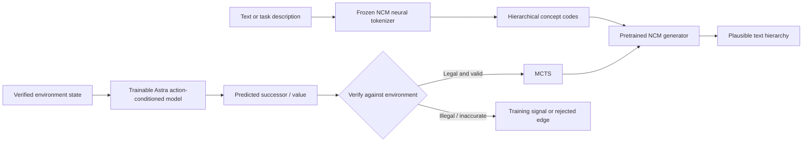
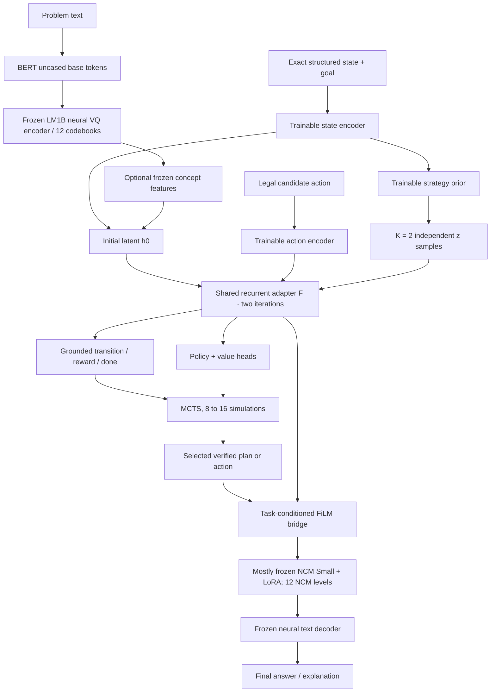

> **Implementation review, 19 October 2026:** This v1 proposal has been reviewed and corrected in [the v4 engineering contract](v15_astra_ncm_v4/REVIEWED_SPEC.md). The implemented pilot uses exact graph states, a smaller spatial recurrent learner, explicit strategy preferences, native128 pretrained NCM, and gated LoRA adaptation/search. The original v1 text is archived in `v15_astra_ncm_v4/reports/ORIGINAL_ENGINEERING_SPEC_V1.md`. Read the reviewed contract for authoritative objectives, data splits, execution gates, and limitations.

# V15 ASTRA: Pretrained LM1B NCM + LoRA + Recursive Reasoning + GRAM-Inspired State + Exploration z + Action Encoder + MCTS

**Engineering specification and first-principles research plan**  
**Version:** 1.0 · **Date:** 19 October 2026 · **Target hardware:** MacBook Air M2, 16 GB unified memory, 8-core GPU  
**Proposed initial configuration:** frozen LM1B tokenizer (111.40M) + mostly frozen LM1B NCM Small generator (97.07M) + LoRA rank 4 (test rank 8) + **two shared-weight reasoning iterations** + **two exploratory strategy samples** + **8–16 MCTS simulations** *only after* transition-model validation.  
**Maturity:** **research design, not a tested implementation or demonstrated reasoning result.**

> **One-sentence thesis:** Preserve a pretrained multiscale text representation and coarse-to-fine generator; add a small, learnable action-conditioned recurrent world-model interface; train distinct strategies and accurate successor predictions on grounded trajectories; then spend inference compute on verified tree search instead of blindly resampling NCM concepts.

---

## Reading map

1. **What exists vs. what must be built**: precise upstream facts, caveats, constraints.
2. **First principles**: latent concepts, LoRA, recurrence, stochastic strategy, grounded actions and planning.
3. **Full architecture**: forward pass, shapes, interfaces, and exact location of modifications.
4. **Training**: synthetic trajectories, stages, mathematical losses, gradient flow, leakage prevention.
5. **Inference / MCTS**: actionable pseudocode, search cost and environment-verification rules.
6. **M2 execution**: memory, implementation skeleton, commands, debugging and feasibility gates.
7. **Research discipline**: experiments, ablations, negative results, rollout criteria and scale-up.

**Conventions:** `B` = batch size; `L` = base text-token length; `J` = number of NCM hierarchy levels; `ℓ_j` = number of code positions at level `j`; `V_j` = code vocabulary at level `j`; `d_v=384` = frozen tokenizer latent width; `d=768` = generator/reasoning width; `d_z=64` = suggested strategy latent width; `R=2` = recurrent steps; `K=2` = independent strategy candidates; `N=8 or 16` = MCTS simulations per decision. All suggested dimensions other than those marked *upstream* are engineering choices.

---

# 1. Source audit: the real upstream NCM that we are reusing

## 1.1 Verified facts (not Astra proposals)

| Upstream attribute | LM1B Small release | Source |
|---|---:|---|
| Generator parameters | **97.07 million** | NCM paper, Appendix C, Table 6 |
| Tokenizer parameters | **111.40 million** | NCM paper, Appendix C, Table 5 |
| Generator blocks, width, heads | **12 / 768 / 12** | `config/eval/lm1b-small.yaml` |
| Head width | `768 / 12 = 64` | Derived |
| Underlying text tokenizer | `bert-base-uncased`, vocabulary **30,528** | Official config |
| Neural tokenizer latent width | **384** | Official config |
| Neural text window | **128 base tokens** | Official config |
| VQ hierarchy | **12 levels**, **8,192 codes per level** | Official config |
| Lengths by level | `[1,8,16,24,32,40,52,64,76,92,108,128]` | Official config |
| Total code positions across hierarchy | **641** per 128-token block | Derived: sum of lengths |
| Generator prefix length | **1** | Official config |
| Separate context encoder | **disabled** | Official config |
| Level-0 prediction | `predict_level0: false`, `query_level0: true` | Official config and `models/next_concept.py` |
| Attention pattern | **block diagonal** for parallel level supervision | Official config |
| Train/generate asymmetry | all levels teacher-forced in a training forward; levels generated sequentially at inference | Paper and source |

**Critical correction to a possible misunderstanding:** The LM1B generator is a **pretrained unconditional generator**, not a pretrained task-conditioned problem solver. It has a one-token prefix, not a ready-made graph-state context encoder. We **must build** the interface from task state/goal/strategy/action into its hidden computation and train it; feeding arbitrary instructions into the released generator without adaptation would be conceptually incorrect.

**Another correction:** `query_level0: true` means the model *can* generate the first (one-position) VQ level via a learned query. The flag `predict_level0: false` refers to a different optional prefix-based predictor. Do not write code that assumes the first level is always supplied externally or always sampled from an unconditional unigram.

**Context-length nuance:** `context_length: 129` in the generator is **1 prefix + at most 128 positions for a currently generated hierarchy level**, not a 129-word instruction context. The teacher-forced multilevel forward has many concatenated level positions and uses a structured attention mask.

**Reconstruction caveat:** `bert-base-uncased` irreversibly removes case distinctions at pre-tokenization. Even if VQ reconstruction were perfect, byte-exact reconstruction of original mixed-case strings is not guaranteed. Arbitrary math/code punctuation and OOD structured state may also be represented poorly. Grounded planning **must not rely exclusively on a lossy natural-language codec** to preserve legal actions or exact graph edges.

### Checked primary sources

- Code repository: https://github.com/HazyResearch/ncm
- LM1B configuration: https://raw.githubusercontent.com/HazyResearch/ncm/main/config/eval/lm1b-small.yaml
- Actual transformer: https://raw.githubusercontent.com/HazyResearch/ncm/main/models/next_concept.py
- Actual attention & MLP modules: https://raw.githubusercontent.com/HazyResearch/ncm/main/models/common.py
- Tokenizer wrapper: https://raw.githubusercontent.com/HazyResearch/ncm/main/tokenization/vqvae_tokenizer.py
- Evaluation loader: https://raw.githubusercontent.com/HazyResearch/ncm/main/scripts/eval_shard.py
- Checkpoints: https://huggingface.co/hazyresearch/ncm-checkpoints/tree/main/lm1b
- Published paper, especially Section 3, Appendix C and G: https://arxiv.org/html/2610.14162

## 1.2 Three categories of components

| Category | Components | How to use |
|---|---|---|
| **Existing pretrained assets** | base BERT uncased tokenizer, NCM neural VQ encoder/codebooks/decoder, NCM Small transformer and heads | Load official checkpoints, verify state dicts; initially freeze |
| **New trainable Astra modules** | graph/problem encoder; action encoder; recurrent hidden-state correction; strategy prior/posterior; transition head; value/policy heads; task-conditioning bridge; LoRA matrices | Implement, initialize, train on trajectories and code prediction |
| **Non-neural infrastructure** | environment simulator, exact action legality filter, rollout scorer, MCTS tree, evaluation harness, caches | Mostly ordinary deterministic code; does not learn simply because it runs |

**GRAM-inspired** in this document means a **proposed** stochastic/recurrent latent mechanism influenced by V15's goals. It is **not** a claim that the official NCM repository implements GRAM, nor that the equations reproduce every detail of any named GRAM paper. Any fidelity to a specific GRAM paper requires a separate line-by-line audit against that paper.

---

# 2. Starting from first principles: why change a text generator?

## 2.1 Two very different prediction problems

**Text generation:** Given partial concepts, predict plausible next-level concepts. NCM is trained for this.

**World modeling:** Given a state `s_t`, candidate action `a_t` and (optionally) strategy `z`, predict an *actual successor* `s_(t+1)` and reward/termination. A text generator is not automatically a world model.

Consider a graph with edges `A→B`, `A→C`, `B→D`, `C→G`, where `D` is a dead end and `G` is the goal. A fluent text generator can write “A→D→G” even though no such legal path exists. We need an action-conditioned state model and a verifier.



**Desired result:** Keep the pretrained generative prior while learning grounded decision dynamics. **Failure mode:** If the learned representations omit legal-action information, the planner can become extremely confident about wrong transitions.

## 2.2 What is a vector representation?

A model cannot directly add or multiply the English word “north”. Instead it maps symbols into numbers. A `d=768` vector is a list of 768 numbers; all 768 values jointly encode useful properties. The values do not have human-assigned meanings. Embeddings can be learned for states, actions and latent strategies.

For a batch of `B=2` examples, a global representation is a matrix in `R^(2×768)`. A per-position representation of `T=8` items has shape `[2,8,768]`. The positions and dimensions must be kept separate throughout implementation.

---

# 3. Frozen multiscale NCM tokenizer: mechanism and mathematics

## 3.1 From text to VQ codes

Let the base text-token sequence be `x ∈ {0,…,30527}^{B×128}`. The trained neural encoder maps these tokens to continuous vectors

\[
z^{\mathrm{enc}}=E_{\mathrm{vq}}(x)\in\mathbb R^{B\times128\times384}.
\]

For an illustrative one-position residual vector `u∈R^384`, a VQ codebook contains `V=8192` learned vectors `e_1,…,e_V∈R^384`. Quantization chooses the closest one:

\[
r^*=\arg\min_{j\in\{1,\ldots,V\}}\|u-e_j\|_2^2.
\]

**Derivation:** Square distance is `||u-e||²=(u-e)·(u-e)=u·u-2u·e+e·e`; for a fixed `u`, the first term is constant, so choosing the minimum distance is equivalent to maximizing `2u·e−||e||²`. This converts a continuous vector into an integer code ID. It permits a finite discrete vocabulary to represent learned features.

**Toy example** in a *two-dimensional imaginary codebook*, not the real 384-dimensional model: `u=(1.9,0.2)`, `e1=(2,0)`, `e2=(0,2)`. Squared distances are `0.05` and `6.85`; choose ID 1. The code carries an approximation, not the original vector exactly.

## 3.2 Why multiple levels?

One coarse code cannot preserve every detail of 128 tokens. NCM accumulates quantized residual corrections across hierarchy levels.

In conceptual notation (ignoring the resize operators between different resolutions):

\[
\hat z^{(j)}=\hat z^{(j-1)} + U_j\big(e_j(r_j)\big), \quad \hat z^{(0)}=0.
\]

- `j∈{1,…,12}`: hierarchy level.
- `r_j∈{0,…,8191}^{B×ℓ_j}`: discrete IDs at level `j`.
- `e_j(r_j)∈R^{B×ℓ_j×384}`: lookup vectors from that level's codebook.
- `U_j`: the upstream multiscale upsampling / residual-merge operation mapping to the common reconstruction resolution.
- `ẑ^(j)∈R^{B×128×384}`: conceptual cumulative reconstruction, if expressed at full resolution.

The actual repository implements specific scale-change and residual operators; **use its code instead of manually implementing the simplified sum**. Early levels carry more global information; finer levels fill in missing details.

| Level index `j` | `ℓ_j` | IDs shape for `B=2` | Code vocabulary |
|---:|---:|---|---:|
| 1 | 1 | `[2,1]` | 8192 |
| 2 | 8 | `[2,8]` | 8192 |
| 3 | 16 | `[2,16]` | 8192 |
| 4 | 24 | `[2,24]` | 8192 |
| 5 | 32 | `[2,32]` | 8192 |
| 6 | 40 | `[2,40]` | 8192 |
| 7 | 52 | `[2,52]` | 8192 |
| 8 | 64 | `[2,64]` | 8192 |
| 9 | 76 | `[2,76]` | 8192 |
| 10 | 92 | `[2,92]` | 8192 |
| 11 | 108 | `[2,108]` | 8192 |
| 12 | 128 | `[2,128]` | 8192 |
| **Total** | **641** | 641 IDs per block | 12 separate vocabularies |

**Important:** 641 hierarchical code IDs **are not a compression of 128 base token IDs if all levels are stored**. Coarse *partial* hierarchies can be compact; the full hierarchy has more discrete positions than the original text.

## 3.3 NCM generator's training vs. inference

During training, one masked transformer pass supervises many hierarchy levels with their known lower-level conditioning. During inference, NCM generates the levels **sequentially**, usually one transformer invocation per level, predicting positions *within* a level in parallel.

A schematic probability factorization is

\[
p(r_1,\ldots,r_{12})=p(r_1)\prod_{j=2}^{12}p(r_j\mid r_{<j}).
\]

The transformer predicts a categorical distribution for each position in a level. For ground truth code `y`, the negative log-likelihood loss is `−log p(y)`. When `p(y)` rises, the loss falls. Averaging over positions yields cross-entropy.

**Two distinct iteration axes:**

- `j=1,…,12` is **NCM coarse-to-fine generation**.
- `r=1,2` is **our proposed Astra hidden-state reasoning recurrence**.

Never conflate them. Two reasoning iterations do **not** replace 12 generation levels, nor imply 24 full generator passes unless the implementation explicitly repeats the generator.

---

# 4. LoRA: adapt a frozen pretrained model without updating all its weights

## 4.1 Why LoRA?

A standard linear layer computes `y=Wx`, with `W∈R^(d_out×d_in)` and `x∈R^(d_in)`. Fine-tuning all `d_out·d_in` weights would require optimizer states and full-gradient memory. We instead keep `W` frozen and learn a low-rank correction:

\[
y=Wx+\frac{\alpha}{q}BAx,\quad A\in\mathbb R^{q\times d_{in}},\;B\in\mathbb R^{d_{out}\times q}.
\]

- `q`: LoRA rank; experiment with **4** and **8**.
- `α`: scaling hyperparameter, e.g. equal to `q` for multiplier 1; tune later.
- `A` compresses the input into a `q`-dimensional trainable feature.
- `B` expands it back to output width.

The trainable count is `q(d_in+d_out)` instead of `d_in·d_out`. Zero-initialize `B` and initialize `A` normally so the initial output matches the pretrained model exactly. **LoRA does not add a recurrent computation or an action encoder by itself.** Those are separate modules.

## 4.2 Exact upstream insertion points

The repository's `models/common.py` has **fused QKV** in `Block.attn.c_attn` and attention output `Block.attn.c_proj`; the normal MLP has `Block.mlp.c_fc` and `Block.mlp.c_proj`. Do not assume the project uses Hugging Face names such as `q_proj`, `k_proj`, `v_proj`. A generic adapter wrapper around these actual `nn.Linear` modules is safer than a name list copied from LLaMA.

| Upstream linear module (per layer) | Weight shape | Rank-4 trainable LoRA weights | Rank-8 trainable LoRA weights |
|---|---|---:|---:|
| `attn.c_attn` fused Q,K,V | `[2304,768]` | 12,288 | 24,576 |
| `attn.c_proj` | `[768,768]` | 6,144 | 12,288 |
| `mlp.c_fc` | `[3072,768]` | 15,360 | 30,720 |
| `mlp.c_proj` | `[768,3072]` | 15,360 | 30,720 |

**Attention-only LoRA across 12 blocks:** rank 4 = **221,184** trainable weights; rank 8 = **442,368**.  
**Attention + MLP LoRA across 12 blocks:** rank 4 = **589,824**; rank 8 = **1,179,648**.  
Those are just LoRA weights, excluding new Astra modules, biases or optional heads; check actual module shapes before injection.

**Starting decision:** `q=4` on `attn.c_attn` and `attn.c_proj`; keep base weights and codec frozen; optionally expand to `q=8` or MLP projections only after baseline improvement.

## 4.3 Gradient check

The frozen original matrix has no gradient: `W.requires_grad=False`. LoRA parameters `A,B` receive gradients through `L(y)` by the chain rule, even though the frozen `W` contributes to the forward pass. Ensure the optimizer receives **only** trainable parameters; test that `W` remains bitwise unchanged after one step.

---

# 5. Astra state, action, strategy and recurrence: a concrete mathematical contract

## 5.1 State is *not* just text

For graph navigation a true environment state can be represented as

\[
s_t=(G,v_t,g,\mathcal H_t),
\]

where `G=(V,E)` is the graph, `v_t` is current vertex, `g` is goal and `H_t` is optional visited-node history. Legal actions are `A(s_t)={v':(v_t,v')∈E}`.

**Recommended two-path design:**

1. **Exact structured path:** Feed graph adjacency, current node, goal and legal-action IDs into a small, newly trained state encoder. This prevents graph edges from being corrupted by text reconstruction.
2. **Language/concept path:** Optionally encode the text description using the **frozen NCM tokenizer**; use pretrained NCM for concept-level generation of candidate explanations or transitions. Compare against a *structured-only* baseline to see whether pretrained NCM actually helps.

An MLP or small graph encoder can produce `c_t=E_s(s_t)∈R^(B×768)`. For variable-size graphs, use padded node embeddings plus a mask, or a small message-passing graph network. Do not invent an NCM-coded graph if exact edges are already available.

## 5.2 Action encoder

If each candidate action has a discrete ID or target node, use a learned embedding plus state context:

\[
e_t(a)=E_a(s_t,a)\in\mathbb R^{B\times768}.
\]

For a small bounded action vocabulary, a table lookup is enough; for dynamically named nodes or edges, embed **features** `(source, destination, edge type, legal mask)` and pass them through a shared MLP. Shared parameters permit transfer to unseen graphs.

**Toy reasoning:** In state A the two candidate actions are “go to B” and “go to C.” Their action vectors need not encode their English spelling; they should encode the chosen successor and consequences. An action ID `3` is meaningless unless the state tells us what that ID does.

**No-action case:** The policy may include `STOP` only if the state is terminal or an explicit stop action is legal. Illegal moves must be masked *before* softmax and before expansion in MCTS.

## 5.3 Exploration latent `z`: strategies, not noise for its own sake

We propose a conditional Gaussian strategy prior:

\[
p_\theta(z\mid s_t)=\mathcal N\!\big(\mu_p(s_t),\operatorname{diag}(\sigma_p^2(s_t))\big),\qquad z\in\mathbb R^{B\times64}.
\]

- `μ_p`: mean strategy vector `[B,64]`.
- `σ_p`: positive standard deviation `[B,64]` (parameterize via `log σ²`, clamp for stability).
- `diag(σ²)`: diagonal `64×64` covariance per example; components can vary independently.

Sample without blocking gradients using reparameterization:

\[
\epsilon\sim\mathcal N(0,I),\qquad z=\mu_p+\sigma_p\odot\epsilon.
\]

The element-wise product `⊙` scales random noise. At inference draw **K=2** independent samples `z_1,z_2`, using fixed seeds for comparisons. They are **two attempts**, not automatically two distinct valid reasoning strategies. Measure both diversity *and* successful outcomes.

### GRAM-inspired training posterior (optional from Stage 3 onward)

A recognition network may see the observed next state *during training only*:

\[
q_\phi(z\mid s_t,a_t,s_{t+1})=\mathcal N(\mu_q,\operatorname{diag}(\sigma_q^2)).
\]

The training posterior can infer which latent transition style explains the demonstrated outcome. But at deployment `s_(t+1)` is unknown, so **always sample from `p(z|s_t)`**, never from a posterior that sees future outcomes. If this causes a large train/test gap, the posterior has learned information the prior cannot reproduce (posterior/prior mismatch).

An approximate KL penalty links posterior and prior:

\[
D_{\mathrm{KL}}(q\|p)=\frac12\sum_{i=1}^{64}\left[\log\frac{\sigma_{p,i}^2}{\sigma_{q,i}^2}+\frac{\sigma_{q,i}^2+(\mu_{q,i}-\mu_{p,i})^2}{\sigma_{p,i}^2}-1\right].
\]

Each of the 64 terms compares one Gaussian dimension. It is zero when posterior and prior means and variances agree. If weighted too strongly, the posterior may ignore future-specific information and `z` collapses; too weakly, training may exploit a posterior the test-time prior cannot imitate.

**Alternative for an initial tiny graph dataset:** learn **two discrete strategy IDs** corresponding to explicitly generated forward/backward or breadth/depth trajectories. Compare with the continuous Gaussian prior. Controlled ID supervision is easier to interpret than hoping Gaussian randomness spontaneously produces strategic diversity.

## 5.4 Two shared-weight reasoning iterations

Initialize a global hidden state using exact state features and optional frozen text/concept features:

\[
h_0=\operatorname{LN}\big(W_s c_t+W_c c^{\mathrm{ncm}}_t+b\big)\in\mathbb R^{B\times768}.
\]

- `c_t`: state encoder output `[B,768]`.
- `c^ncm_t`: optional frozen NCM-derived summary `[B,768]`, or **zero** for the strict structured baseline.
- `W_s,W_c`: trainable `768×768` matrices, potentially replaced by smaller bottleneck projections.
- `LN`: layer normalization, stabilizing scale.

For *each candidate action* `a` and strategy `z`, compute a conditioned message. A fully specified lightweight design is

\[
u_r=\operatorname{LN}\big(h_r+W_e e_t(a)+W_z z' +W_s'c_t\big),\qquad z'=\operatorname{SiLU}(W_{z0}z),
\]

\[
\delta_r=W_2\operatorname{GELU}(W_1u_r+b_1)+b_2,\quad g_r=\sigma\big(w_g^\top[u_r;\delta_r]+b_g\big),
\]

\[
\boxed{h_{r+1}=\operatorname{LN}(h_r+g_r\delta_r)},\qquad r=0,1.
\]

Suggested dimensions: `W_z0:[768,64]`; `W_1:[512,768]`; `W_2:[768,512]`; `w_g:[1536]`; `g_r:[B,1]` (broadcast across 768 features). Reuse **the same** `W_1,W_2,w_g` at both iterations.

**Why residual addition?** We need to preserve knowledge from the current state while proposing a correction. If `g≈0`, almost nothing changes before normalization. If `g≈1`, the whole correction participates. Initialize `W_2` near zero and/or initialize `b_g` negative (e.g. `−2`) to prevent early runaway state updates. LayerNorm means `g=0` is not strictly mathematical identity unless applied carefully; if exact identity is needed, normalize the *input to `F`*, not the residual output.

### A simpler exact-residual implementation, recommended for the first pilot

\[
\boxed{h_{r+1}=h_r+\sigma(b_g)\,W_2\operatorname{GELU}\big(W_1\operatorname{LN}(h_r+W_ee_a+W_z z+W_sc_t)\big)}.
\]

Initialize `W_2=0`. Then `h_2=h_0` at initialization, preserving baseline conditioning and avoiding artificial drift. As training proceeds the shared cell learns refinements. This is our **reference implementation** for first experiments. Later test richer gates or GRAM-style fast/slow memory.

**Parameter roughness:** a 768→512→768 MLP has `768×512+512×768=786,432` main weights (plus biases/conditioning). Reusing it twice does not duplicate parameters. An alternative “loop the entire NCM 12-layer generator twice” is materially more expensive and should be tested separately, not assumed.

## 5.5 What do two loops actually learn?

A recurrent cell does **not** become a reasoning module because it is repeated twice. It learns a useful two-step process only if (i) training loss rewards improved successor/policy/value predictions after refinement, (ii) targets have multistep structure, (iii) gradient flows through each step, and (iv) a one-step and an equal-compute nonrecurrent baseline are beaten on held-out tasks.

**Diagnostic:** log `||h_2−h_1||`, `||h_1−h_0||`, prediction accuracy after steps 0/1/2 and per-step residual norms. Large norm growth without validation improvement indicates unstable recurrence. Near-zero updates may mean that the model has ignored the loop.

---

# 6. Conditioning the pretrained NCM generator correctly

## 6.1 What cannot be done without changing source code

The released LM1B generator is unconditional and has `prefix_len=1`, `ctx_encoder.enabled=false`. It cannot be used as a ready-made transformer that accepts arbitrary 128-token task prompts through a general `context_encoder` interface. Likewise, its upstream `generate()` is decorated with `@torch.no_grad()`, so it is **not** an end-to-end training function for new conditioning modules.

Therefore, implement a **custom differentiable conditioned forward** and a corresponding **conditioned inference loop**. Preserve the upstream VQ hierarchy and masking semantics. Avoid patching `config.prefix_len` and then expecting the original checkpoint to behave identically.

## 6.2 Low-risk conditioning bridge: zero-initialized FiLM

For each hierarchy level `j`, the pretrained generator constructs token/upsampled-latent embeddings `X_j∈R^(B×ℓ_j×768)`. Build a fixed-width conditioning vector from Astra's final reasoning state `h_2∈R^(B×768)`:

\[
(\gamma_j,\beta_j)=W_{\mathrm{film}}[h_2;\operatorname{embed}(j)]\in\mathbb R^{B\times1536}.
\]

Split into vectors `γ_j, β_j∈R^(B×768)`, initialize the final linear to **zeros**, and modify the generator's pre-block features:

\[
X_j' = X_j\odot(1+\gamma_j[:,None,:])+\beta_j[:,None,:].
\]

Broadcasting gives shape `[B,ℓ_j,768]`. Initially `γ=β=0`, so `X_j'=X_j`: upstream behavior is preserved. During training, the model can learn how state, action, and strategy modify output concept probabilities.

**Injection point:** after upstream upsampling/convolution, projection to `n_embd=768`, and level/position embeddings, but **before** the stack of transformer blocks. The actual `forward()` and `_decode_level_logits()` functions should be adapted so *both* teacher-forced training and sequential inference use the same conditioning formula. Do not accidentally condition only training or only decoding.

**Shape / masking rule:** preserve original prefix visibility, `block_diagonal` supervision mask and per-level RoPE positions. A naive concatenation of extra tokens invalidates pretrained positional layouts and checkpoint compatibility. FiLM avoids changing token count.

**Possible other bridge:** a small trainable prefix/cross-attention interface. This can be more expressive but is more invasive and may incur larger activation costs. Treat it as a separate ablation, **not** Phase 1 default.

## 6.3 Separate output responsibilities

Astra should first learn two products:

1. **Structured successor and action value:** `T_θ(s,a,z)` and `V_θ(s)` for planning, with **exact-state** supervised targets.
2. **Concept/text description:** condition NCM on selected state/trajectory to generate coherent explanations and optional next-concept targets.

**Never use the decoded text as the canonical MCTS state** in the first prototype. Decode for display or optional auxiliary modeling. The MCTS state is a verified graph node/structured state, or a learned latent only after stringent calibration.

---

# 7. Full forward pass and tensor-shape ledger

Assume `B=2` graph examples, each with 4 or fewer legal candidate actions; representation width `768`, latent width `64`. For one state-action-strategy tuple:

| Step | Tensor | Shape | Trainability |
|---|---|---|---|
| Base text tokens | `x` | `[B,128]` | integers |
| Frozen tokenizer hierarchy | `r_j` | `[B,ℓ_j]`, j=1…12 | frozen |
| Frozen VQ reconstruction | `Z_ncm` | `[B,128,384]` | frozen |
| Optional concept summary projection | `c_ncm` | `[B,768]` | projection trainable; frozen source |
| Exact graph encoder | `c_t` | `[B,768]` | trainable |
| Action features | `e_a` | `[B,768]` | trainable |
| Strategy parameters | `(μ_p,logσ²_p)` | each `[B,64]` | trainable |
| Strategy samples | `z_1,z_2` | each `[B,64]` | differentiable samples in training |
| Initial state | `h_0` | `[B,768]` | via trainable bridge |
| Loop 1 / 2 states | `h_1,h_2` | each `[B,768]` | shared recurrent weights |
| Transition logits | `P(s'|s,a,z)` | `[B,N_state]` for toy finite graph | trainable |
| Action logits | `π(a|s,z)` | `[B,A_max]` | trainable + legal mask |
| Value | `V(s)` | `[B,1]` | trainable |
| FiLM gamma, beta | `(γ_j,β_j)` | each `[B,768]` | trainable |
| NCM target embeddings | `X_j'` | `[B,ℓ_j,768]` | frozen backbone + LoRA/FiLM |
| Predicted hierarchy logits | `logits_j` | `[B,ℓ_j,8192]` | shared pretrained output head + LoRA |
| Decoded base-token logits | `logits_text` | `[B,128,30528]` | frozen decoder |

For a variable-graph encoder, `N_state` must be replaced by a state representation or candidate successor scoring head that generalizes to graph size; **do not interpret an arbitrary node-label softmax as OOD generalization**. Start with fixed-size graphs for unit tests, then move to permutation-equivariant graph representations.

### End-to-end architecture (conceptual)



**Gradient flow during training:** `loss → NCM head → LoRA and FiLM → recurrent h_2 → action encoder/strategy/state encoder`. Frozen generator and tokenizer original weights receive no parameter updates. If codec features are precomputed and detached, no graph through tokenizer is needed. `loss_transition` can train action/state/recurrence **without** running the 97M generator, making M2 training much cheaper.

---

# 8. Grounded dataset: how we get state-action-next-state pairs

## 8.1 Why raw LM1B text is insufficient

Raw language gives associations between words, not a guaranteed tuple `(state, legal action, actual successor)`. Guessing that a sentence contains an action would require heuristics and would not guarantee correct outcomes. The **primary training source for grounded action prediction** should be an environment with executable transition rules.

For the first experiment use generated directed/undirected graphs with 5–12 nodes, variable density, single/multiple goal routes, cycles, decoys and dead ends. Each training example must have a verified legal action and an oracle-computed next state. Record shortest-path distance and terminal reward for value supervision.

For symbolic transforms use equally precise rules (swap, increment, reverse, grammar rewrite, etc.) with executable validators. **Do not simultaneously introduce too many task types** before graph-navigation gates pass.

## 8.2 Minimal trajectory record

```json
{
  "episode_id": "graph_seed_0042",
  "graph_id": "g_0042",
  "graph_edges": [[0,1],[0,2],[1,3],[2,4]],
  "current_node": 0,
  "goal_node": 4,
  "legal_actions": [1,2],
  "chosen_action": 2,
  "next_node": 2,
  "reward": 0.0,
  "done": false,
  "shortest_remaining_steps": 1,
  "strategy_label": "forward_shortest_path",
  "problem_text": "At node 0, reach node 4 using valid edges."
}
```

Here `reward=0` for a nonterminal legal step; in a toy reward scheme, successful arrival gets `+1`, illegal actions are impossible because they are masked, and timeouts or dead ends can get `0` or a negative value. Keep the reward definition identical in the dataset, value targets and MCTS evaluator.

Dataset fields may also contain original text and frozen NCM code cache (`r_1…r_12`) for concept supervision. Store tokenization version/hash and `padding_mask`; do not mix code IDs across levels without their boundaries.

## 8.3 Train / validation / OOD split

- **Train:** graph seeds and graph families not in validation; a deliberate mix of shortest/longer legal paths; balanced terminal/nonterminal examples.
- **Validation:** unseen graphs from *same* size/density regime; never reuse the exact graph with permuted node names as independent evidence unless explicitly evaluating permutation invariance.
- **OOD test:** larger graphs, different edge density, long detours, unseen graph templates, altered goal distributions, and renamed nodes.
- **Leakage block:** group by entire graph instance / generation seed; do not randomly split individual trajectory steps of the same graph across train and test.
- **Counterfactuals:** from the same `s_t`, produce *all legal actions* and exact successor states, not just the expert-chosen action. This identifies bad alternatives and enables calibrated search.
- **Strategy-diverse data:** include verified forward search, backward search, depth-first, shortest-path and constrained detour traces where applicable; do not label two equivalent paths as distinct strategies without demonstrating differences.

### Scale suggestions, not published NCM quantities

| Dataset mode | Unique graphs | Transitions | Goal |
|---|---:|---:|---|
| Unit tests | 20 | ~200 | validate pipeline, exact oracle |
| Local pilot | 2,000 | ~20k–100k | compare recurrence/action/strategy |
| Larger follow-up | 20k+ | 0.2–2M | generalization and calibration |

Cache only what is needed; an unnecessary 641-code hierarchy for every graph step increases storage. A text-code cache is optional if action training uses exact structured states.

---

# 9. Loss functions: what exactly makes Astra learn?

The objective must reward not just fluent outputs, but **legal transitions, successful actions, calibrated outcome scores and useful recurrence**.

## 9.1 Transition loss

For a small finite-state toy graph, output a distribution over next nodes. If the true next node is `y`, the loss for one example is

\[
\mathcal L_{\mathrm{trans}}=-\log p_\theta(s_{t+1}=y\mid s_t,a_t,z).
\]

**Toy:** true next node C; model assigns `p(C)=0.8`; loss is `−ln(0.8)≈0.223`. If it assigns `0.1`, loss is `≈2.303`, so the optimizer strongly penalizes the wrong distribution. For general graphs, predict a successor embedding and/or score legal successors, with negative candidates and permutation-respecting targets.

When transitions are *known exactly* from the environment, transition loss tests a model's ability to imitate or generalize but MCTS can and should use the **real transition function** for the initial research benchmark.

## 9.2 Policy loss (teacher actions)

Let `π_θ(a|s,z)` be a softmax over *legal* actions. Given oracle action `a*`,

\[
\mathcal L_{\mathrm{policy}}=-\log \pi_\theta(a^*\mid s,z).
\]

For several equally good shortest-path actions, don't penalize all but an arbitrary chosen action. Use a target distribution over the optimal set, or a soft target based on negative remaining path length. Otherwise the learned policy will be needlessly narrow and `z` may collapse.

## 9.3 Value loss

Let `v_t*∈[0,1]` denote an oracle success probability or an episode outcome target under a **specified rollout policy**. Predict `V_θ(s)∈[0,1]`:

\[
\mathcal L_{\mathrm{value}}=\frac1B\sum_{b=1}^B(V_\theta(s_b)-v_b^*)^2.
\]

**Interpretation:** overestimating a losing path is bad because MCTS will spend visits on it. Measure value calibration, not just mean squared error. If using terminal rewards and dynamic programming, define how terminal utility is propagated and keep all returns on the same scale.

## 9.4 NCM concept preservation / adaptation loss

For a target concept hierarchy `r_j*`, conditioned logits yield

\[
\mathcal L_{\mathrm{code}}=\frac1{\sum_j\ell_j}\sum_{j=1}^{12}\sum_{i=1}^{\ell_j} -\log p_\theta(r_{j,i}^*\mid r_{<j}^*,s,a,z).
\]

**Training condition:** use **teacher-forced earlier hierarchy levels**, but match the inference distribution with code corruption/scheduled mixing experiments. Do not feed a ground-truth future state into the prompt at inference, and do not train only on noncorrupted perfect prefixes if generation will use predicted prefixes.

**LM1B caveat:** the upstream `predict_level0=false`/`query_level0=true` setup has a nuanced generation/training path. Confirm which logits the actual `forward` supervises before writing this loss; include the correct query-level-0 supervision path, or explicitly exclude level 0 and test it separately. The equation describes the intended entire factorization, not a drop-in one-liner for stock `forward()`.

**Compute:** applying this full 641-position, 8192-way objective on every graph step may be needlessly expensive on an M2. Start with grounded structured losses, then sparse concept supervision on sampled examples/levels, measuring whether NCM adds genuine transfer.

## 9.5 KL regularization for optional stochastic posterior

\[
\mathcal L_{\mathrm{KL}}=\frac1B\sum_b D_{\mathrm{KL}}\big(q_\phi(z\mid s,a,s')\|p_\theta(z\mid s)\big).
\]

Start `β_KL` small, monitor posterior collapse (`KL→0`, `z` has little behavioral effect) and prior/posterior mismatch (`q` succeeds but `p` fails). A small positive KL is not by itself proof of useful strategy learning.

## 9.6 Strategy diversity, validity and stability

A diversity metric should operate on **behavior**, not just vector distance. One legitimate design is to compare legal policy distributions for two samples and require difference only when the dataset supports multiple successful strategies; add a counterweight penalizing unsuccessful or illegal results. Purely maximizing `||z1−z2||` can produce different numbers with identical actions or worse planning.

For example, define an optional contrastive *measurement*:

\[
D_{\mathrm{policy}}(s)=\tfrac12\big[D_{\mathrm{KL}}(\pi_1\|m)+D_{\mathrm{KL}}(\pi_2\|m)\big],\quad m=\tfrac12(\pi_1+\pi_2).
\]

This is the Jensen–Shannon divergence, bounded for two discrete distributions. Use it primarily as a diagnostic; if made a training objective, gate it by demonstrably equivalent-value yet distinct valid solutions. Do not force diversity where only one action can succeed.

## 9.7 Composite objective and initial weights

\[
\boxed{\mathcal L =\lambda_T\mathcal L_{\mathrm{trans}}+\lambda_P\mathcal L_{\mathrm{policy}}+\lambda_V\mathcal L_{\mathrm{value}}+\lambda_C\mathcal L_{\mathrm{code}}+\beta\mathcal L_{\mathrm{KL}}+\lambda_R\mathcal L_{\mathrm{retain}}.}
\]

`L_retain` can be a KL divergence from the original frozen generator's code distribution on ordinary LM1B text. It tests catastrophic degradation of generative behavior. Starting proposal: `λ_T=1`, `λ_P=1`, `λ_V=0.25`, `λ_C=0` in the first action-only pilot; introduce code loss gradually (`λ_C≈0.1`) only once it is worth the compute. `β=0` until the posterior exists; tune empirically rather than presenting values as universal constants.

**Gradient-routing policy:**

- `L_trans/policy/value → state/action/recurrent/strategy/value heads`.
- `L_code → FiLM + LoRA + upstream trainable heads + recurrent conditioning`.
- `L_KL → strategy prior/posterior`.
- `L_retain → LoRA + FiLM`; *not* frozen codec weights.
- **No gradient through discrete MCTS decisions** in this initial design. Train from oracle and later improve with search-produced policy targets if search demonstrably helps.

---

# 10. Training stages: exact order, freezing policy and exit gates

## Stage 0: Reproduce and audit upstream NCM

**Train:** nothing. **Frozen:** tokenizer, generator.

1. Record Git SHA, Hugging Face checkpoint revisions, torch and macOS versions, tokenizer details and codebook level boundaries.
2. Download only LM1B tokenizer + Small generator + config; validate that both state dicts load strictly.
3. Reproduce a tiny **CPU** forward and one short generation. Port to MPS cautiously. The upstream `evaluate.py` and `scripts/eval_shard.py` explicitly depend on CUDA and do **not** run unchanged on an M2.
4. Compare code input, reconstruction and generated text. Log all 12 level lengths, tokenizer IDs, EOS/PAD behavior and exact normalized text reconstruction.
5. Run codec sanity on 100 ordinary sentences and 100 graph/math/symbolic strings; report lowercased normalized token exact-match as well as original byte-exact match (the latter is expected to fail for some casing examples).

**Gate:** reproducible checkpoint load; full hierarchy shapes correct; no inconsistent code ID range; MPS/CPU numerical checks tolerable. If codec corrupts critical task symbols, use structured states for planning and reserve NCM for language rendering.

## Stage 1: Grounded action-conditioned baseline, NO recurrence, NO z

**Train:** small state encoder, action encoder, transition head, policy head and value head. **Frozen:** all pretrained NCM components, LoRA disabled.

Use exact graph-state tuples. Implement `T(s,a)` with candidate legal successor scoring. Verify that oracle shortest-path actions beat random policy and that predicted transitions match known edges. A simple deterministic baseline is the essential control.

**Gate proposal (small in-distribution graphs):** >98% legal-action accuracy by explicit masking; >95% one-step successor accuracy if transition is learnable from provided complete edge list; meaningful success over a random legal policy. Thresholds are *research gates*, not predictions.

## Stage 2: Two-loop recurrent refinement (R=2)

**Train:** shared recurrent cell, initial state projection and heads. **Frozen:** upstream tokenizer + NCM.

Compare `R=0`, `R=1`, `R=2`, `R=4` on matched examples and identical training budgets. Include a **nonrecurrent two-layer MLP with similar parameters and FLOPs**. Always evaluate after each recurrent step.

**Gate:** `R=2` improves held-out task success or transition/value calibration at a comparable inference-compute budget; recurrence stays stable; no information leakage.

## Stage 3: Exploration K=2 and GRAM-inspired stochasticity

**Train:** conditional prior, (optional) training posterior, z projection, possibly recurrent cell/head. **Frozen:** pretrained NCM.

Start with `K=1` deterministic, then `K=2` independently sampled. Compare categorical strategy IDs and Gaussian z. Build a dataset with *verified* alternative successful routes/algorithms. Evaluate best-of-two under *equal candidate-compute* and not merely against a cheaper K=1 setting.

**Gate:** genuine successful behavioral diversity; prior-sampled z not dramatically worse than posterior-sampled z; increased accuracy or better calibrated uncertainty at matched compute. If z doesn't help, remove it: the architecture should survive without a decorative latent.

## Stage 4: NCM conditioning bridge + LoRA rank 4, then rank 8

**Train:** FiLM conditioning, LoRA, optional low-rank concept projection; structured modules jointly at a restrained rate. **Frozen:** neural tokenizer/codebooks/decoder, original NCM weights.

First prove zero-init FiLM + zero-init LoRA reproduce baseline logits within tolerance. Then train NCM to express selected *verified* successor/plan text or next concepts. Balance task loss against ordinary LM1B retention. Add adapters on **attention fused QKV + attention output** first, comparing rank 4 vs 8.

**Gate:** conditioned output follows legal actions; concept/code accuracy and downstream task accuracy improve without unacceptable loss in reconstruction or ordinary-generation baseline; no silent train/inference mismatch.

## Stage 5: MCTS search (N=8 then N=16)

**Train:** initially **nothing extra**; MCTS is inference-time code. **Frozen:** trained policy/value/world-model checkpoint. Use the real graph simulator to produce valid successors for early benchmarks.

Compare greedy policy, random legal, best-of-K, beam search, flat MCTS, and (later) hierarchical MCTS at *equal wall-clock / transition-evaluation budget*. Search should branch over actions, **not** 8192 NCM codes at every level.

**Gate:** significant and consistent improvement at matched inference cost over strongest simpler baseline, not just a larger number of raw model invocations.

## Stage 6: Optional GradCuit and continual learning

**Not part of the first pilot.** After a working action model and calibrated value head, optionally optimize **per-problem z** at inference while all model weights remain frozen, constrained by legal action outcomes or a differentiable verified surrogate. Avoid optimizing against uncalibrated self-evaluation: this produces reward hacking. Later test gated LoRA and replay with explicit retention benchmarks.

---

# 11. MCTS: precise algorithm, formula, and toy dry-run

## 11.1 Why search at all?

A greedy policy chooses the currently highest-probability action. A greedy choice can be wrong when success requires temporarily taking an apparently less-promising detour. MCTS allocates a limited number of simulations across alternative action sequences.

For each tree node `s`, track visit count `N(s)` and for each edge `(s,a)`, visit count `N(s,a)`, cumulative backed-up value `W(s,a)` and prior `P(a|s)`. Define the mean value

\[
Q(s,a)=\frac{W(s,a)}{\max(1,N(s,a))}.
\]

`W` sums value estimates or observed terminal outcomes from visits traversing that edge. If outcomes are `1,0,1`, then after three visits `Q=2/3`. Values are from the perspective of the **same maximizing agent** in a single-player graph task; adversarial games require sign changes during backup.

A PUCT-style exploration score is

\[
\boxed{U(s,a)=Q(s,a)+c_{\mathrm{puct}}P(a\mid s)\frac{\sqrt{N(s)}}{1+N(s,a)}}.
\]

- `Q`: empirical exploitation; it rises when actions lead to higher returns.
- `P`: model's prior over *legal* actions; it favors good unvisited actions.
- `√N(s)`: exploration pressure grows as the parent gets more visits.
- `1+N(s,a)`: repeated visits to a branch reduce its exploration bonus.
- `c_puct`: chosen exploration strength; report in experiments.

**Toy:** `N(s)=9`, two actions A and B; `P(A)=0.7,P(B)=0.3`, `Q(A)=0.4,N(s,A)=6`, `Q(B)=0.6,N(s,B)=3`, `c=1`. Then `U(A)=0.4+0.7×3/7=0.7`; `U(B)=0.6+0.3×3/4=0.825`: choose B. This favors better experienced returns despite its lower initial prior.

At the root with `N(s)=0` and every edge unvisited, choose a prior-based expansion or seed the counts before applying the formula; otherwise all scores may initially tie.

## 11.2 How K=2 interacts with search

Two defensible implementations:

**Option A (recommended): root mixture.** Sample two `z`s once per decision. Compute two legal-action policies `π(a|s,z1),π(a|s,z2)` and average/merge them into a root prior. Run **one** 8- or 16-simulation MCTS tree, using fixed policy/value nets. This controls expensive duplicated branches.

**Option B: separate strategy trees.** Give each strategy an equal simulation budget, e.g. `N_total=16` split as 8 per `z`; compare final verified outcomes, not a value head alone. This tests whether strategy-conditioned search helps more than a merged tree, at equal **total** simulator calls.

Do **not** silently interpret “K=2 and N=16” as either 16 total or 16 per strategy. The initial protocol means **16 simulations total per decision**, unless marked otherwise.

## 11.3 Minimal MCTS pseudocode

```python
# PSEUDOCODE; not a drop-in importable implementation.
def plan_mcts(root_state, model, env, z_samples, total_simulations=16):
    # env is authoritative for legal actions, transition, reward, terminal.
    tree = SearchTree(root_state)
    for sim in range(total_simulations):
        node = tree.root
        path = []
        while node.expanded and not node.terminal:
            action = select_legal_action_by_puct(node)
            path.append((node, action))
            next_state, reward, done = env.step(node.state, action)
            node = tree.get_or_create_child(node, action, next_state, done)
        if node.terminal:
            leaf_value = terminal_return(node.state)  # e.g. 1 success, 0 fail
        else:
            legal_actions = env.legal_actions(node.state)
            priors = average_priors_over_z(model, node.state, legal_actions, z_samples)
            node.expand(legal_actions, priors)
            leaf_value = model.value(node.state)  # same scale as terminal return
        backup(path, leaf_value)  # single-player root-referenced value
    return argmax_root_visit_count(tree.root)  # or best verified completed path
```

**Critical semantics:** The terminal state return and leaf network value must be on a consistent scale. In a time-penalized shortest-path setting, backup must discount/add step rewards correctly; code above is schematic for terminal success. Add a visited-state transposition table and cycle/depth rules if graph loops exist. Avoid repeated forward passes where exact simulator results can be cached.

## 11.4 Can NCM generate full trajectories inside MCTS?

Potentially later, but **not** initially. Full NCM generation uses a 12-level autoregressive-over-levels process. Calling it for every MCTS branch can dominate compute. In the first pilot, plan over structured states using small action/value heads, then run NCM **once** to verbalize the chosen path. A later learned-latent MCTS must establish fidelity against real environment states, legality, value calibration and a budget advantage.

---

# 12. MacBook Air M2 engineering plan

## 12.1 Storage and runtime memory

`97.07M + 111.40M = 208.47M` pretrained parameters. **Weight-only lower bounds:**

- FP32: `208.47M × 4 bytes ≈ 834 MB` (decimal MB).
- FP16/BF16: `208.47M × 2 bytes ≈ 417 MB`.

These numbers exclude temporary activations, attention masks, dequantization buffers, optimizer states for Astra/LoRA, tokenizer assets, graph caches, PyTorch/runtime and unified-memory use by macOS. Checkpoint files on disk may occupy more bytes than weight-only estimates because of dtype/metadata.

**A full teacher-forced NCM call at all 641 hierarchy positions produces an `[B,641,8192]` logits tensor:** at `B=1`, this is `5,251,072` elements, ~10.5 MB in FP16 just for logits, excluding autograd copies and hidden activations. Backpropagating through the 97M transformer is much more expensive than running a 1M-parameter recurrent head on cached features.

**Known upstream obstacle:** evaluation scripts hard-code `.cuda()` and `CUDA_VISIBLE_DEVICES`. MPS must use a custom launcher, explicit `.to(device)`, attention mask testing and perhaps CPU fallback for unsupported operations. Do not claim MPS support until end-to-end tests pass.

## 12.2 Recommended configs

| Config | Frozen components | Trainable work | Reasoning | Search |
|---|---|---|---|---|
| **Minimal** | entire NCM, tokenize offline | exact graph encoder/action head (~sub-1M feasible) | R=0 or R=1 | none |
| **Local default** | NCM backbone/codec original weights | rank-4 LoRA + small recurrent/state/action/strategy heads | **R=2, K=2** | **8–16 total** only in eval |
| **Heavier local** | frozen codec | rank-8 LoRA, more conditioning and concept loss | R=2–4, K=2–4 | N=16–32 with hard cap |
| **Scale-up GPU** | frozen or selectively tuned codec | larger adapters, structured multi-task trajectories, learned latent planning | R=4+, K=4+ | hierarchical MCTS / model-based rollouts |

Start **batch=1**, gradient accumulation 8–32 for trainable heads, single or sparse level supervision, and MPS device if verified stable. Profile `torch.mps.current_allocated_memory()`/`driver_allocated_memory()` where available, plus system memory and wall-clock.

### Feasibility order

1. Reproduce NCM on **CPU** first. 2. Run frozen forward on **MPS**. 3. Train a 0.5–2M-parameter structured head without NCM autograd. 4. Enable LoRA and FiLM for sparse concept steps. 5. Only then permit search. Full looping of the 12-layer NCM transformer is a separate slow-path experiment.

## 12.3 Acquisition commands (paths checked against official loader)

```bash
# Requirements: python>=3.10, git, a compatible pytorch install and Hugging Face CLI.
git clone https://github.com/HazyResearch/ncm.git
cd ncm
python3 -m venv .venv
source .venv/bin/activate
python -m pip install --upgrade pip
python -m pip install -r requirements.txt
python -m pip install -U huggingface_hub

# The small config expects generator.pt within lm1b/small
# and tokenizer.pt one directory above.
hf download hazyresearch/ncm-checkpoints \
  lm1b/tokenizer.pt \
  lm1b/small/generator.pt \
  lm1b/small/config.yaml \
  --local-dir artifacts

# Verify exact paths (the loader uses relative ../tokenizer.pt):
ls -lh artifacts/lm1b/tokenizer.pt
ls -lh artifacts/lm1b/small/generator.pt
ls -lh artifacts/lm1b/small/config.yaml
```

**Do not run the official `evaluate.py` unmodified on Mac:** it requires visible CUDA GPUs. Write `scripts/astra_smoke_mps.py` to use the upstream classes while replacing CUDA-only launch logic. `torch.load(...,weights_only=False)` is used by the upstream release; treat checkpoint files as trusted executable pickle inputs and use official download provenance/checksum pinning.

### Loader design, near-code pseudocode

```python
# PSEUDOCODE: verify installed upstream API/dtype/operator behavior locally.
import torch
from omegaconf import OmegaConf
from tokenization.vqvae_tokenizer import VQVAETokenizer
from models.next_concept import NextConceptTransformer

cfg = OmegaConf.load('artifacts/lm1b/small/config.yaml')
cfg.tokenizer.vqvae.checkpoint_path = 'artifacts/lm1b/tokenizer.pt'
tk = VQVAETokenizer.from_config(cfg.tokenizer)
G = NextConceptTransformer(vqvae_local=tk.vqvae, config=cfg.model)
sd = torch.load('artifacts/lm1b/small/generator.pt', map_location='cpu',
                weights_only=False)
G.load_state_dict(sd['model'], strict=True)
for p in tk.vqvae.parameters(): p.requires_grad_(False)
for p in G.parameters(): p.requires_grad_(False)
tk.vqvae.eval(); G.eval()

# Test on CPU first; mps available != every upstream operation supported.
device = 'mps' if torch.backends.mps.is_available() else 'cpu'
tk.vqvae.to(device); G.to(device)
```

**Subtle checkpoint issue:** `G` holds `vqvae_local` as a **tuple** and it is *not* part of the registered module tree, so `G.to(device)` **does not move the codec**. Move `tk.vqvae` separately first, as above. Never count its weights as trainable simply because the generator references it.

### Config proposal (`astra.yaml`, new file in *your* Astra repository)

```yaml
project: v15_astra_ncm_lm1b
base:
  upstream_config: artifacts/lm1b/small/config.yaml
  generator_ckpt: artifacts/lm1b/small/generator.pt
  tokenizer_ckpt: artifacts/lm1b/tokenizer.pt
  freeze_tokenizer: true
  freeze_ncm_original: true
lora:
  enabled: true
  rank: 4                    # ablate with 8
  alpha: 4                   # ablate other scales later
  dropout: 0.0
  target_modules:
    - transformer.blocks.*.attn.c_attn
    - transformer.blocks.*.attn.c_proj
astra:
  state_width: 768
  action_width: 768
  recurrent_hidden: 512
  recurrent_steps: 2
  share_recurrent_weights: true
  strategy_dim: 64
  strategies_per_problem: 2
  stochastic_posterior: false  # enable at Stage 3 after baseline
  film_zero_init: true
  use_exact_structured_state: true
  use_ncm_concepts_for_planning: false  # enable as an ablation
mcts:
  enabled: false               # enable only at Stage 5
  total_simulations: 8         # then 16
  branch_over: legal_actions
  exact_environment_transitions: true
train:
  device: auto                 # cpu -> mps after smoke test
  batch_size: 1
  grad_accumulation: 16
  optimizer: adamw
  lr_heads: 0.0003             # starter suggestion, tune
  lr_lora: 0.0001
  weight_decay: 0.01
  max_grad_norm: 1.0
  seed: 42
```

Configuration values outside the official `base.upstream_config` are **proposed**. The dotted wildcard path syntax is for Astra's custom module-selector implementation and is **not guaranteed to work directly in PEFT**. Programmatically inspect `named_modules()` and print every installed adapter.

---

# 13. Minimal interfaces and code architecture

Proposed repository layout (new Astra code, not upstream NCM):

```text
astra_ncm/
  README.md
  configs/astra.yaml
  src/
    upstream_adapter.py       # checkpoint loading, frozen codec/NCM bridge
    codec_cache.py            # encode/decode per-level indices, masks
    lora_inject.py            # fused-QKV-compatible LoRA wrapper
    state_encoder.py          # exact graph/state features
    action_encoder.py         # legal action features
    recurrent_cell.py        # 2-step shared-weight correction
    stochastic_strategy.py   # p(z|s), optional q(z|s,a,s')
    conditioned_ncm.py       # FiLM training/inference at each NCM level
    transition_heads.py      # policy, value, successor, terminal
    environments/graphs.py   # oracle step/legal/goal
    search/mcts.py           # PUCT tree over legal actions
    train.py
    evaluate.py
  data/make_graphs.py
  tests/
    test_checkpoint.py
    test_codec_shapes.py
    test_freezing.py
    test_lora_zero_init.py
    test_recurrence_shared_weights.py
    test_strategy_prior_only_at_eval.py
    test_mcts_legality.py
    test_train_inference_conditioning_parity.py
    test_no_split_leakage.py
```

Suggested typed interfaces:

```python
class Env:
    def legal_actions(self, state) -> list: ...
    def step(self, state, action) -> tuple:  # next_state, reward, done
        ...
    def is_goal(self, state) -> bool: ...

class AstraAgent:
    def encode_state(self, states): ...                 # [B,768]
    def encode_actions(self, states, actions): ...      # [B,A,768]
    def sample_z(self, state_emb, count=2): ...         # [B,K,64]
    def refine(self, h0, action_emb, z): ...           # [B,768]
    def score_actions(self, states, legal_actions, z): ...
    def predict_successor(self, states, actions, z): ...
    def value(self, states): ...
    def explain_with_ncm(self, selected_plan): ...     # optional expensive decode
```

**Implementation warning:** `B`, `K` and `A` axes should not be silently flattened and mixed. If vectorizing, convert `[B,K,A,768] → [B*K*A,768]` only with matching masks and reversible reshape. Unit tests should compare batched and slow one-example inference exactly in evaluation mode.

### Training-step pseudocode

```python
# PSEUDOCODE: modular staged learning, not claimed runnable as-is.
batch = get_grounded_graph_batch()        # s, a, s_next, legal, returns
c = state_encoder(batch.states)           # [B,768]
ea = action_encoder(batch.states, batch.actions)
mu, logvar = strategy_prior(c)            # [B,64], [B,64]
z = mu + (0.5 * logvar).exp() * torch.randn_like(mu)
h = initial_projection(c)
for iteration in range(2):
    h = shared_recurrent_cell(h, c, ea, z)
trans_logits = transition_head(h)
policy_logits = mask_illegal(policy_head(h), batch.legal_mask)
value = value_head(h).sigmoid()
loss = transition_ce(trans_logits, batch.next_states)
loss = loss + policy_ce(policy_logits, batch.oracle_actions)
loss = loss + 0.25 * mse(value, batch.success_target)
optimizer.zero_grad(set_to_none=True)
loss.backward()
clip_grad_norm_(trainable_parameters, 1.0)
optimizer.step()
```

For dynamic candidate-action policies `policy_head(h)` alone is insufficient: score `f(h,e_a)` for every legal candidate, so variable-size action sets and node permutations can generalize. The pseudocode assumes a fixed-size toy action output purely for simplicity. **Actual research-grade implementation should use per-candidate scoring.**

---

# 14. Debugging: tests required before any serious claim

## 14.1 Hard invariants (automatic assertions)

- Checkpoint loads with `strict=True`; print true generator/tokenizer parameter counts, including possible shared/tied references without double counting.
- Only intended adapter/new-module parameters have `requires_grad=True`; frozen source parameters remain exactly unchanged after optimizer step.
- NCM hierarchical code lengths equal the official schedule; all IDs satisfy `0≤r<8192` and maintain level boundaries.
- `γ=β=0` FiLM and `B=0` LoRA reproduce the pretrained per-level logits (within numerical tolerance) for identical input, dropout off.
- Shared recurrent cell has the same Python/module parameter objects at iterations 1 and 2. No accidental second copy.
- Train and inference conditioning pathways give matching logits for identical teacher-forced code prefixes and conditioning when sampling is disabled.
- Every expanded MCTS action is legal under the authoritative environment; `env.step` never generates nonexistent graph edges.
- Root visit count equals number of MCTS simulations unless an explicit early stop (verified terminal) occurs; no double-counting or missing backups.
- Test-time `z` samples come exclusively from prior `p(z|s)`, never from a posterior with access to `s_next`.
- Dataset graph IDs / generation seeds never cross train and held-out splits.

## 14.2 Runtime signals and what they mean

| Signal | Healthy trend | Failure interpretation | Response |
|---|---|---|---|
| One-step successor accuracy | high and held-out stable | state/action interface broken | inspect oracle, labels, masks |
| Action legality | 100% with hard mask | invalid expansion | fix mask before sampling/search |
| Step-0/1/2 accuracy | extra step helps or neutral | recurrence harmful | test gate init, gradient norms, R=1 |
| `||h_r−h_(r−1)||` | bounded | exploding/vanishing change | inspect residual initialization |
| `KL(q||p)` | finite and informative | collapse or severe mismatch | reduce complexity / balance beta |
| Diversity vs success | several *valid* alternatives | random noisy behavior | use action-level diversity measurement |
| Value calibration | predicted bins match success rate | misleading MCTS priorities | calibrate/value retrain |
| Original NCM generation metric | acceptable retention | LoRA overwrites pretrained behavior | lower LR, retain loss, smaller rank |
| MCTS gain at equal budget | positive and repeatable | overhead without search benefit | retain best-of-K / greedy baseline |
| M2 memory high watermark | consistent, below available | unified memory pressure/swap | reduce batch, levels, logits, heads |

## 14.3 Failure modes and safeguards

1. **Lossy tokenizer corrupts symbolic details.** Keep authoritative structured state external; benchmark round-trip fidelity separately.
2. **No task-conditioning capability in LM1B pretrained checkpoint.** Train FiLM/state bridge and check zero-init parity.
3. **LoRA attaches to wrong names.** Traverse `named_modules`, inspect shapes, assert installed counts.
4. **Loop has no causal influence.** Compare per-step predictions; remove if equal-compute performance does not improve.
5. **Stochastic `z` collapses.** Measure policy JSD and successful strategy diversity; supervise strategy structure.
6. **Action encoder memorizes node IDs.** Randomize node labels and test on unseen graphs; prefer relational features.
7. **MCTS searches hallucinated states.** Start with exact `env.step`, not decoded text; verify predictions first.
8. **Decoder is invoked inside every search branch.** Avoid; decode only selected plan in first pilot.
9. **Train uses posterior but inference uses prior.** Evaluate true prior rollout every epoch.
10. **Training on one graph family appears to generalize.** Hold out graphs and graph templates, report OOD separately.
11. **Unbounded compute multiplication K×R×N×J.** Separate cheap transition/value evaluation from full NCM generation and document NFE.
12. **MPS operator incompatibility.** Start CPU, run targeted MPS tests and log all fallbacks; never silently claim successful GPU execution.
13. **Prefix/level-0 mishandling.** Preserve exact NCM generation path, query-level-0 behavior and checkpoint semantics.
14. **Over-regularization toward pretrained NCM.** Prevents learning the conditional task; tune retention tradeoff.
15. **Reward hacking / self-verification.** Only claim success using environment-grounded rewards and independent evaluation.

---

# 15. Experimental matrix and evaluation protocol

## 15.1 Minimum necessary ablations

| ID | Pretrained NCM | Trainable action model | Recurrence | Strategy samples | LoRA/FiLM | MCTS |
|---|---|---|---:|---:|---|---|
| E0 | Yes, original unconditional | No | No | No | No | No |
| E1 | Available but unused | **Yes** | 0 | 1/deterministic | No | No |
| E2 | Available but unused | **Yes** | 1 | 1/deterministic | No | No |
| E3 | Available but unused | **Yes** | **2 shared** | 1/deterministic | No | No |
| E4 | Available but unused | **Yes** | 2 | **2 z samples** | No | No |
| E5 | **Yes, conditioned** | Yes | 2 | 2 | **rank 4 + FiLM** | No |
| E6 | **Yes, conditioned** | Yes | 2 | 2 | **rank 8 + FiLM** | No |
| E7 | As E5 | Yes | 2 | 2 | rank 4 | **8 sims total** |
| E8 | As E5 | Yes | 2 | 2 | rank 4 | **16 sims total** |
| HRM | Optional no NCM | Yes | lightweight HRM | 1 or 2 | No | matched |

The original unconditional LM1B NCM is **not** a fair zero-shot graph-navigation model because it lacks the required task input. Report its *language-generation/codec metrics* separately; use E1 as the first **task-compatible** baseline. For genuine pretrained-transfer evidence, compare a version of E5 with randomly initialized NCM generator weights under matched training compute (probably a smaller follow-up) or use a frozen-random-feature control.

## 15.2 Metrics and statistical controls

- **Exact task success (%):** fraction of previously unseen held-out graph problems solved.
- **Transition exact accuracy (%):** known legal successor predicted correctly.
- **Policy quality:** oracle-action mass, top-1 accuracy (when unique), regret / path-length stretch over shortest path.
- **Value accuracy:** MSE, Brier score, probability calibration / expected calibration error.
- **Search efficiency:** success versus simulations **and wall-clock**, simulator calls, model forward passes, memory peak.
- **Exploration:** unique successful paths, action disagreement/JSD, diversity conditioned on validity.
- **NCM retention:** original dataset code cross-entropy; generation text quality metrics when affordable; frozen codec fidelity.
- **Generalization:** graph size/density/template shifts, renamed node IDs, changed goal distributions.
- **Seed reporting:** at least **2 seeds for pilot**, **3–5 seeds** for convincing positive results; confidence intervals where possible.

**Compute accounting:** Report separately (i) backbone generator forward evaluations, (ii) recurrent-cell evaluations, (iii) action/value head evaluations, (iv) exact environment steps and (v) decoded text outputs. “MCTS 16 simulations” does not mean “16 generator full-hierarchy passes”. This separation is essential to avoid inflated or misleading cost claims.

## 15.3 Go / no-go decisions

- **After Stage 0:** If symbol fidelity is poor, forbid NCM text codec from the exact planner state; continue with separate structured state interface.
- **After Stage 2:** If recurrence is no better than matched MLP compute, simplify architecture; do not assume two loops imply reasoning.
- **After Stage 3:** If z adds only randomness, remove or supervise it; train diversity of behaviors, not diversity of numbers.
- **After Stage 4:** If pretrained NCM does not improve task performance/retention over a small local model, reconsider whether its inference expense is justified.
- **After Stage 5:** If 8–16 MCTS simulations fail to beat equal-compute best-of-K or greedy, do not promote MCTS into default inference.

---

# 16. One full numerical dry-run

**Task:** reach node G from A. Directed edges: `A→B`, `A→C`, `B→D`, `C→G`; D is dead end. Terminal value `V(G)=1`, `V(D)=0`.

1. State encoder reads exact edge list, current A, goal G → `c_A:[1,768]`.
2. Legal-action encoder creates `e(A→B),e(A→C):[1,768]` each.
3. Prior samples `z_1,z_2:[1,64]`; they might emphasize breadth-first vs goal-directed search, but **only if training has learned a corresponding distinction**.
4. For action `A→B` + `z_1`, initialize `h0:[1,768]`, then update the same recurrent cell twice: `h0→h1→h2`. The transition head predicts successor B, value/policy scores its desirability.
5. Repeat over action `A→C` and/or `z_2`; predict successor C. The oracle environment confirms the two edges are legal.
6. An 8-simulation MCTS explores branches and eventually evaluates B→D (failure) and C→G (success). With accurate terminal outcomes and sufficient exploration, the root should prefer `A→C`.
7. Execute `A→C`, observe actual state C, then replan or choose `C→G`.
8. Only after selecting a verified route, optionally condition NCM to produce “A → C → G” in text. If decoding introduces case/symbol errors, render the exact structured path instead.

**No unjustified claims:** Success in this trivial graph proves pipeline correctness, not general reasoning. The scientifically interesting test is held-out graphs with loops, long deceptive paths, new sizes, and an equal-compute baseline.

---

# 17. Recommended first actual research run

**Experiment:** `Astra-LM1B-Stage0-to-2`, with no MCTS yet.

1. **Audit** the official NCM checkpoint and codec on CPU (then MPS where possible).
2. **Generate** 2,000 distinct verified small graphs, grouped split into train/val/test.
3. **Train** a small exact-state + action-conditioned next-state/value model (`R=0`).
4. **Add** `R=1`, then **R=2** shared recurrent cell. Compare against a matched nonrecurrent MLP.
5. **Measure** one-step transitions, graph success, wall-clock and M2 memory under at least two seeds.
6. Only if looping helps, turn on `K=2` and require behavioral strategy differences with real success.
7. Only if task conditioning works, attach rank-4 LoRA to the **real fused QKV/attention projection** names, add zero-init FiLM to the NCM generator and measure pretrained-transfer value.
8. Only if action/value predictions are calibrated, try 8 and then 16 total MCTS simulations using exact environment transitions.

**Why this order matters:** It changes **one mechanism at a time**. If an improvement occurs, its cause is identifiable. If it fails, the experiment still yields a useful answer about the worth of pretrained NCM, recurrence, z, LoRA or search.

## Final architectural recommendation

The compelling component is **not** simply “NCM + many add-ons.” It is a **controlled split**: pretrained NCM as the hierarchical concept/text prior; a small trainable action-conditioned recurrent module as the decision-state learner; stochastic `z` only when data supports alternative successful strategies; and exact-environment MCTS only when a reliable successor/value interface exists.

The **most practical M2-first architecture** does *not* run the full 97M NCM transformer two times per action per MCTS rollout. It runs the **small shared recurrent cell twice**, uses cheap action/value heads during tree search, and uses the pretrained NCM generator only where its coarse-to-fine linguistic/concept prior demonstrably adds value.

**This is a plausible, falsifiable V15 Astra research direction. It is not yet an empirical claim of stronger reasoning, general world modeling, or continual learning.**

---

## References

1. Kumbong et al. (2026), *Next-Concept Modeling: Fast, Parallel Coarse-to-Fine Text Generation*. https://arxiv.org/abs/2610.14162 ; HTML https://arxiv.org/html/2610.14162
2. HazyResearch official NCM source: https://github.com/HazyResearch/ncm
3. LM1B Small YAML: https://github.com/HazyResearch/ncm/blob/main/config/eval/lm1b-small.yaml
4. NCM transformer source: https://github.com/HazyResearch/ncm/blob/main/models/next_concept.py
5. NCM attention and MLP source: https://github.com/HazyResearch/ncm/blob/main/models/common.py
6. Neural tokenizer wrapper: https://github.com/HazyResearch/ncm/blob/main/tokenization/vqvae_tokenizer.py
7. Official checkpoint release: https://huggingface.co/hazyresearch/ncm-checkpoints/tree/main/lm1b
8. Hu et al. (2021), *LoRA: Low-Rank Adaptation of Large Language Models*. https://arxiv.org/abs/2106.09685
9. Silver et al. (2017), *Mastering the game of Go without human knowledge* (policy/value guided MCTS). https://www.nature.com/articles/nature24270

**Visual Deliverables Included.**
