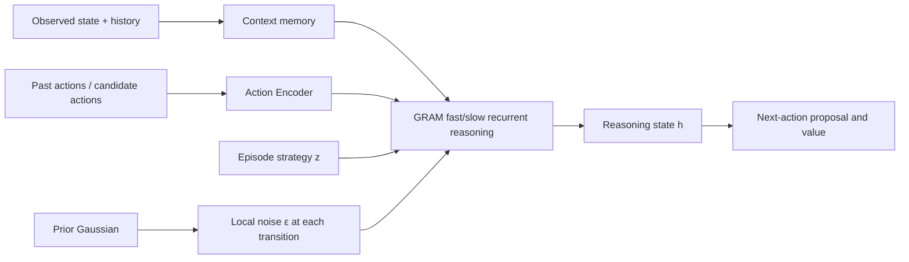
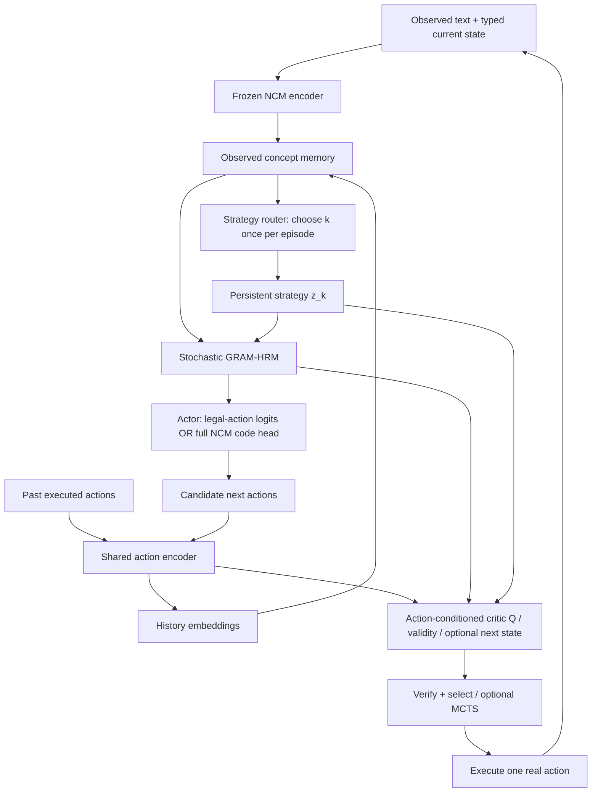

# V15 Astra-R: Multi-Strategy Data + GRAM + Action Encoder + Global Strategy `z`

**Research and engineering specification | Draft v0.1 | 18 October 2026**  
**Status:** Proposed experiment, **not** a trained, validated architecture.  
**Hardware reference:** MacBook Air M2, 8 GPU cores, 16 GB unified memory.  
**Lineage:** Extends `V15_Astra_Engineer_Training_Spec(2).md` and responds to `FIRST_PRINCIPLES_REVIEW.md`, `diagnostics(1).json`, and our discussion of insufficient trajectory diversity and replacing/reinterpreting V15's additional strategy latent.  
**Abbreviations:** NCM = Next-Concept Modeling; HRM = Hierarchical Reasoning Model; GRAM = Generative Recursive Reasoning; MCTS = Monte Carlo Tree Search.

> **Core proposal:** Keep the pretrained NCM tokenizer **frozen**. Use a **verified, multi-solution, long-horizon dataset**. Retain GRAM's stochastic recurrent dynamics. Give the agent an **action encoder** for action history and *candidate action evaluation*. Retain a separate, **episode-persistent global strategy `z`**, but require it to show causal, reward-relevant differences in complete plans. Do not add GradCuit, MCTS or continual learning until the corresponding simpler comparison succeeds.

> **Source distinction:** GRAM's stochastic recurrence and target-informed posterior come from [Baek et al.](https://arxiv.org/abs/2605.19376); NCM's multi-resolution code hierarchy comes from [Kumbong et al.](https://arxiv.org/abs/2610.14162). **The action-conditioned critic, persistent `z`, new dataset curriculum, joint training recipe, and integration between them are Astra-R research proposals**, not claims made or validated by those papers.

---

## 0. Executive decision and five research questions

### Decision

**Build four matched models, not one full system immediately:**

1. **B0: deterministic recurrent control** with legal-action ranking and optional NCM-code generator.
2. **B1: stochastic GRAM** without a global strategy `z`.
3. **B2: GRAM + action encoder** without `z`.
4. **B3: GRAM + action encoder + global `z`** (this document's candidate architecture).

Compare on **the exact same underlying tasks** with one-reference versus multiple-solution supervision, hard held-out environments, and identical verifier/compute budgets. This isolates effects that otherwise become entangled.

Five falsifiable questions:

| Question | What would count as evidence? | Null result / interpretation |
|---|---|---|
| Does stochastic GRAM help? | Additional **valid** and independently useful plans at equal runtime | Noise may be unused or too costly |
| Does action encoding help? | Better calibrated candidate-action values, legality or episode success | Explicit action features may be unnecessary |
| Does global `z` help beyond GRAM noise? | A *fixed* `z` consistently controls distinct successful multi-step strategies | Strategy bank is redundant; remove it |
| Does multi-strategy training matter? | B3-vs-B2 advantage increases on controlled multi-solution data | More data alone did not activate strategy learning |
| Does reasoning beat simpler planning? | Stronger held-out episode success **per second/verifier call** than direct action, greedy heuristics, BFS/A* where applicable | Do not claim a reasoning/scaling breakthrough |

### Why this revision is necessary: existing audit, not speculation

The 18 October V15 snapshot used a **frozen LM1B NCM codec**, a **10,000,333-trainable-parameter GRAM** plus **111,404,672 frozen tokenizer parameters**, and a fixed 128-transition validation panel. GRAM reached **82.03%** optimal next action; a simple legal-distance heuristic scored **84.38%** on the same panel. **493/641 (76.91%)** target code positions are constant among seven canonical actions, and their correct level-1-to-4 prefixes already distinguish the seven actions. The live pilot **does not establish useful GRAM stochasticity**, an effect from strategy `z`, or multi-step planning superiority. See `FIRST_PRINCIPLES_REVIEW.md` and `diagnostics(1).json`.

A dataset with many different problems can still carry **one predictable next-action label per state**. That teaches imitation, not multiple reasoning policies. The new experiment deliberately distinguishes **problem variety**, **trajectory diversity for the same problem**, and **actual long-horizon difficulty**.

---

## 1. First principles: three different types of uncertainty/control

### 1.1 The underlying decision problem

At external time `t`, an environment has a state `s_t`, the agent observes `o_t`, chooses action `a_t`, and the environment transitions according to `s_{t+1}=F_env(s_t,a_t)` for deterministic pilot tasks. The goal is to reach a terminal set before a step limit `H`. The true objective is **episode success**, not 641 code labels matching a teacher:

$$
J(\theta)=\mathbb E_{\pi_\theta,F_{env}}\big[\mathbf 1\{s_{T}\in G\}\big],\qquad T\le H.
$$

Symbols: `θ` is trainable policy parameters; `π_θ` is the action-selection policy; `F_env` is the simulator; `G` is the set of goal states; `T` is the stopping step; `1{...}` is 1 if the event happens, otherwise 0. This indicator is typically **not differentiable**, so we train supervised predictions and/or use sampled-reward estimators.

### 1.2 Do not conflate GRAM's state with Astra's global `z`

The original GRAM paper calls its recurrent latent state `z_t` in the general formulation, and its hierarchical instance has low-level state `l` and high-level state `h`. **This document reserves `z` for a NEW global strategy**, while using `h_r` and `l_{r,j}` for GRAM's state. The three objects are:

| Representation | Example shape | Time scope | Purpose |
|---|---|---|---|
| `h_r`, `l_{r,j}` | `[B,S,d]` | Recurrent computation | Evolving solution state |
| `ε_r` | `[B,S,d]` | New draw at each slow transition `r` | Stochastic correction; explore local trajectories |
| `z_k` | `[B,M_z,d]` | Same global mode `k` across an **episode** by default | Coherent long-term strategy preference |
| `e(a)` | `[B,d_a]` or `[B,A,d_a]` | A known past or considered candidate action | Represent action identity/semantics |
| NCM codes `C` | `[B,641]` for chosen LM1B pilot | Representation of one 128-text-ID block | Generate/decode an action text block; **not** the MCTS steps |

`B`: batch size; `S`: recurrent slots (pilot 16); `d`: recurrent width (pilot 128); `M_z`: global latent tokens (start with 1 or 2); `d_a`: action embedding width (propose 64 or 128); `A`: available candidates. These are proposals; the pinned checkpoint is the authority for actual codec dimensions.

### 1.3 Visual intuition: different jobs, not three names for the same noise



Think of `z` as **which route the agent is committed to**, `e(a)` as **which concrete move is under consideration**, and `ε` as **small exploratory deviations in the internal computation**. In the pilot, measure whether they actually separate this way; the picture is a hypothesis, not a measured representation.

### 1.4 A toy branching example

State `S` has two equal-cost routes to goal `G`: `S→U→G` and `S→D→G`. A single canonical target `U` makes a perfectly competent `D` proposal look like an error. Multi-solution supervision marks both paths successful. A meaningful high-level latent could favor `U` across the *whole route*, while the candidate-action encoder represents `MOVE_UP` or `MOVE_DOWN`. If `z` flips midway without new information, it is not a persistent strategy.

---

## 2. DATASET: what specifically must change

### 2.1 Dataset requirement: multiple *verified* plans, not just paraphrased text

For each problem instance `i`, store its complete observation rules, exact transition API, starting state `s_0`, goal predicate, action grammar, horizon and a **set of verified successful trajectories**:

$$
\mathcal T_i=\{\tau_i^{(1)},\ldots,\tau_i^{(m_i)}\},\qquad
\tau_i^{(j)}=(s_0,a_0,s_1,a_1,\ldots,s_T).
$$

`m_i` is the number of retained distinct successful plans. Require `m_i ≥ 2` for multi-plan examples, and only count trajectories whose transitions and final goal are checked by the simulator. **An alternative valid immediate action is not necessarily part of a successful plan.** Distinguish `legal`, `successful`, `shortest`, `near-optimal`, and `failed-but-informative`.

### 2.2 Proposed task families and why each exists

| Task family | Example | Source of multiple valid strategies | Main diagnostic |
|---|---|---|---|
| **Branching mazes and graphs** | Two corridors, barriers, costly doors | Topologically distinct paths | Route commitment, detours, graph generalization |
| **Modular/state-machine programs** | Reach residue goal using add/subtract/multiply | Different operation sequences | Algebraic planning beyond nearest-distance heuristic |
| **Stack-machine / symbolic execution** | Satisfy typed stack program | Different instruction sequences with same output | Multi-step validity, exact state updates |
| **Block rearrangement / mini planning** | Move blocks to a target arrangement | Different subgoal orders | Long-horizon dependencies and reversibility |
| **Constraint satisfaction** | Small graph coloring or N-Queens | Multiple valid assignments | GRAM stochastic *solution* diversity without necessarily having agent actions |
| **Rule-change curriculum** | Change transition rules after partial execution | Need plan revision | Adaptation vs memorization |

**Do not train the same action semantics inconsistently.** Each domain gets a declared typed action schema and deterministic parser. Constraint-satisfaction outputs may be full solution strings; treat them as **a separate evaluation track**, not as action-step trajectories, unless the environment explicitly models partial assignments as actions.

### 2.3 Three matched training panels (the decisive experiment)

**D-SINGLE:** Exactly **one** verified successful teacher plan per underlying problem. This reproduces canonical imitation but uses the same improved state descriptions and problem population.

**D-MULTI:** The **same underlying problem IDs**, but expose several verified plans per problem. Sample alternative plans under explicit weights. Training updates/tokens must be matched to D-SINGLE; do not accidentally give D-MULTI 4× the compute. Evaluation is on the same held-out problem families.

**D-MULTI-HARD:** Keep multiple valid plans but increase causal difficulty: misleading distance heuristics, obstacles requiring backtracking, delayed reward, mixed operations, partial observability only if the policy tracks a belief state, and **truly** 10/20/30-step optimal paths. Release a *separate versioned benchmark*, never silently replace the earlier test set.

**Attribution logic:** If B3 beats B2 only on D-MULTI, that supports usefulness of `z` when multiple solutions are available. If both fail on D-MULTI-HARD, the representation, training, or planning capacity may be inadequate. A larger D-SINGLE result alone does **not** answer whether the strategy component works.

### 2.4 Difficulty buckets and data composition (proposed targets, not observed facts)

Stratify held-out episodes by **minimum required verified steps** to any goal:

| Bucket | Optimal path length | Purpose | Target share in *hard evaluation* |
|---|---|---|---:|
| H1 | 1–4 | Plumbing / simple behavior | 15% |
| H2 | 5–9 | Short planning | 20% |
| H3 | 10–19 | Sustained planning | 25% |
| H4 | 20–29 | Long-horizon planning | 20% |
| H5 | ≥30 | Stress test | 20% |

Do not infer horizon from NCM level count or text-block length. `optimal_path_length` is **review/evaluation metadata**, not an input to the policy unless the same quantity is genuinely observable at deployment. Prefer environment families with branch factor `2–6`, bounded nonterminal branching, wrong-path traps, and difficulty bins where the simple distance heuristic measurably fails. Log distribution of *number of independent successful path classes* per task (`1`, `2`, `3–4`, `≥5`).

For train/validation/test, use **group-level split before extracting transitions or alternative trajectories**. Suggested 80/10/10 by environment-family group, plus a sealed OOD suite. If the same maze geometry or rule program is reused with a different successful trajectory, **all variants belong to one split**.

### 2.5 Diversity must be semantic, not cosmetic

Two plans should count as different only if they are meaningfully different after normalizing syntax:

1. Canonicalize action IDs and remove formatting differences.
2. Discard cycles and duplicates when defining shortest/near-shortest strategy classes, but retain cycles explicitly in recovery/failure-track data.
3. Compare paths using action edit distance, first decision divergence, state-sequence overlap, and topology/waypoint signatures. Only use domain-appropriate measures.
4. Require **independent route choice** for the multi-strategy label, not merely two wordings of the same route.
5. Record path cost and outcome. Do not call a long, valid but unsuccessful detour a successful strategy.
6. Preserve class coverage: do not fill `m_i=4` with nearly identical plans from the same branch.

Example for a maze with two disjoint corridors: `class=UPPER_ROUTE` and `class=LOWER_ROUTE`. These **training-only semantic labels** can help study a latent intervention, but the deployed `z` router must not receive the *correct future class label*.

### 2.6 Data balance and anti-shortcut controls

- **Paired counterfactuals:** same goal-distance, different wall layout requiring different first moves. The *full observable walls* must be included in inputs or typed state.
- **Symmetry tests:** reflect/rotate mazes with consistently transformed actions; ensure no arbitrary `LEFT` dominance.
- **Length control:** avoid predicting path class using trivial variation in teacher text length.
- **Rule paraphrases:** paraphrase instructions while preserving the exact underlying state and target semantics; split paraphrases with their parent problem.
- **Negatives:** distinguish illegal moves, legal but losing moves, and successful alternatives. Use these for action-value learning, not as valid teacher targets for a successful-plan actor.
- **Unseen combinations:** hold out operator compositions and map templates, not merely random rows.
- **Distribution audit:** track domain counts, action frequencies, successful strategy classes, required shortest lengths, ties and heuristic-failure rate.

### 2.7 Schema: one problem and its alternative solutions

```json
{
  "problem_id": "graph_v2_00417",
  "family_group_id": "topology_seed_005",
  "split": "train",
  "domain": "graph_navigation",
  "env_version": "graph_nav_v2",
  "initial_state": {"node": "S"},
  "observation": {
    "nodes": ["S", "U", "D", "G"],
    "edges": [["S","U"],["U","G"],["S","D"],["D","G"]],
    "goal_node": "G"
  },
  "action_schema_version": "move_neighbor_v1",
  "horizon_budget": 3,
  "eval_only_optimal_distance": 2,
  "solutions": [
    {
      "solution_id": "u_path",
      "verified": true,
      "terminal_success": true,
      "total_cost": 2,
      "strategy_class_eval_only": "UPPER",
      "actions": ["MOVE_U", "MOVE_G_FROM_U"],
      "states": [{"node":"S"},{"node":"U"},{"node":"G"}]
    },
    {
      "solution_id": "d_path",
      "verified": true,
      "terminal_success": true,
      "total_cost": 2,
      "strategy_class_eval_only": "LOWER",
      "actions": ["MOVE_D", "MOVE_G_FROM_D"],
      "states": [{"node":"S"},{"node":"D"},{"node":"G"}]
    }
  ],
  "codec_manifest_sha256": "REPLACE_WITH_REAL_PINNED_HASH"
}
```

**Important:** This is illustrative, not a claim of having generated those episodes. `eval_only_*` fields must be stored separately from policy observations. IDs like `MOVE_G_FROM_U` are intentionally typed; in an implementation, use stable action semantics and canonical serialization independent of the training label. Each episode must contain a reproducible transition function or environment spec; a list of successful states alone is not a substitute for a verifier.

### 2.8 Production data generation algorithm (reference pseudocode)

```python
for family in sample_environment_families(seed):
    split = split_by_stable_family_hash(family)  # before plans/rows
    for problem in generate_problems(family):
        assert complete_observation_matches_true_task_rules(problem)
        graph = expand_verified_state_space(problem)  # only for tractable simulators
        good_plans = enumerate_or_sample_successful_plans(
            graph, horizon=problem.horizon, max_cost_ratio=1.25
        )
        good_plans = [p for p in good_plans if replay_exactly(problem, p).success]
        classes = classify_semantically_distinct_plans(good_plans, problem)
        if len(classes) >= 2:
            save_multistrategy(problem, representative_plans(classes), split)
        save_single_plan_control(problem, choose_one_plan(good_plans), split)
        save_action_outcomes(problem, exhaustive_or_rollout_labels(graph), split)
# Then build frozen NCM text-block code caches from TRAIN observations/targets.
# Keep any oracle search traces/optimal distances in teacher/evaluator storage only.
```

For larger/intractable state spaces replace `expand_verified_state_space` with bounded search, seeded randomized planners and **record coverage limitations**. Search used to construct offline teacher data is allowed; it is **not** permission to give the test-time policy an oracle transition or value it would not normally have. All baseline solvers get their actual runtime costs measured.

---

## 3. The frozen NCM representation: unchanged contract

NCM maps an exactly specified text-token block `X_b` to a hierarchy `C_b=T_NCM(X_b)`, then `D_NCM(C_b)` reconstructs text. For the audited LM1B pilot, code levels had lengths `(1,8,16,24,32,40,52,64,76,92,108,128)`, totaling **641 codes**, with **4096 classes per code**. Those numbers are checkpoint-specific; pin and verify them. NCM predicts all positions in one level in parallel while levels are sampled sequentially.

**Non-negotiable limits:**

- Freeze all BPE, encoder, codebooks, projections and decoder parameters. Codec IDs/caches tied to a specific checkpoint hash.
- The LM1B pre-tokenizer in the review destroys some case/accent distinctions (`Foo` vs `foo`, `résumé` vs `resume`). Do not claim exact general symbolic fidelity.
- In the old pilot, maze text omitted walls, which were instead provided via an **88-integer typed state**. This caused text-input aliasing unrelated to quantization. New code-only experiments must serialize walls/rules; state-conditioned experiments must retain the separate typed-state qualification.
- Audit action **round-trip** (`serialize→BPE→NCM encode→decode→parse`) on every action grammar, not just average token reconstruction.
- Do not equate `12 NCM refinement levels` with `12 decisions` or `12 GRAM thoughts`.
- The 641-code head is hugely redundant for seven actions. **Always test a direct action head** as an efficiency baseline and, for known enumerated actions, as an optional main action-selection pathway.

### Two separate policy tracks

**Track E (enumerable action space, preferred for present tasks):** `state→reasoning→policy over legal actions`, with action encoder and value head; NCM decoding only when an action must be expressed as text. This is efficient and reduces the trivial seven-action-to-641-code mismatch.

**Track G (open-ended generative actions):** `state/context→reasoning→641 NCM codes→frozen decoder→parse action`, then encode the **generated candidate** and verify/rank it. This preserves V15's generative objective but pays the 12-level head/decode cost. Never claim the two tracks have equal sampling costs.

---

## 4. Proposed GRAM + action encoder + `z` architecture

### 4.1 Safe dataflow: proposal actor versus candidate-conditioned critic



**Leakage firewall:** The actor **never receives the target next action** while predicting that same next action. Actor input may contain **past executed actions**. The critic may receive a **candidate action** because its job is to assess *what happens if we try this candidate*, not to guess its identity. During training, use positives **and negatives** as candidate critic inputs. If an action-conditioned recurrent model predicts future consequences, condition it on the tested candidate; it must not be reported as an action-generating policy.

### 4.2 Module interfaces and tensor shapes (pilot proposals)

| Module | Input | Output | Trainable? |
|---|---|---|---|
| Frozen NCM | observed BPE IDs `[B,128]` or indexed blocks | 12-level codes `[B,641]` | **No** |
| Context encoder | observed codes `[B,W,641]`, typed state `[B,D_s]` | `M:[B,L_m,128]` | Yes |
| Past action encoder `E_a` | historical action IDs/features `[B,T_h]` | `[B,T_h,64]`, projected to 128 | Yes |
| Strategy router | context summary `[B,128]` | mode probabilities `[B,K]` | Yes (Stage S4) |
| Global `z_k` | mode, context | `[B,M_z,128]`, fixed mode per episode | Yes (Stage S4) |
| Fast GRAM | `l:[B,16,128]`, `h`, `M`, `z` | updated `l:[B,16,128]` | Yes |
| Slow GRAM + prior | `h`, `l`, `M`, `z` | `u,μ_p,σ_p:[B,16,128]`; sampled `h` | Yes |
| Training posterior | same recurrent state **plus true target codes** | `μ_q,σ_q:[B,16,128]` | **Training only** |
| Actor (Track E) | pooled GRAM state, context, z | canonical action logits `[B,V_A]` + legal mask | Yes |
| Actor (Track G) | GRAM state/context/z + previous generated code levels | each-level code logits `[B,n_l,4096]` | Yes |
| Candidate critic | current state, pooled GRAM state, `z`, action vector `[B,A,64]`, remaining horizon | `Q:[B,A]` and optional successor/legality predictions | Yes |

`W`: observed history blocks; `L_m`: context memory slots; `D_s`: true observed typed-state dimension; `T_h`: observed past action count; `V_A`: canonical action vocabulary size. Use arrays rather than one-hot variables for structured actions. `D_s` is task dependent; the old fixed 88-element state should not be assumed universal.

**Core optimization:** compute context once, not once per candidate. For a small action space, run actor's GRAM reasoning once; apply a vectorized candidate critic over all legal actions. A more expensive **action-conditioned GRAM rollout per candidate** is a separate ablation, not a requirement.

### 4.3 Action encoder: from first principles

For finite action IDs `a`, the smallest encoder is a table `E_A∈R^{V_A×d_a}`. Selecting row `a` yields `e(a)∈R^{d_a}`. If actions have typed arguments, combine verb and argument encodings:

$$
e(a)=\mathrm{MLP}_{a}\!\left([E_{verb}(v_a),E_{arg}(r_a)]\right).
$$

`v_a` = verb (`MOVE`, `ADD`, `MULTIPLY`); `r_a` = argument (`LEFT`, `2`, an object ID); square brackets are concatenation. Output is `[B,d_a]`. Benefits: compositional generalization is possible, but only if the data spans enough verb/argument combinations. For current seven canonical actions, an embedding table is the first control; do **not** claim an elaborate encoder is necessary.

For the critic, fuse candidate actions **after** a common GRAM representation:

$$
q_a=\sigma\!\left(f_{Q}([\bar h,\bar M,\bar z,e(a),E_H(H)])\right).
$$

`h̄`, `M̄`, `z̄` are pooled `[B,128]` vectors, `E_H(H)` encodes remaining horizon, `f_Q` is an MLP, and `σ` is the logistic sigmoid. `q_a∈(0,1)` estimates **success probability under a specified continuation policy**, not an unquestionable optimal `Q*`. Keep `policy_version` in the label manifest.

**Practical value example:** From a state with two legal actions, the critic predicts `q_UP=0.78`, `q_DOWN=0.63`. The planner ranks `UP` higher. If the simulator later shows the upper corridor blocked by new information, recompute from the updated observation; no target answer was supplied to the actor.

### 4.4 GRAM stochastic dynamics, with a persistent global strategy

Start with encoded memory `M`, initialized `h_0,l_0`, and mode-conditioned `z_k`. At slow transition `r`, apply `J` low-level updates:

$$
l_{r,j+1}=F_L(l_{r,j},h_{r-1},M,z_k),\quad j=0,\ldots,J-1.
$$

Then obtain a deterministic high-level proposal:

$$
u_r=F_H(h_{r-1},l_{r,J},M,z_k).
$$

A learned prior returns Gaussian mean/scale and samples a **local stochastic correction**:

$$
(\mu_{p,r},\rho_{p,r})=G_p(u_r,M,z_k),\qquad
\sigma_{p,r}=\operatorname{softplus}(\rho_{p,r})+\sigma_{min},
$$

$$
\xi_r\sim\mathcal N(0,I),\quad
\epsilon_r=\mu_{p,r}+\sigma_{p,r}\odot\xi_r,\quad
\boxed{h_r=u_r+\epsilon_r}.
$$

`F_L/F_H/G_p` are trainable modules; `ξ_r` is independent standard Gaussian noise; `⊙` means elementwise multiplication; `σ_min>0` avoids zero scale. Shapes for `h,u,ε,μ,σ` are `[B,S,d]`. This is **an Astra conditioning extension** to GRAM, not the source paper's exact implementation. A paper-matching isotropic variance control must remain available.

**Gradient geometry:** Increasing `σ` lets nearby samples spread further through hidden-state space; decreasing `σ` concentrates them. Larger variance is **not automatically better exploration**: it may produce invalid actions or noisy value estimates. Measure behavior-level rather than vector-distance diversity.

### 4.5 What precisely is global `z`?

Begin with **two or four modes**. Let a router see only observations at the **episode root**:

$$
\pi_{\omega}(k\mid X_0)=\operatorname{softmax}_k(R_\omega(\bar M_0)),\quad
z_k=G_z(\bar M_0)+m_k.
$$

`k∈{1,…,K}` is sampled/selected **once per episode**; `m_k∈R^{M_z×d}` is a learned mode embedding; `G_z` maps root context to `M_z×d` continuous tokens. Hold the same `k` and default `z_k` constant during an episode, while GRAM can resample `ε_r` at each reasoning transition. If replan-after-observation is tested, declare when and why `z` can change; do not silently resample every action.

A single mode should ideally induce a consistent *class of complete trajectories* rather than merely different first actions. Assess interventions `do(z=z_i)` on the **same state and same GRAM random seeds**; measure whether high-level plan decisions, goal success, and path class change predictably.

**Avoid mode label mythology:** `k=0` need not universally mean 'upper route'; mode labels may permute across training runs. A useful `z` need only cause stable, valuable behavioral distinctions in matched contexts. Require each mode to help somewhere; avoid forcing uniform occupancy if true strategy prevalence is not uniform.

### 4.6 Inference algorithm (Track E: enumerable actions)

```python
def choose_action(observation, past_actions, root_strategy, remaining_horizon):
    M = encode_observation_frozen_NCM_and_typed_state(observation)
    M = fuse_past_action_embeddings(M, past_actions)
    k, z = root_strategy  # selected earlier; branch-local in search
    h, l = init_recurrent_state(M)
    for r in range(R):
        for j in range(J):
            l = gram_fast(l, h, M, z)
        u = gram_slow_proposal(h, l, M, z)
        mu, sigma = gram_prior(u, M, z)
        h = u + mu + sigma * sample_normal_like(mu)
    legal = environment_legal_actions(observation)  # only if agent has this API
    logits = direct_action_actor(h, M, z)
    action_vectors = action_encoder(legal)
    q = candidate_critic(h, M, z, action_vectors, remaining_horizon)
    # Predefine: choose policy alone, critic alone, or a calibrated combination.
    return select_among_legal_actions(logits, q, legal)
```

If the environment does not expose legal actions, candidates must be proposed (or legality predicted) with honest failure rates. A known legal-action enumerator is an **environment capability**, not learned reasoning; compare it as a control. Track G substitutes NCM code generation and frozen decoding for the direct actor, then runs the same candidate critic only on decoded/parsed proposals.

---

## 5. Training objective, derived without hidden target leakage

### 5.1 Step one: the action and code losses

For **Track E** with a training target action `a*`, and actor distribution `π_θ(a|X,z,τ)`, the simplest likelihood loss is:

$$
\mathcal L_{act}=-\log\pi_\theta(a^*\mid X,z,\tau).
$$

When multiple target actions from the same state are equally successful, sampling one validated teacher continuation per update gives a legitimate data-mixture objective; it does **not** directly maximize final goal reward. Alternatively, a soft target over *successful* legal actions can be constructed from offline verified rollouts, with weights tied to quality. Never treat **every legal action** as equally successful.

For **Track G**, teacher codes for target text block `Y=(Y_{\ell j})` yield:

$$
\log p_\theta(Y\mid X,z,\tau)
=\sum_{\ell=1}^{12}\sum_{j=1}^{n_\ell}
\log p_\theta(Y_{\ell j}\mid X,z,\tau,Y_{<\ell}).
$$

`ℓ` indexes NCM refinement level, `j` indexes code positions *inside that level*, `n_ℓ` is position count, and `Y_{<ℓ}` denotes **earlier target levels in teacher-forced training** or **earlier generated levels at inference**. The 641-term **sum** is proper hierarchical code log-likelihood; per-code averages are reporting/training surrogates, not the same joint log probability. The first level must be generated, never injected from target at inference.

### 5.2 Step two: GRAM's training-only posterior

Since a sampled latent trajectory may influence the answer, train an amortized inference posterior that receives the true target **during training only**:

$$
q_\phi(\epsilon_r\mid X,Y,z_k,\epsilon_{<r})
=\mathcal N(\mu_{q,r},\operatorname{diag}(\sigma_{q,r}^2)).
$$

At inference, use the **prior**, not this target-conditioned posterior. For `p` and `q` diagonal Gaussians, one coordinate's KL is:

$$
\operatorname{KL}(q\Vert p)
=\frac12\left[\log\frac{\sigma_p^2}{\sigma_q^2}+
\frac{\sigma_q^2+(\mu_q-\mu_p)^2}{\sigma_p^2}-1\right].
$$

Derivation: `KL(q||p)=E_q[log q - log p]`; insert two Gaussian log densities; `E_q[(ε-μ_q)^2]=σ_q²`, and `E_q[(ε-μ_p)^2]=σ_q²+(μ_q-μ_p)²`. Sum over all coordinates/transitions to obtain the trajectory KL. Check with FP64 near equality to avoid apparent tiny **negative** KL caused by cancellation; true KL is nonnegative.

For a single chosen global mode `k`, the terminal generative evidence lower bound (ELBO) is:

$$
\mathcal B_k(X,Y)=
\mathbb E_{q_k(\tau\mid X,Y)}[\log p_\theta(Y\mid X,z_k,\tau)]
-\operatorname{KL}(q_k(\tau\mid X,Y)\Vert p_\theta(\tau\mid X,z_k)).
$$

To see why this is a **lower** bound, write `p(Y|X,z_k)=E_{q_k}[p(Y,τ|X,z_k)/q_k(τ|X,Y)]` and apply Jensen's inequality `log E[v] ≥ E[log v]`. For multi-action episodes, `Y` should be the *complete teacher trajectory* and prior/posterior factorization must account for sequential observations/actions; using single-block `Y_t` changes the objective and training signal. The initial cheap pilot may train block-level objectives while evaluating full trajectories; label it honestly.

### 5.3 Step three: strategy mixture and responsibilities

With `K` global strategies and observed root `X_0`, the generative mixture is:

$$
p_\theta(Y\mid X_0)=\sum_{k=1}^{K}\pi_\omega(k\mid X_0)
\int p_\theta(Y\mid X_0,z_k,\tau)\,p_\theta(\tau\mid X_0,z_k)\,d\tau.
$$

Training may use a **target-aware** variational responsibility `r_η(k|X_0,Y)` and per-mode posterior `q_k`. Applying Jensen over mode `k` and stochastic trajectory produces:

$$
\boxed{\mathcal B_{mix}=
\sum_{k=1}^{K}r_k\mathcal B_k
-\operatorname{KL}(r\Vert\pi_\omega)},\qquad \sum_k r_k=1.
$$

Here `r_k` means the *training* probability assigning the observed complete plan to mode `k`, while `π_ω(k|X_0)` is the *inference* strategy prior. For fixed exact per-mode bounds `B_k`, maximizing the displayed expression gives `r_k∝π_k exp(B_k)`. **Do not put noisy one-sample estimates into `logsumexp` and automatically claim an unbiased, exact mixture likelihood bound.** If the full variational calculation is too expensive, clearly call the implemented objective a sampled variational **surrogate**, with its approximation bias documented. For smaller experiments one can supervise approximate trajectory classes as a **distinct conditional strategy objective**, not the same ELBO.

Crucial consistency requirement: use the **same episode-level `k`** for *all actions in a demonstrated teacher plan*. If the mode changes every block, the model is training a different per-block mixture, not persistent strategies.

### 5.4 Step four: candidate-action value and dynamics

With verified training rollouts, let `g∈{0,1}` indicate eventual success within the remaining horizon **under the recorded continuation policy**. The critic predicts `q_a=Q_ψ(s,a,z,H)`. Use binary cross entropy:

$$
\mathcal L_Q=-\big[g\log q_a+(1-g)\log(1-q_a)\big].
$$

This is derived from negative log-likelihood of a Bernoulli event: `p(g|q)=q^g(1-q)^(1-g)`. Include both positive and negative candidates (not just selected expert actions), otherwise the critic can learn a trivial 'everything shown to me wins'. Record `policy_id`, `horizon`, `episode_group`, `candidate_a` for every value label. The same state/action may have different success chances for different continuation policies or horizon budgets.

Optional **next-state predictor** for tasks without exact simulators:

$$
\hat s_{t+1}=F_\psi(s_t,e(a_t),h_t,z),\quad
\mathcal L_{dyn}=d_s(\hat s_{t+1},s_{t+1}).
$$

`d_s` is a state-appropriate error (cross entropy on categorical states, squared error on continuous states). **Do not replace a trustworthy exact simulator with a learned dynamics head** in the first pilot; use the learned head as a diagnostic, and only later compare learned-model planning with true-transition planning.

### 5.5 The practical multi-objective loss

During the **ablation phase**, keep components separable:

$$
\mathcal L_{total}=
\lambda_{gen}(-\mathcal B_{mix})+
\lambda_Q\mathcal L_Q+
\lambda_{dyn}\mathcal L_{dyn}+
\lambda_{aux}\mathcal L_{aux}.
$$

Every `λ` is a **declared nonnegative weight**, not an established constant. Choose `λ_gen=1`; initially turn **off** untested dynamics/diversity auxiliaries (`λ_dyn=λ_aux=0`), and add a separate critic stage (`λ_Q` used only when value labels are meaningful). Beware of mismatched scales: Track G's summed code log likelihood spans 641 positions, while a single-action BCE is one scalar. Report raw components and gradient norms before combining them. No arbitrary diversity maximization should reward invalid action trajectories.

**Important training-order alternative:** First train actor/GRAM until it can reliably solve tasks, then train a **frozen-policy** critic on outcome rollouts, and only then jointly fine-tune if separate evidence says it helps. This reduces nonstationary value targets and makes causal ablations easier.

### 5.6 Do we need an extra diversity loss?

**Not initially.** Multi-plan examples plus a well-specified global-mode latent may already incentivize distinct modes. If every mode collapses, compare (1) stronger multi-plan balance, (2) trajectory-class-guided training, and (3) a measured aggregate-mode-use regularizer, each as a **separate ablation**. Forcing embeddings far apart in Euclidean space is insufficient; reward must depend on *verified behavioral* distinctions. Penalizing KL too strongly can suppress useful GRAM randomness; setting KL to zero can allow training-only posterior shortcuts that the inference prior cannot reproduce. Measure the gap rather than choosing β by intuition alone.

---

## 6. Staged training plan and freeze table

| Stage | Train | Frozen | Required evidence before moving on |
|---|---|---|---|
| **S0 Data/codec** | No NN parameters; build verified D-SINGLE / D-MULTI / D-MULTI-HARD | Entire NCM | Complete observable state; solver & diversity audits; split integrity; full action round-trips |
| **S1 Controls** | State-only direct-action policy; nonrecurrent code-head control; deterministic HRM | NCM | Closed-loop success, trivial/heuristic/BFS baselines, parameter/wall parity |
| **S2 GRAM base** | HRM + GRAM prior and train-only posterior; actor | NCM; no global strategy yet | Prior-only stochastic vs prior-mean vs deterministic; KL, valid-path diversity |
| **S3 Action encoder** | Past-action encoder, candidate critic, optional action-conditioned GRAM ablation | NCM, initially actor/GRAM during critic fitting | Better candidate ranking/calibration and episode success, no leakage |
| **S4 Persistent strategy `z`** | Mode router, global embeddings/conditioning, possibly GRAM fine-tune | NCM; posterior absent at inference | Causally distinct **successful** multi-step plan classes at equal compute |
| **S5 Test-time optimization (optional)** | **Temporary per-instance `z` offset only** at inference | All model weights | Verified improvement over equal-budget random/sham/sampling; finite differences |
| **S6 Search & distillation (optional)** | Value calibration, then distilled student on verified search trajectories | Teacher snapshot, NCM | Gain beyond BFS/A*, enumerate+rank, best-of-N at equal total cost |
| **S7 Continual learning (optional)** | Gated low-rank adapters, retrieval corrections, bounded consolidation | NCM, protected base | New-task acquisition plus old-task retention and recorded memory cap |

**Stop at any stage when its extra component fails the matched comparison.** The roadmap is a sequence of empirical gates, not an instruction to implement every stage regardless of results.

### Short training/inference pseudocode for the strategy stage

```python
# Train: full teacher trajectory Y may inform r/q, NEVER actor/router inputs.
M = encode_observed_problem_and_past_actions(observation, history)
pi_k = strategy_router(root_observation_only)
r_k = training_only_mode_posterior(root_observation, verified_teacher_plan)
for k in modes:
    z_k = strategy_tokens(root_observation, k)
    # Teacher-forced history is allowed, true FUTURE answer as input is not.
    bound_k = gram_episode_ELBO(
        observed_states_and_prefix_actions, verified_teacher_plan,
        strategy=z_k, posterior_is_training_only=True,
    )
loss_actor = -(r_k * bound_k).sum() + categorical_KL(r_k, pi_k)
optimize(loss_actor)

# Infer: no r_k, no q_phi, no teacher future, one persistent episode mode.
k = sample(strategy_router(initial_observation))
z = strategy_tokens(initial_observation, k)
for real_t in range(horizon):
    action = free_policy_and_action_ranker(observation, history, z,
                                           prior_noise_only=True)
    observation, reward, done = true_environment_step(action)
    history.append(action)
    if done: break
```

`gram_episode_ELBO` is a *specification-level placeholder*, not a released GRAM function. An implementation must define the sequential prior/posterior histories, `z` scope, per-step objective, masks and tensor shapes and unit-test against a tiny exhaustive model before calling it an exact ELBO.

---

## 7. Experiment design: identify the effect instead of guessing

### 7.1 Main ablation matrix

| Model | GRAM noise | Action encoder | Global z | Train on D-SINGLE | Train on D-MULTI |
|---|---|---|---|---|---|
| B0 deterministic HRM | No | Optional common direct action table | No | Yes | Yes |
| B1 GRAM | Yes | No | No | Yes | Yes |
| B2 GRAM+actions | Yes | Yes | No | Yes | Yes |
| **B3 GRAM+actions+z** | Yes | Yes | **Yes** | Yes | **Yes** |
| B4 GRAM+z (action-encoder ablation) | Yes | No | Yes | Optional | Yes |

**Control choices:** Match trainable parameters where feasible, optimizer updates/tokens, train elapsed wall time, and inference latency. Run two experiment sets: **same-backbone scientific ablation** and **equal-total-system-cost practical comparison**. Where exact parity is impossible, publish both measurement axes rather than claiming 'matched' without details. Start two diagnostic seeds, then **≥3 independent seeds** for any promoted claim; cluster-bootstrap by problem family.

### 7.2 Required baselines that can invalidate a claimed gain

- Greedy legal-distance heuristic, with fixed and random tie-breaking.
- BFS/Dijkstra/A* with *the same* available environment model and counted runtime.
- Direct state→action MLP with and without past-action encoder.
- Nonrecurrent NCM actor and deterministic HRM actor.
- GRAM prior mean vs 1/4/8 noise samples.
- Strategy `z` shuffled/random versus learned, holding GRAM noise seeds fixed.
- Best-of-N stochastic GRAM samples with same verifier calls as MCTS or GradCuit.
- Critic ablation: exact legal enumeration+ranking versus generative 641-code proposals.

### 7.3 Metrics: exactly what a successful `z`/stochastic model must show

**Decisive:** held-out complete-episode goal success, by minimum required steps and new rule families; success at matched wall time and verifier calls.

**Action layer:** legality, precision/recall of successful candidates, next-action optimality, action-value Brier score and calibration under a specified policy/horizon.

**Representation:** action round-trip fidelity, collisions, full-code exact match, NCM levelwise NLL, percent constant codes, model trainable/frozen param counts.

**GRAM:** prior-only success, posterior-only *diagnostic*, prior-mean performance, summed KL (nonnegative), `σ` ranges, stochastic **behavioral** diversity, unique verified successful solution classes per N prior samples.

**Global strategy `z`:** mode occupancy, `P(class|do(z=k),same task)`, mode-conditioned success, mode consistency over full episodes, gain relative to adding the same number of ordinary GRAM samples. A global mode whose outputs vary only in punctuation has failed.

**Search/CL later:** completed-action expansion count, verified returns, equal-time best-of-N, distillation no-search gains, acquisition-retention matrix, total stored adapters/retrieval/latency.

**Causal metric example:** On a held-out fork task, repeatedly run with identical context and GRAM noise seed but different `z` choices. If `z_1` sends 90% of *successful* runs through the upper route and `z_2` sends 90% of *successful* runs through the lower route, that is clear control. If both yield the same route, latent-vector separation alone counts for nothing. These 90% figures are **illustrative success criteria, not measurements**.

### 7.4 Pitfalls and kill switches

| Failure | Likely mechanism | Fix/test |
|---|---|---|
| `z` modes identical | Router/decoder ignores mode, or only one useful route | Paired multi-plan data; fixed-seed mode swap; remove if still null |
| GRAM prior/posterior identical with zero useful noise | KL pressure + easy single-answer targets | Measure hard ambiguous tasks; adjust β only as ablation; compare posterior and prior |
| Posterior appears excellent, inference fails | Training target leaked through posterior | Delete posterior at inference; perturb true Y and prove generation unchanged |
| Action encoder simply copies desired next action | Candidate is fed to **actor** that predicts same action | Enforce actor/critic input separation; use candidates only for evaluation |
| Critic predicts everything succeeds | Only expert positive candidates trained | Include failed/legal-but-losing rollouts and calibrate by policy+horizon |
| `z` controls first move but not plan | Mode resampled per block or no episode consistency | Pin global mode across episode; explicit episode-level training |
| More codes produce better NLL but not better action | 493 of 641 old action codes constant | Report exact verified actions; direct-action control |
| Hard benchmark secretly easy | Labels use arbitrary path length; trivial heuristic succeeds | Stratify by **shortest** distance and heuristic failure; solver audits |
| Codec loses necessary distinctions | Case/accent or state details disappear | Full text/typed state contract; collision audit; reject affected tasks |
| Reward evaluation leaks expert solver | Oracle shortest-distance/goal access inside model/reward | Isolate teacher/evaluator; count solver call cost; test environment-available rewards |
| Memory/compute unbounded | Per-mode GRAM × candidate × 641-code head | Cache context, vectorized critic, profile peak memory and latency |

---

## 8. M2 16 GB implementation tiers

### Tier A: minimal **causal** proof (recommended next)

- **Dataset:** e.g. 2,000 train problems, 250 validation problems, 250 sealed test problems, 2 verifiable plan classes for at least half of the multi-plan tasks. These are starting proposals, not guaranteed statistically sufficient.
- **Tasks:** small branching graphs + small rule-state programs; include one hard-detour diagnostic slice and length buckets up to 10–20 where feasible.
- **Model:** `d=128`, `S=16`, `J=2`, `R=2`, `K=2`, `M_z=1`, `d_a=64`. Use **Track E direct action head**; freeze NCM, cache observed codes (or state-only for an explicit control).
- **Experiments:** B0/B1/B2/B3 on D-SINGLE and D-MULTI. Do not activate GradCuit/MCTS/CL.
- **Resource safety:** batch 4–16 with gradient accumulation as measured; FP32 MPS initially for parity; keep canonical frozen NCM encoding on CPU if it changes code IDs on MPS; time and memory-profile before long runs. Specific throughput is hardware/workload-dependent and must be measured.
- **Go/no-go:** does B3 on the same problems produce a statistically persuasive gain in successful distinct plans or closed-loop success beyond B2 at matched inference budget?

### Tier B: local robust study

- Tens of thousands of *family-group-disjoint* problems with 2–4 diverse successful plans where possible; 3+ seeds.
- Add long-horizon 10–30+ and held-out rule-composition test groups.
- Compare exact **Track E** action selection to **Track G** full NCM code generation.
- Evaluate context pooling versus raw-code attention; prior stochasticity ablations; mode-persistence toggles; calibrated action critic.
- Add test-time latent optimization **only** after B3 demonstrates useful strategy interventions.

### Tier C: scale-up (single GPU or cluster)

- Richer open-ended text instructions, parameterized actions, compositional planning and larger branching state spaces.
- Additional environment families and realistic out-of-distribution splits; execute-action traces and partial-observation belief-state interfaces.
- Larger recurrent backbone, multiple modes, trajectory-level critic and search distillation; separate FLOPs/latency/codec calls.
- Compare with autoregressive Transformer planners, structured world models, goal-conditioned policies, MCTS, and direct tool-using language agents.

### Why compute matters

Full Track G output head: **641×4096 = 2,625,536 logits per generated block**. FP32 logits consume **10.5 MB per example** before backward activations; multiplied by sampled GRAM trajectories and `z` modes this can dominate local memory. The full LM1B pilot included ~111.4M frozen codec weights, not a free 10M-parameter stand-alone generator. A simple direct-action actor plus vectorized candidate critic is therefore the **most diagnostic first experiment**, although it cannot prove full NCM generative reasoning benefits.

---

## 9. First-principles numerical dry-run (two routes, two modes)

**Goal:** distinguish candidate action representation, stochastic reasoning, and persistent strategy selection.

Suppose root state `S` offers actions `UP` and `DOWN`. Both can reach `G` in two moves. Verified training paths are `UP→RIGHT` and `DOWN→LEFT` (action names are schematic; exact transitions are defined by the environment). The route classes are `upper` and `lower`.

1. **Encode observation**: complete state/rules → frozen NCM codes + typed state → context vector `M`.
2. **Encode past actions**: at the root, history is empty; at time 1, encode the actually executed `UP` or `DOWN` into `[1,64]`.
3. **Select strategy**: root router gives `π(k=1)=0.5`, `π(k=2)=0.5`; choose `k=2` and hold its `z_2` for both action steps.
4. **GRAM recurrence**: for each internal update, compute deterministic `u_r`; sample `ε_r` from learned prior; update hidden state `h_r=u_r+ε_r`. These samples do not change which mode `k` was selected.
5. **Actor**: proposes `{UP,DOWN}` without being told the ground-truth target action.
6. **Action encoder/critic**: embed both candidate actions; for illustration predicts `Q(S,UP,z_2,H=2)=0.25`, `Q(S,DOWN,z_2,H=2)=0.80`.
7. **Verifier**: select `DOWN`, execute exact transition to the lower node; observed new state and *previously executed* `DOWN` become the next actor inputs.
8. **Persist strategy**: keep `z_2`, resample GRAM local noise, select `LEFT`, verify arrival at `G`.
9. **Intervention**: same state and matched noise seeds, replace `z_2` with `z_1`. If complete successful route flips reliably to `UP→RIGHT`, `z` has meaningful causal control.

The `0.25/0.80` values are **invented for illustration**, not observed checkpoint outputs. If `UP` and `DOWN` truly have equal success probability under identical optimal continuation policies, a well-calibrated *unconditioned optimal* value should not give radically different values. The values above are plausible only for **mode-conditional continuation policies**: the `z_2` policy is more likely to finish its preferred lower route. This matters when interpreting a learned critic's target.

---

## 10. Required implementation files, tests and evidence

Suggested repository extension (create on demand; **these files are not included in this document**):

```text
v15_astra_r/
  configs/
    data_single.yaml
    data_multi.yaml
    data_multi_hard.yaml
    b0_deterministic.yaml
    b1_gram.yaml
    b2_action_encoder.yaml
    b3_action_encoder_z.yaml
  data/
    generate_problems.py       # split-first, reproducible
    enumerate_plans.py        # verifies + classifies distinct plans
    typed_actions.py          # common grammar and environment interface
    codec_cache.py            # frozen NCM code cache and hash
    audits.py                 # no leakage, class counts, collisions
  models/
    action_encoder.py
    gram_backbone.py
    strategy_router.py
    actor_direct.py
    actor_ncm.py
    candidate_critic.py
  training/
    train_actor.py
    train_critic.py
    train_strategy.py
    evaluate_episode.py
  tests/
    test_exact_transitions.py
    test_split_isolation.py
    test_actor_no_future_action.py
    test_posterior_never_in_inference.py
    test_strategy_episode_persistence.py
    test_critic_policy_horizon.py
    test_mode_swap_behavior.py
    test_frozen_codec_unchanged.py
```

**Mandatory unit and experimental acceptance checks:**

- [ ] `hash(NCM_parameters_before) == hash(NCM_parameters_after)`; deterministic cache hashes pinned.
- [ ] All `D-MULTI` teacher routes independently replay to terminal success.
- [ ] Two solutions of the same task never leak across train/test groups.
- [ ] At least two meaningful strategy classes exist in the designated multi-plan subset.
- [ ] Policy actor logits are invariant to changing the held-out future teacher action, with fixed observed history and random seed.
- [ ] Critic is tested with positive and negative candidate actions on the same state.
- [ ] Removing the posterior during inference changes **no** outputs for fixed prior random seeds.
- [ ] A global mode is preserved for every step of an episode and copied/restored per counterfactual search branch.
- [ ] Each GRAM noise ablation compares prior sample, prior mean and deterministic control.
- [ ] Code-head level 1 is always generated, and output evaluation includes *free* decoded actions.
- [ ] Critic success labels specify horizon and rollout policy; no unqualified `Q*` claims.
- [ ] Group-disjoint held-out tests and 3+ seeds support any promoted claims.
- [ ] Every score includes wall time, verifier cost, trainable/frozen params, and failure categories.

---

## 11. What this architecture would actually establish if successful

The success case is not simply 'GRAM with more components'. It is:

1. A frozen, reusable **hierarchical text representation** does not erase task-critical state.
2. A recurrent stochastic policy finds **distinct verified plans**, not merely varied text.
3. An explicit action encoder gives candidate-level reasoning or evaluation that a context-only recurrent model lacks.
4. A global `z` selects coherent plan families across **multiple real actions** beyond ordinary GRAM sampling.
5. These benefits survive new graph/rule families and beat simpler policies/solvers under measured total cost.
6. Only after those are true: search can be distilled and useful knowledge retained without uncontrolled memory growth.

If item 4 fails, deploy **GRAM + action encoder without `z`**. If items 2 and 4 fail, deploy a simpler deterministic action-conditioned planner. If a standard graph solver dominates on fully known tiny graphs, report the neural method as a representation-learning experiment rather than a superior planning algorithm.

---

## 12. References and evidence ledger

### Primary research (external)

1. **GRAM:** Baek et al., *Generative Recursive Reasoning* (2026), [paper](https://arxiv.org/abs/2605.19376), [HTML](https://arxiv.org/html/2605.19376). **Supports:** stochastic latent recursive transitions, learned prior/target-conditioned posterior, variational learning, multi-solution evaluation. **Does not establish:** Astra's global strategy `z`, NCM integration, or candidate-action encoder.
2. **NCM:** Kumbong et al., *Next-Concept Modeling* (2026), [paper](https://arxiv.org/abs/2610.14162), [official source](https://github.com/HazyResearch/ncm), [weights](https://huggingface.co/hazyresearch/ncm-checkpoints). **Supports:** frozen multiscale concept-code interface and levelwise parallel code generation. **Does not establish:** action-level planning or the Astra search stack.
3. **HRM:** *Hierarchical Reasoning Model*, [paper](https://arxiv.org/abs/2506.21734). **Supports:** hierarchical recurrence inspiration.
4. **Explorative Modeling:** [arXiv:2607.27372](https://arxiv.org/abs/2607.27372). **Inspiration** for global strategy diversity; this proposed variational router is a separate Astra design.
5. **GradCuit:** *Credit-Assigned Gradient Flow Enables Robust and Interpretable Test-Time Latent Reasoning*, [paper](https://arxiv.org/abs/2608.02585). **Inspiration** for optimizing instance-specific continuous latent variables, not direct empirical evidence for Astra's NCM-code or verifier-action estimator.
6. **MuZero:** [paper](https://arxiv.org/abs/1911.08265). **Inspiration** for value-guided planning with tree search, not evidence for this particular action encoder.

### User-supplied evidence (local, uploaded)

- `V15_Astra_Engineer_Training_Spec(2).md`: prior stage 0–7 implementation contract, NCM codec specification, GRAM Gaussian/ELBO, strategy and MCTS designs.
- `V15_Astra_Engineer_Review(2).md`: mathematical audit, unresolved implementation contracts, nonclaims about empirical validation.
- `FIRST_PRINCIPLES_REVIEW.md`: 18 October live-pilot limitations, target entropy audit, 82.03% vs 84.38%, missing maze-wall text, near-zero stochastic KL, baseline priorities.
- `diagnostics(1).json`, `pretokenizer_collisions.json`: logged dataset composition, canonical code redundancy, aliasing and baselines.
- `V15_Astra_Math_Checks_Result(1).json`: nine toy math checks; **not** validation of this newly proposed architecture.

**Document status:** research protocol and architecture proposal. No new model was trained or dataset generated in producing this file. Do not retroactively ascribe any new performance to V15.

**Visual Deliverables Included.**
