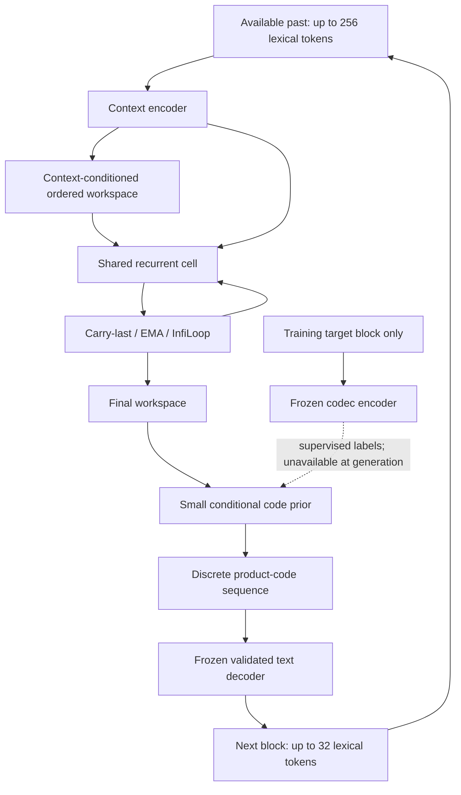

# V15 Astra: a discrete representation and recurrent-state redesign

**20 October 2026 — research and engineering design. Design only; no new training run has been started.**

Tokenizer derivation: [Discrete_LatentTokenizer.md](Discrete_LatentTokenizer.md).

## 1. Recommendation

The two papers justify a better experiment, not a claim that Astra has been repaired.

Use **RePR-inspired discrete representations** to investigate whether a compact text channel can preserve useful dependencies and exact details. Use **InfiLoop attention residuals** to investigate whether a recurrent predictor can retain useful intermediate states as compute increases. Keep those hypotheses independently testable.

The first implementation should be a small, conditional, position-aware model with:

- A frozen, validated 32-token discrete codec.
- An explicit 256-token past-context interface.
- A recurrent workspace that contains multiple ordered slots.
- A separately measured normalized code prior and text decoder.
- A carry-last, trained EMA and InfiLoop comparison using the same shared cell.
- Direct-token generation and deterministic structured rendering as strong controls.

Do **not** begin with a new 30M model, new codec, persistent latent strategy, nested loops and MCTS all trained together. That would make another failure difficult to locate. A roughly 30M allocation is specified below as a conditional scale target after the small experiments work.

This is a new codec/prior family, not a compatible continuation of the released NCM hierarchy. Its new alphabet, 32-token blocks and smaller widths require newly trained components or separately validated transfer. The official 97M generator's pretrained capabilities do not automatically transfer to these codes. Include that lost reuse and the cost of new pretraining when judging whether the change saves compute.

## 2. Evidence from the completed Astra experiments

These observations come from saved local artifacts, not from the papers.

| Observation | Supported interpretation | Unsupported interpretation |
|---|---|---|
| R2 graph planners achieved 100% greedy success on the 200-graph test; larger-graph OOD was 96.5% / 98.5% across two seeds. | The supervised structured subsystem learned this synthetic task. | General reasoning or a proven advantage from recurrence. |
| Parameter-matched untied controls achieved 96.5% / 99.5% on the larger graphs. | Weight sharing did not establish superiority in that comparison. | More recurrent steps must eventually beat an untied model. |
| Search reached 100% OOD success for both R2 seeds with extra calls. | Exact-environment search can help this setup. | Search is better at equal end-to-end compute. |
| Gold-code decoding was exact on 21/24 diagnostic validation routes; free generation was 0/24. | Both a codec ceiling and a substantial predicted-prefix/generation failure exist. | Low code loss implies faithful text. |
| Giving gold first six or nine code levels raised exact routes to 14/24 or 20/24. | Earlier code errors strongly affect later decoding in this diagnostic. | The coarse levels alone contain every route detail, or recurrence is the sole cause. |
| The completed follow-up's parent, control and corrected on-policy arm each scored 0/72 exact test routes. | Residual-consistent recovery training did not fix free generation in that experiment. | A longer continuation is already supported by evidence. |

In that final 72-example comparison, code NLL was approximately **0.210 / 0.184 / 0.242** for parent / control / recovery. The lower control NLL still accompanied zero exact routes. The comparison used one continuation seed and matched updates rather than actual elapsed compute.

The official NCM configuration also has **641 categorical code positions per 128 lexical tokens**, across 12 levels, with 8,192 choices per position. Its nominal uncompressed code payload is \(641\times13=8,333\) bits. It does not save compute merely by containing fewer symbols than text; it does not contain fewer scalar symbols.

The existing frozen generator and codec have about **97.07M + 111.40M parameters**, separate from the small trainable graph planner and adapters. Calling that entire deployed system a “10M” or “30M” model would be misleading.

Sources:
[reviewed v4 contract](v15_astra_ncm_v4/REVIEWED_SPEC.md),
[diagnosis and follow-up description](v15_astra_ncm_v4/followup/README.md),
[completed follow-up results](v15_astra_ncm_v4/runs/20261019_renderer_prefix_followup/final_results.json).

## 3. First-principles requirements

### 3.1 Separate decision quality, representation quality and expression quality

A correct graph plan can become incorrect text. A good text autoencoder can have a bad conditional prior. A stable recurrent state can contain the wrong answer.

Give each interface its own target and acceptance test:

| Interface | Required input/output contract | Main test |
|---|---|---|
| Observations → structured plan | Exact graph/state/goal/preference → legal ordered actions | Solve success, cost regret, node-permutation invariance |
| Text → discrete codes → text | Source block → finite symbols → free reconstruction | Exact fields and blocks, rare-token errors, shuffled-code controls |
| Past context → future codes | Available prefix → normalized distribution over target code sequence | Held-out code loss plus fully free text |
| Recurrent state → next recurrent state | Same observed context, new candidate, accumulated history | Improvement versus depth and loss of previously correct answers |
| Verified plan → displayed actions | Ordered IDs → faithful ordered expression | Exact path identity; deterministic lexicalizer baseline |

Evaluate these separately before connecting them. The previous model's graph success must not conceal its renderer failure.

### 3.2 Preserve the relevant information before asking the model to reason

An exact route such as `[2, 5, 1, 9]` is ordered data. A pooled global condition may be difficult for a small adapter to recover position by position. This is a plausible explanation to test, not a proven causal diagnosis of the old run.

Keep raw structured observations exact. Encode selected plans as an ordered sequence with position, ID and role. Use attention or pointers from the rendering step to that sequence. Compare with the existing global conditioner at matched decoder capacity.

For ordinary language, retain 256 tokens of actual preceding context. A 32-token output block is an emission unit, not a reason to discard context or force sentence boundaries every 32 tokens.

### 3.3 Distinguish the axes of computation

The new design has separate axes:

1. **Text time:** successive 32-token output blocks.
2. **Within-block code order:** slot/group categorical predictions.
3. **Recurrent computation:** repeated updates to a workspace before code generation.
4. **Physical layer depth:** layers inside one shared update.
5. **Optional search:** additional candidate/action evaluations.

The initial product codec has no residual coarse-to-fine axis. Do not confuse its product groups with NCM residual levels or with recurrent time.

## 4. What InfiLoop contributes

Source: supplied [Loop-Native Attention Residuals PDF](</Users/shubhankankrishna/Desktop/RL/Papers Direct/Loop-Native Attention Residuals.pdf>), titled **Scaling to Tens of Thousands of Test-Time Iterations with Loop-Native Attention Residuals**, [arXiv 2610.11570v2](https://arxiv.org/abs/2610.11570), Li et al.; [official repository](https://github.com/pixeli99/InfiLoop).

The method replaces “the newest candidate becomes the entire next state” with a learned, decayed mixture of candidates. It is applicable to shared recurrent blocks without requiring a GRAM-style variational latent model.

### 4.1 Derive the update

At one workspace position, with observed context \(C\):

\[
z_t=f_\theta(h_{t-1};C),\qquad z_0=h_0.
\]

Score each candidate once:

\[
s_t=q^\top\operatorname{RMSNorm}(z_t),\qquad
\beta=e^{-\lambda}\in(0,1).
\]

The query q is shared across recurrent iterations. Then:

\[
\alpha_{t,i}=
\frac{\exp(s_i)\beta^{t-i}}
{\sum_{j=0}^t\exp(s_j)\beta^{t-j}},
\qquad
h_t=\sum_{i=0}^t\alpha_{t,i}z_i.
\]

Because each historical score stays fixed and each historical weight receives the same decay, the entire history can be summarized:

\[
N_t=\beta N_{t-1}+\exp(s_t)z_t,\qquad
D_t=\beta D_{t-1}+\exp(s_t),\qquad h_t=N_t/D_t.
\]

Initialize \(N_0=\exp(s_0)z_0\), \(D_0=\exp(s_0)\). Initializing the mass to zero while claiming the initial state participates in the mixture would be a different rule.

Equivalently:

\[
\gamma_t=\frac{\exp(s_t)}{\beta D_{t-1}+\exp(s_t)},\qquad
h_t=(1-\gamma_t)h_{t-1}+\gamma_t z_t.
\]

This is a content-dependent step toward a candidate. It can reject an unhelpful update *if training learns useful scores*. It does not contain an exact correctness verifier.

### 4.2 Numerically stable implementation proposal

Use \(h_t\) and log normalization mass \(\ell_t=\log D_t\):

```text
initialize:
    h = h0
    log_mass = score(h0)

for each recurrent update:
    candidate = shared_cell(h, observed_context)
    score_new = score(candidate)
    log_mass_new = logaddexp(log_beta + log_mass, score_new)
    gate = exp(score_new - log_mass_new)
    h = (1 - gate) * h + gate * candidate
    log_mass = log_mass_new
```

This is algebraically equivalent to the paper's positive weighted sum; it avoids directly exponentiating an arbitrarily large content score. Use FP32 accumulator state, log mass and reductions. The large matrix operations may use a separately validated lower precision.

Parameterize \(\beta=\operatorname{sigmoid}(\rho)\), computing `log_beta` stably. An initial \(\beta=0.55\) is a paper-informed starting point, not an Astra optimum. A zero-initialized q provides a useful EMA-like initial behavior.

With equal scores, \(\gamma_t\) approaches \(1-\beta\). At \(\beta=0.55\), that is **0.45**, not zero. A settled model can have a nonzero gate because the candidate is close to the current state. Do not interpret a small gate alone as correctness, or require every solved instance's gate to vanish.

If score clipping is introduced, document it and apply it in both streaming and explicit-reference tests. The clipped system is equivalent to a clipped-score mixture, not to an unclipped one.

### 4.3 Guarantees and limits

- At each finite iteration, \(h_t\) lies in the convex hull of the generated candidates.
- Consequently, its norm is bounded by the largest candidate norm **so far**.
- A bound for arbitrarily many iterations additionally requires bounded candidates.
- The nonlinear cell can still diverge, cycle or settle on a wrong answer.
- Averaging states associated with different discrete answers can itself produce an unhelpful state.
- Constant persistent aggregation memory does not mean constant training activation memory.
- The fixed q does not re-query every old state using the current question/state; that more general attention would not have this same constant-memory recurrence.

The paper's results concern puzzle and abstract-reasoning benchmarks with its training setup. Its headline effective depths count executed Transformer layers. **24,960 layer evaluations do not mean 24,960 outer updates, 24,960 distinct layers, or additional physical parameters.**

The controlled depth curves and ablations are more informative for our hypothesis than the complete-system leaderboard. In the paper's ablation, a trained EMA control trails learned content scoring. Its severe β=0 test-time failure is a distribution-shift ablation, not proof that a properly trained carry-last model cannot work.

## 5. Proposed model interfaces



### 5.1 Context and workspace

The context encoder reads only the available past. It can be bidirectional **within that past window** because none of those tokens is a future target. Batched training must still slice each example at its prediction boundary.

Initialize \(M=16\) ordered workspace slots through learned queries and attention to the context. The zero-recurrence control therefore already has access to context; it is not an intentionally crippled bank of unconditional queries.

Keep observed context C separate from mutable workspace H. Repeatedly overwriting C would make it harder to distinguish reasoning from forgetting the input.

Initially use one recurrent axis and a shared two-block cell:

1. Workspace self-attention.
2. Cross-attention to observed context.
3. SwiGLU feed-forward update, with ordinary within-block residuals and norms.
4. InfiLoop/carry-last/EMA connection **between complete cell applications**.

Do not wrap each sublayer and the complete cell in additional loop accumulators unless that is a separately specified ablation.

### 5.2 Recur once per output block, not blindly per categorical symbol

Run R workspace iterations for a block, then condition a small causal prior on the final workspace. The initial normalized prior predicts the 32 scalar product-code IDs in fixed slot/group order.

This avoids automatically multiplying the entire recurrent-cell cost by every code prediction. The prior still pays its own sequential cost; it can exploit the completed workspace through cross-attention.

At the next text block:

- Append the generated lexical tokens to the actual context.
- Retain at most the chosen 256-token window.
- Construct the new block's workspace.
- Reset its aggregation state and mass.

Cross-block hidden-memory reuse would be a separate stateful-language-model experiment. It must not happen accidentally via an uncleared accumulator.

### 5.3 Cache only mathematically unchanged tensors

Within a block, the observed context and model weights are fixed, so each recurrent layer's context K/V projections can be reused. The workspace changes every iteration; its self-attention K/V cannot be treated as a static prefix cache.

A bidirectional past-context encoder generally changes old contextual features after a new block is appended. Recompute its window unless implementing and testing a different causal caching design. A causal context encoder with incremental K/V is a useful later throughput comparison.

For the causal code prior and text decoder, use normal validated causal caches. Verify full-prefix and incremental logits on identical inputs.

### 5.4 Structured plans remain a distinct interface

Keep the validated exact graph observation, legality mask and transition simulator. Do not replace adjacency or node IDs with lossy text latents.

For plan rendering:

1. A learned planner or search proposes an ordered route.
2. The exact environment checks its legality and goal.
3. A deterministic lexicalizer emits the authoritative action sequence.
4. A learned renderer may supply alternate phrasing, but must be scored against the route.

The deterministic output is an application correctness baseline, not evidence for neural language quality.

To test learned binding, use an ordered route-token memory and position-specific cross-attention/pointer prediction. Include pairs differing in exactly one node ID, reversed routes, repeated nodes and independently permuted node labels. Providing a verified path is legitimate conditioning for rendering; providing the future oracle path to an unassisted language-model comparison would change the task.

## 6. Is this still GRAM?

The completed v4 pilot is a structured recurrent planner plus a conditioned NCM renderer. Its reviewed contract explicitly omitted an unsupervised future-conditioned latent posterior and KL objective. It should not be presented as a full variational GRAM implementation.

The immediate redesign is best called an **Astra conditional latent model with a shared recurrent predictor**. InfiLoop can improve its inter-iteration connection without establishing every GRAM hypothesis.

If a genuine latent strategy model is later added, define:

\[
p_\theta(y,z\mid u)=p_\theta(z\mid u)p_\theta(y\mid u,z),
\]

with a training-only posterior \(q_\phi(z\mid u,y)\). A standard objective has:

\[
\mathbb E_q[\log p_\theta(y\mid u,z)]
-D_{\rm KL}(q_\phi(z\mid u,y)\|p_\theta(z\mid u)).
\]

The future-conditioned posterior is permissible for training inference, but deployment must sample/infer z from the prior using available observations. Report the actual variational bound when applicable; a weighted auxiliary KL or teacher-forced code objective is not automatically that bound.

Before introducing this component, demonstrate:

- Multiple useful outcomes/strategies per condition.
- A posterior that changes the generated behavior.
- A prior that selects useful behaviors without future information.
- No improvement caused solely by more candidate samples.
- Strategy persistence across an episode when required.

For the current graph experiment, shortest-path versus risk-averse preference is already an explicit observed condition. Keep it explicit. Do not relabel those supervised preferences as an emergent latent strategy.

## 7. Why nested loops, MCTS and memory are deferred

### Nested inner/outer recurrence

The paper supports independent accumulators per recurrent axis. If Astra later adds slow/fast states, each must have its own q, β, h and log mass, with an explicit reset policy.

Specify whether the inner state persists across outer updates. Resetting h but retaining its old mass is incorrect; cloning h without its mass is incomplete. Parent and child search branches must never mutate the same recurrence state in place.

First test one axis. Nested loops introduce another allocation problem: the same compute might be more useful in a wider cell, a better decoder or another training example.

### Search

Retain exact-environment MCTS only for graph decisions with defined legal actions, rewards and value targets. Compare against greedy, BFS/Dijkstra where applicable, and an equal-wall-time candidate budget.

Do not run MCTS over arbitrary text/code branches with an unvalidated learned value and then call the result verified. Neither RePR scores nor InfiLoop gates are calibrated search values.

### Persistent memory

External memory, sleep consolidation and online adaptation are independent hypotheses. They can preserve or amplify incorrect text. Add them only after current-context generation is reliable and their write/read policies have separate tests.

## 8. Parameter and compute accounting

### 8.1 Approximately 30M stored parameters: a concrete allocation

This is a **capacity allocation example**, not the recommended starting scale. Dense projections omit biases; attention uses ordinary Q/K/V/O projections; SwiGLU has three projections. Normalization gains and small positional/type parameters are additional.

For width d and FFN width m:

\[
P_{\rm selfblock}=4d^2+3dm,\qquad
P_{\rm self+crossblock}=8d^2+3dm.
\]

| Component | Configuration | Major weights |
|---|---|---:|
| Shared lexical embedding / tied decoder output | 4,096 × 384 | 1,572,864 |
| Context encoder | 4 self-attention blocks, d=384, m=1,024 | 7,077,888 |
| Initial context-to-workspace attention | d=384 | 589,824 |
| Shared recurrent cell | 2 self+cross blocks, d=384, m=1,024 | 4,718,592 |
| Workspace queries | 16 × 384 | 6,144 |
| Conditional code prior | 2 self+cross blocks, d=256, m=768 | 2,228,224 |
| Workspace → prior bridge | 384 → 256 | 98,304 |
| Prior code input embeddings and untied output heads | 2 groups, 256 entries, d=256 | 262,144 |
| Text decoder | 5 self+cross blocks, d=384, m=1,024 | 11,796,480 |
| Codec encoder | 2 self blocks, d=192, m=512 | 884,736 |
| Codec lexical embedding | 4,096 × 192 | 786,432 |
| Ordered pair pooling projection | 384 → 192 | 73,728 |
| Product codebooks | 2 × 256 × 96 | 49,152 |
| Dequantized features → decoder | 192 → 384 | 73,728 |
| One InfiLoop scorer and decay | Parameterless score RMSNorm | 385 |
| **Major-weight total** | Excludes small norms/type parameters | **30,218,625** |

An offline teacher is additional and separately reported. The two representation heads add 73,728 training-only weights. The codec encoder is stored but need not execute during ordinary generation when context is read as lexical tokens.

The total includes learned EMA codebook entries even if the implementation registers them as buffers rather than optimizer parameters. Report trainable parameters, frozen parameters, learned codebook buffers and optimizer/EMA bookkeeping separately in an actual model inventory.

**Freezing/tie rule:** after the codec is frozen, the shared lexical embedding/tied decoder output must stay frozen during prior training. Updating it through the context encoder would silently modify the decoder. Alternatively untie the embeddings, initialize a separate context copy and add its parameters to the ledger. The table assumes the frozen shared version.

The decoder is a large part of this allocation because literal fidelity has failed before. That choice could erase latent-generation efficiency. A smaller decoder must be tested; it is not justified to reserve this capacity merely to hit 30M.

For the first pilot, shrink widths/depths to a measured **2–8M aggregate model** and report its actual module count. Do not train the 30M allocation until the codec and small conditional system pass.

### 8.2 Recurrence does not create new parameters

At R=6, the **4.72M shared cell** is applied six times. The cell still stores 4.72M weights. A bookkeeping sum of its weight applications is 28.31M, but that is **not an equivalent 28.31M unshared model**, and the entire 30.22M system is not applied six times.

The two-layer cell at R=6 executes 12 recurrent Transformer-layer evaluations per block. Context encoding, initial attention, the causal code prior and the text decoder have their own compute costs.

With n workspace positions and L context positions, a rough dense-plus-attention FLOP estimate for one self+cross block is:

\[
F_{\rm recurring}\approx
12nd^2+4n^2d+6ndm+4nLd.
\]

This uses two FLOPs per multiply–accumulate and caches context K/V. Add \(4Ld^2\) per layer for those projections once per block. Norms, activations, softmax, hardware overhead and batching effects are omitted.

At n=16, L=256, d=384, m=1,024, two shared blocks and R=6, this approximation is **1.175 GFLOPs for the recurrent stage**, including its fixed K/V projections. The four-block bidirectional context encoder alone is approximately **4.027 GFLOPs per fresh window**. Neither number includes the prior or text decoder.

This illustrates why reducing latent positions alone is insufficient. Context recomputation and lexical decoding can dominate. Actual MPS throughput and sustained thermals must decide the useful configuration.

### 8.3 Memory

FP32 parameters, gradients and two Adam moments require approximately 16 bytes per trained parameter before activations and framework overhead. Thirty million fully trained parameters therefore imply about **480 MB decimal** for those tensors, not total process memory.

The one-axis log-mass aggregation state at batch one, n=16 and d=384 uses:

\[
16(384+1)\times4=24,640\ {\rm bytes}.
\]

That is only the persistent h/log-mass state. It excludes the candidate tensor, context, attention workspaces, optimizer, decoder caches and the autograd tape.

Constant loop-state size therefore does not justify unrolling thousands of differentiable updates on 16 GB. Start at short loops and measure peak unified memory.

## 9. Training and optimization protocol

### Phase 0 — preserve and register

Place any future implementation in a separate source directory, with new configs, data manifests and checkpoints. Preserve v4 and follow-up artifacts as completed evidence. Do not warm-load incompatible NCM code embeddings into a different discrete alphabet.

Register the primary metrics, selection rule, resource ceiling and comparison budgets. Hash data, lexical tokenizer, codec and source at each stage boundary.

### Phase 1 — establish the codec

Follow [Discrete_LatentTokenizer.md](Discrete_LatentTokenizer.md). The first controlled comparison changes only the representation objective:

- Reconstruction + commitment.
- Reconstruction + commitment + categorical RePR supervision.

Use matched teacher, data, capacity and decoder. Compare equal wall time as well as equal optimizer updates because representation supervision adds computation.

No recurrent-language-model claim is possible until gold-code free decoding preserves the required information.

### Phase 2 — establish conditional generation without recurrence

Train a direct-token baseline and a conditional code-prior baseline. Use a meaningful context-conditioned R=0 workspace for the latter.

Test 16-example overfitting, fresh symbolic continuation, real-text continuation and multi-block boundaries. Compare generated codes against gold codes diagnostically, and freely decode both.

For code priors use normalized autoregressive likelihood first. A parallel refinement prior is a separate experiment with a clearly defined sampling process; masked CE should not be displayed as exact text perplexity.

### Phase 3 — test the loop connection

Hold the codec fixed. Use the same cell, data, loss, optimizer schedule and trained R initially:

| Arm | Inter-iteration rule | Question |
|---|---|---|
| Carry-last | \(h_t=z_t\) | Does the basic shared cell benefit from recurrence? |
| Trained EMA control | q fixed to zero; learned decay | Is smoothing/temporal decay sufficient? |
| InfiLoop | Learned q and decay | Does content scoring add value? |
| Untied control | Distinct update cells | Is sharing useful at comparable parameters or compute? |

A parameter-matched untied control and an arithmetic-matched untied control are usually different models. Report both when affordable; do not assert simultaneous equality from approximate widths.

Begin with R=4 and compare inference R in {1, 2, 4, 8, 16, 32}. Stop excessive-depth evaluations if outputs or resource use deteriorate. Evaluate each trajectory's first-correct step, final correctness and probability of losing a previously correct answer.

Variable training depth, learned halting and nested recurrence are later interventions. Keep them out of the first loop-rule comparison.

### Phase 4 — gradient and memory policy

Use full backpropagation for the short initial loops if measured memory permits. For longer loops, use activation checkpointing or explicitly truncated backpropagation.

At a truncation boundary, detach **both h and log mass**, then re-enable gradients for the chosen segment. Detaching only h leaves an unintended history through the mass; detaching only the mass changes another part of the training signal.

Truncation preserves the forward recurrence but changes its gradient estimator. Record unrolled steps, differentiated steps and supervision points. The paper's deep-supervision/truncation recipe is evidence that this tradeoff matters, not a guarantee for text.

### Phase 5 — resource discipline

Use the existing exclusive heavy-job convention. Do not run codec encoding, teacher inference, model training and large evaluations simultaneously on unified memory.

Benchmark:

- CPU versus MPS for codec batches.
- Microbatch one, then increase after sustained warm-up.
- Actual p50/p95 block latency, lexical tokens/s and peak memory.
- Temperature-related throughput degradation over a sustained run.
- Numerical parity, finite backward gradients and deterministic resume.

Retain separate latest and best validation checkpoints. Stop cleanly on nonfinite loss, resource violations or the registered deadline. A resume must preserve the original deadline and optimizer/RNG state.

## 10. Evaluation that can decide whether the architecture helped

### 10.1 Exact structured checks

- Legal actions, solve rate and path cost under the specified preference.
- Exact ordered route rendering and critical-field accuracy.
- Label permutation, input padding and batching invariance.
- Same words/IDs in different orders, repeated entities, minimal negation changes.
- Gold-code decoding, predicted-code decoding and direct-token baseline.
- Correct-condition versus shuffled-condition performance.

Old test graphs/routes that have informed this design are now development evidence. Create fresh final tests and hold them out from checkpoint selection.

### 10.2 Language continuation

Use a deduplicated source-document split and report:

| Metric | Measurement |
|---|---|
| Context relevance | Relevant prefix versus shuffled/unrelated prefix on controlled continuation tasks; review sampled free continuations |
| Entity fidelity | Exact ID/name/number binding where reference facts are known |
| Repetition | Repeated n-grams, repeated blocks, and degenerate loop rate, with metric definition fixed |
| Boundary continuity | Entity/tense/topic consistency across adjacent 32-token blocks; join-window review |
| Distribution modeling | Direct-token NLL where defined; separately labeled code NLL and latent single-path text-NLL bound |
| End-to-end cost | Initial context work, recurrence, code generation, token decoding, verification and any search |

Do not equate one-reference exact match with open-ended language quality. Use exact references for tasks with a unique/verifiable answer and broader assessments for free continuation.

### 10.3 Acceptance rules

These are proposed decision rules, not claimed results:

1. **Codec:** pass the companion document's exact-detail gate before planner integration.
2. **Conditioning:** all 16 tiny examples must generate correctly without gold prefixes; a failure blocks scale-up.
3. **RePR:** improve a held-out fidelity/predictability/compute tradeoff against the same codec without RePR. A better auxiliary loss alone does not qualify.
4. **InfiLoop:** improve the accuracy–latency curve or reduce overthinking at the same inference budget versus trained carry-last and EMA. Merely tolerating more iterations is insufficient.
5. **30M promotion:** a smaller passing model must show a documented capacity bottleneck or a favorable scaling comparison. Width alone is not the remedy for a broken interface.
6. **Product claim:** beat a matched direct-token system on the chosen quality/cost target. A codec can be scientifically informative even if it fails this application gate.

Repeat promising effects across three seeds and report paired uncertainty by graph/document. Use validation for thresholds and checkpoints, and a fresh final test once the comparison is fixed.

## 11. Staged budget and timeline

This document does not start a new 24-hour clock. A future pilot should be a bounded sequence of decisions rather than an uninterrupted long run.

| Stage | Initial budget allocation | Required result before proceeding |
|---|---|---|
| Implementation and local invariants | Engineering work; duration determined by parity/debugging | Correct masks, quantizer, stable recurrence, checkpoint replay |
| Teacher/codec smoke and 16-example fit | Up to 2 hours of model compute | A functioning hard-code reconstruction path |
| Small codec comparison | Up to 6 hours | Held-out fidelity and code-use evidence |
| Conditional prior/direct-token comparison | Up to 6 hours | Context-dependent free generation |
| Short-loop control comparison | Up to 6 hours | A measured reason to retain the new connection |
| Final evaluation and profiling reserve | Up to 4 hours | Honest quality/cost report and next decision |

These are **budget caps for a possible 24-hour smoke program**, not predictions that all arms, all three seeds or competitive language training fit in that time. If teacher training or implementation is not ready, the program is not ready to launch. A full factorial study and 30M training require a newly measured budget.

Do not consume the next stage's compute merely because the previous one used its allowance. A failed gate should produce a diagnosis and stop that branch.

## 12. Verification plan for implementation

Before training:

1. Compare streaming InfiLoop outputs with explicit history softmax, including initialization, extreme scores and multiple decay values.
2. Compare gradients of q, decay and candidate states using autograd or finite differences on short sequences.
3. Verify zero-score EMA behavior and the no-decay limit separately.
4. Test state reset, independent batches and branch cloning of h **and** mass.
5. Test target-exclusion masks and the teacher's subset-zero invariant.
6. Test hard forward quantization, deterministic ties and frozen-code identity.
7. Compare causal full-forward and cached code/text generation logits.
8. Confirm that a prior optimizer step cannot change the frozen codec or tied output embedding.
9. Validate complete CPU/MPS checkpoint replay on a short run.
10. Run the tiny free-generation memorization test, not only teacher-forced loss.

Only the light arithmetic subset has been executed for this design:

- Streaming log-mass recurrence versus explicit softmax over 12 sequences, each 80 steps, including scores up to magnitude 1,000: worst absolute error **2.78×10⁻¹³** in Python FP64.
- Equal-score gate at β=0.55 converged to **0.45**.
- Exact-distribution information telescoping and the indefinite-PMI example passed.
- Major-weight and nominal code-capacity counts were calculated.

[Check source](design_reviews/20261020/check_design_math.py) and [result JSON](design_reviews/20261020/design_math_results.json).

These are not PyTorch gradient tests, MPS tests, a trained-model evaluation or a speed benchmark. Those remain prerequisites for implementation claims.

## 13. Practical conclusion

There are two plausible improvements here:

**A better discrete learning target** may make the codes more useful to a small conditional predictor, provided the quantized channel preserves literal details.

**A better recurrent connection** may reduce destructive updates, provided the shared cell learns useful proposals and the added iterations improve the quality–cost curve.

Neither can substitute for the missing free-generation evidence. The next architecture should earn its complexity in this order: faithful codec, correct conditioning, useful recurrence, measured compression/speed, then larger capacity and optional strategy/search.

### Sources and provenance

- RePR: supplied PDF, pp. 3–7, 9, 16–18; [official paper](https://arxiv.org/abs/2610.20533).
- InfiLoop: supplied PDF, pp. 3–5 for derivation, pp. 6–9 for experiments/ablations, appendices for compute and implementation; [official paper](https://arxiv.org/abs/2610.11570).
- Original project direction: [V15_Astra.md](V15_Astra.md).
- Current implementation contract: [REVIEWED_SPEC.md](v15_astra_ncm_v4/REVIEWED_SPEC.md).
- Measured failure and follow-up: [follow-up README](v15_astra_ncm_v4/followup/README.md) and [final test report](v15_astra_ncm_v4/runs/20261019_renderer_prefix_followup/final_results.json).

InfiLoop supplied PDF SHA-256:
`a4bb12f7b5c0abaefcaf9daf44836937954e8734e0f3504239479a78afbfa46e`.

RePR supplied PDF SHA-256:
`99176e8d7d2dac40928bfaf30b53c933a2e0ad353f4df13fc2e17134d1b13a01`.
