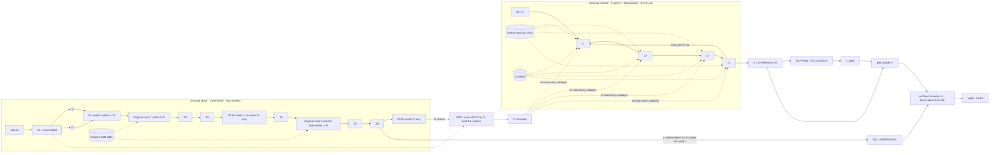

# HRM Thinker v3 — draft architecture (19M compute, d = 256)

**Status:** revision **r2** (2026-09-29 ≈ 21:20), revised after the external deep review `draft_v3_review.md`. That review was written against r1 (SHA-256 `97409b62…c8dd183`), so its line anchors no longer match. What r2 changed is listed in §11 (row R9). r2 is a *different design* from the earlier width-384 `proposed_v3.md`.
- **How to read r2.** The architecture is unchanged. What changed is what the draft claims and how the experiment is read:
  - causal explanations are now stated as hypotheses to test;
  - geometry and intervention results are diagnostics, not proofs;
  - the recurrence comparison gains a controlled ladder of arms (§9.4);
  - the arithmetic is corrected: slots vs tokens, the output head, LR direction, memory and sampling units.
- **Advisor:** 41 completed calls in the design phase, plus the deep-review (R) calls; 4 attempts failed on overload (18:03, 18:05, 18:27, 19:10). All are logged in §11. Every module went through a design ladder and then a per-section review pass.
- **Budget:** 18,986,871 compute parameters, within the owner's "within 19 million". The exact count and 10 float64 tests are in `v3_design/v3_ref.py`. The count was reproduced independently; the harness has known gaps, C1–C7 in §7.1.
- **Nothing trained.** During the v3 design work (from ≈ 16:20) no file under `run_m2_25M/` or `run_v2_19M/` was touched. The V-011 re-exec guard edit to v2's `train.py` (≈ 15:50, recorded in DECISIONS.md) predates it and takes effect at v2's 24 h resume.
**Owner's brief (verbatim points):**
- Width 256.
- Encoder the same as v1 (8 layers, or add one or two).
- Engram 50M or 80M, and possibly split across depths.
- 3 × SWA + 1 × FULL per block, each with an FFN; L/G two-stream; gated residuals; Qwen-style gated attention.
- Concept pooling kept.
- Concept module: 4 full-attention layers.
- LoopFormer (t, Δt) conditioning; recurrence ≤ 3.
- MoE optional.
- A Mobius-style shared FFN in addition to the per-layer FFNs.
- S as working memory (S₀ = 0, S written last).
- RMSNorm, NCP heads and the PQ codebook kept.
- Decoder: 4 layers + plan builder.
- NextLat questioned.
- Objective: v1's (check v2's).
- ≈ 19M compute parameters.

> Sections are filled in order: §1 evidence → §2 principles → §3 encoder → §4 concept → §5 decoder → §6 objective → §7 budget → §8 training → §9 evaluation → §10 whole-model review → §11 advisor log.

## 0. v3 at a glance (the specification to build and to visualise)

| module | structure | params |
|---|---|---|
| **Encoder** | d 256 · `SSSFSSSF` · S: SWA window 8, 4 × 64 heads (kv 2), partial RoPE 16/64 · F: full causal, 6 × 64 heads (kv 2), NoPE, τ_h · gated attention (σ(W_gate x)), QK zcRMSNorm, q/k/v ShortConv k4 · SwiGLU 256 → 1024 → 256 in every layer · L/G two-stream gated residual (S reads L, writes L+G; F reads L+G, writes G) · Engram 80M (8 × 208,333 × 48, orders 2–3, 4 heads): **one table, read after layer 0 (with conv) and after layer 4 (no conv, W_v = 0)** · CRC pool 4 × 256 → 256 on radius 16 · L-reach 63 | 9,641,007 |
| **Concept module** | C = c_hat (evidence, re-read every sublayer), S = working memory (S₀ = 0) · **4 distinct layers**: gated read {C, S} → full causal concept attention 6 × 64 → write S; gated read {C, S} → [own SwiGLU 736 ‖ shared SwiGLU 1024] → write S · **Φ(S; C, t, Δt)**: a per-stream (t, Δ) table of read gains (γ_C, γ_S) and write gains (α) over 6 pairs, zero-init · main trajectory M = 3 (⅓, ⅓, ⅓); shortcut M ∈ {1, 2a, 2b} (training only) · full backprop · `u = zcRMSNorm(S₃)` · NCP head over PQ 32 × 128 × 8 → `c_pred` · dense (no MoE), no carry norm | 4,881,216 |
| **Decoder** | D₀ = tok + P; P_t = W_u u[j*] + W_c c_pred[j*] + offset, j* = ⌊(t+1)/4⌋ − 1 (null plan when invalid) · 4 confined layers: queries from D, keys/values from tok (window 8, 4 × 64 heads) · SwiGLU 1024 · logits = zcRMSNorm(D) Eᵀ (tied) · reach 70 | 4,464,648 |
| **Objective** | NTP(u₃) + 0.1 NCP(u₃) + 0.05 NCP(u_s) + 0.1 shortcut-consistency(rms S_s, sg rms S₃) + VQ; full-batch denominators; clean target masks; no NextLat / MoE aux / per-pass NCP | — |
| **Total** | **18,986,871 compute** (50.8 / 25.7 / 23.5 %), within the owner's "within 19 million" · 101.1M stored | |



## 1. What v1 and v2 measured (evidence base)

### 1.1 The two runs
| | v1 (`run_m2_25M`, main) | v2 (`run_v2_19M`, live) |
|---|---|---|
| Width d / concept width d_c | 384 / 384 | 256 / 384 |
| Attention heads | 6 × 64 (kv 2) in every layer | 4 × 64 (kv 2) in every layer |
| Encoder | SSSFSSSF, L/G streams, Engram after layer 0, d_ff 1056 | same design at d 256, d_ff 704 |
| Engram | 8 × 131,071 × 48 = 50.3M | 8 × 208,333 × 48 = 80.0M |
| Concept core | **1** shared dense layer, looped R ~ U{1..4}, full backprop, S₀ = 0 | D6: **4** distinct layers, shared pool of 16 experts top-2, K ~ U{8..12}, windows of 4 with detached carry, LN_h carry |
| Decoder | 4 confined layers, plan builder (u, c_pred) | same, W_u 256 → 256 |
| Objective | NTP + 0.1 NCP + VQ | NTP + 0.1 mean-per-pass NCP + 0.1 consistency + VQ + 0.01 LB + 0.001 z + NextLat-h + NextLat-KL |
| Compute params | 25.05M | 18.83M |
| Measured speed | 1,650–1,815 tok/s | 1,100–1,400 tok/s (MAC estimate was 1,660–1,830) |

### 1.2 Same data, same tokens per step (32,768), so step = tokens ¹
| step | v1 val (TS / WK) | v1 recall1 | step | v2 val (TS / WK) | v2 recall1 |
|---|---|---|---|---|---|
| 554 | 3.718 (2.83 / 4.60) | 0.008 | 1,048 | 3.695 (2.83 / 4.56) | 0.000 |
| 1,217 | **3.227** (2.41 / 4.05) | **0.336** | 2,517 | **3.191** (2.38 / 4.00) | **0.328** |
| 1,402 | 3.157 | 0.477 | 2,796 | 3.150 (2.35 / 3.96) | 0.539 |
| 1,792 | 3.032 | 0.820 | — | — | — |
| 2,376 | 2.913 | 0.922 | 2,394 | 3.218 | 0.219 |
| 4,039 | 2.755 (1.98 / 3.53) | 0.984 | — | — | — |

¹ Both runs used `seed = 0` and the same data directory (verified in their `config.json`), so step k is the *same* tokens in the same order in both runs (§8.3).

**v2 needs about 2× v1's tokens to reach the same validation loss and the same long-range recall.** At equal steps (≈2,390), v2 is 0.30 nats worse. v2's first recall appeared at step ≈2,250, versus ≈1,100 for v1.

### 1.3 What each component showed
- **The concept route works (v1 final test).** Turning the core off costs 0.58 nats on TinyStories and 0.46 on WikiText. That is a *fixed-checkpoint intervention effect*, not a measure of what the core adds during training. The decoder then sees a null plan it never trained on, off-distribution everywhere except document starts (`RESULTS_DECODER.txt`). Co-adaptation can exaggerate the delta, and redundancy or compensation can shrink it, so even the sign of its bias is not determined. The clearer signals are the recall collapse and the u-off / c_pred-off deltas. Recall drops from 97 % to 0.4 %. Turning `u` off costs almost as much. Turning `c_pred` off costs 0.02–0.03 nats, 1 point of recall, 16 points of carry and 7 points of multi.
- **Extra passes barely helped v1.** R1 vs R4 differs by 0.001 nats. The update angle between passes shrinks from 6.7° to 0.11° by pass 8 while the state norm grows from 9.8 to 69: the loop's updates became near-repetitive. The end-to-end concept bench (`Concept Design/RESULTS_E2E.txt`) was also nearly flat across R1–R16, and so was the decoder bench on a single retrieval task. **"Looping destroys the representation" is too strong. The better hypothesis is "this loop recipe did not earn its cost."** LoopFormer's conditioning is a plausible remedy for the near-repetitive dynamics (§4), and v3 tests it rather than assuming it works.
- **Extra passes appeared to help v2 a little, but the number is not comparable.** At checkpoint 1703, R1 → R6 is −0.064 nats and R6 → R12 is −0.002; NCP is best at R2 and worse after. This is a fixed-weight sweep on a model trained at K ∈ {8..12}, so R1 was never in distribution, and part of the 0.064 is recovery from an untrained depth. v1's R1–R4 *was* in distribution (trained R ~ U{1..4}), so its flat result is the honest one (see §9.3 M4).
- **v2's MoE worked but cost a lot.** The live run drops 4.5–5.1 % of expert assignments at capacity 1.25 (19–37 % at launch). The earlier audit measured 18–29 % of real-row assignments dropped at checkpoint 267 (proposed_v3; not re-measured). Prefix-ordered capacity introduced a batch-row bias. The dispatch cost speed, and the pool never showed specialisation that paid for itself.
- **NextLat (v2) never earned its place.** nl_h stayed flat at ≈0.12 and KL at ≈0.18. At step 267 its gradients opposed NTP's on shared core and decoder matrices. The earlier decoder experiments rated it neutral to slightly negative.
- **Detached windows (v2) cut credit.** No final-NTP gradient reaches the first window's state or the initial projection.
- **The codebook is healthy in both runs** (codes_min 0.98–0.99, VE ≈0.65). Compression is not the bottleneck.
- **Engram:** no run has an Engram-off ablation, so its benefit is **unmeasured**. From the corpus sample (`v3_design`, 4M/16M/32M-token prefixes, Heaps' law), the full 264M-token corpus has ≈4.4M distinct bigrams and ≈25M distinct trigrams. 71 % of trigram tokens come from trigrams seen ≥ 8 times in 32M tokens. Distinct n-grams far exceed the rows at either table size, so 50M vs 80M only changes the collision count. **Provenance gap:** the sampling script, seed, corpus slices and collision statistics behind these estimates were not saved in `v3_design`. They are design estimates, not a reproducible artifact, until that is done (§8.5 step 0).
- **v2 memory leak (V-011).** The trainer leaks native memory at about 2 GiB/h. This is an implementation hazard to design against in v3: prefer few, large ops over many small index ops.

### 1.4 What v3 inherits untested (stated plainly)
**Two differences from v1 that v2 also had are inherited untested: width 256 (v2's largest unresolved confound) and the 80M Engram (v1 had 50M).** The full list of v3-vs-v1 differences is longer (§9.5). v3 also adds **two hygiene changes that v1 did not have**, both expected to be small: the full-batch loss denominator (§6.2) and the NCP/VQ target masks (§4.6). A third fact changes how v2 should be read: v2 was 18.83M nominal but only **15.69M active per token**, because its expert pool counted in full while each token used 2 of 16 experts (§4.5). Going from v1 to v2 cut the non-embedding capacity of the encoder and decoder by 52.7 %, and v2 is 2× less token-efficient. The owner chose 256 for compute-optimality (§2.1). v3 keeps 256 and spends the headroom on FFN width in the encoder and decoder (§3, §5). §9 adds a **matched-step gate against v1**, so a width-limited run is caught at step ≈1,200, not at 48 h.

## 2. First principles for v3

### 2.1 The Chinchilla argument, priced honestly
Chinchilla-style dense models are compute-optimal at about 20 tokens per parameter. **That is motivation for balancing data and parameters, not a theorem for this model.** v3 has an 80M lookup table, weights applied several times, a repository convention that excludes embeddings, and a mixed synthetic corpus. A scalar tokens-per-parameter ratio cannot decide its optimum width, so **width 256 is the owner's stated design constraint, a hypothesis and not a derived optimum** (§1.4, §10.5b).

v1 processed 132.7M token slots at 25M params (5.3 slots/param). The final design's two-point throughput fit (`v3_design/v3_budget.py`, an unvalidated estimate, §7.2) gives **≈ 1,290–1,770 slots/s. That is about v1's speed, not 2× it.**
- **Units.** The trainer's throughput counter counts `ids.numel()`, i.e. **slots, including PAD**. PAD is 5.71 % of the corpus (280,368,128 slots vs 264,365,789 non-padding tokens per epoch). Below, "slots" are what the counter measures and "tokens" are non-padding tokens. Valid next-token targets are fewer again (row ends and document boundaries) and must be counted directly.
- **Why not faster:** the output head costs 8,192 × 256 = 2.1M MAC per position. That is a third less than v1's 3.1M at d 384, but it is still the largest single matmul. The 4-layer core also runs 3 passes plus a shortcut trajectory.
- **What 48 h buys:** 211–290M slots net of evaluation, i.e. **≈ 199–273M non-padding tokens, or 10.5–14.4 tokens per compute parameter** (assuming the corpus-average PAD share). That is about 2–3× what v1 actually got in its 24 h run, but **most of that comes from the longer run, not from the width**: v1 run for 48 h would have reached ≈ 10. The width's own contribution is **fewer parameters for similar tokens (25/19 ≈ 1.3×)**.
- **Data:** at 280.4M slots per epoch, 48 h is **0.75–1.03 epochs** (§8.3; r1's 0.80–1.10 divided slots by non-padding tokens). The literature on multi-epoch training suggests that up to about 4 epochs is close to fresh data. That is not verified here, and at ≈ 1 epoch it barely matters.
- **The levers that do raise tokens/param are compute per token, not parameters.** §7.2 prices each, in order of cost to the design. The shortcut NTP is already kept out of the decoder, which avoids −17 %.

### 2.2 Principles (each traced to evidence)
1. **Keep what measurably works.** Two kinds of evidence:
   - *ablated in v1's final test (§1.3):* the S scratchpad with S₀ = 0 and C re-read every pass (core off / u off); the PQ codebook and c_pred (c_pred off; VE, codes_min); NTP + NCP + VQ, the objective that produced them;
   - *verified in design screens:* the encoder's L/G contract with bounded reach (encoder spec, exact tests); concept pooling on the sphere; the confined decoder with the target-aligned plan (`RESULTS_DECODER.txt`, 2 seeds).
2. **The final task loss must reach every pass**: full backpropagation, no detached windows. With R ≤ 3 this is affordable.
3. **Recurrence has to earn its cost, and that is measured.** v1's loop converged to near-identical updates. LoopFormer's (t, Δt) conditioning is a plausible remedy: in the paper's own setting, TMLT/LoopFormer beat plain loops at the same compute (Pile PPL 10.38/10.28 vs 10.91). That is evidence for its experiments, not a result v3 inherits. Cap recurrence at 3, supervise shorter trajectories rather than intermediate states, and **separate repetition, conditioning and shortcut training with controls (§9.4)**.
4. **Dense FFNs at 19M; the sparse component is the Engram table, outside the compute budget (§4.5).** v2's MoE cost throughput and fairness and never paid for itself.
5. **One objective per level.** Keep NCP (concept level) and drop NextLat (token level), which competed with NTP. The shortcut terms are the same concept-level objective on a second trajectory (§6.4).
6. **Design for the M2's real speed.** Few, large, fused ops, and no per-token index ops in the per-step graph beyond v1's Engram gather, which is the accepted exception. Every millisecond is priced in §7 and measured before launch.
7. **Every claim gets a test that can detect its failure.** The gates are fixed before training (§9): recall onset (E1) and matched-data val (E2) against v1. The full recipe is compared against a single-pass arm (M1), and the controlled arm ladder attributes any difference (§9.4). Loop geometry (M2) and gradient alignment (M3) are diagnostics that explain results; they are not verdicts.
8. **Separate inspiration, structural similarity and replicated evidence.** The papers (LoopFormer, Mobius, the diffusion curriculum, NextLat) supply the first two for v3's combination. Only v3's own controlled runs can supply the third.

## 3. Encoder

**Role.** Turn tokens into two things:
- `tok`: a local token stream with reach bounded to exactly 63 tokens, the only thing the decoder reads;
- `c_hat`: one concept per 4 tokens with global reach, the only way long-range information reaches the decoder.

Everything below preserves this contract. **Scope note:** V-004 recorded v1's measured bottleneck as *core retrieval*, not encoder capacity. The encoder's job for recall is to put facts into G cleanly, and the core does the retrieving. The encoder spend therefore cannot fix recall alone; §4 carries that weight.

**The encoder's first-principles risk: nothing in its training signal says "put the fact into G at the fact position".** At a fact token the loss pressure on G comes from NTP at nearby tokens via the plan (which reads concepts ≤ j*) and from NCP (predict the next chunk's code). Neither says "be retrievable 200 tokens later". That pressure arrives only once the core has learned to look back and its gradient flows through C to the fact's concept. It is a two-stage dependency, and the most likely explanation of v1's recall lag (language improving from step 554, recall appearing at 1,009–1,217); it is a hypothesis, not a measured cause. It is the reason E1 (recall onset) exists and E5 (the encoder's G contribution) is logged.

### 3.1 Skeleton (unchanged from v1 by design)
| item | v3 | why |
|---|---|---|
| width d | 256 (owner) | compute-optimality (§2.1); inherited confound (§1.4) |
| layer pattern | `SSSFSSSF`, 2 blocks of 3 × SWA + 1 × FULL, each with its own SwiGLU FFN | the owner's stable motif. It fixes L-reach at 63. More S layers add 10 tokens of reach each and would change the confinement contract (a 12-layer encoder gives reach 93) |
| streams | L (local) and G (global). S layers read {L} and write {L, G}; F layers read {L, G} and write {G} only | L never sees a FULL write, so `tok` has bounded reach and G has unbounded reach. G feeds only the concept pooling |
| residual grammar | gated read `x = mean_i σ(U_i V_i rms(R_i) + b_i)(1+γ_i) rms(R_i)` (rank 32, b = +2 → 0.881), gated write `s = 2σ(u·x + a)` (= 1 at init) | v1's tested grammar (the owner's "gated kind of residual") |
| attention | gated attention (output ⊙ σ(W_gate x), as in Qwen3-Next), QK zcRMSNorm, causal document-aware ShortConv k = 4 on q/k/v. S: window 8, partial RoPE on 16 of 64 dims. F: full causal, NoPE, per-head temperature τ_h | v1's anatomy; stable across both runs (no guard events at 6e-4) |
| heads | S layers 4 × 64 q heads, 2 KV heads (GQA). **F layers 6 × 64 q heads**, 2 KV heads | see §3.4 |
| FFN | SwiGLU, width decided in §3.4 | — |
| token output | `tok = zcRMSNorm(L)` | unchanged |

### 3.2 Engram: one shared 80M table, read at two depths
- **Size: 8 tables × 208,333 rows (prime) × 48 dims = 79,999,872 parameters, the owner's 80M.** From the corpus sample (§1.3), about 335k trigram types and 220k bigram types occur at least once per 4M tokens. Per row per hash head that is 1.6 trigrams and 1.05 bigrams at 80M, versus 2.6 and 1.7 at 50M. **The 80M table is sized to the frequent n-gram set.** Each table gets one lookup per token. Over 211–290M tokens, the ≈ 335k frequent trigram types share ≈ 71 % of lookups (≈ 450–600 hits each); the ≈ 25M rare types share the rest (≈ 2–4 hits each), landing as noise on the same rows. Using 4 hash heads per order makes it unlikely that one key collides in every head. The heads are concatenated and projected by learned weights, though, so this is **not** an unbiased average that cancels the noise; how much collisions cost is unmeasured. Its cost is memory only: the table sits outside the 19M compute budget and the gather cost does not depend on size. Parameter, gradient and two Adam moments come to 1.28 GB, versus 0.80 GB at 50M (+0.48 GB, counted in §7). v2 ran 80M at B = 2 without the table being implicated in its leak (V-011 is small native allocations).
- **Placement: one table, read after layer 0 and after layer 4** (the first S of each SSSF block), not four separate tables. **The key does not change with depth**: the n-gram ending at position t is the same at every layer. Four tables would store the same key → value map four times with a quarter of the rows each, raising the per-row trigram load from 1.6 to 6.4. That is the wrong trade for a memory that is limited by collisions. What differs with depth is the value wanted and the context available to decide whether to use it. So each read has its own W_k, W_v (zero-init), gated read and write, while the rows are shared. They are *meant* to be gathered once, but the design-screen code (`check_engram2.py`) actually gathers twice, because it calls the original read, which gathers again (review C4; the parameters are not duplicated). The trainer must factor a shared "read from gathered rows" helper and check output and gradient parity (§8.5 step 1). **This is the Mobius principle (one shared knowledge store, depth-specific access) applied to Engram.** The repo's encoder spec (§14 scale path) already uses **two insertion points** at scale ("layer 2 and ≈ L/4" for 12–16-layer encoders), as separate modules following the Engram paper. v3's rule is **"the start of each SSSF block"**: that gives ≈ L/4 for 3–4 blocks and L/2 for v3's 2 blocks. v3 did not copy L/4. **Sharing the table is v3's own choice**, justified by the depth-invariant key.
- **Why read 2 sees more:** read 1's gate sees L after S1, with 10 tokens of context (13 is L's reach after the Engram conv); read 2's gate sees 43 tokens. The second gate can retrieve an n-gram's value only where the wider context says it applies, for example disambiguating a frequent bigram.
- **Why read 2's gate reads only L (a correctness constraint, not a style choice):** α multiplies what is written into L. If the gate read G, L would depend on FULL-attention writes and its reach would become unbounded, silently breaking confinement. So read 2 gets richer context only through L's larger reach (43 tokens). This is verified *indirectly* by the reach test: a G-reading gate would show up as reach ≈ 1,024. The direct check is structural: read 2's gate and value path *read* only L. G is passed only as a residual destination for the write, and that is not a leak (§3.6, and a code-review item at §8.5 step 1).
- **Reach contract kept exactly:** read 2 has **no short conv**, so L-reach stays 63 and decoder reach stays 70. With a conv it would be 66 / 73. Verified exactly in float64 by `v3_design/check_engram2.py`. **What this costs:** v1's read applies `silu(conv(α⊙v))`, which mixes the last 4 positions' n-gram values, so read 1 effectively sees up to 6-gram context. Read 2 sees only position t's value. That is the price of keeping reach 63.
- **Init equivalence:** W_v2 = 0, so at step 0 the two-read encoder is **bit-identical** to v1's one-read encoder (verified). The second read cannot disturb early training; it contributes only once gradients open it.
- **Hashing unchanged:** canonical ids, orders {2, 3}, 4 heads per order, multiplicative-XOR 61-bit, document boundary id 0.
- **Cost:** +0.21M params and +0.2M MAC per token for read 2.
- **Measurability (new in v3):** the eval intervention set gains `engram_off` (α = 0 at both reads) and `engram_read2_off`. Neither has ever been measured.
- **Rejected variants:**
  - 4 separate tables: key duplication.
  - 4 reads of the shared table, after layers 0, 2, 4 and 6 (gate contexts 10 / 33 / 43 / 63 tokens): **+0.43M params beyond two reads**, two more W_k/W_v matmuls and reads per token, and +6 tokens of reach if the convs are kept. Rejected on cost.

### 3.3 Concept pooling (CRC), unchanged in form
`mix = softmax(W_r rms(G))` over {e0, rms(L), rms(G)} (init bias −1/−1/+1 → 0.107/0.107/0.787). Then `c = W_pool · concat_4(m)` (4 · 256 → **d_c = 256**; at d_c = d the init is plain mean pooling, `P = I`) and `c_hat = √d_c · c/‖c‖`, i.e. on the sphere.
- The compression ratio is **4:1, exactly v1's.** v2's 2.67:1 (4 · 256 → 384) is not evidenced to have helped: v2 is confounded.
- d_c = 256 changes the PQ layout to 32 × 128 × 8 (§4).
- **Telemetry: the CRC mix (encoder G contribution, report only).** G is trained only through the concept route (§5.1). If that route is slow, the router can drift toward L and e0, making concepts local summaries and starving the F layers. Log the mean mix (e0 / L / G), the normalised branch contributions `‖mix_k · branch_k‖` and the gradient reaching G, at every eval. **A low G share does *not* mean the global path is bypassed**, for two reasons:
  1. a concept built only from local features of an old chunk is still retrieved globally by the core's full concept attention;
  2. the mix weights are themselves computed from `rms(G)`.

  The deep review forced the mix to exactly [1, 0, 0] in the reference model: editing token 4 still changed a logit at position 100 by 0.0395. The whole global route is tested by distant-answer accuracy with plan/core interventions. The encoder's F/G branch specifically is tested by the `F_off` intervention (§7.4): the F layers' writes to G are set to 0, so G keeps only the S-layer writes and concepts lose all full-attention content. It is ultimately tested by a trained control.

### 3.4 Spending the encoder headroom: FFN ratio 4, F-layer heads 6
Priced with `v3_design/v3_budget.py`; F-head deltas added analytically. The core in every row is 4L ff896 + shared 1024, and there are 2 Engram reads.

| option | encoder | compute | enc / core / dec | tok/s (range) |
|---|---|---|---|---|
| A | SSSFSSSF, ff1024, heads 4 | 18.87M | 50 / 26 / 24 % | 1,315–1,808 |
| B | SSSFSSSF, ff896, F heads 6 | 18.28M | 48 / 27 / 24 % | 1,350–1,856 |
| **C (default)** | **SSSFSSSF, ff1024, F heads 6** | **19.07M** (after all §4 decisions and the cap trim, exactly 18,986,871, §7.1) | **51 / 26 / 23 %** | **1,315–1,808 ¹** |
| D′ (owner option) | SSSFSSSF**F**, ff832, F heads 6 | 18.96M | 50 / 26 / 24 % | 1,313–1,805 ¹ |

¹ The fit does not include the extra F-layer score MACs from 6 heads (about +2 % per token), so C and D′ are about 2 % slower than shown. These rows were priced before the core was finalised (core ff 896, 4 heads); §7.1 and §10.6 have the exact final counts (C: 18,986,871; D′: 18,877,439).

- **F-layer heads 4 → 6** (q, o and gate 256 → 384; KV stays 2, so the GQA repeat is 3). This costs +197k params and about +2 % MACs. It is v1's head geometry, and it adds capacity exactly where global attention happens, i.e. where facts enter G for the concepts. S layers stay at 4 heads because window-8 attention gains little from more heads. Implementation: new `EncoderConfig.n_heads_full`.
- **FFN ratio 4 (SwiGLU 256 → 1024 → 256) in the encoder *and* the decoder.** One ratio for both, so the decoder's share stays proportional (§5).
  - Ratio 4 is above v1's 2.75. It is the largest lever that adds capacity without touching the reach contract or the motif.
  - It targets the capacity cut in the encoder and decoder that is v2's main suspect.
  - It is a judgement call, not an evidenced optimum.
- **The extra-F-layer alternative (D′) is legitimate:** an F layer writes only G, so L-reach stays 63, and the brief allows "one or two more layer". It buys a third global attention hop on G just before pooling, instead of per-position FFN storage. **Question for the owner:** should global composition get a third hop in the encoder, or stay the core's job? The default keeps it in the core, for three reasons.
  1. v3's recurrence study needs the core to do the composing; a stronger encoder invites one-pass shortcuts that bypass the loop.
  2. D′ breaks the 3S+1F motif the owner called stable.
  3. The brief's first reading is "exact same using 8".

### 3.5 Encoder summary (default C)
| part | params |
|---|---|
| 6 × S layer (attn 4 heads 262k + FFN 786k + GR 35k) | 6 × 1.08M = 6.50M |
| 2 × F layer (attn 6 heads 361k + FFN 786k + GR 68k) | 2 × 1.21M = 2.43M |
| Engram projections, 2 reads (W_k, W_v 384 → 256, gated read, write) | 0.43M |
| CRC router + pool (1,024 → 256) + tok_norm | 0.26M |
| **encoder non-embedding** | **9.64M** |
| token embedding (tied with the output head, excluded) | 2.10M |
| Engram table (excluded) | 80.0M |

**Reach:** L 63 (unchanged), G unbounded.

**Relation to v1 at init:** the second Engram read is bit-identical to v1 at step 0 (W_v2 = 0). The structural departures are the widths: FFN ratio 4, F-layer heads 6 and d = 256. They are randomly initialised like v1's, not identical to it. §9's matched-step gate compares against v1 with these differences stated.

### 3.6 Encoder acceptance tests (inherited by §9)
- **v1's exact float64 set:** reach(L) = 63; L bit-identical ≥ 64 tokens after an edit; G changes globally; causality; document isolation; first changed concept = ⌊p/4⌋; init values (read gate 0.881, write scale 1, mix 0.107/0.107/0.787, ‖c_hat‖ = √d_c = 16).
- **New in v3:**
  1. The two-read encoder is bit-identical to the one-read encoder at init (`check_engram2.py`, done).
  2. The shared table is one tensor (`check_engram2.py`, done).
  3. `n_heads_full` = 6 with GQA repeat 3 matches a reference attention; reach stays 63 with 6-head F layers and read 2 (**done**, §8.4 G0).
  4. Read 2's gate and value path read only L; G appears only as the write destination. Checked in code review.
  5. `engram_off` and `engram_read2_off` return exactly the α = 0 forward. This is exact because `silu(conv(0)) = 0` for read 1 and `silu(0) = 0` for read 2. The downstream layers were trained with the contribution present, so the eval delta is a fixed-checkpoint intervention effect whose bias has no determined sign (§9.3 M5). It is not the value of training with Engram.
  6. Both reads consume **one** gather of the table: a forward hook counts one table call per encoder forward, with output and gradient parity against the two-gather screen code (review C4).

### 3.7 Interface handed to the concept module
- `c_hat`: (B, M = 256, 256) on the sphere with radius √256 = 16 (v1/v2: √384 ≈ 19.6). The core's GR read is RMS-normalised, and per-segment VQ and NCP are radius-invariant (mean square 1 per dimension at any d_c, §4.6). Only quantities summed over all d_c dimensions change: ‖c_hat‖² (256 vs 384) and the core's ‖S‖, which is not comparable across widths anyway.
- `cdoc = doc[:, ::4]`.
- `tok`: reach 63, so the decoder reach is 70. §5 must keep window 8.
- d_c = 256 forces the PQ layout to 32 × 128 × 8: the hard code index tuple has 224 bits, versus 336. That bounds the *discrete* message only; the continuous `u` route and the soft `c_pred` vector are not limited to it. **The per-segment metrics stay comparable** with v1/v2 (§4.6): `c_hat` has mean-square 1 per dimension at any d_c, segments stay 8-dimensional with 128 codes, and `codes_min` and `VE` are ratios.

## 4. Concept module

**Role.** The only path for information beyond 63–70 tokens.
- **C = c_hat** is the evidence: fixed for the input, re-read at every sublayer of every pass, and differentiable back to the encoder.
- **S** is the working memory (the scratchpad). S₀ = 0 means no computation has been written yet, not that there is no input: the first read sees C.
- After the last pass, `u = zcRMSNorm(S)` goes to the decoder and to the NCP head. The v1 ablations show this route carries almost all long-range information (core off: recall 97 % → 0.4 %).

### 4.1 Layer anatomy: 4 distinct full-attention layers, each with its own FFN
Each layer ℓ = 1..4 has its own weights and v1's two-sublayer grammar over two streams:
```
x = Read^attn_ℓ(C, S)                         # gated read over {C, S}, rank 32, b = +2
S = S + Write^attn_ℓ(x) · GatedAttnFull_ℓ(x)  # full causal attention over concepts
x = Read^ffn_ℓ(C, S)
S = S + Write^ffn_ℓ(x) · SwiGLU_ℓ(x)  [+ shared-FFN branch, §4.4]
```
- **Attention = the encoder's F-layer class, `GatedAttention(kind="F")` with `n_heads_full = 6`:** 6 × 64 q heads, 2 KV heads (GQA repeat 3), QK zcRMSNorm, NoPE, per-head τ_h, output gate σ(W_gate x). One implementation serves the encoder F layers and the core.
- **Why 6 heads, not a wider FFN:** every failing v2 probe is a retrieval. recall1 means finding the concept that holds the key and copying its value; carry3, multi4 and hop compose several retrievals. The component that retrieves is attention, and V-004 named core retrieval as the bottleneck. 6 × 64 is also v1's core geometry.
- **Mask:** causal and same-document over the M = 256 concepts (`build_masks(cdoc, 1)[1]`). The state at concept j depends only on concepts ≤ j. §5's target-aligned plan indexing relies on this.
- **Short convolutions:** the q/k/v ShortConvs (kernel 4, residual form, zero-init = identity) run over **concept positions**, i.e. 16 tokens of local mixing, masked by `cdoc`. They are the only local operation in the core.
- **Own FFN: SwiGLU 256 → 736 → 256** (768 was trimmed to 736 to meet the owner's "within 19 million"; §10.6). This is not a starved FFN: each FFN sublayer also runs the shared FFN (1024) on the same read (§4.4), so once the shared branch opens (its output projection is zero at init) each layer application has 736 + 1024 = 1,760 FFN hidden units (ratio 6.9). v1's single core FFN had 1,056 at d 384 (ratio 2.75). **Dependency: resolved, parallel (§4.4).** Had the shared FFN run once per pass, the own FFN would have returned to about 896.
- **Per-layer params:** attention 363k, own FFN 565k, GR reads 68k, write scalars 0.5k, so **996,488 per layer and 3,985,952 for 4 layers.**

### 4.2 Recurrence: at most 3 passes, trajectories conditioned on (t, Δt)
**The owner's formula, made concrete.** One pass of the 4-layer stack is the transformation
`S_i = Φ(S_{i−1}; C, t_{i−1}, Δ_i),  S₀ = 0,  i = 1..M,  Σ Δ_i = 1,  t_{i−1} = Δ_1 + … + Δ_{i−1}`.
Here h ≡ S (the carried working memory), C is the fixed evidence re-read inside Φ, t is the normalised time already travelled, and Δ is the share of the work this pass must do.

**Why v1's loop stagnated, and what (t, Δ) is meant to test (a hypothesis, not a proof).**
- **The leading hypothesis: a fixed point in direction space.** v1's measured updates were *nearly constant in size and nearly identical in direction*: norms 9.77, 8.75, 8.60, 8.53 … with angles 6.7° → 0.11°. The GR read normalises S. So *if* S's direction settles and C is fixed, the read input is nearly the same every pass, and so is the write. That mechanism is plausible, but the trajectory alone does not show it is architecture-only, independent of data and training. **A recurrent map without an explicit clock can still do changing, useful computation**, because its state changes; the isolated concept experiments in this repository did. **What the (t, Δ) table does:** it removes one route to this invariance, because each pass applies different read and write gains. It enlarges the set of behaviours the model *can* represent. It does not make the optimiser pick useful ones: the table starts at zero, can stay small, can be ignored downstream, or can encode updates that differ but do no useful work. Whether it helps is decided by the controlled arms (§9.4), not by this argument.
- **A contributing mechanism, front-loading:** v1 sampled R ~ U{1..4} **without conditioning**, and the decoder consumed whichever endpoint came out. So pass 1 had to be a complete answer in 25 % of training steps.
- That signal rewards putting all the work into pass 1, leaving passes 2–4 nothing to do. This is exactly the measured R1 ≈ R4, with update angles collapsing from 6.7° to 0.11° (§1.3).
- With Δ conditioning, pass 1 under Δ = ⅓ *knows* it owes a third of the work, and pass 1 under Δ = 1 knows it owes all of it. The same weights can then do different, complementary work at each position of a trajectory.
- **A third possibility v3 makes more likely: data-limited depth.** If the concept-level computation this corpus needs fits in one pass, extra passes idle whatever the conditioning. v3's pass is 4 distinct layers, already deeper than v1's 4 passes of 1 layer. That is a **capacity change separate from the number of passes**: a stronger single pass can help retrieval while reducing the need for recurrence. Three passes are not three reasoning steps. v3 could then train well and still show no benefit over the plain one-pass arm. §4.7's telemetry helps *interpret* the three cases, and the controlled arms (§9.4) decide between them.
- The diffusion paper found t unnecessary. Its setting is different: thousands of steps, a noise curriculum, and unique-answer puzzles. At L = 3 with elastic budgets, a single step must be told whether it is the whole job or a third of it.

**Trajectories.** With L = 3 on the grid of ⅓ there are exactly **6 reachable (t, Δ) pairs**. This is what makes the table conditioning in §4.3 exact rather than an approximation.

| budget M | schedule Δ | (t, Δ) pairs used |
|---|---|---|
| 3 (main) | (⅓, ⅓, ⅓) | (0, ⅓), (⅓, ⅓), (⅔, ⅓) |
| 2a | (⅓, ⅔) | (0, ⅓), (⅓, ⅔) |
| 2b | (⅔, ⅓) | (0, ⅔), (⅔, ⅓) |
| 1 | (1) | (0, 1) |

**Training, every micro-batch:**
1. **Main trajectory** M = 3 from S₀ = 0 → `u₃ = zcRMSNorm(S₃)`, which feeds the decoder (NTP) and the NCP head.
2. **Shortcut trajectory**: S ~ U{1, 2} per micro-batch. M = 2 picks one of its two schedules uniformly. It also starts from S₀ = 0 and re-reads C. Its output `u_s` is supervised by the NCP head and by consistency with stop-gradient u₃ (§6). It does **not** run the decoder, which would cost −17 % throughput (§7).
3. **Full backpropagation** through both trajectories: no detached windows, no truncation. Gradients from both reach the encoder through C. At ≤ 3 passes, keeping the whole graph is affordable, and final-loss credit reaches every pass (principle 2).
4. **Terminal-only supervision**: each trajectory is supervised at its endpoint only; intermediate states are never pulled toward the final answer. v2's per-pass NCP was best at R2 and worse after. That is *consistent with* intermediate supervision harming late states, but also with late passes optimising NTP at NCP's expense; either way, terminal-only supervision avoids imposing one endpoint's target on every state.
5. The trajectory RNG is seeded separately and checkpointed, and resume restores it.

**The design permits iteration; it does not require it.** If passes 2–3 idle, u₁ ≈ u₃, so L_scons ≈ 0 and L_NCP(u₁) ≈ L_NCP(u₃): the idle solution satisfies every shortcut term trivially. The only pressure to use passes 2–3 is that u₃ must be good, and if u₁ can be equally good, idling is a valid optimum at no cost (nothing penalises unused compute). **Only the controlled arms (§9.4) measure whether iteration paid.** M1 (full recipe vs one pass) says whether the whole recipe helped, not why. v3 starts with no pass-dependent signal (the table is zero), which is the regime that produced v1's near-repetitive updates. It must learn its way out through the table's gradient, as LoopFormer does from its zero-initialised modulator.

**What the shortcut re-introduces, and what stops it.** The (0, 1) shortcut makes pass 1 the whole answer in 50 % of micro-batches, more often than v1's 25 %. The difference is that the pass is *told* which case it is in. But nothing in the main trajectory's loss *penalises* the model for also front-loading under (0, ⅓) and leaving passes 2–3 idle. A **small coefficient on the shortcut loss** (LoopFormer uses 0.1; §6) is *intended* to keep the main trajectory dominant. Coefficients do not establish gradient dominance, though: losses have different Jacobians, masks and routes to shared weights. So dominance is measured by the per-term gradient audit (§6.4), and the effect on quality is decided by the arm ladder (§9.4: Full vs T3 isolates the shortcut bundle).

**Why M < 3 is a weaker claim than M = 3.** The decoder trains only on u₃. At inference with M = 1 or 2 it consumes a u it has never trained on, and only the consistency loss pulling u_s toward u₃ makes that work. Hence: gate on M = 3, and report M < 3 as elasticity, not as the model's quality.

**Consistency on the normalised state, not raw S.** S accumulates across passes (v1: norm 9.8 → 69). Matching raw S would force a 1-pass trajectory to write 3× the magnitude through a write scalar bounded at 2. The loss compares `rms(S)`, which is scale-free: that is u without the out_norm gain, so the loss cannot shrink the gain the decoder and NCP consume (§6.1).

**Exact compute saving (optional):** the (⅓, ⅔) shortcut's first step is bit-identical to the main trajectory's first step (same S₀, C and (0, ⅓)). Reusing it gives the same combined loss and, in exact arithmetic, the same weight and C gradients. It cuts the mean shortcut cost from 1.5 to 1.25 passes. **Tested so far: the forward only** (v3_ref T5). The gradient and optimizer-update parity is still owed (review C3): duplicated vs shared prefix from cloned parameters, comparing the combined loss, all gradients and one AdamW update. It needs a tolerance suited to the backend, because MPS need not accumulate in the same order. The reused prefix must not be detached.

**Cost:** 3 + 1.5 = 4.5 pass-equivalents in training (4.25 with the reuse), so **+50 % core pass work over main-only (+41.7 % with the reuse)**. The shortcut is one third of the combined total, which is a different number. These are core-pass figures, not whole-model throughput (§7.2). Per micro-batch forward that is 18 core layer applications, ≈ 288 per 16-micro-batch optimizer step. At eval, 3 passes = 12 layer applications at concept rate.

**Inference:** M = 3 by default. Report M = 1, M = 2 (both schedules) and M = 3; **gate on M = 3**. **Hypothesis to test, not a setting:** LoopFormer §4.4 found that coarse-early and fine-late schedules win, which predicts (⅔, ⅓) beats (⅓, ⅔).

**Pricing the halves.** LoopFormer Table 1 (Pile PPL): Base-Loop 10.91 → TMLT, t only, 10.38 → LoopFormer 10.28. Most of the gain is t-conditioning. The shortcut plus Δ buy about 0.1 PPL *and* budget elasticity in the paper's setting, at +50 % core pass work in v3 (+41.7 % with the reuse). The owner asked for Φ(h; t, Δt), so the shortcut stays: without it Δ is always ⅓ and carries no information. **"t only, no shortcut, 3 passes" (the TMLT baseline) is a named control arm in §9** and the fallback if throughput comes in low.

### 4.3 How (t, Δ) enters Φ: a zero-initialised table of per-stream read gains and write gains
For pair p ∈ {1..6} and layer ℓ, a learned table holds 7 vectors in ℝ^256, all initialised to 0:

| site | modulation | LoopFormer analogue |
|---|---|---|
| attention read | `x = ½[g_C (1+γ_C)(1+γ^C_{p,ℓ,a}) rms(C) + g_S (1+γ_S)(1+γ^S_{p,ℓ,a}) rms(S)]` | γ_msa (scale after the norm) |
| attention write | `S += 2σ(u·x+a) · (1+α_{p,ℓ,a}) ⊙ Attn(x)` | α_msa (residual gate) |
| FFN read | same per-stream form with γ^C_{p,ℓ,f}, γ^S_{p,ℓ,f}; the one read x feeds both FFN branches | γ_mlp |
| own-FFN write | `(1+α_{p,ℓ,own})` | α_mlp |
| shared-FFN write | `(1+α_{p,ℓ,sh})` | — (new) |

- **Why a table and not the paper's Fourier + MLP modulator:**
  - All 6 reachable pairs are visited in training, so a lookup *is* the fully trained function on the whole domain. The paper's MLP exists to generalise to unseen (t, Δ), which v3 never has.
  - Cost is 6 × 4 × 7 × 256 = **43k params**, versus about 1.3M for the paper form (7 % of the compute budget for six input values).
  - What it gives up: it does not extend to L = 4 or to off-grid schedules without new entries. That is acceptable under "max recurrence 3".
- **Two gains per stream, on purpose:** v1's static `(1+γ_i)` and the new per-pair `(1+γ^{pair})`. They are redundant for pair-independent scaling but harmless. Both are zero-init; the static gain is decayed like the other zc gains, the table is not (below), and the static one absorbs the mean. Do not "simplify" one away: that would break the v1 identity at init.
- **Why per-stream read gains (the one place v3 departs from LoopFormer):** LoopFormer has one stream, so one γ. v3's read mixes *evidence* C and *memory* S, and (t, Δ) has a natural job there. At t = 0 the S stream is empty and the read must lean on C; late in a trajectory a pass may trust its memory more. Separate γ_C and γ_S per pass give Φ a direct handle on evidence-vs-memory weighting, which a single γ on the mixed read cannot express.
- **Init = v1 exactly.**
  - LoopFormer's AdaLN-Zero sets the *gate* to 0, so residual branches write nothing at init. With S₀ = 0 that is the startup proposed_v3 §5.3 warned against.
  - v3 multiplies v1's write scale `2σ(u·x+a)` (= 1 at init) by (1 + α) with α = 0, and the reads by (1 + γ) with γ = 0. **At step 0 the conditioned core is bit-identical to the unconditioned one**, and the first write is nonzero because x reads C.
- **Weight decay: none (reversed after the deep review, R3).** The table's zero *is* the failure mode: an all-zero table means no pass-dependent signal, which is the regime that converges to v1's fixed point (§4.2). Decay would bias it back toward that regime. The effect is small (with Adam, decay removes ≤ 10 % of the per-step movement for |α|, |γ| ≲ 1), so this is decided on principle, not on expected magnitude. The conditioning *domain* is small (6 inputs), but that is not a no-overfitting argument: the gains multiply token-dependent computation everywhere in the core. The counter-force given up is decay's pull on gain growth. **Nothing bounds (1+α) now.** Gradient clipping bounds one step's gradient norm, not the cumulative parameter value, and Adam's moments and repeated updates still allow drift. So ‖α‖ and ‖γ‖ per pair are logged (already in the telemetry) as the check.
- **The table's one real cost: no transfer between pairs.** Independent entries mean learning (0, ⅓) teaches nothing about (0, ⅔). **Exposure, counted in the right unit:** the shortcut is sampled per *micro-batch*. A row used with probability 0.25 appears at least once in a 16-micro-batch optimizer step with probability 1 − 0.75¹⁶ = 0.99. So over ≈ 7,600 steps it gets some gradient on ≈ 7,520 of them (≈ 30,400 contributing micro-batches), not r1's "1,900 updates". Its *weighted* exposure is still well below a main row's, because its only losses are the shortcut terms (§6.4). Adam momentum also moves a row on steps with no fresh contribution. If M4's elasticity results are poor, the option is a feature-based modulator, Fourier(t, Δ) → Linear(d_f, 7 · 256) per layer (≈ 115k at d_f = 16), which shares parameters across pairs.
- **Exact on pairs, not on states.** The (⅔, ⅓) entry serves the main trajectory's step 3 (after two ⅓-steps) and 2b's step 2 (after one ⅔-step). LoopFormer's semantics intend the state at t = ⅔ to be path-independent, but v3, like the paper, enforces agreement only at t = 1 (L_scons on endpoints). Nothing pulls the two t = ⅔ states together. This is accepted, as in the paper.
- **Granularity:** (t, Δ) is per micro-batch and per sequence, which is LoopFormer's own stated limitation. The entries train unevenly: main-trajectory pairs every step, (0, 1) at 50 %, and the two M = 2 schedules at 25 % each. (⅔, ⅓) receives gradient from two contexts with different S.
- **Acceptance tests:** with the table zeroed, the forward equals the unconditioned model exactly; after training, the M = 1 and M = 3 outputs differ. The perturbation test must change the table *alone*: r1's T1b changes both the table and the shared FFN before attributing the result to the table (review C6).
- **Telemetry that helps interpret §4.2 (diagnostic, not a verdict):** the update angle between passes and the state norm per pass (v1 measured both), and ‖α‖, ‖γ_C‖, ‖γ_S‖ per pair and layer (three γ_S entries are structurally zero, §10.2). On the live page these are aggregated per pair (mean over layers and sites) every hour; the full 168-number table is logged at milestones. Update angles that collapse toward v1's 0.11° are a **warning worth investigating when they come with a quality failure**. On their own they prove nothing, because small aligned refinements can still do useful work (§4.7).

### 4.4 The shared FFN (the owner's Mobius-style central memory): a parallel branch in every layer
`SwiGLU_shared: 256 → 1024 → 256`, **one set of weights used by all 4 layers in every pass.** Inside each layer's FFN sublayer:
```
x = Read^ffn_ℓ(C, S)   (with the per-stream (t, Δ) gains)
S = S + 2σ(u·x+a)·[ (1+α_{p,ℓ,own}) ⊙ SwiGLU_ℓ(x) + (1+α_{p,ℓ,sh}) ⊙ SwiGLU_shared(x) ]
```
- **What it buys, stated precisely:** within a pass, layer 4 can query the same memory layer 1 used, which is the owner's "layer 4 requires layer 1 knowledge". The recurrence already provides the across-pass half for free: pass 2's layer 1 runs after pass 1's layer 4, the "backward residual" in Mobius's sense. The shared FFN's marginal value is therefore **within-pass access plus a store trained by every application.**
- **Why parallel and not the alternatives (the cost type matters, not just the size):**
  - *Parallel branch* on the same read adds matmul work only, i.e. MACs, which the M2 handles well: −11 % tok/s versus once per pass.
  - *Sequential third sublayer* adds a sequential layer application per layer, the cost term that sank v2: +18 applications per step, about −17 % on top of the parallel cost, plus its own reads. **Rejected.**
  - *Once per pass* is cheapest, but it removes exactly the within-pass access the owner asked for. **Rejected.**
- **Init: its output projection is zero.** The branch writes exactly 0 at step 0, so the core is bit-identical to one without a shared FFN (the Engram W_v pattern). α_sh = 0 alone would give gain 1, i.e. full strength, so it cannot do this job. Acceptance test: with the projection zeroed, the forward equals the own-FFN-only core.
- **Hidden 1024** is the ratio-4 decision from §3.4, applied to the shared FFN (the own FFN is 736, §10.6). Params: **0.79M.**
- **The 1,024 / 736 split is a decision, not a side effect of the cap trim.** Trimming either side keeps the parameter-matched arm at own-992 (4 × 736 + 1,024 = 4 × 768 + 896 = 3,968), so the cap does not force the split. The shared store is kept larger (58 % of each layer's FFN capacity) because the only evidence available, Mobius's data-efficiency result, favours a shared store. That evidence is one-sided: it comes from 7B models that *replace* per-layer FFNs rather than keeping both.
- **Honest provenance:** Mobius *replaces* per-layer FFNs with one shared store (attention-only "reasoners") at 7B/35B. v3 keeps both, which the paper never tested. **This is the owner's hypothesis, not the paper's result:** the own FFNs hold layer-specific abstract transforms, and the shared FFN holds knowledge any depth may need. It therefore gets an exact test:
  - **Param-matched control arm (§9): own FFN 992, no shared FFN.** 4 × 761,856 = 3,047,424, versus 4 × 565,248 + 786,432 = 3,047,424, so the principal FFN matrices are exactly equal (the shared FFN is worth exactly 256 hidden units per layer). **Stated precisely:**
    - the arm drops the shared-write table site α_sh (6 × 4 × 256 = 6,144 entries), so its full count is 18,980,727. The arm's report states that number;
    - equal parameters are not equal MACs: the shared matrix runs at every layer, so the default does 4 × (736 + 1,024) = 7,040 hidden units of work per pass against the arm's 3,968;
    - unique capacity is `4 × own + shared` in both. Reusing the shared store is more computation, not more independent parameters.
  - **Intervention `shared_ffn_off`** (output projection → 0 at eval), next to `engram_off`.
- **Init gradients are temporarily zero, by design:** while the shared output projection is 0, `shared.w1`, `shared.w3` and the α_sh slice of the table get no gradient (the deep review's untouched-init probe). They start learning once w2 opens. This is not a failure (§10.2).
- **Telemetry:** the shared FFN receives gradient from ≈ 18 applications per micro-batch forward (17 with the §4.2 reuse), against 4.5 (4.25) for any own FFN. Log its gradient norm separately (like the codebook's). AdamW normalises scale but not conflicts in direction between layers; the per-(pair, layer) gain α_sh is the mitigation.
- **Scope: core only.** Letting encoder F layers or the decoder read it is dimensionally possible, but it would mix token-rate and concept-rate statistics in one store. That is untested and outside the brief ("along with the 4 concept blocks"). Deferred.

### 4.5 Dense, not MoE
**Decision: every FFN in v3 is dense.**
- **The decisive first-principles argument.** MoE trades *parameters* for *compute*: more parameters at the same active compute per token. v3's binding constraint is a **parameter cap** (≈19M, counting the whole expert pool, as `model.py:param_table` does). Under a parameter cap, MoE spends the budget on weights that sit idle for any given token.
  - v2's numbers show it. Its 16 × 3 × 256 × 512 = 6.29M pool counted fully inside its 18.83M, but each token touched 2 of 16 experts per layer.
  - **v2 was 18.83M nominal and 15.69M active per token** (`v2_budget.json`, row C_E16). This is a third inherited confound, alongside width and Engram: v2 was smaller than it looked.
- **The owner's question ("MoE is not working properly"), answered from telemetry.** Mechanically it worked: drops fell from 19–37 % at launch to 4.5–5.1 %, where they sat on the flag for the whole run. It did not pay:
  - routing divergence between passes of 0.04 means the routers picked nearly the same experts every pass, so the loop did not use expert diversity;
  - capacity-order drops meant some concepts got *no* FFN update in a layer, and outcomes depended on batch-row order;
  - dispatch cost throughput.
  **In short: it worked, did not pay, and cost speed and fairness.**
- **v3's sparsity lives elsewhere.** The 80M Engram *is* the sparse memory: parameters outside the compute budget, gathered by index, with one token touching 8 of its 1.67M rows. If the core is ever sparsified, Mobius says where: partition the **shared** FFN MoE-style at scale, never per-layer experts. That is the deferred path.
- **Consequences elsewhere:**
  - the 0.01 LB and 0.001 z losses leave the objective (§6);
  - the MoE dispatch ops that V-011 suspected (`index_add / scatter / one_hot`) leave the per-step graph. GQA's `repeat_interleave` (in every attention layer) and the Engram gather remain, as in v1, and whether v1 leaked was never measured. So the leak's cause is *not* shown to be removed (§7.3).

### 4.6 Readout, PQ vocabulary and the NCP head at d_c = 256
- **Readout:** `u = zcRMSNorm(S_M)`. **One `out_norm` and one NCP head are shared** by the main and shortcut trajectories. The shortcut's NCP loss passes through that norm; the shortcut consistency loss deliberately does *not* (it compares the gain-free `rms(S)`, §6.1), so it cannot shrink the gain the decoder consumes (v3_ref test T4c).
- **VQ is one-sided by design (v1's choice, inherited):** the codebook chases detached `c_hat`, and nothing pulls `c_hat` toward the codes (no commitment term). That is why VE plateaus at ≈ 0.65 instead of climbing, and why the dead-code restarts do the work a commitment loss would.
- **PQ vocabulary: 32 segments × 128 codes × 8 dims** (224 bits per concept, versus 336 in v1/v2). Codebook: 32,768 params, excluded from the compute count. Why this layout:
  - 8-dim segments with 128 codes are v1's geometry; only the segment count follows d_c.
  - 32 × 256 × 8 would change the codes per segment and break comparability (+33k).
  - 64 × 128 × 4 puts 128 codes in 4 dims, nearly a grid: VE would rise trivially while the NCP target gets harder without becoming more meaningful.
  - 16 × 128 × 16 would under-cover 16-dim segments, so VE would fall.
  - 32 × 256 × 8 (considered and rejected): bits per concept *dimension* are already v1's (7 bits per 8-dim segment). The total fell only because d_c has fewer dimensions to encode, not because the code is coarser. 256 codes would be *finer quantisation than v1 ever had*: VE would rise mechanically and NCP would get harder without c_pred carrying more of what the concept holds. It is free in the compute budget but would break per-segment comparability for no evidenced gain.
- **Per-segment metrics remain comparable with v1/v2.** ‖c_hat‖² = d_c, so the mean square per dimension is exactly 1 at 256 and at 384. VQ error per segment (a sum over 8 dims) has the same scale; NCP cross-entropy per segment has the same uniform-prediction baseline, ln 128 = 4.85 (a baseline, not a maximum: CE is unbounded above); `codes_min` and `VE` are ratios. Only the *total* information changes. The per-segment temperature init `log(2·d_c/S)` = log(2·256/32) = **log 16, identical to v1's** log(2·384/48).
- **Head (v1 unchanged, with v2's exact speed-up):**
  - `q = W_q u` (256 → 256, 65k), with logits `−‖q − e‖²/τ_s` computed as `‖q‖² − 2q·e + ‖e‖²`;
  - `c_pred = Σ_n π_n · sg(e_n)`;
  - the codebook is trained **only** by L_VQ on detached `c_hat`, and the head sees detached `e`.
- **Target hygiene (a deliberate change from v1/v2, from proposed_v3 §7.3):**
  - A pair counts only if the current chunk is nonempty, the target chunk is complete (4 real tokens) and both are in the same document. v1/v2 had 3.8 % all-PAD target pairs.
  - k-means++ init, hit counts and dead-code restarts use complete real chunks only. Restarts run every **100 optimizer steps**, as in v1 (`train.py:301–303` calls `restart_dead_now`, which bypasses the per-micro-batch counter in `ConceptVocab`). **Candidates are not guaranteed by slot count.** An optimizer batch has 8,192 chunk *slots*, but the trainer must count the *eligible* complete real chunks. If there are fewer than 128 per segment, it takes a deterministic fallback: accumulate candidates over the next optimizer steps until there are 128, and never initialise from PAD.
  - Restarted rows get their Adam moments reset.
  - This slightly moves `ncp`'s baseline, so **the matched-step gate compares `val` and `recall`, not `ncp`.**

### 4.7 No carry normalisation between passes (v1 and LoopFormer), with a named fallback
**Decision: S is carried raw between passes.** S₀ = 0 as the owner specified, and "S is written last" holds literally: the decoder reads `zcRMSNorm` of the raw accumulated scratchpad.
- **What v1 actually measured** (`eval_final.json`, `health.loop_dynamics_lr_hop`, 8 passes):
  - state norms 9.8, 18.5, 27.1, … 69.4;
  - per-pass update norms 9.77, 8.75, 8.60, 8.53, …;
  - angles between consecutive updates 6.70°, 1.25°, 0.55°, … 0.11°.

  Norm growth that is *linear* (≈ one update norm per pass) happens only when successive writes point the same way. Random-direction writes would grow like √N. So **v1's norm growth was the same phenomenon as its aligned updates, not a separate mechanical cause.** Renormalising S would act on the magnitude. The (t, Δ) conditioning (§4.3) acts on the pass-invariance that may have caused the alignment. Which of the two matters is an empirical question (below).
- **LoopFormer does not renormalise** (Algorithms 2–3: pre-norm inside the block, h looped raw). Its magnitude control is the time-conditioned α, which v3 has. The diffusion paper's LN_h exists for K in the thousands, while its 8 inner loops are pre-LN with no renorm, the same regime as v3's 3 × 4.
- **The diffusion paper's "separately normalised views" are already present in v3:** reads see `rms(S)` (the GR read normalises each stream), the readout is `zcRMSNorm(S_M)`, and shortcut consistency acts on the gain-free `rms(S)`. Only the write accumulation depends on raw magnitude, and that is exactly what α controls.
- **Init:** v3's carry rule and write grammar are v1's. With the table = 0 and the shared-FFN output projection = 0, the step-0 core is a stack of four v1-grammar layers looped 3×: **v1's mechanism, not v1's model** (v1 had one layer at d 384).
- **Gradient reach across passes, measured, not just constructed:** log ∂L/∂S₁ : ∂L/∂S₃ at the milestones. v1's 1.14 was a mature-model ratio over 4 applications. v3_ref T4 confirms only that gradient is nonzero, and in r1 it ran on a perturbed model, not the untouched init (review C2). The residual identity term does not guarantee against vanishing or exploding gradients: products of (I + J_i) can contract, amplify or cancel directions. Only the trained-checkpoint measurement settles it.
- **Telemetry, logged at M = 3 and on the M = 1 trajectory:**
  - per-pass state norms and update norms;
  - the angle between consecutive updates;
  - the **alignment ratio ρ = ‖S_M‖ / Σ_i ‖ΔS_i‖**. v1 had ρ ≈ 0.99 over 8 passes. Independent directions would give ≈ 1/√M.
  - the **relative update norm** ‖ΔS_i‖ / ‖ΔS₁‖ for passes 2 and 3.
- **Three distinguishable signatures:**

  | case | ‖ΔS_i‖ | angles | ρ | M1 |
  |---|---|---|---|---|
  | v1's fixed point | constant | → 0 | → 1 | fails |
  | idle passes (data-limited) | passes 2–3 → 0 relative to pass 1 | irrelevant | irrelevant | fails |
  | useful iteration | comparable | large | ≪ 1 | **passes** |

  The table says what each column of this table is *typical of*. It is **not a decision rule**, because geometry is neither necessary nor sufficient for useful work:
  - **Not necessary.** Small aligned refinements can cross a decision boundary or complete an iterative estimate. The deep review's 2-D counterexample: updates (1, 0), (1, 0.05), (1, 0.05) give an angle ≈ 0 and ρ = 0.9997, yet the normalised state's second coordinate goes 0 → 0.025 → 0.033, so a threshold at 0.03 is crossed only on pass 3.
  - **Not sufficient.** The table makes passes differ by construction, and pair-specific gains can rotate states without doing useful work.

  The write gains (1+α) are *not* a clean idling signal either. The table is not decayed, so nothing pulls α toward 0 (§4.3), and the static write scale 2σ(u·x+a) can move independently. Use the relative update norm, and read all of these together with outcomes.
- **Fallback arm, "carry renorm"** (zcRMSNorm of S at pass boundaries, the diffusion paper's LN_h). It is a separate change to the dynamical system: it can erase useful magnitude and change optimisation. So it is **not** selected just because an angle is small. **Trigger:** the recurrence arms show no benefit (§9.4: neither A3 nor T3 beats A1), *and* the geometry shows v1's signature at M = 3, i.e. angle(ΔS₂, ΔS₃) < 10° (v1: 1.25°) with ρ₃ > 0.90 (v1: ≈ 0.99). The numbers stay as v1-anchored reference lines for the diagnostic, not as a pass/fail gate.
- **The outcome, not the geometry, is the test.** The same-checkpoint `val(M=3) − val(M=1)` and `recall(M=3) − recall(M=1)` (v1: 0.001 nats; v2 R1 → R6: 0.064) measure **elasticity under the trained decoder**. They cannot replace a trained single-pass control (§9.3 M4, §9.4).

### 4.8 What v3 takes from the diffusion paper, and what it defers
The paper, *Diffusion as a Training Curriculum for Timestep-Free Iterative Reasoning* (Google, 2026), runs a looped Transformer that carries a persistent hidden state h between denoising steps. The noisy observable x is freshly re-corrupted at every step and h is never supervised directly. The result is anytime solving (Sudoku-Extreme 99.9 %), and the annealed-noise *training curriculum* is essential.

| lesson | in v3? |
|---|---|
| a persistent, uncorrupted working memory carries the computation (resetting it costs 82.5 → 58 %) | **mostly:** S has no per-pass target and S₀ = 0 (the paper also starts from h₀ = 0). But S is not entirely unsupervised in v3: L_scons supervises the shortcut's normalised endpoint toward the main one (§6.1) |
| two separately normalised views of one latent (carried h, decoded ŷ) | **yes:** raw S carried; `u = zcRMSNorm(S)` read out (§4.7) |
| every step receives a local training signal | **partially:** the paper supervises every denoising step; v3 supervises the endpoints of both trajectories (2 of 4.5 passes per micro-batch), not intermediate states |
| a shallow multi-step backprop window is best (L = 4 beat 1 and 16) | **consistent:** full backprop over ≤ 3 passes |
| timestep conditioning unnecessary | **no, deliberately:** it holds at K ≫ 1,000 with noise; at L = 3 with elastic budgets Δ must be told (§4.2) |
| annealed-noise denoising curriculum on the observable | **deferred.** v3's core has no observable fed back between passes, and next-token language has no unique answer to denoise toward. The analogue (noising c_pred and feeding it back as a draft) is an untested research arm, not part of the default. |

### 4.9 Concept module summary
| part | params |
|---|---|
| 4 × layer (attention 6 × 64: 363k · own SwiGLU 736: 565k · 2 GR reads: 68k · writes: 0.5k) | 3.99M |
| shared SwiGLU 1024 (output projection zero-init) | 0.79M |
| (t, Δ) table: 6 pairs × 4 layers × 7 vectors × 256 | 0.04M |
| NCP head (W_q 256 → 256, τ_s) + out_norm | 0.07M |
| **concept module (compute)** | **4,881,216 (exact, §7.1)** |
| PQ codebook 32 × 128 × 8 (excluded) | 0.03M |

**Interface to the decoder (per chunk, main trajectory only):** `u = zcRMSNorm(S₃)` (B, 256, 256) and `c_pred` (B, 256, 256), the soft expected next-concept code vector. **Eval interventions** (fixed-checkpoint effects, §9.3 M5): core off (null plan), u off, c_pred off, plan swap, M ∈ {1, 2a, 2b, 3}, `shared_ffn_off`, table off (all 6 pairs → 0).

### 4.10 Concept-module acceptance tests (inherited by §9)
Exact float64 tests on a small config:
1. **Init identities:**
   - (t, Δ) table = 0 → identical to the unconditioned core;
   - shared-FFN output projection = 0 → identical to the own-FFN-only core;
   - the (⅓, ⅔) shortcut's first step equals the main trajectory's first step, if the reuse is implemented.
2. **Causality and isolation:** the state at concept j is unchanged by edits to any concept > j (causality over concepts) or in another document.
3. **Full-gradient check, split in two (review C2):**
   - *untouched init:* NTP has nonzero gradient at C, S₁, S₂, S₃, the table and the shared output projection. Branches behind a zero output projection (`shared.w1/w3`, α_sh, read 2's W_k) are **expected** to be zero on the first backward and are listed as such, not failed;
   - *perturbed weights:* every parameter reaches a nonzero gradient.
4. **Teacher detachment, with a mutant (review C1):** build an isolated L_scons graph. Assert zero gradient at the teacher's raw state and readout, and nonzero gradient on the student side. Then remove `.detach()` in a mutant and require the test to **fail**. r1's T4b inspected `u.grad`, but `u` is not in the L_scons graph, so it passed even with the detach removed (teacher-state gradient 0.052 in the review's probe).
5. **Reuse parity beyond the forward (review C3):** duplicated vs shared prefix, comparing the combined loss, all gradients and one optimizer update (§4.2).
6. **Batch-row permutation invariance:** dense layers remove v2's capacity exception.
7. **Target masks and reductions:** an all-PAD or cross-document pair gives zero loss and zero gradient, with no NaNs; partial chunks and empty terms are handled; the global reduction equals a full-batch reference under deliberately unequal valid counts. **Pending:** trainer-level (G1, §8.4).
8. **The harness must reject deliberate defects:** a leaked future token, a crossed document boundary, a removed teacher detach, a detached reused prefix, duplicated optimizer registration, and the table missing from its no-decay group. Each mutant must make the suite fail, and the process must **exit non-zero** on any failure (review C6).

## 5. Decoder

**Role.** Turn the local token stream plus the concept plan into the next-token distribution. The owner is satisfied with v1's decoder, so v3 keeps it and changes only two widths. **All long-range information must arrive through the plan**, because the decoder's own reach is 70 tokens.

### 5.1 Anatomy: v1's confined decoder, 4 layers
```
D₀ = tok + P                                   # plan added once, at the input (v1 "add")
for ℓ in 1..4:
    x = Read_ℓ(D)                              # gated read over {D}
    q = W_Q x ;  k, v = W_K tok, W_V tok       # keys/values from tok ONLY, window 8, partial RoPE 16/64, QK zcRMSNorm
    D = D + Write_ℓ(x) · W_O(SDPA(q, k, v) ⊙ σ(W_gate x))
    x = Read'_ℓ(D) ;  D = D + Write'_ℓ(x) · SwiGLU_ℓ(x)
logits = zcRMSNorm(D) @ Eᵀ                     # tied to the encoder's token embedding
```
- **Confinement:** no position ever reads D at another position; queries are private and keys/values come only from `tok`. The decoder's **token-path reach** (without the plan) is therefore **63 + 7 = 70 at any depth**. Through the plan, its total reach is the whole document (every concept ≤ j*). `DecoderConfig.enc_reach = 63` and the assertions in `model.py` (63/70) still hold because §3 kept L-reach at 63.
- **Changes from v1:**
  - FFN SwiGLU 256 → **1024** → 256 (ratio 4, the same ratio as the encoder, §3.4);
  - heads **4** × 64 with 2 KV heads, **a reduction from v1's 6**, by the same judgement as the encoder's S layers: window-8 attention gains little from more heads. `configs()` passes the decoder's heads separately from `n_heads_full`.
- **Kept by evidence, not reopened:**
  - plan injection "add" at D₀ (it learned the carry task in 2 of 2 seeds; the separate-stream "read" arm in 1 of 2);
  - the confined layout (the "stack" control was not clearly better).
- **Where the encoder's global half gets its gradient (a structural fact):** the decoder reads only `tok` (L). The encoder's F layers, the G stream and the CRC pool are therefore trained **only through the concept route**: NTP via plan → u / c_pred → core → C, and NCP via C. VQ uses a detached `c_hat`. This is why v2's detached windows cost more than core credit, and why full backprop (§4.2) and the NCP and consistency terms (§6) carry the encoder's global half.
- **Output head:** tied, 256 × 8,192. Its 2.1M MAC per position is a third less than v1's 3.1M, but it is still the largest single matmul (§2.1).
- **The head is a mechanism by which width 256 can cost language loss (named, not evidenced).**
  - Logits have rank ≤ 256 over 8,192 tokens (v1: ≤ 384), the softmax bottleneck.
  - The more immediate limit is the norm: `zcRMSNorm(D)` puts D on a sphere of radius √256 · (1+γ), so the model sharpens a distribution only by growing E's row norms (no-decay, std 0.02 at init) and γ.
  - Nothing in the runs shows this cost: at matched loss, WikiText was v1 4.05 vs v2 4.00 (§1.2). v2's lag is time-to-reach in both languages.
  - **Telemetry, hourly:** mean and max row norm of E, and the mean output entropy. A later diagnostic is a rank/entropy measurement of v1's final logits (CPU, after v2 ends).
- **Plan-to-token ratio (the decoder-side analogue of E5).** `tok` is unit-RMS; P = W_u u + W_c c_pred + offset starts at ≈ 1/√3 of tok's RMS (default Linear init) and is not bounded later (W_u and W_c can grow). **Log ‖P‖ / ‖tok‖ hourly (report only):** it says how much of D₀ is concept and how much is local.

### 5.2 Plan builder (target-aligned, leak-free)
`P_t = W_u u[j*] + W_c c_pred[j*] + offset[(t+1) mod 4]`, with `j*(t) = ⌊(t+1)/4⌋ − 1`. A learned null plan replaces `W_u u + W_c c_pred` when j* < 0 or chunk j* belongs to another document.
- **Why it cannot leak:**
  - chunk j*'s last token is `4j* + 3 ≤ t`;
  - §4.1's causal concept mask makes `u[j*]` depend only on concepts ≤ j*.

  The first three predictor positions of each document therefore get the null plan, a learned vector (`plan.null` is an `nn.Parameter` and receives gradient from step 0), not a fixed-magnitude constant. v1's bench confirms this works. **Data-side dependency (verified):** the packer pads every document to a multiple of 4 (`build_data.py:pack`), and in the first 2,000 training rows all 22,280 document starts fall on a chunk boundary. So chunk j* never straddles two documents.
- **What `c_pred[j*]` is:** the core's prediction of chunk **j* + 1**, the chunk that *contains* x_{t+1}. That is why turning `c_pred` off cost v1 16 points of carry: it is the part of the plan that looks ahead.
- **Shapes:** `W_u`, `W_c` are 256 → 256 (v1's shapes, since d_c = d). v2's W_c was 384 → 256 because its PQ space was 384, and its W_u was corrected to 256 → 256 because u came from the core at d 256 (that is the `wu_fix` in `v2_budget.py`). v3 needs neither. `offset` has 4 × 256 entries; `null` has 256.
- **Elastic depth:** at inference with M < 3, the plan is built from `u_M` and `c_pred_M`, which the decoder never trained on (§4.2). The decoder is not independent of M.

### 5.3 NextLat: removed from the default (the answer to "isn't NextLat just NCP?")
**Mechanism.** NextLat (`hrm_decoder.py:NextLat`, Teoh et al.) trains `ĥ_{t+1} = h_t + f_ψ(LN[h_t ; rms(E x_{t+1})])` toward `sg[h_{t+1}]` (SmoothL1), plus `KL(p(·|sg h_{t+1}) ‖ p(·|ĥ_{t+1}))`, where h is the decoder's final hidden state. Now trace what h_{t+1} contains. `D₀ = tok + P`, and P switches to a **new concept plan** whenever `j*(t+1) > j*(t)`, i.e. once every 4 tokens.
- **At those boundary positions**, NextLat asks the decoder to guess the effect of a concept it has not seen yet. That is **NCP's job**, done explicitly and at the right level by `c_pred`, from the core's state over all past concepts.
- **At the other 3 of 4 positions**, it predicts within-plan token dynamics that the confined decoder already computes.

**Stated exactly:** the boundary is t ≡ 2 (mod 4). Position t+1 = 4k − 1 uses chunk k − 1, whose *last token is x_{t+1} itself*. NextLat asks the predictor at t to anticipate the core's reading of a chunk that ends in the token being predicted, and `c_pred[j*(t)]` predicts the code of exactly that chunk (j*(t) + 1 = k − 1). **So the owner's intuition is partly right: at the boundaries NextLat's target overlaps heavily with what NCP predicts, and it is self-bootstrapped at token rate.** It is **not** mathematically redundant with NCP, though. NextLat's target is a future *decoder hidden state* given the observed next token; NCP's is the *quantised next-chunk concept*. They share temporal structure but are not the same random variable, loss or conditioning problem. The right conclusion is "not demonstrated to help in this system", not "identical to NCP". The precise differences:
- **level:** token rate vs concept rate;
- **target:** the model's own moving hidden state vs a VQ-anchored discrete code of the next concept;
- **what it trains:** the decoder vs the core and encoder (through C).

v1's `hrm_decoder.py` already had NextLat as an optional module, and the decoder bench tested it, but the v1 *run* used NCP only. v2 was the first run to use NextLat.

**Evidence** (it has not been shown to help; its cost is measured; it has not been shown to cause v2's gap):
- **v2 run** (`stdout.log`, every 200 steps): `nl_h` 0.137 → 0.128 and `nl_kl` 0.237 → 0.194 from step 225 to 2,625. Both are essentially flat and noisy (0.122–0.142 and 0.18–0.25) while NTP fell from 4.08 to 2.42. The auxiliary barely moved.
- **Gradient conflict, verified in `v2_underperformance_review_2026-09-28/gradient_replication.json`** (step 267, 4 micro-batches):
  - on the decoder's plan projection W_u, the cosine between NTP's gradient and NextLat's is −0.28 to −0.54 (both the h and KL terms, all 4 batches);
  - on the core input projection it is −0.13 to −0.50 in 7 of 8 readings.

  Not remeasured later.
- **Decoder bench** (`Decoder Design/RESULTS_DECODER.txt`, d 128, 2 seeds, carry task):
  - with NextLat: carry exact 0.984 / 0.953, no early speed-up (0.72 / 0.60 at step 500);
  - without: 0.969 / 0.984 (0.68 / 0.67);
  - loss +0.019 / +0.014 nats and filler +0.01 with NextLat;
  - "neutral to slightly negative".
- **Confounding:** v2's recall came through the concept route (plan-swap recall 0.000 vs 0.39 at step 2,662), and v2 has three other confounds (§1.4). NextLat's share of the gap cannot be attributed.

**What removing it saves:**
- ψ = 0.66M training-only params;
- 6.16M MAC-equivalents per token with KL, about 7 % of v2's training compute (1.97M without KL);
- a second B × T × 8,192 logits tensor: 2 × 1,024 × 8,192 × 4 B = 64 MiB at B = 2 fp32, plus its softmax/KL temporaries and gradient (together ≈ 0.25 GiB if logits, probabilities, log-probabilities and the gradient are all retained; a profiling question);
- two λ = 1 terms from the objective.

**Status: off by default, not permanently rejected.** If it is ever revisited, the named arm is **SmoothL1 only, λ_KL = 0**: the paper's own d = 1 ablation found that half strongest on long-offset probes (MODEL_V2_19M §7).

### 5.4 Decoder summary and proportions
| part | params |
|---|---|
| 4 × confined layer (attention 262k · SwiGLU 1024: 786k · reads/writes ≈ 35k) | 4 × 1.08M = 4.33M |
| plan builder (W_u, W_c 256 → 256, null, offsets) | 0.13M |
| out_norm | 0.0003M |
| **decoder** | **4.46M** |

**Proportions: v1 had encoder / core / decoder ≈ 62 / 8 / 30 %; v3 has 50.8 / 25.7 / 23.5 %.** The core's share grew and the decoder's fell. That *is* the rebalancing toward the concept module the owner asked for in the v2 brief ("encoder, concept and decoder should be proportional"), and it is a consequence of the decisions, not an accident. MODEL_V2_19M §3.3 recorded the owner's target as ≈ 30 % core; v3 has 26 %.

### 5.5 Decoder acceptance tests (inherited by §9)
v1's `hrm_decoder.py` unit set, exact float64 on a small config with v3's structural class (confined, window 8, chunk 4, `plan_in = "add"`); the tests check structure, not width:
- reach 70;
- a future-token edit leaves earlier logits unchanged;
- editing another packed document leaves this one unchanged;
- the first three predictor positions of each document get the null plan;
- `core_off` equals the null-plan forward. Its val delta is a fixed-checkpoint intervention effect: the null plan is off-distribution, so the delta is not the core's training-time contribution, and the sign of its bias is not determined;
- the `use_u` / `use_c` switches work.

**Parked for §8:**
- The no-decay parameter group (proposed_v3 §9): embeddings, the Engram table, the codebook, τ, conv kernels, biases, the null plan and the chunk offsets. zc norm gains are decayed; the (t, Δ) table is not (§4.3, reversed after the deep review).
- Incremental generation. A recurrent core's keys and values depend on the pass state, so the full-context eval path comes first (proposed_v3 §15).

## 6. Objective

### 6.1 Terms
`L = L_NTP(u₃) + 0.1 · L_NCP(u₃) + λ_S · L_NCP(u_s) + λ_c · L_scons(rms S_s, sg rms S₃) + L_VQ`
- The coefficients λ_S and λ_c are decided in §6.4.
- `L_answer` is an optional arm, not a term (§6.5).
- **Removed from v2:** NextLat-h and KL (§5.3), MoE LB and z (§4.5), per-pass NCP (§4.2), and v2's "consistency (final window)".
- **v1's terms survive with v1's coefficients** (NTP 1, NCP 0.1, VQ 1), honouring the owner's "v1 objective functions are good". All seven v2-only terms are accounted for above.
- **Naming:** v3's new term is called **shortcut consistency** (`L_scons`) everywhere, so it cannot be mistaken for v2's different loss.

| term | definition | typical scale | weighted |
|---|---|---|---|
| L_NTP | cross-entropy of the main-trajectory logits on valid targets, `m_t = same_doc(t, t+1) ∧ target ≠ PAD` (EOS is a valid target) | ≈ 2.4 nats | 2.4 |
| L_NCP(u₃) | per-segment CE of the next chunk's code, averaged over valid pairs (§4.6 masks) and the 32 segments | ≈ 2.8 (comparable per segment with v1/v2) | 0.28 |
| L_NCP(u_s) | the same head on the shortcut endpoint | ≈ 3 | λ_S · 3 |
| L_scons | mean squared error per element between the **gain-free** readouts `rms(S_s)` and `sg(rms(S₃))`, over **nonempty** chunks (u exists for every real chunk, not only for complete-target pairs). Computing it on u instead would drive the shared out_norm gain γ down by an amount proportional to the trajectories' disagreement: the optimum (1+γ)* = (1+γ₀)·cos(a, b) < 1+γ₀, which was verified numerically (every channel pushed down). The gain-free form removes that fixed-sign bias | ≤ 4 exactly (both unit-RMS), and **small at init**: with the table at 0, the two trajectories share weights, C and S₀ and differ only in pass count. Measure at step 0. | λ_c · L_scons |
| L_VQ | codebook squared error per 8-dim segment on detached `c_hat`, complete chunks only | ≈ 2.5 | codebook only |

Every term is logged separately. **The summed `loss` is not comparable across versions:** v2's ≈ 5.5 was NTP plus seven other terms (NCP, consistency, VQ, LB, z, nl_h, nl_kl).

The token mask is **v1's `data.py:target_mask` exactly**: `(doc[:,1:] == doc[:,:-1]) & (ids[:,1:] != PAD)` (verified). The same function serves training and eval.

### 6.2 Normalisation over the whole optimizer batch (a change from v1's code, verified)
- **v1** (`run_m2_25M/code/train.py:279–283`) takes the mean over valid targets *within each micro-batch* and then averages the 16 micro-batches equally. A heavily padded micro-batch therefore weighs as much as a full one.
- **v1's evaluator** (`evaluate.py:59–66`) sums token NLL and divides by the token count per language.
- **v3 matches training to the evaluator's convention.** The valid counts for the whole optimizer batch (targets for NTP, valid pairs for NCP, complete chunks for VQ) come from `ids` and `doc` alone and are computed before the micro-batch loop, so no second forward is needed. Each micro-batch then backpropagates `Σ_t m_t CE_t / N_total`, and likewise for the other terms.
- This changes training dynamics only (padded micro-batches stop being over-weighted). The overall PAD share is ≈ 5.7 % (280.4M slots vs 264.4M real tokens), so the size of the effect is bounded and small. Its direction across document types is not derivable, because every document is padded to × 4 and packed into the same rows. **It does not touch the matched-step gate, which is on eval `val` and `recall`.**
- With no valid pair, a term returns a finite zero with zero gradient.

### 6.3 Gradient-reach map (what each term trains)
| term | decoder | core | encoder L (via tok) | encoder G / F layers / pool (via C) | codebook | (t, Δ) table · shared FFN |
|---|---|---|---|---|---|---|
| L_NTP(u₃) | ✓ | ✓ via plan ← u₃, c_pred | ✓ | ✓ only via plan → core → C | — | ✓ |
| L_NCP(u₃) | — | ✓ | — | ✓ | — (head sees detached e) | ✓ |
| L_NCP(u_s) | — | ✓ the same core weights, via the shortcut's graph | — | ✓ | — | ✓ |
| L_scons | — | ✓ the same core weights, via the shortcut's graph (u₃ is stop-gradient) | — | ✓ | — | ✓ |
| L_VQ | — | — | — | — (c_hat detached) | ✓ | — |

The Engram table is reached via L (NTP through `tok`) and via G → C (all concept terms). **The tied token embedding** (2.1M) touches every path: NTP through the input embedding and the output head, and all concept terms through e0 → CRC → C. Two consequences:
1. The encoder's global half now gets gradient from **three** sources (NTP via the plan, main NCP, and shortcut NCP plus consistency via C). v1 had two.
2. C is now trained to be **reachable by a short trajectory**. That is intended, but it is a new pressure on the encoder; watch `VE` and `codes_min`.
3. **Collapse is a risk that is mitigated, not ruled out.** The NCP target (the next chunk's code) is an argmin of a detached `c_hat`, so *within one backward pass* no gradient makes the target more predictable. **That does not freeze the target across optimizer steps.** The same encoder produces the input concepts and the future target concepts, so input-side updates change the target distribution on the next forward. Stop-gradient blocks one path; it does not prove an informative fixed point. NTP through the plan is a competing pressure, but the local token path can lower NTP while the concept path stays weak. Codebook use, entropy and VE are diagnostics: none alone shows the concepts keep the facts needed downstream, and a diverse codebook can encode nuisance distinctions. **Monitored together:** VE and `codes_min`, held-out recall, and a concept-to-fact probe at milestones. **Notify rule:** VE more than 0.03 below v1's at the same eval step (v1: 0.593 at 554, 0.628 at 1,217, 0.639 at 1,792).
4. **Which loss drives the core early is measured, not inferred from loss sizes.** At init NCP ≈ ln 128 = 4.85 per segment (weighted 0.49) against NTP 9.0; by step 554 v1 had NCP 3.64 against NTP ≈ 3.7. Scalar loss values do not establish gradient shares, because the terms have different Jacobians, masks and routes to shared weights. NTP reaches the core only through the plan, so NCP *may* dominate early. The per-term gradient audit (§6.4) at step 0 and in the G3 screen decides it. This is the objective-side face of the two-stage hypothesis (§3).

### 6.4 Shortcut coefficients: λ_c = 0.1 and λ_S = 0.05, a starting point to be measured
- **The paper's 0.1s do not transfer by copying.** LoopFormer's λ₁ = 0.1 sits on a shortcut *NTP* against a main NTP of weight 1, a 10 : 1 ratio between losses of the same type. v3's shortcut has no NTP. The analogous ratio would put λ_S at 0.01 (10 % of main NCP's 0.1). That ratio is borrowed from a different loss pair, so it gives neither a value nor a floor. Whether 0.01 could anchor the shortcut is unknown.
- **Why keep both terms:** L_scons pulls u_s toward u₃, including toward u₃'s early mistakes (it chases a moving target). L_NCP(u_s) is the shortcut's only *task-anchored* signal and keeps the M = 1 endpoint honest against the VQ target when u₃ is wrong.
- **Starting values:**
  - **λ_c = 0.1**, the paper's value; u is unit-RMS, so the scale argument holds.
  - **λ_S = 0.05**, half of main NCP, a provisional starting value (below main NCP by intent; whether the main terms dominate is measured, not implied).

  Both are constant from step 0, as in the paper, which used 4,000 warm-up steps against v3's 300.
- **Dominance is measured, not assumed.** Main NTP reaches the core only through the plan, by an unknown fraction, so dominance cannot be derived from coefficients. **The audit, defined:**
  - `g_main = ∇(L_NTP + 0.1 L_NCP(u₃))` and `g_short = ∇(0.05 L_NCP(u_s) + 0.1 L_scons)`, the *weighted* gradients;
  - per parameter group (encoder, core attention, own FFNs, shared FFN, table, decoder plan projections), record ‖g_main‖, ‖g_short‖, the **norm of their sum** (not the sum of norms) and **cos(g_main, g_short)** with the projection of g_short on g_main. An auxiliary gradient can be smaller and still oppose the task on a crucial module; a larger aligned one can be useful;
  - on **fixed diagnostic batches** drawn from different data families (language, symbolic, retrieval, code, probes) and all three shortcut schedules. Report the distributions and the task trend that follows, never one random micro-batch.

  It needs one backward per term, so it runs out of process, **at the cadence set in §8.2** (pre-launch, milestones, optional 4-hourly), never inside the training loop. **Reading, not a hard rule:** investigate if g_short is persistently *anti-aligned* with g_main on the core or table (cos < 0 across most batches), or if it exceeds g_main there *and* the main task trend stalls. A smaller norm alone is not the criterion. The response is a resume with new arguments, not an in-loop reaction: halve both λ, or ramp λ_c over 300 steps if the step-0 audit shows L_scons dominating.
- **The price of keeping the shortcut NTP out of the decoder.** Apart from three table rows, the shortcut has no parameters of its own: its terms train the same core weights as the main trajectory. Those three shortcut-only rows, (0, 1), (0, ⅔) and (⅓, ⅔), are trained *only* by the ≈ 0.15-weighted shortcut losses, sampled at 50 % / 25 % per micro-batch (so present in ≈ 99 % of optimizer steps, §4.3). They are **not** decayed (§4.3). Their weighted signal is plausibly much smaller than the main rows get from NTP; the audit measures by how much. It is why M < 3 counts as elasticity and not quality, and what §9's M4 should expect.

### 6.5 Answer-span loss: an arm, not a term
- **Why it is an arm: the gate, not the data.** L_answer re-weights the synthetic 55 % of the corpus. On by default, it would be a fourth difference from v1 confounding the matched-step comparison. Off by default keeps the gate clean, and arm D then tests it cleanly (§9).
- **Hypothesis.** The answer cross-entropy sits on the decoder exactly at the positions the plan exists for. Its gradient reaches the core through W_u, W_c and C, i.e. the concept route at the tokens that matter. v2's recall appeared at step ≈ 2,250 against v1's ≈ 1,100. **If v3's recall onset is late, this is the arm to run, and the prediction is an earlier onset** (the recall-onset step, §9).
- **Form, cited from proposed_v3 §7.2 and not re-derived:** a document- and query-balanced `a_i` (mean over a document's queries of the mean CE over each span), with `λ_answer = 0.1 · min(1, s/300)`. Answer tokens count in both terms; the extra weight is the point.
- **Prerequisite, checked in code.** The task generators (`run_m2_25M/code/tasks.py`) build every example from labelled segments `(text, scored, "answer")`. `build_data.py` records spans only for *eval* items (lines 245–252). For training, the packer concatenates tokens without spans, and `train/synthetic_doc_sha1.npy` is a sorted hash set for deduplication, not a per-row index. So the sidecar is a **deterministic re-emit**: replay the seeded generators and packer, record the spans, and require byte identity with `train/tok.npy` and `doc.npy` (proposed_v3 §8's rule). If identity fails, it is a new dataset version and the control must be rerun on it.
- **Don't import the other half.** proposed_v3 paired L_answer with a hard-task *depth* policy (K = 4 for tagged documents). That conflicts with §4.2's fixed L = 3 and (t, Δ) sampling. The arm changes the loss only.

### 6.6 Objectives of the control arms (each arm is defined by its architecture *and* its loss)
- **fixed-M = 1 arm (A1):** exactly v1's objective (NTP + 0.1 NCP + VQ), with no shortcut terms.
- **t-only arm (T3, TMLT):** no shortcut trajectory, so no L_NCP(u_s) and no L_scons. Its objective is exactly v1's: NTP + 0.1 NCP + VQ.

The fixed-M = 1 and t-only arms therefore differ from each other *only* in architecture (one pass vs a t-conditioned table and 3 passes). **That is T3 vs A1 in §9.4's ladder, not M1:** M1 compares the *default* with fixed M = 1, and those differ in passes, the table, the shortcut trajectories and two loss terms. M1 is therefore a full-recipe comparison.
- **plain three-pass arm (A3):** 3 passes, no table, no shortcut; objective exactly v1's. A3 vs A1 isolates repetition; T3 vs A3 isolates the conditioning (§9.4).
- **own-FFN-992 arm, carry-renorm arm:** the full §6 objective.
- **answer arm (D):** the full §6 objective + L_answer.

### 6.7 Notes handed to §8
- **Loader:** the full-batch denominators need all micro-batches' `ids` and `doc` before the first backward (16 × 2 × 1024 int64, about 256 KB). The count comes from the *current* `accum`, because v1's in-loop memory guard can change it mid-run. The Engram-index prefetch thread is unaffected.
- **Codebook restarts:** resetting a restarted row's Adam moments needs row-level access to the codebook parameter's optimizer state.
- **Peak LR carries over (6e-4):** in the balanced case the full-batch mean has the same expected gradient scale as v1's per-micro-batch mean divided by accum.
- **Clipping (checked):** v1 clips globally at 1.0 *including* the codebook (`train.py:289`). Its codebook gradient norm was 0.015–0.03 against a total of about 0.33, and the total rarely reached the clip after warm-up (1.37 at step 50, 0.32–0.35 after). Keep a single global clip and log codebook and non-codebook norms separately.
- **Memory is expected (unverified) to be at or below v2:** one B × T × 8,192 logits tensor (main trajectory only, about 64 MiB fp32 at B = 2, plus its gradient), no NextLat second tensor, no dispatch buffers. The shortcut adds core activations only, at concept rate.
- **Eval:** report `ncp` at M = 1 and at M = 3, since M = 1 is the endpoint the shortcut terms train.

## 7. Parameter and compute budget

### 7.1 Exact parameter count (instantiated, not estimated)
`v3_design/v3_ref.py` builds the full v3 model from the real v1 classes, with a tiny Engram table added analytically, and counts every tensor. The convention is `model.py:param_table`: compute = encoder non-embedding + concept module without codebook + decoder.

| part | params | share of compute |
|---|---|---|
| encoder (non-embedding) | 9,641,007 | 50.8 % |
| · 6 S layers × 1,085,572 · 2 F layers × 1,217,672 · Engram read 1 215,042 · read 2 214,018 · pool/router/norm | | |
| concept module (without codebook) | 4,881,216 | 25.7 % |
| · 4 layers × 996,488 · shared FFN 786,432 · (t, Δ) table 43,008 · NCP head 65,568 · out_norm 256 | | |
| decoder | 4,464,648 | 23.5 % |
| · 4 layers × 1,083,010 · plan builder 132,352 · out_norm | | |
| **compute parameters** | **18,986,871** | 100 % |
| Engram table (8 × 208,333 × 48) | 79,999,872 | excluded |
| token embedding (tied) | 2,097,152 | excluded |
| PQ codebook (32 × 128 × 8) | 32,768 | excluded |
| **stored parameters** | **101,116,663** | |

**Owner's constraint "within 19 million": met at 18,986,871.** The first complete design was 19,085,175 with the core's own FFN at 768. It was trimmed to 736 for the cap (§10.6), and the exact tests were re-run and pass. The throughput figures in §7.2 were computed at 768 and are slightly conservative (< 0.5 % of MACs).

The same file runs the r1 acceptance tests in float64, and **all 10 print PASS**. The external deep review reproduced them, and the totals, independently:
- init identity (table = 0 and shared projection = 0 give the plain core);
- a trained table changes the output;
- M = 1 differs from M = 3;
- causality over concepts;
- document isolation;
- NTP gradient reaches S₁, S₂, S₃ and C;
- the shortcut consistency term reaches C and does not touch the out_norm gain (T4c, added in the deep review). T4b's "not u₃" half is a **false positive** (C1 below);
- the exact reuse of the (⅓, ⅔) first step;
- batch-row permutation invariance.

(These cover §4.10 items 1–4; item 5, the target masks, is a trainer test pending at G1.) The isolation test edits document 0 and requires that *later* concepts of document 1 stay bit-identical. An earlier version passed on causality alone and was strengthened after review. **`v3_ref.py` is the acceptance harness:** the real trainer's model must reproduce these tests bit-for-bit on the small float64 config. It deliberately omits v2's speed paths (the `speed.py` memo, the X̃ cache), which must each be proven exact against it.

**Known harness gaps (external review, 2026-09-29; repairs pending, not yet applied; test-only, so the 18,986,871 total is unaffected):**

| # | gap | repair (done-criterion at §8.5 step 1) |
|---|---|---|
| C1 | T4b checks `u.grad`, but `u` is not in the L_scons graph, so it passes with the teacher detach removed | isolated consistency graph plus a detach-removed mutant that must fail (§4.10 item 4) |
| C2 | T4 runs after the table and shared w2 are randomised, so "at initialisation" is not what it tests | separate untouched-init and perturbed-weight tests; list the expected zero-gradient branches (§4.10 item 3) |
| C3 | T5 checks reuse parity on the forward only | gradient and one-optimizer-update parity (§4.2, §4.10 item 5) |
| C4 | `check_engram2.Encoder2` gathers the table twice | shared gathered-rows helper, hook counts one gather, parity (§3.6 item 6) |
| C5 | `param_table`'s `parts.eng2` counts the aliased table (218,242 on the tiny table; its own weights are 214,018) | subtract the shared table and assert that the component ledger reconciles with the unique parameters |
| C6 | `__main__` prints FAIL but exits 0; T1b perturbs table *and* shared FFN together | exit non-zero on any failure; split T1b into table-only and shared-only |
| C7 | `forward` returns `u`, `u_s` but not the raw S or gain-free `rms(S)` that L_scons needs | expose gain-free readouts; keep the learned-gain readouts for NCP and the decoder |

**Accounting convention:** "compute parameters" excludes the tied embedding, although the output projection uses it as dense compute. It is the repository's consistent convention (v1 and v2 used it), not a universal measure of model size or training cost.

### 7.2 Compute per token and throughput (a range, not a promise)
Forward MACs per token, including the F-layer head change, and a throughput range from the two-point fit on v1 and v2 (`v3_budget.py`). The fit's b term was fitted on v2, whose 40 layer applications included MoE dispatch and per-window backward, and that may inflate it for v3. But v3's different graph retention (two full-backprop trajectories), larger FFNs and memory behaviour can push the error the other way. So the range is an **unvalidated estimate**; which end is conservative is not established. The per-application cost of v3 is *also unmeasured*. **Units:** tok/s here is the trainer counter's **slots/s including PAD** (§2.1). The rates and MACs were computed at the pre-trim own FFN 768 (`v3_budget.py` also uses an earlier site count); a final ledger must be regenerated from the frozen configuration (§8.5 step 0). Each core application carries two two-stream reads with per-stream modulation plus the parallel shared branch: heavier than v1's single layer, lighter than v2's dispatch.

| configuration | fwd MACs eval / train | core layer applications per micro-batch forward | slots/s (gross) | net slots in 48 h ¹ | slots per param |
|---|---|---|---|---|---|
| **default** (M = 3 + shortcut, shared FFN parallel) | 22.6M / 25.5M | 18 | **1,290–1,770** | **211–290M** | **11.1–15.2** |
| lever: shared FFN once per pass | 20.9M / 22.9M | 18 | 1,410–1,940 | 231–318M | 12.1–16.7 |
| lever: t-only arm (no shortcut) | 22.6M / 22.7M | 12 | 1,520–2,090 | 249–342M | 13.0–17.9 |
| lever: main M = 2 + shortcut (S ~ U{1} only, 3 passes, 3 (t, Δ) pairs) | 20.7M / ≈ 22.7M | 12 | ≈ 1,520–2,090 | ≈ 249–342M | ≈ 13.0–17.9 |
| rejected: shortcut NTP through the decoder | 22.6M / 32.0M | 18 | 1,070–1,470 | 175–241M | 9.2–12.6 |
| *v1 measured* (d 384, 25.05M) | *— / 28.0M* | *2.5* | *1,650–1,815 gross (1,536 average including evals)* | *132.7M in 24 h; ≈ 265M at 48 h (hypothetical)* | *5.3 actual; ≈ 10.6 at 48 h* |
| *v2 projected from the live run at step 2,800* (18.83M nominal, 15.69M active) | *— / 27.9M-eq* | *40* | *1,100–1,400* | *≈ 200M (91.7M in 21.9 h of training time)* | *≈ 10.6 nominal, ≈ 12.7 active* |

¹ Net of the ≈ 2.5 h of evaluation inside the 48 h clock (§7.4), i.e. 45.5 h of training at the gross rate. Gross slots/s and net slots are different quantities: do not divide one by the other. **Non-padding tokens ≈ 0.943 × slots** (corpus-average PAD 5.71 %): the default's 211–290M slots are ≈ 199–273M tokens, i.e. 10.5–14.4 tokens per compute parameter and 0.75–1.03 epochs. The v1 and v2 rows are the same slot units.

**Micro-batch:** both calibration points ran at B2 × 16 (v1's `runs/main/config.json` and v2's launch; v1's GUARDS file is empty, so its memory guard never fired). v3's B is decided at G4, and B4 was +7 % in V-006's profiler, a possible upside not included in the fit.

- **The fit is exactly determined:** 2 measured points, 2 unknowns, no degrees of freedom and so no error estimate. The ±20 % band is a judgement, not a confidence interval. It is replaced by the G4 measurement before any decision.
- **Unpriced small kernels:** the (t, Δ) gains add 7 elementwise ops per layer application (18 × 7 = 126 small kernels per step), and the shortcut adds its NCP head. Both are < 1 % of MACs, but on MPS small kernels cost launch overhead, the cost the C-cache (§8.5) exists to fight. The C-cache's parity test should also count kernels, not only check equality.
- **The core is over-weighted in training compute relative to its parameters:** 7.8M of 25.5M training MACs per token (≈ 31 %, 4.5 passes, i.e. +50 % core pass work over main-only) against a 25.7 % parameter share (≈ 28 % of MACs at eval). That is the honest cost of recurrence, and it is why all the levers in this table live in the core.
- **The honest reading:** v3's default is estimated at about v1's speed. Its gain is 25 → 19M params for similar tokens (§2.1), not more tokens. Whether that is a better use of compute is an empirical question (§2.1).
- **Levers, in order of cost to the design:** reusing the (⅓, ⅔) first step (exact, a few %) → the t-only arm (drops the elastic half) → shared FFN once per pass (drops the owner's within-pass access) → main M = 2 (drops a third of the recurrence).
- **A measured pre-launch throughput is a hard gate (§8).** No lever is pulled on the estimate alone.

### 7.3 Memory
- **Weights and optimizer:** 101.1M stored params in fp32 = 0.40 GB; dense gradients 0.40 GB; AdamW moments 0.81 GB; **≈ 1.62 GB** (decimal) in total. Peak memory adds live activations, temporaries, allocator caches and process overhead. The 80M table accounts for 1.28 GB of this (+0.48 GB versus 50M).
- **Activations at micro-batch 2 × 1,024:**
  - encoder and decoder at d 256, similar to v2;
  - the core's 4.5 passes × 4 layers at M = 256 concepts are small;
  - one logits tensor of 64 MiB plus its gradient.

  No NextLat second logits tensor and no MoE dispatch buffers. v2 at the same B measured 1.6 GiB allocated and a 7.9 GiB driver footprint. v3 is *hoped* to be at or below that, but this is **not provable on paper**: larger FFNs, two full-backprop graphs, temporaries, allocator caches and process overhead all count. G4 measures it.
- **Activation ledger against v2, for G4 to check:**
  - *goes up:* encoder and decoder FFN activations at ff 1024 are ≈ 45 % larger than v2's 704 (≈ 8 MB per tensor per layer at B = 2); both trajectories' graphs are held until one backward (≈ 18 concept-rate applications, comparable to v2's ≤ 16 per window);
  - *goes down:* NextLat's second logits tensor (64 MiB, plus its temporaries and gradient, §5.3) and the MoE dispatch buffers.

  - *the core graphs*, per concept-rate application at B = 2: ≈ 3 MiB of attention scores *if the backend materialises them* (2 × 6 × 256² × 4 B), plus ≈ 10 activations of ≈ 0.5 MiB, so ≈ 8 MiB. That is ≈ 100 MiB for the main trajectory's 12 applications and ≈ 50 MiB for the shortcut's 6 on average (≈ 40 MiB with the reuse), ≈ 150 MiB for all 18. That is **larger** than one 64 MiB logits tensor, not "small beside it"; it is modest against the encoder's token-rate activations. Whether the scores are retained is a profiling question.

  The net is unverified; G4's 100-step profile decides it.
- **The 80M table is 79 % of stored parameters and all of the optimizer-state growth versus 50M (+0.48 GB).** Its Adam moments are mostly stale on tail rows. If G4 is tight, the remaining memory levers are the 50M fallback (§10.6) and a sparse or lazy Adam for the table (deferred in §8.2 as a change of optimizer semantics; it would recover most of the 0.48 GB).
- **Measurement, not estimate:** a 100-step profile at B = 2 must show flat swap and a flat process footprint (the V-011 lesson). The footprint guard (`--mem_restart_gib`) is carried into v3's trainer from day one. Tonight's v2 24 h milestone (≈ 20:20–20:30) is the guard's first live test. v3 removes the leak's suspected op family (§4.5), but the root cause is still unfound, so the guard is not optional.

### 7.4 Evaluation cost (it comes out of the 48 h clock)
Per V-003, hourly evals run *inside* the 48 h of training time; only pauses and the 24 h / 48 h evaluations are excluded. v2's hourly eval took 122–141 s. v3 splits evaluation in two:
- **Hourly quick eval (in process, ≈ 140 s each):** M = 3 val (TinyStories and WikiText, 128 rows); probes (recall1, carry3, multi4, hop, bind, plan-swap); `ncp` at M = 1 and M = 3; the codebook health; the loop telemetry of §4.7 (norms, angles, ρ, ‖α‖, ‖γ‖), which comes from the same forwards.
- **Milestone evals at 24 h and 48 h (out of process, not counted in training time, like v2's `final_eval`):**
  - the full intervention set (fixed-checkpoint effects, §9.3 M5): M ∈ {1, 2a, 2b, 3}, core off, u off, c_pred off, plan swap, `engram_off`, `engram_read2_off`, `shared_ffn_off`, table off, `F_off` (§3.3);
  - the per-term gradient-norm audit (§6.4);
  - the test split, **sealed until the 48 h number of record**. Validation is for development. Even without an explicit tuning rule, looking at test results while losses or arms are still being decided can steer the design. So the 24 h milestone runs validation and the probes, and test is scored once, at 48 h (and on each arm's final checkpoint only after the arm decisions are fixed). The old packed-shard duplicates are not the rebuilt deduplicated eval lists; the remaining cross-evaluation overlap is a stated limitation (§8.3);
  - free-running generation.
- **Total evaluation inside the 48 h clock:** hourly (≈ 1.9 h) plus about 16 step-triggered evals at v1's eval steps (≈ 37 min), **≈ 2.5 h of 48**.
- **The per-term gradient-norm audit** never runs inside the trainer; its cadence is set in §8.2.

## 8. Training recipe

### 8.1 Learning-rate schedule: one continuous 48 h time-based cosine (V-003, carried over)
- **Default run:** v2's `lr_at(step, elapsed, a)` (`run_v2_19M/code/train.py:31–34`), verified:
  - warm-up by **step** (300 steps, linear);
  - cosine by **elapsed training time**, from 6e-4 to 6e-5 (floor fraction 0.1) over 48 h;
  - pauses and the out-of-process 24 h / 48 h evaluations are excluded from elapsed time.

  The schedule ends annealed at 48 h whatever the throughput, and it **never restarts**. v1's continuation re-warmed a trained model to 6e-4 and lost about 0.1 nats for about 1,500 steps (D-041). This was the owner's complaint, and v2 has run this schedule for 22 h without incident. Pauses, the milestone evaluations and V-011 re-exec downtime are excluded from elapsed time, so the guard does not eat training time.
- **Arms use a step-indexed LR trace** for their first N ≈ 2,400 steps. A time-based schedule would put a faster arm (the t-only arm is about 20 % faster) at a ***higher*** LR at every matched step after warm-up: it has used less elapsed time there, and the cosine decreases with time (r1 had this backwards). **The trace must be stored per step:** v2's trainer logs `train_log.jsonl` only every 25 steps (`--log_every 25`), so v3's trainer writes a dedicated `lr_trace.npy` (one float per optimizer step, flushed with each checkpoint and kept in the resume state). **Source of the trace, the owner's choice (§10.6):** (i) the default run's own trace, which forces arms to run after the default, or (ii) a **predeclared** step-indexed schedule, the time cosine evaluated at the G4-measured rate, which lets arms run first as pilots. All arms in a comparison share one trace. A step cosine over N would sit at ≈ 3.3e-4 at step 1,217 against the default's ≈ 5.7e-4. The replay is deterministic only once the default has run, which is why arms are sequential. Warm-up is by step in every schedule, so the first 300 steps are identical without any log. Arms end un-annealed and are compared at matched steps only (§9.4).
- **Carried, not re-derived:**
  - peak 6e-4 (§6.7);
  - warm-up 300 steps (v1/v2: gradient norm ≤ 0.38 and no guard events at 6e-4; LoopFormer's 4,000 was at 1B scale). The zero-initialised table, shared projection and Engram read 2 make early v3 training v1-like, another reason 300 suffices;
  - checked by the pre-launch 60-step full-LR stability screen (V-009).
- **What the schedule does to comparisons with v1 (computed):**
  - **Gate step 1,217** = 39.9M slots = 6.3–8.6 h of training at 1,290–1,770 slots/s, plus ≈ 0.5 h of evals inside the clock (≈ 7 hourly + 7 step-triggered): elapsed 6.8–9.1 h, progress 0.14–0.19. v3's LR there is **5.5–5.8e-4**; v1's at step 1,200 was **4.9e-4** (6.17 h, `train_log.jsonl`). v3 is about 15 % *less annealed* at the gate. It *may* therefore be slightly worse on val at equal steps for a non-architectural reason; the size of that effect is not established by any experiment here. §9 therefore widens the val margin, makes the **recall-onset step** the primary early gate (a heuristic choice: that onset is less LR-sensitive than val is plausible but untested here), and does not read the gate as a verdict on width.
  - **24 h:** v3 is mid-schedule (progress 0.5, LR 3.3e-4), while v1's 24 h result was fully annealed (6e-5). `eval_24h` versus v1 final is unfair *to v3*. The only annealed-vs-annealed comparison is v3 at 48 h versus v1 at its 24 h final, at different token counts. Report both and gate on neither alone.

### 8.2 Optimizer, batch and precision (verified against v1's code)
- **Optimizer:** AdamW with betas (0.9, 0.95), eps 1e-8, weight decay 0.1 (`run_m2_25M/code/train.py:141`).
- **Parameter groups:** `hrm_decoder.py:param_groups` (the one `model.py` imports). **No decay** for `.bias`, `embed.`, `engram.table`, `log_tau`, conv kernels (`.w`), the codebook `vocab.e`, `plan.null` and `plan.offset`; everything else is decayed. v3's new tensors fall out as follows:
  - `core.shared.*` is decayed (matrices). **`core.table` is *not* decayed** (§4.3, reversed after the deep review): it needs an explicit `core.table` pattern in `param_groups`, since it matches no existing no-decay pattern;
  - `core.log_tau` is not decayed (existing pattern);
  - Engram read 2's W_k and W_v are decayed, and its biases are not;
  - the shared table is one tensor, so `named_parameters` lists it once, under `engram.table`.
- **Batch: 32,768 tokens per optimizer step, fixed** (the matched-step gate depends on it). The micro-batch split is **measured before launch**:
  - B2 × 16 (what both v1 and v2 actually ran, verified in their `config.json`);
  - B4 × 8 (V-006's profiler showed about +7 % over B2, but in v2's trainer B4 swapped under MoE and 10 passes).

  v3 is lighter than v2, so B4 may fit. Rule: take B4 only if 100 steps show flat swap and a flat process footprint.
- **Memory guards, both carried:**
  - v1's in-loop guard (`train.py:363–369`: save, halve the micro-batch, double accum, continue; tokens per step unchanged);
  - v2's V-011 footprint re-exec guard for native leaks.

  They cover different failures.
- **Precision: fp32.** V-006 measured bf16 autocast slower on MPS.
- **Clipping:** global norm 1.0 including the codebook (§6.7).
- **Engram table: dense AdamW, as in v1 and v2.**
  - Optimizer traffic is about 1.3 GB per step, tens of milliseconds against a step of about 20 s; memory is 1.28 GB (§7.3).
  - Rows not hit in a step keep moving by bounded, geometrically decaying momentum (m/√v shrinks about 8 % per step). This is ordinary Adam behaviour, and both earlier runs trained with it.
  - Sparse or lazy Adam is deferred: it changes optimizer semantics relative to the baseline.
- **Cadence of the per-term gradient audit (§6.4):**
  - **required** pre-launch on the GPU during the 60-step stability screen (steps ≈ 30 and 60), where adjusting λ costs nothing;
  - **required** at the 24 h and 48 h milestones, out of process;
  - **optional** every 4 h on the CPU at `nice 19` with B = 1. Hourly would contend with the prefetch thread for minutes each hour.
- **State that must survive resume:** the model, AdamW moments, the data cursor and epoch, the torch/numpy RNGs, **the trajectory RNG** (its own `torch.Generator`), elapsed training time, codebook hit counts and restart state, **the per-step LR trace** (§8.1) and all args. G1 verifies it by comparing an interrupted run against an uninterrupted one: model, optimizer moments, row order, LR clock, trajectory choices and codebook restarts. Resetting a restarted code's Adam moments indexes `optimizer.state[vocab.e]['exp_avg' / 'exp_avg_sq'][j, dead]`, which is trivial because `e` is (S, N, ds).

### 8.3 Data: v1's corpus, v1's order in epoch 0
- **Same corpus, tokenizer, canonical ids and eval sets as v1 and v2** (`run_m2_25M/data`, built 09-27 02:11 before v1's launch). Mixture: language 45 % (TinyStories / WikiText), symbolic 22 %, retrieval 13 %, code 10 %, long-range probes 10 %. 264.4M non-padding training tokens in 273,797 rows of 1,024 = 280.4M slots (PAD 5.71 %). **48 h = 211–290M slots net of evaluation ≈ 199–273M tokens = 0.75–1.03 epochs.** Equal rows preserve the data-order comparison with v1, but the cleaned masks and global denominators still change the objective.
- **Epoch 0 must reproduce v1's row order exactly.** This is what turns the matched-step gate into a matched-*data* gate. Both earlier runs used `seed = 0` and the same data directory (verified in `runs/main/config.json` and `runs/v2_48h/config.json`), and v3 pins seed 0. Also verified:
  - v1's `ShardStream` uses `RandomState(seed).permutation(n)`;
  - v2's `order(epoch)` uses `RandomState(seed + epoch)`;

  so with the same seed, v3's step 1,217 sees the same 39.9M slots in the same order as v1. Epochs ≥ 1 are reshuffled; v1 had replayed epoch 1's order.
- **The data half of the confinement contract:** `MANIFEST.json` sets `probe_floor_tokens = 128`, so every long-range answer lies ≥ 128 tokens after its facts, beyond the decoder's reach of 70. That is why `recall1` measures the concept route and nothing else. **Never change reach and the floor in the same experiment.**
- **Engram indices** at 208,333 rows come from v2's CPU prefetch path unchanged; both reads consume the same indices.
- **Loader:** yields the whole optimizer batch's `ids` and `doc` before the first backward (§6.7).
- **Known data issues are handled in the model, not the data:**
  - the 3.8 % all-PAD NCP target pairs by §4.6's masks;
  - the known cross-evaluation overlaps (audit; proposed_v3 §13) are kept for continuity with v1. A clean versioned benchmark is a separate task, not a change mid-comparison.
- **Not in the default:** answer sidecars (arm D only, byte-identical re-emit, §6.5) and a curriculum (a deferred second experiment, consistent with V-004).

### 8.4 Run protocol: timeline, pre-launch gates, infrastructure, monitoring
**Timeline (computed).** v2 started 09-28 20:22. Its 48 h of training time ends 09-30 20:22, plus the excluded 24 h milestone pause (≈ 1–1.5 h), so training ends ≈ 21:30–21:50 on 09-30. Its final evaluation (2–3 h) frees the GPU at **≈ 00:00–01:00 on 10-01**. v2's policy forbids a second GPU job while it runs. Until then only CPU work can proceed, at `nice 19` on small configs, while swap is at 19 GB: implementation, the exact tests and the CPU trainer smoke. **No v3 launch before 10-01.** v3's own wall clock: 48 h of training (evals inside) + ≈ 1–1.5 h milestone eval + ≈ 2–3 h final eval ≈ **52–53 h**. Launched ≈ 01:00 on 10-01, it finishes early on 10-03.

**Projected length:** 211–290M net slots / 32,768 slots per step = **≈ 6,400–8,850 optimizer steps** (v1: 4,050), which sets the dashboard's `--est_total_steps`. Step-triggered evals end at v1's last eval step (4,050); after that v3 has hourly evals only, and its 48 h checkpoint is at roughly 2× v1's steps.

**Pre-launch gates, in dependency order:**

| gate | where | pass criterion | on failure |
|---|---|---|---|
| G0 exact tests | CPU | repaired `v3_ref.py` parity (§4.10 items 1–6, 8; C1–C7 applied); v1's encoder and decoder unit sets at d 256 / ff 1024; reach 63 with `n_heads_full = 6` and read 2 (**done: 63**) | fix |
| G1 trainer smoke | CPU | milestone exit 5 → resume; pause exit 4 → resume with all args; forced footprint re-exec → resume; resume restores the trajectory RNG, cursor, epoch and elapsed time; full-batch denominators equal the per-token mean on a hand-built batch | fix |
| G2 data identity | CPU | hash of epoch 0's first 1,000 row indices equals v1's `ShardStream.order` | stop: the gate is invalid |
| G3 stability screen | GPU (after v2) | scratch run, warm-up 20, 60 steps at 6e-4 (V-009): finite losses, NTP falling, gn settling, per-term audit at **step 0** (before any update: checks the init identities live against `v3_ref.py` and measures L_scons at init), ≈ 30 and 60 | adjust λ (§6.4) here, where it is free; investigate any NaN |
| G4 profile | GPU, after G3 (steady thermal state) | 100 steps, B4 vs B2: swap and footprint baselines are recorded with the trainer stopped (v2 left swap at 17–20 GB, so clear or reboot if it is still high); "flat" means no rise above baseline over 100 steps; measured tok/s | below 1,290: pull §7.2's levers in order (exact reuse → t-only → shared once → M = 2). **Hard floor 1,200 tok/s** (v2's flag): the default does not launch below it |
| G5 disk | — | checked *after* v2's final eval has written its checkpoint and `eval_final.json`; ≥ 10 GB free. A v3 checkpoint is ≈ 1.2 GB (101M params × 3 fp32 tensors); 2 step + last + best ≈ 5 GB | prune v2's step checkpoints (keep last and best) once its final eval is on disk |

Screens are scratch runs: the 48 h clock starts at the real launch, and G3/G4's steps are not the run's steps.

**Infrastructure: `run_v3_19M/`, mirroring v2 by name.**
- **Carried:** `run_job.sh` (exit codes 0 done / 3 guard / 4 pause / 5 milestone, `MILESTONE_EVAL_PENDING`, caffeinate); `pause.sh` / `resume.sh`; `battery_guard.sh` at **7 %** (the owner's brake); the V-011 footprint re-exec guard; `lr_at`; the 8766-style live dashboard (`HRM_MAIN`); step-triggered quick evals.
- **Removed:** MoE, NextLat, detached windows.
- **Added:** trajectories and the trajectory RNG, the (t, Δ) table, the shared FFN, full-batch denominators, target masks, the Adam-row reset.
- **Model classes** come from v1 through `v3_ref.py`.
- **The dashboard field whitelist must be rewritten:** v2's `server.py` passes `drop`, `route_div`, `K_mean`, `nl_h`, … . v3 needs `ncp_s`, `scons`, per-pass norms and angles, ρ, ‖α‖, ‖γ_C‖, ‖γ_S‖, the M used, and the codebook and non-codebook gradient norms. Otherwise the live page shows nothing.

**When a gate fires with nobody watching (pre-registered).**
- **E1 / E2 (early gates):** notify and **continue** to the 24 h milestone. E5 is report-only (§9.2). Continuing cannot damage anything: the schedule is time-based and checkpoints are kept. The milestone gives a checkpoint and a full eval for the owner to decide on. The notification must include the **matched v1 numbers** (for example "recall1 0.04 at step 1,792; v1 had 0.820").
- **E3 (NONFINITE or a guard):** the existing policy applies.
- **E4 (tok/s < 1,200 twice):** notify and continue; a slow run just sees fewer tokens.
- **No gate authorises a stop. Only the owner does.** This matches the monitor policy's "flag, don't act" rule.

**Did the zero-initialised pieces open?** At steps 100, 200 and 300 of the *real* run, log ‖α‖, ‖γ‖, ‖shared.w2‖ and ‖W_v2‖, and flag any that is still exactly zero at step 300. G3's scratch run (warm-up 20) cannot check this.

**Monitoring policy (v2's skeleton with the flags swapped):**
- **Kept:** no loss line for ≥ 45 min; tok/s below the floor twice; gn > 1; GUARD / NONFINITE / Traceback; swap > 5 GB; disk < 5 GB; battery ≤ 20 % on battery; the memory restart counts as planned; exit 5 at ≈ 24 h is planned. The allowed actions (a) resume on AC after a pause, (b) one resume after a transient failure and (c) restart a dashboard are unchanged.
- **Dropped:** `drop > 0.05`.
- **Added as notify items:**
  - recall1 < 0.25 at step 1,792 (E1 warn; < 0.05 is E1 fail; v1's onset was ≈ 1,009–1,217);
  - at a milestone, the fixed-point geometry signature (§4.7) *together with* a flat M = 3 vs M = 1 outcome;
  - the audit showing the shortcut gradient persistently anti-aligned with the main gradient on the core or table (§6.4).

**Arms are sequential and short.** Every gate that discriminates fires by step ≈ 2,376 (≈ 15 h at the estimated speed). An arm uses the shared step-indexed LR trace (§8.1) for N ≈ 2,400 steps and is compared at v1's eval steps, at about a third of the cost. **Order, the owner's decision (§10.6):** r1's default is the 48 h run first, then the arms. The review's alternative is the controlled pilot ladder first (§9.4), then a 48 h run of whichever candidate the ladder supports. Fallback arms run on their triggers; the ladder arms run if the owner approves.

### 8.5 Implementation order (a dependency list, each item with a done-criterion)
**Hazards the order respects:**
- **Never edit a running tree.** v2 imports its own copies in `run_v2_19M/code` (verified), and it re-imports them at its 24 h resume (09-29 evening). v3 code lives in a new `run_v3_19M/code`, copied from v1/v2. Neither older tree is edited until v2's final eval is on disk.
- **`compat.py`:** v1's `EncoderLayer._apply` shadows `nn.Module._apply`, so `.to("mps")` breaks without the rename patch. `v3_ref.py` never calls `.to()`. v3's `model.py` must import `compat`, as v2's does.

**Order:**
0. **Freeze and repair the reference** (CPU, before any trainer code). Name the frozen specification revision. Apply the harness repairs C1–C7 (§7.1) in a new reference revision, not in place, so r1's numbers stay reproducible. Regenerate the parameter and MAC ledger from the frozen config: `v3_budget.py`'s sweep is kept as history. Save the n-gram sampling artifact (script, seed, slices, hash convention, collision stats, §1.3). *Done when* every deliberate-defect mutant of §4.10 item 8 fails the suite and the process exits non-zero on failure.
1. **Model** (`run_v3_19M/code/model.py`): `n_heads_full` and `engram_read2_after` as real `EncoderConfig` fields, serialised into `config.json` so resume rebuilds the same model; `v3_ref.py`'s classes promoted and its monkeypatches removed; the Engram gathered once for both reads (§3.6 item 6); gain-free readouts exposed (C7). *Done when* `param_table` = 18,986,871, the component ledger reconciles with the unique parameters, and the repaired exact tests pass on the copy.
2. **Data** (`data.py` from v2): all 16 micro-batches' `(ids, doc)` are fetched up front (mmap, cheap) for the denominators; the prefetch thread computes Engram indices per micro-batch as now. *Done when* the 16-micro-batch accumulated loss equals one 32-row batch's loss to summation tolerance (§6.2).
3. **Trainer:** v2's `train.py` minus windows, MoE and NextLat; plus trajectories and their RNG, the §6 losses and masks, the Adam-row reset, the per-step LR trace (§8.1), telemetry fields, both memory guards and step-triggered evals. *Done when* G1 passes, including the real pipeline's future-token invariance and document isolation (not only the isolated core's), and the interrupted-vs-uninterrupted resume test (§8.2).
4. **Eval:** interventions as forward flags, each checked against the zeroed-parameter forward (§3.6, §4.10); the M sweep; loop telemetry; `ncp` at M = 1 and 3. *Done when* `evaluate.py` runs on the small config.
5. **Scripts, monitor policy, dashboard whitelist** (§8.4), after items 3 and 4.
6. **CPU ↔ MPS parity**, the first GPU task after v2 ends and before G3: fp32 MPS forward against the CPU float64 reference, max abs diff < 1e-3 (the `mps_smoke_test` pattern).
7. **Speed paths, last, each gated by its own parity test:**
   - **Cache the C half of every core read.** `σ(U V rms(C))·rms(C)·(1+γ)` does not depend on the pass or the trajectory. Computed once per forward per read (4 layers × 2), it is multiplied by `(1 + γ_C(t, Δ))` per pass. The evaluation order is preserved, so the parity test demands **bit equality**. The saving is mostly kernel count, the cost that sank v2, not MACs.
   - **Reuse the first step of (⅓, ⅔)** (exact, §4.2).
   - **Fuse the own and shared W1/W3** into one 256 → 1,760 matmul (the W2s stay separate because their gains differ). This is not bit-identical (reduction order), so its bar is V-005's 5e-15 in float64.
   - Carry v2's `speed.py` document-mask memo (thread-local).

## 9. Evaluation and acceptance gates
All gates below are fixed before training and must not be moved after seeing results.

### 9.1 Items handed to §9 by earlier sections (checklist)
1. The matched-step, matched-data gate against v1 (§1.4, §8.3), with a widened val margin for the LR difference (§8.1).
2. Recall onset as the primary early gate (§8.1).
3. Step-triggered quick evals at v1's eval steps (§8.3 / call #26).
4. The same-checkpoint M = 3 vs M = 1 outcome, read as elasticity (§4.7).
5. Loop geometry (angle, ρ, norms, relative updates) as a diagnostic, neither necessary nor sufficient (§4.7).
6. The per-term gradient audit, with weighted-sum norms and alignment (§6.4).
7. The controlled arm ladder and the other arms, with their objectives (§4.2, §4.4, §4.7, §6.5, §6.6).
8. The intervention set, read as fixed-checkpoint effects (§3.2, §3.3, §4.4, §4.9, §7.4).
9. Comparability notes: per-segment `ncp` (§4.6); hygiene changes (§1.4); the 24 h comparison is unfair to v3 (§8.1); intervention deltas are not training-time contributions (§1.3, §5.5).
10. Reporting M < 3 as elasticity, not quality (§4.2).
11. Acceptance tests, including the deliberate-defect mutants (§3.6, §4.10, §5.5, §7.1).

### 9.2 Early gates during the run
Step-triggered quick evals run at **all of v1's eval steps**: 185, 265, 365, 554, 766, 1,009, 1,217, 1,402, 1,593, 1,792, 1,992, 2,190, 2,376, 2,559, 2,764, 2,944, … . They are added on top of the hourly evals, so every comparison is a measurement, not an interpolation. The gate steps are 1,217, 1,792 and 2,376.

| gate | v1 reference | pass | warn | fail → action |
|---|---|---|---|---|
| **E1 recall onset (primary)** | recall1 0.117 at 1,009, 0.336 at 1,217, 0.820 at 1,792 (v2: 0.047 at 1,837, first ≥ 0.25 at ≈ 2,250) | recall1 ≥ 0.25 by step 1,792. **This line is deliberately far below v1's 0.820 at that step.** Passing E1 means "no severe v2-like delay", *not* matching v1; v2 would fail | 0.05–0.25 at 1,792 | < 0.05 at 1,792: notify. v3 would be repeating v2's delay; candidate arm D (answer loss, §6.5) |
| **E2 val at matched data, per language** | mean 3.227 (TS 2.41 / WK 4.05) at 1,217; 3.032 at 1,792; 2.913 at 2,376 (per-language values from v1's eval log) | **each language** ≤ v1 + 0.10 | v1 + 0.10 to + 0.20 in either language | > v1 + 0.20 in either language at two consecutive gate steps: notify. For scale, v2 was + 0.39 (mean) at a similar step (3.619 at 1,177). A WikiText-only gap is *compatible with* the output-head mechanism (§5.1) but does not diagnose it uniquely |
| **E3 stability** | gn ≤ 0.38 after warm-up, no guard events | gn ≤ 1, no NONFINITE, no guard | any clip hit after step 300 | NONFINITE or a guard: the monitor policy applies |
| **E4 throughput** | — | ≥ 1,290 slots/s | 1,200–1,290 | < 1,200 twice: notify (§8.4 floor) |
| **E5 encoder G contribution (report only)** | CRC G share at init 0.787 | — | — | report the mix, branch contributions and G's gradient. **Not a bypass test** (§3.3): the global route is tested by distant-answer accuracy with plan/core interventions, and the F/G branch by `F_off` |

**Loop geometry (§4.7) is reported hourly** from the quick eval (§7.4), so near-repetitive or idle passes are visible early. It is a diagnostic; it gates nothing.

**Measurement facts behind these margins** (verified in `evaluate.py:quick` and `MANIFEST.json`):
- The quick eval uses 128 of the 256 val rows per language and 128 probe items per family, so recall1 has a resolution of 1/128.
- E1: the standard error is 0.038 at p = 0.25 and 0.019 at the fail line p = 0.05, so pass and fail are ≈ 10 SE apart (by the smaller SE). This is item-sampling error only; seed variance is not included.
- E2: 0.10 nats is far above eval noise on 128 rows.
- v1's reference numbers were evaluated at R = 4 (`--eval_R 4`), v3's at M = 3. v1's depth-insensitivity (R1 ≈ R4, §1.3) makes the comparison fair.
- **v1's "24 h final" is a run-budget label:** its saved `eval_final.json` records 21.953 h elapsed at 4,050 updates (132,710,400 slots, not that many valid targets). Efficiency tables use the recorded field and say what the clock includes.

**Interpreting a late recall onset.** v2 had 4 heads × 40 applications = 160 head-applications per concept and onset at ≈ 2,250; v1 had ≈ 15 and onset at 1,009–1,217. Reusing heads adds computation. It does not directly measure independent representational capacity or successful retrieval, so this comparison neither rules attention capacity in nor out. The leading suspects are signal (the two-stage hypothesis, §3) and the credit path (§10.2). The ladder and arm D test them.

**Why E2's margin is 0.10 and E1 is primary.** The 0.10 is a judgement: nothing in the repo quantifies val versus LR at this stage (D-041's +0.1 came from a re-warm, a different mechanism), so the warn band is the hedge. At the gate, v3's LR is about 15 % higher than v1's (5.5–5.8e-4 vs 4.9e-4, §8.1). v3 *may* therefore be slightly worse on val at equal data for a non-architectural reason, and 0.10 is meant to absorb that while still catching a v2-like gap (+0.39). Recall onset being less LR-sensitive is a heuristic, not a measured fact. **Neither gate is a verdict on width 256.**

### 9.3 Milestone reports (24 h and 48 h, out of process)
| item | measure | reading | action |
|---|---|---|---|
| **M2 loop geometry (diagnostic)** | at M = 3 and on the M = 1 trajectory: per-pass norms, relative updates, angle(ΔS₂, ΔS₃), ρ₃ = ‖S₃‖ / Σ‖ΔS_i‖; v1 reference lines 1.25° and ρ ≈ 0.99 | explains a quality result; neither necessary nor sufficient for useful work (§4.7) | none on its own. The carry-renorm arm triggers only on "no recurrence benefit **and** v1's signature" (§4.7) |
| **M3 gradient audit (diagnostic)** | §6.4: weighted g_main, g_short per group, norm of the sum, cosine, over fixed diagnostic batches | persistent anti-alignment on the core or table, or g_short > g_main there with a stalled task trend | investigate; possible resume with halved λ_S, λ_c (or a λ_c ramp) |
| **M4 elasticity (report only)** | val and recall at M = 1, 2a, 2b and 3 on the same checkpoint; LoopFormer predicts 2b > 2a | report M < 3 as elasticity, not quality (§4.2). **Same-checkpoint M3 − M1 cannot test recurrence**: the decoder never trained on u₁, which biases the gap toward M = 3. Under the elastic objective a *small* gap with a good M = 3 is shortcut success, not idle passes. v2's R1 → R6 is not comparable either (its R1 was never trained) | — |
| **M5 intervention effects (report)** | the §7.4 set: core off, u off, c_pred off, plan swap, `engram_off`, `engram_read2_off`, `shared_ffn_off`, table off, `F_off`. Each is a **fixed-checkpoint intervention effect**: report the exact intervention, the reference loss, the changed loss and the distribution caveat. **Not upper bounds:** co-adaptation can exaggerate a delta, and redundancy or compensation can shrink or reverse it | large plan-swap damage shows dependence on plan content, not superiority over a model trained without that route. The value of *training with* a component needs a retrained ablation | the first measurements of Engram and each read; they inform v4 |
| **M6 language (48 h)** | v3 at 48 h versus v1's final (2.755; TS 1.98 / WK 3.53; 21.95 h recorded), both annealed, at different slot counts (≈ 211–290M vs 132.7M) | report with slot and token counts; not a single-number verdict | — |

### 9.3b Arm comparisons (at v1's eval steps ≤ 2,376, same step-indexed LR trace)
| comparison | measure | pass line | reading if it fails |
|---|---|---|---|
| **M1 full recipe vs single pass** | the default against the **fixed-M = 1 arm (A1)** on the **full** eval (all 256 val rows per language, 256 probe items per family; `probes_256`) | recall1 better by ≥ 10 points, with val better by ≥ 0.03 nats, **at ≥ 2 of the 3 gate steps** (1,217, 1,792, 2,376), under the paired statistics below; "2 of 3" is read as consistency across shared history, not as three trials | the full recipe did not beat one pass: report it; ship M = 1 or M = 2. **Which part failed is not identified by M1** (repetition, conditioning or the shortcut bundle); the ladder (§9.4) identifies it |

- **M1 compares recipes, not recurrence.** The default and A1 differ in passes, the table, the shortcut trajectories and two loss terms, and in training work per example. A win is a win for the full recipe; a loss could come from the shortcut objective or the conditioning. **A recurrence claim needs the ladder (§9.4). Without it, recurrence's value is *unmeasured*, not successful or failed.**
- **Paired statistics.** The two models are scored on the *same* 256 items. Report paired per-item outcomes: the disagreement counts (items right in one arm only) with an exact McNemar test and a paired 95 % interval on the recall difference; for val, a paired bootstrap over rows/documents. One model's binomial SE does not describe a paired difference. **The three gate steps are not three independent trials**: the checkpoints share training history and eval items, so "2 of 3" is a consistency check, not a replication. None of these intervals includes training-seed variance.
- **Recall is the sharper test; val corroborates.** Val differences between two 19M models on the same data at matched LR are small, while recall moves a lot in this window (v1: 0.34 → 0.92). The 0.03-nat val margin is a **decision threshold, not a calibrated estimate of seed noise**: the only in-repo seed spread (≈ 0.02 nats between two d-128 decoder-bench seeds) does not establish the variance of a 19M language model. With one seed per run, every arm comparison is indicative. **A second seed on the decisive comparison is worth more than several one-seed fallback arms.**
- **Report both efficiencies.** At matched steps (equal examples: sample efficiency) *and* at matched measured wall time (training efficiency). A slower arm can win per example and lose per hour. For an inference claim, add measured latency at the evaluated depths.
- **Limited power at these lengths.** At step 2,376, v1 had carry3 0.125, hop 0.047 and multi4 0.000: the hard tasks are near chance for every arm here. recall1 is mainly a *retrieval* test; a gain there does not establish multi-step reasoning. If composition is still near chance, the record is "insufficient evidence for composition", not a reasoning-depth result.

**The 24 h comparison is unfair to v3** (mid-schedule, LR 3.3e-4, against v1's fully annealed 6e-5). `eval_24h` is reported, not gated.

### 9.4 Control arms (sequential, N ≈ 2,400 steps)
**The controlled ladder (review §9, adopted).** It separates repetition, conditioning and shortcut training. All ladder arms keep the same encoder, decoder, own/shared FFN allocation, clean masks, batch reduction, tokenizer, training rows and step-indexed LR trace (§8.1). Shared tensors are **matched explicitly at initialisation** (copied from one reference init), because one global seed is not enough when module construction changes the RNG consumption order.

| ladder arm | passes | conditioning | shortcut losses | objective | params | comparison → question |
|---|---|---|---|---|---|---|
| **A1 plain one-pass** (= fixed M = 1) | 1 | none | none | v1's | 18,943,863 | baseline |
| **A3 plain three-pass** | 3 | none | none | v1's | 18,943,863 | A3 vs A1: recurrence with the same parameters and objective |
| **T3 t-conditioned three-pass** (= TMLT, t-only) | 3 | main-trajectory rows (t, ⅓) only | none | v1's | 18,965,367 | T3 vs A3: the conditioning (incl. its 21.5k parameters) |
| **Full (the default)** | 3 | full (t, Δ) table | NCP(u_s) + L_scons | full §6 | 18,986,871 | Full vs T3: the elastic-training bundle, for main quality and for short-budget inference |

- **Minimum to isolate repetition:** A1 and A3. T3 and Full are needed to claim that conditioning or the shortcut helps. Full vs A1 is M1, the whole-recipe test.
- **Cost, stated plainly:** ≈ 15–18 h per arm at N ≈ 2,400 (A1 is faster). With the default's first 2,400 steps reused as the Full arm (valid only if it ran on the shared trace), the ladder adds 3 arms ≈ 45–54 h; with own-FFN 992, ≈ 60–70 h of GPU time.
- **How to read the results:**
  - A3 beats A1 per example but loses per hour: recurrence has sample-efficiency value without demonstrated training-efficiency value.
  - T3 beats A3: the conditioning hypothesis gains support.
  - Full fails to beat T3 on main quality but improves short-budget inference: the shortcut is useful for elasticity only, and whether that matters is a project priority.
  - None beats A1 within uncertainty and cost: use the simpler model for the next main run and keep recurrence as a research question.
- **An arm ends un-annealed and is compared at matched steps (and matched wall time) only.**

**Other arms:**

| arm | architecture change | objective (§6.6) | question | triggered by |
|---|---|---|---|---|
| **own-FFN 992, no shared** | own 992; principal FFN matrices matched (3,047,424 either way); α_sh site removed (18,980,727, §4.4) | full §6 | does the owner's Mobius hybrid beat plain per-layer FFNs, at equal parameters and at equal time? | **recommended after the ladder** (the recurrence question first). If it wins at equal parameters but loses at equal time, report that trade-off, not a winner |
| **carry renorm** | zcRMSNorm of S at pass boundaries | full §6 | does renormalisation help when recurrence fails with v1's geometry? | no recurrence benefit **and** v1's geometry signature (§4.7) |
| **answer (D)** | none | full §6 + L_answer (sidecars first, §6.5) | does answer supervision bring recall onset earlier? | E1 warns or fails |

LoopFormer's Table 2 (Pile PPL; transcription checked by the external review) is why the plain baseline is mandatory: (3 ⊗ 2) at 14.3 was *worse* than a plain 3-layer model at 12.93, and only (3 ⊗ 4) at 11.12 beat it. That is evidence for demanding a plain baseline, not a prediction of what v3's three passes will do.

### 9.5 Comparability rules for every report
- The primary comparisons are **eval `val` (per language) and `recall1`**. `ncp` is comparable per segment but its targets were cleaned (§4.6), so it is secondary.
- Always list v3's differences from v1: width 256, Engram 80M, ratio-4 FFNs, 6-head F layers and core but **4-head S layers and decoder (v1: 6 everywhere)**, the 4-layer core with (t, Δ) and the shared FFN, full-batch denominators, target masks.
- The summed `loss` is never compared across versions (§6.1).
- **One seed per run.** Seed sensitivity is unresolved (the decoder bench showed two seeds disagreeing on the read arm). Say so with every default-vs-arm comparison, and prefer a second seed on the decisive comparison (§9.3b).
- **Paired statistics and both efficiencies** (per example and per measured hour) for every arm comparison (§9.3b).
- **Name the kind of evidence:** paper results are inspiration or structural similarity; only v3's controlled runs are replicated evidence (§2.2 principle 8).
- All acceptance tests (§3.6, §4.10, §5.5, §7.1), including the deliberate-defect mutants, pass before any number is reported.

## 10. Whole-architecture review (step by step, first principles)

### 10.1 Step 1: data flow, shapes and what each tensor may see
Trace one micro-batch (B = 2, T = 1,024, packed documents):

| stage | tensor | shape | may see (causal / document boundary) |
|---|---|---|---|
| input | `ids`, `doc`; Engram indices (CPU, n-grams of orders 2 and 3, within the document) | (B, T), (B, T, 8) | position t: tokens ≤ t of its own document |
| embed | `e0 = rms(E[ids])` | (B, T, 256) | token t |
| encoder L stream | after 8 layers + 2 Engram reads | (B, T, 256) | **tokens t−63 … t** of the same document (reach 63, verified) |
| encoder G stream | F layers write G only | (B, T, 256) | all tokens ≤ t of the document (unbounded) |
| `tok = zcRMSNorm(L)` | to the decoder | (B, T, 256) | reach 63 |
| CRC pool | `c_hat_j` from tokens 4j … 4j+3, mixing e0, L and G | (B, M = 256, 256) on radius 16 | tokens ≤ 4j+3 of the document |
| core, main trajectory | S₀ = 0 → S₁ → S₂ → S₃ (12 layer applications); C re-read every sublayer | (B, 256, 256) | concepts ≤ j of the document (causal concept mask, verified) |
| readout | `u = zcRMSNorm(S₃)`, `c_pred = Σ π sg(e)` | (B, 256, 256) each | concepts ≤ j |
| shortcut (training only) | S₀ = 0 → u_s over 1 or 2 passes | (B, 256, 256) | concepts ≤ j |
| plan | `P_t = W_u u[j*] + W_c c_pred[j*] + offset[(t+1) mod 4]`, j* = ⌊(t+1)/4⌋ − 1; null when invalid | (B, T, 256) | tokens ≤ 4j* + 3 ≤ t |
| decoder | D₀ = tok + P; 4 confined layers, keys/values from tok (window 8) | (B, T, 256) | local tokens t−70 … t, plus the plan (all concepts ≤ j*) |
| logits | `zcRMSNorm(D) @ Eᵀ` | (B, T, 8,192) | predicts token t+1 |

**The single invariant everything rests on:** position t's logits depend on tokens ≤ t only. Two paths carry information:
- **local** (≤ 70 tokens back): `tok` and decoder attention;
- **global** (unbounded within the document): G → C → core → u / c_pred → plan, gated by j* so that chunk j* ends at or before t.

The long-range probes put answers ≥ 128 tokens after their facts, so they can only use the global path. That makes recall a clean measurement of the concept route. **Verified pieces:** reach 63 (encoder, including read 2 and 6-head F layers), concept causality and document isolation (`v3_ref.py` T2/T3), and the plan index (v1's decoder tests, which must be rerun at d 256; §5.5).

**One place worth watching:** c_pred[j*] predicts chunk j* + 1, which *contains* the target token x_{t+1}. This is allowed: c_pred is computed from concepts ≤ j* only, and the next chunk's actual code is used only as an NCP training target (detached), never as input. The leak test is a future-token edit leaving earlier logits unchanged (§5.5, v1's test).

### 10.2 Step 2: gradient flow and what happens at step 0
**At step 0**, the (t, Δ) table = 0, the shared-FFN output projection = 0 and both Engram W_v = 0. So:
- Engram contributes nothing;
- the core is four v1-grammar layers looped 3×, whose first write is nonzero because the read sees C;
- the plan is random W_u u + W_c c_pred;
- NTP ≈ 9.0–9.2 (ln 8,192 = 9.01; v1's spec measured 9.16 at init).

**Initial connectivity, measured on the untouched init** (the external review's CPU probe; r1's T4 ran on perturbed weights). NTP reaches C (‖∇‖ 0.0068), S₁, S₂ and S₃ (0.019 / 0.014 / 0.013), the table (0.0098), the shared output projection (0.128) and read 2's W_v (0.0005). **Temporarily zero, by design:** `shared.w1`, `shared.w3`, the α_sh slice of the table and read 2's W_k get no gradient on the first backward, because their output projection is 0. They start once it opens, the Engram/NCP pattern of v1's spec §5.8. This is connectivity at init, **not a stability guarantee for training** (§4.7). **One permanent structural exception:** the γ_S entries of the three t = 0 pairs at layer 1's *attention* read never receive gradient. That read always sees S₀ = 0, so ∂x/∂γ_S ∝ rms(S) = 0. These 768 parameters are dead by construction, and a zero ‖γ_S‖ there in telemetry does not mean "the model ignores memory". The same site is the half-scale first read (½ · g_C · rms(C)) that proposed_v3 §5.3 described.

**What learns first, and why the concept route must still win.** The local path (`tok` → decoder, reach 70) lowers NTP fastest, so language improves before recall. The concept route is the only way to the probes' answers. In v1, recall appeared at step ≈ 1,009–1,217, after val had already fallen below 3.35; in v2 at ≈ 2,250.

**Why v3's route should train faster than v2's, mechanism by mechanism:**
1. **Full backprop over ≤ 3 passes** instead of detached windows: final-NTP credit reaches every pass and C (T4 verified).
2. **Dense FFNs:** no concept loses its FFN update to capacity drops.
3. **No NextLat:** removes a gradient that opposed NTP on W_u, the plan's own input matrix (cosine −0.28 to −0.54, §5.3).
4. **A credit path of 12 applications** instead of ≈ 40.

These make v3 *easier to optimise* than v2. They do not show that the new conditioning, shared FFN and shortcut combination is beneficial; that is the ladder's job (§9.4).

**Why it may still train slower than v1's:** width 256 (§1.4), and 4.5 passes of core per step mean more parameters to coordinate. **The early gates E1/E2 exist to measure exactly this.**

### 10.3 Step 3: every v1/v2 lesson and v3's countermeasure (the mistake ledger)
| # | lesson (source) | v3 countermeasure (section) |
|---|---|---|
| 1 | v1's continuation re-warmed a trained model to 6e-4 and lost about 0.1 nats for about 1,500 steps (D-041) | one continuous time-based schedule that never restarts; the 24 h eval is a pause (§8.1) |
| 2 | v1 mis-estimated total steps twice (D-021, D-033) | cosine on elapsed training time (§8.1) |
| 3 | v1 replayed epoch 1's order | reshuffle by seed + epoch; epoch 0 = v1's order (§8.3) |
| 4 | v1's loop produced near-repetitive updates: R1 ≈ R4, update angles 6.7° → 0.11° | (t, Δ) conditioning and trajectories as a *tested* remedy; the controlled ladder A1 / A3 / T3 / Full separates repetition, conditioning and shortcut (§4.2, §4.3, §9.4) |
| 5 | v1/v2 had 3.8 % all-PAD NCP target pairs | target masks on complete, same-document chunks (§4.6) |
| 6 | v1 weighted micro-batches equally regardless of padding | full-batch denominators (§6.2) |
| 7 | v2 cut encoder/decoder capacity by 52.7 % and was 2× less token-efficient | FFN ratio 4, 6-head F layers, d_c 256 so the headroom goes to the encoder and decoder; matched-step gate (§3.4, §9.2) |
| 8 | v2's MoE: 15.7M active of 18.8M, drops on the flag, row-order bias | dense everywhere (§4.5) |
| 9 | v2's detached windows cut credit to early passes and the initial projection | full backprop over ≤ 3 passes, no initial projection (S₀ = 0) (§4.2) |
| 10 | v2's NextLat opposed NTP on W_u and the core input | removed; a SmoothL1-only revisit arm is named (§5.3) |
| 11 | v2's per-pass NCP pulled intermediate states toward the endpoint (NCP best at R2) | terminal-only supervision per trajectory (§4.2) |
| 12 | v2's 10 passes × 4 layers were slow (≈ 40 sequential applications) | ≤ 3 passes (12 applications); the C-cache cuts kernels (§4.2, §8.5) |
| 13 | v2's MAC-linear speed estimate was 30 % optimistic | two-term fit, stated as a range; measured G4 gate with a hard floor (§7.2, §8.4) |
| 14 | v2's trainer leaks native memory at about 2 GiB/h | footprint re-exec guard from day one; the MoE dispatch ops are gone, while GQA's repeat_interleave and the Engram gather remain as in v1 (§7.3, §4.5) |
| 15 | v2's LN_h carry is confounded | none by default; carry renorm is a fallback arm with a v1-anchored gate (§4.7) |
| 16 | the battery nearly paused v2 before its milestone | the 7 % brake is kept; the monitor flags ≤ 20 % on battery (§8.4) |
| 18 | v1/v2 never had an Engram-off switch, so its value was never measured | every v3 component gets an eval intervention (`engram_off`, `engram_read2_off`, `shared_ffn_off`, table off, `F_off`), read as fixed-checkpoint effects, not training-time value (§9.3 M5) |
| 19 | about 30 monitor checks queued behind long turns overnight | the watcher is the primary signal; cron checks are secondary (§8.4) |
| 17 | claims cited from memory drift (a reviewer's suggestion that `nl_h` was rising was checked against the log and found flat) | every carried number in this draft was re-read from code or logs (§11) |
| 20 | r1's tests could pass while the property they named was broken (T4b; review C1) and advisor approval was treated as verification | every test gets a mutant that must fail; the advisor log is a decision history, not proof (§4.10 item 8, §11) |

### 10.4 Step 4: the owner's brief, point by point
| owner's request | v3 | where |
|---|---|---|
| width 256 | yes (d = d_c = 256); the Chinchilla gain is priced honestly | §2.1, §3.1 |
| encoder the same as v1 (8 layers, or add 1–2) | exactly SSSFSSSF; an extra-F-layer option (D′) priced and offered | §3.4 |
| Engram 50M or 80M | **80M**, sized to ≈ 335k / 220k frequent trigram / bigram types | §3.2 |
| split Engram at different depths | **one shared table read at 2 depths** (a 4-way split duplicates the key); reach kept at 63 | §3.2 |
| 3 × SWA + 1 × FULL, FFNs, L/G streams, gated residual, Qwen-style gated attention | all kept | §3.1 |
| concept pooling | kept (4:1, on the sphere) | §3.3 |
| concept module: 4 full-attention layers | yes: 4 distinct layers, 6 × 64 heads | §4.1 |
| LoopFormer Φ(h; t, Δt) | yes: a zero-initialised per-stream (t, Δ) table, trajectories, shortcut consistency | §4.2, §4.3 |
| max recurrence 3 | yes: M ≤ 3 (main M = 3) | §4.2 |
| MoE if it helps | **dense**: under a parameter cap MoE idles parameters; v2's MoE did not pay | §4.5 |
| Mobius shared FFN *plus* per-layer FFNs | yes: parallel branch in every layer, zero-initialised, with a parameter-matched control arm | §4.4, §9.4 |
| diffusion paper | its structural lessons taken; the noise curriculum deferred with reasons | §4.8 |
| S as working memory, S₀ = 0, written last | yes | §4.2, §4.7 |
| RMSNorm, NCP heads, PQ codebook | kept; PQ 32 × 128 × 8 | §4.6 |
| decoder: 4 layers + plan builder + RMSNorm + distribution | kept (ratio-4 FFN) | §5 |
| NextLat: did it work? isn't it NCP? | answered by mechanism and evidence; removed | §5.3 |
| objective: v1's (check v2's) | v1's terms and coefficients, plus the shortcut terms; all seven v2-only terms accounted for | §6 |
| within 19M | **18,986,871** (exact; trimmed from 19,085,175) | §7.1, §10.6 |
| encoder, concept and decoder proportional | 50.8 / 25.7 / 23.5 % (v1: 62 / 8 / 30) | §5.4, §7.1 |
| advisor at each step, ≥ 50 calls, module ladder | **41 completed design calls, not 50**, plus the deep-review calls R1–R7 and the r2 revision calls (4 attempts failed on overload). One decision per call: module ladder (encoder → concept → decoder → objective → evaluation), then a pass over every section §0–§10, a sign-off, the deep review and the r2 revision | §11 |

### 10.5 Step 5: risk register (what could make v3 fail, and the kill or fallback criterion)
| risk | likelihood | detection | response |
|---|---|---|---|
| width 256 keeps v2's token-inefficiency | medium | E1/E2 at steps 1,217–1,792 | notify the owner at the first failed gate; the owner decides whether to stop or continue. A d-384 control is the definitive test |
| throughput below 1,290 | medium | G4 | levers in order; hard floor 1,200 |
| the (t, Δ) table learns but passes 2–3 still idle | medium | ladder: T3 vs A3 vs A1 (§9.4) | ship M = 1 or 2; report honestly |
| the shortcut opposes or swamps the main gradient and front-loads pass 1 | low–medium | M3 audit (weighted sums, cosine) plus Full vs T3 | halve λ_S and λ_c, or drop to T3 |
| the shared FFN fights the per-layer FFNs (gradient conflict from 18 applications) | low–medium | its gradient norm; own-992 arm | own-992 arm |
| the native memory leak recurs | medium (root cause unknown) | footprint telemetry | re-exec guard (planned maintenance) |
| the 80M table's memory plus swap | low | G4 profile | fall back to 50M (it changes nothing else) |
| implementation bug in trajectories or masks | medium | G0–G2 exact tests | fix before launch |
| concepts turn into local summaries (the CRC router drifts to L/e0) | low–medium | E1 recall onset and plan/core interventions; E5 and `F_off` describe the encoder branch (§3.3) | notify; arm D |
| L = 3 is too few loops to beat a non-looped stack (LoopFormer Table 2) | medium | A3 vs A1 (§9.4) | ship M = 1 or M = 2; report |
| NCP drift degrades concepts without a visible codebook failure | low–medium | VE rule plus held-out recall and a concept-to-fact probe (§6.3) | notify; investigate the NCP weight |

### 10.5b What this experiment cannot answer
- **The effect of width:** there is no d-384 control, so a v3 gap to v1 cannot be attributed to width alone.
- **Seed sensitivity:** one seed per run.
- **Where a width cost comes from:** a language gap could come from the encoder and decoder capacity or from the rank- and norm-limited output head (§5.1). One run cannot separate them.
- **Hard-task skill at arm lengths:** carry, multi and hop are near chance for every model at steps ≤ 2,376, so the arms cannot test them.
- **Generalisation beyond this corpus:** the task suite is mostly synthetic plus two language sources. Success here is not general reasoning.
- **Multi-step reasoning depth:** recall1 is mainly retrieval. Unless an evaluation whose difficulty grows with the number of dependent operations is added, and the training data supplies such examples, a recurrence gain here is not evidence of iterative reasoning.
- **Why a component helps, from one run:** intervention effects are fixed-checkpoint; only retrained ablations (the ladder, own-992) estimate the value of training with a component.

### 10.6 Open decisions for the owner
| decision | default | alternative | what changes |
|---|---|---|---|
| **the 19M cap** (the brief says "within 19 million") | **core own FFN 736 → 18,986,871**; the parameter-matched arm stays exact (own 992, no shared) | 768 → 19,085,175, if "≈ 19M" is what was meant | the core's own-FFN ratio falls from 3.0 to 2.9; everything else is unchanged |
| extra encoder layer | exactly `SSSFSSSF` (18,986,871) | D′ `SSSFSSSFF`, ff 832 (18,877,439) | a third global hop before pooling; the motif breaks; the encoder may pre-compose retrieval (§3.4) |
| recommended arms | the ladder A1 → A3 → T3 (Full = the default's first 2,400 steps if on the shared trace), then own-FFN 992 | A1 and A3 only (the minimum that isolates repetition), or none (recurrence then stays *unmeasured*) | ≈ 15–18 h per arm at N ≈ 2,400 on the single GPU; the ladder ≈ 45–54 h, with own-992 ≈ 60–70 h. With default first: default done ≈ early 10-03, ladder ≈ 10-05, own-992 ≈ 10-06 |
| Engram size | 80M | 50M (v1's) | −0.48 GB of memory, one fewer difference from v1, about 2 frequent types per row instead of 1 (§3.2) |
| shortcut coefficients | λ_S 0.05, λ_c 0.1 (start and measure) | halve both, or ramp λ_c | whether the main trajectory dominates the core's gradient (§6.4) |
| throughput levers if G4 is low | exact reuse → t-only → shared once → M = 2 | launch below 1,290 anyway (never below 1,200) | tokens per param versus design fidelity (§7.2) |
| **order: 48 h default first, or the pilot ladder first** (new in r2) | r1: default 48 h first, then the arms on its logged LR trace | **the review's recommendation:** run the ladder (A1, A3, T3, Full at N ≈ 2,400) first on a predeclared step-indexed trace, then spend the 48 h on the candidate it supports | pilots first costs ≈ 60–70 h of GPU before any 48 h run, but it means the expensive run is explainable; default first gets a 48 h checkpoint sooner, but a recurrence claim then waits for the arms anyway (§8.1, §9.4) |
| LR trace source for arms | the default's own per-step trace (requires default first) | a predeclared step-indexed schedule (time cosine at the G4 rate) | whether arms can run before the default; all arms in a comparison share one trace (§8.1) |

### 10.7 LoopFormer faithfulness (the owner asked for this paper "in deep")
| LoopFormer (ICLR 2026) | v3 | same / different, and why |
|---|---|---|
| a cycle loop of a k-block stack Φ_k, (k ⊗ L) | 4 distinct layers looped M ≤ 3: (4 ⊗ 3) | **same** structure; L = 3 is the owner's cap. v3 also changes the initialisation, the state/evidence interface, the conditioning form and the shortcut supervision (rows below), so it inherits the paper's *idea*, not its empirical result |
| each loop conditioned on (t_{i−1}, Δ_i), Σ Δ = 1 | Φ(S; C, t, Δ) with the same definitions | **same** idea |
| Fourier features + 2 MLPs → an AdaLN modulator Linear(d, 4d) per block | a zero-initialised table over the 6 reachable pairs | **different:** exact on a finite domain, 43k vs 1.3M params; does not extend to L = 4 (§4.3) |
| one γ per sublayer (single stream) | γ_C and γ_S per sublayer | **different:** v3's read mixes evidence and memory, and (t, Δ) should be able to weigh them (§4.3) |
| AdaLN-Zero: gates start at 0 (writes nothing) | (1 + α) on v1's write scale: identity at init | **different:** with S₀ = 0, zero gates would delay the first useful write (§4.3) |
| h looped alone, with no input re-injection | C re-read at every sublayer (input injection, as in Geiping's recurrent depth) | **different:** v1's evidence route; C is the evidence and S the scratchpad (§4.1) |
| training: the full L trajectory + a shortcut S ~ U{1..L−1} with a random schedule | the main M = 3 + a shortcut S ~ U{1, 2}, schedule uniform on the grid | **same** |
| L_S = shortcut NTP through the LM head, λ₁ = 0.1 | shortcut NCP (λ_S = 0.05) + shortcut consistency; no second decoder pass | **different:** a second decoder pass costs −17 % throughput; M < 3 is weaker as a result (§4.2, §6.4) |
| L_cons = ‖sg(h_L) − h_S‖², λ₂ = 0.1 | mean-squared error per element on the **gain-free** `rms(S_s)` vs `sg(rms(S₃))`, λ_c = 0.1 | **different:** S accumulates across passes, so raw S cannot match; `rms` is scale-free and, unlike u, cannot shrink the shared out_norm gain (§4.2, §6.1) |
| no renorm between loops | no carry norm | **same** (§4.7) |
| budget-elastic inference at any M ≤ L; coarse-early schedules win | M ∈ {1, 2a, 2b, 3}; 2b > 2a as a hypothesis to test | **same**, with the gate on M = 3 |
| regime: k ∈ {1, 2, 3}, L ∈ {8, 12, 24} at ≈ 1B params, 25B tokens | (4 ⊗ 3) at 19M params, ≈ 250M tokens | **different: below the paper's tested L.** Table 2: (3 ⊗ 2) *lost* to a plain 3-layer model (14.3 vs 12.93 PPL) and only (3 ⊗ 4) beat it. L = 3 sits inside the range where looping lost; the fixed-M = 1 arm is the test (§9.4) |

## 11. Advisor log
From row 32 on, even rows are pre-written self-checks (written before each call as a fail-safe) and odd rows are the advisor's answers. **Completed calls: 1–29, 31, 33, 35, …, 53 = 41.** Failed attempts: 3 (18:03, 18:05 and 18:27, advisor overloaded): row 30 and the unnumbered row.

| # | step | advice (one line) | outcome |
|---|---|---|---|
| 1 | orientation | Price every option before deciding. List the unstated constraints: d_c divisibility, (1+α) init with S₀ = 0, width 256 as a confound, throughput as the Chinchilla number, L_S cost, Engram key duplication, recurrence ≈ Mobius backward residual, the diffusion vs LoopFormer tension on t, NextLat ≠ NCP, full backprop, answer loss optional. One decision per call. | `v3_budget.py` written; §1–§2 structured around it |
| 2 | budget + d_c | Every row runs at ≈ v1 speed, so the Chinchilla gain is 1.3× in params, not 2× in tokens (say so). d_c = 256 is decisive, because 384 forces enc/dec to stay at ff704. Keep SSSFSSSF exactly (a 12-layer encoder changes L-reach from 63 to 93). Spend the headroom on FFN width (row R15). Decide now: shared FFN parallel (−11 %) and no L_S through the decoder (−17 %). | §2.1 rewritten with the honest numbers; d_c = 256 adopted (§4) |
| 3 | Engram size | Decide on the count of *frequent* types, not all types. Memory is the only cost (+0.48 GB). Every departure from v1 weakens the matched-step gate, so list 80M as inherited. Make Engram measurable (`engram_off`). | 80M: ≈335k/220k frequent trigram/bigram types, about one per row per head (§3.2) |
| 4 | Engram placement | The key does not change with depth, so 4 tables would store it 4× at rows/4. Use one shared table with depth-specific W_k/W_v/gate at the start of each SSSF block. No conv on read 2 (reach 63). Zero-init W_v means v1-identical at init. Add a read-2 switch. | 2 reads, shared table; `check_engram2.py` confirms reach 63/66 and init identity (§3.2) |
| 5 | encoder headroom | Evidence can't split FFN width from heads. F-layer heads 4 → 6 are nearly free (+197k) and match v1's geometry; S heads buy little. The FFN ratio (3.5 vs 4) is a judgment call. Add an `n_heads_full` config field. | F heads 6 adopted; FFN ratio vs an extra F layer put to call #6 |
| 6 | FFN ratio vs extra F | An extra F layer keeps reach 63 (it writes G only) and is allowed by the brief. It buys a global hop that could pre-compose retrieval and bypass the core, and it breaks the motif. Default C (ff1024, F heads 6); offer D′ trimmed to about 19M. Use one FFN ratio for encoder and decoder. Fix the §3.2 wording (10 not 13; spec = separate modules; no causal claim about v2's pool). | C adopted (19.07M); D′ offered (§3.4); wording fixed |
| 7 | **encoder review (ladder 1)** | The design passes. Write down the read-2 gate constraint (L only, else reach becomes unbounded) and what dropping the conv costs. Footnote the missing F-score MACs; say "largest" not "only" lever; state init relations honestly; list acceptance tests; hand §4 an explicit interface. Park the dense-Adam drift on the 80M table under §8. | all applied (§3.2, §3.4–§3.7); Adam-drift note parked for §8 |
| 8 | core layer anatomy | Every failing probe is a retrieval, i.e. attention, so heads over own-FFN width (evidence-linked). In parallel mode the own FFN plus the shared FFN give 1,792 hidden units per layer (record the dependency on call #11). 6 heads = v1's core geometry and the same class as the encoder F layer. State that the convs run over concepts (cdoc) and the causal concept mask. | 4 layers × (6-head F attention + own SwiGLU 768), 1.02M/layer (§4.1) |
| 9 | trajectory design | Write down why v1 stagnated: unconditioned random R rewards front-loading into pass 1. Δ tells each pass its share. Consistency on u, not S. Price the halves (t-conditioning gives most of LoopFormer's gain), so t-only is a named control arm. Enumerate the 6 (t, Δ) pairs. The first step of (⅓, ⅔) can be reused exactly. Terminal-only supervision. RNG checkpointed. Gate on M = 3. The shortcut coefficient needs its own decision (§6). | §4.2 written |
| 10 | conditioning form + init | A table is exact on the 6 visited pairs (state what it gives up: no L = 4). Use (1+α) on v1's write scale and (1+γ) on reads, zero-init, so identical to v1 at init (not AdaLN-Zero). Use per-stream γ_C, γ_S, which follow from v3's two-stream read. Decay like zc gains. Log angle and ‖α‖, ‖γ‖ telemetry to falsify the stagnation fix. | per-stream table, 43k params (§4.3) |
| 11 | shared FFN placement | Ratify parallel (§4.1 and §4.3 already depend on it). A sequential sublayer adds the application cost that sank v2; once per pass removes the within-pass access the owner wants. Zero-init the output projection (α_sh = 0 is gain 1). Be honest that Mobius replaces own FFNs, so v3's hybrid is the owner's hypothesis: add the param-matched control (own 1024, no shared) and `shared_ffn_off`. Separate grad-norm telemetry. Core only. | §4.4 written; §4.1 wording fixed |
| 12 | MoE vs dense | Dense. Under a parameter cap MoE spends the budget on idle weights: v2 was 18.8M nominal and 15.7M active, a third confound for §1.4. MoE "worked but didn't pay" (divergence 0.04, drops on the flag, row-order bias). Engram is v3's sparse memory; the future sparse path is the shared FFN (Mobius). LB/z leave §6; the dispatch ops suspected in the leak leave the graph. | §4.5 written; §1.4 updated |
| 13 | PQ + NCP head | 32 × 128 × 8 (keep 8-dim segments). **Correction:** per-segment metrics *are* comparable (mean-square 1 per dim at any d_c; same segment geometry; τ init log 16 identical). One out_norm and W_q shared by both trajectories. Adopt proposed_v3's target masks as a stated hygiene change, and gate on val/recall, not ncp. Park the carry normalisation for #14. | §3.7 corrected; §4.6 written |
| 14 | carry normalisation | **Correction of #13:** linear norm growth *is* aligned writes (the stagnation itself), not a separate cause. LoopFormer does not renormalise and uses α. The diffusion paper's LN_h is for K ≫ 1,000; its separate views are already present in v3. Default: none. Named fallback arm, with a gate anchored to v1's measured angles. | §4.7: none; gate angle(ΔS₂, ΔS₃) ≥ 10° (v1 1.25°), ρ₃ ≤ 0.90 (v1 0.99) |
| 15 | **concept review (ladder 2)** | The design passes. **Key fix:** the angle gate cannot falsify once the table differentiates passes, so the outcome margin (M = 3 vs M = 1, val and recall) is the sufficient test. Say what the shortcut re-introduces (pass 1 as the whole answer 50 %) and what stops it (small λ, outcome gate). Decoder caveat for M < 3. The init identity is "v1's mechanism, not v1's model". Close the dependency; soften the diffusion row; label 2a/2b. Interface to §5 confirmed (W_u, W_c 256 → 256). | all applied |
| 16 | decoder anatomy | Keep v1 (the owner is satisfied): confined layout, keys/values from tok, reach 70, plan "add", tied head. Two changes: FFN 1024 and 4 heads. W_u/W_c 256 → 256 (no v2 fix needed). Write why the plan is leak-free and what c_pred[j*] is. Proportions 62/8/30 → 51/26/23 are the rebalancing the owner asked for. Point back to the M < 3 caveat. List v1's unit tests. | §5.1, §5.2, §5.4, §5.5 written |
| 17 | NextLat | Answer with mechanism: NextLat's target changes plan at chunk boundaries, so it is a token-rate, bootstrap shadow of NCP there and redundant elsewhere. Verify trends before citing: nl_h/nl_kl are **flat and noisy** over the run, not rising (checked). Quote the decoder-bench numbers. Not shown to help, cost measured, not attributable. Off by default; the revisit arm is SmoothL1-only. | §5.3 written; "rising" claim checked and corrected to "flat" |
| 18 | **decoder review (ladder 3)** | The design passes (arithmetic and boundary algebra re-checked). Mark core-off val as an upper bound (null plan off-distribution). State that the G stream is trained only through the concept route. Verify the gradient-conflict citation (done: W_u cosine −0.28 to −0.54). v1's code had NextLat but the v1 run did not use it. Hand the no-decay list to §8. The shortcut NCP weight must stay below the main 0.1; consistency at 0.1 is a defensible start. | all applied |
| 19 | objective terms + normalisation | Verify v1's baseline in code (done: per-micro-batch mean in train, token-sum/count in eval). Use the full-batch denominator: cheap (counts from ids/doc), a training-only change, the gate unaffected. Write the gradient-reach map (the encoder's global half now has 3 sources; C is pressured to be shortcut-reachable). Scales: L_scons ≈ 2 at init. Rename it "shortcut consistency". | §6.1–§6.3 written |
| 20 | shortcut coefficients | Fix the L_scons scale (≤ 4, small at init, not ≈ 2). The paper's 10:1 ratio gives a floor (0.01), not a value. Keep both terms (scons chases u₃; NCP-shortcut is task-anchored). Start with λ_c 0.1 and λ_S 0.05; measure dominance with per-term core gradient norms; fallback: halve both, ramp λ_c. Mean per element over nonempty chunks; constant from step 0. | §6.4 written; §6.1 scale fixed |
| 21 | answer-span loss | An arm because of the gate (a 4th confound), not because of the data. Hypothesis: earlier recall onset. Cite proposed_v3's form and ramp. Verify the prerequisite in code: generators emit labelled segments, spans are saved for eval only, and the sha1 file is a dedup set, so a deterministic re-emit with a byte-identity check is needed. Don't import the hard-task depth policy. Confirm v1's terms keep v1's coefficients. | §6.5 written; v1-terms line added |
| 22 | **objective review (ladder 4)** | The design passes. Verify `target_mask` (done: exact) and the clip (done: global incl. codebook, but gn_cb 0.02 of 0.33, harmless). Per-term grad-norm telemetry must run offline hourly, not in the loop. Loader and Adam-reset notes to §8; LR carries over. "Seven terms besides NTP". List the two hygiene changes in §1.4. Define the arms' objectives. Memory lighter than v2; ncp at M = 1 and M = 3. | §6.1, §6.4, §6.6, §6.7 and §1.4 updated |
| 23 | budget review | Count re-added (19,085,175). **T3 passed by causality alone:** fixed to edit doc 0 and check later doc-1 concepts; T2/T4b tightened; all pass. Missing line added: eval cost comes out of the 48 h, so the hourly quick eval is split from the milestone full set. Per-application cost is also unmeasured. The guard is not optional. v3_ref = acceptance harness. Hand to §8: the LR differs at the gate step (v1 4.9e-4 at step 1,200). | tests fixed and rerun; §7.1, §7.2, §7.3 updated; §7.4 written |
| 24 | LR schedule | Time-based 48 h cosine for the run (V-003, verified in code); step-based over a declared N for arm comparisons (else a faster arm gets a lower LR per step). Compute the gate bias: v3 5.6–5.8e-4 vs v1 4.9e-4 at step ≈1,200, so v3 is less annealed. Recall onset is the primary early gate. 24 h is unfair to v3. Carry peak and warm-up. The hourly per-term audit on CPU contends with prefetch: decide the cadence in §8. | §8.1 written |
| 25 | optimizer / batch / precision | Verify AdamW and param groups in code (done: (0.9, 0.95), 1e-8, 0.1; the regex covers vocab.e, null, offset; the new tensors fall out correctly). B4 vs B2 is a measured pre-launch choice (tokens per step fixed at 32,768). Carry both memory guards. The audit is required pre-launch on GPU and at milestones; 4-hourly on CPU is optional. fp32, clip, dense Adam on the table carried. The trajectory RNG and Adam-row reset go into the resume state. | §8.2 written |
| 26 | data | Epoch 0 must equal v1's order (verified: RandomState(seed) vs seed + epoch), which makes the gate matched-data. The probe floor of 128 is the data half of confinement. Reconcile §2.1 with §7.2 (0.84–1.16 epochs). Hedge the repetition claim (no repo source found). Step-triggered evals at v1's eval steps (to §9). | §2.1 reconciled; §8.3 written |
| 27 | run protocol | Compute the launch timeline (GPU free ≈ 00:00–01:00 on 10-01; GPU gates wait for it). Gates G0–G5 in dependency order, each with a criterion and a failure action (hard floor 1,200 tok/s; lever order). Run the reach test at n_heads_full = 6 (done: 63). Carry v2's infrastructure by name, but rewrite the dashboard whitelist. Swap the monitor flags. Arms sequential at N ≈ 2,400. Screens are not the run. | §8.4 written; reach at 6 heads verified |
| 28 | implementation order | The C-cache is **bit-identical** (evaluation order preserved) and saves kernels, not MACs. Fuse own and shared W1/W3 (5e-15 bar). Hazards: never edit a running tree (v2 re-imports at 20:15; verified that v2 uses its own copies); import compat (the `.to()` shadowing). A dependency list with done-criteria; MPS parity is the first GPU task. Collect the §9 hand-offs before writing §9. | §8.5 written |
| 29 | **evaluation review (ladder 5)** | **M1 measured the wrong thing:** within-checkpoint M3 − M1 is biased (the decoder never saw u₁), and a small gap is shortcut *success*. Recurrence value needs a **fixed-M = 1 arm** (LoopFormer Table 2: 3⊗2 lost to plain 3-layer). Arms must replay the default's logged LR (a step cosine is LR-confounded vs the default). Make E1's tolerance visible (~50 % slower still passes). All interventions are upper bounds. E2's 0.10 is a judgement. Use all of v1's eval steps. Resolve own-1024 "always" vs "on trigger". | §9.2–§9.4 fixed; fixed-M = 1 arm added |
| 30 | whole review step 1 (data flow) | advisor overloaded twice (18:03, 18:05), not counted | — |
| 31 | **whole review §10.1–§10.5 + §0 (ladder 6)** | The design passes. **3 table entries (γ_S at t = 0, layer 1 attention) never get gradient** (S₀ = 0): say it is structural. §0 diagram: C enters every layer, not only L1. Eval time ≈ 2.5 h with step-triggered evals. Clarify ledger row 17. Add §10.6 (owner decisions) and §10.7 (LoopFormer faithfulness table). Update v2's recall in §1.2. Make the remaining calls fail-safe (checklist first). | all applied |
| 32 | section pass §0 + §1 (pre-written self-check) | Self-check: §0 numbers = §7.1 (9,641,007 / 4,979,520 / 4,464,648 = 19,085,175 ✓); objective coefficients = §6.4 ✓; §1.2 v1/v2 rows re-read from both stdout logs ✓; §1.3 MoE drop "5–6 %" vs the live 4.5–5.1 % needs aligning; the "18–29 % real-row" figure comes from proposed_v3 (checkpoint 267), not re-measured | see next row |
| 33 | section pass §0 + §1 | The pass is clean on numbers. **Verify the seed claim** (done: v1 and v2 both seed 0, same data dir, so token-identical). §0 diagram lacked the L/G two-stream (redrawn); mark the shortcut as training-only; add a heads row to §1.1; add the caveat to v2's R1→R6 (R1 never trained) in §1.3; §1.4's "two" cross-referenced to §9.5. Pre-note: §5.2's `wu_fix` is about **W_u**, not W_c (fixed). | all applied |
| 34 | section pass §2 (pre-written self-check) | §2.1 numbers equal §7.2 (1,290–1,770 tok/s; 223–306M; 11.7–16.0 tok/param; 0.84–1.16 epochs) ✓. Principle 7 updated to §9's gate names (it said "R2 vs R3", superseded by M1 vs the fixed-M = 1 arm). Principle 3 cites Table 1 correctly (10.91 / 10.38 / 10.28) ✓. | see next row |
| 35 | section pass §2 | The pass is clean on numbers. The Chinchilla frame mixed v1's actual 5.3 with a hypothetical 48 h 12: v3's gain over v1's actual is mostly run length (fixed). Principle 4 now says Engram is the sparse part; principle 1 splits "ablated" from "verified in screens"; principle 5 covers the shortcut terms; principle 6 names the Engram gather as the exception; the levers point to §7.2. | all applied |
| 36 | section pass §3 (pre-written self-check) | §3.5 per-layer numbers equal the exact count (S 1,085,572; F 1,217,672; reads 215,042 / 214,018; pool etc. 263,171 → 9,641,007) ✓. §3.2 Engram arithmetic ✓. Reach at 6 heads now marked done. §3.4's 19.07M was analytic before the table grew to 43k; points to the exact 19,085,175. | see next row |
| 37 | section pass §3 | The count is exact. **§3.7 contradicted §4.6 on VQ scale** (per-segment VQ is radius-invariant; fixed). The 4-read rejection mislabelled its baseline (+0.43M / +6 vs two reads) and wrongly called the gate context "small" (10/33/43/63); the rejection now rests on cost. State the placement rule ("start of each SSSF block") vs the spec's L/4. Mean pooling at d_c = d (not "orthonormal"). Say why engram_off is exact (silu(0) = 0). | all applied |
| 38 | section pass §4 (pre-written self-check) | §4.9 equals the exact count (layers 4 × 1,021,064; shared 786,432; table 43,008; head 65,568; out_norm 256) ✓. §4.2's pair enumeration is consistent with `v3_ref.PAIRS` / `SCHED` ✓. The §4.10 tests all ran (T1–T6) and the isolation test was strengthened ✓. The paper modulator's 1.3M is 6.9 % of 19.09M ✓. | see next row |
| — | §4 pass advisor call | advisor overloaded (18:27), not counted; retried successfully as #39 | resolved |
| 39 | section pass §4 | Numbers exact. **Errors fixed:** repeat_interleave does *not* leave the graph (GQA uses it everywhere; only dispatch ops go); §4.10 item 5 is a pending trainer test, not covered by the 9 tests. Telemetry notes the 3 structural zeros and aggregates per pair on the live page. The per-pass NCP reading is "consistent with". 18 → ≈ 18 (17). Two gains per stream are intentional. | all applied |
| 40 | section pass §5 (pre-written self-check) | §5.4 equals the exact count (4 × 1,083,010 + 132,352 + 256 = 4,464,648) ✓. The §5.3 NextLat numbers were re-read from stdout, the bench and gradient_replication ✓. The W_u/W_c note was fixed in #33 ✓. The v1 decoder unit tests at d 256 are still to run (G0). | see next row |
| 41 | section pass §5 | Count exact. "Reach 70" is the token path (the plan gives document-wide reach): fixed. Decoder heads 4 is a *reduction* from v1's 6 (now in §9.5). **Verify chunk alignment** (done: pack pads to ×4; 22,280/22,280 document starts aligned). NextLat's boundary identity stated exactly (t ≡ 2 mod 4). Add CRC-mix telemetry (G share) and a risk row. The unit tests check structure, not width. Proportions cite the recorded 30 % target. | all applied |
| 42 | section pass §6 (pre-written self-check) | §0 objective = §6.1/§6.4 coefficients (1, 0.1, 0.05, 0.1, 1) ✓. target_mask and clipping re-read from code ✓. The reach map is consistent with v3_ref T4/T4b ✓. The arms' objectives (§6.6) match §9.4 ✓. The answer-arm prerequisite was verified in tasks.py/build_data.py ✓. | see next row |
| 43 | section pass §6 | Clean on coefficients. Add the fixed-M = 1 arm to §6.6 (it shares v1's objective with t-only, so M1 isolates architecture). The reach map now says "same core weights via the shortcut's graph". **Price the design:** the shortcut-only table rows get ~10× less signal. Add the tied embedding to the reach map. Denominator count from the current accum. Restart cadence queried; **verified correct** (v1 calls restart_dead_now every 100 optimizer steps) and stated in §4.6. | all applied |
| 44 | section pass §7 (pre-written self-check) | §7.1 was re-added by #23 ✓. §7.2 rows come from v3_budget with F-head MACs added ✓. §7.3 memory: 101.2M × 4 B × 4 = 1.62 GB ✓. §7.4 eval time ≈ 2.5 h ✓. Open: §7.2 tokens/param for v2 (≈ 11, 14 active) should be checked against 215M/18.83M = 11.4 and 215M/15.69M = 13.7 ✓. | see next row |
| 45 | section pass §7 | Count exact. **Token figures were gross:** now net of the 2.5 h of eval (211–290M, 11.1–15.2 tok/param, 0.80–1.10 epochs), propagated to §2.1, §8.3 and §9. v1 at 48 h ≈ 10.6 (net). The v2 row is a projection (≈ 200M from step 2,800). The M = 2 lever was mis-priced (S ~ U{1}: 12 applications). Name the micro-batch difference in the fit. Activation ledger added. The test is looked at twice, so no tuning on test. | all applied |
| 46 | section pass §8 (pre-written self-check) | lr_at re-read (warm-up × cosine by elapsed) ✓. The gate LR arithmetic (5.6–5.8e-4 vs v1 4.9e-4 at step 1,200) ✓. Param groups re-read ✓. The seed and order verified ✓. Timeline: v2 training ends ≈ 21:30–21:50 on 09-30 and the GPU is free ≈ 00–01 on 10-01 ✓. §8.4 G4 uses 1,290 / 1,200 (consistent with §9 E4) ✓. | see next row |
| 47 | section pass §8 | **§8.1 contradicted §9.4** (a step cosine for arms): now the LR replay. **Verify v1's micro-batch** (done: v1 ran **B2 × 16**, no guard events; the "B4 × 8 = v1" claim was wrong and fixed in §7.2 and §8.2). Audit at step 0 too. Gate arithmetic includes eval time (5.5–5.8e-4). State the projected steps (6,400–8,850) and v3's wall clock (52–53 h). Monitor flag aligned with E1. 20 h → 22 h; re-exec downtime excluded. | all applied |
| 48 | section pass §9 (pre-written self-check) | E1/E2 references re-read from v1 stdout (1,009: 0.117; 1,217: 0.336 / 3.227; 1,792: 0.820 / 3.032) ✓. v2 comparisons (1,177: 3.619; 1,837: recall 0.047) ✓. Arms table includes fixed-M = 1 ✓. M4 elasticity caveats ✓. Open: the §9.4 own-1024 trigger is "the owner's call" while §8.4 says arms run only on a gate; check they agree. | see next row |
| 49 | section pass §9 | **M1 was circular and mistimed** (it needs the arm, the arm waited for M1, and the arm never reaches 24 h/48 h): moved to an arm-comparison block at steps ≤ 2,376, with a ≥ 2-of-3 rule and its limited power stated. Arms split into recommended (fixed M = 1 first, own-1024) and fallback (renorm, answer, t-only); §8.4 and §10.6 aligned. One-seed caveat. E5 (CRC G share) added; M2 reported hourly. Fixed M = 1 is 19.04M. | all applied |
| 50 | section pass §10 (pre-written self-check) | §10.1 invariant restated ✓. §10.2 dead γ_S entries ✓. §10.3 ledger row 14 narrowed (#39) ✓. §10.4 brief table: its "advisor ≥ 50" row must state the true count. §10.5 has the CRC row ✓. §10.6 arms aligned (#49) ✓. §10.7 LoopFormer table ✓. Open: §10.4's "in progress" advisor row and the top Status line need updating at sign-off. | see next row |
| 51 | section pass §10 | **The brief says "within 19 million"** (not "around"): trim the core's own FFN 768 → 736 → **18,986,871** (verified in v3_ref; tests pass; the matched arm becomes own-992, still exact). Propagated to §0, §4, §7, §9, §10. §10.2's "three sources" is not a v2 difference (removed). §10.7 regime row (L = 3 is below the paper's tested L; Table 2 warns). Ledger rows 18–19. §10.5b "cannot answer". Shortcut marked training-only; NTP 9.0–9.2. | all applied |
| 52 | sign-off (pre-written checklist) | Every §11 "pending" resolved ✓; §0 = §7.1 (18,986,871) ✓; §2.1 = §7.2 net figures ✓; no gross token figures outside the log ✓; cap decision recorded in §10.6 ✓; Status line and §10.4 advisor row state the true count (41 completed, 3 failed) ✓ | see next row |
| 53 | **sign-off** | The draft is complete and consistent after the trim. Explain §11's numbering (even rows = self-checks; 41 calls). Scope the "nothing modified" claim (the V-011 edit at 15:50 predates the design work). Connect G in the §0 diagram. Trim MACs < 0.5 %. Footnote the §3.4 rows as pre-final. §4.4 wording (shared 1024, own 736). Note on v3_budget. For the owner: the cap trim to confirm or revert, §10.6 decisions, §10.5b limits. | all applied; **draft signed off** |
| 54 | deep review R1 · encoder | The findings hold. Add the structural risk: no signal says "store the fact retrievably in G" until the core looks back (two-stage, v1's recall lag). The read-2 gate contract is verified only indirectly (add a structural check). Flag the 1024/736 shared/own split for R2. Stale fixes. | applied (REVIEW_v3.md R1) |
| 55 | deep review R2 · concept core | **v1's stagnation was *identical* passes, a fixed point in direction space** (normalised read + stable S direction ⇒ the same write every pass), an architectural mechanism the table breaks; lead §4.2 with it. Three telemetry signatures (fixed point / idle / useful); α is a confounded idling signal (decay). PQ: bits per dimension are unchanged, so 32 × 256 is finer than v1, not a restoration (rejected). Don't use head-applications for E1 (v2 had 160 and was slowest). Record the 1024/736 split with one-sided evidence. The (⅔, ⅓) entry is exact on pairs, not states. | applied (REVIEW_v3.md R2) |
| 56 | deep review R3 · recurrence maths | Wording: v3 starts with no pass-dependent signal, the regime that *converges* to the fixed point. Decay on the table is ≤ 10 % of per-step movement: decide on principle. **Adopted: no decay on the table** (its zero is the failure mode; reverses #10; propagated to §4.3, §8.2, param_groups; gains bounded by clip, ‖α‖ logged). **Key sentence:** the shortcut terms don't oppose idling; the design permits iteration, M1 measures it. The table cannot transfer between pairs (a Fourier option if M4 is poor). Measure ∂L/∂S₁ : ∂L/∂S₃. | applied (REVIEW_v3.md R3) |
| 57 | deep review R4 · decoder | The head bottleneck is a real *mechanism*, but my v2 WikiText evidence was mismatched (at matched loss, WK v1 4.05 vs v2 4.00); name it as unevidenced. Make E2 per-language. The binding limit is zcRMSNorm radius × ‖E‖ rows, not only rank: log E row norms and output entropy. **Addition:** log ‖P‖/‖tok‖ (the plan's share of D₀). The null plan's magnitude is fixed. Don't claim the decoder FFN is where knowledge lives. | applied (REVIEW_v3.md R4) |
| 58 | deep review R5 · objective | NCP has no collapse *gradient* (the target is a detached argmin), only drift: use a matched-step VE rule. Drop the synthetic/language mix-direction claim (PAD ≈ 5.7 %, direction not derivable). **Leak found:** L_scons on u shrinks the shared out_norm gain (optimum (1+γ₀)cos < 1+γ₀; **verified numerically, every channel pushed down**). Fixed by computing L_scons on gain-free rms(S); v3_ref T4c added (10/10 pass). VQ one-sided (no commitment term). Quantify NCP's early share. | applied (REVIEW_v3.md R5) |
| 59 | deep review R6 · budget | The core's *training* MAC share is ≈ 31 % vs 25.7 % of params (over-weighted: the cost of recurrence). My per-row Engram hits were a uniform average: frequent types ≈ 450–600 hits, rare ≈ 2–4 as noise on shared rows (the heads average it). Additions: 126 unpriced gain kernels per step (the C-cache should count kernels); shortcut graph ≈ 125 MB; the 80M table is all the optimizer growth (sparse Adam is the last memory lever). The fit is exactly determined (no error estimate). G4 swap baseline taken with the trainer stopped; G5 after v2's final eval. | applied (REVIEW_v3.md R6) |
| 60 | deep review R7 · gates | Verify eval counts (done: quick eval 128 of 256 val rows and 128 probes; v1 eval at R = 4). M1: the recall leg (≥ 10 pts on the full 256-item eval) is the real test, with val (≥ 0.03, cited to the bench's ≈ 0.02 seed spread) corroborating. E1 SE arithmetic fixed (≈ 10 SE by the smaller). Pre-registered overnight default: gates notify and continue, no gate authorises a stop, notifications include matched v1 numbers. Arms timeline (step-indexed LR replay; done ≈ 10-04 midday). Real-run check that zero-init pieces opened by step 300. v1 R = 4 vs v3 M = 3 stated. | applied (REVIEW_v3.md R7) |
| — | deep review R8 · overall verdict | advisor overloaded (19:10), not counted; R8 self-verdict written in REVIEW_v3.md | superseded by R9 |
| R9 | **r2 revision after the external review** (`draft_v3_review.md`, 6/10 as an experimental design) | Every finding was checked against code, logs and the review's probes (T4b false positive reproduced in code; double gather confirmed; slot counter `ids.numel()`; LR log every 25 steps). None rejected. **Adopted:** M1 relabelled full-recipe vs single-pass, plus the controlled ladder A1 / A3 / T3 / Full with paired statistics and equal-time reporting (F1); geometry and audit demoted to diagnostics, carry-renorm trigger redefined (F2); E5 → report-only encoder-G contribution plus `F_off` (F3); collapse described as a mitigated risk (F4); weighted-sum/cosine audit, no "floor", one cadence (F5); "upper bound" → fixed-checkpoint intervention effect everywhere (F6); conditioning as a tested hypothesis (F7); harness gaps C1–C7 recorded, repairs pending at §8.5 step 0; slots vs tokens (0.75–1.03 epochs, 10.5–14.4 tokens/param), head MACs, LR direction plus a per-step LR trace, memory figures, +50 % shortcut pass work, per-micro-batch exposure, clip/null-plan/ln 128/224-bit wording, throughput fit "unvalidated" (A1–A8). **Left to the owner:** pilot ladder before the 48 h run, and the LR-trace source (§10.6). The architecture and the 18,986,871 count are unchanged | applied (r2) |
