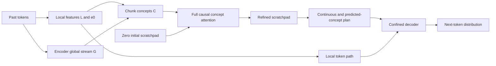

# Deep review of `draft_v3.md`

**Review date:** 29 September 2026. **Reviewed draft:** the 1,106-line, 159,771-byte version with SHA-256 `97409b62feaec78d6ec34e0b0c32aec27ae22517283511c7f317e8bacc8dd183`. Repository inventory was captured at 19:18 IST; the frozen results include v2's evaluation at 19:19:12 IST, step 2,942. Training continued while this review was conducted.

**Verdict: keep this as a candidate, but revise the scientific claims and acceptance tests before treating it as a launch-ready experiment.** The architecture is coherent and removes several measured v2 problems. Its exact parameter budget is correct. However, its central recurrence comparison changes multiple things at once; two architectural explanations are overstated; several gates cannot establish what their names claim; and the reference tests leave important failure modes undetected.

My judgment of the **draft as an experimental design is 6/10**. This is not a measured score for V3: no V3 training result exists. The design deserves implementation and controlled screening, but the evidence does not justify promising that it will beat v1. The most valuable next change is a cleaner experiment, rather than another architectural addition.

The original draft, reference model, and running experiments were left unchanged. New work is confined to this report and [its evidence directory](/Users/shubhankankrishna/Desktop/EncoderConceptDecoder/draft_v3_review_2026-09-29/FILE_COVERAGE.md).

## 1. What was actually reviewed

This review covers the repository's structure, model lineage, results, training/evaluation code, data manifest, earlier investigations, current draft, reference implementation, and the papers most directly used to justify the draft.

| Coverage | What was done | Limit |
|---|---|---|
| Entire repository | Inventoried 1,723 files and 222 directories, excluding this newly created review directory | A filesystem inventory is not a claim of line-by-line semantic review of every file |
| Project text | Machine-read and indexed 720 non-dependency text files; 346 distinct contents after hash deduplication; parsed JSON/JSONL and Python ASTs without reported parse errors | Deep semantic review concentrated on architecture, training, evaluation, data, results, and the draft; generated UI assets and duplicate snapshots received structural comparison |
| Local environment | Identified 861 `.venv` files separately | Third-party package internals were not audited |
| PDFs | Extracted text from 47 PDFs, representing 44 distinct contents, with no extraction errors reported | Detailed claim checking focused on LoopFormer, Mobius, the diffusion curriculum paper, and NextLat; extraction is not a full scientific review of every paper in the library |
| Binary artifacts | Read metadata for 23 NumPy arrays and archive structure for 13 checkpoint/evaluation `.pt` files | No fresh full-scale checkpoint evaluation or tensor-by-tensor weight audit; earlier checkpoint diagnostics are explicitly historical |
| Reference model | Reproduced all 10 advertised float64 tests and parameter totals | Small CPU configurations, not MPS training validation |
| Additional probes | Tested true-initialization gradients, a deliberately broken detach, CRC routing, embedding gathers, and arithmetic claims | These establish mechanics or counterexamples, not trained V3 quality |

The [coverage appendix](/Users/shubhankankrishna/Desktop/EncoderConceptDecoder/draft_v3_review_2026-09-29/FILE_COVERAGE.md) lists every non-dependency file and the inspection level. The [inventory](/Users/shubhankankrishna/Desktop/EncoderConceptDecoder/draft_v3_review_2026-09-29/inventory.tsv), [text scan](/Users/shubhankankrishna/Desktop/EncoderConceptDecoder/draft_v3_review_2026-09-29/text_scan.json), [paper inventory](/Users/shubhankankrishna/Desktop/EncoderConceptDecoder/draft_v3_review_2026-09-29/paper_inventory.json), and [frozen metrics](/Users/shubhankankrishna/Desktop/EncoderConceptDecoder/draft_v3_review_2026-09-29/evidence_snapshot.json) preserve the evidence.

### The repository contains different meanings of “v2” and “v3”

- **Whole-model v1:** `run_m2_25M`. Its class named `ConceptCoreV2` is part of v1; that class name does not make the whole run v2.
- **Whole-model v2:** the running D6/MoE experiment in `run_v2_19M`.
- **Earlier proposed V3:** `proposed_v3.md`, with width 384 and a different recurrence/supervision proposal.
- **This reviewed V3:** `draft_v3.md`, width 256, four distinct core layers, up to three passes, a conditioning table, a shared FFN, and shortcut losses.

These are separate designs. In the inspected webapp, `data/arch_v3.json` still names `proposed_v3.md` as its source. Its existing proposed-V3 illustrations should not be treated as verification of this draft. The webapp was inspected as a presentation of evidence, not as a source of architectural truth.

## 2. Reconstructing the model from first principles

The desired behavior is not “move the scratchpad” or “use every layer.” It is to predict tokens accurately, use distant evidence when needed, generalize beyond memorized examples, and do so within the machine's time and memory budget.

There are four separate questions:

1. **Information:** can the facts required for an answer reach its prediction?
2. **Representation:** does the state preserve and organize those facts usefully?
3. **Learning:** does the answer loss assign useful credit to the operations that should build that state?
4. **Efficiency:** does the improvement justify the extra work, relative to spending that work on more examples or a simpler model?

The draft answers much of question 1 structurally. Its parameter counts address only part of question 4. Questions 2 and 3 require measurements, and several statements currently substitute geometric or scalar-loss proxies for those measurements.

### The actual proposed computation

| Stage | Proposed behavior | Assessment |
|---|---|---|
| Encoder | Width 256, eight `SSSFSSSF` layers, separate local L and global G streams, FFN 1024 | Coherent; width remains an unresolved confound relative to v1 |
| Engram | One 79,999,872-parameter table, two reads with distinct projections; second read has no convolution | Sharing storage is sensible; the added read's quality benefit is unmeasured |
| Concepts | Mix `e0`, L and G, concatenate four positions, project to 256 and normalize | Preserves the tested interface, with reduced dimensionality relative to v1 |
| Scratchpad | Start `S₀ = 0`; repeatedly read C and S, write S; four distinct layers per pass | A sound way to separate evidence from working state |
| Recurrence | Three main passes; terminal losses; full backpropagation | Removes v2's truncation of final-loss credit to early states |
| Conditioning | Six `(t, Δ)` entries, seven gain vectors per layer, 43,008 parameters | A compact finite-grid implementation; no guarantee of useful depth |
| FFNs | Own FFN 736 in each layer, plus the same shared FFN 1024 at every layer | Plausible hybrid, not an established consequence of Mobius |
| Decoder | Four confined layers, plan added once, tied vocabulary head | Mechanically consistent with the earlier design |
| Main loss | NTP + 0.1 NCP + VQ | A reasonable inherited baseline, with changed masks and reductions |
| Shortcut losses | 0.05 shortcut NCP + 0.1 gain-free state consistency | New pressures on the same encoder/core, with no direct shortcut token loss |

The normalized-state consistency definition is a good correction: it avoids directly encouraging the learned output-normalization gain to shrink simply to hide trajectory disagreement. It does **not** by itself make the shorter trajectory useful to the decoder.

### Information can travel globally in more than one way

Even a concept made entirely from local features can be retrieved from a distant position by **full concept attention**. Therefore, the concept route can remain global when the CRC coefficient on G is zero. This distinction matters directly to gate E5.

## 3. What v1 and v2 actually establish

### Comparable recorded results

The table contains official quick evaluations. It does not silently mix the 128-item quick probes with the 512-item final test probes.

| Run | Step | Logged elapsed hours | TinyStories NLL | WikiText NLL | Mean NLL | Recall1 exact |
|---|---:|---:|---:|---:|---:|---:|
| v1 | 1,009 | 5.247 | 2.4866 | 4.1609 | 3.3238 | 11.72% |
| v1 | 1,217 | 6.284 | 2.4077 | 4.0454 | 3.2265 | 33.59% |
| v1 | 1,792 | 9.393 | 2.2280 | 3.8353 | 3.0316 | 82.03% |
| v1 | 2,376 | 12.504 | 2.1252 | 3.6998 | 2.9125 | 92.19% |
| v1 | 2,764 | 14.580 | 2.0673 | 3.6406 | 2.8539 | 94.53% |
| v2 | 2,796 | 21.898 | 2.3446 | 3.9548 | 3.1497 | 53.91% |
| v2 | 2,942 | 22.950 | 2.3231 | 3.9270 | 3.1250 | 53.91% |
| v1 main final | 4,050 | 21.953 | 1.9807 | 3.5277 | 2.7542 | 98.44% |

At nearby steps 2,764 versus 2,796, v2 is about **0.296 nats worse** in mean language loss and **40.6 percentage points lower** on recall, after taking substantially longer. The steps are close, not identical, and later learning rates differ. This corroborates the delay without claiming an isolated architectural cause.

The draft calls the v1 endpoint its “24 h final.” That is a run-budget label: the saved final evaluation's elapsed field is 21.953 h. Tables about efficiency should use the actual field and explain what the clock includes. Its 4,050 updates represent **132,710,400 token slots**, not that many non-padding targets.

### The scratchpad worked; extra depth was much less established

The historical v1 final test achieved 97.07% distant single-value recall, while harder tasks were much weaker: carry3 58.01%, multi4 8.20%, hop 9.18%, and binding 2.93%. Removing or swapping the plan severely damaged retrieval. These results establish that the concept route can carry useful distant information. They do not establish that repeating the same core is responsible for the gain.

The isolated concept experiments sometimes benefited greatly from additional passes. The end-to-end concept bench, however, had nearly equal results at R1, R2, R4, R8 and R16 despite a useful plan. The decoder bench similarly found that a single retrieval task did not need extra depth. These are important negative results, not reasons to discard S.

Earlier v2 checkpoint interventions at steps 138/267, and the later step-1,703 diagnostic saved in the preceding V3 investigation, found modest improvements in token loss as recurrence increased, then saturation. **“Looping destroys the representation” is too strong. “The current loop recipe fails to earn its cost” is the better hypothesis.** Those are historical diagnostics; this review did not rerun full v2 checkpoints.

The earlier underperformance review also measured three concrete v2 problems: NextLat gradient conflict on selected shared weights, batch-row asymmetry in MoE capacity dropping, and a detached early-state path that does not receive final language-loss credit. The draft sensibly removes those mechanisms. Their removal makes V3 easier to optimize; it does not prove that the new conditioning/shared-FFN/shortcut combination is beneficial.

Sources: [frozen run data](/Users/shubhankankrishna/Desktop/EncoderConceptDecoder/draft_v3_review_2026-09-29/evidence_snapshot.json), [earlier v2 diagnosis](/Users/shubhankankrishna/Desktop/EncoderConceptDecoder/v2_underperformance_review_2026-09-28/REPORT.md), [later checkpoint results](/Users/shubhankankrishna/Desktop/EncoderConceptDecoder/v3_design_review_2026-09-29/RESULTS.md), [concept end-to-end results](</Users/shubhankankrishna/Desktop/EncoderConceptDecoder/Concept Design/RESULTS_E2E.txt>), and [decoder results](</Users/shubhankankrishna/Desktop/EncoderConceptDecoder/Decoder Design/RESULTS_DECODER.txt>).

## 4. High-priority findings

### F1 — M1 does not isolate recurrence, and equal data does not establish compute efficiency

**Location:** draft §§6.6, 9.3b and 9.4, especially [the M1 definition](/Users/shubhankankrishna/Desktop/EncoderConceptDecoder/draft_v3.md:869).

The default and fixed-M1 arm differ in all of the following:

| Variable | Default | Fixed M1 |
|---|---|---|
| Main passes | 3 | 1 |
| Pair conditioning | Trainable table | Removed |
| Shortcut trajectories | Present | Absent |
| Shortcut NCP | Present | Absent |
| Shortcut consistency | Present | Absent |
| Training work per example | Higher | Lower |

Matching examples and LR controls two important variables. It does not control the rest. A win is a win for **the full recipe**, not an isolated recurrence effect. A loss could come from the shortcut objective or conditioning rather than recurrence. The draft's statement that the fixed-M1 and t-only objectives match is correct, but M1 compares the default with fixed M1, not t-only with fixed M1.

The label “recurrence earned its compute” also needs an equal-budget comparison. A slower model can be better at equal examples and still lose after the simpler model processes more examples in the same time. Report both sample efficiency and wall-clock efficiency. For an inference claim, add measured latency at the actual evaluation depths.

**Correction:** make a controlled recurrence baseline mandatory if the report intends to claim a recurrence benefit. Section 9 below gives a nested comparison that separates repetition, conditioning, and shortcut training. Retain the current default-vs-M1 comparison, but rename it “full recipe versus single-pass baseline.” Without the control, the correct result is **unmeasured**, not successful or failed recurrence.

### F2 — M2's geometry thresholds are not necessary conditions for useful computation

**Location:** draft §§4.7 and 9.3, [M2](/Users/shubhankankrishna/Desktop/EncoderConceptDecoder/draft_v3.md:860).

The gate requires an update angle of at least 10° and

`ρ = ||S₃|| / (||ΔS₁|| + ||ΔS₂|| + ||ΔS₃||) ≤ 0.90`.

With zero initial state, the triangle inequality gives `ρ ≤ 1`. A value near 1 indicates aligned updates. It does **not** imply that those updates are useless. Small aligned refinements can cross a decision boundary, improve a probability margin, or complete an iterative estimate. Conversely, orthogonal or cancelling writes can satisfy the geometry gate while adding noise.

A concrete two-dimensional counterexample is saved in [the probes](/Users/shubhankankrishna/Desktop/EncoderConceptDecoder/draft_v3_review_2026-09-29/claim_probes.json): updates `(1,0)`, `(1,0.05)`, `(1,0.05)` yield angle approximately zero and `ρ = 0.99972`. The normalized state's second coordinate changes from 0 to 0.02499 to 0.03331. A decision threshold at 0.03 is reached only on pass 3. This is a mathematical counterexample to necessity, **not** a claim that a trained V3 behaves this way.

The reverse implication also fails: pair-specific gains can rotate states without doing useful work. Different gains do not force different outputs for all inputs, and useful different outputs do not require large angles.

**Correction:** make angle, ρ, state norm and relative-update norm diagnostics. Trigger investigation when they accompany a task or efficiency failure. Do not automatically select carry normalization merely because an angle is small. Carry normalization is a separate change to the dynamical system and may erase useful magnitude or change optimization.

### F3 — E5 incorrectly equates low CRC G weight with bypassing the global route

**Location:** draft §§3.3, 9.2 E5 and 10.5, [E5](/Users/shubhankankrishna/Desktop/EncoderConceptDecoder/draft_v3.md:846).

There are two direct reasons the inference is invalid:

1. C can contain local features from an old chunk; full concept attention can retrieve that chunk globally.
2. In the encoder, the CRC mixture weights are themselves computed from `rms(G)`. A small direct G coefficient does not necessarily remove G's influence on the selected mixture.

I forced the CRC router to the exact constant mixture `[e0,L,G] = [1,0,0]`, removing both of those encoder-G contributions. Editing token 4 still changed a logit at position 100 by **0.03950** in the small reference model. That edit is outside the local decoder route. The core's global attention carried the dependence.

This is an untrained structural probe, so it establishes reach, not useful trained retrieval. It is sufficient to disprove “G share below 0.4 means the global path is being bypassed.”

**Correction:** rename E5 “encoder G contribution.” Log normalized branch contributions and gradients, not only a softmax coefficient. Use distant-answer accuracy with plan/core interventions to evaluate the entire global route. To study the encoder F/G branch specifically, use a defined F-off or G-contribution intervention and, ultimately, a trained control.

### F4 — Detached NCP targets do not guarantee that representations cannot collapse

**Location:** [draft §6.3](/Users/shubhankankrishna/Desktop/EncoderConceptDecoder/draft_v3.md:573).

The draft says the target is detached, so no gradient can make it more predictable and collapse cannot occur “by gradient.” This confuses a derivative within one backward pass with learning over many optimizer steps.

The same encoder produces the current input concepts and future target concepts. Updating it through the input-side loss changes the target distribution on the next forward pass, despite detaching today's target. Stop-gradient blocks one path; it does not freeze the encoder or prove an informative fixed point.

NTP supplies a useful competing pressure, but the local token path can reduce NTP while the concept path remains weak. Codebook usage, entropy and variance explained help diagnose problems; none alone proves that the representation retains the facts required for downstream tasks. A diverse codebook can encode nuisance distinctions.

**Correction:** describe collapse as a risk mitigated by NTP, initialization, and observed representation health, not ruled out. Monitor held-out retrieval and concept-to-fact probes alongside codebook statistics. Measure the main and auxiliary gradients over several representative batches before asserting which loss drives the core.

### F5 — The loss coefficients and loss values do not establish gradient dominance

**Location:** draft §§4.2, 6.3 and 6.4.

The draft correctly asks for per-term gradient measurements in §6.4, but elsewhere says the small shortcut coefficient keeps the main trajectory dominant and quantifies “NCP-driven” early learning using scalar loss sizes. Those conclusions do not follow. Losses can have different Jacobians, masks, curvatures and routes to shared weights.

Define the weighted gradients on an explicit parameter subset:

`g_main = ∇(L_NTP + 0.1 L_NCP_main)`

`g_short = ∇(0.05 L_NCP_short + 0.1 L_scons)`.

Measure the norm of the **sum**, not the sum of individual norms. Record their cosine/projection as well as their magnitudes, separately for the encoder, core attention, own FFNs, shared FFN, conditioning table and decoder plan projections. An auxiliary gradient can be smaller and still oppose the task gradient on a crucial module. A larger aligned gradient can be useful.

A single random microbatch and a hard “auxiliary norm must be smaller” rule are weak grounds for halving both coefficients. Use repeated fixed diagnostic batches from different data families and shortcut schedules; report distributions and the subsequent task trend. The different cadence statements in §§6.4 and 8.2 also need reconciliation.

**Correction:** retain 0.05 and 0.1 as provisional starting values. Remove the claimed 0.01 theoretical “floor” for shortcut NCP: a ratio borrowed from another loss does not prove that a smaller coefficient cannot anchor learning.

### F6 — Component-off deltas are not mathematically guaranteed upper bounds

**Location:** draft §§5.5, 9.3 M5 and 10.3, [M5](/Users/shubhankankrishna/Desktop/EncoderConceptDecoder/draft_v3.md:866).

An intervention can be out of distribution. That tells us its interpretation is conditional; it does not determine the direction of its bias. Removing a coadapted module can exaggerate its apparent benefit. Redundancy, compensation, or a harmful module can reduce or reverse the measured delta.

Therefore, “every delta is an upper bound” is false without additional assumptions about training, optimization and the comparison class. It is particularly unsuitable for table-off, shared-FFN-off and plan-swap interventions, which change different aspects of the state distribution.

**Correction:** call these **fixed-checkpoint intervention effects**. Report the exact intervention, reference loss, changed loss and distribution caveat. Use a retrained ablation to estimate the effect of including a component during learning. Large plan-swap damage supports dependence on plan content; it does not alone establish superiority over a model trained without that route.

### F7 — “The conditioning table fixes the architectural cause” is stronger than the evidence

**Location:** [draft §4.2](/Users/shubhankankrishna/Desktop/EncoderConceptDecoder/draft_v3.md:249), §4.3 and the deep-review log.

The proposed mechanism is plausible: if normalized S settles into an effectively constant readout and C is fixed, later updates can become similar. But the observed trajectory does not establish an architecture-only cause independent of data and training. A recurrent map without an explicit clock can still perform changing, useful computation because its state changes. The isolated concept experiments in this repository already demonstrate that possibility.

A nonzero conditioning table enlarges the set of behaviors the model can represent. It does not ensure the learned optimizer will select useful ones. The table starts at zero, can remain small, can be ignored downstream, or can encode visually different but task-irrelevant updates.

Similarly, the presence of an identity term in a residual Jacobian is not a guarantee against vanishing or exploding gradients. Products of `I + J_i` may contract, amplify, or cancel directions. The true-initialization probe confirms a nonzero path in the tested configuration; it is not a stability theorem for training.

**Correction:** replace “fixes it” with “tests a plausible remedy for the observed near-repetitive dynamics.” Keep the full-gradient design and measure gradient propagation at trained checkpoints. Separate the architectural possibility, the learned behavior, and the quality benefit.

## 5. Reference implementation and acceptance-test review

### What reproduced successfully

Running `v3_design/v3_ref.py` on CPU reproduced all ten printed passes and the exact totals below. The tiny Engram table is replaced analytically with its declared full size for the stored-parameter count.

| Component | Parameters |
|---|---:|
| Encoder, excluding embedding and Engram table | 9,641,007 |
| Core, excluding codebook | 4,881,216 |
| Decoder | 4,464,648 |
| **Compute total under repository convention** | **18,986,871** |
| Engram table | 79,999,872 |
| Tied token embedding | 2,097,152 |
| PQ codebook | 32,768 |
| **Stored total** | **101,116,663** |

The “within 19M” claim is correct, with 13,129 parameters of headroom. This convention excludes the tied embedding even though the output projection uses dense compute. It is a consistent repository accounting convention, not a universal measure of model size or training cost.

The existing tests provide useful evidence for core causality, document isolation, batch permutation invariance, initial identity of the added branches, and forward equivalence of the shared first step. [Reproduced output](/Users/shubhankankrishna/Desktop/EncoderConceptDecoder/draft_v3_review_2026-09-29/reference_tests.txt).

I also reran the separate Engram reach check: the second read preserves one-read outputs at zero output-projection initialization, shares the same table object, and leaves L reach at **63 without its convolution**, versus **66 with it**. This supports the draft's no-convolution choice. [Reproduced reach tests](/Users/shubhankankrishna/Desktop/EncoderConceptDecoder/draft_v3_review_2026-09-29/engram_reach_tests.txt).

### C1 — The teacher-detachment test has a false positive

In [T4b](/Users/shubhankankrishna/Desktop/EncoderConceptDecoder/v3_design/v3_ref.py:207), the consistency loss is computed from `rms(S)` while the check inspects `u.grad`. But `u = out_norm(S)` is not used by that loss on either side. Its missing gradient therefore cannot prove the teacher branch is detached.

I deliberately removed `.detach()` in an independent probe. The current T4b condition still returned **true**, while the teacher state had gradient norm **0.05185**. The current code includes the detach; the defect is in the test's ability to catch its removal.

**Required repair:** build a fresh isolated consistency graph, retain the teacher raw state/readout gradient, assert zero teacher-side gradient and nonzero student-side gradient, and add a mutant check that fails when detach is removed. If a prefix is shared, gradients through the student's shared prefix remain legitimate; the assertion must isolate the teacher endpoint branch.

### C2 — “At initialization” is not what the advertised gradient test currently tests

The harness perturbs most parameters and then randomizes both the conditioning table and shared FFN output projection before T4. Thus its gradient result describes that perturbed model.

I separately tested the untouched initialization. NTP reached C and all three main states:

| Tensor | Gradient norm in the small CPU probe |
|---|---:|
| C | 0.006774 |
| S₁ | 0.019081 |
| S₂ | 0.013698 |
| S₃ | 0.012908 |
| Conditioning table | 0.009808 |
| Shared FFN output projection | 0.127810 |
| Second Engram output projection | 0.000511 |

This supports healthy initial connectivity. However, `shared.w1`, `shared.w3`, the shared-branch α slice, and the second Engram key projection have zero initial gradient in this probe because the respective output projection is zero. They can begin learning after it opens. The draft already identifies some structurally dead initial-state gain entries; it should also distinguish these **temporarily zero** gradients from failures.

**Required repair:** separate untouched-initialization tests from perturbed-weight structural tests. Do not demand that every branch parameter receive a gradient on the first backward pass.

### C3 — Reuse parity currently checks the forward, not the gradients or optimizer update

T5 establishes that continuing from the main trajectory's first state gives the same shortcut output as recomputing it. That is useful. It does not establish the draft's stronger claim of identical weight and C gradients after combining the main and shortcut losses.

**Required repair:** compare duplicated-prefix versus shared-prefix execution from cloned parameters, including combined loss, all relevant gradients, and one optimizer update. Use tolerance appropriate to the backend; exact real arithmetic equivalence does not automatically imply identical floating-point accumulation order on MPS. Ensure the reused prefix is not detached and does not cross an optimizer mutation.

### C4 — The “one table gather” implementation actually performs two

[Encoder2.forward](/Users/shubhankankrishna/Desktop/EncoderConceptDecoder/v3_design/check_engram2.py:42) gathers the embedding for the second read, then invokes the original first Engram read, whose own forward gathers the same table again. A forward hook counted **two** calls.

This does not duplicate the table parameters and does not invalidate the current parameter total. It contradicts the claimed gather reuse and could matter to memory traffic and backward work.

**Required repair:** factor a read-from-gathered-embedding helper used by both projections, then verify output and gradient parity. The second-read gate already uses L only; passing G as the residual destination is not itself leakage. The prose assertion that its function “takes no G” should describe what is read, rather than the literal signature.

### C5 — The budget breakdown double-counts the shared-table alias in `eng2`

The model-level total deduplicates parameters correctly. The `parts.eng2` entry in [param_table](/Users/shubhankankrishna/Desktop/EncoderConceptDecoder/v3_design/v3_ref.py:147) counts the aliased table when inspecting that submodule alone. The reproduced tiny-table output is 218,242; its own projections/gate have **214,018** parameters. With the real table, the misleading submodule count would include nearly 80M extra entries.

**Required repair:** subtract the shared table for this breakdown and assert that the component ledger reconciles with unique model parameters. Do not change the verified 18,986,871 total because of this reporting bug.

### C6 — The executable can print FAIL and still exit successfully

The `__main__` block prints each result but does not assert that all passed or exit nonzero. An automation that checks only the process exit status could accept a failed model.

**Required repair:** fail the process if any acceptance assertion fails. Also split T1b into table-only and shared-FFN-only perturbations: it currently changes both before attributing the result to the table.

### C7 — The reference interface does not yet expose the normative consistency inputs

The model forward returns `u` and optionally `u_s`, but not raw `S_main` and `S_short` or their gain-free normalized values. The prescribed consistency loss cannot in general be reconstructed safely by dividing learned output gains out of u.

**Required repair:** expose the gain-free readouts explicitly. Keep learned-gain readouts for NCP and the decoder. This is a reference-interface gap, not an observed bug in a V3 trainer: no complete V3 trainer exists here yet.

All additional probes and their exact outputs are saved in [probe_claims.py](/Users/shubhankankrishna/Desktop/EncoderConceptDecoder/draft_v3_review_2026-09-29/probe_claims.py) and [claim_probes.json](/Users/shubhankankrishna/Desktop/EncoderConceptDecoder/draft_v3_review_2026-09-29/claim_probes.json).

## 6. Resource, arithmetic and mathematical corrections

### A1 — Distinguish slots, non-padding tokens and valid targets

The training throughput counter increments `ids.numel()`. It measures **slots**, including padding. The manifest contains:

- 273,797 training rows × 1,024 = **280,368,128 slots** per epoch.
- **264,365,789 non-padding tokens** per epoch.
- PAD fraction **5.7076%**.

The draft multiplies the measured slots/second by time, then divides by non-padding tokens/epoch. That produces the incorrect 0.80–1.10-epoch range.

| At 45.5 training hours | Low rate: 1,290 slots/s | High rate: 1,770 slots/s |
|---|---:|---:|
| Processed slots | 211.302M | 289.926M |
| Dataset epochs | **0.754** | **1.034** |
| Approximate non-padding tokens | **199.242M** | **273.378M** |
| Approximate non-padding tokens / 18.987M compute params | **10.49** | **14.40** |

The non-padding estimates assume the processed rows have the corpus-average PAD fraction. Exact valid next-token targets are fewer again because of row ends and document boundaries; count them directly. Equal rows/slots preserve the historical data-order comparison, but the cleaned masks and global denominators still change the objective.

### A2 — Chinchilla does not prove width 256 is optimal here

The cited dense-model scaling result is useful motivation for balancing capacity and data, not a theorem for a model with an 80M lookup table, repeatedly applied weights, a custom exclusion of embeddings from the parameter count, and a mixed synthetic corpus. A scalar “tokens per compute parameter” ratio cannot decide this architecture's optimum. [Primary paper](https://arxiv.org/abs/2203.15556).

The draft's claim that the output-head matmul does not shrink with width is also incorrect: `8192 × 384 = 3,145,728` MACs per position versus `8192 × 256 = 2,097,152`, a **one-third reduction**. Other costs and accuracy tradeoffs remain.

Keep width 256 as a stated design constraint/hypothesis. Establish its effect only with an appropriate width control, or explicitly leave it unresolved. Increasing FFN hidden size does not restore the lost residual-stream dimensionality or tied-head rank.

### A3 — The LR comparison has the direction reversed

At a matched step after warm-up, a faster arm has used **less elapsed time**. Under a monotonically decreasing time-based cosine it therefore has a **higher**, not lower, LR. [Draft §8.1](/Users/shubhankankrishna/Desktop/EncoderConceptDecoder/draft_v3.md:708) states the opposite.

The proposed LR replay remains a good fix for the confound. But specify how exact per-step replay is stored: the inherited v2 trainer logs every 25 steps by default, so its ordinary `train_log.jsonl` is not a per-step LR trace. Add a dedicated trace or a precisely specified schedule source. Do not imply that the existing sparse log alone supplies every step's LR.

Neither “recall onset is much less sensitive to LR” nor a predicted 0.10-nat LR allowance has been established by this repository's experiments. Label both as heuristics. A WikiText-only gap is compatible with several mechanisms; it does not diagnose the output head uniquely.

### A4 — Memory arithmetic and certainty need correction

For B=2, T=1,024, V=8,192 and fp32:

`2 × 1024 × 8192 × 4 = 67,108,864 bytes = 64 MiB`.

The draft correctly uses 64 MiB in one place, then calls NextLat's second logits tensor approximately 0.25 GiB in the ledger. If 0.25 GiB is intended to describe several retained tensors/gradients, list them; it is not the size of one such logits tensor.

Likewise, a materialized concept-attention score tensor is `2 × 6 × 256² × 4 = 3 MiB`, not approximately 1.6 MB. Whether the actual attention backend retains that tensor is a profiling question.

The “shortcut graph” ledger counts all 18 expected main-plus-shortcut layer applications. The incremental shortcut contributes six on average before reuse; the main contributes twelve. The 125 MB estimate cannot simultaneously mean just the shortcut and all eighteen applications. It is also larger than 64 MiB, despite the sentence describing it as small beside that tensor.

The weight/gradient/Adam estimate of approximately 1.62 GB is sound in decimal units. Actual peak memory also includes live activations, temporaries, allocator caches and process overhead. Larger FFNs, two full-backprop graphs and a larger table prevent a proof that V3 will be no heavier than v2. Keep the proposed 100-step memory profile; label memory expectations unverified.

### A5 — Shortcut overhead is 50% of the main core pass work before reuse

The main uses 3 passes. The sampled shortcut averages 1.5, so the total is 4.5: **50% additional core pass work relative to main-only**. The shortcut is one-third of the combined total; that is different from “+33% core compute.” With shared-prefix reuse, the additional pass work is 1.25/3 = **41.7%**.

These percentages concern core passes, not whole-model throughput. The draft's separate whole-model MAC/throughput estimates must retain that distinction. The 18 applications are per microbatch forward graph, or an average of 288 across 16 microbatches per optimizer step. They are not 18 total layer executions per optimizer step.

### A6 — The conditioning-row exposure calculation uses the wrong sampling unit

The shortcut is sampled **per microbatch**. A row used with probability 0.25 appears at least once in an accumulation-16 optimizer step with probability:

`1 − (1 − 0.25)^16 = 0.989977`.

Across 7,600 optimizer steps this is approximately **7,524 optimizer steps with some gradient contribution**, or **30,400 contributing microbatches**, not 1,900 row updates. Weighted gradient exposure is still lower than that of main rows; the correction does not make all rows equally supervised. Adam momentum can also move a row on a step without a fresh contribution.

### A7 — Clip and normalization claims need narrower wording

| Draft claim | Correct interpretation |
|---|---|
| Gradient clipping bounds conditioning gains | It bounds a gradient norm, not cumulative parameter values; Adam moments and repeated updates still allow drift |
| Six conditioning inputs leave “nothing to overfit” | The learned gains affect many token-dependent computations; a small conditioning domain is not a no-overfitting proof |
| `zcRMSNorm` gives a fixed output sphere | Its per-channel learned gain changes the norm; plain gain-free RMS normalization has the simple radius bound |
| Null-plan magnitude is fixed | `PlanBuilder.null` is an `nn.Parameter`; this review observed nonzero initial gradient to it |
| NCP maximum is `ln 128` | This is the uniform-prediction CE baseline and maximum entropy for 128 categories; CE itself is unbounded above |
| PQ has 224 bits, therefore that is the concept channel's information capacity | 224 bits describes the hard code index tuple; the continuous u route and soft predicted code vector are not restricted to that discrete message count |
| Many head-applications rule out attention capacity as a bottleneck | Reusing heads increases computation; it is not a direct measure of independent representational capacity or successful retrieval |

The CE counterexample in the probes is 14.844 nats for 128 classes, already exceeding `ln 128 ≈ 4.852`. None of these corrections requires removing PQ or RMS normalization; they require accurate arguments for keeping them.

### A8 — Estimates should be generated from the final configuration

`v3_budget.py` explicitly describes a pre-trim 768-wide own FFN and its analytical table model uses an earlier site count. `v3_ref.py` is the source that reproduces the final 736-wide, seven-site parameter count. Preserve the sweep as historical exploration, but generate a distinct final budget artifact from the finalized configuration.

The two-point throughput fit has no degrees of freedom to estimate prediction error. v2's MoE and backward windows may inflate its per-application cost, but V3's different graph retention, FFNs, and memory behavior can push error the other way. “Pessimistic for V3” is not established. Use “unvalidated estimate,” then replace it with measured throughput and memory.

## 7. Module-by-module disposition

### Encoder and Engram: keep the mechanics; test the capacity claim

Retain the L/G separation, document-aware masks, the second read's L-only gate, and its absence of a new convolution. These preserve the intended local reach. The full encoder remains causal, and the decoder's local-only path stays bounded when the plan is removed.

The 80M table and two reads are hypotheses about useful storage/access, not demonstrated substitutes for width. Hash collisions do not turn concatenated, learned table heads into an unbiased noise-cancelling average. A citation or an open Engram gate does not establish the gain of 80M versus 50M, or two reads versus one.

The draft cites n-gram statistics but the five text files in `v3_design` do not contain a reproducible sampling/count artifact for those estimates. Save the sampling seed, corpus slice, canonicalization/hash convention and collision statistics before using them as quantitative justification. This is a provenance gap, not evidence that the stated estimates are false.

### Core and zero-state scratchpad: keep the separation of evidence and working memory

`S₀ = 0` does not prevent a first write because the read includes C. The fresh gradient probe supports that path. Keeping C available avoids forcing every pass to recover the evidence from an already compressed scratchpad. Full backpropagation provides the final loss a route through the early passes.

Four distinct layers per pass make one pass already powerful. That can help retrieval while reducing the need for recurrence. It should be counted as a separate capacity change from increasing the number of passes. Do not infer that three passes equal three reasoning steps.

### Shared FFN: retain as an ablation candidate

Mobius motivates cross-layer shared storage. The draft's parallel own-plus-shared branch is a different allocation. Sharing weights means the total unique capacity is `4 × own + shared`, even though every application can activate `own + shared` hidden units. Repeated access is computation, not newly independent parameters.

The own-FFN-992 control matches the principal FFN matrices because `4 × 992 = 4 × 736 + 1024`. If removing the shared branch also removes its conditioning sites, the complete model count changes slightly. State whether the unused sites are retained or removed, and report the actual full count. Equal parameters do not imply equal MACs because the shared matrix is reused at every layer.

### PQ and NCP: retain, with honest limits

Keeping eight-dimensional segments and 128 codes preserves a useful aspect of the prior geometry. Per-segment CE has the same units and uniform baseline across versions, but changed encoders, target masks and concept width prevent interpreting lower NCP as proof of better token modeling.

Masking all-PAD or invalid target pairs and using full-batch denominators are good corrections. They require executable tests for partial chunks, empty terms and unequal valid counts. A large number of chunk slots does not guarantee a minimum number of complete real chunks for initialization; count eligible chunks and specify a deterministic fallback if there are too few.

### Decoder and NextLat: the conservative default is justified

The confined decoder and target-aligned plan interface have prior mechanical and synthetic-task support. Preserve them while investigating the core. Keep NextLat off for the first controlled V3 comparison because its extra cost and selected gradient conflicts are measured, while its gain is not.

The explanation should be “not demonstrated to help in this system,” rather than “mathematically redundant with NCP.” At a chunk boundary, the auxiliary target involves a future decoder hidden state and observed next token; NCP predicts quantized next-chunk concepts. These share temporal structure but are not the same random variable, loss, or conditioning problem.

### Training and evaluation: finish the executable contract

The proposed resume state, separate trajectory RNG, full-batch denominators, code-restart moment reset, CPU parity tests and memory guard are good requirements. The reference model is not a trainer, and these requirements remain pending.

Test global reduction against a full-batch reference with deliberately unequal valid counts. Verify model, optimizer moments, row order, LR clock, trajectory choices and codebook restart state after interrupted versus uninterrupted execution. Test the real pipeline's future-token invariance and document isolation, not only the isolated core's concept causality.

The draft appropriately distinguishes quick validation from full evaluation, but its two-of-three M1 rule does not supply three independent repetitions: checkpoints share training history and evaluation examples. Use paired per-example outcomes and confidence intervals. For accuracy differences, disagreement counts matter; comparing a 10-point delta to one model's binomial SE does not establish the paired uncertainty. Sampling uncertainty also does not include training-seed variance.

The 0.03-nat M1 margin is a decision threshold, not a calibrated estimate of this model's seed noise: two d=128 synthetic decoder runs do not establish the variance of a 19M language-model experiment. Similarly, E1's pass line of 25% recall at step 1,792 is deliberately much lower than v1's 82.03% at that step. Passing E1 means avoiding a severe delay under the chosen tolerance; it does not mean matching or beating v1.

Avoid routinely examining test results while still deciding losses or arms. Even without an explicit numerical tuning rule, human inspection can influence design. Use validation for development and retain a clearly identified final test/OOD evaluation. Existing cross-evaluation overlap remains a limitation; the old packed-shard duplicates must not be confused with the rebuilt deduplicated evaluation lists.

## 8. What the papers support—and what they do not

The local PDFs were extracted and the corresponding primary sources were checked. Paper results are evidence for their own experiments, not acceptance tests for this implementation.

| Source | Supported transfer | Boundary of the evidence |
|---|---|---|
| [LoopFormer](https://arxiv.org/abs/2602.11451) | Time/step conditioning and shortcut training are plausible tools for elastic-depth models | V3 changes initialization, the state/evidence interface, conditioning parameterization, and shortcut task supervision; it has not inherited the paper's empirical result |
| [Intern-S2-Mobius](https://arxiv.org/abs/2608.14290) | Globally shared FFN storage motivates testing shared memory across layers | It does not validate the exact dense 736-own + 1024-shared allocation in this small hybrid |
| [Diffusion curriculum](https://arxiv.org/abs/2609.01449) | Persistent hidden state and training dynamics deserve attention | Denoising curriculum, per-step supervision and task setting differ; “full BPTT through three passes” is not a reproduction of its window-length experiment |
| [NextLat](https://arxiv.org/abs/2511.05963) | Future-latent prediction is a distinct auxiliary objective | Its success elsewhere does not override the measured local costs/conflicts, nor make NCP identical to it |
| [Chinchilla](https://arxiv.org/abs/2203.15556) | Data and parameter budgets should be considered jointly | Its dense scaling relation does not prove this recurrent-plus-lookup model's width optimum |

I specifically checked the draft's LoopFormer Table 2 citation against the local PDF: the cited Pile perplexities **12.93 for the three-layer baseline, 14.3 for `(3⊗2)`, and 11.12 for `(3⊗4)` are correctly transcribed**. That is a legitimate reason to demand a plain baseline. It is not a prediction of what V3's three passes will do. The paper's own low-budget narrative should not override the table values.

The strongest paper-related edit is to distinguish **inspiration**, **structural similarity**, and **replicated evidence** throughout the draft. This repository has the first two for the new combination, not the third.

## 9. A revised experiment that can answer the central questions

Keep the proposed architecture available. Change the order and interpretation of the tests so that an expensive result is explainable.

### Stage 0: mechanical readiness before performance claims

1. Repair C1–C7 in a development copy/reference revision.
2. Freeze the configuration and regenerate parameter/MAC ledgers from it.
3. Implement the trainer's masks, global reductions, RNG/resume state and actual per-step LR trace.
4. Run small CPU end-to-end parity, gradient, mask, optimizer-group and resume tests.
5. When the training device is available, profile memory and throughput, including evaluation and a checkpoint cycle. No new GPU experiment was launched for this review.

A test suite should reject deliberate violations: removing teacher detachment, leaking a future token, crossing a document boundary, duplicating optimizer registration, detaching a reused prefix, or omitting the conditioning table's declared optimizer-group rule.

### Stage 1: separate the changes

| Arm | Main passes | Conditioning | Shortcut losses | Question answered by comparison |
|---|---:|---|---|---|
| A: plain one-pass | 1 | None | None | Baseline |
| B: plain three-pass | 3 | None | None | B versus A: benefit/cost of recurrence with the same module parameters and objective |
| C: conditioned three-pass | 3 | Main trajectory's t-dependent gains | None | C versus B: effect of conditioning, including its small parameter addition |
| D: full draft | 3 | Full `(t, Δ)` table | NCP-short + consistency | D versus C: value/cost of the elastic-training bundle |

All arms keep the same encoder, decoder, shared/own FFN allocation, clean masks, batch reduction, tokenizer and training rows. Match shared tensors explicitly at initialization; setting one global seed is insufficient if module construction changes the RNG consumption order. Keep a common LR-versus-step trace for sample-efficiency comparisons.

For limited resources, A and B are the minimum to isolate repetition itself; C and D are needed to claim their additional mechanisms help. A versus D remains a useful overall recipe test, but must be labeled accordingly. A separate D versus own-992 comparison studies the shared FFN after the main recurrence question is better understood.

Do not require all pilots to consume 48 hours. Use predeclared matched checkpoints and extend the promising comparison far enough for the relevant tasks to learn. If a 2,400-step pilot still has near-chance composition performance, record **insufficient evidence for composition**, not a successful reasoning-depth result. A second seed on the decisive comparison is more informative than several unrelated one-seed fallback changes.

### Stage 2: evaluate useful work rather than a shape of trajectory

For every arm, report:

- Per-language NLL, with valid-token counts and paired row/document uncertainty estimates.
- Recall, carry, multi-fact, hop and binding exact match, with the same item identities and paired outcome counts.
- Quality versus processed rows/valid targets, and quality versus measured wall time.
- Inference quality versus latency for supported depth budgets.
- Distant-answer sensitivity to correctly specified plan/core interventions.
- Gradient alignment and state geometry as explanatory diagnostics.

Use the same-checkpoint M1/M2/M3 sweep to measure **elasticity under the trained decoder**. It cannot substitute for training a single-pass control. Also, recall1 is mainly a retrieval test; a gain there alone does not establish multi-step reasoning. Include an evaluation whose difficulty increases with the number of dependent operations, and state whether the training distribution supplies such examples.

### Stage 3: choose a 48-hour candidate using the result

- If B improves quality at equal examples but loses at equal time, recurrence has a sample-efficiency benefit without a demonstrated training-efficiency benefit.
- If C beats B, the conditioning hypothesis gains support.
- If D fails to beat C in main quality but improves short-budget inference, the shortcut objective may be useful specifically for elasticity. Decide whether that is a project priority.
- If none beats A within uncertainty and cost, use the simpler model for the next main run while retaining recurrence as a research question.
- If the shared FFN control wins only at equal parameters while losing at equal time, report that tradeoff rather than declaring a universal winner.

The draft's existing matched-step v1 milestones can remain historical warning lines. They are useful for recognizing a v2-like delay, but are not substitutes for the controls above because width, objective reduction, masks, capacity allocation and LR differ.

## 10. Specific edits needed in the draft

| Section | Edit |
|---|---|
| Status/header | Name a final specification revision; distinguish this candidate from `proposed_v3.md`; reconcile the advisor-call count with the later log |
| §1 / §2 | Keep the v1/v2 numerical evidence; separate observed facts from causal interpretations; correct output-head cost and scaling-law certainty |
| §3 | Keep reach/isolation requirements; correct one-gather implementation claim; replace “G share means global path” with branch-specific diagnostics |
| §4.2 | Replace “conditioning fixes the architectural cause” with a falsifiable hypothesis; say endpoint matching uses gain-free states consistently |
| §4.3 | Correct microbatch exposure arithmetic, clipping/overfitting claims, and stale “both decayed” wording |
| §4.6 | Call `ln 128` the uniform CE baseline; describe hard-code bits without treating them as the whole information channel |
| §4.7 | Make geometry diagnostic; reconcile its within-checkpoint outcome language with §9's trained-control definition |
| §4.8 | Do not call S entirely unsupervised when the new consistency loss explicitly supervises its normalized endpoint |
| §5 | Correct learned-null-plan and learned-normalization statements; describe NextLat as unproven here, not identical to NCP |
| §6.3 | Remove the no-collapse proof and scalar-loss proof of early NCP dominance |
| §6.4 / §8.2 | Choose one gradient-audit cadence; define weighted gradient sums and alignment; remove stale decay on shortcut rows |
| §7 | Correct slots/epochs, memory tensors, sampling units, shortcut overhead and confidence in the throughput fit; regenerate final ledger |
| §8.1 | Reverse the faster-arm LR statement; specify exact LR trace storage |
| §8.4 / §9.4 | Remove the stale short-arm step-cosine instruction if replay is normative; prefer a controlled pilot before the full costly run |
| §9 | Relabel M1; demote M2/E5 causal claims; replace “upper bounds” with intervention effects; specify paired uncertainty |
| §10.2 | Separate initial connectivity from stability guarantees and temporary zero branch gradients |
| §10.7 | Use the gain-free consistency definition rather than the older u-based wording; keep paper differences explicit |
| Reference code | Apply C1–C7 and verify that deliberate defects fail the harness |

The draft contains many rounds of useful revision, but some earlier reasoning remains after decisions changed. A short normative specification should take precedence over the historical discussion. The advisor log should remain a decision history, not act as proof: repeated approval does not replace a controlled experiment or a test that can detect its intended failure.

## 11. Review of this review

I challenged the conclusions against the same principles used to criticize the draft:

| Check | Result |
|---|---|
| Did I infer V3 quality from its geometry? | No. Geometry findings are logical counterexamples; no trained V3 quality is claimed |
| Did I treat old v2 diagnostics as newly measured? | No. Historical checkpoints and the new small-reference probes are separated |
| Did I confuse codebook health with reasoning? | No. Both are reported as different evidence |
| Did I reject recurrence because the current design is confounded? | No. The proposed A/B comparison tests it directly |
| Did I use an intervention as a trained ablation? | No. The CRC probe establishes an available path, not its trained usefulness |
| Did I invalidate the total because a submodule count is wrong? | No. The 18,986,871 total is independently reproduced and retained |
| Did I claim all PDF/library text was deeply understood because it was extracted? | No. Coverage levels and their limits are explicit |
| Did I modify the live run to investigate it? | No. The new executable probes used one-thread CPU work; no training state or MPS job was changed |
| Did I replace the user's candidate with the earlier width-384 proposal? | No. The review evaluates this draft on its own terms |

**Final recommendation:** preserve the zero-initialized scratchpad, repeated access to C, confined decoder, full gradient path and simpler dense core. Keep the conditioning table and shared FFN as plausible hypotheses. Repair the test gaps, correct the claims and accounting, and require controlled evidence before calling recurrence successful or spending the full run budget on the assumption that it is.

The architecture may work well. The current draft does not yet provide a reliable way to know **why** it worked—or why it failed. Correcting that is the most important improvement.
