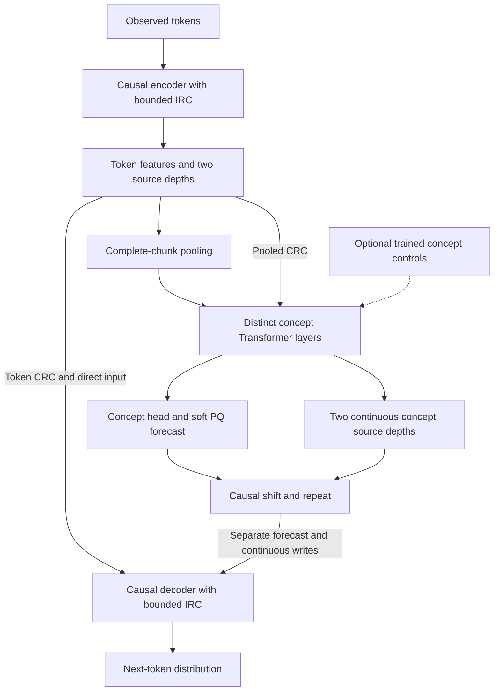

# V7: a scalable encoder-concept-decoder with predictive concepts and optional latent search

Date: 5 October 2026.  
Status: architecture and experiment design; not implemented or validated.  
Evidence: completed V1-V6 experiments, current source, historical audits, and the local paper library.  
Review: a self-review by the same author is recorded at the end; it is not independent confirmation.

## 1. Decision

Build a **jointly trained encoder-concept-decoder backbone with next-concept prediction**, then preserve the V6 staged recipe: **freeze the encoder/decoder → refit the concept module → add prior-trained exploratory Z → validate a complete transplant → test GradCuit and MCTS**. Use GradCuit-style updates to propose local changes and AB-MCTS to allocate attempts between fresh proposals and refinement. Ordinary token sampling and latent sampling remain explicit competitors.

The backbone must improve prediction and task performance before search is added. Search must improve verified success after its full cost is charged. These are separate hypotheses and need separate experiments.

The main changes from V6 are:

1. Train a competent concept stack jointly with the encoder and decoder, then refit a compatible concept core through the frozen surrounding model. Keep the staged refit/transplant design; use distinct Transformer layers as the primary capacity axis. A shared recurrent replacement is a separate compression arm.
2. Preserve exact token-level fact access. Use a normal causal decoder residual stream, with predicted concepts and continuous concept features entering through separate, measurable connections.
3. Retain NCP, but specify its units, gradient paths, coefficient schedule, and mandatory no-NCP comparison. Investigate the V5/V6 reversal instead of declaring either result universal.
4. Add all three directions of cross-module routing and a bounded-memory form of intra-module routing. These are explicit V7 adaptations, not a claim to reproduce the NCP paper's full routing.
5. Train exploration around a competent frozen backbone, with a wider control space than V6 and an exact zero-control reference. Protect the reference algebraically and test useful alternatives empirically.
6. Search over **realizable concept-control schedules and their generated answers**. A concept forecast is not assumed to be an action-conditioned world model.
7. Scale width, distinct layers, data, and training compute first. Report search scaling and recurrence scaling separately.

This design preserves the user's preferred hierarchy:

**tokens → encoder → chunk pooling → concept Transformer → concept head → soft concepts → causal shift/repeat → decoder → tokens.**

It also preserves continuous encoder-to-decoder and concept-to-decoder routes. A product-quantized vocabulary does not make the whole network discrete, and MCTS does not require a fully discrete neural network.

## 2. What the repository actually establishes

### 2.1 The NCP reversal is central evidence

The following rows describe different experiments. Only comparisons within each row pair are matched; V5 and V6 percentages must not be compared as if their data, training, and verifier protocols were identical.

| Experiment | NCP enabled | NCP disabled | Interpretation |
|---|---:|---:|---|
| V5 foundation, 18,000 updates, standard greedy generation, 512 development items | 89.26% | 19.53% | NCP helped under the V5 recipe and historical verifier. |
| V6 foundation, matched 9,000-update prefixes, standard greedy, 64 development items | 0/64 | 51/64 = 79.69% | NCP hurt substantially under this V6 recipe. |
| Same V6 prefixes, hard greedy, 128 development items | 0/128 | 37/128 = 28.91% | The reversal also appears on harder graphs. |
| Same V6 prefixes, text NLL | 1.95674 | 1.95799 | Text quality was nearly identical on this evaluation. |
| Same V6 prefixes, graph NLL | 0.61158 | 0.12441 | The failure is visible before search. |

Sources: [V5 NCP](v5_tiny/runs/A_ncp_s0/eval_a_val.json), [V5 alpha-zero](v5_tiny/runs/A_ncp_a0_s0/eval_a_val.json), [V6 NCP prefix](v6_tiny/runs/eval_forecast_prefix_dev/summary.json), [V6 alpha-zero prefix](v6_tiny/runs/eval_no_forecast_prefix_dev/summary.json).

In both alpha-zero controls, the encoder, pooling, concept stack, soft codebook prediction, continuous concept port, decoder, and VQ fitting remain. The intervention removes the NCP term's gradient. It does not remove the concept architecture. The V6 comparison concerns foundation models, before recurrent replacement and Z training.

All 64 standard and 128 hard greedy failures of the V6 NCP prefix are classified as illegal transitions. The alpha-zero prefix has just one illegal-transition failure in each split; most remaining hard failures lack a complete terminator. This points to different capability bottlenecks. It does not identify which internal mechanism caused them.

The V6 alpha-zero control stopped at a declared 9,000-step prefix of the same 18,000-step schedule. Its result is not a matched 18,000-step endpoint comparison, nor independent-seed confirmation. All these inspected sets now count as development evidence for V7.

### 2.2 Other results that constrain V7

| Evidence | What transfers into the design | What remains unproved |
|---|---|---|
| Original isolated concept experiments | Latent gradients and extra computation can repair controlled composition tasks. | The same gains surviving token-level end-to-end learning. |
| Original end-to-end experiments | A useful concept route can exist while extra passes contribute little. | One loop equaling one reasoning step. |
| V1/V2 audits | Objective conflict, truncated credit, route capacity, and memory cost need direct measurement. | A single auxiliary loss explaining all underperformance. |
| Completed V3 | Strong retrieval and measurable plan use; much weaker multi-hop/binding results. | Retrieval, plan dependence, or healthy code usage establishing general reasoning. |
| V4/V4.1 | Direct access to token facts helped; fixed-input plan-off tests can give false attribution. | Forcing all distant information through concepts improving quality. |
| V5 replacement and transplant | A concept core can be trained through a frozen decoder and preserve competence; retain this staged training path. | Refit beating direct joint training or matched extra continuation at every scale. |
| V5 prior exploration | Candidate selection repaired the poor prior of a future-conditioned latent model; extra continuation alone did not. | Posterior reconstruction implying useful inference-time controls. |
| V5 internal RL | The tested controller/switching recipe lost to stronger baselines. | Internal RL being inherently unsuitable. |
| V5 GradCuit | Useful gradient direction relative to random updates. | Advantage over the strongest retry baseline. |
| V6 trained audits | Exact zero-control behavior and frozen weights were preserved. | Those invariants implying high model quality. |
| V6 prior sampling | Hard held-out success 11.91%, versus 9.18% token retry at equal candidate count. | A robust compute-matched advantage across independently trained seeds. |
| V6 primary GradCuit test | Hard 8.59% versus retry 8.98%; standard 20.31% versus 23.44%. | GradCuit outperforming retry: both paired 95% intervals include zero. |

V6 completed all planned stages without skipped or partial evaluations. Its strongest foundation finding arrived at the end, after the main replacement/search family had already been trained from the NCP foundation. It would be incorrect to say the full search pipeline was tested on its strongest foundation.

Sources: [original concept results](Concept%20Design/RESULTS_E2E.txt), [original control results](Concept%20Design/RESULTS_H1_H2.txt), [V2 audit](v2_underperformance_review_2026-09-28/REPORT.md), [V3 final](run_v3_19M/runs/v3_48h/eval_final.json), [V4 comparison](v4_tiny/VS_LLM_REPORT.md), [V4.1 assessment](v41_tiny/ASSESSMENT.md), [V6 report](v6_tiny/REPORT.md), [V6 primary result](v6_tiny/runs/PRIMARY_RESULT.json). V5's [report](v5_tiny/REPORT.md) is stale about phases D/E; use the [completed D JSON](v5_tiny/runs/D_v6_s0/phase_d.json), [hard E JSON](v5_tiny/runs/E_v6_s0_hard/phase_e.json), and [deterministic retry control](v5_tiny/runs/B_v2_s0/bestof11_T1.json).

### 2.3 What the NCP paper supports, and what our tiny models omitted

The local [NCP-ArchPreview report](NCP-ArchPreview%20Technical%20Report.pdf), particularly sections 2-4 and Appendix B, provides positive evidence for next-concept prediction at large scale. Its reported 8.94B model uses a 16-layer encoder, 8-layer concept module, and 16-layer decoder. Its 200B-token component study and 1B/150B residual-routing study distinguish architecture, routing, and objective contributions. The main pretraining run uses 5.73T tokens. These are the authors' results, not measurements of this repository's models. The [official paper page](https://arxiv.org/abs/2609.10715) and [evaluation repository](https://github.com/LUMIA-Group/ncp_olmo_eval) identify the corresponding release.

The transfer limits are concrete:

| Component | NCP report | V5/V6 foundation | V7 decision |
|---|---|---|---|
| Concept computation | Distinct Transformer layers | Two distinct blocks, later replaced by a shared recurrent core | Distinct stack trained jointly, then refitted; recurrence tested separately |
| IRC | Dynamic mixtures across depths within each module | Paper-style IRC omitted; ordinary block residuals present | Bounded depth bank, compared with plain residuals and full IRC |
| CRC | Encoder→concept, encoder→decoder, concept→decoder; source-depth mixtures | Direct final encoder path plus one reduced continuous concept port | All three directions with explicitly bounded banks |
| Predicted concepts | Soft weighted codebook vectors | Soft weighted codebook vectors | Preserve differentiability |
| NCP | MSE against detached next pooled concept | Per-feature MSE, alpha=1 | Same predictive principle; explicit normalized units and coefficient study |
| VQ | Nearest-code fit to detached encoder concepts | Same principle; V5 also included padding chunks | Valid complete chunks only; gradients and optimizer state specified |
| Concept history | Paper text describes predicted-concept feedback at inference | Deployed refresh from actual generated token prefixes | Refresh in both generation and replay; latent-only rollout is separate |
| Scale/stability | Large models, BF16, Muon/AdamW recipe, routing studies | One tiny FP32 foundation seed per principal study | Scale-specific optimization and independent confirmation |

An earlier conversation left IRC/CRC too loosely described. **The V6 implementation does not contain the paper's IRC or full CRC system.** This correction matters when interpreting the negative tiny result.

There is also a reproducibility ambiguity in the report: equation 22 averages squared vector error over concepts, while Algorithm 1 line 21 additionally averages over PQ segments. Neither is a per-feature mean. The alpha/beta inputs are not enough to recover an exact tiny-scale coefficient. V7 defines its own units below; alpha=1 is not called a paper reproduction.

The paper motivates retaining NCP. It does not establish that our proposed routing, loss schedule, control interface, or search will work. In particular, its codebook combinations are a vocabulary capacity, not proof of semantic actions or a fully discrete world model.

## 3. Derivation from first principles

### Step 1: preserve the prediction problem

The base model estimates `p(x[t+1] | x[0:t])`. Every additional mechanism must improve this prediction problem, useful downstream behavior, or cost. A concept module is justified by useful computation over a shorter sequence, not by giving its vectors the name “concept.”

### Step 2: separate detail from longer-range computation

Identifiers, numbers, precise syntax, and newly generated tokens need an accurate token route. A concept summary can organize longer-range structure without carrying every exact detail. Therefore the decoder retains causal access to encoder features and its own previous token states. V7 does not enforce the older 70-token information restriction.

This allows the decoder to bypass concepts. That is intentional: a beneficial concept route must earn use through performance, not by removing useful alternatives. Matched trained controls establish its value.

### Step 3: compress positions, not necessarily representation width

Keep concept width equal to token width initially, and reduce sequence length by a fixed factor `k=4`. Concept blocks can then add learned capacity at fewer positions. Do not combine a shorter sequence with an unnecessarily narrow latent state before demonstrating that the latter preserves needed information.

### Step 4: retain predictive supervision while controlling interference

NTP alone may discover useful abstractions, but it does not explicitly ask a representation to predict the next chunk. NCP supplies that pressure. Its target is learned and moving, however, and the pressure can compete with exact fact retrieval. Loss scale, target statistics, and shared-gradient alignment are measurable design variables.

For fixed target representations, squared-error prediction tends toward a conditional mean. When several futures are valid, this mean need not correspond to any one realizable future. Thus NCP is a representation-learning objective; it is not sufficient by itself to create diverse executable plans.

### Step 5: learn the useful deterministic function first

Train encoder, concept stack, head, connections, and decoder together. A weak frozen encoder/decoder cannot be repaired reliably by adding search. The NCP and alpha-zero foundation arms receive equal budgets before either becomes the exploration anchor.

### Step 6: learn how concepts may vary usefully

After foundation selection, freeze the encoder, decoder, and forecast vocabulary. Refit the concept core through the real frozen decoder, then freeze the accepted deterministic core and train control adapters from a prior available at inference. This preserves V6's useful separation between learning competent computation and learning alternatives. Optimize complete, causal control schedules, not a stitched collection of independently selected future windows. Preserve the entire accepted refit's zero-control function.

### Step 7: give gradients a genuine downstream path

Inject control before substantial concept computation remains. Both forecast and continuous concept connections can carry its effect through the decoder. A detached target is appropriate; detaching the controlled computation would defeat repair. Nonzero gradients establish access, not useful optimization direction.

### Step 8: distinguish proposing from choosing

GradCuit proposes nearby alternatives by changing controls. MCTS allocates attempts among alternatives and refinement histories. Their combination is useful only if proposals contain better answers and feedback helps allocate attempts. With binary failure feedback, the allocation signal can be weak.

### Step 9: ground every claim about a future state

A predicted next concept does not specify how an action changes the world. The first search system therefore generates actual token continuations and verifies them. A later prefix tree must include the actual prefix and caches in its state. Pure latent rollouts need a separately validated transition model.

### Step 10: make scale a learning claim

Scalability means increasing model capacity, data, and training compute improves quality along a useful frontier. Efficient batching is necessary but insufficient. V7 must show a backbone scaling curve with search disabled and a separate inference-compute curve on frozen backbones.

## 4. Backbone specification

### 4.1 Notation and initial configuration

Positions are zero-indexed within a document. Position `t` predicts token `t+1`.

| Quantity | Tiny mechanism configuration | Scaling rule |
|---|---|---|
| Width `d` | 128 | Increase with depth and data |
| Encoder/concept/decoder layers | 3 / 4 / 3, all distinct | Scale each stack; no compulsory weight sharing |
| Token vocabulary | 2,048 for the legacy bridge | Lock one suitable tokenizer per scaling study |
| FFN width | 384, SwiGLU | Approximately `8d/3` at larger scale, rounded for kernels |
| Attention | Four query/KV heads, head width 32 | GQA at larger widths after training the corresponding architecture |
| Chunk length `k` | 4 | Keep fixed in the primary width/depth study |
| PQ segments `S`, entries `Q` | 8, 32 | Increase to at most 32 segments and 128 entries initially |
| Context | 192 for the V5/V6 bridge; separate 512/1,024 pilots | Train and test longer contexts separately |
| Routing source bank | At most two exported source depths | Fixed bound as depth grows |
| Search control dimension `d_z` | 32 | `d/4`, rounded to legal dimensions |
| Adapter intermediate width `r_z` | 32 | `d/4` |

The 3/4/3 configuration intentionally gives concept control multiple layers below its injection sites. It has more distinct concept parameters than V6; comparisons must include parameter- and compute-matched controls. It is approximately 2.45M parameters before exact implementation counting, not a claimed measured count.

### 4.2 Ordinary block

Each block uses pre-RMSNorm, causal attention, and SwiGLU:

```text
A = X + Attention(RMSNorm(X))
Y = A + W_down(SiLU(W_gate RMSNorm(A)) * W_up RMSNorm(A))
```

Use document-local positions and masks. The small bridge uses full causal attention. A separately trained larger-context family uses three sliding-window blocks followed by one full-attention block, independently within each module; a module's final block is full attention even if its depth is not a multiple of four. Concept windows use concept positions, not token positions. Window sizes are configuration fields and appear in every baseline's cost ledger.

Use bias-free attention/FFN projections and rotary positions in all three stacks. The initial reference uses RoPE base 10,000, with token-local indices in encoder/decoder and chunk-local indices in the concept stack; Q/K normalization precedes the rotary transform. Long-context changes to the position scheme are trained and evaluated as declared variants, not applied silently at inference. Source export norms and the final module norms are learned RMSNorm; routing's `n` remains parameter-free. Disable dropout in the tiny correctness reference.

Per-head Q/K normalization is the preferred stability variant, shared with matched baselines. The NCP report's section 4.6 supports investigating it but states that its main results used layer-wise Q/K normalization. V7 must not attribute those main results to per-head normalization.

No MoE, Engram, learned halting, or recurrent scratchpad is required by the initial backbone. These have additional cost and attribution questions in the repository.

### 4.3 Bounded intra-module routing: V7 IRC

This is a new routing proposal inspired by IRC, with a fixed source count. It avoids retaining and mixing every earlier layer at every later layer.

For the block output `Y_l`, the candidate bank is:

```text
X_bank = [module_input, latest_completed_four-layer_group_state, Y_l]
```

Before any four-layer group has completed, mask the middle entry. Duplicate tensor identities are included only once. The group state updates after layers 4, 8, 12, ... and is used only by later layers. The module-input entry is the immutable initial stream: token embeddings for the encoder, observed `C` for the concept module, and `H` for the decoder. Per-block CRC and optional control writes occur afterward; they do not mutate that entry.

Let `n(v)=v/sqrt(mean(v²)+1e-6)` and `s(v)=sqrt(mean(v²)+1e-6)`. A small affine router maps `n(Y_l)` to a softmax over the available bank. With a learned per-channel gate:

```text
w_l = softmax(router_l(n(Y_l)))
g_l = (0.25 / sqrt(L_module)) * tanh(a_l)
X_next = Y_l + g_l * s(Y_l) * (sum_b w_l[b] * n(X_bank[b]) - n(Y_l))
```

Initialize `a_l=0`, so the initial forward function is exactly the ordinary residual block. Initialize router weights to zero, with bias 2 for the current-output entry and 0 for other entries. Router gradients start after the gate opens; this initial delay is expected and must be checked rather than mistaken for permanent disconnection. The normalization is parameter-free here; block RMSNorm remains learned.

The bounded correction limits this routing branch relative to the current state. It does not bound the whole network's Jacobian or prove stability. Compare plain residuals, this bounded bank, and paper-style full IRC in the routing pilot. If bounded routing fails to earn its cost, retain plain residuals; do not rename that control as a routing success.

### 4.4 Encoder and exported facts

Embed tokens and apply `L_e` encoder blocks. Let `H=n_e(E_final)` be the token features. Export two token-resolution states: the outputs after `ceil(L_e/2)` and after `L_e` layers, each normalized by the source export norm. They are causal, unpooled, and available to the decoder at the same token positions.

Pool complete chunks separately within each document:

```text
C_j = n(mean(H[k*j : k*j+k]))
E_bank_j = [n(mean(E_export_b[k*j : k*j+k])) for b in exported_depths]
```

Only fully valid chunks enter the concept sequence or VQ. Padding used for alignment is not a token observation. An incomplete final chunk does not produce a forecast. The decoder still scores its legal next-token targets.

The final pooling normalization is an explicit V7/V6-style choice, not stated as identical to the paper's plain mean-pooling equation. Include normalized versus unnormalized pooling in the bridge if target statistics implicate it.

### 4.5 Cross-module routing: V7 CRC

For a target state `T` and a bank of at most two aligned source states `S_b`, define:

```text
w = softmax(W_route * n(T) + b_route)
g = (0.5 / sqrt(L_target)) * tanh(a)
CRC(T, S_bank) = T + g * sum_b w[b] * n(S_b)
```

Use an independent router/gate for each destination layer and each source module. Initialize the effective gate to `0.02/sqrt(L_target)` and routers uniformly. All three connections exist:

- Encoder→concept: pooled encoder exports, aligned at the same completed chunk.
- Encoder→decoder: unpooled encoder exports, aligned at the same observed token.
- Concept→decoder: concept exports aligned by the causal rule in section 4.8.

Apply incoming CRC immediately before a destination block. Apply its ordinary block and then V7 IRC. Encoder blocks have no incoming CRC. Multiple incoming CRCs are evaluated in the fixed order encoder then concept; routers see the current target state. Source tensors stay differentiable during joint foundation training.

This is bounded normalized routing, not the paper's unrestricted signed IRC or all-depth CRC. Its source choices, gates, and ordering are fully specified so an implementation can be compared rather than improvised.

### 4.6 Concept stack and forecast vocabulary

Start `U_0=C`. Apply encoder→concept CRC and `L_c` distinct concept blocks, with causal attention at chunk resolution. Export the midpoint and final concept states for CRC. Let `u=n_c(U_final)`.

The product codebook contains `E[s,q,:]` with shape `[S,Q,d/S]`. For each completed chunk:

```text
logits_j = reshape(W_head u_j + b_head, [S,Q])
pi_j = softmax(logits_j, code_axis)
qbar_j = concat_s(sum_q pi_j[s,q] * E[s,q])
```

`qbar_j` predicts the next observed pooled concept `C_{j+1}`. The core consumes observed continuous `C`, not nearest-code indices. The decoder receives the soft expectation. No argmax or straight-through estimator is needed in the primary backbone.

During normal generation, complete a new chunk from the **actual generated tokens**, encode and pool it, and advance the concept caches. Do the same during likelihood replay. This refresh contract avoids silently switching to predicted-concept-only histories at inference.

### 4.7 Decoder and concept injection

Initialize the decoder stream with `D_0=H`. Before every decoder block apply encoder→decoder CRC, concept→decoder CRC, and a forecast write:

```text
D_l_in = CRC_from_concept(CRC_from_encoder(D_l))
D_l_in += g_forecast_l * qbar_aligned
```

`g_forecast_l=(0.5/sqrt(L_d))*tanh(a_forecast_l)` is a learned diagonal gate initialized to `0.1/sqrt(L_d)`. It is distinct from the continuous concept gate. Do not normalize `qbar` to unit RMS: its magnitude can encode uncertainty, and normalization could amplify a near-zero average.

The decoder uses its own evolving states for causal attention K/V. It can combine facts and previous plans. This deliberately relaxes the confined-decoder contract of V1-V4.1; it matches the goal of a capable language-model backbone rather than assigning exclusive reasoning rights to a module.

The final normalized state uses the tied token embedding as the output head. Header, response, and text masks determine the loss, not which causal information the model may read.

### 4.8 Exact causal alignment

For document-local token position `t`, the most recent complete chunk is:

`j*(t) = floor((t+1)/k) - 1`.

Use `qbar[j*(t)]` and concept exports from that same chunk; use zero when the index is negative or invalid. For `k=4`:

| Logit position | Predicts token | Latest concept used |
|---|---|---|
| 0, 1, 2 | 1, 2, 3 | None |
| 3 | 4 | Chunk 0, formed from tokens 0-3 |
| 4, 5, 6 | 5, 6, 7 | Chunk 0 |
| 7 | 8 | Chunk 1, formed from tokens 4-7 |

Repeat each concept across four prediction positions after this alignment. Never inject `C_{j+1}`, its target codes, or a future-derived controller into those predictions. Encoder→decoder CRC needs no chunk shift because encoder state `H_t` is already causal at token `t`.

For packed documents, alignment is document-local. Reset position IDs, attention ownership, chunk counters, control windows, and null-prefix behavior at boundaries. Test all four prompt-end phases, including prompts ending inside a chunk.



## 5. Foundation objectives and optimization

### 5.1 Explicit loss units

Define valid token targets `I`, valid next-concept pairs `J`, and complete valid chunks `K_valid`. Report losses per domain before combining them.

```text
L_token = mean_{t in I}[-log p(x[t+1] | x[:t+1])]
L_ncp   = mean_{j in J}[sum_a (qbar[j,a] - stopgrad(C[j+1,a]))² / d]
index[j,s] = argmin_q ||stopgrad(C[j,s]) - E[s,q]||²
L_vq    = mean_{j in K_valid}[sum_s ||stopgrad(C[j,s])-E[s,index[j,s]]||² / d]
L_foundation = L_token + alpha(progress)*L_ncp + beta_vq*L_vq
```

Both latent losses are feature means. V6's VQ averaged squared distance per segment, so conversion requires the factor `d/S`; copying its scalar coefficient into this definition does not preserve its gradient scale. This is recorded as an intervention, not hidden in an implementation helper.

For text, score every valid within-document next token. For GraphNav, score every response and full terminator token. NCP pairs require complete same-document source and target chunks, and a target chunk with at least one scored token. VQ uses complete chunks, including public headers, but excludes padding. Keep these masks identical in NCP and alpha-zero arms.

For the legacy mixed-data bridge, average the token and NCP losses within each domain, then combine 50/50. Use the same domain balancing for V7 VQ; separately reproduce V6's original pooled-chunk VQ reduction in the bridge. Larger language-model runs use a declared corpus mixture, not an automatic 50% symbolic allocation.

### 5.2 Gradient contract

| Term | Encoder/pool | Concept blocks/head | Codebooks | Decoder/decoder CRC |
|---|---|---|---|---|
| Token loss | Yes, all causal paths | Yes | Yes through soft mixtures | Yes |
| NCP | Yes through source concepts and encoder→concept CRC | Yes | Yes | No |
| VQ fit | No | No | Selected entries only | No |

Only the target of NCP is detached; do not detach the source concept sequence. VQ's target detach prevents encoder attraction toward codewords from that term. It does not prevent token/NCP gradients from updating codewords through the forecast path.

Log gradient norms and cosine alignment between token and NCP gradients at representative encoder, concept, and head matrices. Use separate domain readings. Measure before global clipping; an auxiliary term can consume clipping budget even if its scalar value looks modest.

The tied embedding receives output-head and encoder gradients. Report these paths explicitly when attributing changes. The frozen-backbone exploration stage still requires backward operations through frozen weights to differentiate controls.

### 5.3 Proposed NCP schedule

The initial V7-NCP hypothesis uses `alpha_max=0.1` in feature-mean units:

```text
0-5% of declared foundation target-token budget: alpha = 0
5-20%: linear ramp from 0 to alpha_max
20-100%: alpha = alpha_max
```

This gives token learning and the vocabulary an initial period to organize before full predictive pressure. It is a hypothesis, not an established fix. Compare against the same schedule with `alpha_max=0`, `0.01`, and `1`, plus constant-alpha controls when testing whether the ramp itself matters. Freeze the chosen schedule before confirmation and count selection compute.

Default `beta_vq=1` in the feature-mean definition. The initial codebook LR multiplier is 1, with 10 as a declared bridge/control choice. Joint Q gradients may make the historical tenfold LR too aggressive; this remains unmeasured. Do not add gradient projection, an EMA encoder, entropy regularization, and a new target loss simultaneously to rescue a failed arm.

If NCP gradients persistently oppose token learning, first establish that the effect repeats across batches/seeds and localizes to a domain/module. Then test one declared change: lower alpha, a delayed schedule, or source-gradient isolation. The latter removes NCP gradients from the encoder and is a diagnostic/new training variant, not the default end-to-end objective.

### 5.4 Collapse and target-drift diagnostics

Measure pooled-feature variance/effective rank, nearest-code usage, code reconstruction error, forecast MSE relative to copy-last/train-mean/linear controls, forecast drift on a fixed training-only probe, and token quality. A constant representation can make prediction easy; spherical normalization and code usage alone do not rule this out.

Also measure the response to content changes, swapped facts, shuffled codebooks, and calibrated mean-plan interventions. Pair inference interventions with trained controls that experienced the same absence of information. A destructive out-of-distribution zero vector is not proof of useful concepts.

Use training-only complete chunks for codebook initialization. Proposed restarts are confined to the first 20% of training. Initially check every 1% of the declared target-token budget, and replace only entries with zero nearest-assignment usage throughout that interval; do not treat low soft probability alone as nonuse. Record each replacement and reset exactly its optimizer rows. Freeze the vocabulary before refit/control training. Compare restart-free training if restarts dominate feature drift; never repurpose evaluation examples for codebook maintenance.

### 5.5 Numerical recipe and recovery

Start the tiny reference in FP32 with AdamW, betas `(0.9,0.95)`, global clipping at 1, and independently calibrated LR. Use `.002` only as the V6 reproduction setting, not a universal scale law. Matrix weight decay, embeddings, norms, gates, routers, and codebook groups are explicit configuration entries.

At larger scale use BF16 activations with FP32 softmax/reductions, optimizer master states as required, and tested attention kernels. Softmax, VQ distances, norm denominators, and GradCuit probabilities receive dedicated precision checks. A μP or Muon parameterization is a separate verified configuration; paper-specific post-norm loop scaling is not transplanted into this pre-norm dense stack.

For the initial dense reference, initialize ordinary matrices and embeddings with normal standard deviation `sigma=0.02*sqrt(128/d)`; divide attention-output and FFN-down projection initialization by an additional `sqrt(2*L_module)`. Norm gains start at 1 and ordinary biases at 0. Codebooks use the training-chunk initialization, routing gates use section 4's explicit effective values, and control adapters use section 6's calibration. This is a proposed scale-dependent initialization, not a verified learning-rate transfer rule.

The initial tiny LR pilot uses `{3e-4,1e-3,2e-3}`, a 1% target-token warmup, and cosine decay to 10% of peak. Use decay 0.1 on ordinary projection matrices and zero on embeddings, norms, gates, biases, routers, and codebooks initially; publish this grouping. The historical reproduction uses its historical grouping and schedule. Refit and adapter LR selection is separate, with zero adapter weight decay. Lock all settings before confirmation and include optimizer tuning in selection cost.

Depth-aware initialization and bounded routing are safeguards to test, not stability proofs. Log activation RMS, attention maxima, per-head norms, update/weight ratios, code norms, clipping frequency, and nonfinite events. A bounded forecast gate does not bound the learned codebook norm, so monitor their product as well. Preserve a last finite atomic checkpoint containing optimizer, RNG, data position, code usage, and scheduler state. Resume must reproduce the next data/control draw and update within declared tolerances.

## 6. Preserve the V6 recipe: refit, explore, and transplant

### 6.1 Deterministic concept refit through a frozen surrounding model

The main training sequence is:

```text
A: jointly trained NCP foundation
   → B0: deterministic concept-core refit through frozen encoder/decoder
   → B1: frozen refitted core + trained prior-driven Z adapters
   → C: complete-transplant and zero-reference validation
   → D: GradCuit and MCTS over controls, with weights frozen
```

This keeps the staged idea developed in V5/V6. It lets a concept module specialize under a stable token interface and lets exploration be trained afterward without destroying its accepted deterministic function. Its benefit still needs comparison with direct training and equally costly continuation.

**B0 ownership.** Select a complete competent foundation using development criteria. Freeze its encoder, embeddings, forecast head, codebooks, decoder, encoder exports, and decoder-side CRC/forecast routers and gates. Preserve a teacher snapshot. A separately owned refit core includes concept blocks, concept IRC, incoming encoder→concept CRC, and concept export/final norms. Train only those refit-core weights. The frozen forecast head and decoder remain differentiable with respect to their inputs.

The primary scalable refit uses the same number of distinct concept layers as the foundation and starts from their copied weights, including all concept-side routers/norms. It therefore begins with the exact foundation function. This is an interface-compatible concept-only refit, not a claim that copying a stack creates new capacity. A fresh-initialized compatible stack and the V6-style shared recurrent replacement are explicit alternative arms. A changed core must still export every required decoder-facing port; it cannot inherit a favorable comparison by silently adding capacity or dropping ports.

**B0 objective.** Train at full replacement, through the actual frozen decoder:

```text
L_refit = L_token(refitted system)
        + alpha_refit * L_ncp(refitted forecast, detached observed next C)
        + delta(progress) * L_ports

L_ports = mean_valid_chunks[
    (MSE_feature(qbar_refit, stopgrad(qbar_teacher))
     + MSE_feature(export_mid_refit, stopgrad(export_mid_teacher))
     + MSE_feature(export_final_refit, stopgrad(export_final_teacher))) / 3
]
```

Exports here are the normalized continuous source tensors supplied to decoder CRC before its routing mixture. Match the forecast's actual magnitude as well. Use the same complete-chunk masks and domain balancing for each term. This adapts V6's port-distillation idea to V7's additional routes; it is not numerically identical to V6's hidden-state-plus-A loss.

Use the selected foundation's final alpha for `alpha_refit`; the alpha-zero lineage stays alpha-zero. Start `delta=1` for the first 10% of the declared refit target-token budget, decay linearly to zero by 30%, then leave it zero. At a copied initialization the port loss starts at zero; it protects the interface while the core begins adapting. Codebooks stay frozen and no VQ fit/restarts occur in B0. NCP gradients can now update only the refit core, not the frozen source encoder or head.

An initial pilot allocates refit target tokens equal to 10% of foundation target tokens; calibrate its LR separately and record full training cost, including teacher passes and decoder backward work. This is a starting budget, not a promise that 10% is sufficient. A fresh/recurrent replacement may need more and must disclose that cost.

**B0 acceptance.** Require text and symbolic token NLL degradation no worse than 0.02 nats per target and standard strict-success degradation no worse than 2 percentage points relative to its own foundation, assessed with paired uncertainty as in section 11.4. Compare hard success and all failure categories as well. Do not advance a failed refit to primary search merely because its port MSE is small. Preserve the original competent foundation as a fallback and report the failed arm.

**B1 ownership.** Freeze the accepted refitted core too. Save hashes of the entire deterministic transplant, then train only the two Z adapters below. The exact zero-control anchor is now this deterministic refit, which can differ from the original foundation after B0. Teacher/foundation equality is not the invariant claimed after refitting.

**Necessary controls.** Compare (i) direct adapters on the foundation without refit, (ii) concept-only refit followed by adapters, and (iii) ordinary full-model continuation at matched additional training compute followed by adapters. Report matched extra-data exposure separately when compute matching changes token counts. Keep adapter/search budgets and tuning allowances matched. This distinguishes the refit method from merely spending more training compute. Within exploration, include deterministic continuation with B1-matched extra compute, as V6 did.

### 6.2 Two concept control sites

Add one adapter just before concept block 1 and another just before block `floor(L_c/2)+1`, after that block's incoming encoder CRC and before its attention. Thus the second site still has at least half the stack below it. The two sites share each window's control vector but have separate weights.

For a site input `v_j`, a window control `z_w`, and trainable adapter matrices:

```text
a_j = U((1 + 0.5*tanh(G*n(v_j))) * (V*z_w))
write_j = cap * s(v_j) * a_j / sqrt(1 + mean(a_j²))
v_controlled_j = v_j + write_j
```

`G:[r_z,d]`, `V:[r_z,d_z]`, `U:[d,r_z]`; use no bias in the Z-dependent maps. The same formula applies independently at the two sites. Initial `G=0`; `U` and `V` are nonzero random matrices with their scale calibrated on training-only data so a prior draw initially writes about 1% of input RMS. Initial `cap=0.1`; a wider cap is a declared ablation, not an automatic rescue.

The smooth denominator gives `RMS(write) < cap*s(v)` and a finite derivative at zero. Use `s(v)=sqrt(mean(v²)+epsilon)`; near a zero state the bound is relative to this regularized scale. The equation does not guarantee a globally small output change after many layers.

For finite weights, **all controls equal to zero imply exactly the accepted deterministic refit's function**, while the derivative with respect to Z can be nonzero. The direct-adapter control instead anchors to its own selected foundation. Keep the adapter computation in the gradient graph at zero. An inference-only bypass must not be used for the first GradCuit derivative.

These adapters have approximately `2*(2*d*r_z+r_z*d_z)` matrix parameters. At `d=128,d_z=r_z=32`, that is 18,432, excluding any optional biases. V6 had `d_z=8`; the larger proposed space is a capacity hypothesis. Compare `d_z=8,16,32` at the same write cap before attributing a gain to gradients or MCTS.

### 6.3 Prior and temporal coordinates

Sample a standard Gaussian control and project it into an RMS ball of radius 2. Use a fixed prior before considering a learned proposal distribution. A fixed prior avoids a future-conditioned posterior/prior mismatch but does not guarantee coverage of useful behavior.

The primary control window is one concept (`L=1`). Secondary `L=2,4` windows are trained explicitly. Sample their lengths uniformly during the exploration pilot, record per-length performance, and lock one length for the primary search comparison. Holding a vector is not assumed to create a temporally meaningful action.

For a prompt of `P` tokens, the first response logit is at `t=P-1`. The first potentially useful control site is the latest completed concept `j0=floor(P/k)-1`, if it exists. Subsequent controls cover concept indices at and after `j0`. This may require recomputing a few prompt-side decoder states; reuse only genuinely control-independent caches. Very short prompts with no completed concept start control at the first later completed chunk.

Controls are exogenous independent draws during candidate training. At search time they can be chosen using the entire given prompt and previous public feedback. Only response likelihood is scored; do not interpret a retrospectively controlled prompt's likelihood as an ordinary unconditional LM score. Every new response token remains conditioned only on the given prompt, already generated tokens, and the selected controls.

### 6.4 Coherent candidate training

Draw `K=2` complete schedules per training suffix initially. For candidate `i`, compute its response/suffix token loss under the same real observed prefix and teacher-forced target suffix:

```text
ell_i = sum_valid_suffix[-log p(target_token | prefix, schedule_i)] / suffix_target_count
i_best = argmin_i ell_i
L_explore = (1-beta)*ell_i_best + beta*mean_i ell_i
```

Use `beta=0.25` initially and compare `beta=0`. Choose one winner for the complete suffix of one document, not separately per window. A packed row can contain multiple independent documents; their candidate identities and denominators are separate.

Only adapter weights train. The zero schedule is logged as a reference but does not compete to win and suppress exploration gradients. Keep the zero anchor exact by freezing weights, rather than approximating that invariant with a KL penalty.

This is a candidate-selection training objective, not the marginal likelihood of the latent-variable model. If reporting mixture likelihood, compute `-log(mean_i exp(sum_t log p_i(y_t)))` for complete realizable schedules before dividing by target count; do not average tokenwise winners or call mean candidate NLL a mixture likelihood.

Do not force all nonzero controls to minimize NCP MSE toward the same realized future: that could erase the intended alternatives. In the NCP lineage, NCP has already shaped the foundation and deterministic refit; the alpha-zero lineage remains its explicit control. The control stage is evaluated by verified diversity, single-draw quality, and downstream repair, with NCP statistics reported diagnostically.

Score-then-replay can reduce retained activations. Candidate scoring and the winning replay must use identical weights, random draws, masks, and precision. There is no intervening optimizer update. The average-candidate term still requires the corresponding gradients; replay all contributing candidates with correct weights. Frozen decoder weights still cost backward computation.

### 6.5 Exposure and reachability gates

Teacher-forced candidate training does not establish good free generation. Before search, evaluate fresh generated suffixes under 1, 2, 4, and 8 independent control draws, with fixed token sampling conditions. Report successful novel outputs, duplicated failures, invalid transitions, stopping behavior, and quality at zero.

On a separate development subset, fit controls to known valid trajectories as a privileged reachability diagnostic, then regenerate and verify. Its labels and cost never enter the ordinary search score. Compare a matched token-residual control site to test whether the concept interface has any distinctive advantage.

If privileged optimization cannot find useful changes, inspect gradient reach, control rank, and the cap before spending more search. If it succeeds but prior sampling fails, improve proposal training. If sampling works and gradients do not help, deploy sampling in that experiment. These outcomes are useful even when the hybrid search hypothesis fails.

### 6.6 Complete transplant, not a partial blend endpoint

For validation, evaluate replacement fractions `lambda in {0,0.25,0.5,0.75,1}` on every concept-to-decoder port:

```text
qbar_lambda = (1-lambda)*qbar_foundation + lambda*qbar_refit_Z
export_b_lambda = (1-lambda)*export_b_foundation + lambda*export_b_refit_Z
```

Feed these tensors through the unchanged decoder-side routes. Both branches read the same actual observed/generated token prefix. At `lambda=0`, the original foundation is recovered. At `lambda=1,Z=0`, the accepted deterministic refit is recovered. At `lambda=1,Z!=0`, the trained exploration interface is active. These are different endpoints and must be checked separately.

B0/B1 already train with `lambda=1`; blending is a diagnostic of interface compatibility, not additional required training. Deployment uses complete replacement and can unload the old concept teacher. Count active weights separately from training/reference resident weights. An intermediate blend cannot rescue a failed full-replacement claim.

Check text quality, standard/hard generation, all prompt-end phases, and cached replay at both endpoints. If additional transplant training is needed, declare a separate arm and give its controls equal extra compute. Reuse of a frozen encoder does not permit reuse of old decoder caches after a concept change. Retain the trained-adapter, frozen-weight, and zero-control checks after serialization/reload.

## 7. GradCuit-style local refinement

### 7.1 Scope and feedback

The [GradCuit paper](Loop%20Papers/GradCuit.pdf), section 2, inserts optimizable latent states into an intermediate attention sequence. V7 instead changes trained concept controls. It borrows the principle of continuation-token gradients reaching internal states; it is not an exact reproduction.

Model and adapter weights are frozen. Only the current problem's controls change. Start with the same zero-control greedy answer used by every baseline. Stop immediately when the public verifier accepts a complete answer.

For a rejected generated sequence `y`, replay its actual tokens and compute:

```text
L_reject(Z; y) = mean_response_t[log p_Z(y_t | prompt,y_<t)]
L_trust(Z; y)  = mean_response_t[KL(p_0(.|prompt,y_<t) || p_Z(.|prompt,y_<t))]
L_repair = L_reject + lambda_KL*L_trust
Z_new = Project_RMS2(Adam_step_descent(Z, grad_Z L_repair))
```

`p_0` is the frozen zero-control model evaluated on the same replayed token prefixes, not a reference generated trajectory. Include every actually generated response token through the complete terminator. Exclude padding, prompt targets, and nonexistent future windows. `lambda_KL` is selected from `{0,0.05}` on development data initially.

The sign matters: minimizing positive log probability lowers the probability of the rejected answer. For greedy generation and length-normalized replay this is a heuristic rejection update. It is not an unbiased estimate of a reward gradient and does not identify the correct answer. Do not differentiate through argmax tokens or through the discrete verifier.

For a separately labeled on-policy variant, sample trajectories from the actual `p_Z`, use sequence-summed log probability with an action-independent baseline, and multiply by reward advantage. Keep its sampling/temperature and probability replay identical. Do not silently apply that statistical justification to the greedy variant.

### 7.2 Local optimization protocol

Use per-problem Adam state and per-problem clipping. Select LR from a small declared development grid, initially `{0.01,0.03,0.1}`; raw LR is not presumed transferable across widths. Record the induced write change, token KL, and gradient norm. Regenerate and verify after every accepted optimizer update, including the final permitted update.

A tree child created by gradient refinement gets a fresh local optimizer state for its fixed refinement burst. Initially use one update per child. Standalone sequential GradCuit may preserve moments along its chain; that difference is declared and receives a reset-moment control if it affects the comparison.

Accepted problems and unused windows receive no updates, including no momentum drift. Reject nonfinite updates. A nonfinite zero-control answer is a numerical failure; it is not repaired until it appears successful. Search records the full cost of unsuccessful or late work.

With binary feedback, a rejected trajectory gives no location of the mistake. Do not infer that all tokens were wrong. Public error positions may be used only in a separately labeled richer-feedback arm with identical information given to competing methods. A successful hidden reference trajectory is privileged diagnostic information.

### 7.3 Why the new interface could help, and why it might not

More concept layers below the injection, continuous CRC at multiple decoder depths, and a wider trained control space provide additional gradient paths. That makes useful repair plausible. It could also amplify harmful changes, leave a low effective control rank, or merely duplicate token sampling. KL on visited prefixes does not constrain unseen continuations. Fresh verification and equal-cost controls decide whether the mechanism helps.

## 8. MCTS over the concept-control space

### 8.1 Primary search object

Use the node-aggregation variant **AB-MCTS-A with Beta sampling**, following [AB-MCTS](AB-MCTS.pdf), especially Appendix A.5.2, and the audited backup definitions in [the V6.1 design](draft_v6_1.md).

A node stores a complete realizable control schedule, its generated answer, actual token lengths, public feedback, parent/operator identity, and cumulative cost. It is a node in a **refinement tree**, not a claim that each depth is an environment time step or concept token.

Register the common zero-control first answer as the virtual root's first answer child, with one real observation backed up to root GEN. If it succeeds, stop. Otherwise this failed child is available for refinement, and root GEN can propose fresh prior schedules. Its generation and verification consume the same budget in every method. Predeclare the response-token limit and resulting maximum control-window count; sample complete schedules to that horizon, mask unreached windows during gradient updates, and classify a missing terminator at the cap as failure.

The action is a change to concept controls; the rollout is real autoregressive decoding through the frozen encoder-concept-decoder; the observation is the actual answer and verifier output. This is a legitimate search over a continuous concept-control space. Discretization consists of sampling finitely many proposals, not rounding the whole model into hard codes.

### 8.2 Proposal kernels

At the virtual root, draw a fresh complete schedule from the trained prior. At an answer node, propose a child using a fixed development-selected mixture:

| Kernel | Initial hybrid probability | Operation |
|---|---:|---|
| Local random change | 0.50 | Choose one currently active window uniformly; add isotropic Gaussian noise, then project |
| New suffix | 0.25 | Choose an active boundary; keep earlier controls and resample that boundary and all later windows |
| Gradient refinement | 0.25 | One GradCuit update on the node's rejected answer; regenerate from the original prompt |

Initial Gaussian standard deviation is 0.25 in Z coordinates. A prior-only AB arm uses the first two kernels with probabilities 2/3 and 1/3. Compare these fixed kernels before adding learned operator selection. A new suffix means a new **control** suffix; the primary answer-refinement experiment regenerates the response and makes no unjustified reuse of earlier output tokens.

Do not give MCTS a privileged correct path, graph shortest distance, or hidden target score. Public legal-transition checks are allowed as a verifier, but running BFS as a heuristic would itself solve the tiny graph problem and changes the experiment. A BFS solution is an upper-bound/diagnostic baseline only.

### 8.3 Selection and backup

Every answer node N has a `GEN(N)` option for generating a new direct child and a `CONT(N)` option for continuing below an existing answer child. For each statistics object, initialize `alpha=beta=0.5`. With observations `r_i` in `[0,1]`:

```text
alpha = 0.5 + sum_i r_i
beta  = 0.5 + sum_i (1-r_i)
selection_draw ~ Beta(alpha,beta)
```

At a node, compare eligible GEN and CONT draws. If CONT wins, draw from eligible answer-child statistics and descend into the selected child. If GEN wins, execute one proposal from that node. There is no additional PUCT multiplier in this selector.

The histories are different:

- Answer N: its own score and every descendant's score.
- GEN(N): scores of N's direct children only.
- CONT(N): scores below those direct children, excluding the children's own scores.

When a new child X of N is evaluated, initialize X's own answer statistic once, update GEN(N), update answer N, then update each strict ancestor's answer and CONT statistics. Do not update CONT(N) or any ancestor's GEN. The virtual root needs allocation statistics but no fabricated own answer.

Fractional scores use the paper's Beta-style update as an allocation heuristic; correlated, nonstationary descendants do not make it a calibrated Bayesian success posterior. Keep this distinction explicit when interpreting uncertainty.

### 8.4 Binary and richer feedback

Primary reward is strict full-answer success. Every failed attempt before the first accepted answer has reward zero. Therefore the primary selector distinguishes counts and tree structure, not degrees of correctness among failures. It may reduce largely to diversification. This limitation is not solved by calling the procedure MCTS.

A separate public-feedback arm may use a predeclared fraction of satisfied executable constraints or passed public tests. Report the exact formula and give the same feedback to flat sampling, random-parent refinement, beam, and gradient baselines. For GraphNav, legal-prefix fraction can reward long but useless walks, so it is a diagnostic heuristic rather than proof of progress toward the goal. Final success always requires the original strict verifier.

For unverified natural-language tasks, report likelihood and externally evaluated quality separately. Self-rated confidence or the NCP loss is not a trustworthy correctness oracle. General language search needs an independently evaluated verifier and hidden evaluation labels inaccessible to the search policy.

### 8.5 Resource and state contract

Initial safety limits: 32 complete candidates including the common first answer, refinement depth 4, and at most 4 cached live branches per problem. The primary stopping rule is a locked wall-time budget; candidate limits are additional safeguards. Calibration chooses time budgets corresponding to approximately 4, 8, and 16 retry opportunities before results are examined.

Check time before proposing and after every generation, backward pass, and verification. Credit only answers fully verified before the deadline. Charge overrun work. Disable GEN when depth, memory, or proposal limits make expansion impossible; propagate eligibility upward so selection cannot stall on an unusable subtree.

Use a maximum of four proposal requests per remaining candidate slot before declaring a node's proposal source stalled. Canonically identical controls under the same generation seed are exact duplicate requests and can reuse an existing record without a new reward observation; proposal overhead still counts. Different controls yielding the same failed answer are real paid trials and remain separate observations, with duplicate-output rate reported. Do not merge them as proven equivalent states.

Candidate-local state includes controls, RNG, generation caches, and optimizer moments. Share immutable prefix pages; never share writable cache tensors between branches. On resource exhaustion return the recorded failure category and any diagnostic best candidate, without labeling an unverified answer successful.

### 8.6 Discrete PQ moves are an optional arm

MCTS can operate on continuous Z, so hardening PQ is unnecessary. If testing discrete vocabulary actions later, choose a complete segment-index tuple from a context-dependent proposal and use a bounded interpolation:

```text
qbar_changed_j = qbar_j + eta*(concat_s E[s,a_s] - qbar_j)
```

Use `eta=0` as the exact reference; train the same nonzero intervention family before evaluation. Product segments are factorized predictions and arbitrary Cartesian combinations need not be coherent. Independent segment argmax is not a semantic plan. A joint proposal or strong compatibility screening is required, and the continuous CRC channel must be measured separately.

This arm changes the forecast port without directly changing same-prefix concept-core caches. It can still alter later generated tokens and thereby every downstream cache. Report hard-versus-soft competence and intervention effects before spending a search budget. Pure hard-code generation is a new trained architecture, not an inference flag.

### 8.7 Later prefix-concept MCTS

A temporal tree can be tested after answer refinement. Its state must contain `(actual token prefix, encoder/concept/decoder caches, chunk phase, control history)`. An action selects the next window's control, executes real token generation for that window, refreshes observed concepts, and produces a child state. Rollouts to a complete answer supply the value.

Two prefixes with similar concept vectors are not automatically the same state: exact facts and token history still affect future transitions. Do not merge nodes by nearest concept code. Multiple token outcomes under one control require explicit stochastic/chance handling or reproducible seed-conditioned edges. Compare against token-prefix beam search and token-prefix MCTS with the same verifier and cost.

Predicting `C_{j+1}` with NCP is insufficient to skip the token rollout. A latent-only dynamics model would additionally need action conditioning, multi-step calibration, termination/reward prediction, and evidence that it preserves decision-relevant state. That is outside the initial V7 claim.

## 9. Deployment policy and baseline matrix

Default ordinary generation uses the competent deterministic transplant at zero control, or the foundation in the declared no-refit control. On tasks with a suitable verifier, the selected search policy may be invoked after a failed first answer. Always report the all-problem score including that common first answer; separately reporting repair among failures cannot replace it. The common-first-answer rule applies within one frozen anchor. Different foundations/refits have their own first answers and must be compared as different trained systems, with their full training costs reported.

The minimum inference comparison is:

| Arm | Proposal distribution | Allocation | Gradient cost |
|---|---|---|---|
| Greedy anchor | Z=0, greedy tokens | One attempt | None |
| Token retry | Z=0, fixed selected token sampler | Independent attempts | None |
| Latent retry | Prior Z, greedy tokens | Independent attempts | None |
| Combined retry | Prior Z and token sampling | Independent attempts | None |
| Standalone GradCuit | Local control updates | One refinement chain | Charged |
| Random refinement | Same random child kernels | Random parent or fixed chain | None |
| AB-prior | Same non-gradient kernels | AB-MCTS-A | None |
| AB-hybrid | Same hybrid kernel mixture | AB-MCTS-A | Charged |
| Hybrid allocation control | Same hybrid kernel mixture | Random parent/fixed chain | Charged |
| Token-residual control | Matched control capacity at a token-layer site | Same selected search | Charged |

Temperature and sampling truncation are tuned on development data with an equal tuning allowance. An unoptimized temperature-one retry alone is insufficient as the final strong baseline. The replay distribution exactly matches whichever sampler is used when claiming on-policy gradients.

The decisive hybrid comparison is against both the strongest retry policy and the same hybrid proposal kernels under simpler allocation. Beating weak random noise does not establish the value of MCTS. Beating greedy at 16 times its cost does not establish architecture efficiency.

Keep equal-candidate, equal-FLOP, batch-throughput, and per-request wall-time results distinct. Include encoding, generation, reference replay, backward passes, verification, tree management, synchronization, and failed/late attempts. Report cold compilation separately from warm sustained measurements.

## 10. Scaling like a Transformer

### 10.1 What is intended to scale

The primary capacity increase is ordinary learned width and **distinct layer parameters**. A 40-layer configuration has 40 separately trained blocks, rather than a small block repeatedly applied 40 times and described as equivalent capacity. Fixed-size routing banks avoid all-pairs depth mixing. Sequence compression makes concept-layer capacity cheaper per observed token, while the token stacks preserve detail.

The following are analytic starting points, not trained models or hardware benchmarks:

| Configuration | `d` | Encoder / concept / decoder | Vocabulary | `S × Q` | KV/query-head ratio | Major backbone weights | Two control adapters |
|---|---:|---|---:|---|---:|---:|---:|
| Tiny mechanism | 128 | 3 / 4 / 3 | 2,048 | 8 × 32 | 1 | 2.429M | 0.018M |
| Small | 256 | 4 / 4 / 4 | 8,192 | 16 × 32 | 1 | 12.460M | 0.074M |
| Medium | 512 | 6 / 4 / 6 | 32,768 | 32 × 64 | 1/2 | 63.996M | 0.295M |
| Scaling A | 1,024 | 8 / 6 / 8 | 32,768 | 32 × 128 | 1/4 | 280.101M | 1.180M |
| Scaling B | 2,048 | 12 / 8 / 12 | 32,768 | 32 × 128 | 1/4 | 1.485B | 4.719M |
| Scaling C | 4,096 | 16 / 8 / 16 | 32,768 | 32 × 128 | 1/4 | 7.198B | 18.874M |

The first two rows use FFN width `3d`; the remaining rows use idealized `8d/3`. Round FFN widths and head counts to legal kernel dimensions when instantiating, then recount. The tiny row needs head width 32; larger configurations may use 64 or 128 with integral query and KV head counts. Tokenizer changes across rows prevent these particular rows from forming a clean scaling experiment. A measured scaling study locks one tokenizer and data protocol across its selected widths.

For tied token embeddings, FFN ratio `r`, and KV/query-head ratio `g`, the leading parameter count is:

```text
P_block = (2 + 2*g + 3*r) * d²
P_major = V*d + (L_e+L_c+L_d)*P_block + d*S*Q + Q*d
P_controls = 2*(2*d*r_z + r_z*d_z)
```

The table excludes small norms, router weights, gates, and biases, including the `S*Q` head bias. It counts the soft forecast head and codebooks. The same-shape refit replaces its teacher core, so its active parameter count is unchanged before adding adapters; keeping both during training increases resident memory. No all-depth projection bank or untied output embedding is hidden in the count. Count unique tensors in the actual implementation before allocating training compute. The roughly 2.45M tiny estimate in section 4 is intentionally approximate.

### 10.2 Compute, activation memory, and caches

For sequence length `T`, the dense projection/FFN workload is proportional to:

`T*d²*(L_e + L_d + L_c/k)`.

Full attention's pairwise workload is proportional to:

`d*T²*(L_e + L_d + L_c/k²)`.

These expressions omit constants, vocabulary projection, PQ operations, routing, and backward work. The forecast head costs roughly `(T/k)*d*S*Q`; the token vocabulary head still acts at token resolution. VQ lookup and code restarts also belong in measured cost. Compression does not make the encoder, decoder, or vocabulary head free.

With all-full attention, a first KV-storage estimate in bytes is:

`2 * bytes_per_element * B * g*d * ((L_e+L_d)*T + L_c*ceil(T/k))`.

Here `B` is the number of simultaneous sequences or writable branches. Replace each local layer's context term by its retained window in the mixed-attention family. Add source exports, logits/replay buffers, temporary activations, allocator overhead, and control/optimizer state. Search shares model weights, but branch caches and backward activations are real memory costs.

A bounded routing bank has constant source count as depth grows. This does **not** make total training activation memory constant: block activations still scale with depth unless recomputed. Gradient checkpointing must preserve RNG and controlled computations. Reference KL replay can be cached only for exactly matching prefixes and zero-reference weights.

For a control change beginning at concept `j`, invalidate the affected concept states at and after `j` from the first injection site onward. Decoder states at and after token-logit position `k*(j+1)-1` can change even before the prompt ends. Encoder prefix states can be shared while actual token prefixes match; invalidate their continuation after generated tokens diverge. Later injection sites can admit finer reuse, but the conservative rule is the correctness reference. Never detach a controlled dependency merely to make cache reuse convenient.

### 10.3 Training and serving throughput

Use dense, fused attention/FFN kernels, contiguous concept batches, and vectorized segment-code distances. Train with packed documents only after document-boundary parity passes. Normalize losses by global valid counts, not the number of microbatches. Under distributed training, use global per-domain denominators and account for whether the framework sums or averages gradients.

At larger sizes, shard ordinary parameters and optimizer state with established data/tensor/pipeline parallel layouts appropriate to the hardware. The encoder→concept→decoder dependency remains; this design does not claim the three modules can execute independently. A pipeline partition must include cross-module source exports in its communication and activation budgets.

For search, batch independent problems and candidate proposals where possible. Mask completed examples and optimizer updates completely. Bucket response lengths and reserve memory for gradient replay. Measure both single-request latency and sustained batched throughput: batching retry candidates can change which method is best. Keep FP32 correctness results separate from BF16 and compiled throughput results until their parity checks pass.

Report valid target tokens/second, total processed tokens/second, accelerator time, wall time, peak allocated and reserved memory, training FLOPs, and total experiment-selection compute. Compilation and preprocessing are reported separately and included in end-to-end cost when relevant to the deployment.

### 10.4 Neural scaling experiment

First establish a useful mechanism at tiny scale, then select at least three widths and multiple training-token budgets under one tokenizer and held-out protocol. Train ordinary decoder-only Transformers with the same normalization, attention family, data, and optimizer tuning allowance. Include a parameter-matched comparison and a compute-matched comparison; they answer different questions and may require different baseline depths.

Plot held-out language loss and verified downstream quality against parameters, processed data, training FLOPs, and elapsed accelerator time with **search disabled**. Report foundation and refitted endpoints separately, charging all refit/distillation compute. Report the joint frontier instead of fitting a power law to two points. Include the encoder-concept-decoder alpha-zero control to isolate NCP, and the plain-residual hierarchy to isolate routing.

Only afterward measure frozen-backbone inference-compute curves. A search method can improve a given backbone without improving the training-compute frontier. Report how its gain changes with backbone strength: easy problems already solved by the stronger model leave fewer opportunities for repair.

Neither a 2M-parameter symbolic success nor the NCP paper's 8.94B result establishes V7's scaling law. The table is an implementable capacity path; the scaling claim awaits these experiments.

### 10.5 Optional recurrence and sparse capacity

After the dense stack works, test a shared middle concept block with one versus two trained visits. Give each visit correct state, position/visit conditioning where specified, gradient reach, and distinct cache ownership. Compare against an untied stack at matched executed compute and against a smaller dense model at matched parameter count. Increased visits at inference require a trained and evaluated visit policy; they are not a free substitute for depth.

MoE is a later capacity experiment with load balancing, token-drop behavior, communication, and active/total parameter counts explicitly measured. Neither recurrence nor MoE is needed to make the primary design Transformer-scalable. Retrieved memory or an external exact-fact store is similarly separate from the backbone claim.

## 11. Experiments that can falsify this design

### 11.1 Repair the evidence chain first: V5/V6 bridge

The current evidence cannot identify the cause of the NCP reversal. V5 and V6 differ in document sampling and boundaries, padding treatment in VQ, codebook-restart optimizer handling, RNG/data order, and evaluation strictness. Their completed alpha-zero comparisons also have different endpoints. A larger architectural rewrite would otherwise hide this unresolved cause.

Use this sequence:

1. Compare V5/V6 forward and loss components on the same valid single-document inputs and, where shapes permit, the same weights. Identify every intentional difference. Evaluate existing checkpoints with one strict common verifier as a historical diagnostic; do not overwrite their original reports.
2. Reproduce V6's alpha-one and alpha-zero foundation pair through the same full target-token budget and schedule. Include independent foundation seeds. Keep tokenizer, examples, update order, masks, sampling, generation length, and decoding policy matched within each pair. A 9,000-step intermediate result remains an intermediate result.
3. Test one suspected recipe change at a time against a fixed reference: document/window sampling with correct boundaries; feature/segment loss units; pooled-feature normalization; VQ domain reduction; codebook LR; restart handling; and NCP schedule. RNG/data-order sensitivity needs multiple seeds, not a single lucky order.
4. If a change explains the reversal reproducibly, test its interaction with NCP in a small factorial comparison. Do not infer that a correctness fix caused harm merely because it arrived in the same revision. Legacy padding leakage or lenient verification may be reproduced only as labeled historical diagnostics; they cannot qualify a production result.

Measure token/NCP/VQ gradients before clipping, graph node versus color versus terminator errors, target drift, route influence, and free generation throughout. Token likelihood can improve while greedy stopping or exact transitions fail. The bridge should distinguish optimization interference, data exposure, numerical scale, and evaluation effects before choosing a causal explanation.

### 11.2 Stage sequence and decision rules

The full programme is larger than a single 5–7-hour tiny run. Allocate and record a budget for each stage after throughput calibration. Do not silently trade away independent seeds, a matched endpoint, or final testing to meet a wall-clock promise.

| Stage | Work | Advance only when |
|---|---|---|
| A0 — contracts | Reference implementation, masks, losses, zero-control algebra, cache parity | All correctness contracts pass; exact counts/costs recorded |
| A1 — bridge | V5/V6 causal comparison and matched NCP endpoints | Known differences are accounted for; no unresolved correctness failure |
| A2 — backbone pilot | Ordinary Transformer, plain hierarchy, bounded routing; alpha-zero and NCP | A competent hierarchy passes held-out development gates |
| A3 — foundation confirmation | Locked winner and its decisive controls, independently trained seeds | Quality and cost gains repeat within stated uncertainty |
| B0 — concept refit | Freeze encoder/decoder/vocabulary; train a compatible concept core through the decoder | Full replacement preserves competence relative to its own foundation |
| B1 — exploration | Freeze accepted deterministic refit; train prior-driven adapters | Zero reference preserved; useful free-generation coverage established |
| C — transplant | Validate all forecast/continuous port endpoints, caches, and saved-model ownership | Complete replacement works; partial blends are only diagnostics |
| D0 — inference pilot | Retry, GradCuit, AB-prior, AB-hybrid, allocation controls | A locked candidate improves the relevant cost frontier on development data |
| D1 — sealed confirmation | Locked baselines and winner on fresh tests, across trained seeds | Primary comparisons and limitations reported without further test tuning |
| E — scale | Larger widths/data budgets and context tests | Backbone and optional search improvements persist at higher cost/capacity |

A failed search gate does not invalidate a useful backbone. A useful search interface does not validate NCP. If alpha-zero is the strongest competent foundation, compare search there as well and explicitly report that the NCP hypothesis was not supported by that setting. The user's preferred NCP design remains a tested arm; it is not protected from its own control.

### 11.3 Keep the ablation budget interpretable

Begin with plain-residual hierarchy alpha-zero/NCP and bounded-IRC+CRC hierarchy alpha-zero/NCP. Use the same feature-mean loss convention in this 2×2 pilot. Split IRC and CRC contributions only if their combined routing variant earns further investigation. Test full paper-style routing as a distinct comparison, not as a mid-run change to V7.

Then isolate forecast-only versus continuous-only versus both concept-to-decoder ports, using trained controls with comparable parameter/compute accounting. Combine inference interventions with retrained controls; a zeroed port alone gives distribution-shift evidence. Retain an ordinary Transformer baseline throughout.

Tune the small alpha/ramp and codebook choices on development data with a fixed allowance. Do not launch the Cartesian product of every proposed option and report only its winner. Record all trials, failed numerical runs, rejected variants, and selection compute. Use paired seeds/data orders when feasible without treating paired initialization as independent confirmation.

### 11.4 Predeclared quantitative gates

The following thresholds are proposed decision rules, not predictions of achieved performance. Freeze them before confirmation and change them only in a newly labeled protocol.

- **Competence:** on the fresh standard GraphNav development set, target at least 80% strict greedy success before using that backbone as a primary repair benchmark. Always publish results below this gate. A full-length model that cannot meet it needs diagnosis before expensive search.
- **Text preservation:** the upper endpoint of a paired 95% interval for text NLL degradation is at most 0.02 nats per scored token versus the selected matched baseline. Use document/block resampling, not independent resampling of correlated tokens.
- **Task preservation:** for a claimed general backbone improvement, the lower endpoint of the paired success-difference interval is no worse than −2 percentage points on the predeclared standard task. State which comparison is primary before looking at results.
- **NCP benefit:** improved normalized forecast skill alone is insufficient. Require a predeclared token-quality or verified-task improvement over alpha-zero, with preservation gates on the other primary outcomes and selection compute disclosed.
- **Control reach:** exact zero-reference parity, a nonzero tested control gradient, and better verified candidate coverage than the zero anchor. The decisive efficiency comparison remains the strongest equal-cost retry control.
- **Search benefit:** target at least a 3-percentage-point absolute gain on the locked hard-task primary endpoint at equal wall time, with a paired 95% interval above zero, and preservation of the standard-task outcome. Confirm against both tuned retry and the same proposal kernels under simpler allocation. Show the whole cost curve, not only a favorable budget.
- **Confirmation:** at least three independently trained foundation seeds for a preliminary repeatability claim, with separately recorded adapter and search RNG seeds. Report each foundation's result and the between-seed spread; three seeds still provide limited certainty. Search seeds on one foundation are not independent training replications.

When a CI cannot distinguish methods, say “inconclusive at this sample and budget,” even if its point estimate favors V7. Sequential development inspection is allowed; repeated final-test inspection followed by retuning is not.

### 11.5 Data and evaluation scope

Create fixed training, calibration, development, and sealed test partitions. All previously inspected V1–V6 test items are development material for V7. Keep codebook initialization, LR calibration, restart statistics, and control training on training/calibration data as declared. Hash source versions, tokenizer, item identities, split manifests, and checkpoints.

For text, deduplicate documents and near-duplicates across splits, retain boundaries, and report token-weighted and document-level uncertainty. Include varied natural text and longer contexts before making a language-model claim. GraphNav alone cannot establish LLM quality.

For symbolic tasks, include strict GraphNav with full terminators, longer paths and graphs, identifier relabeling, changed layouts, exact-value retrieval, variable binding, and composition tasks inherited from earlier repository failures. Group related generator families across splits; do not claim structural graph independence merely because generation seeds or node labels differ. If using graph-isomorphism filtering, specify and verify that algorithm separately.

Report token NLL by domain, exact free-generation success, failure categories, valid-but-wrong outputs, calibration where meaningful, response length, and cost. On ordinary text without an executable verifier, measure held-out likelihood and separately evaluated generation quality; do not relabel self-confidence as reward.

## 12. Implementation acceptance contract

This document does not implement or run the following tests. They specify what a later implementation must demonstrate before training results are trusted.

| Contract | Required observation |
|---|---|
| Causal forward pass | Changing future tokens cannot change earlier logits; cover each chunk phase, each route, and document boundaries |
| Causal losses | NCP pairs never cross documents or use incomplete targets; source gradients exist and target branches are detached |
| Header/terminator ownership | Graph headers remain visible; only declared targets are scored; complete terminators contribute gradients |
| Exact module order | Input → incoming CRC → optional control → block → IRC; exports taken after the specified layer's IRC |
| Masked chunk parity | Packed and separate-document execution agree within declared precision tolerance |
| Padding invariance | Extra padding changes neither valid losses nor VQ assignments/restart counts |
| Reduction parity | Full-batch, microbatch accumulation, and distributed reductions produce the same valid-count-normalized update |
| PQ gradient ownership | Token/NCP gradients reach codebooks; VQ gradients reach selected entries but not encoder targets |
| Restart state | Replaced code rows have the specified optimizer state reset, with unrelated rows preserved |
| Refit ownership | Only declared concept-side weights train in B0; frozen decoder computations retain gradients into the core |
| Transplant endpoints | Lambda-zero equals foundation; lambda-one/Z-zero equals deterministic refit; both continuous ports and the forecast are replaced |
| Zero-control reference | All-zero schedules preserve deterministic-refit logits and generation before and after adapter training; frozen tensors retain their hashes |
| Gradient access at zero | Finite differences and automatic differentiation agree for a nontrivial control probe, including at Z=0 |
| Control locality | No control updates inactive windows or other examples; changing one branch cannot mutate another |
| Replay fidelity | Cached and uncached generation/replay agree on actual token prefixes, including retrospective prompt-side writes |
| Replay gradient fidelity | Cached differentiable replay agrees with a full recomputation for control gradients |
| Rejection-update direction | On a small differentiable fixture, descent lowers the rejected sequence's replay log probability for a sufficiently small step |
| Final update used | Every credited control update is followed by regeneration and verification, including the final update |
| Optimizer ownership | Accepted examples, unused windows, and fresh tree children have the specified masking/reset behavior; no momentum drift |
| AB backup ownership | A hand-computed multi-level tree matches direct-child GEN, deeper-descendant CONT, and inclusive answer statistics exactly |
| Search information boundary | No hidden solution, shortest-path oracle, or evaluation label enters proposals, gradients, or selection |
| Search cost reconstruction | The event log reconstructs every generation/backward/verification cost and excludes late answers from deadline success |
| Numerical precision | FP32 reference parity precedes BF16/compiled claims; nonfinite events are explicit and counted |
| Recovery | Atomic checkpoint resume preserves next data/control draws and the update within stated tolerance |
| Parameter accounting | Unique actual weights and trainable/frozen counts agree with the instantiated configuration |

For bitwise zero-control checks, use the same deterministic backend and arithmetic path. When fused kernels or nondeterministic hardware prevent bitwise equality, state a predeclared numerical tolerance and additionally verify the algebraic invariant and generation parity. A fast bypass and an adapter execution path are not automatically comparable bit for bit.

Each stage writes a compact manifest, train summary, evaluation summary, failure record when applicable, and append-only cost events. A final report must distinguish completed, failed, skipped, and partial arms. Monitoring metadata never substitutes for a result. Smoke tests establish execution and contracts; they do not establish model quality.

## 13. Repository review coverage and source map

The review inventoried **2,296 nondependency project files**, scanned **1,891 text files** with **1,271 distinct byte contents**, parsed **49,852 JSONL records**, and parsed the syntax/symbols of **348 Python files**. There were no errors in that mechanical JSON/JSONL/Python scan. All **50 PDF files** were indexed and text-extracted, with duplicate papers identified. These counts describe the snapshot before adding this draft; they are not a claim that every line or every PDF page received equal semantic review.

The substantive review followed each architecture generation's source, its training/evaluation interfaces, completed result summaries, and the audits that changed its interpretation. Detailed paper reading centered on NCP, GradCuit, and AB-MCTS; the remaining paper library was screened for relevant alternatives. NCP architecture, objective, and routing pages were also checked visually. Checkpoint/archive metadata was inspected without loading every weight tensor or replaying training. Dependency environments and generated bytecode were excluded; bulk data shards were treated as data with manifests/schema rather than architecture prose.

| Repository area | Contribution to the review |
|---|---|
| Root drafts, walkthroughs, and design/review notes | Evolution of the information path, losses, recurrence, and search assumptions; V6 and V6.1 contracts |
| `Encoder Design/` | Causal token encoding, compression, exact-fact access, encoder spec and original harness |
| `Concept Design/` | Isolated and end-to-end concept experiments, latent optimization, VQ diagnostics, composition and scale probes |
| `Decoder Design/` | Confined-decoder information restrictions, read paths, and the rationale for relaxing them in V7 |
| `Loop Papers/`, root papers | NCP, GradCuit, AB-MCTS, recurrence/depth and latent-prediction alternatives; distinguish reported evidence from proposals |
| `Emergence in Residual Stream/`, `Imp Paper/` | Temporal-abstraction and related theoretical motivation; no assumption that a held Z automatically realizes an abstract action |
| `run_m2_25M/`, `run_v2_19M/` | Earlier integrated training and failures motivating objective, route, and credit-assignment audits |
| `audit_v2_2026-09-28/`, `v2_underperformance_review_2026-09-28/` | Historical source and checkpoint audits; separate root-cause hypotheses from measured failures |
| `v3_design/`, `draft_v3_review_2026-09-29/`, `v3_design_review_2026-09-29/` | Parameter budgets, preserved source snapshots, design alternatives, and attribution pitfalls |
| `run_v3_19M/` | Completed retrieval/binding/composition results, intervention sensitivity, and limited loop benefit |
| `v4_tiny/`, `v41_tiny/` | Baseline comparisons, fact-route changes, calibrated interventions, trained plan controls, and long-context audits |
| `v5_tiny/` | Positive NCP control, replacement/transplant, prior repair, completed internal-RL and GradCuit controls; raw outputs supersede stale report sections |
| `v6_tiny/` | Actual model/loss implementation, masks and data, final evaluations, runtime parity/audits, prefix NCP reversal, and primary compute-matched result |

Principal design sources are the local [NCP report](NCP-ArchPreview%20Technical%20Report.pdf), [GradCuit paper](Loop%20Papers/GradCuit.pdf), [AB-MCTS paper](AB-MCTS.pdf), [V6 architecture draft](v6_draft.md), and [V6.1 search draft](draft_v6_1.md), together with the raw evidence linked in section 2. Older drafts and archived source copies provide provenance, not additional independent experimental replications.

## 14. First-principles self-review after drafting

This is the author's adversarial review of the proposed design. It does not certify an unimplemented model.

| Question | Finding and resulting decision |
|---|---|
| Does the design solve the original next-token problem causally? | Yes at the specification level: observed complete chunks, explicit shift, document-local masks, and actual-token refresh. Implementation parity remains mandatory. |
| Is the concept module useful by construction? | No. It can be bypassed through token routes. Preserve the bypass and demand trained-control evidence of benefit. |
| Is NCP rejected because one small run failed? | No. Retain it and investigate the V5/V6 reversal. Its scale, gradient path, and schedule are explicit. |
| Is NCP guaranteed by the large paper? | No. V7 changes routing, objectives' numerical units, normalization, and inference history; it is not a paper reproduction. |
| Can a low NCP loss certify reasoning? | No. Collapse and conditional-mean forecasts can lower MSE without executable alternatives. Test predictive skill and downstream outcomes. |
| Does a codebook make the entire computation discrete? | No. Observed concepts, soft expectations, CRC, and Z remain continuous. Search can still sample finite actions. |
| Are internal RL and GradCuit opposites? | No. Reward-weighted latent updates can be a policy-gradient method; the proposed greedy rejection update is specifically a heuristic. Distinguish the objective and estimator from the location of the update. |
| Is the useful V6 staged recipe retained? | Yes. Foundation → frozen-interface concept refit → prior-driven Z → complete transplant → search is the main sequence. Direct training and extra-continuation controls test what each step adds. |
| Does refitting require recurrence? | No. The primary refit keeps distinct Transformer layers; a shared recurrent replacement is a separately costed compression arm. |
| Does freezing the backbone preserve zero behavior? | Only with an exact zero-preserving interface. The bias-free Z path supplies it; adapter gradients and cache behavior still need tests. |
| Does exact zero behavior guarantee useful nonzero controls? | No. Prior coverage, privileged reachability diagnostics, and free-generation evaluation decide this. |
| Does NCP give a world model for MCTS? | No. Primary search verifies actual answers. Prefix search includes actual token state; latent-only simulation is deferred. |
| Can binary feedback allocate promising failures? | Only weakly: all failures score zero before a success. Test AB allocation against random/chain controls and treat richer feedback as a separate arm. |
| Is bounded routing proven stable? | No. It bounds local writes, not the product of layer Jacobians. Monitor activation/update behavior and test scale. |
| Does Transformer-shaped parameter growth prove scalability? | No. The count and cost path are plausible; a quality-versus-compute frontier is required. |
| Could search gains come entirely from additional sampling? | Yes. Strong token/latent retry and same-kernel allocation controls are primary comparisons. |
| Can a favorable tiny result justify a 7B run? | No. Confirm mechanisms across seeds and intermediate widths before expanding the budget. |

The self-review caught and clarified several specification hazards: immutable IRC input-bank ownership versus later control writes; numerical loss-unit conversion; actual prompt-side cache invalidation; candidate-selection training versus marginal likelihood; the limited information in all-zero failure feedback; and analytic parameter counts versus measured counts. The design review also restored refit/exploration/transplant as an explicit main training path, with separate foundation and deterministic-refit anchors and matched-continuation controls. The resulting draft keeps these distinctions explicit.

The preferred V7 hypothesis is therefore **a competent NCP Transformer hierarchy, a concept core refitted through its frozen encoder/decoder, and prior-trained exploratory Z whose GradCuit/MCTS search must earn its cost**. The fallback is determined by the experiment: retain whichever backbone, refit, objective, routing, and search components pass their own controls. No positive result is assumed in advance.
