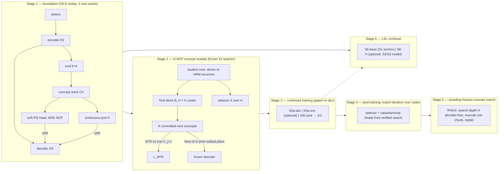
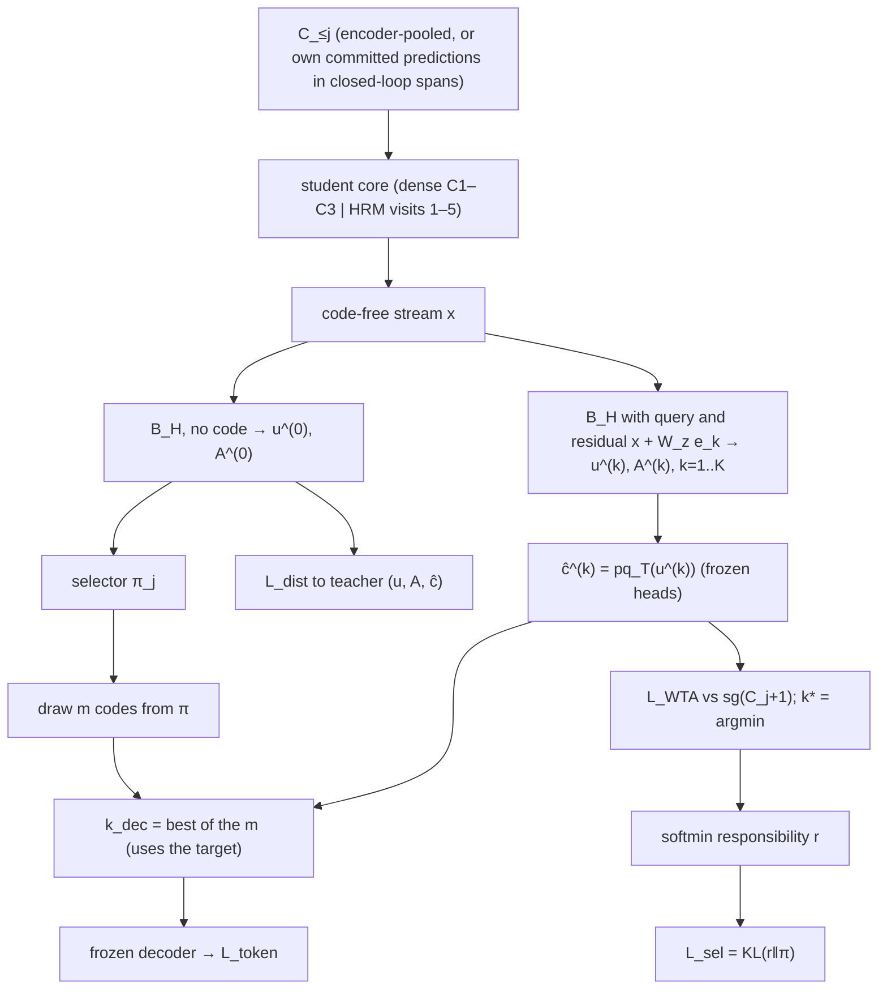
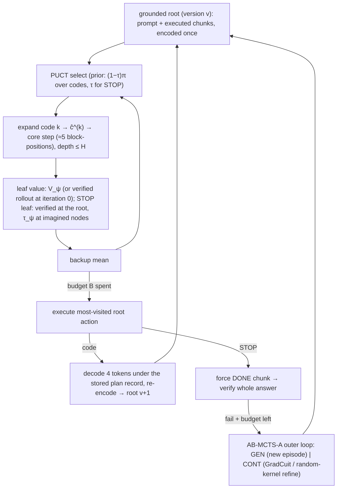

# V9: committed next concepts, decoder-free concept search, and separable continual learning

Date: 6 October 2026. Status: **design only. No V9 code, training or evaluation has been run.** Every measured number quoted below comes from an existing V1–V8 artifact or from a paper in this folder; the source map in Appendix A gives the file for each one. Thresholds, costs and run-times are derived in the text where they appear.

**Revision of 7 October 2026.** Amended in response to `review_v9.md`, which reviewed the draft with SHA-256 `a0b696e46ba94debd248de5d15b06c950e238221fc690b2a94e589f2546f2613`. No V9 result existed when the amendments were made; the review is their only cause. Appendix C lists every change, and which review findings were accepted, modified or rejected.

This draft starts from the owner's proposal of 6 October:

1. Train an encoder–concept–decoder (ECD) from scratch with NTP + NCP on text and symbolic data.
2. Train a separate recurrent concept module (GRAM / HRM / looped), supervised by the trained ECD's next concepts and cross-module signals, with an injected control **Z** for GradCuit and explorative modelling.
3. Refit that module into the ECD and continue pretraining until it is stable.
4. Post-train with SFT and RL, using Z (GradCuit) as the RL interface.
5. At inference, run **MCTS over discrete next concepts with the decoder removed during the search**. The decoder generates only the chosen step; then search the next step.
6. Test continual learning of the whole architecture with Local Support Learning (LSL).

The draft keeps all six stages. Each one is grounded in what the project has actually measured. It also identifies **one object that every previous version lacked**, which stages 2, 4 and 5 all depend on.

---

## 0. Thesis in one paragraph

Decoder-free search, RL through the concept interface, and a controllable concept module all need the same thing: at each step, a **discrete choice among next-concept hypotheses, each with a committed plan**, and a **calibrated prior** over those choices. No version has had one.

- V5–V8 trained NCP as squared error between the soft-PQ *expectation* and the next pooled concept. That follows the NCP paper's objective (eq. 9, eq. 22), but the minimizer of that loss alone is the *conditional mean* of the possible next concepts: one blended vector, not a set of branchable alternatives.
- V1–V4 trained a categorical NCP, but factorized it into independent per-segment softmaxes; the only joint categorical (V4's coarse code, measured on pinpad at ~1.2M parameters before any retrieval onset) carried almost no task structure (NMI ≈ .02). In both families the decoder received an expectation, never a committed choice.

V9's central change is **hypothesis-conditioned NCP (H-NCP)**:

- K discrete codes per concept step, trained winner-take-all against the true next concept, so that each code can commit to one mode.
- A selector head trained to predict which code will win.
- **Nested in V8.** With K = 1 and the closed loop off, the S2 objective is V8's REFIT objective, enforced by a contract test. The V9-K1 control differs from that in one switch, the closed loop. In the S1 arm A_const_hncp, K = 1 is the V8 foundation objective at α = 1.

A code is a **hypothesis choice with a continuous plan, not yet an action**. Whether the K codes decode to distinct legal moves is measured (G2.4), not assumed. The selector is both the search prior and the RL policy. The draft's single load-bearing claim is that the H-NCP concept module, trained against a frozen V8-style foundation, passes four measured gates: authority and deployable calibration, each against its K = 1 control (V9-K1), and imagined-versus-executed transitions and execution consistency, measured on the model's own states. Search and RL over codes go only as far as those gates allow: a failed authority gate stops them, and the other gates limit how they run (§6.8, §12.3).

The search the owner proposed is **receding-horizon**: search over next concepts without the decoder, decode and execute one real step, re-encode, and search again (§9.1). "Decoder-free" in this draft means a decoder-free *lookahead*; the decoder still executes each chosen step. The continual-learning study on the foundation is independent and runs regardless.

---

## 1. Decision and scope

### 1.1 What V9 builds



| Stage | Built from | New in V9 | What decides the next step (§12.3) |
|---|---|---|---|
| S1 foundation | V8-D 2,448,640-parameter E3/C4/D3; delayed MSE NCP; frozen V8 GraphNav generator and verifier | Two new training seeds (V8's seed 811 is historical); paired tests on fresh sealed manifests; PrefixLM and exploratory P-blur arms | G1 competence; NCP-vs-α0 and hierarchy-vs-flat reported either way |
| S2 H-NCP core | V8 REFIT protocol and ownership: frozen S1 teacher, trainable core distilled from it | Codes in the core's final block, WTA NCP, selector, best-of-m plans, closed-loop concept training; dense (Tier A) and recurrent (Tier B) cores | **G2.1 authority and G2.2 deployable calibration** against V9-K1; **G2.3 imagined vs executed transitions and G2.4 execution consistency** on the model's own states |
| S3 continued training | V5 Phase C λ-curve, V8 `System.plans` | Decoder-only adaptation first; an optional encoder arm and a joint arm | G3 on development data, with a full re-gate; otherwise the S2 model goes forward |
| S4 post-training | V5 Phase D (internal RL) and E (GradCuit) | Expert iteration on the selector, value and terminal heads; GradCuit only as a refine kernel beside a random-direction kernel | Value and terminal head rows (G4); compared with token RFT, token GRPO and selector REINFORCE from the same checkpoint, reported either way |
| S5 concept search | V6.1 AB-MCTS-A design (not implemented) | Receding-horizon search RH(H), with H from G2.3; G(R) and IMAG variants; explicit STOP; cost model and replay contracts | Mechanism, practical and feedback-efficiency comparisons (§9.6), reported either way |
| S6 LSL continual | V8 LSL implementation | S6-base and optional S6-H; separability measured before and after each phase; always-open, VQ-only and full-fine-tune arms; same-weight installation test | G6 rows; LSL credited only under the four-condition rule (§10.7) |

### 1.2 What is deliberately not in scope

- Text-domain MCTS. In GraphNav one concept is exactly one reasoning step (§4.2). In text, chunk boundaries are not step boundaries, and no version has a step segmentation. Step-level search on text is listed as future work (§15).
- Any scaling claim. The size ladder in §11 is a measurement plan, not a prediction.
- Merging S3 and S2 into one end-to-end run. ETA's rate–distortion result (co-training destroyed the abstraction alignment that a frozen base preserved) and V5's success with a frozen teacher both argue against making joint training the default.

### 1.3 One load-bearing claim at a time

The project's most repeated failure has been changing many axes at once: V2 changed at least eight relative to V1, and V7 about twelve relative to V6. V9 therefore orders its claims:

1. S1's mandatory arms change **nothing architectural** relative to V8-D; they add seeds and paired statistics. The PrefixLM arm changes the mask, and the exploratory A_const_hncp arm puts H-NCP into the foundation; both are labelled as such.
2. S2's claim changes **one axis**, K, measured against V9-K1, which shares V9's closed-loop training. A separate arm, S2-V8repro, turns the closed loop off and reproduces V8's REFIT objective (contract-tested to 1e−6), so the closed loop is isolated from K.
3. S3–S5 are conditional on S2's gates. A failed S2 gate stops or limits the branches that depend on it (§12.3) and is reported as a result.
4. S6-base does not depend on S2 and uses the S1 anchor. S6-H, which is optional, starts from the promoted S2/S3 model, or from the S4 model if it runs after S4.

---

## 2. What eight versions established

### 2.1 Evidence that the design must respect

| # | Finding | Strength | Source |
|---|---|---|---|
| E1 | A matched flat Transformer is better on text at small scale, by about .02–.07 nats in V7 (3 seeds, sign 3/3, no CI) and about .05 in V8 (1 seed). | Moderate | `v7_tiny/runs/*/dev.json`, `v8_tiny_12h/runs/*_sealed_test/summary.json` |
| E2 | The hierarchy beats the matched flat model on GraphNav navigation in V8 sealed tests: delayed NCP 80.4% [78.6, 82.0], α0 76.5% [74.6, 78.3], flat 73.7% [71.8, 75.6]; n = 2048, one seed. | Moderate for hierarchy vs flat; **weak** for NCP vs α0 (marginal intervals miss by 0.3 points, no paired test) | `v8_tiny_12h/REPORT.md` |
| E3 | The NCP objective's sign on GraphNav reversed between recipes: V5 NCP .893 vs α0 .195 greedy success; V6 α0 79.7% (51/64 standard dev items) vs NCP 0% with both runs at 9,000 updates, and identical text NLL (1.957 NCP vs 1.958 α0) and graph NLL .612 (NCP) vs .124 (α0). | Strong that the effect is recipe-dependent; the mechanism is unknown | `v5_tiny/runs/A_ncp_s0/eval_a_val.json`, `A_ncp_a0_s0/eval_a_val.json`; `v6_tiny/runs/eval_forecast_prefix_dev/summary.json`, `eval_no_forecast_prefix_dev/summary.json` |
| E4 | In the V6 9k-prefix comparison, **all** 64 standard and 128 hard greedy failures of the NCP prefix were illegal transitions (correct format, wrong move), while the α0 prefix had one illegal-transition failure per split and failed mostly by missing terminators. (In V7, by contrast, *every* arm, including α0 and flat, failed navigation by illegal transitions. That is a capability failure common to all arms, not an NCP signature.) | Moderate (one seed; 64 standard and 128 hard dev items) | `v6_tiny/runs/eval_forecast_prefix_dev/summary.json`, `eval_no_forecast_prefix_dev/summary.json` (`failures` by reason); V7 per-suite dev JSON |
| E5 | NCP training makes open-loop concept self-feedback far less damaging. Feeding the model's own predicted concepts for every chunk after c₀, with the decoder still reading true tokens, costs NCP +.048 nats graph and +.217 text, versus α0 +.891 graph and +.599 text. | Strong (paired, small SE) | `v5_tiny/runs/A_ncp_s0/eval_a_val.json`, `A_ncp_a0_s0/eval_a_val.json` |
| E6 | **Z has authority over a frozen decoder.** V5 posterior Z gives −.11 nats graph and −.50 at colour switches; Z-swap minus ε-only = +.498 ± .023. | Strong | `v5_tiny/REPORT.md` §3 |
| E7 | A variational Z prior alone was confidently wrong (V5 V3, +.345 nats over the teacher). Explorative modelling made it deployable: V6 variant +.025; the C_v3 rescue +.022 versus +.370 without XM. | Strong for "XM necessary in this setup" (1 seed) | `v5_tiny/REPORT.md` §3–4, `runs/C_v3_noxm_s0` |
| E8 | **Latent steering had a lower point estimate than a simpler search in all 4 comparisons that had a comparator.** Concept-spec H1: 26–38% vs 66–99.7%, a large gap. V5 E: .543 vs prior resampling .598, paired −.055 (SE .012), the one interval that excludes 0. V6 locked test: −3.1 points [−8.2, +1.95] (standard, n = 256). V8 E: −24.1 points [−43.7, +0.5], 0 gains / 14 losses of 58. | Consistent direction; individually small, and two of three paired intervals include 0 | `Concept Design/HRM_THINKER_Concept_Module.md` §13.3; `v5_tiny/runs/E_v6_s0_hard/phase_e.json`; `v6_tiny/runs/PRIMARY_RESULT.json`; `v8_tiny_12h/runs/E_search/summary.json` |
| E9 | Internal RL over Z did not beat the zero-cost prior mean (V5 D: .811/.752 vs .906 standard). ETA-style switching saturated (β ≈ .99). | Moderate (1 seed) | `v5_tiny/runs/D_*/phase_d.json` |
| E10 | Recurrence never became a hop-per-pass mechanism end-to-end. V1 was idle (R1 and R8 within .001 nats of each other on every family). V3's one-pass inference ablation cost .066 on multi4 (.830 → .764, n = 512) and almost nothing on composition (hop .170 → .162, bind .061 → .064); like V4's, it is a distribution-shift diagnostic (§2.7), and no trained one-pass V3 control is recorded. V4's inference ablation (1 pass instead of 2) cost only +.008 and +.014 nats of validation token loss in its two arms, and the trained one-pass control was never run, so whether V4 used its second pass is unknown (V4.1). In V8 the recurrent refit matched the dense refit: sealed standard 1,657 vs 1,654 of 2,048 (80.9% vs 80.8%), with 2,055,424 vs 2,448,640 active parameters. | Strong for "no evidence recurrence buys composition at ≤25M" | `run_m2_25M/runs/report_tables.md`; `run_v3_19M/runs/v3_48h/eval_best.json`; `v4_tiny/REPORT.md:281`; `v41_tiny/ASSESSMENT.md:19`; `v8_tiny_12h/runs/B_refit_{dense,recurrent}_sealed_test/summary.json` |
| E11 | V8 LSL: phase 1's retention decisions were both false (TinyStories NLL +.0071 [.0059, .0084]). Phase 2 installed bind (+25.2 points, 129 gains / 0 losses) and destroyed navigation (standard −81.5 points; sealed 0/2048). Phase 3's skill was present with the adapter forced open (171/512) and absent with the fitted gate (1/512). Bind shares the edge-list serialization with navigation (`data.py:135–147`); gate rates were measured only on current-phase data. The always-open control has no recorded phase. | Strong that forgetting and gate-installation failure happened; **the mechanism was not measured**, and gating's benefit was never estimated | `v8_tiny_12h/runs/D_lsl_phase{1,2,3}/decision.json`, `D_lsl_phase2_sealed_test/summary.json`, `D_always_open_summary.json`, `code/drive_12h.py:148` |
| E12 | Size and length generalization failed for every arm: hard14 and long18 ≈ 0. | Strong | V8 sealed summaries |
| E13 | Process: no full-scale run (V1–V3) and no pipeline run (V5, V6, V8) used more than one hierarchy training seed. Only V7's foundations (3 seeds) and the V4/V4.1 tiny pinpad studies (2–3 seeds) did. Pre-registered screens were skipped in V2/V3, and the three full-scale runs have no prose report. | — | run folders `run_m2_25M/`, `run_v2_19M/`, `run_v3_19M/`, `v4_tiny/`, `v41_tiny/`, `v5_tiny/`, `v6_tiny/`, `v7_tiny/`, `v8_tiny_12h/` |

### 2.2 "NCP" has meant two different objectives

| | **Paper / V5–V8 form** | **V1–V4 form** |
|---|---|---|
| Prediction | `ĉ_j = concat_s Σ_n π_(j,s,n) e_(s,n)`, the per-segment softmax expectation | Per-segment logits over code indices (V4: coarse code, then residual PQ) |
| Loss | `‖ĉ_j − sg(c_(j+1))‖²` (NCP paper eq. 22; `v8 train.py:54`; `v5 model_v5.py:256`) | CE on next code indices (`concept_core_v2.py`; `model_v4.py:339`) |
| What the minimizer is | The **conditional mean** of the next pooled concept, restricted to the codebook hull | Per-segment marginals. V4 also had a joint coarse categorical, the lineage's only one; its NMI with subgoals was ≈ .02, measured on pinpad at ~1.2M parameters before retrieval onset. |
| What the decoder saw | The expectation `ĉ` (plus port A) | Also an expectation (`c_pred = Σπ·sg(e)`; V4 `cbar + PQexp`). Never an argmax or a sample. |
| Evidence at scale | NCP paper: 1.95× token convergence and −.091 loss at 8.9B; −.0098 at 3B, where the NCP model trails an MTP baseline early and crosses below it near update 2,285 | None above 25M |
| Evidence in this project | E2, E3, E5 | V1 c_off +.024 language but multi4 .082 → .014; V3 multi4 .830 → .779 |

Two conclusions follow.

- The V5–V8 runs used **the published NCP objective** (the soft-PQ expectation under squared error). Their scale, data, tokenization and schedules differ from the paper's, so their mixed results are not explained by a deviation in the objective; they may still reflect those other differences.
- A categorical next-concept distribution would be a **second departure** from the paper. It is justified only by a requirement the paper does not have: something to branch over and to reinforce. V9 therefore keeps the paper's MSE form *inside* each hypothesis (§6), so the departure is exactly one axis (K).

### 2.3 Why a conditional mean can hurt navigation and still help later (hypothesis)

From first principles: at a GraphNav hop, the next concept depends on which of three colours is taken, and when several colours make progress the true next concept is multimodal. A squared-error predictor converges toward the centroid of those modes. That centroid is the encoding of no legal hop. In the V5–V8 decoder (`D_t = H_t + shift(ĉ)_t + γ·shift(A)_t`) that vector is added to the token features of the next four positions.

| Phase of training | Predicted effect of a mean-of-modes plan | Observed |
|---|---|---|
| Early: the decoder's token route cannot yet look up legal edges | The plan is the strongest structured input. The decoder learns to follow it, and it points between legal moves, giving illegal transitions. | V6 (α = 1 from step 0): NCP 0% vs α0 79.7% at 9k steps; graph NLL .612 vs .124; every NCP-prefix failure an illegal transition, α0 failures mostly missing terminators. |
| Late: the token route already selects a legal node from the prompt | The centroid of legal next nodes is a useful summary ("which region of the graph"). It adds information without overriding the token route. | V8: delayed NCP (α = 0 for 6k updates, ramped to .1 by 8k) 80.4% vs α0 76.5%. **Weak support only**: one seed, marginal intervals separated by 0.3 points, no paired test, and α also changed from 1 to 0.1, so timing and coefficient are confounded. |
| Text | The decoder relies on the token route from the start. The concept term is a small additive summary. | NCP vs α0 text NLL nearly identical in V6; flat best in V7/V8 |

This is a hypothesis: it fits five observations (V6's success gap, V6's graph-NLL gap, E4's illegal-transition signature, V8's weak delayed-NCP advantage, and the matching text NLLs) and has not been tested directly. The conditional-mean argument holds for an isolated squared-error predictor of a fixed target distribution. It does not show that the joint token + NCP + VQ optimizer learns that mean, or that the mean must decode to an illegal move: a continuous decoder can map an intermediate vector to a legal output, and several discrete hypotheses can all be bad.

**What is multimodal is the label, and the generators differ.** Standard GraphNav labels are random colour-run walks, so the label given a prefix is genuinely multimodal wherever several colours continue a valid walk. Hard-suite labels follow one shortest path chosen by BFS (`data.py:104`, `:112–131`), so the label given a prefix is nearly deterministic even where several moves make progress. Multimodality of valid solutions and multimodality of training labels at the same prefix are different objects; the tests below use the second, computed exactly from the generator.

Two predictions can distinguish the hypothesis from alternatives, and both are pre-registered (§12):

- **P-blur-1:** at the same early timing (constant α = 1 from step 0), the per-item illegal-transition rate under H-NCP with K = 4 (arm A_const_hncp) is lower than under K = 1 (arm A_const).
- **P-blur-2:** on standard items under K = 1, the illegal-transition rate at a position increases with the generator's label entropy there. Under K = 4 that dependence weakens.

Both use **all items** as the denominator, not failures, because a share of failures can fall merely because formatting failures rise. Illegal transitions, missing terminators, other format errors and wrong-goal endings are counted separately. Label ambiguity, NCP forecast error and execution legality are recorded separately per position.

A_const and A_const_hncp have one training seed each, so both predictions are **exploratory**: a result in either direction motivates a two-seed replication, not a conclusion (§2.7). A failed P-blur-1 counts against the hypothesis only if the K = 4 arm's codes are live and have authority (the §6.4 live-code check and the G2.1(b) swap measurement, run on that arm). Otherwise it shows that the hypotheses did not learn, which is a different negative. V8's draft (§4.3) already warned that squared-error prediction tends toward the conditional mean. V9 is the first version to put that warning under test.

### 2.4 The search and steering record

E8 is the most important constraint on stages 4 and 5. The "green signal" in the earlier experiments is precisely:

- **Z authority:** the decoder obeys Z (E6).
- **Search beats no search:** in V5 E, GradCuit lifted hard-goal success from .369 to .543.

It is **not** latent search beating a verifier-scored token alternative at equal cost; that has not happened once (E8: lower point estimate in all four comparisons; of the three with paired intervals, only V5 E's excludes 0). In GradCuit's own paper a random-direction walk reached 60.6% against reward-guided LatentSeek's 60.3%, and GradCuit's reward gradient added a further 2.4 points over random, winning 14 of 15 settings; the authors call reward guidance "the decisive gain". In V5 E, GradCuit beat its random-direction control by +.102 (SE .014) on hard-goal items. So the reward gradient does add something over random directions, in both places. What it has not done is beat verifier-scored resampling: GradCuit's competitors in the paper were self-scored, while in this project verifier-scored retries are the strong baseline.

V9 consequence: GradCuit appears only as a **refine kernel** inside search, always beside a random-direction kernel (§8.3). Every search claim names its token-level competitor under the same wall-clock cap.

### 2.5 What open-loop concept rollout has and has not been measured to do

What has been measured is E5: a full-document open-loop concept stream, with the soft expectation fed back and the decoder still reading true tokens.

What has **not** been measured is the setting the decoder-free proposal needs:

- (a) N-step rollouts for N = 1–5 from a true prefix;
- (b) rollouts of **committed** concepts rather than expectations;
- (c) a core trained on its own predictions;
- (d) whether a rolled-forward concept is a *legal* move.

V8's draft (§4.2) instructed: "Do not roll predicted concepts forward as if they were verified world states." V9 does not drop that instruction. It turns it into gates G2.3 and G2.4 (§6.6).

### 2.6 What V8's continual-learning run did and did not test

V8 followed LSL's Algorithm 4 (the gate is held open during adapter training, `model.py` `LoRABank.force=True`). It ran on V8's recurrent-core system, without temporal smoothing, and its configuration was far smaller than the paper's: rank-4 LoRA on q and v only, a 32-dimensional JL projection, a 4-component Φpos, and an 8-component Φneg fitted on the foundation mixture (the right negative support, since it contains the old tasks). The paper used rank 128–512 on all matrices, JL 256, and 16–32 components, at 1.5–7B parameters, and it states that retention depends on representation quality and improves with scale.

What that run supports (details in §10.2):

- It is **negative evidence about this tiny LSL configuration on this task sequence**: phase 1's preservation was not established, phase 2 forgot widely, and phase 3's skill vanished when the fitted gate replaced forced-open operation.
- It is **not** a controlled estimate of gating's benefit, because the always-open control never ran.
- It does **not** refute the LSL framework at the paper's scale.
- It does **not** confirm an explanation. Bind shares the edge-list serialization with navigation, and LSL's theory (paper App. E) says the newest update wins wherever activation supports overlap, so overlap is a plausible explanation for phase 2. But overlap was never measured: gate rates were recorded only on current-phase data.

V9's protocol (§10) measures separability before each phase and keeps a pre-registered **overlap prediction** for bind.

### 2.7 Process lessons carried into V9

- One seed was never enough. Every V9 comparison that supports a decision uses ≥2 training seeds and paired item-level tests.
- No component may be removed or reinstated on a language-only threshold (the V3-016 lesson). Item-level task metrics are always reported beside NLL.
- `core_off`-style inference ablations are distribution-shift diagnostics, not use measurements (V4.1 finding). Claims that a module is used come from trained controls.
- Test scripts must not write into `runs/`. While the original V9 draft was being written, a test run overwrote `v41_tiny/runs/test_v41_block60.json` with an equivalent result (15/15). V9 tests write only to a temporary directory, which the CI contract checks (§13.1).

---

## 3. First-principles requirements

Each requirement is stated once. Every later design choice cites the requirement it satisfies.

- **R1 — A decision needs one mode, not a mean.** Wherever the network must choose among several valid futures (a hop, a step), the object that carries the choice must be able to *commit*. A squared-error regressor has generative expressivity 1 (XM paper §2). Fixes: a latent that indexes the mode (XM, Free Transformer, GRAM), or a categorical over joint outcomes.
- **R2 — A search action must be joint and realizable.** Sampling PQ segments independently produces tuples that may correspond to no encodable chunk. The choice must be one index (or one bounded continuous vector) whose effect on the decoder was trained. Being trained is not enough to make it an action: what each choice actually decodes to has to be measured (G2.4).
- **R3 — Plans must be trained the way inference will draw them.** In V5 V3 the hindsight-selected plan was trained and the prior's plan was deployed, at a cost of +.345 nats. In V9's S2 the decoder is frozen, so the requirement applies to what the token loss trains: plans come from a prior-drawn subset of codes, hindsight-selected within it (§6.3), and deployable likelihoods are gated (G2.2).
- **R4 — A transition model must be trained on its own outputs if it will be run on its own outputs.** A core trained only on encoder-pooled concepts has never seen a predicted concept as input. Closed-loop use needs closed-loop training, and a measurement of whether imagined and executed states lead to the same decisions (G2.3).
- **R5 — A node's value must come from somewhere real.** That means a verified decoded completion, or a learned value head whose accuracy has been measured on held-out complete candidates before it is trusted on intermediate nodes (GRAM's LPRM is the precedent).
- **R6 — A search method is only better than the simplest search at the same cost.** On GraphNav the concept tree and the token tree are two action parameterizations of the same task (§9.2). A cheaper node is worth something only if transitions are accurate enough. Every comparison runs under one wall-clock cap and one verifier-call ceiling and names the binding constraint (§9.6).
- **R7 — An abstraction learned on top of a model is safest when the model holds still while it is learned.** In ETA it survived on a frozen base and collapsed under co-training. The default is frozen-teacher training; continued joint training is gated.
- **R8 — Local updates protect old skills only where old and new activations are separable at each gated matrix** (LSL App. E). Shared input formats make overlap possible, not certain, so separability is measured before LSL is credited or blamed.
- **R9 — One axis per claim, ≥2 seeds per decision.** This is §1.3 restated as a requirement.

---

## 4. Testbed and data contract

### 4.1 Freeze the V8 12-hour generator

CF14 records that GraphNav numbers are not comparable across V5–V8: verifiers, headers and packing all differed. V9 fixes the `v8_tiny_12h` generator, splits and verifier for **every stage**:

- Content-hash grouped splits (the V8 audit fix).
- Suites: standard (10 nodes), hard10, hard14, long18, lookup, compose, pointer, bind, shifted. Bind and shifted are S6 phase data (§10.5) and are not part of every evaluation.
- Strict verifier; n = 2048 sealed standard items. V8's sealed sets are now historical; V9's confirmatory evaluations use fresh sealed manifests drawn from the same generator (§13.2).
- The text families (FineWeb-Edu subset, TinyStories) with V8's hash-grouped leakage fix.
- The source files are copied by SHA-256 into `v9_tiny/code/frozen/` and imported from there. Any later change creates a new testbed version and invalidates cross-stage comparisons. The draft treats such a change as a separate experiment.

### 4.2 On this testbed, one concept is one reasoning step

From `v8_tiny_12h/code/data.py:145–151`:

- The instruction is 4 tokens.
- Every prompt edge is `[NODE, COL, NODE′, SEP]`, 4 tokens.
- Every response hop is `[COL, TO, NODE, SEP]`, 4 tokens.
- The terminator is `[DONE, SEP, SEP, SEP]`.

The prompt length is therefore a multiple of 4, and every hop occupies exactly one k = 4 chunk. With `N_COL = 3`, the only free choice in a hop is its colour; the node follows from the edge table in the prompt.

**Indexing (exact).** Under V8's shift the plan from chunk j is first exposed at logit position 4j+3, so it controls the decoding of chunk j+1. (§9.3 writes the same rule as "the code at chunk j controls hop j − j0 + 1, with j0 = P/4 − 1"; for hop h both name chunk P/4 + h − 2.) The first response token sits at position P (prompt length, a multiple of 4) and is predicted from position P−1, whose plan comes from chunk P/4 − 1, the **last prompt chunk**. In general, **the action for hop h is the code chosen at chunk h − 1**. NCP already scores that last prompt chunk as a source, because its target chunk contains response tokens (`runtime.py:84`).

This is what makes the owner's "next discrete concept = next step" concrete here:

- the concept core sees the edge list as a sequence of edge-concepts;
- each response concept is one hop;
- a step-level token search has branching factor 3 per hop, plus STOP.

### 4.3 Data mixture and exposure

Data mixture and exposure are unchanged from V8's foundation allocation:

- **Batch and update budget:** 64 rows × 192 tokens, 24,000 updates per foundation arm.
- **Totals per foundation arm:** 576k GraphNav, 96k lookup, 48k compose, 48k pointer and 768k text rows; 264.6M non-padding tokens.
- **Mixer composition:** half text, 3/8 graph, and the remainder lookup/compose/pointer (`data.py:197`).
- **Loss masks:** symbolic rows are already trained response-only (`data.py:155`). NCP already scores only target chunks containing response tokens (`runtime.py:84`).

### 4.4 PrefixLM as an isolated S1 arm

In HRM-Text's FLOPs-matched ablation (Table 3), a 1B Transformer went from 40.55 to 47.72 MMLU with response-only loss, and to 53.15 with PrefixLM added. V8 already has the response-only half. The PrefixLM half is worth +5.4 MMLU there, on natural-language question answering at 1B; nothing says how much of it transfers to 4-token symbolic chunks at 2.45M. It (bidirectional attention within the symbolic prompt, causal elsewhere) is added as **one S1 arm**, not as a default.

Three interactions are flagged for measurement:

1. Every prompt-chunk concept now pools whole-prompt information. That could help concept-level edge lookup; here it is measured by S1 task success only. The S2 transition gates are not run on this arm, because S2 teachers are A_delayed seeds.
2. NCP targets inside the prompt would be leaked, but NCP already excludes them. A contract test asserts that this exclusion survives the mask change.
3. The text rows stay causal, so text NLL keeps its meaning.

---

## 5. Stage 1 — the foundation

### 5.1 Architecture: unchanged V8-D

The block equations are V8's, which `v8_tiny_12h/code/model.py` verifies:

```text
H_t   = Encoder_E3(embed(x))_t                                  (d=128, 4 heads, FF384, RoPE, pre-RMSNorm)
C_j   = RMS(mean(H_4j … H_4j+3))
U_j   = ConceptStack_C4(C_≤j)_j                                  (causal over concepts, document-isolated)
π_j,s = softmax(W_s U_j + b_s)            s = 1..8 segments, 32 codes, 16 dims
ĉ_j   = concat_s Σ_n π_j,s,n Q_s,n                               (soft-PQ expectation; NCP paper eq. 9)
A_j   = W_A RMS(U_j)
D_t   = H_t + shift(ĉ)_t + γ ⊙ shift(A)_t                         (γ init 0.1; shift exposes v_j at t = 4j+3)
logits_t = tied_head(Decoder_D3(D)_t)

L_S1 = L_token + α(u)·L_NCP + L_VQ
L_NCP = balanced_domain_mean ‖ĉ_j − sg(C_j+1)‖²                   (scored target chunks only)
α(u) = 0 for u < 6000, linear to 0.1 by u = 8000, then 0.1       (V8 delayed schedule)
```

Parameter counts:

- Hierarchy: 2,448,640.
- Matched flat Transformer: 2,450,048 (10 blocks, FF400 ×9 + FF384).

### 5.2 Arms and seeds

The V8 seed-811 checkpoints already exist, verified by SHA-256 against `train_summary.json` provenance. Their sealed results were seen while V9 was designed, so seed 811 is **historical and development evidence**: it is reported per seed, but it does not count toward any confirmatory test. Confirmatory claims rest on the new seeds, trained with the identical recipe and evaluated on fresh sealed manifests (§13.2).

| Arm | Seeds | Role | Cost on M2 (from V8 wall-clock) |
|---|---|---|---|
| A_delayed (anchor) | 811 (reuse) + 2 new | S2 teacher; NCP evidence | ~1.8 h per seed |
| A_alpha0 | 811 (reuse) + 2 new | Mandatory NCP control | ~1.8 h per seed |
| A_flat | 811 (reuse) + 2 new | Mandatory architecture control | ~2.4 h per seed |
| A_delayed_prefixlm | 2 new | PrefixLM interaction (§4.4) | ~1.8 h per seed |
| A_const (α = **1** from step 0, the V5/V6 coefficient) | 1 new | Exploratory. Reproduces the V6 conditions under which NCP reversed; measures P-blur-2 (illegal-transition rate vs the generator's label entropy) at K = 1 | ~1.8 h |
| A_const_hncp (α = 1 from step 0, H-NCP K = 4 head in the foundation) | 1 new | Exploratory. The only arm that can test **P-blur-1** (S2 trains against an already-competent frozen decoder, so it cannot) | ~2.2 h |
| A_delayed ×4 budget | 1 new | Exploratory; NCP-paper crossover test (§5.4) | ~7 h |
| A_alpha0 ×4 budget | 1 new | Exploratory; the matched control without which the crossover test has no NCP − α0 difference at the long budget | ~7 h |

The mandatory part costs about 12 h for two new seeds of three arms. The full set costs about 34 h.

**A_const_hncp, specified.** This arm puts H-NCP inside the S1 foundation, where there is no teacher:

- B_H is the foundation's last concept block (C4's fourth block), run once code-free and once per code exactly as in §6.2.
- `L_dist` is absent; `L_VQ` is present.
- `L_NCP` is replaced by the §6.3 `L_WTA` at constant α = 1, the V5/V6 coefficient.
- The selector and best-of-m plans (m = 2) are as in §6.3.
- There is no closed-loop concept training (§6.5's rollout) in S1, so none is used here.
- With K = 1, `L_WTA` reduces to `L_NCP`, the selector term vanishes and none of `e_k`, `W_z`, `W_π` is instantiated (§6.2), so the objective reduces exactly to the V8 foundation objective at constant α = 1, which is arm A_const. That pair isolates K inside the foundation.

### 5.3 Statistics

- **Primary:** paired item-level comparisons on a fresh sealed standard suite (n = 2048, drawn as in §13.2; V8's own sealed set is historical), using McNemar exact tests and paired bootstrap intervals over items. Every seed is reported separately; the seed-level summary is the sign across confirmatory seeds plus the pooled paired interval. V8's per-arm marginal intervals are not used to claim a difference between arms.
- **Text:** paired document-level bootstrap of the NLL difference.
- **"No worse" claims** use pre-declared equivalence margins from the register (§12.3), never a non-significant difference.
- The fixed list of primary hypotheses and the multiplicity correction are in §13.2.

### 5.4 The crossover test (secondary)

The NCP paper's 3B study shows NCP trailing early and crossing below the MTP baseline near update 2,285. That is a *within-run* training-length effect at fixed scale, not evidence about parameter scale.

The V9 test holds architecture and data fixed and compares NCP − α0 at 24k updates against the same comparison at 96k updates, using the two ×4 arms. It is one seed per arm, so it is reported as exploratory. If the text gap does not shrink or change sign, the "small budgets never reach the regime where NCP helps" hypothesis is weakened. In its own units, V8's budget is 264.6M non-padding tokens / 2.45M parameters ≈ 108 tokens per parameter. The paper's text does not state tokens per parameter at its crossover, so no direct equivalence is claimed.

### 5.5 S1 acceptance

- **Competence gate (G1, §12.3):** V8's thresholds (≥80% standard dev, ≥95% lookup), judged by point estimate as in V8, on each new anchor seed. A seed that fails remains in the statistics but is not used as an S2 teacher. V8's own anchor scored 80.5% (1,648/2,048), so a new seed may fall either side by seed noise alone. If both new seeds fail, S2 runs with seed 811 as its only teacher, flagged *non-independent teachers*, and the S1 reproduction gap is reported.
- **Reporting:** every S1 comparison is reported in the same table with its interval, including the ones that disfavor NCP.

---

## 6. Stage 2 — the hypothesis-conditioned concept module (H-NCP)

This is the stage the owner described as "train a separate recurrence GRAM/HRM/looped concept module on the bootstrapped next concept and CRC data, with Z as injection for GradCuit and explorative modelling." Each part of that sentence maps to one V9 element:

| Owner's term | V9 element | Precedent |
|---|---|---|
| separate recurrence-based concept module | student core: dense C4 copy **or** HRM-recurrent core (V8 `Core`, 2×(2L + 1H)) | V8 B_refit_dense / B_refit_recurrent |
| bootstrapped next concept and CRC data, supervised | frozen S1 teacher supplies targets: true next pooled concept `C_j+1` for NCP, and teacher states `(u, A, ĉ)` for distillation | V8 REFIT objective (`train.py:41–69`) |
| Z as injection | a **discrete code k ∈ {1..K}** with a learned embedding `e_k`, plus (for GradCuit only) a bounded continuous offset δ | Free Transformer discrete latent; V5/V6/V8 continuous Z |
| explorative modelling | winner-take-all NCP over the K codes (multiple-choice learning over enumerated latents) and best-of-m plans, hindsight-selected within a prior-drawn subset | XM paper eq. 1; V5 V6 (Forward XM, K = 2) |
| GradCuit | continuous refinement of `e_k + δ` inside search (§8.3) | GradCuit paper; V5 E, V6, V8 E |

### 6.1 Teacher, student, and parameter ownership

- **Teacher:** one accepted S1 anchor checkpoint (A_delayed, a seed that passed §5.5), fully frozen. Each S2 run records its teacher. The two S2 seeds use two independent teachers: the two new A_delayed seeds when both pass G1, otherwise the passing one and V8's seed 811. If neither new seed passes, both S2 seeds are refits of seed 811, flagged *non-independent teachers* (§13.2).
- **Student ownership is V8 REFIT's, unchanged** (`train.py:10–16`, `model.py:276–287`). The whole system is frozen: encoder, embedding and tied head, decoder, codebook `Q`, and the foundation's PQ heads and port. A new core is trained in place of the foundation's concept stack:
  - *dense*: deep copies of C1–C4, `con_norm` and `W_A`, all trainable, exactly as `DenseCore`. V8 trained 869,504 parameters here.
  - *recurrent*: V8's HRM-pattern `Core` (in_proj, shared `fL` and `fH`, `h0`, `l0`, norms, `out_n`, `B_u`, `B_A`), freshly initialized. The core itself has 476,288 parameters against the dense core's 869,504, so the whole system has 2,055,424 active parameters against 2,448,640; any comparison reports both counts.
- **V9 adds only three things:** code embeddings `e_k ∈ R^16`, the write `W_z ∈ R^(128×16)`, and the selector `W_π ∈ R^(K×128)` plus its bias. At K = 8 that is 128 + 2,048 + 1,032 = **3,208 parameters**, for either core.
- **The PQ heads stay frozen**, so `ĉ^(k) = pq_T(u^(k))` goes through the teacher's heads and `Q`. Hypotheses differ only through `u^(k)` and `A^(k)`.

*Revision note.* The previous revision made the PQ heads trainable and froze `W_A`. That broke both the V8 equivalence claimed in §6.3 and the exactness of the λ-transplant in §7 (review F01, F08), and it is withdrawn.

### 6.2 Where the code enters (B_H), and what it costs

**B_H is the core's final block application.** For the dense core that is the copied C4 block. For the recurrent core it is the final `fH` visit, visit 6 of the L, L, H, L, L, H schedule; its weights are shared with visit 3. No block is added for either core.

The **code-free path** is the unchanged V8 computation (`Block.forward`, then `DenseCore` or `Core` readout), giving `u^(0)` and `A^(0)`. The **code path** for position j and code k changes only the query and the residual of B_H:

```text
x_j        block input at position j: C3 output (dense), or h_j + l_j at the final visit (recurrent)
x_j^(k)  = x_j + W_z e_k
q_j^(k)  = rotate( W_q · n1(x_j^(k)), j )                 query from the perturbed input
K_≤j, V_≤j from n1(x_≤j) of the unperturbed stream          (position j's own key and value included, unperturbed)
y_j^(k)  = x_j^(k) + W_o · attn(q_j^(k), K_≤j, V_≤j)       residual from the perturbed input
z_j^(k)  = y_j^(k) + w3( silu(g) ⊙ v ),  (g, v) = w12( n2(y_j^(k)) )
dense:      u_j^(k) = con_norm(z_j^(k))                   A_j^(k) = W_A,core( rms(u_j^(k)) )
recurrent:  h'_j    = out_n( post_H(z_j^(k)) )            u_j^(k) = B_u h'_j ,  A_j^(k) = B_A h'_j
both:       ĉ_j^(k) = pq_T(u_j^(k))                       teacher's frozen heads and Q (NCP paper eq. 9)
selector:   π_j     = softmax( W_π u_j^(0) + b_π )        read from the code-free output
```

Properties that follow:

- **One forward pass serves all K hypotheses.** Nothing downstream reads a perturbed key or value, so codes change only the readout at position j.
- **At K = 1 there is no code.** None of `e_k`, `W_z` or `W_π` is instantiated, `u^(1) ≡ u^(0)`, and the computation is exactly `DenseCore` or `Core`. This matters for the contract test: an instantiated parameter with zero gradient would still be moved by AdamW's weight decay.
- **Initialization.** `e_k ~ N(0, 1)`, `W_z` with std .02, and `W_π = 0`, so the selector starts uniform. The write `W_z e_k` has RMS ≈ .08. Its ratio to the stream's RMS is verified at initialization for each core, because the recurrent stream has a different scale.
- **The code enters only at the final application.** For the recurrent core the perturbation is added at visit 6 alone, so visits 1–5 and every cache stay code-free. That is what lets one forward pass serve all K hypotheses for this core too.
- **Neither core shields the code-free path from training.** WTA gradients reach C4 (dense) or the shared `fH` weights (recurrent, which also serve visit 3). The code-free plan therefore drifts from the teacher's unless distillation holds it. That drift is measured as two numbers, the drift of `u^(0)` and of `A^(0)` against the teacher's (§7.1); `ĉ^(0)` follows from `u^(0)` through the frozen heads. The two are separate quantities: on the recurrent core `u = B_u h'` and `A = B_A h'` are different trainable maps, and on the dense core `A` also moves with the trainable `W_A,core`.
- **Plans at unscored positions.** At chunks with no scored NCP pair (prompt chunks whose next chunk is also prompt), π is untrained, so the plan there is the code-free `(ĉ^(0), A^(0))`. Codes are sampled, searched or swapped only at chunks whose next chunk is a scored target: every chunk inside a text document (text rows carry loss on every token, `data.py:188`) and every symbolic chunk whose next chunk contains response tokens.

**Cost, derived from `model.py` in block-positions.** In the training forward pass each chunk costs 4 tokens × (E3 + D3) = 24 token block-positions plus 4 concept block-positions (dense C4), about 28 in total. H-NCP adds K single-position evaluations of `B_H` per chunk: query-side attention over ≤48 concept keys plus one FFN. At K = 8 that is +8, about +29% in block-positions and less in FLOPs, because concept attention spans a quarter of the token length. Closed-loop spans (§6.5) are **sequential**: each rolled position depends on the previous prediction, so a spanned sequence is computed in three parts: the prefix up to `j0` in one pass, then N incremental single-position core steps (4 block-positions each on the dense core), then the suffix in one pass, because later positions attend to the span's keys and values. In compute that is small: about 0.6 extra sequential steps per sequence on average (p_cl · E[N] = .25 × 2.5), plus the suffix recomputation, about 1–2% of all block-positions. The cost is latency: a batch of 64 sequences almost always contains a span of 4, so each update waits for up to 4 small sequential steps. Inference costs are in §9.5.

### 6.3 Objective

```text
d_j,k   = mean_features( ĉ_j^(k) − sg(C_j+1) )²             V8 per-feature MSE, scored target chunks only
k*_j    = argmin_k d_j,k                                    ties → lowest index
L_WTA   = Σ_j w_j [ d_j,k* + ε · mean_{k≠k*} d_j,k ]         ε = .05; the loser term is not computed at K = 1
r_j,k   = softmax_k( −d_j,k / τ_j ),  τ_j = max(0.1 · mean_k d_j,k , 1e−4)
                                                            softmin responsibility (it ignores π; not a posterior)
L_sel   = KL( sg(r_j) ‖ π_j )
S_j     = min(m, K) distinct codes drawn from π_j without replacement (π floored at 1e−6, renormalized)
k_dec,j = argmin_{k ∈ S_j} d_j,k                            prior-subset, hindsight-selected
plan_j  = ( ĉ_j^(k_dec), A_j^(k_dec) )  → frozen decoder through the V8 shift
L_dist  = V8 REFIT distillation of the code-free path:
          mean[ ‖u⁽⁰⁾−u_T‖² + ‖A⁽⁰⁾−A_T‖² + ‖ĉ⁽⁰⁾−ĉ_T‖² ] / 3     (train.py:55)

L_S2 = L_token(plan) + α·L_WTA + δ(u)·L_dist + λ_sel·L_sel
α = 0.1 constant, δ(u) = V8 REFIT schedule (1 for the first 10% of updates, linear to 0 by 30%), λ_sel = 0.1
w_j and every reduction are V8's: domain-balanced means with ncp_weights (runtime.py:84)
```

Why each term has this form:

- **The decoder plan is hindsight-selected within a prior-drawn subset.** For m > 1 the choice of `k_dec` uses the true next concept, so training does not match deployment. At deployment there is no target: the code comes from the selector (greedy) or from search. The size of that gap is what G2.2's single-prior-sample and selector-argmax likelihoods measure.
- **Why m = 1 is an arm and not the default.** In S2 the decoder is frozen, so `L_token(plan)` trains only the pathway of the code whose plan was used. With m = 1, a code drawn from the prior is pushed toward whatever continuation the data actually took, whichever mode that code represents. That is the mean-seeking pressure of K = 1, applied to every code. Best-of-m sends the token gradient to the code that already best explains the realized future, consistent with WTA. m = 2 is the V5 Forward-XM precedent, the only setting whose prior was deployable (+.025, E7). m = K is the hindsight extreme, the analogue of V5 V3's posterior training, whose prior was confidently wrong (+.345). m ∈ {1, 2, K} is an arm.
- **The WTA term trains hypotheses to cover modes; the selector learns which one wins.** The selector's target is the softmin responsibility rather than the hard argmin, so near-ties do not become label noise. It is a reconstruction-based assignment, not a Bayesian posterior: it ignores π, and winning a distance contest against the recorded demonstration is not the same as choosing an action that reaches the goal. Selector calibration is therefore reported twice: against demonstration assignments `k*`, and against executed action success from gate G2.4 (§6.6).
- **Distillation bounds the code-free path early.** It is a finite, annealed penalty that reaches zero at 30% of S2, so it does not make the code-free plan an exact zero-control anchor. The exact anchor is the frozen teacher itself, which is kept as a fallback; code-free drift is measured (§7.1).
- **Four likelihoods are reported separately**, and only the last three describe a deployable model:
  1. *oracle*: `k*` at every chunk (uses the target; diagnostic only);
  2. *single prior sample*: one `k ~ π` per chunk;
  3. *selector-argmax*: the greedy deployment code;
  4. *per-chunk mixture*: `log Σ_k π_k p(chunk | k)`, with every other chunk's code fixed at selector-argmax. This needs K decoder passes per chunk and is exact only per chunk.
- **K = 1 equivalence, stated as a contract.**

  ```text
  K = 1, closed loop off:  no code, u^(1) ≡ u^(0), π ≡ 1, S = {1}, k_dec = 1, no L_sel term,
                           L_WTA = Σ_j w_j d_j,1 = V8 L_NCP,
                           trainable set = V8 REFIT's (the core only)
  ⇒ L_S2, its gradients and its AdamW update equal V8 REFIT, for both core types.
  ```

  The **contract test** (§13.1) uses a fixed batch and seed. Loss, every trainable parameter's gradient, and one AdamW step must equal `train.py`'s REFIT path to 1e−6 relative in float32. The optimizer is V8's: weight decay .1 on parameters of dim ≥ 2 and 0 otherwise, betas (.9, .95), lr .001, 200-step warmup, cosine schedule, gradient clipping at 1.0. A second check is a **separate run with V8's `--steps 6000` schedule** (not the midpoint of a 12,000-update run), compared with the saved `B_refit_dense_dev` and `B_refit_recurrent_dev` metrics. It is expected to agree within MPS nondeterminism rather than bit for bit. The fixed-batch test carries the exactness claim.
- **The V9 K = 1 control is a different arm.** It is K = 1 with closed-loop training on (§6.5), so it differs from V8 REFIT in exactly one switch. K = 8 against V9-K1 measures multiplicity; V9-K1 against the V8 reproduction measures closed-loop training.

### 6.4 Dead hypotheses

The September concept-level XM latent "collapsed and [was] costly end-to-end" (`Concept Design/HRM_THINKER_Concept_Module.md` §13.4), and winner-take-all methods are known to leave hypotheses that never win. Three measures address this:

- the relaxed WTA ε above;
- a **restart rule**: a code is *dead* when its win share over the last 500 updates is below 1/(10K). Every 500 updates each dead code is re-initialized by splitting the most-winning code (`e_dead ← e_top + N(0, .1²)`), with its optimizer state zeroed, as V8 does for codebook restarts (`model.py` `restart`);
- **logging**: per-code win share, selector entropy, and pairwise distances between hypothesis predictions.

The live-code check in G2.2 uses the same definition of dead. Few live codes can be legitimate where contexts are deterministic, so the check is global, not per context.

### 6.5 Closed-loop concept training (R4)

During training, with probability `p_cl = .25` per sequence:

1. Choose a response chunk `j0` uniformly.
2. For `j0 < j ≤ j0 + N`, `N ~ U{1..4}`, replace the student core's input `C_j` with the **detached** committed prediction `ĉ_(j−1)^(k*_(j−1))` from the previous position.
3. NCP and token targets remain the true ones.

Choices and their limits:

- **The fed-back hypothesis is the hindsight winner k\*.** Only the demonstrated branch has labels: the next true concept exists for the mode the data took and for no other. Closed-loop training therefore teaches "continue correctly after committing to the mode the world took". It does **not** cover the wrong or low-prior branches that search will visit. Those are covered by measurement (G2.3 and G2.4 on self-generated and wrong-branch states, §6.6). S4's grounded search generates executed transitions on visited branches; whether they train anything is an S4 arm (§8.2).
- **Detaching** avoids backpropagation through the rollout. Undetached rollout is an arm. It changes gradient flow, not the distribution of fed-back actions, so it does not address the branch-coverage limit above.
- *Soft versus snapped feedback.* The fed-back vector is the within-hypothesis expectation, continuous like the encoder-pooled `C`. The arm `snap` replaces each segment with its nearest codebook entry. The default stays soft, because the core never saw quantized inputs in S1.

### 6.6 The S2 gates: what is measured

This section defines the measurements. **Every threshold, partial band and fail consequence is in the gate register (§12.3)**, which is the only place thresholds are stated.

**Comparison arm.** G2.1 and G2.2 compare V9-K8 against the **V9-K1 control** (same closed-loop training, seed, steps and data order), so the difference is multiplicity alone. G2.3 and G2.4 are properties of V9-K8 on its own states (at K = 1 there is nothing to branch over); V9-K1's drift and legality are reported beside them. The V8 reproduction and the frozen teacher are reported throughout. Dense and recurrent cores are reported separately.

**State distributions.** Every per-state measurement is taken on four distributions of grounded states at response chunks, on standard and hard10 development items (hard14 reported):

| Name | How the state is reached | Role |
|---|---|---|
| D_gold | demonstration prefixes | what training saw |
| D_self | prefixes produced by the model's own greedy policy (selector-argmax code, chunk decoded, re-encoded, repeated), generated up to the paired demonstration's response length or to DONE, whichever comes first | **gating distribution**: what receding-horizon search stands on at every step (§9) |
| D_wrong | a D_self state after one forced illegal or non-progress hop | recovery: search must recognize and abandon such branches |
| D_search | states visited by the S5 pilot search | reported once a pilot exists; not gated in S2 |

**G2.1 Authority: does the code control the decoder, usefully?**

The decoder is frozen from S1, where it learned to read the *expectation* `ĉ_T`. A committed `ĉ^(k)` is the same kind of object (codebook hull, same shift) but sharper. V5 showed a frozen decoder obeys a posterior-conditioned plan of this form; G2.1 tests whether that holds here.

- (a) **Oracle-code graph NLL** against V9-K1. It uses the target, so it is a necessary condition, not a sufficient one: if even hindsight codes do not lower the NLL, the codes carry no usable information. V5's posterior Z achieved −.11.
- (b) **Swap at the last prompt chunk** (chunk P/4 − 1, whose plan controls the first response hop, §4.2). Replace `k_dec` with each other code and greedy-decode. Report:
  1. sensitivity: how often the first colour changes;
  2. among changed first hops, the legal fraction, so that destructive sensitivity does not count as control;
  3. distinct legal first hops across the K codes (this is G2.4's diversity number at hop 1).

  Same-code regeneration must change nothing, because generation is deterministic. V5's Z-swap figure was +.498.

**G2.2 Calibration: can the prior be deployed?**

- (a) **Deployable likelihoods.** Single-prior-sample and selector-argmax NLL against V9-K1, on graph and on text. Oracle and per-chunk-mixture NLLs (§6.3) are reported beside them.
- (b) **Action coverage against an attainable ceiling.** Measured at the action level: do the decoded actions of the selector's top-2 codes include the demonstrated next action (colour or DONE)? A fixed coverage threshold would be wrong. If a prefix has three equally likely demonstrated continuations, even a perfect selector covers at most 2/3 with two choices. The ceiling is computed **exactly** from the generator (`data.py:112–131`). A standard walk is a program of 2–4 colour runs, each 2–4 hops long, with no colour repeated consecutively: 2,322 programs per graph and start. Keeping exactly the programs the generator would accept (`data.py:129`: the start is not the goal, no intermediate node is the goal, the final node is the goal) and consistent with the prefix gives the demonstration's exact next-action distribution. The ceiling is its expected top-2 mass. When the prefix already is a complete accepted program, the next action is DONE with probability 1. Hard10 demonstrations are the BFS path with a fixed colour order, so their labels are deterministic and the ceiling is 1.0.
- (c) **Calibration.** ECE of π against empirical win frequency, with at least 50 items per bin and the reliability diagram; held-out log loss of the `k*` assignment; live codes as defined in §6.4.
- (d) **No harm.** Greedy free-generation success with selector-argmax codes, paired against V9-K1.

**G2.3 Closed-loop transitions: imagined versus executed paths**

From a grounded state, take a code sequence of length N = 1..4 under three action rules: selector-argmax, uniformly random codes, and search-selected (once an S5 pilot exists). The register gates on the first two; the search-selected rule is reported, not gated.

- The **imagined path** feeds each `ĉ^(k)` forward as in §6.5, with no decoding.
- The **executed path** applies the same code sequence, but each chunk is greedy-decoded by the frozen decoder under its plan, re-encoded and pooled.

The code sequence is fixed in advance; the two paths differ only in the concept inputs the core receives. Report, per N and per action rule, on D_self (gated) and D_gold and D_wrong (reported):

- (a) **decision agreement** over the *next* code choice at step N: selector-argmax at the imagined state equals selector-argmax at the executed state; once a value head exists (S4), `|V_ψ(imagined) − V_ψ(executed)|` as well. This is what search depends on;
- (b) executed legality and goal progress of the path;
- (c) NLL drift in the E5 form (own predictions fed back, decoder reading true tokens), against V9-K1 and the re-measured V8-D teacher;
- (d) diagnostics: imagined-to-executed concept distance, and nearest-candidate agreement with its margin.

**Horizon coupling.** Receding-horizon search (§9) may use lookahead depth H only if G2.3 passes at N = H on D_self. A one-step independent-error model shows why one-step legality is not enough: 0.95^20 = .358 and 0.95^40 = .129. Receding horizon keeps the imagined depth at H ≤ 4, because every executed step is grounded.

**G2.4 Execution consistency: what each code actually does (the central S2 test)**

For a grounded state s and each code k:

```text
plan      (ĉ^(k), A^(k))
y_k     = greedy-decode the 4-token chunk with the frozen decoder under that plan
action  = verify(y_k) against the prompt's edge table: legal hop, illegal hop, DONE, or malformed
c_real  = pool( encode(prefix ⊕ y_k) )
```

Report on all four distributions, gated on D_self:

1. **Branching.** Among states with at least 2 *progress options* (colours whose destination is strictly closer to the goal by BFS distance, computed from the graph), the share where the K codes decode to at least 2 distinct legal actions. Also the duplicate rate (codes decoding to the same action).
2. **Useful coverage.** The share of states where at least one code decodes a progress option.
3. **STOP.** DONE is legal iff the current node equals the goal after at least one hop (`data.py:85`). *STOP coverage*: some code decodes DONE where it is legal. *False STOP*: any code decoding DONE where it is illegal, reported per code and under selector-argmax. Search has its own forced STOP action (§9.3), so both are reported rather than gated: STOP coverage matters for greedy decoding (G2.2(d)), and an executed code that decodes an illegal DONE ends its trajectory as a verified failure.
4. **Predicted versus executed.** Among legal decodes: whether the nearest of the 73 candidate chunks (3 colours × 24 nodes plus DONE, each encoded in the state's actual context) to `ĉ^(k)` is the decoded action, with the margin distribution (agreement at tiny margins is noise); and `‖ĉ^(k) − c_real‖²` against the distance to the nearest other candidate.
5. **The port.** Whether decoding with `(ĉ^(k), A^(0))` instead of `(ĉ^(k), A^(k))` changes the action, which shows whether `A` carries the decision.
6. **Code semantics.** NMI between code index and decoded colour, per context and pooled, and whether a code keeps its colour across contexts. This is a measurement without a prediction; for reference, V4's coarse code had NMI ≈ .02.
7. **Later hops.** The swap test of G2.1(b), repeated at a random later response chunk.

G2.4 costs K × 4 decoder tokens and one re-encode per state. At 512 states × 4 distributions × K = 8 that is about 65,000 decoder tokens per checkpoint, which is negligible.

The 73-candidate nearest-chunk projection used by the previous revision as a legality gate is now a diagnostic (item 4). A far-off prediction still has a nearest candidate, and the decoder may produce a different hop under the same plan; execution is the ground truth.

**Diagnostics, not gates:**

- Engaged-depth metrics for the recurrent core: ‖Δh‖ across visits, block cosine, and logit-lens KL of `ĉ` across visits (HRM-Text §3.4). These are the evidence for whether recurrence engaged, which it has not in any earlier version (E10).
- The P-blur-2 measurement (§2.3) repeated in S2: per-position illegal-transition rate on standard against the generator's label entropy, V9-K1 against V9-K8, with all items as the denominator. The prediction H7 is decided in the S1 arms; this is supplementary.

### 6.7 Arms and budget

| Arm | Core | K | m | Closed loop | Seeds | Role | Cost (V8 refit ≈ 0.5 h / 6k updates) |
|---|---|---|---|---|---|---|---|
| S2-V8repro-dense | dense | 1 | – | off | 2 | **Tier A.** V8 REFIT reproduction; matched-budget control | ~1 h each |
| S2-K1-dense | dense | 1 | – | on | 2 | **Tier A.** V9 K = 1 control | ~1 h each |
| S2-K8-dense | dense | 8 | 2 | on | 2 | **Tier A.** Main claim | ~1.3 h each |
| S2-K1-rec | recurrent | 1 | – | on | 2 | **Tier B.** Recurrent K = 1 control | ~1 h each |
| S2-K8-rec | recurrent | 8 | 2 | on | 2 | **Tier B.** Recurrent module (owner's stage 2) | ~1.3 h each |
| V8-schedule replay | dense; recurrent | 1 | – | off | 1 each | Implementation check against saved V8 dev metrics, run with `--steps 6000` | ~0.5 h each |
| S2-K8-m1 / -mK | dense | 8 | 1 / K | on | 1 each | Exploratory: plan selection | ~1.3 h each |
| S2-K8-open | dense | 8 | 2 | off | 1 | Exploratory: closed loop at K = 8 | ~1.3 h |
| S2-K8-undetached / -snap | dense | 8 | 2 | on (variant) | 1 each | Exploratory: feedback variants (§6.5) | ~1.5 / 1.3 h |
| S2-K4 / S2-K16 | dense | 4 / 16 | 2 | on | 1 each | Exploratory: K sweep | ~1.2 / 1.6 h |

- **Tier A gates S3–S5, and the dense model is the one promoted to them.** Tier B gates any statement about the recurrent module; if it passes, the recurrent K = 8 model goes to the recurrence statements and may be the S6-H anchor, but it does not go through S3–S5 (that would double Q4–Q6).
- **Both tiers are mandatory:** the owner's stage 2 names a recurrent module, and a plan that never tests it does not answer the owner's question. Tier A plus the two replays takes about 7.6 h; Tier B about 4.6 h; everything about 22 h.
- **Names.** In the gate text, V9-K1 and V9-K8 mean S2-K1 and S2-K8 for the core being discussed (dense or recurrent); "the V8 reproduction" is S2-V8repro.
- **Single-seed arms are exploratory.** They can suggest the next experiment but never decide an architectural question (§13.2).
- **Budget.** Every arm except the replays trains for 12,000 updates, twice V8's refit length. B_H is now the core's own final block, so the extra updates are for code specialization and the selector, and the budget is matched across all arms. S2-V8repro at 12,000 updates is the matched-budget control; the separate 6,000-update replay is only the implementation check.



### 6.8 If S2 fails

Consequences are stated per gate in the register (§12.3). In outline:

- **G2.1 fails on both seeds.** The code does not control the decoder. With the decoder's token route dominant, the plan is a summary, not a decision (the §2.3 hypothesis's "late" regime). The concept branches of S4 and S5 stop, token-level methods continue, and the result is reported as evidence against concept-level control at this scale.
- **G2.2(d) fails (no harm not shown).** The K = 8 model is not promoted. V9-K1 has no codes, so S4 and S5 run token methods only, and the predictions downstream of promotion (L1, L3, H11, H14, H16) are reported as untestable (§12.3). The S2 predictions about the K = 8 model itself remain testable.
- **G2.2 fails, G2.1 passes.** This is the V5 V3 situation: the codes work under hindsight but the prior is not deployable. Downstream stages proceed, flagged "prior not deployable": greedy results carry no capability claim, and search uses the selector only as a PUCT prior. The m-arms and the K = 4 arm move into the mandatory queue and are inspected before any new mechanism is proposed.
- **G2.4 fails.** The codes do not produce distinct legal actions, so there is nothing to branch over without the decoder. S5 keeps only grounded concept search (every child decoded) as a mechanism control, beside the token baselines.
- **G2.3 fails at N = H.** Receding-horizon search is limited to the depths at which G2.3 passes. Failure at N = 1 has the same consequence as a G2.4 failure.

---

## 7. Stage 3 — refit and continued pretraining

### 7.1 What this stage is for, and what it must not break

After S2 the decoder has only ever been trained on *expectation* plans, while the codes produce *committed* plans. Continued training could let the decoder adapt to committed plans; that is the owner's "make the refitted module more stable". It could also wash the codes' meaning out. ETA measured that risk in its setting: co-training the base with the abstraction module collapsed it to a degenerate single switch, losing the rate–distortion gap that a frozen base preserved. That is evidence for running a frozen control, not a proof that careful joint training must fail. V5 Phase C found that continued training at λ = 1 changed little (gate +.021/+.017, hard-goal .338 → .363; `v5_tiny/REPORT.md` §4).

Two things S2 leaves behind constrain this stage:

- **The code-free path has drifted.** Distillation reached zero at 30% of S2, and WTA gradients reached the code-free path through the shared final block (§6.2). The drift of `u^(0)` and of `A^(0)` from the teacher's is measured on development data at the end of S2 and after every S3 arm. The exact zero-control anchor is the frozen teacher itself, which is kept as the fallback.
- **Moving the encoder moves the coordinates.** The concept core reads encoder-pooled concepts and predicts encoder-pooled targets. Training the encoder changes both, even when the core is frozen. "Frozen core" therefore does not mean "frozen abstraction interface". For that reason decoder-only adaptation comes first and encoder adaptation is a separate arm.

### 7.2 Protocol

All arms start from the promoted S2 model (the dense core, §6.7), train on the S1 mixture for 6,000 updates with the same data order, and use 2 seeds. Decoder plans follow the S2 rule (§6.3), and §6.5's closed-loop rollout stays on at p_cl = .25 in every arm: with a frozen core it changes only which plans the decoder sees, and in S3b it also trains the core as in S2. At prompt chunks whose next chunk is also prompt, the decoder still receives the code-free plan (§6.2), the plan distribution the S1 decoder already knows. Every scored chunk, text and symbolic, carries a committed plan, so that is where the adaptation signal comes from; the exposure is reported as a count of committed-plan positions per domain.

1. **Transplant check (λ curve, V5 C).** With V8's ownership (§6.1), `System.plans` mixes both outputs: `u = (1−λ)u_T + λu_S` and `A = (1−λ)·port_T(u_T) + λA_S`, and `ĉ = pq_T(u)` goes through the frozen heads. The student side is the code-free `(u^(0), A^(0))`, because the teacher has no codes; the curve measures the transplant of the code-free path. λ = 0 therefore reproduces the teacher exactly. λ ∈ {0, .3, .6, 1}.
2. **S3a-dec — decoder only.** The decoder blocks, its final norm and γ train. The tied embedding stays frozen, because training it would also move the encoder's input. The encoder, codebook, PQ heads, core, codes and selector stay frozen, so the concept coordinates do not move.
3. **S3a-enc — encoder and decoder (optional).** As S3a-dec, plus the encoder blocks, `enc_norm` and the tied embedding. The core, codes and selector stay frozen. Input drift is reported as the change in encoder-pooled concepts on development data, and all S2 measurements are recomputed with the adapted encoder, including the G2.4 candidate encodings and the G2.2 ceiling's demonstration mapping.
4. **S3b — joint.** Everything trains. The WTA and selector terms stay active, and distillation stays on at δ = 0.1, a chosen weight (not a V8 number) meant to hold the code-free path near the teacher without dominating the other terms. Its targets are the **original frozen teacher's** code-free outputs `(u_T, A_T, ĉ_T)`, computed by the teacher from its own encoder on the same tokens, not from the adapted encoder. As in S3a-enc, every S2 measurement is recomputed with the adapted encoder.

### 7.3 Gate G3

An S3 arm replaces the S2 model downstream only if it passes G3 in the register (§12.3). G3 is decided **on development data only**; the sealed sets stay untouched until the final evaluation (§13.2). It requires:

- code authority kept (G2.1(b), relative to its S2 value);
- G2.2 still holding;
- **G2.3 and G2.4 re-run**, with outcomes at the lookahead depth S5 will use no worse than the S2 model's. A model can keep its first-hop swap rate and token loss while damaging transitions;
- development standard success and text NLL no worse than S2's, by the register's margins (hard10 success reported beside them);
- code-free drift reported (not gated).

If no arm passes, S2's model goes forward and S3 is reported as a negative. The prediction is that S3a-dec passes and S3b loses authority (H11, §12).

---

## 8. Stage 4 — post-training: what "RL with Z" means here

### 8.1 SFT is already in the pretraining mixture

On this testbed the GraphNav, lookup, compose and pointer rows are verified demonstrations trained response-only (`data.py:155`), which is exactly what SFT would add. A separate SFT stage would only repeat that exposure, so it is omitted. S4's new ingredient is reinforcement from a verifier on problems that the demonstrations do not solve, chiefly hard10 and hard14.

### 8.2 RL as expert iteration over codes (the primary method)

The owner's three readings of "RL with Z" are distinct, and V9 assigns each a role:

| Reading | What updates | V9 role | Prior evidence |
|---|---|---|---|
| (a) GradCuit on Z | test-time latent optimization: instance-specific variables, no persistent policy learning | refine kernel inside search (§8.3) | lower point estimate than its simpler competitor in 4/4 comparisons (E8) |
| (b) a policy over Z trained by policy gradient | the selector | secondary arm (REINFORCE on the selector) | V5 D: below the prior mean (E9) |
| (c) expert iteration: search finds verified code sequences, which are distilled into the prior | selector π, value V_ψ, terminal τ_ψ | **primary** | AlphaZero-style policy improvement; never tried in this project |

**The loop** runs on receding-horizon search (§9.1, §9.3): at each real step a search of budget `B_train` node expansions and lookahead depth H is run from the current grounded state, the most-visited root action is executed (decoded, re-encoded, grounded), and the next search starts from there. A problem ends at an executed STOP or at the hop limit, and the answer is verified. H is H* from the register (H = 1 if only G2.3-H1 passes). If RH(1) itself is not allowed, every child is grounded in every iteration, as in iteration 0, the method becomes expert iteration over grounded code search, and it is labelled exploratory (§12.3). If G2.1 fails, S4's concept branch does not run (§6.8).

```text
prior at s     = [ (1 − τ_ψ(s)) · π(· | s) over the K codes ,  τ_ψ(s) for STOP ]      (K + 1 actions)
iteration 0 (no heads exist):   every child is grounded (decoded and re-encoded); π from the S2/S3 selector,
                                STOP prior 1/(K+1); leaf value = verified outcome of a greedy grounded completion
                                from the leaf (selector-argmax codes): the classic MCTS rollout.
                                A STOP leaf is verified directly.
iterations i = 1..I:            leaf value = V_ψ(i)(u^(0)) on the (possibly imagined) leaf state;
                                a STOP leaf at an imagined node has value τ_ψ(s), the estimated probability
                                that STOP is legal there; whether the imagined hops before it were legal is
                                known only once the path is grounded
record per executed root state s_t:  root visit distribution N(s_t, ·) over the K codes and STOP;
                                     final verified outcome o ∈ {0, 1} of the trajectory
update:
  selector  L_π = Σ_t CE( N(s_t, codes) / Σ N(s_t, codes) , π_θ(· | s_t) )       visit temperature 1
  value     L_V = Σ_t ( V_ψ(s_t) − o )²
  terminal  L_τ = Σ_s BCE( τ_ψ(s), 1[cur(s) = goal and hops(s) ≥ 1] )   on grounded states only
frozen: encoder, decoder, embedding, Q, PQ heads, core (with its W_A), e_k, W_z    (ETA: learn on a frozen base)
```

What each target means, stated because the review asked (F07):

- **V_ψ estimates the success probability of iteration i's search policy** (receding horizon with `B_train`, H), from a grounded state. That is the AlphaZero form: labels come from executed root states of played trajectories, and the head is versioned per iteration. Imagined nodes inside a search get no label by design. Whether a head trained on grounded states transfers to imagined ones is measured by the G2.3 pairing (`|V_ψ(imagined) − V_ψ(executed)|`).
- **τ_ψ's labels need no demonstration.** On any grounded state the verifier's rule decides whether STOP is legal (`data.py:85`). No hidden reference continuation ever labels a search state; alternative legal paths are not mislabelled. τ_ψ is trained on grounded states (executed roots and the iteration-0 rollout states) and validated on imagined states through their executed counterparts; false STOP on imagined states is reported separately.
- **Unlabelled is not failed.** Problems that hit the hop limit are failures (o = 0 by rule). Nodes and trajectories without a verified outcome contribute nothing to `L_V`, and the unlabelled fraction is reported per iteration.
- **Value-head validity** is checked before use, with the thresholds and the undefined-AUROC rule in the register (§12.3): AUROC, Brier score, log loss and a reliability diagram, on held-out executed states and on imagined states at each depth.

Scale: I = 4 iterations; iterations 1–4 use 4,096 problems each, standard and hard10, fresh from the frozen generator's train split. `B_train = 32` expansions per real step, adjusted on the pilot (§9.5) and reported. The loop runs once per promoted S2/S3 seed (two seeds), so L3 rests on two training seeds. **Iteration 0 uses 512 problems**, because its rollouts dominate the cost: each expansion creates one grounded child (≈ 29 block-positions) and evaluates it with one grounded completion (≈ remaining hops × 28 ≈ 168). At 32 expansions × ~6 real steps × 512 problems that is about 98,000 rollouts, ≈ 16.5M block-positions for the rollouts alone plus ≈ 2.8M for the grounded children. A decoder-free iteration on 4,096 problems costs ≈ 4.6M: per real step, 32 children at ≈ 5 plus one executed chunk at ≈ 28. Wall-clock is measured, not inferred from these counts (§9.5). If a G4-V row fails at iteration i, the leaves of that iteration fall back to verified grounded completion, which at 4,096 problems would cost about eight times iteration 0; that iteration therefore runs at iteration-0 scale (512 problems), or the loop stops and reports.

**Capacity, disclosed.** The primary method trains the selector `W_π` (1,032 parameters at K = 8) and two 128 → 1 heads (129 each): 1,290 parameters. The token baselines' LoRA, rank 16 on q and v of the three decoder blocks, has 3 × 2 × 16 × (128 + 128) = 24,576. That favors the baselines on capacity and the primary method on inductive bias. Every result table lists trainable parameters per arm. (The token tree's value head, 129 parameters, belongs to the S5 comparison in §9.6, not to these S4 baselines.)

**Baselines.** All start from **the same promoted checkpoint** as the primary method (the S3 model if G3 passed, else S2), used in code-free mode, with the same problems, verifier calls and wall-clock cap. Every baseline uses that checkpoint's decoder **and** the code-free plan from that checkpoint's own core, not the S1 core:

1. Token-level expert iteration (rejection-sampling fine-tuning): sample complete answers at T = 1, keep verified successes, fine-tune the rank-16 decoder LoRA (q and v, three blocks) on them.
2. Token-level GRPO on the same adapter. ETA found GRPO fails on sparse compositional rewards; it is included because it is the standard method.
3. Reading (b): REINFORCE on the selector with the verifier reward.

The same three from the S1 anchor are reported separately and labelled **whole-pipeline comparisons**, because they differ in more than the post-training method.

**Exploratory arm S4-exec.** Grounded search produces executed transitions on visited branches: for an executed code k, the plan's own outcome `c_real`. The arm adds `L_exec = ‖ĉ^(k) − sg(c_real)‖²` and trains only `e_k` and `W_z` (2,176 parameters). It aligns imagination with execution, but it has a moving target: changing `ĉ^(k)` changes the plan, which changes the executed chunk. It is run only as an exploratory arm and never as a fixed-point procedure without that caveat.

**Primary metric:** development hard10 success for selection; sealed hard10 and hard14 success at the end, both greedy (no search) and with the §9 search at a fixed budget, paired by item. Each run reports problems, verifier calls, generated tokens, completed candidates, duplicates, learning compute and wall-clock (§9.6).

### 8.3 GradCuit as a refine kernel

GradCuit (Appendix A.1 of the paper) optimizes an offset on inserted-prefix hidden states with all weights frozen, minimizing `−R(x)·Σ_t log π(x_t | x_<t, z)` on the current greedy answer. The paper maps the verdict to **R = 0 if correct, −1 otherwise**, regenerates greedily after each update, and stops as soon as the verifier accepts, after at most ten updates. It uses Adam at lr 1e−3, with no norm constraint.

V9 keeps the reward mapping and the stopping rule exactly. Everything else is an **adaptation**, named as such:

| | Paper | V9 |
|---|---|---|
| Optimized latent | inserted-prefix hidden states at a mid layer | the code embedding at one chunk: `e = e_k + δ`, entering through `W_z` |
| Model and verifier | 3–8B instruction models; self-verifier | 2.45M frozen V8-D-style model; external strict verifier (`data.py:71`) |
| Optimizer | Adam, lr 1e−3, ≤ 10 updates | Adam, ≤ 10 updates; lr chosen from {1e−3, 1e−2, 1e−1} separately for each norm-bound setting, on a development pilot of 256 failed answers (run in Q5, §14). `W_z` has std .02, so a unit of δ moves the stream far less than the paper's latent |
| Norm bound | none | `RMS(δ) ≤ 0.5 · RMS(e_k)` (the XM "prior holes" caution) for the sealed runs and H14; unbounded is compared with it on the development pilot only |

```text
o        = verify(answer) ∈ {0, 1}
R_grad   = o − 1                       0 if accepted (stop), −1 if rejected
loss(δ)  = −R_grad · Σ_t log p(x_t | x_<t, plans(e_k + δ))     on the current failed answer, teacher-forced
δ        ← Adam step on loss(δ); then greedily regenerate from that chunk on (earlier tokens cannot change) and verify
```

With `R_grad = −1`, each step lowers the log-probability of the rejected answer. Using the verifier outcome `o` directly as the reward would multiply every gradient by 0 on a failed answer and make the kernel an exact no-op; the contract tests (§13.1) include a failed-answer fixture that must show a nonzero gradient and a decrease in the rejected answer's log-probability after one step. If the gradient is naturally zero because the decoder ignores the code, that is reported as an authority failure (G2.1), not hidden.

Its role:

- GradCuit is used only as the **refine** operator for a failed complete answer: the AB-MCTS CONT analogue (§9.3).
- It always runs beside a **random-direction** kernel with the same step norm and no reward gradient. In the paper the random-walk variant reached 60.6% against reward-guided LatentSeek's 60.3%, while the reward gradient added a further 2.4 points over random and won 14 of 15 settings; the authors call reward guidance "the decisive gain". In V5 E, GradCuit beat its random-direction control by +.102 (SE .014) on hard-goal items while losing to prior resampling. The pairing measures what the reward gradient adds here.
- It is never reported as a standalone method; its results are printed next to E8.

---

## 9. Stage 5 — concept search with the decoder out of the lookahead

### 9.1 What the owner proposed, and the three variants

The owner's words: given the question and the first step, "use encoder and concept to produce next discrete concept which will be the next step … can we not do MCTS, than we will use decoder to generate 2nd step and so on." That is **receding-horizon planning**: search in concept space from the current grounded state, decode and execute one real step, re-encode, and search again. The previous revision equated the owner's proposal with decoding only a finally selected whole path; that was a misreading (review F06) and is corrected here.

V9 defines three variants, always named in this order. RH runs in the primary matrix; G(2), G(4) and IMAG run in one declared exploratory block (§9.6):

| Variant | What it does | Role |
|---|---|---|
| **RH(H)** | From a grounded root, search to depth H without the decoder; execute the most-visited root action as one real chunk; re-encode; replan. H ∈ {1, 2, 4} | **Primary: the owner's stage 5.** RH(1) is the minimal form and runs first |
| **G(R)** | One search per problem; the selected path is re-grounded every R committed chunks. R ∈ {1, 2, 4}. G(1) decodes every child (grounded concept search, V6.1 §12's exact prefix tree, concept-guided) | G(1) is one of the five primary methods: the one-tree grounded search of V6.1's design. G(2) and G(4) are the exploratory dial |
| **IMAG** | One search per problem over whole imagined paths; the chosen path is decoded once at the end (the previous revision's "R = ∞") | Stress variant |

RH(H) and G(R ≥ 2) run only at depths where G2.3 passes and only if neither G2.4 branching nor G2.4 coverage fails; partial results make them exploratory (register, §12.3). IMAG needs imagined transitions to hold over the whole solution path, typically 4–16 hops on standard and at least 4 on hard10, longer on hard14. The independent-error arithmetic in §6.6 (0.95^20 = .358) illustrates why it is a stress test rather than the plan.

### 9.2 Two action parameterizations, not one tree

The token tree has 3 colours plus STOP per node; on GraphNav a colour fully determines a legal hop. The concept tree has K codes plus STOP per node; a code determines a *plan*, and what that plan decodes to is measured, not assumed (G2.4). Several codes may decode to one colour, some to illegal hops, and some colours may be missing. The comparison in §9.6 is therefore between **two action parameterizations of the same task**. The per-state code → action map from G2.4 is reported beside every search result.

### 9.3 Definitions

```text
Grounded root   prompt plus every executed chunk, encoded; caches built; version id v
State s         grounded prefix (version v)  +  imagined suffix of committed plan records  +  rolled concepts
                +  branch-local core caches
Plan record     immutable (v, chunk j, code k, ĉ_j^(k), A_j^(k)): the exact plan used if chunk j+1 is ever
                decoded; never recomputed
Action          code k ∈ {1..K} at chunk j → controls hop (j − j0 + 1), j0 = P/4 − 1 (§4.2); or STOP
Transition      decoder-free: c̃_j+1 = ĉ_j^(k) (soft; snap is an arm) → one incremental core step →
                u^(0), π, V_ψ, τ_ψ at the child. Each child's code query (one B_H evaluation at its
                parent) is paid once, when the child is created (§9.5)
Prior           [ (1 − τ_ψ(s))·π(·|s) over codes ,  τ_ψ(s) for STOP ]            (§8.2)
                S4 iteration 0 has no heads: STOP prior 1/(K+1), and every child is grounded
Tree policy     PUCT  a* = argmax_a Q(s,a) + c·P(a|s)·√N(s)/(1 + N(s,a)),  c = 1.5
                Dirichlet(0.3) root noise, weight .25, in training searches and in the answer loop's GEN
                (below) only; ties → lower action index
Leaf value      iteration 0: verified greedy grounded completion; later: V_ψ(u^(0))            (§8.2)
                STOP leaf: verified at a grounded node, τ_ψ(s) at an imagined node. A STOP child of the grounded
                root that verifies as accepted ends the problem at once; one that fails is a verified failure (value 0).
                If the terminal head fails its row, STOP exists only at grounded nodes, and the prior at imagined
                nodes is π over the K codes alone
Backup          mean
Execution (RH)  most-visited root action (ties → higher prior → lower index):
                code  → decode its 4 tokens under the stored plan record, append, re-encode → new root (v + 1)
                STOP  → force [DONE, SEP, SEP, SEP], verify the whole answer, end
Hop limit       20 executed hops (standard, hard10), 40 (hard14); reaching it is o = 0 by rule
Return rule     an answer is reported as solved only after it is decoded and verified
```

The 73-candidate nearest-chunk decode is a G2.4 diagnostic and is never used inside search. Search reads only the cheap heads `V_ψ` and `τ_ψ`, whose validity is checked against the register before they are trusted. If the value head fails its row, leaves fall back to the iteration-0 rule (verified grounded completion); if the terminal head fails, STOP is allowed only at grounded nodes.

**Answer loop.** When budget remains after a decoded answer fails verification, an outer **AB-MCTS-A** loop (V6.1 §9) treats each complete answer as a node. **GEN** starts a fresh episode of the inner method from the root with a fresh root-noise draw; this is the only use of noise at evaluation, and without it a deterministic inner method would repeat its answer. **CONT** refines a failed answer with the §8.3 kernel (GradCuit or random direction) at one of its committed chunks, chosen uniformly, and regenerates greedily from that chunk. Feedback is binary, as in V6.1 §10.1. The inner and outer loops share one wall-clock cap; the outer loop is an add-on reported separately (§9.6), because its state and reward semantics differ from the inner search's.

### 9.4 Re-grounding and cache semantics

RH(H) re-grounds at every executed step by construction. G(R) and IMAG re-ground along a path, and this is the algorithm (review F06):

1. **Start from a known grounded prefix** (version v) with its encoder, decoder and core caches.
2. **Replay pending chunks in order.** For each imagined chunk on the path, decode its 4 tokens with the frozen decoder under its stored plan record, append them, extend the encoder cache, pool the true concept, and replace the rolled concept in the core cache. The plan from chunk j first affects logit position 4j+3, so decoding chunk j+1 starts there; for a plan swap at the last prompt chunk that position is P − 1.
3. **Invalidate descendants.** States, priors, values and visit statistics below a re-grounded node were computed from rolled concepts. They are discarded, not replayed. Statistics on the path from the root to that node are kept, since they estimate the same actions.
4. **Branch-local, copy-on-write caches.** Siblings never share mutable cache tensors. The recurrent core keeps a separate cache for each of its six visits on each branch.
5. **Charge everything.** Replay, re-encoding, cache copies and verifier calls count against the budget.
6. **Contract test (§13.1).** Cached execution equals full replay from tokens on branches, sibling orderings and re-grounding boundaries, to 1e−5 in logits (float32), with the deterministic tie-breaking above. Bit-identical trees across CPU and MPS are not assumed.

### 9.5 Cost model and the runtime it implies

Block-positions per operation, from the V8-D configuration (E3/C4/D3; B_H is the core's final block). Convention: a child's code query (one B_H evaluation at the parent's position) is paid once, when the child is created; executing an action does not pay it again.

| Operation | Work | Dense / recurrent core (recurrent only if it were searched; not in the mandatory plan) |
|---|---|---|
| Decoder-free child | its code query at the parent + one core step on c̃ (all blocks, including the code-free B_H) | 1 + 4 = **5** / 1 + 6 = **7** |
| Grounded child (G(1)) | its code query + 4 tokens × (E3 + D3) + core step | 1 + 24 + 4 = **29** / 1 + 24 + 6 = **31** |
| Executed step (RH) | 4 tokens × (E3 + D3) + core step on the true concept (the query was paid at expansion) | 24 + 4 = **28** / 24 + 6 = **30** |
| Token child (token tree search) | 4 tokens × (E3 + D3) + core step, with 4 **sequential** decoder steps | 24 + 4 = **28** / 24 + 6 = **30** |
| STOP at a grounded root | force the DONE chunk + verify | 0 + verifier (the chunk is forced, not decoded) |
| One RH real step | B decoder-free children + one executed step | ≤ 5B + 28 (STOP children cost 0) |
| IMAG final decode | the chosen path, once | ≈ 28 per hop |

A decoder-free child is about **5.6×** (dense, 28/5) or **4.3×** (recurrent, 30/7) cheaper than a token child in block-positions, and it removes the four sequential decoder steps. These are arithmetic on block-positions, not FLOPs or latency: they omit norms, heads, cache copies, root costs and synchronization. All K code queries of a node are evaluated in one batched B_H call; children of different nodes are batched as a frontier.

**Caveat that may dominate.** At d = 128 on the M2 GPU, per-step latency is probably kernel-launch-bound, so the wall-clock ratio could be near 1× at batch size 1. Nodes per second are therefore **measured** for every method at frontier sizes {1, 16, 64} in a pilot before any comparison, and all comparisons use measured wall-clock.

**The evaluation runtime has to be measured too** (review §7.3). For a matrix of M methods, S suites, n items and budget multipliers b_i (× one greedy answer's wall-clock t_g), the maximum runtime per seed is `M · S · n · Σ b_i · t_g`. V8's saved results bound t_g:

- batched greedy decoding: 15.96 s per 512 hard10 items (31 ms each) and 54.25 s per 512 hard14 items (106 ms each) (`v8_tiny_12h/runs/A_delayed_ncp_sealed_test/summary.json`);
- unbatched: V8's search lock calibrated 7.4–12.0 s per item for a zero-shot answer plus 15 retries, about 0.46–0.75 s per attempt, and V8's search evaluation ended `partial_time_budget` after 58 paired problems (`v8_tiny_12h/runs/E_search/summary.json`).

The previous revision's matrix (4 methods × 2 suites × 512 items × budgets summing to 63) is 258,048·t_g seconds, 71.7·t_g hours per seed: about 5 h if search batches across items like greedy decoding, and 33–54 h if it does not. The primary matrix is therefore reduced: the five methods of §9.6 (four if RH(H*) does not exist), budgets {1, 4, 16}× (Σ = 21), 512 hard10 items and 256 hard14 items. With five methods that is `5 · 768 · 21 · t_g` ≈ 22.4·t_g hours per seed: about 1.2 h batched, about 13 h unbatched. The mechanism comparison (§9.6) adds grounded RH(1) on the 512 hard10 items at 16× (`512 · 16 · t_g` ≈ 2.3·t_g hours per seed) and a node-matched decoder-free rerun that costs at most as much: ≤ 4.6·t_g hours per seed, about 0.15 h batched and 2.7 h unbatched. The two answer-loop runs that decide H14 (§9.6) add `2 · 512 · 16 · t_g` ≈ 4.6·t_g hours per seed. The exploratory G(R)/IMAG block adds ≈ 0.85·t_g hours. Budgets {2, 8, 32}× are secondary and run only if the pilot shows time for them. Q6 in §14 is sized from the pilot, not from this arithmetic.

### 9.6 Comparisons

Three comparisons, kept separate (review F10). **Which model:** the S3 model if G3 passed, else the S2 model. Token methods use the same weights in code-free mode (plan = `(ĉ^(0), A^(0))`). The same two token methods from the S1 anchor are whole-pipeline variants; they are secondary, run on hard10 at 16× only if the pilot shows time (≈ 4.6·t_g hours per seed), like the secondary budgets.

1. **Mechanism: does removing the decoder from the lookahead cost or gain?** Same weights, same code actions plus STOP, same PUCT, same heads. Decoder-free RH(1) against RH(1) with every child grounded (grounded RH(H*) at H* > 1 would decode every lookahead node and is not run), compared at equal node count (which isolates transition accuracy) and at equal wall-clock (which adds the cost advantage; H16). This isolates grounding. Grounded RH(1) runs on the 512 sealed hard10 items at the 16× budget only, which is the declared procedure for H16, and decoder-free RH(1) is run again there at grounded RH(1)'s node count.
2. **Practical: does the method beat the best token search?** Under one wall-clock cap and one verifier-call ceiling. Here the token methods use the strongest S4 token arm's decoder (RFT or GRPO, chosen on development data; the promoted decoder if neither beats it), so both sides arrive post-trained:
   - token tree search over the same hops: actions are the 3 colour tokens at a hop's first position plus STOP (the DONE chunk); prior from that decoder's softmax over those four tokens; each child forces its first token and completes the hop greedily; same PUCT and root noise. Its value head is a 128 → 1 head on the decoder's final-layer state at the last grounded position (4j + 3 for the last grounded chunk j), fitted with `L_V` on the same executed trajectories and outcomes S4 records, refitted on the chosen decoder's states if that decoder is not the promoted one. Those labels describe the concept search's policy, not the token tree's, so the token tree is also run with the iteration-0 leaf rule (verified greedy completions); whichever does better on development data is its configuration here;
   - verifier best-of-N token sampling at T = 1, the strongest simple baseline in E8.

   Each result names its binding constraint (wall-clock or verifier calls). Every STOP verification counts as a verifier call: at most one per real step for RH, but at every depth for the token tree. One asymmetry is intended, not a fairness gap: the token tree is always grounded, so its STOP is verified at any depth, while the concept tree's STOP at an imagined node is valued by τ_ψ until the node is grounded.
3. **Feedback efficiency.** The same methods at a fixed number of verifier calls, with runtime reported, analysed separately.

**Exploratory block.** G(2), G(4) and IMAG run on 256 development hard10 items at the 4× budget, one seed: about `3 · 256 · 4 · t_g` ≈ 0.85·t_g hours. They follow the register: G(R) runs only at R where G2.3 passes or is partial, and IMAG is not run if G2.4's predicted-versus-executed row fails. They show how much grounding can be removed along a path; they decide nothing.

The AB-MCTS-A answer loop is added to the best inner method (chosen on development data) and reported separately. It runs twice on the 512 sealed hard10 items at 16×, once with CONT = bounded GradCuit and once with CONT = random direction at the same step norm, per seed: the declared procedure for H14. References, not competitors: greedy decoding, and a symbolic BFS solver as the ceiling.

The five primary methods are RH(1), RH(H*) (the largest H > 1 that passed G2.3, if any), G(1), token tree search, and verifier best-of-N. Budgets are {1, 4, 16}× one greedy answer's wall-clock; items are sealed hard10 (primary) and hard14. Every result is a paired success-versus-budget curve. Each run reports problems, verifier calls, generated tokens, completed candidates, duplicates, cost overruns and nodes per second. The fixed list of primary hypotheses and its multiplicity correction are in §13.2.

### 9.7 Answering the owner's question directly

*Can the decoder be removed while searching over next concepts?* In the owner's form, RH(H), the decoder runs once per executed step and never inside the lookahead. On this testbed that is possible in principle, and V9 measures how far it holds:

- **Why it might work:**
  - one concept is exactly one hop (§4.2);
  - the transition rule is an in-context lookup over edge-concepts the core already attends to;
  - NCP training already makes self-feedback about 18× less harmful on graph data than no NCP (E5);
  - a decoder-free child costs about 5 block-positions against 28 for a token child.
- **Why it might fail, each with its own gate:**
  - the codes do not decode to distinct legal actions (G2.4);
  - imagined and executed states lead to different decisions at depth H (G2.3);
  - the value and terminal heads, trained on grounded states, do not transfer to imagined ones (register);
  - wall-clock is dominated by kernel launches rather than FLOPs (§9.5).
- **RH(1) runs first.** It needs only one imagined transition per child, so it stands or falls on G2.4 and G2.3 at N = 1.

The answer is a table over H (and R), not a yes or no. The steering record in E8 is why the primary comparison is token tree search under the same wall-clock.



---

## 10. Stage 6 — continual learning with Local Support Learning

### 10.1 What the paper establishes, and what it needs

LSL (Ben-Kish et al., 2026) pairs each new phase's LoRA adapter with a per-matrix gate:

```text
g(x) = 1[ Φpos(x) > Φneg(x) ]      Φpos: diagonal GMM on this phase's inputs to that matrix (after the adapter is trained)
                                   Φneg: diagonal GMM on ~1M generic tokens, fitted once
s_t  = α·g_t + (1−α)·s_(t−1),  adapter applied iff s_t > .5          (temporal smoothing, α ∈ [.1, .3])
```

- During training the gate is held open (paper Alg. 4).
- The paper's ablations credit locality, not the GMM family: a union-of-spheres gate performs equally well, while an MLP gate, which is not local, retains worse.
- The gate still opens on 16% of out-of-distribution tokens, 5% with smoothing.

Its theory (App. E) concerns the distribution of **activations at each weight matrix**, and makes two points that matter here:

1. No training objective on the new phase controls where the gate opens outside that phase's support.
2. **Where supports overlap, the newest update wins by design.**

Two limits follow. Shared input serialization is evidence of *possible* activation overlap, not a measurement of it: task headers, context and layer-specific gates may still separate tasks. And actual overlap does not imply complete forgetting: the update may be harmless on part of the overlap. Retention also improves with model scale (1.5B → 7B) in the paper, because the gate relies on representation quality.

### 10.2 What V8 tested, restated from its saved decisions

V8 ran LSL on its recurrent-core system after the Z-exploration stage (`C_exploration`: 2,063,872 active parameters; each phase added 16,384 LoRA parameters, 8 banks × 2,048) with rank-4 LoRA on q and v only, one gate per block shared by q and v, a 32-dimensional JL projection, 4/8 GMM components (Φneg fitted on the foundation mixture), and **no temporal smoothing** (ρ = 1 in every phase; `train_summary.json` metadata). Its 8 gated blocks give 12 gate applications per position: 3 encoder blocks, 6 visits of the 2 shared recurrent-core blocks, and 3 decoder blocks. The paper used rank 128–512 on all matrices, JL 256 and 16–32 components at 1.5–7B. The saved decision files say:

| Phase | New skill | Retention | Gate |
|---|---|---|---|
| 1 · text | new-text NLL −.013 [−.019, −.008] | symbolic point estimates within ±.4 points; TinyStories NLL **+.0071 [.0059, .0084]**; both saved retention decisions **false** | teacher-forced positive fraction .65–.91 across the 12 gate applications on phase-1 data |
| 2 · bind | +25.2 points (129/512 dev, from 0); fitted gate ≈ forced open (129 vs 127) | standard navigation −81.5 points (0 gains, 1,670 losses of 2,048); hard10 −30.7, lookup −28.8, pointer −18.8; sealed standard **0/2048** | not measured on old-task inputs |
| 3 · shifted | **forced open 171/512, fitted gate 1/512** (installation −33.2 points [−38.1, −27.7]) | standard unchanged (already 0) | the phase-3 bank opened on .83–.94 of teacher-forced phase-3 positions at each of the 12 gate applications. Teacher-forced NLL: 2.845 before the phase, .212 forced open, .813 fitted; free-generation success 171 → 1 of 512 |

Sources: `v8_tiny_12h/runs/D_lsl_phase{1,2,3}/decision.json`, `D_lsl_phase2_sealed_test/summary.json`. The always-open control has no recorded phase (`D_always_open_summary.json`: empty history, `partial`).

What that evidence supports:

- It is **negative evidence about this tiny LSL configuration on this task sequence**: phase 1's preservation was not established, phase 2 forgot widely, and phase 3 lost its installed skill when the gate replaced forced-open operation.
- It is **not** a controlled estimate of gating's benefit, because the always-open control never ran.
- It does **not** refute the LSL framework, which the paper tests at 600× this scale.
- It does **not** confirm the overlap explanation for phase 2. Bind shares the edge-list serialization with navigation, lookup and pointer (`data.py:135–147`), which makes activation overlap plausible, but overlap was never measured: gate rates were recorded only on current-phase data (`drive_12h.py:148`).
- Phase 3 shows that per-application gate rates can look healthy while the skill is lost. The fitted gate kept about three quarters of the teacher-forced NLL gain (2.845 → .813, against .212 forced open), yet free generation fell from 171 to 1 of 512. One candidate mechanism, a hypothesis rather than a finding: a hop fails if a required adapter is closed at any of its tokens, while per-token NLL degrades only modestly; with 12 gate applications open about .88 of the time each, all 12 are open together at only about .88^12 ≈ .22 of positions if they were independent. §10.4's joint telemetry measures this. V8 used no smoothing, so smoothing cannot explain V8's result; V9's smoothing (α ∈ [.1, .3]) is new and adds its own concern, that adapters start closed after each reset, which §10.4 also measures.

### 10.3 Two studies: S6-base and S6-H

S1 contains no codes, selector or hypothesis paths, so a continual study started from the S1 anchor cannot test continual learning of the searchable system (review F09). V9 runs two studies and never lets one stand in for the other:

- **S6-base** (mandatory, independent of S2): from the S1 anchor. Adapters on the encoder, concept stack and decoder attention and FFN projections. Its "VQ-only" arm adapts the codebook `Q` and PQ heads. It measures retention of the foundation and runs whether or not H-NCP succeeds.
- **S6-H** (optional): from an accepted S2 or S3 model, or from the S4 model if S6-H runs after S4. Adapters also cover the student core, including B_H; the VQ-only arm adds the selector. It also measures retention of code authority (G2.1(b)), execution consistency (G2.4) and search (RH(1) at budget 4×) after every phase. If the anchor has no S4 heads, RH(1) uses the iteration-0 leaf rule (verified grounded completion) with STOP only at grounded nodes; if it is the S4 model, it uses that model's heads. Only S6-H addresses continual learning of the complete V9 system.

### 10.4 Measuring separability and the gate

**Gate G6.0, before a phase is trained.** Fit Φpos_p on a 1M-token subsample of phase-p data (a phase has about 24.6M tokens: 2,000 updates × 64 × 192, §10.7) with the new adapter at zero, then compute smoothed gate hit rates (α = .3) per gated matrix on held-out tokens from every earlier phase and every foundation suite. G6.0 is a **pre-registration proxy**: it fixes the phase's label (separable or non-separable) before any result is seen. The deployed gate is refitted on M ⊕ adapter after training (paper Alg. 1), and **the post-training measurement is the one that enters the analysis**; any disagreement is reported. Thresholds are in the register (§12.3). A phase that fails G6.0 is still run, labelled non-separable. G6.0 is a fixed data-separability proxy, so it uses α = .3 smoothing for every arm, including LSL-v8, whose deployed gate has none.

**Φneg.** As in V8, Φneg is fitted on the foundation mixture: the old tasks are exactly the negative support the gate must reject. It is refitted for each anchor (S6-base and S6-H), because different models produce different activations.

**Gate telemetry, during and after every phase** (fixing V8's limitation):

- on old-task **and** new-task inputs, because low activation on old tasks alone is passed perfectly by a gate that never opens;
- separated by position type: prompt, response node-selection, and formatting tokens;
- per matrix with tail statistics (95th percentile and maximum across matrices), not only means, and **jointly**: per position, the number of gated blocks open and the share of positions with all of them open (V8's phase 3, §10.2);
- teacher-forced **and** in free generation;
- with smoothing state reset at document boundaries, search branches and recurrent visits.

**Data access, stated plainly.** Choosing P2 and checking gates uses old-task inputs from a dedicated calibration split, distinct from the development and sealed splits. That is access to old-task data, though nothing old is replayed during adapter optimization. The claim is "no replay during adapter optimization", not "no access to prior data".

### 10.5 Phases

| Phase | Data | Separability expectation | Role |
|---|---|---|---|
| P1 | V8's continual text family (domain-shifted text) | likely separable from symbolic data; overlaps base text | repeats V8 phase 1, whose preservation was not established. G6.2's text bound (+.005 nats) is stricter than V8's phase-1 TinyStories loss (+.0071), so credit on P1 is a higher bar than V8 met |
| P2 | a new symbolic grammar, **colour-count** (below), **or** V8's shifted-layout navigation, whichever passes G6.0; if both pass, the one with the lower mean old-task hit rate, colour-count on a tie | must pass G6.0 | **positive test of LSL** |
| P3 | bind (V8 phase 2, unchanged) | predicted to fail G6.0 (shared edge-list serialization) | **pre-registered overlap prediction** |

**Colour-count specification.** A new generator, chunk-aligned, with its own content-hash split and a sealed set of 2,048 items:

- Prompt header: `[GNAV, COL c*, DONE, SEP]`. No V8 task uses this combination; a uniqueness check is a contract test.
- Body: L colour tokens drawn uniformly from the 3 colours, L ∈ {8, 12, …, 40}.
- Response: `[NODE0 + count(c*), DONE, SEP, SEP]`, with count ≤ 23 (resampled otherwise). Response-only loss.
- It needs **its own parser dispatch, verifier and split manifest.** V8's `parse_prompt` (`data.py:57–69`) parses every 4-token body row as an edge `[NODE, COL, NODE′, SEP]`, so a colour-only body raises "Malformed public header" before any task is dispatched.
- Its header makes it a positive control for separability, not evidence that arbitrary new skills can be isolated.

Shifted-layout navigation is the informative alternative: in V8 its gate failed to install (§10.2).

**The P3 prediction.** If the overlap hypothesis is right for this case, LSL forgets about as much as always-open does: the 95% paired interval of (LSL − always-open) in retained development standard navigation lies entirely within ±5 points. An interval that crosses ±5 leaves the prediction not confirmed. If LSL retains more than always-open by an interval excluding +5 points, this experiment's overlap prediction is wrong for bind. That would weaken the overlap explanation of V8's phase 2; it would not invalidate the paper's overlap policy.

If neither P2 candidate passes G6.0, that is itself reported: at 2.45M the representation does not separate symbolic grammars well enough for local gating, consistent with the paper's statement that retention depends on scale. LSL is then run on P1 only as the positive test.

### 10.6 Arms

| Arm | Adapter | Gate | Purpose |
|---|---|---|---|
| LSL-v8 | rank 4, q and v only | one gate per block, shared by q and v and computed from the block input, as V8's `LoRABank`; Φpos 4 / Φneg 8, JL 32, no smoothing (ρ = 1) | reproduce V8's configuration, here on the S1 anchor (10 gated blocks: E3 + C4 + D3) rather than V8's recurrent-core system (8 blocks, 12 applications) |
| **LSL-scaled** | rank 16, q/k/v/o and FFN (`w12`, `w3`) | Φpos 16 / Φneg 32, JL 64; q/k/v share a gate (paper App. B); o, w12 and w3 each get a gate on their own input, which requires extending V8's per-block bank to per-matrix gates | closer to the paper's regime |
| **Always-open LoRA** | same as LSL-scaled | none, always applied | the only test of whether gating helps at all; mandatory |
| VQ-only | S6-base: `Q`, PQ heads. S6-H: also the selector. These are frozen everywhere else in V9; this arm alone unfreezes them | none | NCP paper's "+VQ" route (math +4.27, general +0.39 at 8.9B) |
| Full fine-tune | all weights | none | forgetting reference |
| Replay (10% old data) | all weights | none | ceiling only; it replays old data |

### 10.7 Measurements and acceptance

Each phase trains for 2,000 updates at 64 × 192 tokens, V8's phase length. Per phase, 2 seeds, paired items:

- **Install:** new-skill development accuracy (text NLL for P1).
- **Retain:** every earlier suite, paired against the pre-phase model.
- **Function change:** token-level KL from the pre-phase model on old-task inputs (paper App. H).
- **Gate telemetry:** as in §10.4.
- **Same-weight installation test, after every phase:** the same checkpoint evaluated with its newest adapter forced open and with the fitted gate. This isolates what the gate itself costs; V8's phase 3 lost 33.2 points this way, which a separate always-open trajectory could not have identified.
- **S6-H only:** G2.1(b), G2.4 and RH(1) at budget 4× after every phase.

**LSL is credited with retention on a phase only if all four hold** (thresholds in the register):

1. its new-skill improvement reaches the declared minimum, so a method that learns nothing cannot win on retention;
2. its old-task loss stays within the declared acceptable bound;
3. its retained-suite loss is smaller than always-open's by a paired interval excluding zero;
4. its install is no worse than VQ-only's by more than the declared margin.

VQ-only is expected to retain best and install least; LSL has to beat it on install without losing on retention.

**Budget.** V8's rank-4 q/v phases took 498–564 s of training per 2,000 updates (`D_lsl_phase{1,2,3}/train_summary.json`) plus about 5 minutes per GMM fit. Q2's mandatory 18 phase-runs (3 arms × 3 phases × 2 seeds) at about 20 minutes each (training, a GMM fit for the LSL arm, old-task evaluations) give the ~6 h in §14. Rank 16 on all projections with 16/32-component GMMs will cost more, so a one-phase pilot times training, Φneg fitting, Φpos fitting and each old-task evaluation separately before the queue is fixed. S6-base's estimate in §14 is provisional until that pilot.

---

## 11. Scalability: what grows, and the ladder that measures it

### 11.1 Costs that grow with V9's additions

| Addition | Training cost | Inference cost | Grows with |
|---|---|---|---|
| H-NCP hypotheses | +K single-position block evaluations per chunk (+29% block-positions at K = 8 and this width) | +1 block-position per evaluated code | K, and 1/k of sequence length; independent of token count per chunk |
| Selector, value and terminal heads | negligible | negligible | width |
| Concept search | — | ≈ 5 (dense) block-positions per decoder-free child vs 28 per token child; 7 vs 30 for a recurrent core, which the mandatory plan does not search (§9.5) | tree size; the ratio grows with decoder and encoder depth relative to the core |
| LSL banks | per phase: one rank-r adapter per adapted matrix + one GMM per gated unit (a block for LSL-v8, a matrix group for LSL-scaled) | linear in phase count P (unmergeable; paper's stated limitation) | P × (adapted matrices × r·(d_in + d_out) + gated units × K_gmm·E) |

**What the ratio means.** At larger scale, the encoder and decoder are typically deeper than the concept stack; NCP-ArchPreview uses 16/8/16. The decoder-free child advantage then grows from about 5.6× (3/4/3 here) to (k·(E + D) + C) / (C + 1) = (4·32 + 8)/9 ≈ 15× in block-positions. That assumes concept blocks cost the same per position as token blocks, which holds at equal width, as in NCP-ArchPreview; a wider or narrower concept stack scales the ratio accordingly. That is the scalable form of the owner's idea. It is worth something only if execution consistency (G2.4) and imagined-versus-executed agreement (G2.3) hold as models grow.

### 11.2 The size ladder (S1 and S2 only)

| Size | Shape | Update budget | Estimated M2 time per arm |
|---|---|---|---|
| 2,448,640 (V8-D) | d128, E3/C4/D3 | 24k | 1.8 h (measured in V8) |
| 9,189,632 | d256, E3/C4/D3, FF768 | 24k (same tokens) | ~7 h |
| 27,894,016 | d384, E4/C6/D4, FF1152 | 24k (same tokens) | ~20 h; optional; MPS memory-leak guard required (V2/V3 experience) |

Parameter counts are recomputed from the shapes (the previous revision called the last row "~40M"). Times scale V8's measured 1.8 h by the parameter ratio at the same token count; MPS throughput at d = 384 has not been measured, so the 20 h figure is provisional until a 500-update timing run. The ladder is **equal data**: every size sees the same tokens, so larger models also get more compute. An equal-compute ladder would need fewer tokens for the larger models and answers a different question; it is not run.

The ladder answers two questions that no single size can:

1. **Does the hierarchy's text deficit versus flat (E1) shrink with size?** The NCP paper reports a gain at 3B–8.9B.
2. **Does H-NCP's authority shrink with size,** as the token route strengthens? If it does, concept-level control is a small-model phenomenon, and the owner's search idea loses its scaling argument.

Only the 2.45M row is mandatory for V9. The 9.2M row is the first optional extension, with the S2 Tier A arms only.

---

## 12. Pre-registration

This list was frozen at the draft date (6 October 2026). It was amended once, on 7 October 2026, in response to the written review `review_v9.md`, **before any V9 result existed**; Appendix C logs every change and its reason. Any later amendment made after a result is seen is logged with its timestamp and the result that prompted it. V5's pre-registration was amended about 15 times in a day, and the log is what made those amendments auditable. Following CF11, the **lowest-confidence predictions come first**. They are derived from the gates, not added afterwards.

Predictions marked *exploratory* rest on one training seed per arm. Under §2.7 they can motivate a replication but not a decision. Predictions marked *descriptive* are reported with intervals but not tested, and are not multiplicity-corrected.

### 12.1 Lowest-confidence predictions

| ID | Prediction | Confidence | Why it is low |
|---|---|---|---|
| L1 | RH(1), decoder-free, beats token tree search on sealed hard10 at the 16× budget under the same wall-clock cap (paired interval excludes 0) | ~25% | The child-cost advantage is in block-positions; wall-clock at d = 128 on MPS is probably launch-bound (§9.5); latent methods had the lower point estimate in all four earlier comparisons (E8) |
| L2 | G2.3-H4 passes on standard (every N ≤ 4), so H* = 4 | ~35% | No prior data on committed predictions under the model's own policy; E5 was whole-document with the expectation fed back |
| L3 | After post-training with equal training verifier calls, S4 expert iteration beats token rejection-sampling fine-tuning in greedy sealed hard10 success (paired interval excludes 0) | ~35% | Never tried; 1,290 versus 24,576 trainable parameters (disclosed); E9's internal RL lost |
| L4 | LSL-scaled is credited with retention on P2 under the four conditions of §10.7 | ~35% | 2.45M is about 600× below the paper's smallest model; the paper says retention depends on scale; V8's phase 3 gate failed to install |
| L5 | G2.4 branching passes on D_self | ~45% | A frozen decoder trained on expectations may map several committed plans to one action |
| L6 | G2.2(b) coverage reaches the register's fraction of the exact ceiling | ~45% | The selector is trained on hindsight winners, not on decoded actions |
| L7 | G2.1(a): hindsight-code graph NLL ≤ V9-K1 − .05 nats | ~55% | V5's −.11 came from a continuous Z with a decoder trained alongside it; here the decoder is frozen on expectations |

### 12.2 Other predictions

| ID | Prediction | Confidence |
|---|---|---|
| H1 | The K = 1 contract test passes: loss, gradients and one AdamW step equal V8 REFIT to 1e−6 (§6.3) | ~95% |
| H2 | Dead-code restart keeps ≥ K/2 live codes at K = 8 | ~80% |
| H3 | Hierarchy > flat on fresh sealed standard, paired, sign agreeing on both new seeds | ~70% |
| H4 | The flat model keeps lower text NLL than the hierarchy on both new seeds, by ≥ .02 nats in point estimate with the paired document interval excluding 0 (E1 persists) | ~75% |
| H5 | Delayed NCP > α0 on fresh sealed standard, paired, on both new seeds | ~50% |
| H6 | *Exploratory.* **P-blur-1:** the per-item illegal-transition rate (all items as denominator) is lower under A_const_hncp (K = 4) than under A_const (K = 1), paired interval excluding 0, with A_const_hncp's codes live and with authority | ~50% |
| H7 | *Exploratory.* **P-blur-2:** under K = 1 the per-position illegal-transition rate on standard increases with the generator's label entropy; under K = 4 the slope is smaller | ~50% |
| H8 | *Exploratory.* G2.2 passes at m = 2 and fails at m = K (V5 V3 replicated in discrete form) | ~60% |
| H9 | *Exploratory.* Closed-loop training (S2-K8 vs S2-K8-open) reduces the imagined-to-executed concept distance at N = 2 by ≥ 30% | ~55% |
| H10 | Recurrent core ≈ dense core on every S2 gate (same register outcome on both Tier B seeds as on both Tier A seeds), as in V8 (E10) | ~65% |
| H11 | (register outcome) S3a-dec keeps authority, G2.1(b) ≥ .8× its S2 value; (paired test, in the corrected family) S3b loses ≥ 20% of its swap sensitivity (ETA co-training) | ~50% |
| H12 | P3 (bind) confirms the overlap prediction: the paired 95% interval of LSL − always-open retained standard navigation lies entirely within ±5 points | ~65% |
| H13 | *Descriptive.* VQ-only retains best and installs least of the adaptation arms (a ranking, reported with paired intervals; not in the corrected family) | ~60% |
| H14 | The GradCuit kernel does not beat the random-direction kernel by 2 points or more: the upper bound of the paired interval of (answer-loop success with CONT = bounded GradCuit) − (with CONT = random direction), on the 512 sealed hard10 items at 16× (§9.6), is below +2 points | ~30% (lowered: V5 E measured +.102 over random, and the paper's reward gradient won 14 of 15 settings) |
| H15 | *Exploratory.* The NCP − α0 text gap at 96k updates is smaller than at 24k (crossover direction) | ~45% |
| H16 | At the 16× budget under the same wall-clock cap, decoder-free RH(1) is non-inferior to grounded RH(1) on sealed hard10 (margin in §12.3). At n = 512 the paired interval is roughly ±3–4 points, so a tie is expected to be inconclusive; H16 passes only if decoder-free RH(1) is better by about a point or more | ~40% |

### 12.3 The gate register

This is the **only** place gate thresholds are stated. Sections 6–10 define what is measured; this table decides what follows.

**Rules that apply to every row.**

1. **Data.** Gates are decided on development data. Sealed sets are touched only by the final evaluation (§13.2).
2. **Exposure first.** A gate is judged only after the declared learning budget for that stage is complete. A gate measured on an interim checkpoint (a pilot, an S4 iteration check) is labelled *interim* and never triggers a stop.
3. **Zones.** Each row has a pass zone, a partial band and a fail zone, judged with 95% bootstrap intervals over items (10,000 resamples), paired where the row compares against another arm. **Pass** needs the whole interval in the pass zone. **Fail** needs the whole interval in the fail zone. Anything else, including an interval inside the partial band or straddling a boundary, is **inconclusive**: it is reported as inconclusive, proceeds under the partial consequence, and supports no capability claim. Rows without a partial band (marked —) are promotion or trust decisions: there, anything short of a pass takes the fail column, and for those rows the fail column is always the status quo (no promotion, no credit, head not trusted), never a stop. G1 is judged by point estimate, as V8's competence gate was, because a V8-level model sits astride its 80% threshold.
4. **Seeds.** Every row measured on two seeds (Tier A and Tier B in S2, §6.7; G3; G4, per promoted seed; G6, per phase) is evaluated per seed. Pass needs both seeds to pass; fail needs both to fail. One pass and one fail is inconclusive and flagged *seed-dependent*. In S2, downstream stages proceed with the passing seed's model, no confirmatory S2 claim is made, and a third seed is queued if the budget allows. In the other stages the split takes the row's status-quo consequence.
5. **Gates are decisions, not hypotheses.** They are not multiplicity-corrected. The corrected hypothesis family is listed in §13.2.

**Non-inferiority margins** (used wherever a row says "no worse"): success rates, the paired interval's lower bound ≥ −2 points; text NLL, the upper bound ≤ +.01 nats; graph NLL, the upper bound ≤ +.02 nats.

**S1 and S2**

| Row | Measured (§) | Pass | Partial / inconclusive → | Fail → |
|---|---|---|---|---|
| G1 competence | standard and lookup dev success (§5.5), judged by point estimate as V8 judged it (exempt from rule 3's interval requirement; V8's anchor: 80.5%, 1,648/2,048) | ≥ 80% standard and ≥ 95% lookup | — | the seed is not an S2 teacher; if both new A_delayed seeds fail, both S2 seeds are refits of seed 811, flagged non-independent teachers, and the S1 reproduction gap is reported |
| G2.1(a) oracle NLL | dev graph NLL with `k*` vs V9-K1 (§6.6) | difference ≤ −.05 nats | difference between −.05 and 0 → proceed, flagged "weak authority" | difference ≥ 0 (no gain) |
| G2.1(b) swap | first-hop sensitivity; legal fraction among changed hops (§6.6) | sensitivity ≥ 30% and legal fraction ≥ 90% | sensitivity 15–30% or legal 70–90% → proceed, flagged | sensitivity < 15% or legal < 70% |
| G2.1 overall | (a) and (b) | both pass | — | (a) or (b) fails on both seeds → concept branches of S4 and S5 stop; token methods continue; reported as evidence against concept-level control at this scale (§6.8) |
| G2.2(a) deployable NLL | single-sample and argmax NLL vs V9-K1, graph and text (§6.6) | single-sample ≤ +.05 and argmax ≤ +.02 nats | single-sample +.05 to +.10 → decoder plans use selector-argmax only; argmax +.02 to +.05 → proceed, flagged | single-sample > +.10 or argmax > +.05 → G2.2 fails |
| G2.2(b) coverage | top-2 decoded-action coverage / exact ceiling (§6.6) | ≥ 0.90 | 0.75–0.90 → proceed, flagged | < 0.75 → G2.2 fails |
| G2.2(c) calibration | ECE (≥ 50 items per bin); live codes (§6.4) | ECE ≤ .05 and live ≥ K/2 | ECE .05–.10, or live codes between K/4 and K/2 → proceed, flagged | ECE > .10 or live < K/4 → G2.2 fails |
| G2.2(d) no harm | argmax greedy dev success vs V9-K1 on standard (n = 2048); hard10 reported, not gated, since at n = 512 a tie would sit inside the margin's uncertainty | non-inferior (margin above) | — | not non-inferior → the S2-K8 model is not promoted. With V9-K1 there are no codes, so S3 runs S3a-dec only, on V9-K1, as a plain continued-pretraining check reported without G3's authority conditions; S4 and S5 run token methods only; and the predictions downstream of promotion (L1, L3, H11, H14, H16) are reported as untestable |
| G2.2 overall | (a)–(d) | all pass | — | any of (a)–(c) fails, G2.1 passing → the V5 V3 situation. Downstream stages proceed, flagged "prior not deployable": greedy (no-search) results carry no capability claim, and search uses the selector only as a PUCT prior. The m-arms and the K = 4 arm move into the mandatory queue and are inspected before any new mechanism is proposed (§6.8) |
| G2.4 branching | share of ≥2-progress-option states with ≥ 2 distinct legal decoded actions, D_self (§6.6) | ≥ 80% | 50–80% → decoder-free search runs, flagged | < 50% → no decoder-free search; only grounded G(1) as a mechanism control. S4's concept method runs with grounded children and is labelled exploratory, so L3 is no longer confirmatory |
| G2.4 coverage | share of states with ≥ 1 code decoding a progress option, D_self | ≥ 95% | 85–95% → proceed, flagged | < 85% → as branching fail |
| G2.4 STOP coverage | some code decodes DONE where legal | reported, not gated | — | search has its own forced STOP action (§9.3); greedy success, which needs a code to decode DONE, is gated by G2.2(d) |
| G2.4 false STOP | codes decoding DONE where illegal, per code and under argmax | reported, not gated | — | its effect on success is caught by G2.2(d); in search an executed illegal DONE is a verified failure |
| G2.4 predicted vs executed | nearest-candidate agreement among legal decodes, with margins | ≥ 90% | 75–90% → IMAG flagged | < 75% → IMAG not run |
| G2.3-H (H = 1, 2, 4) | decision agreement and executed legality at N ≤ H, D_self, selector-argmax and uniform codes (§6.6) | at every N ≤ H: agreement ≥ 90% and legality ≥ 95% | at N = H only, agreement 80–90% or legality 85–95% → RH(H) exploratory | otherwise → RH(H) not run. H* is the largest H passing at every N ≤ H. If H = 1 fails, S4's concept method runs with grounded children and is labelled exploratory, so L3 is no longer confirmatory |

Measurements defined in §6.6 that have no row here (G2.2's assignment log loss, G2.3's NLL drift and distance diagnostics, G2.4 items 5–7) are reported, not gated.

**RH(1) requires** G2.3-H1 to pass and neither G2.4 branching nor G2.4 coverage to fail; a partial or inconclusive result on any of them flags RH(1) as exploratory.

**S3, S4 and S5**

| Row | Measured (§) | Pass | Partial / inconclusive → | Fail → |
|---|---|---|---|---|
| G3 | per S3 arm (§7.3) | all of: G2.1(b) sensitivity ≥ 30% and ≥ .8× its S2 value; G2.2 passes; G2.3-H and G2.4 outcomes at the depth S5 will use no worse than the S2 model's; dev standard success and text NLL non-inferior to S2 (hard10 reported); drift reported | — | the arm does not replace S2; if no arm passes, S2 goes forward and S3 is reported as a negative |
| G4-V complete | V_ψ on complete decoded answers vs verifier outcome, held-out executed states (§8.2) | AUROC ≥ .80 and Brier < base-rate Brier (the Brier score of predicting the set's positive rate for every item) | AUROC .70–.80 → V_ψ used, flagged | AUROC < .70 → leaves use verified grounded completion (§9.3) |
| G4-V intermediate | V_ψ on grounded intermediate states vs the trajectory's outcome | AUROC ≥ .70 and Brier < base-rate Brier | — | V_ψ used only at complete nodes |
| G4-V imagined (per depth d) | V_ψ on depth-d imagined states, paired with their executed counterparts through G2.3 | AUROC ≥ .70 and Brier < base-rate Brier | — | leaves at depth d use verified grounded completion |
| G4-τ | τ_ψ: STOP recall on grounded states where STOP is legal; false-positive rate on imagined states | recall ≥ 90% and imagined false positives ≤ 2% | — | STOP allowed only at grounded nodes |

The G4 rows are re-checked at every expert-iteration step, because the heads are versioned. The token tree's value head (§9.6), trained the same way on decoder states, is validated by the same G4-V rows applied to its own states and falls back the same way; its STOP is always verified, so it needs no terminal head. **Undefined AUROC:** if either outcome class has fewer than 30 items in a set, AUROC is reported as "undefined (n_pos, n_neg)" and the row is inconclusive. With constant labels the base-rate Brier score is 0 and cannot be beaten, so no head passes on such a set.

**S6** (per phase, both seeds)

| Row | Measured (§) | Pass | Partial / inconclusive → | Fail → |
|---|---|---|---|---|
| G6.0 separability | smoothed gate hit rate on old-task and foundation inputs (§10.4) | mean ≤ 5% and no suite > 15% | mean 5–10% → labelled "weakly separable"; run and report | labelled non-separable; run and report. If neither P2 candidate passes, the LSL positive test is P1 only |
| G6.1 install minimum | new-skill dev success (text NLL for P1) | symbolic ≥ +10 points; P1 improvement with interval excluding 0 | — | LSL gets no retention credit on that phase |
| G6.2 retention credit bound | each retained suite vs pre-phase model | symbolic loss ≤ 2 points, text ≤ +.005 nats (a credit bound, stricter than the generic margin) | — | no retention credit |
| G6.3 vs always-open | retained-suite loss, paired | LSL loses less, interval excluding 0 | — | no retention credit |
| G6.4 vs VQ-only | install | within 5 points | — | no retention credit |
| G6.5 same-weight installation | fitted gate vs forced open, same checkpoint (§10.7) | within 5 points | — | reported as a gate-installation failure (V8 phase 3) |

LSL is credited with retention on a phase only if G6.1–G6.4 all pass (§10.7).

---

## 13. Verification and statistics

### 13.1 Contracts that must pass before any training run

Items 1 (the 6,000-update replay), 9, 12 and 14 are checked at the stage they concern, not only before training; every other item passes before the first V9 training run.

1. **K = 1 equivalence** (§6.3). With K = 1 and the closed loop off, on a fixed batch, loss, gradients and one AdamW step equal `train.py` REFIT to 1e−6 relative, with V8's optimizer settings. A parameter-count assertion confirms that no `e_k`, `W_z` or `W_π` is instantiated. Separately, one run per core with V8's `--steps 6000` schedule is compared against the saved `B_refit_dense_dev` and `B_refit_recurrent_dev` metrics, within MPS nondeterminism.
2. **Transplant exactness** (§7.2). λ = 0 in `System.plans` reproduces the teacher's logits exactly.
3. **The B_H code path** (§6.2). A probe at chunk j shows that changing the code changes the query and residual inputs of the final block application but not its keys or values; for the recurrent core, visits 1–5 and their caches are unchanged. Evaluating all K codes in one batched call equals evaluating them one at a time.
4. **Causality.** The code at chunk j can change logits only at positions ≥ 4j+3. No token, concept or code from chunk j+1 or later can reach position ≤ 4j+2. A gradient probe checks this per code.
5. **No hindsight at inference.** Mutant tests must be caught:
   - feeding `k*` instead of a selector sample into the inference plan;
   - letting the decoder-free transition read the true next chunk;
   - letting the value or terminal head see the verifier outcome;
   - labelling τ_ψ or V_ψ from a hidden reference continuation instead of the verifier's rule.

   V3's suite caught 7 of 7 mutants; V9 adds these four.
6. **GradCuit reward** (§8.3). On a fixture with a failed answer, `R_grad = o − 1` gives a nonzero gradient, and one step lowers the rejected answer's log-probability. A mutant that uses `o` itself as the reward must be caught as a no-op.
7. **Plan records and replay** (§9.4). Decoding a chunk under a stored plan record equals decoding it directly under the same plan. Cached execution equals full replay from tokens to 1e−5 in float32 logits across branches, sibling orderings and re-grounding boundaries. Re-grounding invalidates the descendants of the re-grounded node.
8. **STOP semantics.** Forcing `[DONE, SEP, SEP, SEP]` verifies as legal exactly when the current node equals the goal after at least one hop (`data.py:85`). τ_ψ labels are produced by that rule.
9. **Code-free reproduction.** The drift of `u^(0)` and of `A^(0)` from the teacher's is measured and reported after S2 and after every S3 arm (§7.1). The frozen teacher used as fallback is the exact file whose SHA-256 is recorded in each S2 run.
10. **PrefixLM leak check.** Under the PrefixLM mask, NCP still scores no prompt-internal target chunk (§4.4).
11. **Generators and splits.** All suites are chunk-aligned. Content-hash splits are disjoint. Colour-count's header is unique, and its parser dispatch and verifier reject every V8 task format and accept every colour-count item (§10.5). The fresh sealed manifests are disjoint by content hash from training data and from V8's sealed sets (§13.2).
12. **Budget accounting.** Search wall-clock includes every selector, value, terminal, decode, re-encode, replay, cache copy and verifier call, plus GMM gate evaluation in S6 models.
13. **Test hygiene.** Tests write only to a temporary directory. A contract checks that no file under `runs/` changes during a test session (§2.7 incident).
14. **LSL gates** (§10.6). A bank forced open equals plain LoRA exactly; a bank closed everywhere reproduces the pre-phase model exactly; each gate reads its own unit's input (the block input for LSL-v8, each matrix's input for LSL-scaled); smoothing state resets at document boundaries, search branches and recurrent visits.
15. **Determinism.** Ties break as in §9.3: in selection to the lower action index; in execution to the higher prior, then the lower index. Fixed-seed search reproduces the same tree on CPU; across CPU and MPS the logit tolerance of item 7 is the contract, and bit-identical trees are not assumed.

### 13.2 Statistics

- **Seeds.** Every decision-bearing comparison uses ≥ 2 new training seeds. V8's seed 811 is historical and development evidence: reported per seed, never counted toward a confirmatory test (§5.2).
- **S2 teachers.** The two S2 seeds use the two new A_delayed seeds as independent teachers when both pass G1. If only one passes, the second S2 seed uses seed 811 as its teacher. If neither passes, both S2 seeds are refits of seed 811 and every S2 table is flagged *non-independent teachers*. Its sealed scores were seen during design, but S2 claims are evaluated on fresh manifests, so that does not contaminate them. Each S2 run records its teacher's SHA-256, and every S2 table states whether its seeds had independent teachers. Refit seeds are drawn independently of teacher seeds.
- **Fresh sealed manifests.** New items are drawn from the generator's held-out content-hash region, disjoint from training and from V8's sealed sets. Each manifest's hash is recorded before any evaluation. Each sealed set is evaluated once per final checkpoint **per pre-registered evaluation procedure**. The S5 method × budget matrix, the H16 mechanism runs and the two H14 answer-loop runs (§9.6) are such procedures, each fixed before any sealed item is read. Development sets are used for every selection.
- **Item-level tests.** McNemar exact tests and paired bootstrap intervals (10,000 resamples) over items; for text, a paired document bootstrap.
- **Seed aggregation.** Every seed is reported separately, with the sign across confirmatory seeds and the pooled paired interval.
- **Multiplicity.** Predictions fall into two groups, plus the exploratory and descriptive ones.
  - **Decided by a paired test**, and forming the Holm-corrected family (within each stage): L1, L3, H3, H4, H5, H11 (the S3b drop), H12, H14 and H16. H12, H14 and H16 are equivalence, bound or non-inferiority claims, decided by where the corrected interval lies relative to their margins; the others are difference tests.
  - **About register outcomes** (L2, L4–L7, H1, H2, H8, H10, and the authority half of H11): scored right or wrong against the register. They carry no p-value, so there is nothing to correct; the register's own rules govern them.

  L3 leaves the corrected family if RH(1) is not allowed (G2.3-H1, G2.4 branching or G2.4 coverage failing), because S4's concept method then runs grounded and is exploratory (§12.3). That rule is fixed here, so the family's membership is fixed before any result.

  Exploratory predictions are reported uncorrected and labelled. Gates are decisions and are not corrected (§12.3, rule 5).
- **"No worse" claims** use the non-inferiority margins in §12.3, never a non-significant difference. Inconclusive results follow §12.3 rule 3.
- **Missing runs.** A skipped or failed run is reported as missing. It is never treated as passing or failing.

---

## 14. Queue and compute on the M2

| Block | Contents | Mandatory time | Full time |
|---|---|---|---|
| Q0 | Contracts (§13.1); fresh sealed manifests; S5 nodes-per-second pilot at frontier sizes {1, 16, 64}; S6 one-phase timing pilot | ~1.5 h | ~2 h (+ a 500-update timing run at 27.9M if the ladder is planned) |
| Q1 | S1: two new seeds of A_delayed, A_alpha0 and A_flat (§5.2) | ~12 h | ~34 h with PrefixLM, the two const arms and the two ×4 arms |
| Q2 | S6-base on the S1 anchor (independent of S2): LSL-scaled, always-open and VQ-only, 3 phases, 2 seeds; can interleave with Q3 | ~6 h, provisional until the Q0 pilot | ~12 h with LSL-v8, full fine-tune and replay |
| Q3 | S2 Tier A (with the two replays) and Tier B; all gates including G2.4 (§6.7) | ~12.2 h | ~22 h with the exploratory arms |
| Q4 | S3: S3a-dec and S3b, 2 seeds; full re-gate (G3) | ~3 h | ~4.5 h with S3a-enc |
| Q5 | S4: iteration 0 plus 4 iterations and the three baselines, per promoted seed (2 seeds); the GradCuit lr and norm-bound pilot (§8.3) | ~20 h, provisional until the Q0 pilot; a failed G4-V row makes that iteration run at 512 problems (§8.2) | ~28 h with the S1-anchor whole-pipeline baselines and S4-exec |
| Q6 | S5 primary matrix (§9.5): 5 methods × {1, 4, 16}× × 512 hard10 + 256 hard14, plus the mechanism comparison and the two answer-loop runs on hard10 at 16×, both seeds; the exploratory G(R)/IMAG block, one seed | **~3.1 h if search batches across items, ~38 h if not**; fixed from the Q0 pilot | about 3× the primary matrix with the secondary budgets {2, 8, 32}× (Σ 42 more), plus the S1-anchor token variants (≈ 4.6·t_g h per seed) |
| Q7 | S6-H (optional), from the promoted S2/S3 model, or the S4 model if run after Q5 | — | ~8 h, provisional |
| — | Total | **~58 h to ~93 h**, depending on Q6 | **~119 h to ~208 h**; + ~7 h per arm at 9.2M and ~20 h per arm at 27.9M for the ladder |

Order: Q0 → Q1 → (Q2 ∥ Q3) → Q4 → Q5 → Q6, with Q7 after Q4 if it runs. Q3 waits for Q1 because the S2 teachers are the new A_delayed seeds (§13.2). If G2.2 fails while G2.1 passes, the m-arms and the K = 4 arm (§6.8) move from the full column into the mandatory queue, adding about 3.8 h. The register (§12.3) can end Q4–Q6 early; any early stop is reported with the gate that triggered it. The previous revision's 44 h / 73 h totals assumed an S5 matrix whose runtime was never computed; Q6 is now sized from measured throughput before it is queued.

---

## 15. What V9 cannot answer

- **Step-level search on text.** Text has no step segmentation aligned with chunks. ETA-style learned switching failed in V5 D (β saturated). Delimiter-based variable-length pooling, as in H-Net/DLCM, is a separate design.
- **Behavior above 2.45M parameters**, unless the optional rungs run. The mandatory plan is 2.45M only; the optional ladder adds 9.2M and 27.9M (§11.2). The NCP paper's evidence starts at 3B.
- **Whether the block-position advantage becomes a wall-clock advantage at other widths or depths.** Only d = 128 on the M2 is measured (§9.5); the §11.1 ratio at larger scale is arithmetic.
- **Whether V_ψ transfers to imagined states deeper than H = 4.** Receding horizon never goes deeper, so V9 does not measure it.
- **Whether the recurrent module behaves differently under S3–S5.** Only the dense model is promoted to S3–S5 (§6.7); the recurrent module is tested in S2 (Tier B) and, optionally, as the S6-H anchor.
- **Whether GRAM-style per-depth stochastic guidance helps the recurrent core.** Deferred; it is a different axis from the per-step code.
- **Compute-optimal K, and Reverse-XM variants.** Only K ∈ {1, 4, 8, 16} is run.
- **LSL over many phases.** Three phases cannot speak to the paper's "hundreds of phases" direction.
- **Generalization to longer graphs (hard14, long18).** Search can only help if transitions generalize. G2.3 and G2.4 on hard14 are reported, not gated, and E12 suggests they will be poor.

---

## 16. First-principles self-review

Each stage is reviewed by asking the same question: *what would have to be true for this to work, and does the design check it?* Claims are tagged **[established]** (measured in this project or stated in a cited paper), **[inferred]** (argued from established facts, not measured), or **[unknown]** (V9 measures it).

**Stage 1.**

- *Is reusing V8-D right when the flat model is better on text?* Yes, for this question. V9's purpose is concept-level control, and the hierarchy wins navigation in V8's single seed [established, E2]. The text deficit [established, E1] is reported and probed by the optional ladder, not hidden.
- *Why keep the MSE NCP after it reversed?* It is the published objective (§2.2). The reversal was recipe-dependent at α = 1 [established, E3], and the delayed schedule is the only variant with a positive point estimate, without a paired test [established, E2]. V9 adds the seeds E2 lacked, and two exploratory arms (A_const, A_const_hncp) that can suggest *why* it reversed. The owner's belief that NCP helps at scale is supported by the paper for loss and benchmarks [established, NCP paper §5.1–5.2]; nothing yet supports it for search [unknown].

**Stage 2.**

- *Is H-NCP new?* As a technique, no. It is multiple-choice learning, or winner-take-all with a learned selector, which the XM paper presents as the simplest form of exploration. What is new is placing it at the concept boundary as the unit of search, nested so that K = 1 with the closed loop off is V8's REFIT objective (§6.3; a contract test, H1). Novelty is not the claim; usefulness is.
- *What do the codes give search?* **Discrete hypothesis choices with continuous plans** — not yet actions. Whether the K codes decode to distinct legal moves is measured by G2.4 [unknown]; it is the central S2 test.
- *What breaks it?*
  - Hypothesis collapse (the September XM history): handled by relaxed WTA, the restart rule and the live-code check.
  - A frozen decoder ignoring sharper plans: G2.1 [unknown].
  - The selector/hindsight mismatch, which is V5 V3 [established, E7]: best-of-m plans, and G2.2 measured with deployable codes rather than k*.
  - Codes that branch on D_gold but not on the model's own states: G2.4 is gated on D_self.
- *Remaining weakness:* closed-loop training feeds the hindsight winner's prediction while inference feeds the selector's choice [inferred]. G2.3 measures the selector-argmax and uniform paths for that reason; undetached closed-loop training is the exploratory arm that could narrow the gap.

**Stage 3.**

- *Does the owner's "continue pretraining" contradict ETA?* Only joint training risks it, and ETA's evidence is from its own setting [established, ETA]. V9 runs decoder-only adaptation first (S3a-dec), keeps encoder adaptation as an optional separate arm because it moves the concept coordinates [inferred], and runs joint training (S3b) beside them. G3 is decided on development data with a full re-gate, and the frozen teacher stays as the fallback. The prediction is that S3a-dec passes [unknown]. This is a gated measurement, not a refusal of the owner's sequence.

**Stage 4.**

- *Why not use GradCuit as the RL method?* GradCuit is **test-time latent optimization**: it fits instance-specific variables and updates no weights, so it is not persistent policy learning [established, GradCuit App. A.1]. As a method it had a lower point estimate than its simpler competitor in four comparisons, with one paired interval excluding zero [established, E8]. Its reward gradient does beat random directions, in the paper and in V5 E [established, §2.4]. V9 therefore keeps it as a **refine kernel**, beside a random-direction control, inside a search whose improvements are distilled into the selector. That keeps the owner's GradCuit, Z and RL triangle while respecting the record.
- *Is its update correct?* With the paper's mapping (`R = o − 1`), a failed answer gives a nonzero gradient; using `o` directly would have been a silent no-op (review F05). A contract test now enforces this.
- *Weakness:* the primary RL method trains 1,290 parameters against 24,576 for the token baselines' LoRA. If it loses, capacity is a live explanation [inferred]. The parameter counts are printed with every result, and S4-exec (training `e_k` and `W_z`) is the exploratory arm that adds capacity.

**Stage 5.**

- *What did the owner propose?* Receding-horizon search: search the next concept, decode one real step, re-encode, repeat. The previous revision recast it as whole-path imagination with decoding only at the end; that was a misreading (review F06), now IMAG, a stress variant. RH(1) is the minimal form and runs first.
- *Is it sound?* In principle, on this testbed: one concept is one hop [established, §4.2], the transition is an in-context lookup the core can attend to [inferred], and NCP training already reduces the damage from self-feedback, 2.8× on text and 18× on graph relative to α0 [established, E5]. Whether the codes act (G2.4) and whether imagined and executed states lead to the same decisions at depth H (G2.3) is [unknown].
- *What could make it pointless?*
  - Launch-bound wall-clock (§9.5) [unknown; nodes per second are measured first].
  - Codes that do not decode to distinct legal moves (G2.4), or that diverge from execution at depth (G2.3).
  - Everything at ≈ 0 on hard14 [established, E12]. Search cannot rescue a transition model that does not generalize, so hard10 is the realistic arena.

  The H and R dials keep a partial result informative: how much decoding can be removed before success drops.
- *Is the comparison fair?* The **mechanism** comparison (§9.6) is the clean one: same weights, same code actions, same PUCT and heads, differing only in whether children are decoded. The token-tree comparison is the practical one; both sides arrive post-trained (the token tree uses the strongest S4 token decoder), and they differ in action parameterization and in where STOP is grounded, differences that are named rather than hidden.

**Stage 6.**

- *Is LSL tested fairly this time?* It gets:
  - a separability measurement before each phase, with the post-training measurement deciding the analysis;
  - a configuration closer to the paper's, including per-matrix gates (V8 ran one gate per block, on its recurrent-core system, with no temporal smoothing [established, §10.2]);
  - the always-open control V8 never recorded;
  - a concept-level competitor (VQ-only);
  - a same-weight installation test after every phase: the comparison that exposed V8's phase 3 (171 → 1 of 512) [established, E11], now run on every phase rather than only where it was noticed;
  - a pre-registered **overlap prediction** for bind.
- *What V8 showed:* negative evidence about a tiny LSL configuration on this task sequence [established, E11, §10.2]; nothing about LSL at the paper's scale, and no measurement of the overlap explanation [unknown].
- *Remaining weakness:* 2.45M is far below the paper's regime. A negative P2 result will be ambiguous between "LSL fails" and "the representations are too weak" [inferred]. The two separability measurements bear on the second explanation. S6-base tests the foundation; only the optional S6-H tests the searchable system.

**Across stages.**

- *Has V9 repeated the many-axes error?* The load-bearing claim changes one axis, K, with V9-K1 as its control. The mandatory queue has five training blocks and one evaluation block, each with its control. Exploratory arms are labelled, and none gates anything.
- *Is the plan honest about scale?* Everything mandatory runs at 2.45M, with optional rungs at 9.2M and 27.9M. No claim is made about the regime in which the NCP and LSL papers report their gains.
- *Is the plan honest about time?* The S5 evaluation's runtime is computed from V8's measured seconds, and its range (2.4–26 h) depends on whether search batches across items, which a pilot settles before the queue is fixed.
- *What did the owner's proposal get right from first principles?* Three things:
  1. A staged pipeline with a frozen foundation, which matches V5's one success (E6, E7) and ETA's frozen-base result [established].
  2. A latent search object, Z, which the decoder demonstrably obeys [established, E6].
  3. Taking the decoder out of the lookahead while still executing real steps. Of these ideas, it is the only one whose cost advantage grows with scale [inferred, §11.1].
- *What V9 changes in it:*
  - Z becomes a **discrete code with a calibrated selector**, because search and RL need a branchable, trainable prior; whether the codes act like moves is measured, not assumed.
  - SFT is folded into pretraining, because the demonstrations already are SFT.
  - "RL with Z" becomes expert iteration, because GradCuit updates no weights.
  - Continued pretraining is gated on development data, because of ETA.
  - LSL gets the separability measurement and same-weight installation test V8 lacked.
  - The recurrent module the owner named is trained and gated in S2, but only the dense model goes on to S3–S5, to keep the queue within budget.

---

## Appendix A — Source map for the numbers in this draft

| Claim | Source |
|---|---|
| V8 sealed standard 80.4 / 76.5 / 73.7; refit .808/.809; LSL phase 2 0/2048; search −24.1 | `v8_tiny_12h/REPORT.md`; `runs/*_sealed_test/summary.json`; `runs/E_search/summary.json` |
| V8 wall-clock (foundation ~6.4–8.6 ks; refit ~1.6–1.8 ks; LSL phase ~0.5 ks) | `v8_tiny_12h/runs/*/train_summary.json` (`wall_s`) |
| V8 model and objective (pq expectation, MSE NCP, REFIT distillation, LoRABank rank 4 q/v, JL 32, 4/8 comps) | `v8_tiny_12h/code/model.py` (`pq`, `Core`, `LoRABank`, `add_phase`); `code/train.py:41–69, 126–128` |
| V8 NCP scoring and response-only masks | `code/runtime.py:84–87`; `code/data.py:155` |
| GraphNav serialization (4-token hops, edges, header), N_COL = 3 | `code/data.py:9, 145–151` |
| Bind shares the edge-list grammar; Φneg on the foundation mixture; gate telemetry on current-phase data | `code/data.py:135–147`; `code/continual.py:43`; `code/drive_12h.py:148` |
| V5 open-loop drift +.217/+.048 (NCP), +.599/+.891 (α0) | `v5_tiny/runs/A_ncp_s0/eval_a_val.json`, `A_ncp_a0_s0/eval_a_val.json` (`predicted_history`); protocol `code/eval_a.py:84–95` |
| V5 Z authority, V3 failure, XM rescue, α0 .195 | `v5_tiny/REPORT.md` §2–4; `runs/C_v3_noxm_s0`; `runs/A_ncp_a0_s0` |
| V5/V6 α = 1 | `v5_tiny/code/phase_a.py:17`; `v6_tiny/code/train.py:98` |
| V6 reversal 79.7 vs 0; NLL .612/.124; illegal-transition analysis | `v6_tiny/runs/eval_forecast_prefix_dev/summary.json`, `eval_no_forecast_prefix_dev/summary.json`; `draft_v7.md` §2.1 (line 48) |
| V7 text gap 0.02–0.07 (3 seeds) | `v7_tiny/runs/A_*/dev.json` |
| V4 coarse categorical (plan = expectation) and NMI ≈ .02 | `v4_tiny/code/model_v4.py:302–347`; `v4_tiny/VS_LLM_REPORT.md` |
| V1 per-segment categorical NCP, c_pred expectation | `Decoder Design/decoder_v1_bundle/concept_core_v2.py:85–99` |
| NCP paper MSE form, expectation, crossover, +VQ | `NCP-ArchPreview Technical Report.pdf` eq. 9, 22; §5.1–5.2 |
| XM forward/reverse, AR limitation, prior-holes caution | `Loop Papers/Explorative Modeling.pdf` §3, §6–7 |
| AB-MCTS GEN/CONT, margins over repeated sampling | `AB-MCTS.pdf` §3, Table 1 |
| GRAM stochastic guidance, LPRM, ablations | `Loop Papers/Generative Recursive Reasoning.pdf` §2, §4.4 |
| HRM-Text objective/PrefixLM ablation, MagicNorm, effective depth | `Loop Papers/HRM_Text.pdf` §2–3 |
| ETA metacontroller, frozen-base result, internal RL | `Emergence in Residual Stream/…hierarchical reinforcement learning.pdf` |
| Free Transformer discrete Z, free bits, collapse at 4 bits | `Loop Papers/Free Transformer.pdf` §3–4 |
| LSL gates, Alg. 1/4, App. E overlap policy, scale limitation | `LOCAL SUPPORT LEARNING.pdf` §3–5, App. B, D, E, F |
| Steering record (E8): concept-spec H1; V5 E; V6 locked; V8 E | `Concept Design/HRM_THINKER_Concept_Module.md` §13.3; `v5_tiny/runs/E_v6_s0_hard/phase_e.json`; `v6_tiny/runs/PRIMARY_RESULT.json`; `v8_tiny_12h/runs/E_search/summary.json` |
| Recurrence record (E10); V1 and V3 `c_off` and multi4 (§2.2) | `run_m2_25M/runs/report_tables.md`; `run_v3_19M/runs/v3_48h/eval_best.json`; `v4_tiny/REPORT.md:281`; `v41_tiny/ASSESSMENT.md:19`; `v8_tiny_12h/runs/B_refit_{dense,recurrent}_sealed_test/summary.json` |
| V8 LSL phases (E11, §10.2) | `v8_tiny_12h/runs/D_lsl_phase{1,2,3}/decision.json`; `D_lsl_phase2_sealed_test/summary.json`; `D_always_open_summary.json` |
| V8 REFIT ownership and objective (§6.1–6.3) | `v8_tiny_12h/code/train.py:10–16, 41–69`; `model.py:51, 115, 244–287, 297–330`; `runtime.py:66–73, 84` |
| Generator, verifier and STOP rule (§6.6, §8.2) | `v8_tiny_12h/code/data.py:57, 71–98, 104, 112–131` |
| V8 runtime for the S5 matrix (§9.5) | `v8_tiny_12h/runs/A_delayed_ncp_sealed_test/summary.json`; `runs/E_search/summary.json` |
| GradCuit reward mapping, stopping rule, optimizer (§8.3); random-walk ablation and layer depth | `Loop Papers/GradCuit.pdf` App. A.1; §3.3, §4.1–4.2 |
| HRM-Text objective and PrefixLM ablation (§4.4) | `Loop Papers/HRM_Text.pdf` Table 3 |
| Dead-code rule and recurrent idle history | `Concept Design/HRM_THINKER_Concept_Module.md` §13.4 |
| V8 dev competence (80.5%, 1,648/2,048) and dev suite sizes (standard 2,048, hard10 512) | `v8_tiny_12h/runs/A_delayed_ncp_dev/summary.json` |
| V8 LSL lineage, ρ = 1, 2,000-update phases, parameter counts | `v8_tiny_12h/runs/C_exploration/train_summary.json`, `D_negative_support/summary.json`, `D_lsl_phase{1,2,3}/train_summary.json` |
| V8 LSL gate mechanics (one gate per block, shared by q and v; banks per active block) | `v8_tiny_12h/code/model.py:322–331` (`active_blocks`, `add_phase`), `:368–390` (`LoRABank`, gating) |
| Recurrent core parameters (476,288) | `v8_tiny_12h/code/model.py:244–273` (`Core`) |
| Token vocabulary (N_LABELS = 24), text loss mask, prompt parser | `v8_tiny_12h/code/data.py:9`, `:188`, `:57–69` |
| V6 prefix step counts (both arms at 9,000 updates) | `v6_tiny/runs/A_no_forecast_prefix_s0/train_summary.json`; `A_ncp_s0/checkpoint_step_9000.pt` |
| V5 Phase C continued training | `v5_tiny/REPORT.md` §4 |

## Appendix B — How this draft was produced

- **Papers read in full:** LSL, GradCuit, ETA. **Read by section** (method, key ablations, limitations): Explorative Modeling, AB-MCTS, GRAM, HRM-Text, NCP-ArchPreview, Free Transformer.
- **Code checked:** the V1, V4, V5, V8 code paths cited above. No V9 code exists, and nothing was trained.
- **Original draft (6 October):** reviewed section by section by an advisor model, in 12 substantive consultations. Each review's corrections were applied before the next section was written, followed by a full read-through for cross-references, numbers and diagram syntax.
- **Revision (7 October):** every finding of `review_v9.md` was checked against the cited code, result files and papers before it was accepted, modified or rejected (Appendix C). The revision was again checked by an advisor model before and after each section was rewritten, in 33 consultations, and then re-read in full. No V9 result had been seen at any point.

## Appendix C — Change log for the revision of 7 October 2026

Reason for every change: the written review `review_v9.md` (reviewed SHA-256 `a0b696e4…f2613`, given in full in the header), or an error found while checking it. No V9 result existed.

**Accepted**

| Finding | What changed | Where |
|---|---|---|
| F01 — K = 1 was not V8 REFIT | V8's ownership adopted (trainable core, frozen PQ heads, core-owned `W_A`); the codes enter the core's own final block; no new parameters at K = 1; a K = 1 contract against `train.py` REFIT; three Tier A arms separating V8 reproduction, closed loop and K | §0, §1.3, §6.1–6.3, §6.7, §13.1 |
| F02 — best-of-m is still hindsight selection, and the selector is not a calibrated action policy by construction | renamed "prior-subset, hindsight-selected"; softmin responsibility named as such; four likelihoods reported separately; selector calibration also reported against executed action success (G2.4) | §6.3, §6.6 |
| F03 — a code is not yet a legal action | "hypothesis choices with continuous plans"; execution-consistency gate G2.4; "same tree" replaced by two action parameterizations | §0, §3, §6.6, §9.2 |
| F04 — authority and rollout gates could pass without a usable latent transition model | gated on the model's own states (D_self); imagined vs executed paths under fixed code sequences; horizon coupling | §6.6, §12.3 |
| F05 — GradCuit update was a no-op on failures | `R_grad = o − 1` with the paper's stopping rule; adaptations named; failed-answer contract | §8.3, §13.1 |
| F06 — re-grounding needs a state and cache algorithm; R = ∞ did not match the owner's "search, decode the step, search again" | receding horizon is the primary method; whole-path imagination becomes the IMAG stress variant; immutable plan records, versioned states, invalidation, cache contracts | §0, §9, §12, §16 |
| F07 — STOP, labels and value semantics | explicit STOP with a defined prior; labels from the verifier's rule; unlabelled is not failed; value head defined as the search policy's success; calibration metrics and an undefined-AUROC rule | §8.2, §9.3, §12.3 |
| F08 — S3 did not preserve the claimed anchor, and its selection used sealed results | G3 on development data; decoder-only arm first; encoder arm separate and optional; full re-gate; distillation target named | §7 |
| F09 — S6 on the S1 anchor cannot test the searchable system | S6-base and optional S6-H | §1, §10.3, §14 |
| F10 — search comparisons confounded | mechanism, practical and feedback-efficiency comparisons; baselines from the same checkpoint; binding constraint named | §8.2, §9.6 |
| F11 — P-blur is a hypothesis | all-item denominators; failure types separate; label entropy from the generator; arms labelled exploratory | §2.3, §12.2 |
| F12 — some gates could reject the multimodality the design intends to model; thresholds scattered | one gate register with zones, an asymmetric inconclusive rule, seed rules, exposure-first rule; coverage judged against an exact ceiling | §6.6, §12.3 |
| F13 — V8 LSL over-interpreted | V8 facts restated from decision files; "no recorded phase" for always-open; P3 kept as a pre-registered overlap prediction | §2.1, §2.6, §10.2 |
| F14 — S6 needs new-task recall, same-weight installation tests and clearer data-access claims | gate telemetry on new-task inputs, teacher-forced and in free generation; same-weight forced-open vs fitted test after every phase; minimum new-skill bar; data-access wording; colour-count parser and verifier | §10.4–10.7 |
| F15 — statistics | seed 811 historical; per-seed reporting; teacher independence; fresh sealed manifests; non-inferiority margins; fixed hypothesis family | §5.2–5.3, §13.2 |
| F16 — missing comparisons and lineage | α0 ×4 arm; recurrent pair mandatory (Tier B); exact source files instead of notes | §5.2, §6.7, App. A |
| Review §7.2 — "~40M" | 27,894,016 (and 9,189,632) recomputed; equal-data ladder stated | §11.2 |
| Review §7.3 — S5 runtime never computed | runtime formula from V8's measured seconds; matrix cut to budgets {1, 4, 16}×; throughput pilot before Q6; queue totals recomputed | §9.5, §14 |
| Self-review corrections | GradCuit described as test-time latent optimization; claims tagged established / inferred / unknown | §8.2, §16 |

**Modified**

- **F02, "make m = 1 primary": partly rejected.** The naming correction is accepted. m = 2 stays the default and m = 1 an exploratory arm, because in S2 the decoder is frozen: the token loss pushes a single prior-sampled code toward the realized continuation whatever its mode, which is mean-seeking pressure (§6.3).

- **F06, "add a receding-horizon arm": extended.** The review asked for an extra arm; this revision makes receding horizon the primary S5 method, because it is what the owner's own words describe, and keeps whole-path imagination (IMAG) as the stress variant.

**Rejected outright:** none. The one partial rejection is F02's, above.

**Found while checking the review**

- E8 reworded: lower point estimate in 4 of 4 comparisons, with only V5 E's paired interval excluding 0.
- H14 confidence lowered from ~60% to ~30%: V5 E measured GradCuit +.102 over its random-direction control, and the paper's reward gradient won 14 of 15 settings.
- E10: V4's second pass was measured only by an inference ablation (+.008 / +.014 nats); "contributed nothing" was wrong.
- §4.4: PrefixLM's own share of the HRM-Text gain is +5.4 MMLU, not the whole 40.6 → 53.2.
- §2.2: "tested the published NCP faithfully" narrowed to the objective.
- §9.5: child costs recomputed under one stated convention.

**Found while re-reading the revision**

- H16 added, with a declared procedure: grounded RH(1) on 512 sealed hard10 items at 16×, plus a node-matched decoder-free rerun.
- The token tree's value head now has a training procedure, and a verified-rollout alternative chosen on development data.
- G(2), G(4) and IMAG were promised but never run; they now form one costed exploratory block.
- Text rows carry codes (`data.py:188` gives them a full loss mask); the S3 exposure statement was corrected.
- G1 is judged by point estimate, as V8 did (its anchor scored 80.5%), and a double G1 failure now falls back to seed 811 as sole teacher instead of stopping V9. G2.2(d) and G3 gate on standard only, with hard10 reported, because a tie on 512 items would fail a −2-point margin.
- The colour-count parser claim was corrected against `data.py:57–69`.
- L3 leaves the corrected family if RH(1) is not allowed, by a rule fixed in advance.

**Found in the second full review (document order)**

- **V8's LSL facts, read from its run metadata:** it ran on the recurrent-core system after the Z stage (`C_exploration`, 2,063,872 parameters, +16,384 per phase), with one gate per block shared by q and v, 12 gate applications per position, and **no temporal smoothing** (ρ = 1). In phase 3 the fitted gate kept about three quarters of the teacher-forced NLL gain (2.845 → .813, against .212 forced open) while free generation fell from 171 to 1. A joint-gate hypothesis replaces the smoothing hypothesis, which cannot apply to V8.
- E3 and E4 now cite the V6 result files (`eval_{no_,}forecast_prefix_dev/summary.json`); both V6 arms are confirmed at 9,000 updates; E10's V3 clause is stated as an inference ablation, at parity with V4.
- The recurrent core is 476,288 parameters; 2,055,424 is the whole recurrent system.
- Only the dense model is promoted to S3–S5; the recurrent module's absence there is listed in §15.
- Pre-registered consequences added: G2.2(d) failing (S3a-dec only on V9-K1; token methods in S4–S5; L1, L3, H11, H14, H16 untestable); G2.2 failing (proceed flagged "prior not deployable"); a G4-V failure during S4 (that iteration at 512 problems); RH(1) not allowed (L3 leaves the family).
- G2.4 STOP coverage is reported, not gated, because search has a forced STOP action; forced STOP costs no model computation; an accepted STOP at the root ends the problem; GEN is the one use of root noise at evaluation.
- H14 now has a declared procedure (two answer-loop runs, bounded GradCuit vs random direction) and is a bound claim rather than a non-significance prediction; H13 is descriptive; L3 and H4 name their outcomes; revised confidences (L4 40 → 35%, H14 60 → 30%, H16 45 → 40%) follow tightened procedures or the H14 evidence.
- The practical search comparison uses the strongest S4 token decoder; G(1)'s role, the S1-anchor token variants (secondary), and the token tree's value-head position are stated.
- Smaller corrections: the closed-loop suffix recomputation; the LoRA count (24,576, q and v of three blocks); GradCuit's pilot and bound setting; the λ-curve's student side; the closed loop in S3; the P2 tie rule; P3/H12 as an interval-inside-margin rule; Φneg refitted per anchor; per-matrix gates required for LSL-scaled; an LSL contract (§13.1 item 14); V9's phase length; the PrefixLM arm's measurement; "decoder-free" defined as a decoder-free lookahead.
