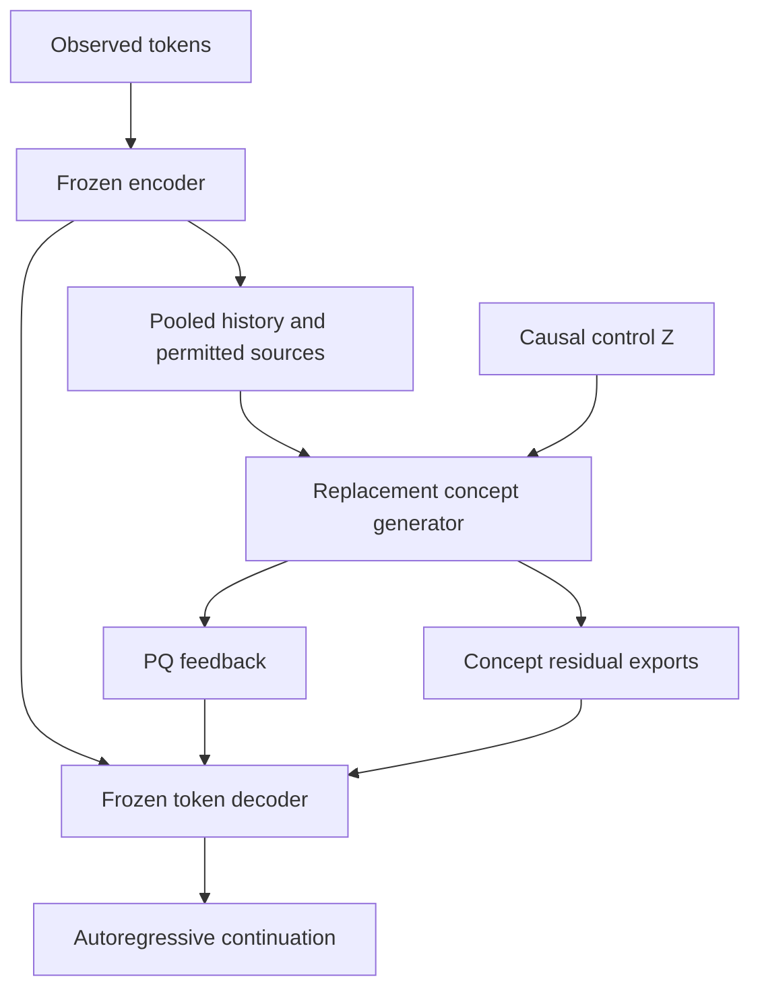
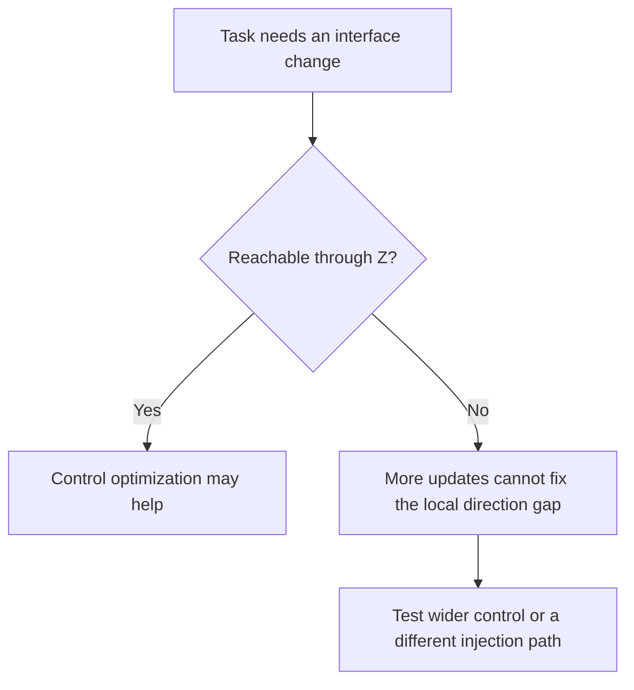
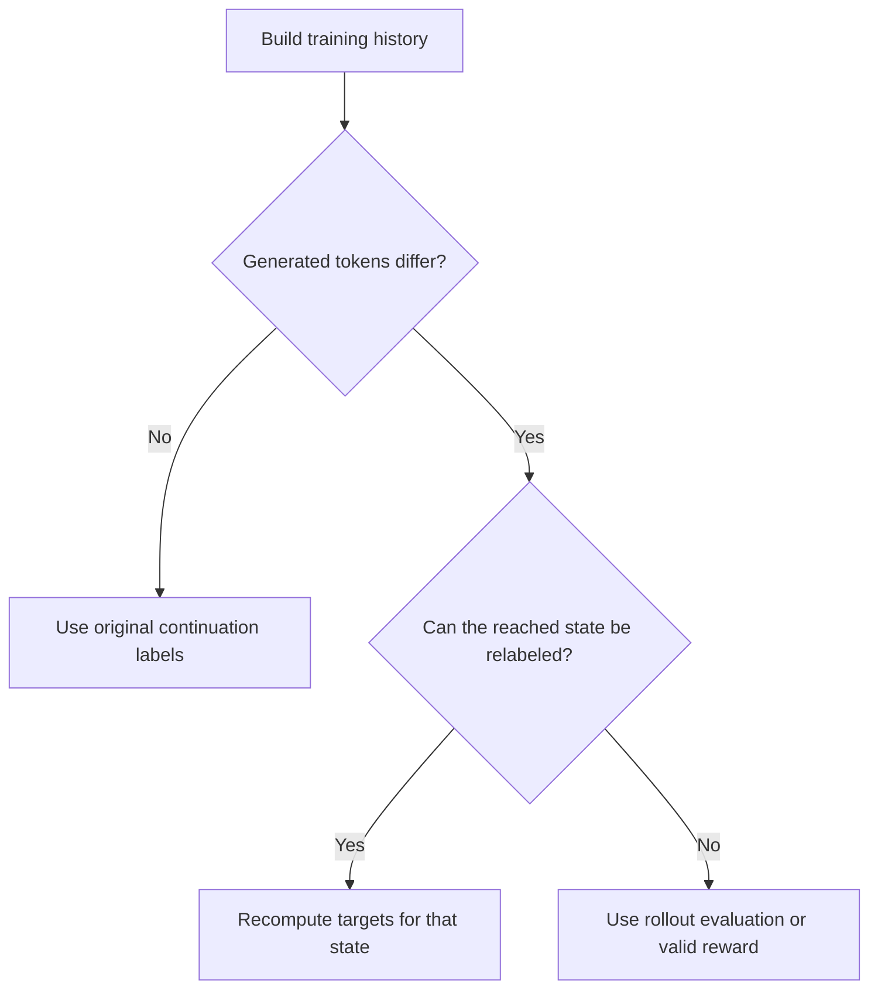
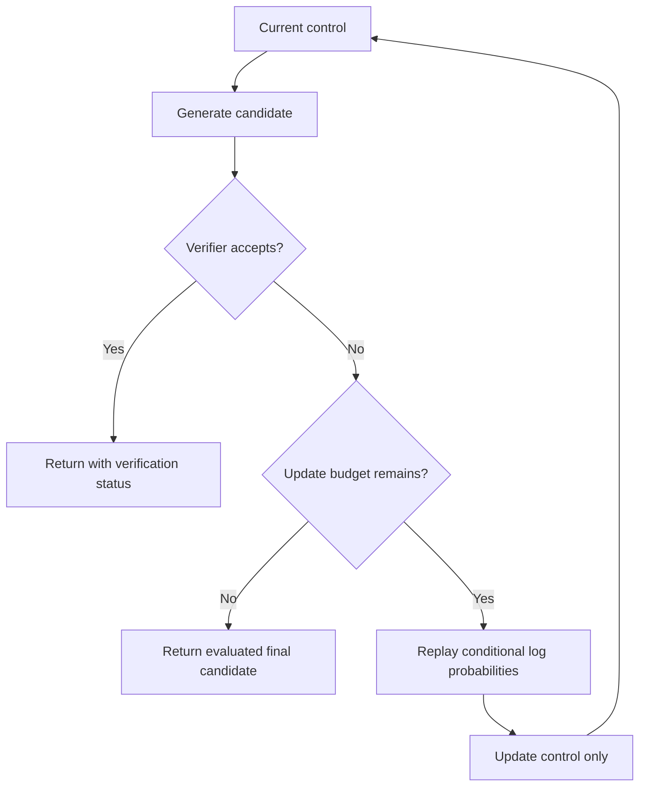
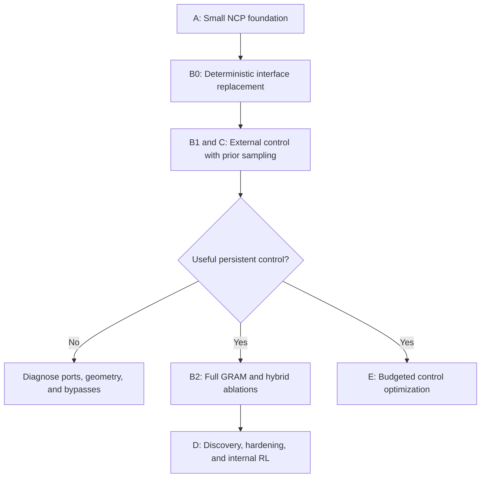

# Review v5: NCP → GRAM/XM → Internal RL → GradCuit

**Date:** 3 October 2026  
**Reviewed specification:** `NCP_GRAM_Z_Five_Phase_Architecture(1).md`, version 1.0  
**Decision:** Proceed with a small, controlled A–C experiment. Make D and E conditional on demonstrated control.  
**Evidence status:** Primary-paper audit, mathematical analysis, and executed numerical counterexamples. No integrated NCP/GRAM model was trained for this review.

## 1. Research verdict and reading roadmap

**The architecture is coherent enough to investigate. Its central unresolved assumption is that a replacement concept generator can create a useful control space that the frozen decoder can reliably execute.** Neither correct gradients nor success in the individual papers establishes that assumption.

The strongest idea is the separation of responsibilities: learn a representation and decoder, replace the concept computation through an explicit interface, and then learn how to control that computation. The weakest bridge is from **“different controls explain different continuations”** to **“controls represent reusable actions that improve novel reasoning tasks.”** Those are different experimental claims.

My recommendation is to preserve the five-phase research program while making the first experiment substantially narrower.

| Read first | Question answered | Main conclusion |
|---|---|---|
| Sections 1–3 | What survives the review? | The modular hypothesis and much of the causal specification |
| Sections 4–5 | Can the representation and objectives support control? | Possibly; controllability, competing losses, and latent allocation need measurement |
| Sections 6–8 | Where can implementation or deployment fail? | Rollout targets, hard switching, and test-time optimization need tighter contracts |
| Sections 9–11 | What should actually be built and measured? | A staged ablation program with explicit stop conditions |
| Sections 12–13 | What was checked, and against which papers? | Reproducible algebra checks and versioned primary references |

The highest-priority findings are:

1. **A concrete pseudocode bug:** Phase E can return the continuation generated *before* its final update. Generate and verify after every update, including the last.
2. **An underspecified training contract:** “train on rollouts” must distinguish predicted concept histories from generated token histories. After token histories diverge, original future labels may no longer be valid.
3. **A hidden geometric bottleneck:** the minimal PQ configuration permits at most 60 affine degrees of freedom in a 128-dimensional feedback vector. This is not automatically fatal, but it changes what the smallest experiment tests.
4. **An objective conflict:** nearest-code cross-entropy and continuous concept MSE can prefer different predictions even for one unambiguous target.
5. **A diagnostic correction:** candidate-slot win frequencies are not semantic mode frequencies when fresh controls are independently sampled for every example.
6. **A deployment gap:** a soft switching gate can transmit substantial control that disappears completely after thresholding.
7. **A missing capability claim:** the current system is a controlled predictor. General planning, interpretable actions, and continual learning remain additional hypotheses.

I used four successive review passes: source fidelity, mathematical validity, adversarial deployment analysis, and experimental simplification. The perspectives requested in the prompt motivate attention to scaling and evidence, predictive representations, distributed credit assignment, and hierarchical control. **This is my review, not a statement of Dario Amodei’s, Yann LeCun’s, Geoffrey Hinton’s, or Demis Hassabis’s opinions.**

## 2. Reconstructing the proposal from first principles

### 2.1 What problem is being solved?

A language model chooses the next token from a probability distribution. A token is a tokenizer unit, which may be a word fragment, punctuation, or a whole word. Generating a long answer requires many such choices.

The proposal introduces an intermediate prediction that influences several choices together. The encoder converts observed tokens into vectors; pooling combines four vectors into a shorter sequence; the concept module predicts the next pooled representation; the decoder uses that prediction while generating four tokens.

An analogy is an instruction writer and an executor. The writer supplies a short instruction, and the executor realizes it. But an electrical connection between them is insufficient: the instruction must mean something the executor understands, and it must affect the behavior we care about.



This diagram contains two concept-to-decoder routes. PQ feedback passes through the codebooks. The residual exports provide additional continuous signals. A successful intervention through the second route does not by itself validate the first route’s semantics.

### 2.2 The five stages and their distinct jobs

| Phase | What is learned | What success would establish |
|---|---|---|
| A: NCP | Encoder, concept stack, codebooks, decoder | A useful foundation with measurable concept-path contribution |
| B: replacement training | Recursive generator, controls, priors/posteriors, output adapters | Future prediction and decoder compatibility under deployable controls |
| C: transplant | The replacement under complete sequence execution | Stable operation with the old concept module fully removed |
| D: internal RL | A causal policy over persistent controls | Better task-directed exploration or credit assignment |
| E: instance optimization | Only the current control offset | Better verified answers within an inference budget |

**Three clocks must remain separate:** token time, concept-boundary time, and recursive computation time. Four recursive updates do not mean four future concepts. A control held for four concepts influences sixteen token predictions under the default chunk size.

| Symbol used in this review | Meaning | Shape, when applicable |
|---|---|---|
| $B,T,d$ | Batch size, token length, representation width | Positive integers |
| $k,M$ | Tokens per chunk; completed chunks $M=\lfloor T/k\rfloor$ | Default $k=4$ |
| $H,C$ | Encoder states; pooled concept states | $[B,T,d]$; $[B,M,d]$ |
| $S,V_c,Q_s$ | PQ segment count, codewords per segment, segment codebook | $Q_s:[V_c,d/S]$ |
| $Z,d_z$ | External control; its width | $[B,d_z]$, initially $d_z=8$ |
| $\eta$ | All independent base-noise draws for a recursive rollout | A collection of tensors |
| $R,n_L$ | High-level transitions; low-level refinements per transition | Integers |
| $\mathcal A$ | Complete decoder-facing interface: feedback plus residual ports | One width-$d$ vector per port and boundary |
| $L,K$ | Scored continuation length; number of candidates | Integers |
| $\mathcal C$ | Complete causal conditioning record | Tokens, states, positions, masks, unaffected caches |

### 2.3 What the existing draft already gets right

These are strengths to preserve, not new corrections:

- The training posterior may see the target; the deployed prior and policy may not.
- The next concept and concept residual exports obey the same causal shift.
- Replacement covers every decoder-facing port, not just the final concept vector.
- Frozen parameters still permit derivatives with respect to their inputs.
- The source NCP objective uses continuous concept MSE; code classification is an added objective.
- Candidate assignment covers a complete persistent-control window.
- Full replacement at blend fraction one is required before claiming a successful transplant.
- Phase E resets its offsets; it does not claim durable learning.

I found no reason to reject those choices on first principles.

## 3. What the cited papers support

I retrieved all nine referenced papers and examined the relevant methods, equations, and implementation sections. I also inspected the NCP, GRAM, and metacontroller architecture figures. This is a methods audit, not an independent reproduction of their benchmark results.

| Reference and inspected location | Supported mechanism | Transfer boundary |
|---|---|---|
| [R1], §§2–3, Figure 2 | Pooled concepts, PQ expectations, causal injection, IRC/CRC, joint losses | Does not establish compatibility with a new stochastic core or semantic external controls |
| [R2], §§2.1–2.3; Appendices A.3, B.1 | Stochastic recursive trajectories, posterior/prior learning, depth and candidate scaling | The one-query NCP core, external $Z$, and decoder ports are adaptations; the practical training surrogate truncates gradients |
| [R3], §3; Appendix F.2 | Best-of-$K$ matching; distinct hard-coverage and smooth-mixture objectives | Its results do not establish that this hybrid learns persistent actions or calibrated control frequencies |
| [R4], §2.2; Appendix A.1, Algorithm 1 | Frozen-weight intermediate-state optimization using regenerated continuations | Optimizing a small generator control changes the available directions and the gradient path |
| [R5], main metacontroller sections; Appendices D.2, E.1–E.2 | Demonstration-based control discovery, temporal integration, causal internal RL | Evidence concerns structured control environments; transfer to open-ended language reasoning remains untested here |
| [R6], §§2–3; Appendix A | Persistent hidden memory and ordered corruption training; timestep-free iterative solving | Its task structure and spatial working state differ from a single future-concept query |
| [R7], §§3.1–3.4, Eq. 6, Algorithm 2 | Coupled latent/token refinement with revisable token readouts | An unchanged NCP autoregressive decoder does not reproduce that generation process |
| [R8], §§2–3 | Gaussian corruption and noise-prediction training | Supplies diffusion mathematics, not evidence for this replacement |
| [R9], §4.1, Eq. 12 | Deterministic reverse sampling as a special case | Fewer denoising steps do not automatically preserve this system’s quality |

Two source details deserve precision. **HC-DLM’s stated practical reconstruction loss is evaluated at the encoder latent; it does not send token-loss gradients into the denoiser in that training objective.** Token feedback during sampling and decoder-grounded gradients during training are different claims [R7]. Also, the internal-RL paper’s continuous switching relaxation explains its ungated proposal KL; an ungated KL is not automatically an error [R5]. Both distinctions matter when borrowing mechanisms.

The proposal’s novelty is chiefly **the integration contract and the learned control space**. There is no basis to multiply the individual papers’ reported improvements, or assume that their favorable scaling properties compose.

## 4. Phase A review: representation and controllability

### 4.1 Pooling compresses; it does not certify abstraction

The pooled vector is

$$
c_m=\frac{1}{k}\sum_{a=1}^{k}h_{k(m-1)+a}.
$$

Here $h_t\in\mathbb R^d$ represents observed token position $t$, $m$ is the chunk index, and $a$ counts positions within that chunk. Equal weights sum to one, so pooling does not increase scale merely by combining more positions.

For arbitrary scalar states, $(1,3)$ and $(2,2)$ both average to 2. Information can therefore be lost. However, the encoder states are contextual: they can encode order before pooling. It would be incorrect to conclude that mean pooling necessarily destroys token order in the trained model.

What must be tested is whether the retained information predicts **task-relevant future structure**. Low concept MSE can also reward predictable syntax, frequent words, or simple copying of a slowly changing context.

Use three forecast baselines: copy the latest concept, predict the training-set mean, and learn a simple predictor from the available history. Compare against actual future targets, and measure errors in directions that affect the decoder. These are stronger tests than merely observing a decreasing auxiliary loss.

### 4.2 A geometric limit hidden in the local PQ settings

This is an original deduction from the specified interface.

For one segment, the prediction is

$$
\hat c^{(s)}=Q_s^\top\pi_s,
\qquad \pi_{s,v}\ge0,\qquad \sum_{v=1}^{V_c}\pi_{s,v}=1.
$$

$Q_s$ has shape $[V_c,d/S]$; $\pi_s$ is a length-$V_c$ probability vector. Thus the output is a **convex combination** of codewords: it lies inside their convex hull, the region obtainable by mixing them with nonnegative weights.

Choose codeword $Q_{s,1}$ as an origin. Because the probabilities sum to one,

$$
\hat c^{(s)}=Q_{s,1}+\sum_{v=2}^{V_c}\pi_{s,v}(Q_{s,v}-Q_{s,1}).
$$

There are only $V_c-1$ difference vectors. Their span cannot exceed either their count or the segment width. Across all segments, therefore,

$$
\dim_{\mathrm{affine}}(\text{PQ output})
\le S\min(d/S,V_c-1).
$$

This is an upper bound, not the measured effective rank; dependent codewords and shared prediction heads can reduce it further.

| Configuration in the draft | Segment width | Codewords per segment | Maximum PQ affine dimension |
|---|---:|---:|---:|
| Minimal: $d=128,S=4$ | 32 | 16 | 60 of 128 |
| Local: $d=256,S=8$ | 32 | 32 | 248 of 256 |
| Source: $d=4096,S=32$ | 128 | 128 | 4064 of 4096 |

**Implication:** the smallest setup changes the relative severity of the PQ bottleneck. A negative result there cannot cleanly reject the source-scale hypothesis. Keep the specified setting as a compact diagnostic, but compare it with $d=128,S=8,V_c=32$, whose upper bound is 128. Codebook parameter storage doubles in that comparison; account for the change.

CRC exports and token paths remain available, so this limit does **not** imply that the whole model has only 60-dimensional representations.

### 4.3 Why a gradient path can exist but still be ineffective

Fix the context, continuation tokens used for scoring, and base noise. Flatten the interface into $a(Z)\in\mathbb R^n$, where $n$ counts all exported scalar values in the window. For a small change $\delta Z\in\mathbb R^{d_z}$, first-order expansion gives

$$
a(Z+\delta Z)\approx a(Z)+J\delta Z,
\qquad J=\frac{\partial a}{\partial Z}\in\mathbb R^{n\times d_z}.
$$

Each column of $J$ describes what moving one control coordinate changes. There can be at most $d_z$ independent local directions. Lifting eight numbers to two width-$d$ prefixes does not create additional independent control coordinates.

If the task loss has interface gradient $g_a=\nabla_a\mathcal L$, the chain rule gives

$$
g_Z=J^\top g_a.
$$

The task may need a change perpendicular to every available column of $J$. For example, $J=\operatorname{diag}(1,0)$ and $g_a=(0,1)^\top$ give $g_Z=0$. The interface responds to control, but not in the useful direction.



Measure control sensitivity on task-relevant logits or behavioral features, not just raw activation norms. Sweep $d_z\in\{8,32,64\}$ only after the eight-dimensional version shows a concrete bottleneck. A small space can be a useful regularizer; a larger one may be easier to exploit adversarially.

There is another possible attenuation: differentiating PQ feedback with respect to its logits gives

$$
\frac{\partial\hat c^{(s)}}{\partial a_s}
=Q_s^\top\bigl(\operatorname{diag}(\pi_s)-\pi_s\pi_s^\top\bigr).
$$

Here $a_s\in\mathbb R^{V_c}$ denotes segment logits, distinct from the flattened interface above. The matrix in parentheses is the softmax derivative. It approaches zero when probabilities become nearly one-hot. A mathematically differentiable route can therefore have very weak useful gradients. CRC can preserve another route, which is why both paths need separate diagnostics.

To obtain that derivative, write each probability as its exponential score divided by the sum of all exponential scores. The quotient rule gives $\partial\pi_v/\partial a_w=\pi_v(\mathbf 1[v=w]-\pi_w)$, where the indicator is one when the indices match and zero otherwise. Collect these entries into a matrix: $\operatorname{diag}(\pi)$ puts the probabilities on its diagonal, and $\pi\pi^\top$ is their outer product. Multiplying by the codebook maps probability changes into feature changes.

**Phase A verdict:** sound foundation choice. Add geometry-aware local settings, simple forecast baselines, and task-conditioned intervention tests before freezing it.

## 5. Phase B review: objectives, uncertainty, and meaningful controls

### 5.1 The variational objective is coherent; its scale needs an explicit contract

Let $u=(Z,\tau)$ collect the external control and stochastic recursive trajectory. The latent model averages over possibilities:

$$
p(y\mid\mathcal C)=\int p(y\mid\mathcal C,u)p(u\mid\mathcal C)\,du.
$$

Introduce a training posterior $q(u\mid\mathcal C,y)$, multiply and divide the integrand by $q$, and use concavity of the logarithm:

$$
\log p(y\mid\mathcal C)
\ge \mathbb E_q[\log p(y\mid\mathcal C,u)]
-\mathbb E_q\!\left[\log\frac{q(u\mid\mathcal C,y)}{p(u\mid\mathcal C)}\right].
$$

The last expectation is KL divergence. It charges for target-informed latent choices that the causal prior would not normally make. Factor the posterior and prior into the external code and sequential guidance choices; their log ratios add, yielding the draft’s control KL plus per-transition KL terms. The derivation is valid for the declared causal joint model and full objective.

The reconstruction term is **summed token NLL**: $-\sum_{t=1}^L\log p(y_t\mid y_{<t},\mathcal C,u)$. Each token contributes because sequence probabilities multiply. Dividing the complete negative bound by $L$ preserves its relative weights for a fixed example. Dividing only reconstruction by $L$ makes each KL effectively $L$ times stronger relative to reconstruction.

For variable-length examples, even dividing the complete loss per example changes how examples are weighted. Save both the within-example reduction and the batch reduction. Also log control KL separately from guidance KL; increasing recursion depth adds guidance variables and can change the objective’s balance.

**The draft’s displayed reconstruction sums are correct.** The request here is to remove implementation ambiguity, including the phrase “normalized whole-text NLL,” which could be mistaken for length-averaged NLL.

### 5.2 Two latent systems can compete to explain the same target

The posterior can encode information in $Z$, in recursive guidance, or both. A successful variational model need not use the external variable that later RL and GradCuit expect to control.

To see what the external KL measures, define the aggregate posterior

$$
\bar q(Z\mid\mathcal C)=\mathbb E_{y\mid\mathcal C}q(Z\mid\mathcal C,y).
$$

Insert $\bar q$ into the log ratio by multiplying and dividing:

$$
\mathbb E_y\operatorname{KL}(q(Z\mid\mathcal C,y)\|p(Z\mid\mathcal C))
=I_q(Z;y\mid\mathcal C)
+\operatorname{KL}(\bar q(Z\mid\mathcal C)\|p(Z\mid\mathcal C)).
$$

$I_q$ is conditional mutual information: how much knowing $Z$ reduces uncertainty about the target under the posterior joint distribution. The identity follows by splitting the logarithm into $\log(q/\bar q)+\log(\bar q/p)$ and averaging. Averaging over contexts gives the corresponding dataset identity.

Consequently, a large control KL may reflect useful target information, prior mismatch, or both. A small control KL with successful reconstruction may mean that internal guidance or the decoder carries the useful information instead. Neither interpretation can be settled from total loss alone.

| Intervention | Fixed | Varied | Question |
|---|---|---|---|
| External-control test | Context, base guidance noise, decoding randomness | $Z$ | Does the proposed action variable influence behavior? |
| Guidance test | Context, $Z$, decoding randomness | Base guidance noise | Is useful variation chiefly internal stochasticity? |
| Persistence test | Task and selected code | Control duration within trained range | Does the behavioral effect persist? |
| Transfer test | Desired operation | Surface form and task composition | Does the code track behavior rather than wording? |

Do not require a globally human-readable axis from the outset. Require a reproducible behavioral intervention. An invertible reparameterization can change the coordinate meanings without changing the model’s behavior.

### 5.3 Smooth mixture likelihood requires whole-sequence probabilities

For candidate $i$, define $\ell_i=-\log p_i(y\mid\mathcal C)$. Select a candidate uniformly once per window and keep it throughout the window. Marginalizing that choice gives

$$
\mathcal L_{\mathrm{mix}}
=-\log\left(\frac1K\sum_{i=1}^K e^{-\ell_i}\right),
\qquad
\rho_i=\frac{e^{-\ell_i}}{\sum_j e^{-\ell_j}}.
$$

Differentiating the logarithm gives $\partial\mathcal L_{\mathrm{mix}}/\partial\ell_i=\rho_i$. Better explanations get larger gradient weights. For fixed candidate components this is mixture likelihood; random prior-generated candidates introduce the finite-sample distinction already noted in the draft.

If instead $\ell_i$ is divided by $L$ *inside* this expression, exponentiation produces $p_i(y)^{1/L}$. That is generally not a normalized sequence distribution. For the four two-token outcomes with probabilities $0.81,0.09,0.09,0.01$, the square roots sum to **1.6**, not 1. Adding a missing normalization would define a different model.

For two candidate sequence probabilities $0.81$ and $0.01$, proper responsibilities are approximately $0.9878,0.0122$; length-averaging at $L=2$ changes them to $0.9,0.1$. Thus normalization also changes specialization pressure.

It is fine to use a temperature-controlled soft minimum as an explicitly different objective. It is not fine to call it unchanged sequence likelihood. Likewise, adding code and MSE scores produces the composite loss already acknowledged by the draft.

### 5.4 Code CE and concept MSE can disagree

Consider one scalar segment with codewords 0 and 1. Let $p$ be the predicted probability of codeword 1, so soft feedback equals $p$. Suppose the actual target is $c=0.49$. Its nearest discrete label is codeword 0.

Continuous error alone is $(p-c)^2$, minimized at $p=0.49$. Code-label cross-entropy is $-\log(1-p)$, minimized at $p=0$. With code weight $\alpha\ge0$, their sum is

$$
f(p)=(p-c)^2-\alpha\log(1-p),
\qquad f'(p)=2(p-c)+\frac{\alpha}{1-p}.
$$

The first derivative term pulls feedback toward the continuous target; the second pulls probability toward the nearest discrete label. At $p=c$, the MSE gradient vanishes but the code gradient remains positive. With $\alpha=0.1$, solving the quadratic obtained from $f'(p)=0$ gives $p\approx0.40585$.

This is a tradeoff, not an invalid loss. But “more supervision” is not automatically helpful. **Start with $\lambda_q=0$** in the main fidelity comparison; introduce code CE as a measured ablation. It may encourage discrete commitment while degrading soft feedback accuracy or saturating its gradients.

### 5.5 Candidate identity is not mode identity

When every example receives fresh independent samples $Z_1,\ldots,Z_K$, slot 1 has no persistent semantic identity. Uniform slot wins can coexist with complete semantic collapse; deterministic tie-breaking can make slot 1 win every time even when every candidate is identical.

The draft’s “one candidate wins almost everywhere” warning is informative for persistent learned prototypes. For fresh continuous samples, replace it with:

- frequencies of verified behavioral modes;
- within-context output differences under controlled interventions;
- prior probability mass assigned to useful behaviors;
- oracle candidate quality versus causally selected quality.

Hard winner matching can encourage coverage without learning the right frequencies. Smooth likelihood does not guarantee semantically meaningful modes either. In both cases, the central diagnostic is **what changes in behavior**, not which array index wins.

**Phase B verdict:** mathematically viable hybrid, but too many explanations for success if introduced all at once. Establish a usable external control with a simpler variant before paying for both posterior-guidance learning and XM.

## 6. Phase C review: transplant, history, and deployment

### 6.1 Matching ports is necessary; matching their useful behavior is harder

The draft correctly replaces the complete interface $\mathcal A_m=(\hat c_m,A_{m,1},\ldots,A_{m,J_C})$, where $J_C$ counts concept residual ports. Keeping tensor sizes, port order, normalization, and timing is essential.

Nevertheless, a frozen decoder responds to feature directions, correlations, and temporal relationships, not just shape or norm. Distillation helps place the replacement inside a familiar numerical regime. Permanent strong distillation can also prevent it from improving on its teacher.

Use a deterministic replacement first. If it cannot reproduce the original decoder behavior with correctly aligned ports, adding stochasticity, RL, or more recursive steps will obscure the interface problem.

The blend has the elementary derivative

$$
\mathcal A^\lambda=(1-\lambda)\mathcal A^{\mathrm{old}}+\lambda\mathcal A^{\mathrm{new}},
\qquad
\frac{\partial\mathcal L}{\partial\mathcal A^{\mathrm{new}}}
=\lambda\frac{\partial\mathcal L}{\partial\mathcal A^\lambda}.
$$

$\lambda\in[0,1]$ is the replacement fraction. At zero, token-loss gradients into the new output vanish. The draft already recognizes this correctly. At intermediate values the decoder sees blended states; good performance there says little about the endpoint unless the endpoint is evaluated directly.

Avoid a second bypass: because the new readouts may access encoder sources, they could perform most of the useful work while ignoring recursion. Train an **adapter-only baseline** that receives the same permitted context but no recursive working state. This complements inference ablations; simply zeroing a trained state can create an unfamiliar input distribution.

### 6.2 Four distributions need separate names

“Teacher forcing” means using earlier observed target tokens while predicting the next target token. It is a valid likelihood calculation. It is different from feeding generated tokens back into the model.

| Training/evaluation mode | Token history | Concept history | Valid target and purpose |
|---|---|---|---|
| Clean likelihood | Dataset prefix | Actual pooled prefix | Dataset continuation; foundation and compatibility |
| Predicted-concept replay | Dataset prefix | Causally predicted concepts | Dataset continuation; concept-history exposure |
| Free generation | Generated prefix after divergence | Predicted concepts | Evaluate generated trajectory with task feedback |
| On-policy supervision | Generated/environment prefix | Declared causal history | Recomputed valid target or expert action for the reached state |

The first two can legitimately use dataset continuations. The third cannot silently inherit the original trajectory’s future labels as though its context were unchanged.

For example, a dataset trajectory reaches state 3 and then applies “add 2,” producing 5. If a generated trajectory instead reaches state 4, its next correct result is 6. Scoring it against 5 teaches an inconsistent transition. In unrestricted language, obtaining the correct continuation of a deviated history is often harder; this makes the distinction more important, not less.



This is an underspecification in the draft, not proof that its existing implementation is wrong: no implementation was supplied. Make predicted-concept replay with teacher-forced tokens the first rollout-training mode. Add generated-token training only with an explicit labeling or reward rule.

### 6.3 Freezing constrains the attainable family

With all surrounding parameters fixed, the replacement can only induce distributions that those fixed computations can realize from the available ports. This is a practical controllability constraint, not a claim that other strings have mathematically zero probability.

Use a supervised control-fitting diagnostic on held-out problems to ask whether known correct behavior is reachable within a reasonable control radius. Treat it as an **oracle diagnostic**, never deployable accuracy. Success shows some available control authority; failure may reflect optimization difficulty rather than impossibility.

Feeding actual future concepts to the decoder is also an oracle intervention, but not a rigorous upper bound: those vectors may differ from the predicted-concept distribution on which the decoder was trained. It can answer a diagnostic question without certifying achievable performance.

### 6.4 Diffusion should remain a separate core experiment

The draft appropriately distinguishes conditional DDIM-style generation, a timestep-free recurrent solver, and HC-DLM. Keep that separation.

The first two use different inference dynamics; the third changes how latent and token states interact. A successful fixed-decoder GRAM transplant would not automatically establish a successful diffusion transplant. Conversely, a one-query failure would not refute iterative solvers with many spatial working positions.

For an eventual diffusion variant, explicitly define the terminal noise level, reverse-step schedule, target standardization, working-state shape, control conditioning, full-rollout supervision, and decoder interface. The endpoint clean estimate must be evaluated after the last update. Do not infer an anytime reasoning guarantee from the noising equations.

**Phase C verdict:** required integration training and evaluation are well motivated. Resolve the rollout-label contract and test the pure replacement before exploring another generative core.

## 7. Phase D review: when a latent vector becomes an action

### 7.1 Persistence is a behavioral claim

A control is a useful high-level action when holding it causes a reproducible behavior over several lower-level steps, and switching it predictably changes that behavior. Holding the same numbers in memory is insufficient.

The proposal resets the internal query state at each concept boundary while retaining $Z$. That can sustain a policy conditioned on a goal, because context records progress. It does not provide a persistent private planning workspace beyond the code and accessible history. Carrying recursive state between chunks would be a meaningful additional variant.

Likewise, the one-query state $[B,1,d]$ is a substantial restriction relative to a reasoner that maintains a working vector for many entities or future positions. Test it first; introduce a small multi-slot workspace only if errors indicate missing intermediate structure.

### 7.2 Soft-to-hard switching needs its own exit gate

The proposed integration is

$$
Z_m=(1-\beta_m)Z_{m-1}+\beta_m\tilde Z_m,
\qquad \beta_m\in[0,1].
$$

$\tilde Z_m$ is the proposed code; $\beta_m$ is the update rate. With zero it retains the previous code, with one it replaces it, and otherwise it interpolates. Training uses this continuous path; deployment thresholds the rate.

Take scalar $Z_0=0$, constant proposal $\tilde Z_m=2$, and $\beta_m=0.49$. Subtract the fixed point 2 from both sides:

$$
Z_m-2=0.51(Z_{m-1}-2),
\qquad Z_m=2(1-0.51^m).
$$

After ten steps, $Z_{10}\approx1.99762$. Thresholding at 0.5 makes every gate zero and leaves the hardened trajectory at 0. A gate can therefore communicate nearly the complete new action without ever crossing its deployment threshold.

| Required comparison | What it detects |
|---|---|
| Soft and hardened discovery models on the same examples | Behavior lost through thresholding |
| Learned switch and fixed-duration switch | Whether termination learning adds value |
| Learned switch and always-switch | Whether temporal abstraction is useful |
| Familiar and novel subgoal orderings | Whether actions compose beyond imitation |
| Same action under paraphrasing and changed observations | Whether control tracks the operation rather than surface form |

Measure the hard-policy result **before RL**, so later policy improvement does not conceal a discovery-to-deployment mismatch. If gates remain intermediate, use a declared hardening curriculum or separately trained termination model and revalidate it.

### 7.3 Do not apply the wrong correction to the KL

The draft penalizes each proposed code’s posterior-to-prior KL, including when the soft gate is small. This may look wasteful, but multiplying it by the gate is not an automatic mathematical fix.

For any fixed $\beta>0$, the transformation $\tilde Z\mapsto(1-\beta)Z_{\mathrm{prev}}+\beta\tilde Z$ is invertible. Applying the same invertible transformation to prior and posterior leaves their KL unchanged: their common Jacobian factors cancel in the density ratio. At exactly zero, both induced distributions collapse to the same retained state and their induced-state KL is zero.

Therefore the continuous proposal regularizer and the exact hard-switch model have different boundary behavior. Retain the existing term as a clearly identified continuous-training choice; rederive the objective if switching becomes discrete. The important empirical question is whether its information budget discovers stable, deployable actions.

### 7.4 A planning system still needs an evaluation of consequences

The semi-Markov return in the draft properly accounts for variable action duration. A causal actor and a value estimator are sensible components. However, sequential prediction plus a latent policy does not automatically constitute explicit lookahead planning.

To claim a world-model planner, one would additionally need an action-conditioned prediction of future states, an objective over those states, and a procedure that compares possible action sequences. These are not specified here. Internal RL may still yield excellent reactive or implicitly planned behavior; label the demonstrated capability precisely.

**Phase D verdict:** conceptually promising after control is established. Demonstration discovery, hardened termination, and novel task composition are separate gates. A next-concept predictor alone does not discharge them.

## 8. Phase E review: test-time credit assignment

### 8.1 Derive the update without confusing rejection with correction

Let $p_Z(y)$ be the continuation distribution under a chosen control and $\mathcal R(y)$ its reward. Expected reward is a probability-weighted sum:

$$
J(Z)=\sum_y p_Z(y)\mathcal R(y).
$$

If reward has no direct differentiable dependence on $Z$, use $\nabla p=p\nabla\log p$ to obtain

$$
\nabla_ZJ=\mathbb E_{y\sim p_Z}
[\mathcal R(y)\nabla_Z\log p_Z(y)].
$$

This identity explains why detached sampled tokens can still provide a score-function gradient. A fixed-trajectory surrogate minimizes $-\mathcal R(y)\log p_Z(y)$. With rejection reward $-1$, it minimizes $\log p_Z(y)$, lowering that rejected sequence’s probability.

There may be many other wrong sequences. In a three-outcome example with probabilities $0.6,0.3,0.1$, rejecting the first outcome and taking a small logit-space step changes them to approximately $0.5523,0.3407,0.1070$. If only the last outcome is correct, most displaced mass still goes to an incorrect alternative. This example illustrates the surrogate’s direction; the actual control-space update has the additional generator Jacobian.

Greedy generation, as used in the source procedure, also does not produce an unbiased sample-based estimator of this expectation. The draft acknowledges this correctly. Improvement must be measured against equally budgeted search, not inferred from the gradient equation.

### 8.2 With stochastic GRAM, the replayed quantity is conditional

Write independent base noise as $\eta$, with distribution independent of $Z$. Reparameterization lets the generator express its stochastic trajectory as a deterministic function of $Z,\eta$. The objective is then

$$
J(Z)=\mathbb E_\eta\sum_y p(y\mid Z,\eta)\mathcal R(y).
$$

Differentiating inside these expectations gives the analogous score term $\mathcal R\nabla_Z\log p(y\mid Z,\eta)$. The derivative must include how the prior’s means, scales, states, and outputs change with $Z$, while the recorded **base** draws remain fixed.

Replaying one base-noise trajectory does not compute the exact derivative of the noise-marginalized log probability $\log p_Z(y)$. Under sampled generation, averaging the conditional estimator across independent base noise and generated outputs targets the expected reward under appropriate regularity. Greedy rollout remains a practical surrogate.

The first diagnostic should use fixed base-noise streams across retries to isolate the effect of optimization. Then test fresh-noise robustness; success for one stream may overfit its accidental trajectory.

### 8.3 Correct the final-update bug

The original E4 loop generates, checks, and then updates inside `range(max_updates)`. If the last check fails, it performs one more update and exits without generating the updated continuation. This conflicts with the stated “regenerate after every update” procedure.

Use the following structure. This is specification pseudocode; the helper names represent implementation contracts.

```python
base = causal_policy_or_prior(prefix).detach()
delta = zeros_like(base, requires_grad=True)
optimizer = Adam([delta], lr=chosen_lr)

# Keep the base-noise stream fixed for the initial controlled diagnostic.
noise = make_base_noise_stream(seed)
candidate = generate(base + delta, prefix, noise=noise)
verdict = verify(candidate)  # Detached; does not receive the hidden answer.

for _ in range(max_updates):
    if verdict.accepted:
        break

    optimizer.zero_grad()
    logp = score_fixed_tokens(
        candidate.tokens.detach(), prefix, base + delta,
        replay_base_noise=noise,
        rebuild_affected_caches=True,
    )
    reward = verdict.reward.detach()  # 0 accepted, -1 rejected
    loss = -reward * logp.sum()
    loss.backward()
    optimizer.step()

    candidate = generate(base + delta, prefix, noise=noise)
    verdict = verify(candidate)

return candidate, verdict
```

With $U$ allowed updates there are at most $U+1$ generated candidates, including the initial one. Report both quantities. If constraints or regularization are added to `delta`, label them as adaptations.

The encoder output for fixed token IDs can be reused. Decoder and concept states influenced by the old control must be rebuilt, beginning at the boundary position that predicts the first affected token. `requires_grad=False` on parameters is compatible with input gradients; wrapping the differentiable decoder call in `no_grad()` is not.

### 8.4 The verifier must reflect deployment

An exact checker is valuable when it checks a candidate using the problem constraints, such as evaluating a proposed arithmetic expression against its target or checking Sudoku constraints. Comparing directly with a hidden benchmark answer is an oracle diagnostic, not deployable self-feedback.

For a learned verifier, record false acceptance and false rejection against separate trusted evaluation labels. Stop-on-acceptance can magnify false positives. Count verifier calls and their cost for every competing method.



**Phase E verdict:** implementable after control is trained. Fix the loop, measure useful reachable directions, and compare against search using the same feedback and total budget. It provides instance adaptation, not accumulated knowledge.

## 9. The experiment I would approve

### 9.1 Preserve the program; reduce the first hypothesis

The first hypothesis should be:

> A causally controlled replacement can maintain NCP decoding quality and improve a verified task, with the original concept stack completely removed.

Do not require it to simultaneously establish novel world models, semantic axes, continual learning, diffusion superiority, and hierarchical RL. Those claims need different evidence.



This is an experimental order, not a claim that B1 is the original GRAM. B1 uses a deterministic recursive core conditioned on external $Z$, with guidance noise disabled. Full GRAM restores posterior/prior guidance learning. The distinction prevents incorrectly crediting a simplified model’s results to the complete paper mechanism.

### 9.2 Build variants in an order that explains failure

| Variant | Main purpose | Advance only when |
|---|---|---|
| V0: standard causal Transformer | Reference quality and cost | It solves the basic diagnostic |
| V1: small NCP | Validate foundation and concept contribution | It learns beyond copy/frequency baselines |
| V2: deterministic full-interface replacement | Isolate replacement compatibility | Pure replacement retains acceptable quality |
| V2a: adapter-only replacement | Check whether the recursive core matters | Compare after matching reasonable capacity and budget |
| V3: external-$Z$ recursive model | Establish causal control before internal noise | Held controls alter useful behavior across several chunks |
| V4: variational GRAM without XM | Test target-informed trajectory learning | Deployable prior quality improves |
| V5: XM-only recursive adaptation | Test exploration separately | Gains survive non-oracle selection and cost accounting |
| V6: full proposed hybrid | Test objective complementarity | It improves the quality/cost frontier over simpler variants |
| V7: policy and instance optimization | Attribute D/E gains | Each beats its relevant equally budgeted baseline |

A full factorial sweep is unnecessary. Stop a branch when its prerequisite fails. Use a small validation sweep before committing three independent training seeds to the most informative comparisons.

### 9.3 Use tasks where the mechanism can be identified

**Controlled multimodality:** give the same prefix several explicitly valid continuations. For example, generate sequences of states using either “add 1” or “add 2” for several transitions, with both branches valid. A hidden generator label records which behavior occurred; it is not supplied to the deployed prior. Hold $Z$ across the sequence and test branch consistency. Follow this with different state ranges and equivalent token encodings.

**Compositional control:** use a small environment with clear subgoals, variable subgoal durations, and exact state transitions. Train on some subgoal combinations and test unseen orders and longer combinations. This supports meaningful switching and policy evaluation.

**Language preservation:** include a fixed held-out text set. Symbolic success alone does not establish useful language modeling, and token NLL alone does not establish persistent action control.

Split by document, underlying task instance, and generative rule before making overlapping windows. Deduplicate across splits. Keep at least one difficulty split that cannot be solved by copying the starting state or memorizing a frequent answer.

### 9.4 Separate four kinds of success

| Measurement | Can use true future during selection? | Interpretation |
|---|---|---|
| Training-posterior reconstruction | Yes, by definition | Training inference capacity |
| Oracle best-of-$K$ or supervised fitted control | Yes; diagnostic only | Candidate availability or potential reachability |
| Prior sampling or causal policy | No | Deployed model quality |
| Verifier-guided test-time search | Only information available to the deployed verifier | Deployed search quality |

Report per-example exact validity, answer diversity, behavioral mode frequencies, token NLL, concept prediction error, posterior/prior gap, pure-replacement quality, drift by horizon, and soft/hard switching gap. Record branch-off, control-swap, guidance-swap, PQ-only, CRC-only, and adapter-only results where relevant.

Use paired uncertainty estimates on the same held-out problems, and report variation across training seeds separately. Many tokens from one answer are not independent experimental trials.

Suggested initial gates are **design choices to predeclare**, not universal research constants:

- Pure-replacement held-out token NLL within 0.05 nats/token of its NCP foundation.
- Useful control effect replicated across three training seeds and fresh task instances.
- No evidence of future leakage, stale affected caches, or a large soft-to-hard behavior collapse.
- Any claimed improvement survives a predeclared inference-cost comparison.

The first tolerance corresponds to a perplexity ratio of $e^{0.05}\approx1.051$: about 5.1% higher. Perplexity is the exponential of average token NLL, so exponentiating the NLL difference gives the ratio directly. Tighten or loosen this tolerance before results are inspected, according to the experiment’s purpose.

## 10. Compute, memory, and the M2 path

### 10.1 Parameters are only one budget

Each concept query performs $R(n_L+1)$ high/low update calls: $n_L$ low updates and one high update, repeated $R$ times. With $R=4,n_L=2$, that is 12 calls per query. Weight sharing saves parameters; it does not erase those calls.

Let $F_E$ be shared encoder/prefix work, $F_G$ one candidate’s concept-generation work, and $F_D$ the affected decoder-scoring work. A simplified candidate-scoring cost is

$$
F_{\mathrm{score}}\approx F_E+K(F_G+F_D).
$$

This is a bookkeeping approximation, not a hardware FLOP prediction. Add posterior computation, backward passes, teacher execution, candidate generation, and verification according to the measured implementation. Reusable unaffected prefixes reduce $F_D$; control-dependent states cannot be reused.

There is also a parallelism issue. Clean-history queries may be processed together with appropriate masks. Predicted concept histories introduce dependencies across chunk boundaries; free token generation introduces additional sequential dependencies. A method can have modest parameter count yet poor training throughput.

| Tier | Recommended scope | What it can establish |
|---|---|---|
| Minimal, approximately 1–3M parameters | Symbolic tasks; $d=128$, $k=4$, $d_z=8$, $K=2$, short full unroll | Causality, interface compatibility, control mechanism |
| M2 Air 16 GB, approximately 10–25M | Add held-out text; sequence length 128–256; candidates evaluated sequentially if needed | Local quality/cost evidence and limited generalization |
| Accelerator scale-up | Larger representation and language data after gates pass | Whether the effect survives scale and distribution changes |

For float32 Adam training, parameter storage alone is approximately $16N$ bytes for $N$ trainable scalar parameters: 4 for weights, 4 for gradients, and 8 for two moments. At 20M parameters that is 320 MB. This excludes activations, frozen modules, attention buffers, and framework overhead; backpropagating through a frozen decoder still needs its input-gradient computation.

The 8.94B source foundation would require approximately 17.88 GB for two-byte weights alone, exceeding the ordinary 16 GB local budget before training state. The local plan is a scaled mechanism experiment, not source-scale reproduction. No M2 runtime was measured in this review.

Compare methods on quality versus measured latency, memory, and total work. Give simple token search and latent search the same verifier access. A fixed candidate count is not an equal compute budget when one method performs recursive generation and backward passes.

### 10.2 What is absent for continual learning

Phase E resets its state; Phase D learns a policy; neither specifies an online retention and consolidation system. Durable learning would require persistent storage or parameter updates, a replay/consolidation rule, and tests for retention and interference. Keep that future objective separate from the first transplant experiment.

## 11. Final revision list and review-pass record

### 11.1 Exact changes recommended to the architecture document

| Priority | Original location | Change |
|---|---|---|
| Correctness | E4 pseudocode | Evaluate an initial candidate, then regenerate and verify after every update |
| Correctness contract | C2 rollout training | Name token-history and concept-history regimes; relabel diverged states or use valid feedback |
| Objective contract | B5–B6 | Specify summed sequence NLL inside mixtures and explicit reductions for every KL/auxiliary term |
| Experimental validity | B7 candidate diagnostics | Distinguish persistent prototypes from exchangeable fresh sample indices |
| Experimental validity | D2 exit gate | Evaluate soft versus hardened switching before RL |
| Geometry | Local configuration | Record PQ affine limits; compare a less restrictive minimal PQ setting |
| Objective ablation | B6 hybrid | Test continuous-target MSE and code CE separately before combining them |
| Control identifiability | B7 | Separate external-control variation from internal-guidance variation |
| Attribution | B4/C1 readouts | Add a trained adapter-only baseline |
| Deployment validity | E2–E3 | Identify conditional base-noise replay; separate greedy surrogate from sampled estimator |
| Evaluation | D4/E4 | Distinguish deployment-accessible verification from hidden-answer oracle feedback |
| Claim discipline | Overall framing | Reserve planning, semantic-control, and continual-learning claims for their own evidence |

### 11.2 What changed across repeated passes

| Pass | Initial question | Result after checking |
|---|---|---|
| 1: source and architecture | Are the modules and attributions coherent? | Broadly yes; the draft already respects many important boundaries |
| 2: mathematical stress tests | Do additional objectives and bottlenecks preserve the intended model? | Found the PQ limit, CE/MSE conflict, and loss-normalization hazard |
| 3: deployment counterexamples | Can training success disappear at inference? | Confirmed the hard-switch counterexample and final-update bug; exposed the rollout-label ambiguity |
| 4: alternative explanations | Could a simpler mechanism explain any apparent gain? | Require adapter-only, deterministic, control-only, noise-only, and equal-budget search comparisons |

An initially plausible criticism was rejected during re-review: the ungated proposal KL in soft temporal integration is not inherently wrong, because the common nonzero affine gate transformation preserves KL. Likewise, the draft already uses summed token NLL; normalization is an implementation hazard to clarify, not an error in that displayed equation.

| Research lens | Most important challenge to this proposal |
|---|---|
| Empirical scaling and evidence | Does it beat a simpler model once decoder, search, and verification costs are counted? |
| Predictive representations | Do the concepts retain useful future structure and support intervention? |
| Distributed computation and credit | Can task gradients reach useful control directions through the actual interface? |
| Hierarchical control and search | Do persistent actions compose, terminate, and improve novel task performance? |

**Funding/build decision:** approve the restricted A–C program. Approve E as a short-budget probe once causal control works. Approve D after persistent behavior and hard-switch compatibility are demonstrated. Defer diffusion and source-scale training until a simpler replacement gives a reproducible advantage.

## 12. Numerical checks and limits of this review

The following checks were executed afresh using Python/NumPy. They establish algebraic facts and counterexamples, not language-model performance.

| Executed check | Result | What it establishes |
|---|---|---|
| Exponentiate mean NLL for a length-2 distribution | Total mass 1.6 | Length-averaged NLL is not unchanged sequence likelihood |
| Candidate responsibilities, sum versus mean NLL | 0.987805 versus 0.900000 for candidate 1 | Loss reduction changes assignment strength |
| Scalar MSE plus code CE, code weight 0.1 | Optimum 0.405847 versus MSE target 0.49 | The auxiliary objectives can conflict |
| Ten soft updates at gate 0.49; threshold 0.5 | 1.997619 versus 0 | Soft control need not survive hardening |
| Task gradient outside control Jacobian span | Control gradient exactly zero | Local responsiveness does not imply useful controllability |
| Two-update original loop versus corrected loop | Evaluated offsets [0,1] versus [0,1,2] | Original pseudocode can return a stale final attempt |
| Rejection update for probabilities [0.6,0.3,0.1] | [0.552340,0.340705,0.106955] | Rejecting one answer does not directly identify the correct alternative |
| Control-KL information decomposition | 0.368064 nats; residual 0 | Demonstrates the information/mismatch identity in a finite toy case |
| PQ Jacobian versus central finite differences | Maximum absolute error about $4.1\times10^{-11}$ | Checks the stated derivative |
| PQ dimension bounds | 60, 248, 4064 | Checks the arithmetic for the three supplied configurations |

For reproducibility, the smallest counterexamples can be rerun without model dependencies:

```python
import math

p = [0.81, 0.09, 0.09, 0.01]
assert abs(sum(math.sqrt(x) for x in p) - 1.6) < 1e-12

c, alpha = 0.49, 0.1
optimum = (1 + c - math.sqrt((1 - c)**2 + 2*alpha)) / 2
assert abs(optimum - 0.4058466423577676) < 1e-12

z = 0.0
for _ in range(10):
    z = 0.51*z + 0.49*2.0
assert abs(z - 1.9976191515234476) < 1e-12
# A gate hardened at 0.5 is always zero in this example.

assert 4 * min(128//4, 16-1) == 60
assert 8 * min(256//8, 32-1) == 248
assert 32 * min(4096//32, 128-1) == 4064
```

I did not reproduce the earlier draft’s reported toy-training percentages or random-interface results: the corresponding original scripts and artifacts were not supplied with this attachment. Those historical figures remain claims in the input document, not new evidence from this review. I did not train NCP, GRAM, the hybrid, or an RL controller; benchmark success, M2 throughput, and large-scale advantage remain unresolved.

**Audit identity:** the reviewed Markdown’s SHA-256 is `85e7c2faad37e2bea047a7103a271c7e92aba79abec6802584053a25989d32a8`. This identifies the input version reviewed; the original file was not modified.

## 13. Primary references

| ID | Paper | Version used |
|---|---|---|
| R1 | [NCP-ArchPreview Technical Report: Moving towards Latent Space Language Models through Next Concept Prediction][R1] | arXiv:2609.10715v1 |
| R2 | [Generative Recursive Reasoning][R2] | arXiv:2605.19376v2 |
| R3 | [Explorative Modeling: Unlocking a Third Pretraining Axis and End-to-End Generation][R3] | arXiv:2607.27372v1 |
| R4 | [GradCuit: Credit-Assigned Gradient Flow Enables Robust and Interpretable Test-Time Latent Reasoning][R4] | arXiv:2608.02585v1 |
| R5 | [Emergent temporal abstractions in autoregressive models enable hierarchical reinforcement learning][R5] | arXiv:2512.20605v2 |
| R6 | [Diffusion as a Training Curriculum for Timestep-Free Iterative Reasoning][R6] | arXiv:2609.01449v1 |
| R7 | [Hierarchical Continuous Diffusion Language Models][R7] | arXiv:2610.02193v1 |
| R8 | [Denoising Diffusion Probabilistic Models][R8] | arXiv:2006.11239, current PDF at retrieval |
| R9 | [Denoising Diffusion Implicit Models][R9] | arXiv:2010.02502, current PDF at retrieval |

[R1]: https://arxiv.org/abs/2609.10715v1
[R2]: https://arxiv.org/abs/2605.19376v2
[R3]: https://arxiv.org/abs/2607.27372v1
[R4]: https://arxiv.org/abs/2608.02585v1
[R5]: https://arxiv.org/abs/2512.20605v2
[R6]: https://arxiv.org/abs/2609.01449v1
[R7]: https://arxiv.org/abs/2610.02193v1
[R8]: https://arxiv.org/abs/2006.11239
[R9]: https://arxiv.org/abs/2010.02502

Visuals in this review include the complete control/decoder interface, local reachability decision, rollout-label decision, corrected optimization loop, staged experiment graph, tensor-shape table, PQ geometry comparison, ablation matrix, and review evidence tables.

Visual Deliverables Included.
