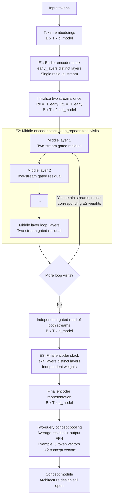
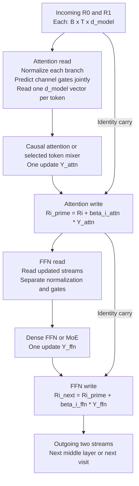
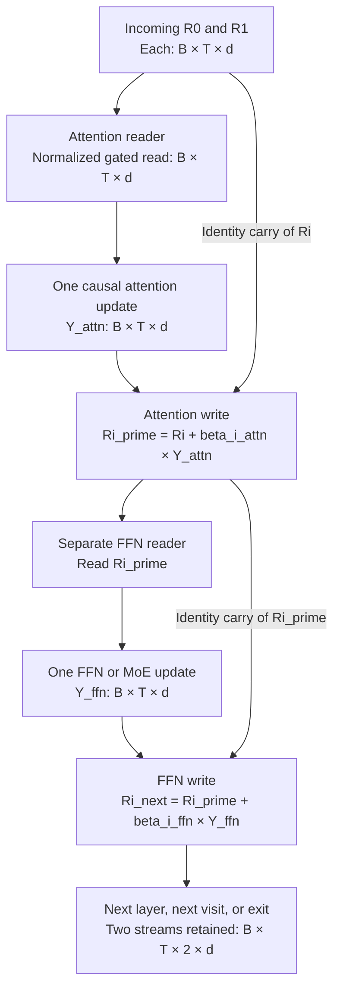
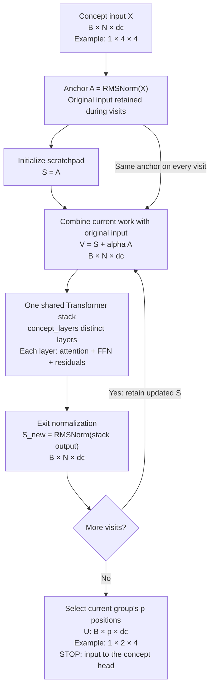
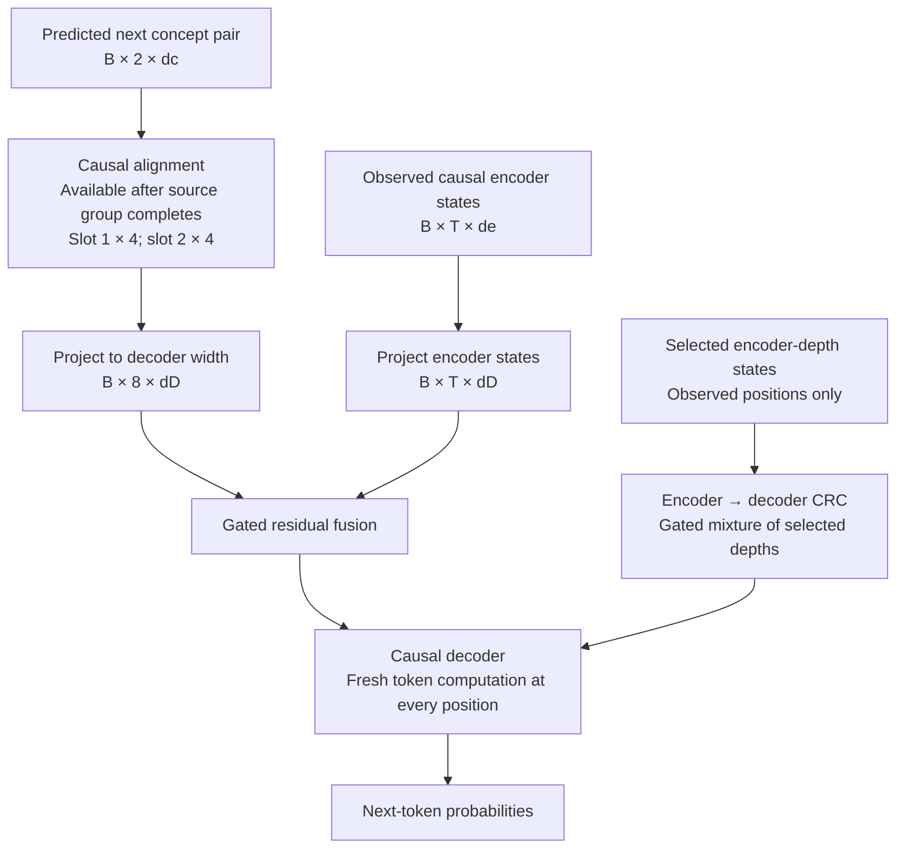

# V10 architecture discussion and review handoff

Prepared and expanded on 2026-10-10 (Asia/Kolkata). Intended reader: GPT Astra, the user's planner/reviewer.

Updated on 2026-10-11 (Asia/Kolkata): Section 15, **Before concept module**, adds the user's complete quoted front-end response verbatim, including its Mermaid diagram, followed by separately labeled review clarifications and a shape checklist.

Further expanded on 2026-10-11 (Asia/Kolkata): Section 16 and Appendices A/C complete the available discussion record through the K=8 code proposal, Explorative Modeling, GradCuit, injection clarifications, pretraining and MCTS. Section 16.1 provides a consolidated index of the inspiring papers and the limits of each connection. The exact Section 15 walkthrough remains unchanged.

Expanded again on 2026-10-11 (Asia/Kolkata): Sections 17-23 record the concept-module discussion, JEPA/CRC reasoning, HRM-Text/diffusion/NCP comparison, anchored recurrent-stack recommendation, the complete beginner walkthrough and the attention-mask explanation explicitly liked by the user. The earlier Section 15 remains unchanged.

Expanded through concept prediction on 2026-10-11 (Asia/Kolkata): Section 24, **Before Concept Shift and repetition**, preserves the user's new complete pasted walkthrough exactly, including all 26 steps and its Mermaid diagram. Separate review notes clarify the head, next-group supervision, shared weights and the stopping boundary.

Expanded through decoder conditioning on 2026-10-11 (Asia/Kolkata): Section 25, **Concept shift, repetition and encoder-to-decoder CRC**, preserves the newly supplied response exactly and adds a separate first-principles review of timing, slot alignment, detail access, CRC, candidate caches and scale.

Expanded through next-token prediction on 2026-10-11 (Asia/Kolkata): Section 26, **Complete proposed V10: tokens to next-token prediction**, preserves the newly supplied full 35-step walkthrough verbatim, including the encoder, pooling, exploration codes/refinement, recurrent concept module, segmented head, alignment, NCP-style decoder, encoder-to-decoder CRC, vocabulary projection and detailed Mermaid diagram. Read Section 26 for the latest complete forward-path explanation; its production settings and unvalidated research choices remain explicitly qualified.

## 0. Read this first

This document records the V10 side conversation from the initial encoder-loop question through concept pooling, encoder residual design, the generalized front end, learned-code conditioning, concept-module history, JEPA and CRC, the three-paper concept-core review, the anchored recurrent-stack recommendation, its complete beginner explanation, the completed-group attention mask, the segmented NCP-style prediction-head proposal and the complete path through the predicted next concept pair and causal decoder conditioning. Its purpose is to preserve the user's proposals, the reasoning behind the recommendations, alternatives, paper inspirations, experimental evidence, dimensions, limitations and unresolved choices.

**Current user-preferred architecture:**

1. **Encoder topology:** earlier encoder stack E1 -> repeated middle encoder stack E2 -> independent final encoder stack E3 -> concept pooling. Generalize depth to `enc_layers`; E1/E2/E3 name stacks, not necessarily single layers.
2. **Pooling:** two-query pooling with an average residual and an output FFN. The detailed example maps eight encoder vectors of width 128 to two concept vectors of width 128.
3. **Middle-stack residual:** two-stream gated read/compute/additive-write adaptation inside the repeated middle layers. Initialize the streams once at E2 entry, retain them across layers and visits, and read them into one representation before the independent E3 stack.
4. **Concept attention-mask explanation:** the user explicitly liked the completed-group permission table: earlier groups cannot read later groups, and both slots of the current completed group may read each other and earlier valid same-document groups. Section 22 preserves the full explanation.
5. **Decoder interface:** the user explicitly liked causal concept shift/repetition plus encoder-to-decoder detail access and a small gated encoder-depth CRC candidate. Section 25 preserves the reply at 8.5/10 overall and distinguishes the fixed four-repeats-per-slot baseline from production settings and unmeasured alternatives.

**Current assistant-recommended concept-core candidate:** one anchored recurrent Transformer stack, with a normalized original-input anchor, an evolving continuous working state, a shared scalar anchor contribution, ordinary internal residuals and normalization at each visit exit. Section 20 preserves the complete recommendation; Section 21 explains it from concept input to the pre-head state. HRM H/L is the principal alternative and an ordinary one-pass Transformer is a control. This is an 8.5/10 research judgment, not a measured V10 result or a finalized head/training/production specification.

**Current concept-head candidate:** NCP-inspired feature-segment prediction heads with separate learned codebooks, segment-wise softmax and differentiable weighted-codeword reconstruction. The user proposed this direction; the assistant recommended it at 8.5/10, with the vocabulary-fitting rule at 8/10 as research judgments. Section 24 preserves the complete walkthrough and separates the proposed two-slot next-group adaptation from published NCP and still-open production/training choices.

**Additional user-proposed research direction:** learn K=8 code choices during pretraining and inject a projected code after pooling, before the shared concept module. Optional local refinement and MCTS are intended later uses of this interface; their benefit and exact implementation remain open. This proposal is recorded alongside the accepted encoder/pooler preferences, with its different evidence status made explicit.

**Scale intent explicitly clarified by the user:** the north star is a roughly **3-trillion-parameter model**, with Kimi K3 as a scale reference. The three-layer, width-128 examples explain the mechanism; they are not the intended production architecture or a commitment to a 2-10M-parameter model. The complete encoder/concept/decoder parameter allocation, dense/MoE choices and activated parameter budget are open.

These are preferred candidates to review and validate, not measured V10 results. The pooling and two-stream residual scores of **8.5/10** were engineering-priority judgments. The residual comparison was initially framed for a compact encoder; those rankings do not establish superiority at 3T scale. No V10 implementation or training run has been performed as part of this discussion.

**For the current encoder specification, read Sections 12-14.** Earlier three-layer diagrams remain as historical explanatory examples. Section 14 gives the generalized diagrams, layer-count formulas, parameter-sharing rules and scale caveats.

**For the complete token-to-concept-module-input explanation, read Section 15: Before concept module.** Section 15.1 is the exact response supplied by the user, including all nineteen steps and the final Mermaid diagram. Sections 15.2-15.3 add review clarifications and a compact dimension checklist. Its historical statement that concept-module internals remain open is followed by the later candidate in Sections 19-21, the head walkthrough in Section 24 and the decoder-interface candidate in Section 25. Production settings, target training and the remaining decoder internals still require design.

**For the learned-code discussion and consolidated paper index, read Section 16.** It connects K=8 to the actual Explorative Modeling and GradCuit mechanisms and preserves the historical Q5 motivation with its caveats.

**For concept-module design, read Sections 17-23.** Section 18 records JEPA/CRC reasoning and critique; Section 19 records the supplied-paper comparison and six variant scores; Section 20 preserves the chosen-core reply in full; Section 21 embeds the entire supplied beginner walkthrough and Mermaid; Section 22 preserves the accepted mask explanation; Section 23 separates current equations, scope, implementation clarifications and remaining review questions.

**For one complete token-to-predicted-concept explanation, read Section 24: Before Concept Shift and repetition.** Section 24.1 is copied exactly from the user's new attachment. Sections 24.2-24.5 add a beginner reading map, shape/parameter checklist, separately labeled review clarifications and provenance. The endpoint is the predicted next pair, before decoder alignment.

**For the next step into the decoder, read Section 25: Concept shift, repetition and encoder-to-decoder CRC.** Section 25.1 preserves the exact new attachment and Mermaid; Sections 25.2-25.6 review one-based/zero-based timing, startup and tails, receptive fields, a numerical example, direct encoder access versus depth CRC, scores, evidence, caches and scale.

### 0.1 Conversation coverage and provenance

- The initial discussion is organized below as encoder first, concept pooling, combined design and review questions. Sections 12-14 preserve the subsequent return to encoder residual design and the generalized architecture.
- Appendix A preserves the available user messages in order. Quotations retain their wording; A17 also describes the attached diagram, and A22 labels its opening/closing excerpts and points to the full embedded response in Section 15.1 rather than duplicating it. The technical sections preserve the available assistant explanations and the earlier discussion's recoverable substance.
- **This is not a complete verbatim chat export.** The earliest encoder assistant replies are available only through retained discussion context and the saved preference. The app's history API does not export turns for this ephemeral side conversation. Their exact wording and original numerical configuration scores could not be recovered and have not been invented.
- The pooling recommendations, five numerical pooling ratings, dimensional walkthrough, subsequent residual ratings and generalized encoder discussion are recoverable and are preserved here. Appendix C records the substance of the recent assistant replies in message order.
- Newly elaborated review considerations are labeled as such. They are not retroactive user decisions.
- Section 15.1 is a verbatim copy of the response explicitly quoted in the user's 2026-10-11 update request. Its supplemental review notes are outside the verbatim markers. This exact excerpt does not change the limitations of the earlier conversation record or claim to export all intervening replies verbatim.
- Section 16 completes the learned-code discussion and paper-inspiration record. Its new review clarifications are labeled as editorial additions. Appendix C4-C8 summarize recoverable substance rather than reconstruct unavailable assistant wording or a missing K=8 numerical rating.
- Sections 17-19 and Appendix C9-C13 organize the subsequent recoverable concept/JEPA/CRC/paper-review discussion without inventing unavailable exact wording. Section 20.1 preserves the available complete core-choice reply; Section 21.1 embeds the user's pasted walkthrough exactly; Section 22.1 preserves the original mask reply in full. The current user explicitly liked that explanation. Supplemental implementation considerations are outside the verbatim markers.
- Appendix A24-A32 extends the user-message sequence through the present documentation request. Long quoted replies are preserved or represented in their dedicated technical sections rather than duplicated inside every appendix entry.
- Section 24.1 preserves the subsequent complete 26-step response exactly from the new user-supplied text attachment, including its Mermaid and inline source citation. Appendix A33-A35 and C18-C20 extend the discussion record through the concept-head review, full walkthrough and present preservation request. Supplementary notes in Section 24.2 onward are outside the verbatim block.
- Section 25.1 preserves the subsequent complete decoder-interface reply exactly from the new attachment. Appendix A36-A37 and C21-C22 extend the discussion record through the explicit preference and preservation request. Its first-principles review additions are outside the verbatim block; earlier preserved text is unchanged.
- Repository measurements and paper claims are distinguished from our architectural inferences. Links identify the evidence so Astra can challenge the interpretation.
- The inherited parent conversation's Q5 status requests, heartbeats, operational recovery instructions and scheduling are outside this V10 architecture discussion. No parent training process, queue, checkpoint, scientific setting or automation was changed for this handoff.
- Read-only source checks supplemented the discussion on 2026-10-10 and 2026-10-11, including the attached papers and the V9 conditioning/training/refinement implementations. Saved experiment reports can describe earlier cutoffs; they are not a live experiment-health report.

### 0.2 Decision register

| Item | Status | What is actually settled |
|---|---|---|
| Earlier stack -> repeated middle stack -> independent exit stack | User-preferred, generalized | E1/E2/E3 are stacks; the former three-layer picture is an example |
| Two-stream gated residual inside the repeated middle stack | User-preferred as part of the accepted generalized diagram | Selective branch reads, additive gated writes, persistent streams across visits |
| Two-query pooling + average residual + output FFN | User-preferred | Preserve this as the primary pooling candidate |
| Roughly 3T total-parameter north star | Explicit user design intent | Track activated parameters and system cost separately; full allocation is open |
| Eight inputs to two concepts | Preferred initial example | Same 4:1 density as V9; validate before scaling window size |
| Width 128, four heads, 32 dimensions/head | Concrete explanatory example | Not a locked production size |
| Output FFN 128 -> 512 -> 128 with GELU | Concrete explanatory example | Fourfold feature expansion; activation and expansion remain reviewable |
| `enc_layers = early_layers + loop_layers + exit_layers` | Generalized topology accepted | Layer counts and partition fractions are configurable |
| Number of encoder visits, size/location of repeated span | Open | Two visits and 16/32/16 at depth 64 are examples, not a universal optimum |
| Initial middle-stream write strengths 0.25 / 0.75 | Proposed engineering example | Not validated or locked; slow/fast are initial biases, not guaranteed roles |
| Gate initialization, norm convention, positional scheme | Open | Mechanisms were illustrated, not fully specified for implementation |
| Code-conditioning interface before the concept module | Proposed; preserved at the user's request | Select e_k, project through W_z, broadcast the same offset to the current group's p slots; keep earlier committed history fixed across current candidates |
| K=8 code choices and optional temporary offset u | Proposed review configuration | Code count is independent of pooling group size; u starts at zero and is local to a problem/boundary, not a global code-table edit |
| Learn useful code alternatives during pretraining | User-proposed hypothesis and recommended investigation | Inspired by Explorative Modeling; objective, stable targets, selector and actual compute budget remain open |
| GradCuit-style refinement and MCTS using pretrained codes | Intended later applications, unvalidated | Local latent optimization, discrete search and model-weight RL are distinct activities; their combination is not proven by the papers |
| Anchored recurrent Transformer concept core | Assistant-recommended initial candidate; user requested a full explanation | Normalized anchor A, evolving S, one shared stack, scalar alpha and visit-exit normalization; Section 24 supplies the head candidate, while production training remains open |
| Completed-group concept attention mask | Explanation explicitly liked by the user | All earlier valid same-document groups plus all slots of the current completed group; no later groups |
| HRM H/L and ordinary one-pass concept Transformer | Principal alternative and baseline | Compare useful outcomes and actual cost; no winner has been measured for V10 |
| Additional encoder-to-concept CRC | Optional, not forced | Investigate complementary source features if needed; rereading A is not NCP depth CRC |
| Encoder-to-decoder detail access | User-requested requirement; combined interface explicitly liked | Direct causal encoder-state route plus a gated selected-depth CRC candidate; preserve identity, order, bindings and prior-evidence access |
| Concept shift and repetition | Combined recommendation explicitly liked by the user | After boundary jg, predicted pair for group j+1 guides the following g token targets; initial 8-to-2 rule repeats each slot four times; Section 25 |
| Additional encoder-to-decoder depth CRC | Preferred candidate to compare, not proven necessary | Distinct from final encoder input; source count, selected depths, gate and placement remain reviewable |
| Segmented soft-codebook concept head | User-proposed direction; assistant-recommended initial candidate | Shared full-state prediction projection, segment softmax and learned codebooks; proposed two-slot next-group interface in Section 24 |
| Target training, production settings and decoder internals | Open beyond the recorded candidates | Code-free observed targets and Section 25 alignment/fusion are current proposals; loss weights, K-candidate objective, anti-collapse evidence, production dimensions and decoder implementation remain open |
| Alpha=0.25, four concept layers, three visits, toy widths | Illustrative only | Keep normalization convention, initialization, bounds, depths and active budgets configurable |
| Additional pooling attention blocks or iterative slot refinement | Deferred candidate | Require evidence beyond the simpler pooler |
| Implement, launch, replace V9, or send to Astra | Not requested here | User requested a file they can give to Astra |

## 1. How the discussion developed

1. The user proposed looping the encoder to create a better representation for the concept module and asked for first-principles reasoning.
2. The user requested evidence from previous experiments and the web.
3. The user asked to compare layer-wise looping, model-wise looping and looping the last N encoder layers, specifically referring to **Loop the Loopies!** They requested scores and additional configurations.
4. The discussion introduced an additional option: repeat a middle/late block, then use a separate final layer. The user explicitly selected this preference and asked that it be remembered.
5. The user then questioned average pooling and proposed attending over groups of 8-16 encoder vectors, applying a 4x-expanded FFN, and reducing the group to multiple concepts. They also considered another self-attention stage before compression.
6. The user argued that CRC or a token-detail route might let the concept module specialize in thinking, reducing the need for lossless token reconstruction.
7. We checked older pooling, recurrence and routing experiments. We distinguished the continuous CRC port from an independent raw-token bypass and identified causality/update-cadence differences.
8. We recommended two-query attention pooling with an average residual and an output FFN, scored it 8.5/10 as a research priority, and compared simpler/heavier alternatives.
9. The user asked for a complete dimensional explanation. We specified the eight-to-two pooler at width 128, including query construction, four heads, average residual, gated correction, output FFN, batch shapes and downstream placement.
10. The user explicitly accepted that pooling candidate and asked it to be remembered in depth.
11. The user requested this comprehensive handoff so Astra would have the discussion, not merely the final architecture names.
12. The user returned to encoder residual design and asked about NCP IRC, DeepSeek mHC, Kimi Attention Residuals, Delta Attention Residuals and Qwen3.8-Next Gated Residual. We inspected earlier code and reports and read the primary paper mechanisms.
13. We distinguished the frozen V9 encoder's ordinary residuals, the original encoder's Qwen-inspired L/G gated streams, older dense IRC, and V7's bounded IRC adaptation. We proposed two-stream gated residuals around the loop, with conditional scores and explicit controls.
14. The user selected the phrase "Two-stream GR adaptation around the loop" and asked for a first-principles explanation. We explained carry/read/write, dimensions, branch evolution, gate granularity, persistent state and the independent exit.
15. The user clarified that V10 targets a roughly 3T-parameter model and asked for `enc_layers`, earlier/middle/final stacks and a generalized diagram. We supplied the topology and per-middle-layer diagrams, parameter-sharing rules, layer-application count and scale limitations.
16. The user explicitly liked the generalized update and requested that this discussion be added to this file for GPT Astra. No message to Astra or implementation was requested.
17. The user supplied Explorative Modeling and GradCuit, proposed learning K=8 useful codes during pretraining, connected them to later RL/refinement/MCTS and asked whether their value might increase at large scale. They explicitly requested simplicity.
18. The user supplied a historical Q5 first-round search/greedy comparison with its different-problems, unequal-compute and unqualified-critic caveats. We preserve it as motivation rather than a controlled search advantage.
19. The user requested a first-principles K=8 architecture diagram, then dimensions for that diagram. The proposed placement was after pooling and before one shared concept module, with fixed earlier history across current candidates.
20. The user asked what conditioning the current concept pair meant, then restated the projected-offset broadcast across the two slots. We clarified that neither code count nor token-group size determines the number of copies.
21. The user requested a paper-grounded injection explanation for pretraining, GradCuit and MCTS. We distinguished globally learned codes, discrete choices and temporary local refinement, including their credit-assignment and history requirements.
22. The user requested the complete token-to-concept-module-input walkthrough with first-principles explanations, dimensions, a dummy example, equations and a final diagram suitable for a twelve-year-old beginner.
23. The user supplied that complete response and requested an exact copy in a separate “Before concept module” section. Section 15.1 preserves it; supplemental review clarifications remain separate.
24. The user requested that the discussions and inspiring papers also be present and reviewed. Section 16 and the extended appendices complete that record without claiming an unavailable full verbatim transcript.
25. The user asked to proceed with the concept module. A shared recurrent Transformer over concept history, ordinary residuals, group-causal attention and a distinct prediction readout were proposed.
26. The user asked whether "Earlier committed concepts" meant encoder-to-concept CRC and reaffirmed the 3T north star. We distinguished logical history from depth routing, quantization, detachment and arbitrary cached activations.
27. The user asked whether additional encoder-to-concept CRC was needed, emphasized decoder access to exact details and introduced V-JEPA/LeCun inspiration. We discussed task-dependent evidence, bindings, target learning and decoder bypass.
28. The user quoted that recommendation and requested a first-principles score. The direction received 8/10 with separate component scores and a critique of missing information, target collapse, oracle selection and scale accounting.
29. The user supplied HRM-Text, Google's timestep-free diffusion-reasoning paper and NCP-ArchPreview, explicitly allowing CRC if useful while rejecting forced complexity. We inspected the papers, compared six variants and revisited isolated versus end-to-end recurrence evidence.
30. The user requested one choice. We recommended the anchored shared recurrent stack at 8.5/10, with H/L as principal alternative and a one-pass control. Section 20.1 preserves the reply.
31. The user requested a beginner explanation starting at concept input and ending before the head, excluding the front-end explanation. Section 21.1 embeds the resulting complete walkthrough and Mermaid exactly from their subsequent pasted attachment.
32. The user asked what M means. We explained the group-causal permission table, additive 0/-infinity scores and fixed permissions versus changing attention weights.
33. The user explicitly liked the mask explanation and requested it and the conversations in separate sections of this file. Sections 17-23 and the extended appendices fulfill that documentation request.
34. The user proposed NCP's segmented concept heads and codebooks, recalled 32 segments with 128 codewords of width 128, and asked for a deep review of Algorithm 1. The assistant recommended the soft-codebook head at 8.5/10 and vocabulary fitting at 8/10, while separating hard assignments, soft predictions, continuous targets and scaling limits.
35. The user requested a complete first-principles walkthrough from tokens through concept prediction, stopping before concept repetition and shifting. The assistant supplied 26 steps, general/tiny dimensions, numerical examples, training paths and a final Mermaid diagram.
36. The user supplied that reply as a text attachment and requested an exact copy in a new section named "Before Concept Shift and repetition", followed by review and separate clarifications for Astra and a beginner. Section 24 fulfills that request.

37. The user proposed concept shift/repetition and encoder-to-decoder CRC, asked for first-principles reasoning and a score, then explicitly liked the complete reply. The assistant recommended the combined interface at 8.5/10, with causal 8-to-2 alignment, direct encoder evidence and a small gated depth-CRC comparison.
38. The user supplied that reply as a text attachment and requested a new section plus step-by-step review. Section 25 preserves it exactly and places further timing, dimension, causal, CRC, cache and scale clarifications outside the verbatim text.

## 2. Encoder looping: first-principles reasoning

### 2.1 What problem the encoder is meant to solve

The encoder converts token-level observations into contextual feature vectors. The concept pooler must then compress those vectors into a shorter sequence that retains facts and relationships needed by the thinker.

An encoder loop is useful if another application of a learned transformation makes task-relevant distinctions more accessible before compression: for example, entity binding, relation direction, numerical updates or resolving a local ambiguity.

This is a hypothesis about representation quality. Repeating a layer does not by itself establish a reasoning algorithm or guarantee that a pooler receives better information.

### 2.2 What recurrence actually means

Let the hidden sequence be H with shape (batch, token_length, width). A recurrent block R has shared parameters across visits:

~~~
H0 = entry_encoder(token_embeddings)
H1 = R(H0)
H2 = R(H1)
...
Hr = R(Hr_minus_1)
H_out = independent_exit(Hr)
~~~

The state evolves. Applying R repeatedly to the same unchanged H0 and retaining the same deterministic output would provide no iterative refinement.

The residual connections inside a Transformer block allow information to carry between visits. Whether the updates improve task performance must still be measured. Large state changes can be unproductive; tiny changes can be sufficient. Hidden-state motion is a diagnostic, not a quality metric.

### 2.3 Four different loop placements

For illustration, E1, E2 and E3 are distinct parameter sets. A repeated name indicates shared weights.

| Configuration | Illustrative execution order | Main hypothesis | Main concern |
|---|---|---|---|
| Layer-wise looping | E1 -> E1 -> E2 -> E2 -> E3 -> E3 | Refine each stage locally before advancing | Every stage, including entry/exit, must tolerate repetition |
| Whole-encoder/model-wise looping | E1 -> E2 -> E3 -> E1 -> E2 -> E3 | Repeat a complete sequence of abstraction stages | Early layers receive already processed states on later visits |
| Last-N-layer looping | E1 -> (E2 -> E3) -> (E2 -> E3) | Concentrate extra work on later representations | If the output layer is repeated too, refinement and interface preparation share a role |
| **Middle/late block + independent final layer** | **E1 -> E2 -> E2 -> E3** | Share the refinement operation and retain a dedicated exit transformation | Needs a matched test against ordinary extra depth |

Here, model-wise means looping the encoder stack in this comparison. It does not mean rerunning tokenization, embedding lookup, pooling, the concept module and the decoder as one whole ECD loop.

A repeated span can contain multiple layers. Repeating a multi-layer span as a unit and repeating each member consecutively are different schedules and should be named explicitly.

The original request asked for numerical scores of the first three configurations. The exact earlier assistant scores are not recoverable in the available history. **Astra should assign fresh ratings rather than treat reconstructed numbers as historical statements.** The user's explicitly accepted preference is the fourth configuration.

### 2.4 Why retain an independent final layer?

The proposed division is:

- Entry layers construct an initial contextual representation.
- The shared middle/late block performs additional refinement.
- The independent final layer prepares the refined state for the concept interface.

A separate exit layer can specialize in producing representations that the pooler can read. It need not also be the repeatedly applied refinement operator. This is an architectural rationale, not a theorem that independent exit layers always win.

The original accepted three-block illustration is below. The later accepted generalization replaces E1/E2/E3 with earlier/middle/final stacks and equips the middle stack with two-stream gated residuals (Sections 13-14):

~~~
Embeddings -> E1 -> E2 -> E2 -> E3 -> concept pooling
~~~

There are three physical encoder blocks and four executed block applications. A suitable untied extra-depth control is:

~~~
Embeddings -> E1 -> E2a -> E2b -> E3 -> concept pooling
~~~

E2a and E2b have independent parameters. This comparison helps separate the effect of additional computation from the effect of sharing the refinement rule.

### 2.5 Dimensions through the encoder example

With batch size 2, token length 64 and width 128:

| Stage | Shape |
|---|---|
| Token IDs | (2, 64) |
| Embeddings | (2, 64, 128) |
| E1 output | (2, 64, 128) |
| E2 visit 1 | (2, 64, 128) |
| E2 visit 2 | (2, 64, 128) |
| Independent E3 output | (2, 64, 128) |

The loop changes effective depth, not sequence length or width. Pooling performs the later sequence-length reduction.

### 2.6 Costs and failure modes

- Weight sharing saves stored parameters relative to adding distinct blocks. Each visit still incurs attention, FFN and training-backward work.
- Encoder loops operate at token length T; the concept module operates at roughly T/4 in the proposed initial design. Moving extra computation to the encoder may be expensive even when its parameter count stays fixed.
- If a task can be solved in one visit, optimization can front-load useful work and leave later visits idle.
- Repeated normalization and similar residual updates can settle into a directionally redundant trajectory. Earlier concept experiments showed useful cautionary examples.
- Reusing a transformation on substantially different feature distributions may impair specialization. The placement and training schedule matter.
- More visits can have diminishing or negative returns. The chosen visit count must earn its latency.
- A looped architecture should be trained or appropriately adapted for its execution pattern; arbitrary repetition of an existing checkpoint is a distinct intervention.
- Causal masks, document isolation and token positions must remain correct through every visit.

**Additional review consideration:** incremental inference needs a deliberate cache scheme. States and K/V tensors can differ by recurrent visit even when weights are shared. Do not assume parameter sharing makes all visits' caches interchangeable.

## 3. Encoder-loop papers discussed

The following are primary research sources. Their settings differ from the historical small ECD experiments and from the proposed full encoder/concept/decoder system. Transfer to V10's roughly 3T north star remains a hypothesis.

### 3.1 Loop the Loopies!

[Loop the Loopies!](https://arxiv.org/html/2607.16051v1) explicitly distinguishes adjacent repetition of each layer from repetition of a complete stack. Its decoder-only MoE experiments favor layer-looping later in training; the reported crossover occurs around 1.2 trillion tokens, while model-looping initially leads. It also discusses execution locality. This supports testing loop ordering, not declaring a universal winner for V10's dense encoder or a short pilot.

The execution-order definitions in Section 2.3 follow this distinction. The independent-exit preference remains a separate placement hypothesis.

### 3.2 SMELT

[SMELT: Scaling Laws for Compute-Matched MoE Looped Transformers](https://arxiv.org/html/2609.01343v1) studies a middle-half, two-visit recipe under matched per-token FLOPs, non-embedding parameters and KV-cache budgets. Its recipe includes width/expert/head adjustments and residual scaling, rather than simply adding another pass to an unchanged model. It motivates testing a repeated middle span and measuring actual cost. Its sparse MoE scaling result establishes neither the optimum for the historical small dense encoder nor the final recipe for a 3T ECD system.

### 3.3 Huginn / recurrent depth

[Scaling up Test-Time Compute with Latent Reasoning: A Recurrent Depth Approach](https://arxiv.org/abs/2502.05171) demonstrates recurrent latent computation in a substantially larger language model. It supports the broader possibility of useful iterative hidden-state computation. Its entry/recurrent/exit organization is relevant to the accepted preference, but success at that scale does not prove that extra V10 encoder visits will improve concepts.

### 3.4 LoopCoder-v2

[LoopCoder-v2: Only Loop Once for Efficient Test-Time Computation Scaling](https://arxiv.org/abs/2606.18023) reports a non-monotonic loop-count effect: two total loops help its parallel-loop coding models, while three or more regress. The analysis includes positional mismatch specific to its execution scheme. The transferable lesson is to measure marginal benefit per visit; two visits is not a universal law.

## 4. Concept pooling: the user's proposal and our reasoning

### 4.1 The original proposal

The user proposed taking 8 or 16 adjacent contextual encoder vectors, applying local self-attention, applying a Transformer-like FFN with fourfold feature expansion and projection back to width d, optionally applying another attention stage, and using a compression FFN to produce fewer concept vectors.

The concrete example was **eight encoder vectors to two concept vectors**. The user asked whether this was sound or overengineered and argued that CRC/detail access could let the concept stream focus on thinking.

The single-block proposal is coherent. Its strongest hypotheses are content-dependent extraction and joint allocation of a larger input window into multiple outputs. The extra precompression Transformer stages are separable hypotheses.

### 4.2 What a useful concept must retain

The accepted reasoning objective is a compact task-sufficient representation, not reconstruction of every token.

For example, these statements require different representations:

- Alice owes Bob five dollars.
- Bob owes Alice five dollars.
- Alice does not owe Bob five dollars.
- Alice owed Bob five dollars and then repaid two.

A representation of only people/money/debt is insufficient. Identities, binding, direction, negation and updates can be essential to thinking. Whether a detail is expendable depends on the downstream task.

### 4.3 Average pooling is simple, but its inputs are already contextual

Current V9 pooling averages groups of four encoder vectors and normalizes the result. It does not average raw word embeddings without prior processing.

The encoder can learn to place relevant contextual information in its output features. Therefore, successful mean-pooling foundations show that averaging is not automatically the dominant bottleneck.

Averages can still blur distinctions or provide poor allocation when multiple facts compete. Learned queries could improve extraction without requiring a second full encoder inside the pooler.

### 4.4 Keep token compression separate from feature expansion

| Operation on one group | Input | Output | What changes |
|---|---|---|---|
| Local self-attention | (8, d) | (8, d) | Information exchange across positions |
| Position-wise 4x FFN | (8, d) | (8, 4d) -> (8, d) | Nonlinear feature transformation at each position |
| Token reduction | (8, d) | (2, d) | Number of output vectors |
| Output FFN after reduction | (2, d) | (2, 4d) -> (2, d) | Features of the two extracted concepts |

An ordinary FFN does not turn eight vectors into two. A compression FFN must explicitly mix or reduce the token axis.

Possible reductions include a flattened projection/MLP, a shared token-axis projection, a strided convolution or query-based cross-attention. They have different parameter and compute costs.

### 4.5 Compression ratios

| Group mapping | Ratio | Interpretation |
|---|---:|---|
| 4 -> 1 | 4:1 | Current V9 concept density |
| **8 -> 2** | **4:1** | Larger joint extraction window, same density |
| 16 -> 4 | 4:1 | Larger joint extraction window again |
| 16 -> 2 | 8:1 | Stronger compression; separate experiment |

The eight-to-two proposal is not inherently more compressed than two four-to-one averages. Its timing differs, as explained below.

### 4.6 Why compression-FFN wording matters

For width d = 128, ignoring biases:

- A flattened linear map 8d -> 2d contains 16d^2 = **262,144 weights**.
- A flattened MLP 8d -> 32d -> 2d contains 320d^2 = **5,242,880 weights**. This is one possible interpretation of expanding the entire flattened group fourfold, not an unavoidable property of the user's idea.
- A standard per-vector FFN d -> 4d -> d contains 8d^2 = **131,072 weights**.
- A token-axis linear map 8 -> 2 shared across channels uses only 16 mixing weights, but its mixing coefficients are static. Preceding contextual processing can still make its overall computation expressive.

A larger compression MLP is a legitimate candidate, but there is no first-principles requirement to use one. Query attention directly produces the desired output count.

### 4.7 Pooling ratings actually given in the discussion

These scores express research priority, not benchmark performance or probabilities of success.

| Candidate | Score | Reason given |
|---|---:|---|
| Current average pooling | 6.5/10 | Cheap, essential baseline; already supports useful concepts |
| User's one self-attention block + 4x FFN + learned eight-to-two reduction | 7.5/10 | Coherent mechanism worth testing |
| Two local attention stages + FFNs + large flattened compression | 6/10 | Several unproven additions and harder attribution |
| Two-query attention pooling + output FFN | 8/10 | Direct content-dependent extraction into multiple outputs |
| **Two-query pooling + average residual + output FFN** | **8.5/10** | Preferred balance of learned extraction, cost and a simple starting path |

The user explicitly chose the final candidate after its dimensional walkthrough.

A small 2x output-FFN expansion was also considered as a budget knob; the concrete explanation used 4x (128 -> 512 -> 128). Neither expansion factor was validated as optimal.

### 4.8 Why the simpler query pooler was preferred

The encoder already performs contextual processing, and the accepted encoder candidate adds refinement before its independent exit layer. The concept module then performs further processing on the compressed sequence.

The simplest new pooler therefore targets extraction: two queries read eight encoder vectors and produce two concept vectors. Its FFN operates after compression. Additional local attention or iterative slot updates remain possible follow-ups if this extraction step is insufficient.

The average residual provides a direct baseline representation and anchors the two slots to different halves. It does not guarantee information preservation or prevent the slots from becoming redundant.

## 5. Preferred pooling design: complete dimensional specification

Confirmed by the user on 2026-10-10 after the detailed dimensional explanation: **two-query pooling with an average residual and an output FFN** is the preferred V10 pooling candidate. Retain the detailed design below when discussing or planning V10.

Status: a user-preferred design candidate for validation. The conversational **8.5/10** score represents engineering priority, not measured performance. These notes do not authorize changing the existing V9 experiment or establish scientifically validated settings.

### Purpose and compression

Jointly extract two concept vectors from eight contextual encoder vectors. At constant feature width, `8 -> 2` retains V9's `4:1` concept density; it changes the extraction window and update cadence. `16 -> 4` would retain that ratio, while `16 -> 2` would be a separate, stronger-compression experiment.

Concepts should retain task-relevant identities, relationships, quantities and reasoning state. They need not reproduce every surface token. Learned slots are not guaranteed to acquire distinct, interpretable meanings.

### Concrete dimensional example

Use feature width `d = 128`, four attention heads of width `32`, and a standard output FFN with `4x` expansion to `512`. These illustrate the preferred mechanism; they remain experimental choices rather than locked production settings.

For one completed eight-token group:

1. Encoder output: `H = [h1, ..., h8]`, shape `(8, 128)`.
2. Average anchors: `m1 = mean(h1, ..., h4)` and `m2 = mean(h5, ..., h8)`. Stack them as `M`, shape `(2, 128)`.
3. Two learned slot embeddings `S`, shape `(2, 128)`, form input-dependent queries: `Q_input = RMSNorm(M) + S`.
4. Attention memory: `X = RMSNorm(H) + P`, with within-group position embeddings `P` of shape `(8, 128)`.
5. Cross-attention projections: `Q = Q_input W_Q` has shape `(2, 128)`; `K = X W_K` and `V = X W_V` each have shape `(8, 128)`. Each projection matrix is `(128, 128)`.
6. Per head, query/key/value shapes are `(2, 32)`, `(8, 32)` and `(8, 32)`. `softmax(Q K^T / sqrt(32))` has shape `(2, 8)`, with softmax over the eight inputs. Each head produces `(2, 32)`.
7. Concatenate four heads and apply `W_O`, shape `(128, 128)`, to produce the attention correction `Delta`, shape `(2, 128)`.
8. Average residual: `Z = M + g * Delta`, shape `(2, 128)`, where `g` is a learned scalar gate. Both queries can read all eight encoder vectors despite their separate average anchors.
9. Output FFN: `F = GELU(RMSNorm(Z) W1 + b1) W2 + b2`. `W1` is `(128, 512)` and `W2` is `(512, 128)`; activation shapes are `(2, 128) -> (2, 512) -> (2, 128)`.
10. Final concepts: `C = RMSNorm(Z + F)`, shape `(2, 128)`.

Cross-attention performs the `8 -> 2` token reduction. The FFN transforms each output vector independently and does not change the number of concepts. Four heads still produce two concept vectors. Applying the FFN after reduction uses one quarter of the FFN position-wise computation compared with applying that same FFN to all eight vectors; this is not a fourfold speedup for the entire pooler.

For batch size `2` and token length `64`, the shape progression is:

```text
Encoder states:        (2, 64, 128)
Eight groups of eight: (2, 8, 8, 128)
Two concepts/group:    (2, 8, 2, 128)
Concept sequence:      (2, 16, 128)
```

The attention projections and FFN together have `196,608` weights in this example, excluding embeddings, biases, gates and normalization parameters.

### Integration and causal availability

```text
Token embeddings
  -> early encoder layers
  -> repeated middle/late encoder block (shared weights across visits)
  -> independent final encoder layer
  -> two-query pooling with average residual + output FFN
  -> concept module / thinker
  -> concept-derived PQ and continuous CRC outputs
  -> decoder, alongside its encoder/token pathway
```

Both concepts from an eight-token group become available only after all eight tokens have been observed. They may help predict token nine onward, never earlier tokens in that group. Concept masks, prediction targets and decoder alignment must reflect this timing; equal concept density does not make the existing four-token shift directly reusable. Preserve slot identity, document boundaries and padding masks.

In the inspected V5/V9 implementations, the continuous CRC port is derived from concept-core output, downstream of pooling. It cannot independently recover information discarded by that path. The decoder's direct encoder-state input is a separate path; details available there are not automatically available to the thinker.

### Validation priorities

First hold the encoder and thinker fixed and compare buffered pairs of four-token averages, a simple learned `8 -> 2` projection, this residual two-query pooler, and one local self-attention/FFN block followed by reduction. Match concept density and availability timing. Compare reasoning accuracy, changed identities/relations/values, contribution of both slots, and measured throughput. Combine the winning pooler with the preferred encoder loop after isolating their contributions.

Start with one query-attention operation and one output FFN. Additional local attention stages, iterative slot refinement or a large flattened compression MLP require evidence from subsequent comparisons.

## 6. CRC, token detail and the role of the thinker

Later discussion: Section 18 expands the user's JEPA inspiration, exact-evidence requirement, optional encoder-to-concept depth mixing and objective critique. Follow tensor dependencies rather than the CRC label.

### 6.1 The user's intended division of labor

The user proposed that the concept module could specialize in thinking while CRC or a token pathway supplies details to the decoder. That is a useful design direction: a compact reasoning state need not reproduce every surface token.

However, reasoning itself can require exact details. The relevant question is which information reaches which computation, not the name of a channel.

### 6.2 What the inspected V5/V9 code actually does

The relevant structure is:

~~~
Encoder H -> pool C -> concept core U -> PQ output
                                  \-> continuous CRC port A

Encoder H -----------------------------> decoder
PQ output + CRC port --causal alignment-> decoder
~~~

The continuous port is computed from the concept-core output, conceptually A = W_A RMS(U). It is downstream of pooling. It can preserve information that a discrete code might discard, but it is not an independent raw-detail route around the pooler.

The decoder separately receives encoder states H. Information available on that decoder pathway is not automatically available to the thinker.

Sources: [V5 model overview](/Users/shubhankankrishna/Desktop/EncoderConceptDecoder/v5_tiny/code/model_v5.py:1), [V9 pooling, port and forward path](/Users/shubhankankrishna/Desktop/EncoderConceptDecoder/v9_tiny/frozen/code/model.py:140).

### 6.3 The CRC label changed across versions

The original encoder specification used CRC for a per-token depth mixture of embedding, local and global representations before pooling and the concept core. That differs from the reduced concept-to-decoder continuous port in V5/V9. Astra should follow actual tensor dependencies for the version being discussed.

Source: [original encoder CRC depth mixture](</Users/shubhankankrishna/Desktop/EncoderConceptDecoder/Encoder Design/HRM_THINKER_ENCODER_v1_SPEC.md:284>).

### 6.4 Consequences for a thinking-focused concept stream

- Preserve the identities, bindings, directions and values required by the thinker.
- Do not infer that concepts can discard all details merely because the decoder has another input.
- If the thinker must recover details later, a separate evidence-retrieval mechanism would be an additional architecture choice. It was discussed as a possible extension, not accepted as part of the initial pooler.
- Direct token access can improve end-to-end accuracy while letting the decoder do more of the task itself.
- Demonstrating that the concept module thinks requires task-relevant interventions and trained controls, not only a large loss increase after an off-distribution null replacement.
- Reconstruction of every input token is not automatically the right auxiliary objective for reasoning concepts.

## 7. Causality, slot order and availability

Later resolution of the concept-mask discussion: the user liked the completed-group permission table preserved in Section 22. Section 23.2 generalizes its same-document and valid-position requirements. Earlier open questions below are retained as discussion history.

### 7.1 Equal density does not mean equal timing

Current four-to-one pooling can provide a new concept after every four observed tokens. Joint eight-to-two pooling provides its pair only after the eighth token:

~~~
Observed tokens:      1 2 3 4 | 5 6 7 8 | 9 ...
Current 4 -> 1:        concept A ready   concept B ready
Joint 8 -> 2:          pair still waiting pair A/B ready
~~~

Both outputs may use all eight encoder vectors. Neither may influence the prediction of a token inside that group before the whole group has been observed. After observing token eight, the pair may help predict token nine onward.

Unmasked attention inside a completed group can be safe if the outputs are released only after the group ends. Causality must be established end to end, not inferred merely because the encoder is causal.

### 7.2 A fair pooling control

Buffer two ordinary four-token averages and release both at the same eight-token boundary as the learned pooler. This separates learned extraction from a change in update cadence.

The original streaming four-to-one system remains useful as a product-level latency baseline. The buffered control answers the narrower pooler question.

Restricting slot one to the first four tokens could preserve earlier availability, but it is a different, asymmetric design from two slots jointly reading all eight. This alternative was not selected.

### 7.3 Interface choices Astra must resolve

- Assign both slots the correct group-end availability. Preserve distinct slot identity without pretending they were observed four tokens apart.
- Specify whether the thinker processes the pair in a fixed causal slot order or permits interaction within a completed pair while staying causal across groups. Both are possible; this choice was not settled.
- Align next-concept targets, teacher outputs, PQ indexing and decoder conditioning with the new pair representation.
- Do not reuse the old four-token shift mechanically.
- Mask padding and document boundaries in averages and attention. Partial final groups require an explicit policy.
- Keep positional information. A set-style attention pooling mechanism does not itself supply language order.
- Eight or sixteen adjacent tokens are computational groups, not guaranteed semantic units. Facts can span groups; the thinker must integrate them.

**Review clarification added for this handoff:** holding the encoder and thinker fixed during a pooler comparison means holding their architecture and training recipe fixed. It does not automatically mean freezing old V9 weights while changing their representation interface. A frozen transplant would test adaptation to interface shift as well as pooler quality and should be identified separately.

## 8. Earlier experiments and what they do or do not establish

These are the architecture-relevant findings behind the discussion, supplemented by source checks for the handoff. They are not a claim that every historical run used the same architecture, task or budget.

### 8.1 Original encoder and decoder component benches

The original encoder's longer synthetic run reached 40.3% answer accuracy. A linear probe recovered fact values from their concepts at 99.9%, fact keys at 76.6%, query keys at 92.7%, and queried values from core output at 42.1%.

This was consistent with a retrieval bottleneck after initial concept formation. The near-perfect value probe concerns one tested attribute; it does not prove lossless representation of all facts.

The decoder bench's harder multi4 task remained near chance after 1,500 steps. Fact keys were 94.5% readable, first value tokens 39.3%, and queried values at core output were near chance. This adds identity/capacity concerns upstream of the decoder. It does not isolate a specific pooling remedy.

The decoder bench also explicitly states that one and eight core passes were equivalent on simple retrieval tasks requiring only one retrieval. Those tasks do not test useful recurrence.

Sources: [encoder probes](</Users/shubhankankrishna/Desktop/EncoderConceptDecoder/Encoder Design/HRM_THINKER_ENCODER_v1_SPEC.md:483>), [decoder results](</Users/shubhankankrishna/Desktop/EncoderConceptDecoder/Decoder Design/RESULTS_DECODER.txt:37>).

### 8.2 Concept-only recurrence versus the end-to-end bottleneck

In the isolated v2 concept bench, the L1S loop learned one-to-three-hop training chains and improved on unseen longer chains with more test-time passes. At the final checkpoint, six-hop accuracy rose to 77.1% with eight passes; the reported best earlier checkpoint was higher. This is a small, synthetic, one-seed result with a structured interface.

The end-to-end token -> encoder -> concept -> decoder bench was different. In its step-9000 analysis, increasing passes from one to sixteen did not materially improve the harder-hop results. State norm grew and per-pass update sizes remained almost constant. A separate concept-level curriculum check did show useful depth behavior.

The lesson is that useful recurrence at a clean concept interface does not automatically survive learned token encoding, pooling and end-to-end objectives. Conversely, a flat end-to-end recurrence curve does not prove that all looping mechanisms are ineffective.

Sources: [concept v2 results](</Users/shubhankankrishna/Desktop/EncoderConceptDecoder/Concept Design/RESULTS_v2.txt>), [end-to-end recurrence analysis](</Users/shubhankankrishna/Desktop/EncoderConceptDecoder/Concept Design/RESULTS_E2E.txt:31>).

The H1/H2 bench also compared latent steering, extra passes and multi-mode latent modeling. Those isolated results are relevant background for the thinker, not direct tests of the V10 encoder or two-query pooler. [H1/H2 results](</Users/shubhankankrishna/Desktop/EncoderConceptDecoder/Concept Design/RESULTS_H1_H2.txt>).

### 8.3 V1/V2 language-model underperformance review

The early V2 review found that V2 learned language more slowly at matched exposure. It did not support the simple claim that repeated passes destroyed prediction: at fixed checkpoints, six passes improved token loss over one on nearly all sampled rows, with small marginal returns from further passes.

Several factors changed together: weaker encoder/decoder capacity, more core applications, auxiliary-gradient conflict, MoE routing asymmetry and detached gradient paths. Encoder/decoder non-embedding capacity fell 52.7%, and average concept-layer applications increased from 2.5 to 40.

This argues for controlled V10 changes and explicit throughput accounting. It does not establish either a benefit or a penalty of the proposed encoder loop.

Source: [V2 underperformance review](/Users/shubhankankrishna/Desktop/EncoderConceptDecoder/v2_underperformance_review_2026-09-28/REPORT.md:5).

### 8.4 V3 design review: state changes are not proof of useful computation

The V3 review separated three recurrence failure signatures: directionally redundant updates, idle later passes and useful iterative work. It discussed relative state-update norms, pass conditioning and objective interactions.

Its central caution remains relevant: an architecture can permit iteration without requiring it to solve the task. Task performance against a trained one-pass control is stronger evidence than changed states or nonzero gradients.

This is design-review evidence, not a new V10 result. [V3 recurrence review](/Users/shubhankankrishna/Desktop/EncoderConceptDecoder/v3_design/REVIEW_v3.md:36).

### 8.5 V4: learned selection worked, end-to-end superiority was unproven

V4 tested attention+FFN, linear/plain-convolution pooling and gated convolution at matched training exposure.

- In a dedicated marked-token selection test, attention placed 0.975 of its best head's weight on the marked token wherever it appeared. Copy error was 0.001, compared with 0.339 for the linear pooler.
- At matched end-to-end language checkpoints, the poolers were effectively tied. At matched attention/linear finals, the loss difference was +0.017 +/- 0.018 nats.
- Retrieval remained near chance. A noted filler-pool design problem limits interpretation of that endpoint.
- Disabling the pooler FFN changed validation NTP by -0.008 +/- 0.003 nats at k4 and -0.002 +/- 0.001 at k6: the FFN was active but did not help at those checkpoints.
- That switch-off is an inference intervention, not a separately trained FFN-free architecture comparison.
- The lower final gated-convolution loss came with more tokens and a different schedule endpoint; it is not a matched-budget win.
- Higher codebook usage under attention is a representation diagnostic, not proof of better reasoning.
- Learned attention could emphasize common/template tokens. The objective must reward retaining task-relevant content.

Sources: [V4 selection test](/Users/shubhankankrishna/Desktop/EncoderConceptDecoder/v4_tiny/REPORT.md:135), [FFN interventions](/Users/shubhankankrishna/Desktop/EncoderConceptDecoder/v4_tiny/REPORT.md:283), [matched comparisons](/Users/shubhankankrishna/Desktop/EncoderConceptDecoder/v4_tiny/REPORT.md:369).

### 8.6 V4.1: encoder loop and decoder bypass both need careful interpretation

V4.1 used attention pooling without a pooler FFN. Its trained encoder-loop control did not meet the registered keep criterion: the reported b2 effect of loop-off was +0.0072 +/- 0.0087 paired item SE, with seed SE 0.0190 across three seeds. No corresponding loop-off text arm was run.

Its direct decoder token-retrieval package improved capability while lowering dependence on example-specific plans. Replacing plans with a training-derived mean cost about 1.61 percentage points of b2, whereas replacing them with the header null cost about 15.83 points. The replacements differed substantially in scale and direction.

Thus, a large null-ablation effect cannot alone prove that the concept pathway performs the reasoning. Nor does this small loop control rule out a different V10 loop placement.

Source: [V4.1 report](/Users/shubhankankrishna/Desktop/EncoderConceptDecoder/v41_tiny/REPORT.md:145).

### 8.7 V5 and V6: useful mean-pooled concepts, but several downstream mechanisms changed

V5's mean-pooled NCP foundation reached 89.3% greedy free-generation success on its GraphNav setting. Its route interventions concentrated on switch information: mean replacement cost about 0.30 nats through CRC versus 0.07 through PQ on the reported color-switch reading.

This supports useful information in the continuous concept-derived port, not the claim that CRC independently bypasses pooling or that PQ codes have established semantics.

V6 is a one-foundation/core-seed development experiment. Its report explicitly limits confidence-bound, depth, scaling and ordinary-Transformer claims. Its repair/search comparisons are not encoder-loop or pooler ablations.

Sources: [V5 foundation and routing](/Users/shubhankankrishna/Desktop/EncoderConceptDecoder/v5_tiny/REPORT.md:22), [V6 limits](/Users/shubhankankrishna/Desktop/EncoderConceptDecoder/v6_tiny/REPORT.md:132).

### 8.8 V7/V8: exposure and endpoint provenance matter

The inspected V7 report lists completed 25M-target foundation arms with zero standard/hard strict success at that report's cutoff. The report itself was generated while the wider queue was running. This is a bounded-exposure observation, not a conclusion that every final V7 result failed.

The initial V8 pilot stopped after a failed engineering gate. A distinct full-exposure V8 pilot continued training and obtained a delayed-NCP sealed standard result of 1646/2048 (80.37%). These are different experiments and should not be merged into a single success/failure label.

In the full-exposure pilot, dense and recurrent refits scored 1654/2048 and 1657/2048 on the listed sealed standard endpoint. A three-item difference is not persuasive evidence of recurrence superiority; both refits were marked not retention-qualified. These were concept-core changes, not the proposed V10 encoder-loop test.

Sources: [V7 report](/Users/shubhankankrishna/Desktop/EncoderConceptDecoder/v7_tiny/REPORT.md:9), [initial V8 pilot](/Users/shubhankankrishna/Desktop/EncoderConceptDecoder/v8_tiny/REPORT.md:3), [full-exposure V8 endpoints](/Users/shubhankankrishna/Desktop/EncoderConceptDecoder/v8_tiny_12h/REPORT.md:52).

### 8.9 V9: use completed evidence without treating it as a V10 test

V9's inspected frozen model uses mean pooling over four vectors and a concept-derived continuous port. Its completed Q1 record includes substantial seed variation: standard success about 19.34% for seed 901 versus 84.23% for seed 902. The teacher record also documents use of the earlier seed-811 teacher after one new seed failed G1.

Q3 contains dense/recurrent concept-core runs and seed-dependent promotion. Both forwarded S3 seeds used the passing dense K8 source in the recorded promotion. Q4 reports that neither decoder-only nor joint candidate replaced S2.

These provenance details caution against calling downstream seeds independent foundations or attributing observed differences to a pooler/encoder change that was never tested. They do not give a verdict on the accepted V10 candidates. Pending V9 stages are not assumed complete.

Sources: [V9 frozen model](/Users/shubhankankrishna/Desktop/EncoderConceptDecoder/v9_tiny/frozen/code/model.py:140), [Q1 result](/Users/shubhankankrishna/Desktop/EncoderConceptDecoder/v9_tiny/runs/Q1_RESULT.json), [Q3 result](/Users/shubhankankrishna/Desktop/EncoderConceptDecoder/v9_tiny/runs/Q3_RESULT.json), [Q4 result](/Users/shubhankankrishna/Desktop/EncoderConceptDecoder/v9_tiny/runs/Q4_RESULT.json).

## 9. Pooling-related research discussed

### 9.1 Set Transformer

[Set Transformer](https://proceedings.mlr.press/v97/lee19d/lee19d.pdf) uses pooling by multihead attention with multiple learned seed queries, producing multiple output vectors. This directly motivates two queries reading eight inputs. Its set invariance is not automatically desirable for language: positional/context information must preserve order-sensitive distinctions. The paper supports the mechanism, not a measured gain for V10.

### 9.2 Perceiver IO

[Perceiver IO](https://arxiv.org/html/2107.14795v3) uses query arrays to specify outputs of different sizes and structures. The number of query positions determines the number of output positions, while its MLP acts independently at each output position. That explains the eight-input/two-query shape mapping and why the output FFN does not perform token compression.

### 9.3 Slot Attention

[Slot Attention](https://arxiv.org/abs/2006.15055) iteratively extracts multiple slots through competitive attention in visual tasks. An iterative two-slot reader was considered as a possible extension. Its visual object-discovery results do not prove language concept specialization, and adding a pooler loop on top of an encoder loop would complicate cost and attribution. It was not chosen as the first V10 pooler.

### 9.4 Perceiver AR

[Perceiver AR](https://arxiv.org/html/2202.07765v1) is relevant to causal attention-based compression. It supports treating masking and input/target alignment as part of the architecture. Our proposed group-end release rule is an ECD design inference, not a directly replicated result from that paper.

## 10. Combined architecture and experimental separation

### 10.1 Preferred candidate in one view

Updated encoder topology: use E1/E2/E3 as stacks, with two-stream gated residuals in repeated E2. The canonical generalized diagrams and dimensions are in Section 14. The width-128 pooling walkthrough below remains explanatory.

The downstream PQ/CRC labels in this historical combined sketch describe earlier interfaces, not a finalized V10 head. Sections 17-23 now document the concept-core candidate, the preferred mask and still-open target/head/decoder decisions.

~~~
Token IDs
  -> embeddings
  -> encoder entry layers
  -> initialize two residual streams once
  -> middle encoder stack, repeated on evolving streams with shared weights across visits
  -> independent gated read into one encoder-width representation
  -> independent final encoder stack
  -> groups of 8 contextual vectors
  -> two average anchors
  -> two input-dependent queries with learned slot embeddings
  -> cross-attention to all 8 vectors
  -> gated attention correction + average residual
  -> output FFN + residual + normalization
  -> 2 concepts per group
  -> concept thinker
  -> concept-derived PQ / continuous CRC readouts
  -> causally aligned decoder conditioning

Encoder/token pathway ---------------------> decoder
~~~

At the explanatory sizes:

~~~
(batch, T, 128)
  -> encoder output:       (batch, T, 128)
  -> grouped memory:       (batch, T/8, 8, 128)
  -> pooled concepts:      (batch, T/8, 2, 128)
  -> flattened concepts:   (batch, T/4, 128)
  -> thinker states:       (batch, T/4, 128)
~~~

Downstream interface details still require design. Equal width and concept count alone do not make the current PQ/CRC/decoder alignment a drop-in implementation.

### 10.2 Separate the two architectural bets

A basic factorial comparison would be:

| Arm | Encoder | Pooler |
|---|---|---|
| A | Unlooped | Buffered averages |
| B | Preferred loop + independent exit | Buffered averages |
| C | Unlooped | Preferred two-query residual pooler |
| D | Preferred loop + independent exit | Preferred two-query residual pooler |

This distinguishes encoder benefit, pooler benefit and their interaction. Add an untied extra-depth encoder control to test whether sharing helps beyond extra computation.

With the later two-stream residual preference, "preferred encoder" is a bundle of loop placement, sharing and residual choices. The factorial table alone cannot attribute gains to any one of those. Use the ordinary-residual versus gated-residual and fixed-gate controls in Section 12.9 to separate them.

A focused pooling comparison should also include:

- Buffered pairs of four-token averages.
- A simple learned eight-to-two projection.
- The preferred two-query residual pooler.
- One local self-attention/FFN block followed by an explicit eight-to-two reduction.

The original heavier two-attention-stage design remains available if the simpler candidates expose a clear limitation.

### 10.3 Fairness and measurements

- Keep concept density, release timing, encoder/core architecture, data, seed pairing and exposure consistent for the intended comparison.
- Report actual wall time, throughput, memory and total executed block applications. Equal parameter count is not equal compute.
- Match training exposure for a representation-quality comparison and separately report performance at a fixed time/compute budget.
- Give simple controls sufficient exposure to learn the task. Early undertraining can overwhelm an architectural difference.
- Define primary endpoints before selecting checkpoints. Distinguish development results, selected best checkpoints and sealed endpoints.
- Where feasible, confirm across independently trained seeds; paired item uncertainty does not replace model-seed variation.
- No 24-hour completion promise or new training schedule was established in this side conversation.

Measurements of interest include reasoning accuracy, relation reversal, changed identities, negation, quantities/updates, rare critical content, text loss, throughput and both slots' contribution.

Probe readability and attention weights are diagnostics. End-to-end task benefit and calibrated interventions are stronger evidence. Do not force orthogonal slots merely to make them different: related facts can require correlated representations.

### 10.4 Implementation questions added for Astra's review

These elaborations were not locked in the conversation:

1. **Gate initialization:** choose a starting gain that permits learning. Simultaneously zeroing a multiplicative gate and the branch's output projection can leave both with zero gradient.
2. **Baseline initialization:** an average residual does not make the complete initialized pooler identical to averaging if its FFN contributes a nonzero correction. Specify initialization before claiming exact equivalence.
3. **Normalization:** define whether RMS normalization has learned gains and which epsilon/convention is used. The explanatory parameter count excluded normalization parameters.
4. **FFN:** the dimensional example used ordinary GELU with two matrices. A SwiGLU substitution changes the parameter-count formula and should be explicit.
5. **Positions:** decide whether existing encoder position information suffices or the added within-group embeddings are retained.
6. **Slots:** test duplicate or unused outputs without assuming fixed entity/relation semantics.
7. **Target learning:** changing the pooler also changes its learned next-concept target distribution. Specify teacher/stop-gradient/forecast conventions rather than attributing every change solely to extraction.
8. **Budget:** establish whether extra refinement belongs before compression or in the thinker by measuring task benefit per cost.

## 11. Questions for Astra

Please review the reasoning and evidence as well as the preferred architecture.

1. Is encoder refinement addressing an observed representation limitation, or is retrieval/core training still the stronger bottleneck?
2. Compare layer-wise, whole-encoder and last-N looping with the accepted middle/late-span plus independent-exit candidate. Give fresh scores with an explicit rubric; do not invent missing historical ratings.
3. Which span and visit count should be tested first at proxy scales and at the 3T north star, and which untied control best isolates weight sharing?
4. Does joint eight-to-two extraction justify its delayed update cadence relative to four-to-one streaming pooling?
5. Are average-conditioned queries plus distinct slot embeddings a better initial design than fixed learned queries in this setting?
6. Is one cross-attention read enough given contextual encoder states and a separate thinker, or is the user's precompression attention block needed?
7. Is the output FFN worthwhile given V4's negative switch-off reading? What trained control would settle it?
8. How should same-group slot order, next-concept targets, PQ and CRC conditioning be specified without future leakage?
9. Can the thinker access all task-critical details? If the decoder's direct token route solves the task, what evidence would still establish useful concept reasoning?
10. Which literature claims transfer from the small dense experiments to the roughly 3T target, and which depend on MoE scale, training budget or a particular loop/cache scheme?
11. What is the smallest decisive experiment matrix that separates encoder, pooling, objective and exposure effects?
12. Identify missing specifications, failure modes, parameter/compute errors and any claim that overstates the older experiments.

13. Compare the accepted two-stream gated residual with correctly implemented Kimi Full/Block AttnRes and mHC at relevant depths. Reassess the earlier compact-model scores for the large-model target.
14. Does the middle-only widened carry followed by collapse before E3 preserve the information the final stack and pooler need? Should the exit retain two streams longer, and what controlled evidence would justify that change?
15. Define read/write initialization, gate rank, separate attention/FFN gates, stream collapse and normalization. Avoid claiming exact baseline equivalence or convergence without a valid argument.
16. Resolve total versus activated parameter budgets across encoder, concept module, decoder and experts. Estimate repeated expert communication, activation memory, residual traffic and per-visit cache requirements.
17. Check the Delta Attention Residuals comparison against Kimi's original source equations and the zero-query/null-source initialization claims before using them as design justification.

18. Compare the anchored recurrent concept stack in Sections 20-21 with a one-pass control and the H/L adaptation in Section 19; separate anchor contribution, exit normalization and useful iteration.
19. Preserve the completed-group mask explanation liked by the user, but specify same-document packing, padding, position information and causal release before implementation.
20. Resolve the concept prediction head, informative targets, token coupling, optional PQ and exact-evidence decoder interface without assuming low latent loss proves reasoning.
21. Specify the learned anchor scalar, norm convention, forward visits, backward horizon and correct per-layer/per-visit caches.

Preserve the user-preferred encoder topology, middle residual candidate and pooler as the starting point, and treat the anchored core as the assistant's current recommendation. Challenge them openly. Preference is not evidence of superiority.

## 12. Return to encoder design: residual mechanisms and evidence

This section records the discussion after the first handoff was written. The user asked whether the earlier encoder used NCP IRC and requested first-principles comparisons of DeepSeek mHC, Kimi Attention Residuals, Delta Attention Residuals and Qwen3.8-Next Gated Residual, including scores and a proposed architecture.

### 12.1 Establish the actual historical wiring before comparing mechanisms

The label "residual" covered different implementations across versions:

| Version/source | Inspected mechanism | What can be concluded |
|---|---|---|
| Frozen V9 encoder | Three blocks with `x = x + attention_output`, then `x = x + FFN_output`; ordinary pre-RMSNorm residuals | Its three-layer encoder does not contain an IRC router |
| Original encoder specification and implementation | Two streams L/G, gated normalized reads and scalar gated additive writes, with explicit read/write masks | Qwen-inspired gated residuals were already part of the earlier design; this was not an exact copy of the later joint-all-branches GR formulation |
| Earlier NCP-style architectures | Dense IRC over earlier residual-updated states | This is a depth-routing mechanism, distinct from a multi-branch gated carry |
| V7 | Bounded IRC correction added on top of a normal block result, with an initially zero correction amplitude | This is an adaptation of routing, not the unrestricted NCP paper mixture |

Sources: [V9 block](/Users/shubhankankrishna/Desktop/EncoderConceptDecoder/v9_tiny/frozen/code/model.py:54), [V9 encoder construction](/Users/shubhankankrishna/Desktop/EncoderConceptDecoder/v9_tiny/frozen/code/model.py:115), [original encoder specification](</Users/shubhankankrishna/Desktop/EncoderConceptDecoder/Encoder Design/HRM_THINKER_ENCODER_v1_SPEC.md:180>), [original gated read/write implementation](</Users/shubhankankrishna/Desktop/EncoderConceptDecoder/Encoder Design/encoder_v1.py:37>), [V7 IRC](/Users/shubhankankrishna/Desktop/EncoderConceptDecoder/v7_tiny/code/model.py:99).

The original encoder's L/G restrictions were architectural information-flow guarantees: local layers read L and wrote L/G; full layers read L/G and wrote G. The new two-branch proposal does not automatically inherit those roles or masks. If Astra retains that earlier locality design, its restrictions need to be specified explicitly.

### 12.2 First principles: carry, read and write are separate choices

For a token representation H, ordinary residual computation is:

~~~
Y = F(Norm(H))
H_next = H + Y
~~~

This provides an identity carry term while allowing an update. Across layers or visits, the stream contains overlapping contributions from the embedding and earlier updates. Addition does not necessarily destroy useful information, but a later operation cannot independently select stored earlier contributions unless the architecture retains access to them.

The three decisions are:

1. **Carry:** which state continues, and with what direct coefficient?
2. **Read:** which features or depth sources enter the next computation?
3. **Write:** how strongly does the computed update change the carried state?

In a shared loop, `H_next = H + F_theta(Norm(H))` may refine useful distinctions or repeatedly amplify a similar update. More norm growth, more hidden-state movement or sharper router weights do not establish better reasoning. The endpoint of interest is useful information reaching the concept interface and improving the intended tasks.

### 12.3 NCP IRC

[NCP-ArchPreview](https://arxiv.org/pdf/2609.10715), Section 2.5.1, mixes candidate states from multiple depths. Its coefficients are unnormalized, permitting signed combinations. It initializes the router to select the latest residual-updated state, recovering the ordinary residual initially. This differs from sigmoid-gated additive writes into persistent parallel branches.

For a looped span, an implementation must define whether its bank contains physical-layer sources or individual executed visits. Those are different mechanisms. An unrestricted mixture also gives optimization more freedom than the conservative branch-carry proposal.

### 12.4 DeepSeek mHC

[mHC: Manifold-Constrained Hyper-Connections](https://arxiv.org/html/2512.24880v2) widens the carried state to `n x d`, reads it into width d and writes the sublayer result back. Schematically:

~~~
R_next = A R + b F(a R)
~~~

The residual mixing matrix A is constrained to be doubly stochastic: nonnegative, with unit row and column sums. This controls amplification from that mixing and preserves the across-stream mean. It does not leave every branch unchanged or guarantee stability of the full nonlinear network.

**Our design inference:** repeated mixing can reduce branch differences as well as exchange information. The constraint is useful, but the extra stream traffic and Sinkhorn machinery require real timing at the intended scale. It was not selected as the first residual candidate.

### 12.5 Kimi Attention Residuals

[Attention Residuals](https://yzhang.site/assets/pubs/techreport/2026/attnres.pdf) uses sources consisting of the embedding and individual sublayer outputs. A learned pseudo-query scores normalized keys and mixes the unnormalized source values:

~~~
V = [embedding, attention_output_1, FFN_output_1, ...]
alpha_i = softmax_i(w^T RMSNorm(V_i))
H_read = sum_i alpha_i V_i
~~~

This attention selects across depth at each token; it is not sequence attention across different tokens. Block AttnRes groups updates to reduce storage and communication.

**Our design inference:** loop visits can be distinct sources even when they share weights. This offers selective access to earlier computations, but changes state construction relative to a unit-coefficient residual carry. It remains a credible comparison, especially when reassessing the design for much deeper models.

### 12.6 Delta Attention Residuals and two corrections to its interpretation

[Delta Attention Residuals](https://arxiv.org/html/2605.18855v1) adds a routed mixture of previous updates to the current residual read:

~~~
H_read = H_carry + sum_i alpha_i Delta_i
~~~

Its additive idea is attractive, but its comparison should be interpreted cautiously: original Kimi Full AttnRes already routes individual sublayer outputs, rather than only completed cumulative states. Thus, "Kimi routes cumulative states; deltas fix it" is not an accurate general distinction.

Also, a zero-initialized query gives uniform attention, not zero output. A zero-valued null source alone does not cancel nonzero sources. For example, averaging updates 1 and 3 gives 2; including a zero source gives 4/3, not zero. An exact baseline-preserving correction needs an additional mechanism, such as a separate amplitude initialized to zero.

**Our design inference:** returning similar updates into a short loop may reinforce an already-present direction. Use a trained comparison and do not treat router sharpness as proof of useful computation. Do not automatically inherit identity-initialization claims from the local paper scratchpad.

### 12.7 Qwen3.8-Next Gated Residual

[On the Design of Qwen3.8-Next Architecture](https://arxiv.org/html/2608.30320v1), Section 2.2, carries four branches, normalizes each separately, predicts channel-level read gates from all branches and writes one computed update with scalar gates per branch:

~~~
X = mean_i(G_i * Norm(R_i))
R_i_next = R_i + s_i F(X)
~~~

It omits a residual branch-mixing matrix. Its ablations support expressive reads; adding the mixing matrix contributes little in their setting. The paper's write uses `2 * sigmoid`, distinct from the proposed V10 adaptation below.

The comparison is not a universal win for GR: its table reports Full AttnRes with GatedNorm below GR in loss in that setting. The original encoder's independently predicted per-stream read gates also differ from this report's joint prediction from all branches.

**Our design inference:** retain separate histories, select features when reading and regulate additive writes. Start with two branches as a candidate, not a claim that four are unnecessary at large scale. Bounded gates do not make a recurrent network automatically convergent.

### 12.8 Scores actually given in the discussion

These were **engineering-priority judgments for a compact, looped encoder**, not accuracy predictions, empirical rankings or ratings validated for the later 3T north star:

| Candidate | Discussion score | Stated rationale |
|---|---:|---|
| Ordinary pre-norm residual | 8/10 | Strong inexpensive control; could be sufficient |
| NCP-style unrestricted IRC | 6.5/10 | Flexible signed mixing; extra freedom without isolated benefit here |
| DeepSeek mHC | 7/10 | Principled constrained mixing; machinery and traffic may be excessive at small depth |
| Kimi Full AttnRes | 8/10 | Credible selective access to individual updates and visits |
| Additive delta routing | 7.5/10 | Preserves a carry; repeated-update reinforcement and comparison caveats |
| Qwen-style four-stream GR | 8/10 | Attractive mechanism; four branches were considered premature for the initial compact example |
| **Two-stream GR adaptation around the loop** | **8.5/10** | Preferred balance of retained state, selective reads and manageable cost |

The subsequent user clarification changes the scale premise. Astra should reconsider these priorities for deep, sparse, distributed models; the small-depth rationale for discounting mHC or four streams cannot simply be carried over.

### 12.9 What the older experiments establish and what they do not

The historical architecture review reports weak effects from Dual-IRC and delta routers in several earlier runs. Some concept routes were bypassed or weakly used, so those runs do not isolate the potential of routing inside an effective recurrent encoder.

Other large "IRC off" losses removed the residual stream itself. They demonstrate dependence on a functioning residual pathway, not the superiority of learned dense routing over ordinary residuals.

Source: [architecture and paper evidence map](</Users/shubhankankrishna/Desktop/EncoderConceptDecoder/Encoder Design/ARCHITECTURES_AND_PAPERS.md:550>).

Acceptance comparisons proposed in the conversation:

1. Same loop with ordinary residuals versus two-stream gated residuals, with entry, exit, pooling, data and training budget aligned.
2. Two streams with fixed read/write coefficients versus learned gates, separating state capacity from routing.
3. Correctly implemented Kimi AttnRes, treating visits as executed computations.
4. Untied extra-depth control to separate sharing from extra work.
5. Held-out task benefit, including identities, values and relation direction; norms and gates remain diagnostics.

Every routing ablation must leave a valid ordinary residual path. These were proposed experiments; no new run was launched.

## 13. Two-stream GR adaptation: complete first-principles explanation

This preserves the explanation requested when the user selected "Two-stream GR adaptation around the loop". It is an adaptation inspired by gated residuals, not a claim to reproduce Qwen's full architecture.

### 13.1 Why retain two representations?

For the example "Alice gave Bob the red key," the encoder must make identities, attributes and directional relations accessible. A single accumulated stream may learn all of these, but earlier and later contributions are superimposed.

With ordinary looping:

~~~
H_visit1 = H_early + Delta_1
H_visit2 = H_early + Delta_1 + Delta_2
~~~

A later operation has the accumulated state, not independent access to every contribution. The two-stream proposal retains two differently updated views without computing a second attention or FFN result.

### 13.2 Initialize once, then evolve

Let `H_early` have shape `(B, T, d_model)`:

~~~
R_0 = H_early
R_1 = H_early
carried_state.shape = (B, T, 2, d_model)
~~~

Both branches initially contain identical information. Copying does not create new information; the extra storage creates room for different histories to develop.

The proposed write is:

~~~
R_i_next = R_i + beta_i * Y
~~~

Here Y is one computed update of shape `(B, T, d_model)`, and each beta is a scalar per token and branch. The example initial strengths were 0.25 and 0.75. One branch initially changes more slowly, the other more quickly. Those are initial biases, not guaranteed memory/reasoning roles.

Ignoring normalization for a one-coordinate illustration:

| Update | Branch initialized with beta = 0.25 | Branch initialized with beta = 0.75 |
|---|---:|---:|
| Initial coordinate | 10 | 10 |
| Add update Y = 4 | 11 | 13 |
| Add next update Y = -2 | 10.5 | 11.5 |

A positive write gate can apply negative corrections because Y can have negative coordinates. These numbers illustrate writes only; a real visit contains attention and FFN writes, and its update depends on the evolving state.

If write strengths stayed constant forever, the streams would just be two mixtures of the original state and total update. They would not preserve a distinct record of every intermediate computation. Data-dependent gates increase flexibility but do not guarantee useful diversity.

### 13.3 Read both branches at channel granularity

For each attention or FFN sublayer:

~~~
N_0 = RMSNorm_0(R_0)
N_1 = RMSNorm_1(R_1)
Z = concat(N_0, N_1)              # (B, T, 2*d_model)
G = sigmoid(W_up SiLU(W_down Z) + b_read)
G_0, G_1 = split(G)              # each (B, T, d_model)
X = 0.5 * (G_0 * N_0 + G_1 * N_1)
~~~

Equations use projections on the final feature axis. In column-vector notation, `W_down` has shape `(r_gate, 2*d_model)` and `W_up` has shape `(2*d_model, r_gate)`.

The rank-16 network in the earlier width-128 explanation was `256 -> 16 -> 256`. In the generalized design, `r_gate` is configurable. A ratio such as `d_model/8` is an example to evaluate, not a locked scaling rule.

Read gates are per token, branch and channel. The model can select features differently across branches. The gate predictor sees both normalized branches, unlike the old independently predicted L/G gates.

Normalization creates a read view; it does **not** overwrite the carried R states. This gated normalized read supplies the sublayer input, so an implementation should not accidentally insert a redundant pre-normalization and claim equivalence to the discussed design.

### 13.4 Compute once and write at branch granularity

~~~
Y = F(X)                         # (B, T, d_model)
beta = sigmoid(W_write Z + b_write)  # (B, T, 2)
R_i_next = R_i + beta_i * Y
~~~

The proposed sigmoid writes lie between zero and one. Qwen's reported `2*sigmoid` writes lie between zero and two. Treat the narrower range and 0.25/0.75 initialization as proposed V10 engineering choices, not paper requirements or established optima.

**Additional initialization elaboration for Astra:** if the write projection starts at zero, biases `logit(0.25) = -ln(3)` and `logit(0.75) = ln(3)` produce the example strengths. This is an implementation option derived from the stated example, not a separately accepted setting. Read-gate bias, output initialization, learned norm gains and epsilon remain open. Do not claim the complete initialized model is identical to an ordinary residual baseline.

Attention and FFN have separate readers and writers. The attention write updates both streams; the FFN reads those updated streams and writes its own result. The old state always has direct coefficient one in each additive write. This is not the interpolation `R_next = (1-beta)*R + beta*candidate`.

### 13.5 State and parameters across visits

- Keep both streams after every middle layer and continue from them at the next layer.
- At the end of the middle span, feed its output streams into the next visit's first middle layer.
- Never reset streams to `H_early` at the start of a later visit.
- Each middle layer owns distinct attention, FFN, read/write and norm parameters.
- Reuse that layer's parameters, including gates and norms, across its visits.
- Gate values and updates can differ across visits because their inputs have changed.
- Retain causal and document-isolation policies through all token-mixing operations.

The proposal supplies an opportunity for useful refinement. It does not establish that the shared block learns an algorithm or that additional visits improve the task.

### 13.6 Exit and limitations

After the loop, an independent gated reader maps the two streams into one representation of shape `(B, T, d_model)`. The independent E3 stack then prepares features for concept pooling. This separates repeated refinement from final interface preparation.

Two carried streams add state capacity and memory traffic. They do not duplicate the full sublayer computation, but gates, normalization and extra state access still cost resources. Branches may become redundant, gates may saturate, and repeated writes may amplify an unhelpful direction. Bounded write gates and normalized reads do not prove convergence of the nonlinear system.

The explanatory slow/fast labels do not enforce the old L/G locality semantics. Nor do two streams guarantee entity/relation separation or preservation of exact details. Keep the ordinary-residual loop as a valid trained control.

## 14. Generalized V10 encoder: accepted topology and scale intent

The user explicitly rejected treating the three-layer/width-128 explanation as the production target. They requested a configurable `enc_layers` architecture and clarified the roughly 3T-parameter north star, referencing Kimi K3. They then explicitly liked the generalized diagram and requested this update for Astra.

### 14.1 E1, E2 and E3 denote stacks

| Name | Role | Parameters and state |
|---|---|---|
| E1 | Earlier encoder stack; construct contextual features | `early_layers` distinct layers; single-stream residual in the illustrated candidate |
| E2 | Middle stack; repeated refinement | `loop_layers` distinct layers; two-stream gated residuals; reuse each layer's parameters across visits |
| E3 | Independent final encoder stack; prepare the pooling representation | `exit_layers` distinct layers; parameters independent of E1/E2 and no repetition in this topology |

The middle stack repeats **as a sequence**, not by applying each individual layer consecutively multiple times before advancing:

~~~
E_early
  -> (M1 -> M2 -> ... -> Mm)     # visit 1
  -> (M1 -> M2 -> ... -> Mm)     # visit 2, same corresponding weights
  -> ...
  -> E_exit
~~~

This is repetition of a selected span. It is neither looping the whole ECD system nor making all middle layers share one parameter set.

### 14.2 Generalized architecture diagram



The diagram focuses on the encoder and agreed pooling interface. It does not remove or finalize the separate encoder-to-decoder route described in Section 6. PQ, CRC, concept-core internals, decoder internals and causal alignment remain design work. E1/E3's ordinary residuals are the illustrated candidate, not a claim that their residual grammar is permanently fixed.

### 14.3 Inside each middle layer



The attention/token-mixing and dense/MoE choices are separate from the two-stream residual topology. The repeated layer computes one attention result and one FFN/MoE result; each is distributed to both branches through its write gates.

### 14.4 Configuration, dimensions and executed depth

| Variable | Meaning | Status |
|---|---|---|
| `enc_layers` | Number of distinct encoder layers | Configurable |
| `early_layers` | Distinct layers in E1 | Configurable |
| `loop_layers` | Distinct layers in E2 | Configurable |
| `exit_layers` | Distinct layers in E3 | Configurable; at least one in the depicted topology |
| `loop_repeats` | Total visits to E2, including the first | Configurable; two is an example |
| `d_model` | Encoder feature width | Configurable; 128 is explanatory |
| `residual_streams` | Number of middle carried branches | Two for the accepted candidate |
| `r_gate` | Bottleneck rank of the joint read-gate network | Open/configurable |
| FFN type and expert configuration | Dense or MoE, expert count, active experts and widths | Open |

Define:

~~~
enc_layers = early_layers + loop_layers + exit_layers

executed_encoder_layer_applications
    = early_layers + loop_repeats * loop_layers + exit_layers
    = enc_layers + (loop_repeats - 1) * loop_layers
~~~

Illustration: `enc_layers=64`, partition `16 earlier + 32 middle + 16 final`, `loop_repeats=2`:

~~~
distinct encoder layers = 64
executed layer applications = 16 + 2*32 + 16 = 96
~~~

The example does not lock a quarter/half/quarter split or production depth. Layer applications are not a FLOPs estimate: token mixers, attention windows, expert activation, reader operations and communication may have different costs. Gate/reader parameters also belong in the full model parameter count.

Parameter sharing saves stored weights relative to an equally deep untied network. Each extra visit still incurs computation and backward work. All visits contribute to the training of the shared parameters; they are not independent models.

General dimensions at the concept handoff, assuming complete groups of eight and the same encoder/pooler width:

~~~
Early encoder output:          (B, T, d_model)
Middle carried state:          (B, T, 2, d_model)
Each middle sublayer input:    (B, T, d_model)
Each middle computed update:   (B, T, d_model)
Read after middle loop:        (B, T, d_model)
Final encoder output:          (B, T, d_model)
Grouped pooling memory:        (B, T/8, 8, d_model)
Two pooled slots per group:    (B, T/8, 2, d_model)
Flattened concept sequence:    (B, T/4, d_model)
~~~

Padding, partial groups and document-boundary masks still require explicit handling. Both jointly extracted concepts retain the same group-end availability rule from Section 7. A different concept width or slot count would be an additional specification, not implied by increasing `enc_layers`.

### 14.5 North star: a roughly 3T system

The user's scale reference is meaningful: the [Kimi K3 technical report](https://arxiv.org/abs/2607.24653) describes 2.8T total parameters and 104B activated parameters. This reference does not establish that our encoder loop or two-stream adaptation is validated at that scale.

For V10, specify both total and activated parameter budgets and allocate them across encoder, concept module, decoder, embeddings and experts. A large total parameter target alone determines neither depth nor executed compute. The original width-128 dimensions and the roughly 2-10M historical/proxy models are examples and evidence sources, not the production goal.

Scale-relevant review considerations recorded or elaborated from the discussion:

- Extra carried-state traffic can matter even when residual gates add few parameters.
- Repeated middle MoE layers still execute expert routing and communication on each visit; shared weights do not remove that work.
- Activation storage and recomputation must account for executed visits and both branches.
- Logical visit states and K/V caches can differ even when the corresponding layer weights are shared.
- The best branch count, gate rank, middle span and visit count remain empirical questions. Two streams are the accepted candidate, not a proved large-scale optimum.
- Compare useful task improvement per additional visit and real end-to-end throughput, not only total parameter count or hidden-state activity.
- Reassess Kimi Full/Block AttnRes and mHC at relevant large-model depths; earlier compact-encoder scores do not settle that comparison.

**Additional terminology clarification for Astra:** Kimi Delta Attention is a token-mixing mechanism; Delta Attention Residuals is the separate depth-routing proposal reviewed in Section 12.6. Similar names should not be treated as evidence that the two designs are the same.

### 14.6 What the latest acceptance does and does not settle

The accepted architectural direction is:

~~~
Earlier feature extraction
  -> persistent two-stream gated refinement in a repeated middle stack
  -> independent read and final preparation stack
  -> two-query pooling with average residual and output FFN
  -> concept module to be designed
~~~

Still open: actual depth, width, partition, loop count, attention pattern, dense/MoE allocation, read/write initialization, norm details, branch-collapse implementation, pooler production dimensions, concept objective, PQ/CRC/decoder interfaces and all measured performance. No V10 code, training job or dispatch to Astra was authorized by this document update.

## 15. Before concept module

Added on 2026-10-11 (Asia/Kolkata) at the user's explicit request. This section preserves the complete quoted front-end explanation, including all equations, examples, tables and the final Mermaid diagram. It stops at the concept-module input.

### 15.1 Exact response, copied verbatim

The text between the following markers is the user's supplied response, without its outer quotation marks. Supplemental review notes follow in Section 15.2; they do not alter the copied text. This is a proposed architecture explanation, not a record of an implemented or validated V10 model.

<!-- BEGIN VERBATIM BEFORE CONCEPT MODULE RESPONSE -->

**Our proposed V10 front end turns tokens into contextual vectors, refines those vectors through a repeated encoder block, compresses them into concepts, and then conditions the current concepts with a learned code.**

We will stop at the **input to the concept module**. Its internal design and everything after it are still open.

I’ll use a tiny imaginary model so the numbers are easy to follow. The same equations work with much larger dimensions.

**1. First, understand what a “dimension” means**

A vector is a list of numbers:

\[
x=[0.2,\;0.7,\;-0.1,\;0.4]
\]

This vector has **four dimensions**, because it contains four numbers.

A matrix is a collection of vectors. For example:

\[
H\in\mathbb{R}^{16\times4}
\]

means:

> Sixteen vectors, with four numbers in each vector.

A batch contains several examples. Therefore:

\[
H\in\mathbb{R}^{B\times T\times d}
\]

means:

> \(B\) examples, each containing \(T\) token vectors, each vector containing \(d\) numbers.

Here are our symbols:

| Symbol | Meaning | Tiny example |
|---|---|---:|
| \(B\) | Examples processed together | 1 |
| \(T\) | Observed token positions | 16 |
| \(V\) | Number of possible token IDs | 32 |
| \(d\) | Encoder and pooler vector width | 4 |
| \(d_c\) | Concept-module vector width | 4 |
| \(h\) | Attention heads | 2 |
| \(d_h=d/h\) | Width per attention head | 2 |
| \(g\) | Tokens in one pooling group | 8 |
| \(p\) | Concept vectors produced per group | 2 |
| \(G=\lfloor T/g\rfloor\) | Completed pooling groups | 2 |
| \(K\) | Learned code choices | 8 |
| \(r_z\) | Code embedding width | 2 |
| \(r_g\) | Bottleneck width inside residual read gates | 2 |
| \(f\) | Pooling FFN expansion factor | 4 |

The tiny widths are only for explanation. In a larger model, \(d\), \(d_c\), depths and expert counts would be chosen separately.

---

**2. Text → token IDs**

Our imaginary input is:

```text
I gave Sam a red book today .
He put it inside his blue bag .
```

For this example, pretend each word and punctuation mark is one token. Real tokenizers can split words into smaller pieces.

A tokenizer converts these tokens into integer IDs:

```text
I    gave Sam a red book today .  He put it inside his blue bag .
1     2    3  4  5   6    7   8   9  10 11   12   13  14   15  8
```

The IDs have shape:

\[
X\in\mathbb{N}^{B\times T}
\]

In our example:

\[
X:\quad1\times16
\]

**A token ID is an address, not a meaning.** ID 5 does not mathematically mean “red”; it tells the model which row of its embedding table to look up.

---

**3. Token IDs → token embeddings**

The model has a learned embedding table:

\[
E_{\text{tok}}\in\mathbb{R}^{V\times d}
\]

Our tiny table has shape:

\[
32\times4
\]

Some imaginary rows might be:

| Token | ID | Embedding |
|---|---:|---|
| I | 1 | \([0.2,\;0.1,\;-0.3,\;0.7]\) |
| gave | 2 | \([0.4,\;-0.2,\;0.8,\;0.1]\) |
| Sam | 3 | \([-0.1,\;0.6,\;0.2,\;0.5]\) |

For each token:

\[
H_{0,b,t}=E_{\text{tok}}[X_{b,t}]
\]

Therefore:

\[
H_0\in\mathbb{R}^{B\times T\times d}
\]

Our example:

\[
1\times16
\quad\longrightarrow\quad
1\times16\times4
\]

We now have a four-number vector for every token.

The coordinates do not have manually assigned meanings such as “person,” “color,” or “action.” Training learns useful combinations.

The encoder also needs information about **position**. Otherwise, distinguishing “Sam gave me” from “I gave Sam” would be difficult. A mechanism such as RoPE can supply position information inside attention; the exact encoder position scheme remains a configuration choice.

---

**4. What an encoder layer does**

An embedding starts as a representation of a token’s identity. The encoder makes it depend on its context.

For example, the representation of “book” should become sensitive to:

```text
Who gave it?
To whom?
What color was it?
What happened before it?
```

A standard Transformer layer has two main operations:

| Operation | Simple interpretation |
|---|---|
| Attention | Read relevant information from other positions |
| FFN | Process the information within each position |

For one attention head:

\[
Q=XW_Q,\qquad K_{\text{attn}}=XW_K,\qquad V_{\text{attn}}=XW_V
\]

The projected vectors have width \(d_h\). Attention computes:

\[
A=
\operatorname{softmax}
\left(
\frac{QK_{\text{attn}}^\top}{\sqrt{d_h}}
+\text{mask}
\right)
\]

\[
O=AV_{\text{attn}}
\]

The attention weights say how strongly each position reads each allowed earlier position.

For the causal encoder candidate, position \(t\) can read positions \(1\) through \(t\), but not future positions. Padding and separate documents must also be masked.

After combining the heads, attention returns:

\[
B\times T\times d
\]

**Attention changes the vectors; it does not change the number of positions.**

A normal residual layer can be written:

\[
H_a=H+\operatorname{Attention}(\operatorname{Norm}(H))
\]

\[
H_{\text{out}}
=
H_a+\operatorname{FFN}(\operatorname{Norm}(H_a))
\]

The additions let the layer keep its previous representation while adding an update.

---

**5. E1: the early encoder stack**

E1 contains \(L_{\text{early}}\) distinct encoder layers.

Its purpose is to build useful contextual features before repeated refinement.

\[
H_{\text{early}}=E_1(H_0)
\]

Both input and output have shape:

\[
B\times T\times d
\]

Our example:

\[
1\times16\times4
\;\longrightarrow\;
1\times16\times4
\]

E1 might learn features useful for tracking who gave what to whom. Those roles are possibilities, not manually imposed assignments.

---

**6. Initialize two residual streams**

Instead of carrying only one representation through the repeated middle stack, we initialize two:

\[
R_0=H_{\text{early}}
\]

\[
R_1=H_{\text{early}}
\]

Each has shape:

\[
R_i\in\mathbb{R}^{B\times T\times d}
\]

Together:

\[
R\in\mathbb{R}^{B\times T\times2\times d}
\]

Our example:

\[
R:\quad1\times16\times2\times4
\]

At initialization, the streams are identical.

**Copying does not create information.** It creates room for two differently updated representations to develop.

Also, these are **two streams for every token position**. They are not the two concept vectors that pooling produces later.

---

**7. Inside E2: read → compute → write**

Every middle layer uses the two-stream gated residual mechanism.

The idea is:

> Read useful features from both streams, compute one update, then write that update into both streams with different strengths.

We do this separately for attention and FFN.

**First, read both streams.**

Normalize them:

\[
N_0=\operatorname{RMSNorm}_0(R_0)
\]

\[
N_1=\operatorname{RMSNorm}_1(R_1)
\]

RMSNorm rescales a vector to help keep its numerical size manageable. It preserves its shape. For one vector:

\[
\operatorname{RMSNorm}(x)
=
\gamma\odot
\frac{x}{\sqrt{\frac1d\sum_{i=1}^{d}x_i^2+\epsilon}}
\]

Here \(\gamma\) contains learned scale values, and \(\epsilon\) is a small constant.

Concatenate the normalized streams along their feature axis:

\[
J=[N_0;N_1]
\]

\[
J:\quad B\times T\times2d
\]

Our example:

\[
J:\quad1\times16\times8
\]

A small gate network produces read gates:

\[
A=
\sigma\left(
\operatorname{SiLU}(JW_{\text{down}})
W_{\text{up}}+b_{\text{read}}
\right)
\]

Using row-vector notation:

\[
W_{\text{down}}\in\mathbb{R}^{2d\times r_g}
\]

\[
W_{\text{up}}\in\mathbb{R}^{r_g\times2d}
\]

Our example is:

```text
8 features → 2 features → 8 gates
```

Split those gates into two sets:

\[
A_0,A_1:\quad B\times T\times d
\]

Then read:

\[
X_{\text{read}}
=
\frac12
\left(
A_0\odot N_0+A_1\odot N_1
\right)
\]

\[
X_{\text{read}}:\quad B\times T\times d
\]

Here:

- \(\sigma\) is sigmoid: its outputs lie between zero and one.
- \(\odot\) means multiply matching coordinates.
- SiLU is a smooth nonlinear activation.
- The gates can select features differently for each token.

**Second, compute one update.**

For the attention sublayer:

\[
Y_{\text{attn}}
=
\operatorname{Attention}(X_{\text{read}})
\]

\[
Y_{\text{attn}}:\quad B\times T\times d
\]

We compute one attention result, not a separate full attention result for each stream.

**Third, write it into both streams.**

Predict two write strengths per token:

\[
\beta
=
\sigma(JW_{\text{write}}+b_{\text{write}})
\]

\[
W_{\text{write}}\in\mathbb{R}^{2d\times2}
\]

\[
\beta:\quad B\times T\times2
\]

Then:

\[
R_0'=R_0+\beta_0Y_{\text{attn}}
\]

\[
R_1'=R_1+\beta_1Y_{\text{attn}}
\]

Each scalar write gate broadcasts across that token’s \(d\) features.

For one coordinate, imagine:

```text
Starting values: R0 = 10, R1 = 10
Computed update: Y = 4
Write strengths: β0 = 0.25, β1 = 0.75
```

Then:

\[
R_0'=10+0.25(4)=11
\]

\[
R_1'=10+0.75(4)=13
\]

The streams now differ because they received different amounts of the update.

The FFN sublayer then performs its own:

```text
Read the updated streams
        ↓
Compute one FFN update
        ↓
Write into both streams
```

Its readers and writers have their own parameters.

The original carried states are preserved through additive writes. Normalizing a read does not overwrite those states.

---

**8. Repeat the middle stack**

E2 contains \(L_{\text{middle}}\) distinct layers:

```text
M1 → M2 → ... → Mm
```

We repeat that entire sequence \(R_{\text{visits}}\) times:

```text
Visit 1: M1 → M2 → ... → Mm
Visit 2: M1 → M2 → ... → Mm
...
```

Each layer has its own weights. On another visit, we reuse that same layer’s weights.

Crucially:

- The two streams continue evolving across visits.
- We do not reset them to the early encoder output.
- Reusing weights does not mean the output stays the same; the input state has changed.

The generalized layer counts are:

\[
\boxed{
\texttt{enc\_layers}
=
L_{\text{early}}+L_{\text{middle}}+L_{\text{exit}}
}
\]

\[
\boxed{
L_{\text{executed}}
=
L_{\text{early}}
+
R_{\text{visits}}L_{\text{middle}}
+
L_{\text{exit}}
}
\]

For a small illustrative partition:

```text
2 early layers + 3 middle layers + 1 exit layer
Middle stack visited twice
```

We have:

\[
\text{Distinct layers}=2+3+1=6
\]

\[
\text{Executed layer applications}=2+2(3)+1=9
\]

The extra visit adds computation without adding another copy of the middle stack’s weights.

---

**9. Merge the streams → independent E3 stack**

After the last middle visit, an independent gated reader combines the two streams:

\[
H_{\text{merged}}
=
\operatorname{Read}_{\text{exit}}(R_0,R_1)
\]

\[
B\times T\times2\times d
\;\longrightarrow\;
B\times T\times d
\]

Our example:

\[
1\times16\times2\times4
\;\longrightarrow\;
1\times16\times4
\]

E3 then processes this merged representation:

\[
H=E_3(H_{\text{merged}})
\]

\[
H:\quad B\times T\times d
\]

E3 has independent weights and is not repeated in this topology.

Its purpose is to prepare the representation for pooling after repeated refinement.

**We have still not compressed the token sequence.** There is still one output vector per token.

---

**10. Split encoder outputs into completed groups**

Now we group adjacent encoder vectors.

For complete groups:

\[
G=\left\lfloor\frac{T}{g}\right\rfloor
\]

\[
H_{\text{grouped}}
\in\mathbb{R}^{B\times G\times g\times d}
\]

Our example:

\[
1\times16\times4
\;\longrightarrow\;
1\times2\times8\times4
\]

The groups are:

```text
Group 1: I gave Sam a red book today .
Group 2: He put it inside his blue bag .
```

If only 19 tokens had been observed, there would be two complete eight-token groups and three remaining tokens. Those three tokens would not yet produce a complete pooled pair under this release rule.

Groups must respect document boundaries.

---

**11. Create two average anchors per group**

Consider one group:

\[
H_j\in\mathbb{R}^{8\times d}
\]

Create two averages:

\[
m_{j,1}=\frac14\sum_{t=1}^{4}h_{j,t}
\]

\[
m_{j,2}=\frac14\sum_{t=5}^{8}h_{j,t}
\]

Stack them:

\[
M_j=
\begin{bmatrix}
m_{j,1}\\m_{j,2}
\end{bmatrix}
\in\mathbb{R}^{2\times d}
\]

For a toy arithmetic example, suppose the eight encoder vectors were:

```text
[1, 0, 0, 0]
[1, 1, 0, 0]
[1, 0, 1, 0]
[1, 1, 1, 0]

[0, 0, 0, 1]
[0, 1, 0, 1]
[0, 0, 1, 1]
[0, 1, 1, 1]
```

Then:

\[
m_1=[1,\;0.5,\;0.5,\;0]
\]

\[
m_2=[0,\;0.5,\;0.5,\;1]
\]

These anchors provide different starting summaries.

For generalized \(g\rightarrow p\) pooling, when \(g\) is divisible by \(p\), each anchor can average one consecutive span of \(g/p\) positions.

For example:

```text
8 → 2:   four positions per anchor
16 → 4:  four positions per anchor
```

This preserves a 4:1 compression ratio.

---

**12. Let the two queries read all eight vectors**

Averages are cheap, but every input receives equal weight. Sometimes one token matters much more than another.

We therefore let each output slot learn what to extract.

Use learned slot embeddings:

\[
S\in\mathbb{R}^{p\times d}
\]

Construct query inputs:

\[
Q_{\text{in}}
=
\operatorname{RMSNorm}(M_j)+S
\]

Construct the attention memory:

\[
X_{\text{memory}}
=
\operatorname{RMSNorm}(H_j)+P
\]

where:

\[
P\in\mathbb{R}^{g\times d}
\]

provides within-group position embeddings.

Project:

\[
Q=Q_{\text{in}}W_Q
\]

\[
K_{\text{attn}}=X_{\text{memory}}W_K
\]

\[
V_{\text{attn}}=X_{\text{memory}}W_V
\]

For one head:

| Tensor | General shape | Tiny example |
|---|---|---|
| Query | \(p\times d_h\) | \(2\times2\) |
| Key | \(g\times d_h\) | \(8\times2\) |
| Value | \(g\times d_h\) | \(8\times2\) |
| Attention weights | \(p\times g\) | \(2\times8\) |
| Head output | \(p\times d_h\) | \(2\times2\) |

Each query can read all eight input vectors:

\[
O_a=
\operatorname{softmax}
\left(
\frac{Q_aK_a^\top}{\sqrt{d_h}}
\right)V_a
\]

Concatenate the heads and apply the output projection:

\[
\Delta_j
=
\operatorname{Concat}(O_1,\ldots,O_h)W_O
\]

\[
\Delta_j\in\mathbb{R}^{p\times d}
\]

Our example:

\[
\Delta_j:\quad2\times4
\]

**Two heads still produce two concept slots.** Heads divide the feature computation; they do not determine the number of output slots.

Both queries can read the entire group, even though their average anchors came from different halves.

---

**13. Add the average residual and output FFN**

Combine the anchors with the learned attention correction:

\[
Z_j=M_j+\alpha\Delta_j
\]

Here \(\alpha\) is a learned scalar gate in our proposed pooler.

Then apply a position-wise FFN:

\[
F_j=
\operatorname{GELU}
\left(
\operatorname{RMSNorm}(Z_j)W_1+b_1
\right)W_2+b_2
\]

Its weight shapes are:

\[
W_1\in\mathbb{R}^{d\times fd}
\]

\[
W_2\in\mathbb{R}^{fd\times d}
\]

With \(f=4\), our tiny example is:

\[
2\times4
\;\longrightarrow\;
2\times16
\;\longrightarrow\;
2\times4
\]

Finish with:

\[
\boxed{
C_j^{\text{pool}}
=
\operatorname{RMSNorm}(Z_j+F_j)
}
\]

\[
C_j^{\text{pool}}\in\mathbb{R}^{p\times d}
\]

The distinction is:

```text
Query attention: 8 positions → 2 positions

Output FFN:      4 features → 16 features → 4 features
                 at each of those 2 positions
```

For all groups:

\[
C^{\text{pool}}
\in\mathbb{R}^{B\times G\times p\times d}
\]

Our example:

\[
C^{\text{pool}}:\quad1\times2\times2\times4
\]

Flattening groups and slots gives:

\[
1\times4\times4
\]

Sixteen token vectors have become four concept vectors.

These concepts are learned numerical summaries. We cannot assume one slot becomes “objects” and the other “relationships,” or that compression preserves every detail.

---

**14. Optional width bridge**

The encoder and concept module do not have to use the same width.

If:

\[
d_c\ne d
\]

we can project:

\[
C_j=C_j^{\text{pool}}W_{\text{bridge}}
\]

\[
W_{\text{bridge}}\in\mathbb{R}^{d\times d_c}
\]

Thus:

\[
p\times d
\;\longrightarrow\;
p\times d_c
\]

If \(d_c=d\), the bridge can simply be omitted.

Our example keeps both widths at four:

\[
C:\quad1\times2\times2\times4
\]

This bridge is a configurable interface, not an additional required component.

---

**15. Choose a learned code**

The code table is separate from the token embedding table:

\[
E_{\text{code}}\in\mathbb{R}^{K\times r_z}
\]

Our example:

\[
E_{\text{code}}:\quad8\times2
\]

Each row is a small learned vector:

\[
e_k\in\mathbb{R}^{r_z}
\]

For instance, an imaginary code might be:

\[
e_3=[1,\;-1]
\]

The code does not come with a predefined interpretation. Training must make different codes useful.

Also, **eight code choices and eight tokens per pooling group are unrelated counts**. We could change one without changing the other.

---

**16. Project the code and inject it into the current pair**

Project the code into concept width:

\[
\delta_k=e_kW_z
\]

\[
W_z\in\mathbb{R}^{r_z\times d_c}
\]

Our example:

\[
(1\times2)(2\times4)
=
1\times4
\]

Suppose:

\[
W_z=
\begin{bmatrix}
1&0&0&0\\
0&0&1&0
\end{bmatrix}
\]

Then:

\[
[1,-1]W_z=[1,0,-1,0]
\]

Now suppose the current pooled concept pair is:

\[
C_j=
\begin{bmatrix}
2&4&1&3\\
5&1&2&0
\end{bmatrix}
\]

These are illustrative values for the addition operation.

Broadcast the same offset across both slots:

\[
\widetilde C_j^{(k)}
=
\begin{bmatrix}
c_{j,1}+\delta_k\\
c_{j,2}+\delta_k
\end{bmatrix}
\]

So:

\[
\widetilde C_j^{(k)}
=
\begin{bmatrix}
3&4&0&3\\
6&1&1&0
\end{bmatrix}
\]

We still have two vectors of width four.

The generalized equation is:

\[
\boxed{
\widetilde C_j^{(k)}
=
C_j+\mathbf1_p\delta_k
}
\]

where \(\mathbf1_p\) is a column of \(p\) ones. It applies the same offset to every slot in that group.

For optional GradCuit-style refinement:

\[
\delta_{j,k}=(e_k+u_{j,k})W_z
\]

Here \(u_{j,k}\) is a temporary adjustment for this problem. It starts at zero. It does not replace or overwrite the globally learned code.

---

**17. Hand the conditioned pair to the concept module**

At the boundary after token 16:

```text
Earlier group: tokens 1–8
Current group: tokens 9–16
```

The current group contributes two conditioned concept vectors. The earlier group contributes its two history positions.

For one selected code:

\[
I^{(k)}
=
\operatorname{Concat}_{\text{sequence}}
\left(
\mathcal H_{<G},
\widetilde C_G^{(k)}
\right)
\]

The earlier history includes any conditioning already committed at previous boundaries. It is identical across candidates at the current decision.

General input shape:

\[
I^{(k)}:\quad B\times(Gp)\times d_c
\]

Our example:

\[
I^{(k)}:\quad1\times4\times4
\]

If exploring all eight codes, the current candidate pairs have shape:

\[
B\times K\times p\times d_c
\]

Our example:

\[
1\times8\times2\times4
\]

Including the shared earlier history gives logical candidate sequences:

\[
B\times K\times(Gp)\times d_c
\]

Our example:

\[
1\times8\times4\times4
\]

They can be batched as:

\[
(BK)\times(Gp)\times d_c
=
8\times4\times4
\]

**The candidates are separate batch entries. They do not attend to each other.**

This is where we stop. We have specified the concept module’s input, not its internal architecture.

---

**18. Timing and the three different “multiple representations”**

Both concepts from tokens 1–8 become available **after token 8**. They can help predict token 9 onward.

Likewise, the pair from tokens 9–16 becomes available after token 16 and can help predict token 17 onward.

The pooler may read all eight vectors within a completed group because its output is released after that group ends. It cannot be used to predict earlier tokens inside that same group.

Keep these three quantities separate:

| Quantity | Where it exists | Purpose |
|---|---|---|
| Two residual streams | Inside the middle encoder | Carry differently updated representations per token |
| Two concept slots | After pooling each eight-token group | Represent the compressed group |
| Eight code choices | Before the concept module | Offer alternative conditioning inputs |

The residual streams merge **before** pooling. There is no rule mapping stream 0 to concept slot 0.

At large scale, the same topology remains configurable: encoder depth, repeated span, visits, widths and dense/MoE choices determine its capacity and cost. The tiny example does not limit the architecture to a small parameter count.

**19. Final architecture diagram**

Each box below shows the **general shape**, followed by our **tiny example**.

```mermaid
flowchart TD
    TEXT["Text<br/>I gave Sam a red book today .<br/>He put it inside his blue bag ."]

    IDS["Tokenizer → token IDs<br/>General: B × T<br/>Example: 1 × 16"]

    EMB["Token embedding lookup<br/>Table: V × d = 32 × 4<br/>Output: B × T × d = 1 × 16 × 4"]

    EARLY["E1: Early encoder stack<br/>L_early distinct layers<br/>Example: 2 layers<br/>Output: B × T × d = 1 × 16 × 4"]

    INIT["Initialize streams once<br/>R0 = H_early; R1 = H_early<br/>Together: B × T × 2 × d<br/>Example: 1 × 16 × 2 × 4"]

    subgraph MID["E2: Repeat the middle stack — example: 3 layers, 2 visits"]
        READ_A["Attention reader<br/>Normalize streams → concatenate → channel gates<br/>B × T × 2d → B × T × d<br/>Example: 1 × 16 × 8 → 1 × 16 × 4"]

        ATT["One causal attention computation<br/>Update Y_attn: B × T × d<br/>Example: 1 × 16 × 4"]

        WRITE_A["Attention writer<br/>Ri ← Ri + beta_i × Y_attn<br/>Keep both residual streams"]

        READ_F["Separate FFN reader<br/>Read the updated streams<br/>Output: B × T × d"]

        FFN["One FFN or MoE computation<br/>Update Y_ffn: B × T × d"]

        WRITE_F["Separate FFN writer<br/>Ri ← Ri + beta_i × Y_ffn<br/>Output: B × T × 2 × d"]

        READ_A --> ATT --> WRITE_A --> READ_F --> FFN --> WRITE_F
    end

    MORE{"More middle layers<br/>or another visit?"}

    MERGE["Independent exit reader<br/>Merge two streams into one<br/>B × T × 2 × d → B × T × d<br/>Example: 1 × 16 × 2 × 4 → 1 × 16 × 4"]

    EXIT["E3: Independent final encoder stack<br/>L_exit distinct layers; example: 1 layer<br/>Output H: B × T × d = 1 × 16 × 4"]

    GROUP["Form completed groups<br/>G = floor(T / g)<br/>B × G × g × d<br/>Example: 1 × 2 × 8 × 4"]

    ANCHOR["Average anchors<br/>Average each consecutive span of g/p positions<br/>M: B × G × p × d<br/>Example: 1 × 2 × 2 × 4"]

    QUERY["Query inputs<br/>RMSNorm(M) + learned slot embeddings<br/>B × G × p × d"]

    MEMORY["Attention memory<br/>RMSNorm(group vectors) + within-group positions<br/>B × G × g × d"]

    POOLATT["Query attention<br/>Each head: p queries read g keys/values<br/>Attention weights: p × g = 2 × 8<br/>Correction Delta: B × G × p × d"]

    RES["Average residual<br/>Z = M + alpha × Delta<br/>Example: 1 × 2 × 2 × 4"]

    POOLFFN["Output FFN + residual + RMSNorm<br/>Per slot: d → 4d → d<br/>Example: 4 → 16 → 4<br/>Pooled concepts: B × G × p × d"]

    BRIDGE["Optional width projection: d → dc<br/>Omit when d = dc<br/>Concepts C: B × G × p × dc<br/>Example: 1 × 2 × 2 × 4"]

    HISTORY["Earlier committed concept history<br/>B × ((G-1)p) × dc<br/>Example: 1 × 2 × 4<br/>Same history for current candidates"]

    CURRENT["Current concept group<br/>B × p × dc<br/>Example: 1 × 2 × 4"]

    CODES["Learned code table<br/>E_code: K × rz<br/>Example: 8 × 2"]

    TEMP["Optional local adjustment u<br/>rz dimensions; initially zero<br/>Example: 2 dimensions"]

    PROJ["Shared code projection<br/>delta = (ek + u) Wz<br/>Wz: rz × dc = 2 × 4<br/>One offset: dc = 4 dimensions"]

    INJECT["Broadcast offset to current slots<br/>C_tilde_j = Cj + ones_p × delta<br/>One candidate: B × p × dc<br/>Example: 1 × 2 × 4"]

    HANDOFF["INPUT TO THE CONCEPT MODULE<br/>Earlier history + conditioned current group<br/>One code: B × Gp × dc = 1 × 4 × 4<br/>All K codes: BK × Gp × dc = 8 × 4 × 4<br/>Concept-module internals remain open"]

    TEXT --> IDS --> EMB --> EARLY --> INIT --> READ_A
    INIT -->|"Identity carry"| WRITE_A
    WRITE_F --> MORE
    MORE -->|"Yes: retain streams; reuse layer weights on later visits"| READ_A
    MORE -->|"No"| MERGE
    MERGE --> EXIT --> GROUP

    GROUP --> ANCHOR --> QUERY
    GROUP --> MEMORY
    QUERY --> POOLATT
    MEMORY --> POOLATT
    ANCHOR --> RES
    POOLATT --> RES --> POOLFFN --> BRIDGE

    BRIDGE --> HISTORY
    BRIDGE --> CURRENT

    CODES --> PROJ
    TEMP --> PROJ
    CURRENT --> INJECT
    PROJ --> INJECT

    HISTORY --> HANDOFF
    INJECT --> HANDOFF
```



<!-- END VERBATIM BEFORE CONCEPT MODULE RESPONSE -->

### 15.2 Review clarifications for Astra and first-time readers

These are additional explanations and implementation questions added during the requested review. They are not edits to the verbatim response, new measured results, or authorization to implement or change V9.

**A. Read the toy model as a shape example.** The width-four encoder values, the coordinate-10 residual example, the eight pooling input vectors and the later code-addition matrix illustrate separate operations. They are not outputs from one numerically executed network. No actual weights have been supplied to calculate an end-to-end forward pass. The sixteen token IDs are a pretend word-level tokenizer; the embedding vocabulary can contain unused rows. Production tokenization, width, layer allocation, expert configuration, precision and parameter budget remain open. The roughly 3T total-parameter north star in Section 14.5 still applies.

**B. Use consistent notation when implementing.** In step 2, X means integer token IDs. In step 4's generic attention formula, X means a floating-point hidden representation. Rename them token_ids and hidden_states in code. The equations use row vectors: full pooler projections W_Q, W_K, W_V and W_O each have shape (d, d), while one head's projected outputs have width d_h = d/h. In a framework storing linear weights as (out_features, in_features), the stored W_z shape is (d_c, r_z), the transpose of the mathematical row-vector convention (r_z, d_c). These conventions describe the same map.

**C. Make broadcasting explicit.** For one group, C_j is (p, d_c), delta is (1, d_c), and ones_p is (p, 1). The product ones_p @ delta is (p, d_c). For a batch and K candidates, a shape-safe expression is:
```text
C_current:              (B, p, d_c)
code_offsets:          (K, d_c)                  # when u = 0
candidate_pairs =
    C_current[:, None, :, :]
    + code_offsets[None, :, None, :]

candidate_pairs:       (B, K, p, d_c)
```
If local offsets depend on the problem and candidate, projected offsets have shape (B, K, d_c) and broadcast as offsets[:, :, None, :]. This shares one code across the group's slots. It does not learn a second independent offset for slot 2, compress positions, multiply d_c by K, or let candidates attend to each other.

**D. The full diagram abbreviates the carry wiring.** Its arrow from INIT to WRITE_A illustrates the first identity carry; every attention writer must instead receive its own incoming streams, and every FFN writer must receive the streams updated by its attention writer. The identity coefficient in each additive write is one. Do not bypass the attention update when carrying into the FFN writer. The diagram below expands one middle layer without changing the original proposal:



**E. Track middle-layer index separately from visit index.** With three middle layers and two visits, execute M1 -> M2 -> M3 -> M1 -> M2 -> M3, retaining the streams throughout. M1, M2 and M3 have distinct parameters, including their gates and norms. A layer reuses its own parameters on the later visit. The quoted controller labeled "More middle layers or another visit?" abbreviates these two counters. Reusing weights does not imply reuse of the same activation or cache at different logical visits. The executed-layer count excludes embedding lookup, gated collapse, pooling and the code projection; it is not a complete FLOPs count.

**F. Group only completed tokens, within each document.** If T is not a multiple of g, select the first G*g eligible encoder positions before reshaping; the unfinished suffix remains outside the completed-group pooler. Do not reshape nineteen vectors into two groups of eight. In packed data, group starts and completeness are defined per document rather than by blindly grouping the global token axis. Padding and document boundaries require explicit masks. Handling a final short document group, startup before the first complete group, and sequences with different completed-group counts are still design decisions. The quoted B × G × ... shapes assume one valid common completed-group count or a correctly masked padded representation.

**G. Preserve the release time of each pair.** Both slots jointly extracted from a group ending at token t are released after token t and can condition token t+1 onward. Separate average anchors do not make slot 1 available after the first half of the group. An unmasked local pooler may read all g already completed token vectors, but future groups must remain inaccessible. The concept module's within-pair versus slot-causal mask is still open; a same-group interaction can be causal with respect to tokens if the entire group has already completed. Changes to g or p require target and downstream alignment review, even if g/p stays four.

**H. The handoff is a logical sequence, not a finalized cache layout.** H_history denotes earlier committed concept input information at this discussion's abstraction level. It does not authorize concatenating an arbitrary layer's output or per-layer K/V tensor directly with raw pooled inputs. The future concept-module design must specify whether history is represented by restored conditioned inputs, persistent hidden states, per-layer K/V caches, or another compatible state. Recomputing a prefix must restore its prior committed code choices and local offsets. Apply the new candidate's offset only to the current group, not retroactively to every earlier group. Once different candidates generate different continuations, their subsequent histories diverge.

**I. Distinguish the proposal from existing V9.** The inspected V9 mechanism injects codes near the final concept-core block, while this V10 proposal injects at the concept-module entrance. Earlier injection can influence more computation and can require more candidate work. Small code-table parameter cost does not make eight concept-core evaluations free. Encoder and pooler outputs can be shared for the same fixed prefix; cache sharing downstream needs a causally correct implementation. No V10 injection-location advantage has been measured here.

**J. Keep the paper inspirations and local refinement separate from proven results.** Explorative Modeling supplies the best-matching latent-conditioned pretraining idea; its learned-embedding language experiments use masked diffusion models, not this group-based ECD architecture. GradCuit optimizes inserted intermediate latent prefix states with frozen model weights. Our (e_k + u)W_z interface is a smaller, restricted adaptation, not an exact reproduction. Optimizing u in r_z dimensions restricts its projected movement to the span of W_z, of rank at most min(r_z, d_c). A frozen-weight backward pass must still preserve gradients to u: freezing parameters is different from disabling autograd through every downstream operation. Hard quantization, detached plans or detached caches can interrupt that path. To learn from a longer continuation, the conditioned history must remain connected to later token probabilities; retaining it only for one group restricts its direct credit-assignment scope.

Source papers discussed in the conversation: [Explorative Modeling, v1](https://arxiv.org/html/2607.27372v1), [GradCuit, v1](https://arxiv.org/html/2608.02585v1). Local attachments: [Explorative Modeling.pdf](</Users/shubhankankrishna/Desktop/EncoderConceptDecoder/Loop Papers/Explorative Modeling.pdf>), [GradCuit.pdf](</Users/shubhankankrishna/Desktop/EncoderConceptDecoder/Loop Papers/GradCuit.pdf>). Code evidence: [V9 conditioning](</Users/shubhankankrishna/Desktop/EncoderConceptDecoder/v9_tiny/code/hncp.py:35>), [V9 temporary code refinement](</Users/shubhankankrishna/Desktop/EncoderConceptDecoder/v9_tiny/code/kernels.py:1>), [V9 code search and committed records](</Users/shubhankankrishna/Desktop/EncoderConceptDecoder/v9_tiny/code/csearch.py:1>).

**K. The counts and roles are independent.** Residual streams create parallel storage per encoder token; attention heads split feature processing; concept slots determine output positions per group; exploration codes supply conditioning choices. Equal numbers in the toy configuration do not equate these roles. Two concept slots are not two independent models. Eight learned codes do not guarantee eight distinct semantic modes or eight useful actions. Two residual streams and different average anchors do not guarantee diversity or lossless information retention.

**L. What Astra should specify next.** Keep this front end as the review candidate while resolving the concept-module architecture and its causal history interface. The remaining review includes selector input and training, stable concept targets, concept-to-token credit assignment, optional local-refinement lifetime and bounds, PQ/CRC/decoder interfaces, partial-group handling, initialization and actual production dimensions. The code table and W_z are proposed trainable parameters during pretraining; local u is a temporary inference variable, not a global replacement for e_k. Discrete code search can start with u=0. Refining every MCTS branch or injecting additional codes into every encoder layer was not selected here. Any claimed gain must compare useful outcomes and measured cost against suitable controls.

### 15.3 Compact shape checklist

This table is a review aid, separate from the verbatim response. It assumes g divides T in the example and a common valid completed-group count across the batch.

| Boundary | General shape | Tiny example |
|---|---|---|
| Token IDs | (B, T) | (1, 16) |
| Token embedding table | (V, d) | (32, 4) |
| Embedded, early and final encoder sequence | (B, T, d) | (1, 16, 4) |
| Middle carried state | (B, T, 2, d) | (1, 16, 2, 4) |
| Joint reader input | (B, T, 2d) | (1, 16, 8) |
| Reader bottleneck | (B, T, r_g) | (1, 16, 2) |
| Channel read gates | (B, T, 2d), split into two (B, T, d) views | (1, 16, 8), split into two (1, 16, 4) views |
| Computed attention/FFN update | (B, T, d) | (1, 16, 4) |
| Scalar write gates | (B, T, 2) | (1, 16, 2) |
| Completed token groups | (B, G, g, d) | (1, 2, 8, 4) |
| Anchors and pooled slots | (B, G, p, d) | (1, 2, 2, 4) |
| Pool attention weights, all groups and heads | (B, G, h, p, g) | (1, 2, 2, 2, 8) |
| Pool FFN expanded activations | (B, G, p, fd) | (1, 2, 2, 16) |
| Optional width bridge output | (B, G, p, d_c) | (1, 2, 2, 4) |
| Code table | (K, r_z) | (8, 2) |
| Row-vector projection W_z | (r_z, d_c) | (2, 4) |
| All projected learned offsets with u=0 | (K, d_c) | (8, 4) |
| Current conditioned pair, one selected code per example | (B, p, d_c) | (1, 2, 4) |
| Current pairs for all K candidates | (B, K, p, d_c) | (1, 8, 2, 4) |
| Logical full prefix, one candidate | (B, Gp, d_c) | (1, 4, 4) |
| Logical full prefixes, K candidates folded into batch | (BK, Gp, d_c) | (8, 4, 4) |

This section records explanation and review material only. It does not implement the V10 front end, finalize the concept module, launch experiments, alter the parent V9 run, or send a review to another thread.


## 16. Discussion record and paper inspirations: learned codes before the concept module

This section completes the discussion record after the generalized encoder was accepted. It preserves the user's motivation for K=8, the questions about code injection, and the proposed connection between pretraining, local latent refinement and tree search. Section 15 remains the exact dimensional walkthrough; the explanations here supplement it. The paper-to-design distinctions and review questions below are editorial clarifications, not additional user decisions or new experiment results.

### 16.1 Paper index: what inspired which part of V10

The references below collect the papers discussed across this document. A paper can motivate a mechanism without validating our combination of mechanisms. “Alternative” means it was considered, not added to the preferred architecture.

| Paper and primary reference | Role in the discussion | What transfers to this proposal, and its limit |
|---|---|---|
| [Loop the Loopies!](https://arxiv.org/html/2607.16051v1) | Encoder execution order; Section 3.1 | Compare adjacent layer repetition with repetition of a stack. Its reported ordering result does not establish the best V10 encoder schedule. |
| [SMELT: Scaling Laws for Compute-Matched MoE Looped Transformers](https://arxiv.org/html/2609.01343v1) | Repeated middle span and compute controls; Section 3.2 | Motivates testing a middle span under explicit resource matching. Its complete scaling recipe is more than adding a second visit to an unchanged encoder. |
| [Scaling up Test-Time Compute with Latent Reasoning: A Recurrent Depth Approach](https://arxiv.org/abs/2502.05171) | Entry, recurrent computation and exit; Section 3.3 | Supports investigating recurrent hidden-state computation. It does not measure this encoder-plus-pooler interface. |
| [LoopCoder-v2: Only Loop Once for Efficient Test-Time Computation Scaling](https://arxiv.org/abs/2606.18023) | Marginal value of another visit; Section 3.4 | A caution that extra visits can regress. Its optimum is not a prescribed V10 loop count. |
| [NCP-ArchPreview](https://arxiv.org/pdf/2609.10715) | IRC/CRC, concept prediction and historical architecture context; Sections 12.3 and 19.5 | The selected encoder GR and anchored thinker are different mechanisms. The complete CRC ablation does not isolate encoder-to-concept necessity. |
| [mHC: Manifold-Constrained Hyper-Connections](https://arxiv.org/html/2512.24880v2) | Alternative residual-stream mechanism; Section 12.4 | Motivates separating carry, read and write and examining stability. V10 does not currently adopt its constrained mixing machinery. |
| [Attention Residuals](https://yzhang.site/assets/pubs/techreport/2026/attnres.pdf) | Kimi depth-attention alternative; Section 12.5 | Routes over embedding and individual sublayer outputs. This is not the two persistent streams in the selected candidate. |
| [Delta Attention Residuals](https://arxiv.org/html/2605.18855v1) | Additive routing alternative; Section 12.6 | Motivates examining prior updates and baseline equivalence carefully. A zero pseudo-query does not itself eliminate the routed correction. |
| [On the Design of Qwen3.8-Next Architecture](https://arxiv.org/html/2608.30320v1) | Main read/compute/write inspiration; Section 12.7 | Joint channel-level reads and scalar branch writes motivate our two-stream adaptation. Branch count, gate ranges and topology differ from the paper. |
| [Set Transformer](https://proceedings.mlr.press/v97/lee19d/lee19d.pdf) | Multiple attention-pooling queries; Section 9.1 | Learned queries extract a fixed number of outputs. Language still needs contextual and positional information. |
| [Perceiver IO](https://arxiv.org/html/2107.14795v3) | Output-query dimensions; Section 9.2 | Query count controls output positions; a position-wise FFN changes features, not position count. |
| [Slot Attention](https://arxiv.org/abs/2006.15055) | Heavier iterative pooling alternative; Section 9.3 | Iterative slot extraction was considered and deferred. Its visual results do not establish linguistic slot roles. |
| [Perceiver AR](https://arxiv.org/html/2202.07765v1) | Causal compression and target alignment; Section 9.4 | Motivates correct causal interfaces. Our release-after-group-end rule is an ECD design choice. |
| [Explorative Modeling: Unlocking a Third Pretraining Axis and End-to-End Generation, v1](https://arxiv.org/html/2607.27372v1) | Best-matching latent-conditioned pretraining; Sections 16.4-16.5 | Explore candidate predictions and train on the best match. Our one-code-per-concept-group AR design is an adaptation of its idea. |
| [GradCuit: Credit-Assigned Gradient Flow Enables Robust and Interpretable Test-Time Latent Reasoning, v1](https://arxiv.org/html/2608.02585v1) | Local gradient refinement with frozen weights; Section 16.6 | Preserve a path from continuation log-probabilities to a local latent variable. Its inserted latent prefix is not our low-rank broadcast offset. |
| [Kimi K3 technical report](https://arxiv.org/abs/2607.24653) | User's large-system scale reference; Section 14.5 | Context for separating total and activated parameters. It does not validate our encoder, pooler or code combination at that scale. |
| [HRM-Text: Efficient Pretraining Beyond Scaling](https://arxiv.org/abs/2605.20613) | Supplied concept-core alternative; Section 19.3 | H/L recurrence, module-exit normalization and credit-assignment warmup. Its full recipe also changes objectives and masking; no V10 H/L advantage is established. |
| [Diffusion as a Training Curriculum for Timestep-Free Iterative Reasoning](https://arxiv.org/abs/2609.01449) | Supplied later concept-solver variant; Section 19.4 | Clean persistent memory with a noisy observable channel and ordered denoising training. Unique-puzzle results and large outer-step budgets do not directly transfer to language. |
| [V-JEPA 2](https://arxiv.org/html/2506.09985v1) | User's predictive-representation inspiration; Section 18.2 | Representation prediction, target branch and later action-conditioned planning; not a literal recipe for text or eight learned action codes. |
| [V-JEPA 2.1](https://arxiv.org/html/2603.14482v1) | Detail versus abstraction nuance; Section 18.2 | Dense and multi-depth supervision improve visual representations. This does not establish that V10 needs encoder-depth CRC. |
| [I-JEPA](https://arxiv.org/html/2301.08243v3) | Context/target construction background; Section 18.2 | Predict target representations from context. Informative targets and masking matter; the combined V10 objective is our adaptation. |
| [Hierarchical Reasoning Model](https://arxiv.org/abs/2506.21734) | Earlier H/L background to the concept-core discussion | Motivates multi-timescale recurrent states. HRM-Text and the V10 adaptation have their own initialization, objectives and gradient policies. |

The two user-provided attachments are [Explorative Modeling.pdf](</Users/shubhankankrishna/Desktop/EncoderConceptDecoder/Loop Papers/Explorative Modeling.pdf>) and [GradCuit.pdf](</Users/shubhankankrishna/Desktop/EncoderConceptDecoder/Loop Papers/GradCuit.pdf>). The attached first versions were used for the detailed mechanism review: Explorative Modeling, Section 3, limitations and Appendices C-D; GradCuit, Section 2.2 and Appendix A.1. Paper instructions, examples and hyperparameters are evidence to interpret, not instructions to execute.

### 16.2 How the learned-code discussion developed

The user proposed a connected research hypothesis:

1. During pretraining, eight learned codes might develop useful alternative predictions rather than leave all alternatives to post-training.
2. A stronger pretrained code interface could give later reward-based learning, local latent refinement and MCTS better starting choices.
3. This might matter more at 8B, 1T or the roughly 3T north star than a tiny pilot can reveal.
4. The user wanted the design to stay simple and explicitly asked us not to overengineer it.

The response direction was to prioritize learning and using the codes during pretraining, then ask whether they provide **better choices per unit of compute** for later refinement or search. This is a research hypothesis; the papers and existing Q5 observations do not establish that the combined V10 system will be cutting edge at scale.

The follow-up discussion progressed from a high-level diagram to dimensions, then to a specific confusion: what does “condition the current concept pair” mean? The user correctly identified the broadcast after projection. We clarified that the same learned offset is applied to both current concept slots; this does not create two new codes or two new models.

The user then requested a paper-grounded explanation of injection for pretraining, GradCuit-style refinement and MCTS, followed by a complete token-to-concept-module-input explanation suitable for a beginner. That complete response and diagram are preserved in Section 15.1. Appendix A now records these later requests, and Appendix C records the recoverable substance of the replies without inventing their original wording.

The original numerical rating for the K=8 proposal is not recoverable from the available assistant messages. No historical score has been fabricated. The recorded 8.5/10 scores elsewhere belong to the preferred pooler and two-stream residual proposal.

### 16.3 What the code does, from first principles

A completed token group first becomes observed contextual information. Pooling then creates a compact representation:

\[
C_j\in\mathbb R^{p\times d_c}.
\]

In the preferred example, eight encoder vectors become two concept vectors, so p=2. These vectors describe the observed group. A learned code supplies a small controllable input that can change what the shared concept module does with that information.

Use a learned table and shared projection:

\[
E_{\mathrm{code}}\in\mathbb R^{K\times r_z},\qquad
e_k=E_{\mathrm{code}}[k],\qquad
W_z\in\mathbb R^{r_z\times d_c}.
\]

For ordinary code use, no temporary adjustment is needed:

\[
\delta_k=e_kW_z,\qquad
\widetilde C_j^{(k)}=C_j+\mathbf1_p\delta_k.
\]

Thus a single width-d_c vector broadcasts over the p concept slots. With p=2:

\[
\widetilde c_{j,1}^{(k)}=c_{j,1}+\delta_k,\qquad
\widetilde c_{j,2}^{(k)}=c_{j,2}+\delta_k.
\]

**Beginner interpretation:** keep the two summaries of what happened, and add the same small steering signal to both before thinking about what could happen next. This signal has no hand-written meaning such as “arithmetic,” “planning” or “caution.” Any useful interpretation must emerge from learning.

The original pair is still distinguishable:

\[
\widetilde c_{j,1}^{(k)}-\widetilde c_{j,2}^{(k)}
=c_{j,1}-c_{j,2}.
\]

That identity concerns the injection itself. Nonlinear processing can subsequently change their relationship. It does not prove information preservation through normalization, compression or the concept core.

For a fixed prefix, encoder and pooler outputs are reusable across current code candidates. Let \(\mathcal H_{<j}\) denote the earlier committed concept history. The logical input for candidate k is:

\[
I_j^{(k)}
=\operatorname{Concat}_{\mathrm{sequence}}
(\mathcal H_{<j},\widetilde C_j^{(k)}).
\]

All candidates at the same node see the same earlier history. Only the current choice varies. History differs between tree nodes that already made different earlier choices. An implementation must preserve those committed choices when recomputing the prefix.

The shared concept module can then produce a candidate state or next-concept prediction:

\[
S_j^{(k)}=F_\theta(I_j^{(k)}).
\]

This names an interface. It does not finalize the concept module's layers, attention, output readout or downstream decoder wiring.

For local continuous refinement, replace the code projection by:

\[
\delta_{j,k}=(e_k+u_{j,k})W_z,\qquad
u_{j,k}\in\mathbb R^{r_z},\quad u_{j,k}=0\text{ initially}.
\]

There are three distinct activities:

| Activity | What changes? | What stays shared? |
|---|---|---|
| Pretraining | Model parameters, learned code table and projection according to the chosen training recipe | The concept module is one parameterized model across codes |
| Discrete inference/search | The selected code index k and committed branch history | Model weights and globally learned codes |
| Optional local refinement | Temporary u for one problem/branch decision | Model weights, global table and projection |

The pair count p=2, code count K=8, encoder stream count 2 and token-group size g=8 are independent. K=8 is an initial comparison setting, not a requirement imposed by either paper.

### 16.4 Explorative Modeling: the actual paper and the V10 adaptation

The relevant idea is forward best-of-K training. For a target y and K latent-conditioned predictions, its basic objective is:

\[
L_{\mathrm{XM}}=\min_k J(\widehat y^{(k)},y).
\]

The closest candidate receives the update. This can reduce pressure to make every candidate predict the same average when the conditional prediction problem has multiple valid possibilities.

The language implementation requires an important distinction: the paper's masked diffusion language models learn discrete latent embeddings, but a candidate samples embeddings at masked positions. Exploring K candidates is not necessarily evaluating each of eight global code IDs exactly once. Our proposal uses a code at a completed concept-group boundary in an autoregressive ECD system. The candidate granularity and causal structure therefore differ.

The paper also reports that autoregressive language models were harder to improve and describes its initial AR results as modest. Its larger gains in other model families are motivation, not evidence for an 8B-to-trillion-scale AR ECD gain.

Our adaptation asks whether alternative next-concept predictions can be learned while retaining ordinary next-token usefulness. A low concept prediction error alone does not prove that the code improves generated continuations. Nor do eight learned embeddings guarantee exactly eight distinct modes of the underlying data distribution.

**What we borrow:** latent-conditioned alternatives and best-match training.

**What we are proposing ourselves:** the pooled-pair injection point, the same offset across both slots, one current group per decision, a learned inference selector, and the interface to later search/refinement. This combination has not been evaluated as V10.

### 16.5 Proposed pretraining path and the missing inference decision

During training, the next observed group is available as a target. For illustration, suppose the future readout predicts a pair with the same shape as a stable target representation:

\[
\widehat C_{j+1}^{(k)},C_{j+1}^{\mathrm{target}}
\in\mathbb R^{p\times d_c}.
\]

A possible candidate error is:

\[
\ell_{j,k}
=\frac{1}{pd_c}
\left\|
\widehat C_{j+1}^{(k)}
-\operatorname{stopgrad}(C_{j+1}^{\mathrm{target}})
\right\|_F^2,
\qquad
k_j^*=\arg\min_k\ell_{j,k}.
\]

This is a proposed teaching signal, not a finalized V10 objective or readout. A frozen teacher or carefully designed moving target is one way to define stable targets. Merely inserting stop-gradient does not prevent collapse when the target-producing representation is also changing through other losses.

A conceptual combined objective is:

\[
L=L_{\mathrm{token}}
+\lambda_cL_{\mathrm{candidate}}
+\lambda_sL_{\mathrm{selector}}.
\]

The weights, target, candidate loss, selected decoder path and any closed-loop training remain to be specified. V9 uses a relaxed winner objective with some nonwinner error, not an exact copy of pure hard-min training.

Why train a selector? During deployment the future target is unknown, so the model cannot choose k by comparing with the answer. A prefix-only state q_j can instead predict:

\[
\pi_j=\operatorname{softmax}(q_jW_\pi+b_\pi).
\]

The source and width of q_j remain open. It should be computed without future-target leakage. Training can teach this selector from candidate outcomes. At inference, it can select one code, sample alternatives or rank a small subset for search.

An oracle best-of-K score measures the choices available when the answer is known. Selector performance measures whether the model can find a useful choice from the observed prefix. Report them separately; a large gap means the learned choices are not yet accessible cheaply.

The minimal design does not require a new diversity network, a decoder for every code, slot-specific code projections or continuous optimization during every pretraining step. Begin by measuring code usage, distinct useful outcomes, token performance and selector quality. Different latent vectors alone are insufficient evidence of useful diversity.

Memory and compute are separate decisions. Hard-min training can evaluate candidates without retaining every backward graph and recompute the winner, as the paper discusses. That strategy must be adjusted if our chosen loss also updates nonwinners. Neither strategy makes the K candidate forward evaluations free.

### 16.6 GradCuit: credit assignment, and why the proposed offset can help

GradCuit performs **instance-specific test-time latent optimization with frozen model weights**. It does not itself pretrain eight discrete codes or train the base model with an RL post-training run.

In the attached paper's implementation, a textual prefix is encoded to intermediate latent states. A zero-initialized offset modifies those states at a selected Transformer layer; subsequent continuation positions can attend to them. After generating and scoring an answer, the fixed generated continuation is teacher-forced to compute:

\[
L_{\mathrm{local}}
=-R\sum_{t\in\mathrm{continuation}}
\log p_\theta(y_t\mid y_{<t},\text{prefix},u).
\]

The generated token identities and reward are detached. The gradient flows from their model log-probabilities through the remaining computation to the latent offset. It does not differentiate through the verifier or the discrete generation decision.

The attached implementation uses a self-verifier, reward 0 for an accepted answer and -1 for a rejected answer, Adam at learning rate \(10^{-3}\), regeneration after an update and at most ten updates. It explicitly does not apply a latent-norm constraint or gradient clipping. These are paper details, not selected V10 hyperparameters.

For V10, the restricted local variable would be u in:

\[
(e_k+u)W_z.
\]

This starts from a globally learned code rather than an arbitrary new latent. Its movement is restricted to the row span of W_z, of dimension at most \(\min(r_z,d_c)\), and is broadcast across the current pair. This uses fewer optimization variables than a full latent prefix, but also limits expressive freedom. The backward and regeneration computations still need to be measured; fewer variables do not automatically make them cheap. It is not an exact GradCuit reproduction.

The essential requirement is a working computational path:

\[
u\rightarrow\widetilde C_j
\rightarrow\text{concept computation}
\rightarrow\text{decoder log-probabilities}
\rightarrow L_{\mathrm{local}}.
\]

Freezing weights preserves their values; it must not disable all autograd through the operations needed to reach u. Hard quantization, detached plan records or detached caches can interrupt the path. A continuous CRC route can help only if it actually carries code-dependent information to the scored token probabilities and remains connected during the gradient pass.

If earlier code effects should receive credit from a long continuation, their conditioned state must persist or be reconstructed in the relevant history. A local plan that affects only one next group provides a narrower direct path. The exact history and decoder interface remain open.

The user's idea of later RL is compatible with investigating this interface, but it requires a separate learning recipe: which parameters are updated, how rewards are obtained and which baselines are matched. Optimizing temporary u, training selector weights with reward and training the full model with RL are different experiments.

### 16.7 MCTS: learned choices can become actions, but branching is useful only when outcomes differ

At a completed group boundary, a discrete action can be “use code k.” Applying it produces a candidate concept state and eventually a candidate continuation. The search can compare these consequences, commit a choice and repeat at later boundaries.

At a given node:

1. Restore its token prefix and previously committed choices.
2. Reuse encoder/pooler computation that is identical for the current candidates.
3. Evaluate the selected current code candidates with u=0 initially.
4. Score or roll out the resulting states under the defined search budget.
5. Store each child with its own committed state/history.

Different code IDs may produce the same continuation. Effective branching can therefore be smaller than K. Better pretraining helps search only if it improves the useful alternatives, prior ranking or state/value predictions enough to offset evaluation cost.

A separate proposal is to refine one promising branch continuously. This is optional and deferred, not a requirement to run GradCuit inside every MCTS expansion. Changing u changes that branch's state; descendants, cached activations and search statistics built from the old state need appropriate reconstruction or invalidation. A temporary local adjustment must not silently overwrite the global code table or other tree branches.

Neither supplied paper proves MCTS gains for this architecture. The relevant evidence must come from matched-budget comparisons of search methods and their actual useful outcomes.

### 16.8 What older experiments and the quoted Q5 result contribute

Sections 8 and 12 already preserve the earlier encoder, pooling, recurrence and residual evidence across the original benches and V1-V9. The code-specific source checks add the following distinctions:

| Inspected V9 mechanism | What it tells Astra |
|---|---|
| [Code table and H-NCP conditioning](/Users/shubhankankrishna/Desktop/EncoderConceptDecoder/v9_tiny/code/hncp.py) | V9 conditions near the final concept-core block; much of the core is shared before branching. V10's proposed entrance injection would affect more layers and can cost more per candidate. |
| [S2 training objective](/Users/shubhankankrishna/Desktop/EncoderConceptDecoder/v9_tiny/code/train_s2.py) | Next-concept supervision, a relaxed winner objective and selector learning already exist. Token-path selection uses a prior-drawn subset. This is evidence of implementation, not proof that V10 entrance injection improves it. |
| [Local refinement kernels](/Users/shubhankankrishna/Desktop/EncoderConceptDecoder/v9_tiny/code/kernels.py) | V9 optimizes a local code-embedding adjustment, regenerates the affected continuation and includes a random-direction control. Its default learning rate and norm bound differ from the attached GradCuit recipe. |
| [Concept-code search](/Users/shubhankankrishna/Desktop/EncoderConceptDecoder/v9_tiny/code/csearch.py) | Discrete code actions, committed records and grounded/imagined transitions already have an implementation. Their existence does not establish a qualified value critic or an end-to-end search advantage. |

For the inspected width-128, rank-16, K=8 code module, table and projection alone use \(8(16)+16(128)=2176\) parameters. Adding a width-128-to-8 selector with bias gives 3208 parameters. This illustrates small parameter overhead; it does not measure the cost of evaluating candidates through a whole concept module. Rank 16 and width 128 are historical settings, not V10 production commitments.

The user quoted the following completed first-round observations when motivating the K=8 proposal:

| Historical observation | Standard success | Hard10 success |
|---|---:|---:|
| Search on fresh training problems | 99.61% | 61.33% |
| Base greedy reference on development problems | 83.20% | 33.98% |

Sources: [S4 seed-921 EI iteration-0 summary](/Users/shubhankankrishna/Desktop/EncoderConceptDecoder/v9_tiny/runs/S4_s921_EI/iter0/summary.json), [greedy reference](/Users/shubhankankrishna/Desktop/EncoderConceptDecoder/v9_tiny/runs/S4_s921_reference_greedy.json).

These use **different problem sets and different compute budgets**. The differences cannot be attributed causally to MCTS, learned-code pretraining or latent imagination. Preserve them as the motivating historical observation, not as a controlled win or the latest Q5 status.

The inspected search summary reports grounded/rollout mode, 29,469 grounded nodes, zero imagined nodes and 34,257 verifier calls. Its critic gate did not qualify imagined value leaves to replace rollouts. This supports the original caveat: the search success rate does not establish a latent-imagination speed advantage.

The two outstanding questions in that discussion remain separate:

- Does training from search improve a model over its reference and RFT/GRPO/REINFORCE controls on the same held-out problems?
- Is tree search worth its compute compared with alternatives under matched time budgets?

This file update records those questions and historical artifacts. It does not re-evaluate the live queue or assert that later Q5/Q6 results are complete.

### 16.9 Scale hypothesis and minimal evidence needed

The user's scale hypothesis should remain visible: pretrained alternatives might become more valuable as the model and data increase. Its status is **plausible research direction, unverified for V10**, rather than either a promise of trillion-scale success or a rejection based on tiny pilots.

A compact sequence of comparisons can answer the core questions before adding mechanisms:

| Question | Useful comparison or measurement |
|---|---|
| Do learned codes help the underlying model? | Single-code/code-free control versus learned K alternatives; hold exposure and architecture fixed and separately account for training compute |
| Is K=8 necessary? | A small sweep such as 1, 2, 4 and 8 at measured resource budgets; these values are review suggestions |
| Are alternatives useful? | Distinct verified continuations and oracle best-of-K, alongside code usage and token/concept losses |
| Can ordinary inference access them? | Selector-selected success versus oracle best-of-K and same-budget token sampling |
| Does entrance injection justify its cost? | Compare with V9-style late injection while holding the rest of the interface fixed |
| Does local optimization add value? | Learned code alone, random-direction adjustment and gradient adjustment with matched regeneration/verifier budgets |
| Does search add value? | Same-problem, matched-time comparison; count decoder work, backward passes and verifier calls |
| Can a critic save rollouts? | Held-out calibration and qualification under the intended imagined-state distribution |

This is review guidance, not a command to launch experiments. The first comparison should isolate code utility rather than change encoder recurrence, pooling, concept core and training objective simultaneously.

A large model amplifies both possible benefit and candidate cost. Track actual activated work, latency, memory, communication, backward passes and verifier usage. A small table of eight vectors cannot by itself make eight full concept-core evaluations cheap. Conversely, ordinary inference can use one selected code; K choices do not require K evaluations on every deployed token group.

### 16.10 Review checklist for Astra and a beginner's reading path

Read Sections 14 and 15 for the accepted encoder topology and the complete shape-by-shape front end. Read Sections 16.2-16.7 for why the codes were proposed and how the three uses differ. Read Sections 8, 12 and 16.8 before using past results to justify a V10 decision.

Before implementation, Astra still needs to resolve:

- The concept prediction readout, target definition and concept-to-token training signal. The later anchored-core recommendation is preserved in Sections 20-21, with implementation and training still open.
- Prefix-only selector state, candidate/subset budget and target-informed training versus deployable selection.
- Implementation of the completed-group concept mask preferred in Section 22, group-release timing, document boundaries, padding and partial/startup groups.
- Persistent code-conditioned history and correct recomputation/cache behavior across candidates and tree branches.
- Whether local refinement is included at all; if so, its variable, lifetime, gradient path, reward, budget and bounds.
- Initialization and collapse checks, including whether the model uses the codes rather than ignores them.
- Actual dimensions, depths, dense/MoE allocation and total/activated resource budgets.

For a first-time reader, the entire idea is: **read the tokens, improve their contextual representations, summarize a completed group, add a learned steering signal, and let one shared thinker process it.** Pretraining teaches the steering choices; ordinary inference selects one; search compares several; optional local refinement adjusts one temporarily. Each added use needs evidence of benefit for its cost.


## 17. Entering the concept module: first proposal and history clarification

This section begins the discussion after the front-end walkthrough. It records the recoverable substance of the earlier replies; it does not reconstruct their missing exact wording. Sections 20-22 preserve the later available explanations in full. The inherited V9 monitoring conversation remains outside this architecture record.

### 17.1 The user's request and the initial recurrent-stack candidate

The user asked, "Can we proceed with the concept module design?" The initial recommendation was one shared recurrent Transformer over the compressed concept sequence, with ordinary internal residual connections, a nonrecurrent Transformer control, and no automatic transfer of the encoder's two-stream GR mechanism into the concept core.

For a current group j containing p concept slots:

\[
C_j\in\mathbb R^{B\times p\times d_c},\qquad
\widetilde C_j^{(k)}=C_j+\mathbf1_p(e_kW_z).
\]

At this stage, the logical input sequence was:

\[
X^{(k)}=[\mathcal H_{<j};\widetilde C_j^{(k)}]
\in\mathbb R^{B\times N\times d_c},\qquad N=jp.
\]

The earlier history is the same across candidates at the current boundary. The initial working-state proposal was S^(0)=X, followed by repeated application of one shared Transformer stack, retaining each updated state. A four-layer stack visited three times was an explanatory example, not a production size. The later anchor and visit-exit normalization proposal in Sections 19-21 refines this initial candidate.

The proposed attention rule was group-causal: both slots of a completed group may interact, and they may read earlier groups in the same document; they may not read later groups. Both slots are released after the group's final token. The user has now explicitly liked the detailed permission-table explanation of this rule; Section 22 preserves it.

The initial output distinction was explicit: a processed current concept state is not automatically a representation of the future. A trained readout is needed to turn it into a next-concept prediction or decoder conditioning. The concept head and downstream fusion are still unresolved.

### 17.2 What "Earlier committed concepts" means

The user supplied a screenshot and asked whether "Earlier committed concepts" was the encoder-to-concept CRC. They also reiterated the roughly 3T system target and indicated that they liked the concept-module idea.

The clarification was:

- Earlier committed concepts are previous pooled concept groups, with any already selected code conditioning restored at their prior boundaries.
- They are the thinker's logical input history, not an extra encoder-depth CRC.
- Earlier choices stay fixed while current alternatives are compared.
- "Committed" does not mean quantized, detached from gradients, or a hidden state that can never be recomputed.
- A clearer box name is "Previous concept groups + committed code choices."
- The history interface must eventually specify inputs versus recurrent states versus per-layer/per-visit K/V caches. These are not interchangeable tensors.

The numerical example used 24 observed tokens:

~~~
Tokens 1-8:    earlier group 1 -> 2 concept positions
Tokens 9-16:   earlier group 2 -> 2 concept positions
Tokens 17-24:  current group   -> 2 concept positions

Earlier history: B x 4 x dc
Current group:   B x 2 x dc
Full input:      B x 6 x dc
~~~

The earlier encoder CRC mixed representations from multiple encoder depths before pooling. V9's continuous concept-to-decoder port is yet another connection. Those mechanisms must not be conflated with ordinary sequence history.

### 17.3 Generality and scope

The user explicitly wants a system that can scale toward roughly 3T total parameters. Concept width, unique layers, recurrent visits, dense/MoE allocation and active expert budgets must therefore be independently configurable. The small examples do not specify the final parameter allocation.

No concept-core implementation, validation run, training launch or change to the parent experiment was authorized by these architecture questions. This file is a review handoff.

## 18. JEPA inspiration, exact evidence and the CRC discussion

This section preserves the substance of the user's encoder-to-concept CRC question, the answer they quoted back, and the subsequent first-principles score/review. It is an organized conversation record, not a claimed verbatim export of unavailable replies.

### 18.1 The user's proposed division of labor

The user asked whether the thinker needs an additional encoder-to-concept CRC and said that encoder-to-decoder access is needed for exact details such as phone numbers. They connected the architecture to V-JEPA and Yann LeCun's predictive-representation ideas.

The recommendation was to retain an encoder-to-decoder detail-access requirement and initially omit an additional encoder-to-concept depth mixer. The ordinary encoder -> pooler -> concept path remains required. An additional depth connection should be justified by measured reasoning benefit.

Consider the example discussed:

~~~text
Sam owns the red bag. Sam's number is 555-0107.
Ana owns the blue bag. Ana's number is 555-0192.

Give me the number of the person who owns the red bag.
~~~

A compact state can resolve red bag -> Sam while the decoder accesses the exact digits. However, identity, order and the binding between Sam and the number must survive. A detail route carrying disconnected digits is insufficient.

The reply also challenged a rigid "thinking versus non-thinking" classification. A phone number is unpredictable before observation, but useful after observation. If the question asks whether its final digit is even, the reasoning computation needs that detail. Task relevance, rather than surface type, determines what the thinker must retain or be able to access.

### 18.2 What the JEPA papers contribute

The proposed principle was:

> Learn representations useful for predicting relationships, consequences and future states, while retaining access to observed evidence when a task requires it.

This does not mean removing all precise information from concepts. Nor does a box named "concept module" establish a predictive world model.

The primary sources discussed were:

- [V-JEPA 2](https://arxiv.org/html/2506.09985v1): an encoder/predictor and EMA target branch, representation prediction instead of pixel reconstruction, and a later action-conditioned predictive model used for planning.
- [V-JEPA 2.1](https://arxiv.org/html/2603.14482v1): dense prediction and supervision at multiple encoder depths, illustrating that local detail and global representation quality can coexist.
- [I-JEPA](https://arxiv.org/html/2301.08243v3): predicting target-region representations from context; the target and context construction matter.

These are visual-model results, not demonstrations of the combined V10 language architecture or its scaling to 3T. V-JEPA's action-conditioned robot model should not be equated with eight learned steering codes. Predicting one future representation is also not sufficient to establish planning: actions, goals and evaluation of consequences still require definition.

The broader LeCun position paper was mentioned as motivation, but attempted access was unsuccessful. This record does not claim a full reading of that document; the concrete JEPA discussion was grounded in the primary papers above.

### 18.3 Three separate connection requirements

| Connection | Recommendation during this discussion | Important limit |
|---|---|---|
| Encoder -> pooler -> concept module | Required by the proposed front end | The concept interface must preserve task-relevant distinctions |
| Additional encoder-depth mixture -> concept module | Optional controlled experiment | Its need has not been established |
| Encoder -> decoder detail access | Preserve as a design requirement | Exact copying also requires identity, order, bindings and access to relevant prior positions |

An additive residual alone does not guarantee exact reproduction. A route carrying only the current encoder vector may not provide adequate access to a number thousands of positions earlier. Decoder attention, memory or another access mechanism must be specified later.

Likewise, decoder-only access cannot help a thinker decide which of two balances is larger if the quantities have disappeared from its evidence. The options discussed were retaining the relevant quantities and bindings in concepts, or later adding selective thinker access to detailed evidence if a compressed-only interface proves insufficient. The first is the simpler starting point.

Earlier encoder features can help when useful distinctions are present at an earlier depth but less accessible at the exit. Re-pooling complementary encoder sources may improve the interface; neither a depth mixer nor the repeated anchor guarantees that all information survives a fixed compressed interface.

### 18.4 Proposed predictive objective and its provenance

The conversation proposed:

\[
\widehat C_{j+1}^{(k)}
=
P_\phi\left(F_\theta(\mathcal H_{<j},\widetilde C_j^{(k)})\right),
\]

\[
L_{\mathrm{latent}}
=
\min_k
D\left(\widehat C_{j+1}^{(k)},
\operatorname{stopgrad}(C_{j+1}^{\mathrm{target}})\right).
\]

This is our combination of explorative codes with a JEPA-inspired target interface, not the published V-JEPA objective. The future group is available only to training supervision. It must not enter the online branch predicting that group.

EMA and stop-gradient are possible target-stabilization ingredients, not an automatic proof of informative, non-collapsed language representations. The exact target, its normalization and teacher updates remain open. NCP's structured PQ prediction is a separate target/readout option; the discussion did not select EMA and PQ together as mandatory components.

Token-generation supervision is needed to connect the concept computation to useful outputs. A powerful decoder detail route might otherwise ignore the thinker. Distinct learned code vectors or low latent loss alone do not establish usefulness.

### 18.5 The proposed architecture at this point

~~~mermaid
flowchart TD
    T["Observed tokens"] --> E["Encoder"]
    E --> H["Contextual token representations"]
    H --> P["Selected concept pooler"]
    P --> Z["Current-group conditioning"]
    Z --> C["Recurrent concept module"]
    C --> U["Processed state and trained prediction readout"]
    H --> M["Detail-access path"]
    M --> D["Decoder"]
    U --> D
    D --> O["Next tokens"]
    U -.-> L["Latent prediction loss"]
    FUT["Future group: training supervision only"] -.-> TE["Target encoder and pooler"]
    TE -.-> L
~~~

This diagram records requirements and proposed interfaces. It does not settle the detail-access mechanism, target recipe, concept head, decoder fusion, or allocation of a 3T parameter budget.

### 18.6 First-principles scoring and critique

When the user quoted the preceding recommendation and asked for a score, the architecture was scored **8/10 as a research direction**, with separate component judgments:

| Component being judged | Score | Meaning |
|---|---:|---|
| Encoder-to-decoder access to exact evidence | 9/10 | A useful requirement, with the actual mechanism still open |
| Begin without an extra encoder-to-concept depth mixer | 8.5/10 | A controlled starting choice, not proof the route is unnecessary |
| JEPA-inspired latent prediction | 8/10 | Promising if it improves useful downstream outcomes |
| The current best-of-K objective as a complete training recipe | 6.5/10 | Target, selector and token coupling were not fully specified |

The 8/10 here is not the later 8.5/10 score for the anchored concept-core candidate; they judge different scopes.

The review made the following arguments:

1. **Missing-information limit.** If C(x_A)=C(x_B) while the required outputs differ, a thinker receiving only that identical evidence cannot distinguish the cases. Adding parameters cannot recover absent information without another information source.
2. **Predictability is not the full task.** Accurate next-representation prediction can coexist with poor reasoning or unhelpful generation.
3. **Possible collapsed solution.** If targets and predictions become a constant c_0, latent loss can be zero while the decoder learns through its detail route. This is a possible objective failure mode, not a claim that collapse has occurred.
4. **Oracle choice versus deployment.** Having one good candidate among K, choosing it from the observed prefix, and benefiting from matched-budget search are separate achievements.
5. **Old isolated benefits are not automatic end-to-end benefits.** The previous concept-only tests encourage investigation but do not prove the learned interface preserves useful iterative behavior.
6. **Scale does not remove the missing specifications.** Active work, visits, candidate evaluations, memory and bandwidth need budgets independently of total parameter count.

The next design priorities were an informative target/readout, exact-evidence access, prefix-only code selection and measured latent-to-token usefulness. Those remain review questions rather than an instruction to launch tests.

## 19. Concept-module paper review, variants and comparative scores

The user supplied HRM-Text, the Google diffusion-reasoning paper and NCP-ArchPreview, requested a deep first-principles design discussion, and explicitly said not to overengineer or force CRC into the architecture.

### 19.1 Sources actually inspected for this comparison

| Source | Relevant inspected material | What it informed |
|---|---|---|
| [HRM_Text.pdf](</Users/shubhankankrishna/Desktop/EncoderConceptDecoder/Loop Papers/HRM_Text.pdf>) | Section 2, Tables 1-3, discussion and optimization appendices | H/L recurrence, module-exit normalization, backward-horizon warmup and objective confounds |
| [Diffusion Timestep Reasoning Google.pdf](</Users/shubhankankrishna/Desktop/EncoderConceptDecoder/Loop Papers/Diffusion Timestep Reasoning Google.pdf>) | Main method/results, Algorithms A1-A2, curriculum/memory/settling/BPTT/inner-loop appendices | Clean persistent memory versus noisy observable state, ordered training curriculum and transfer limits |
| [NCP-ArchPreview Technical Report.pdf](</Users/shubhankankrishna/Desktop/EncoderConceptDecoder/NCP-ArchPreview Technical Report.pdf>) | Sections 2-3, Section 4.4/Table 3, Table 10 and Algorithm 1 | Concept targets/readouts, IRC versus CRC, causal feedback and residual-ablation interpretation |
| [Official HRM-Text recurrent implementation](https://github.com/sapientinc/HRM-Text/blob/main/models/baselines/hrm_nocarry_bp_warmup.py) | Additive H/L updates, initialization and recurrence-specific caches | Verification of the actual update and cache structure |
| [Official HRM-Text Transformer implementation](https://github.com/sapientinc/HRM-Text/blob/main/models/transformer.py) | PreNorm blocks with stack-exit RMS normalization | Concrete normalization placement rather than only the MagicNorm name |

Documents and repository examples were treated as research evidence, not instructions to execute. The read-only comparison did not modify training.

### 19.2 What the concept module needs to do

The example was a relation chain:

~~~text
The red bag belongs to Sam.
Sam's manager is Ana.
Ana's manager is Lee.
Who manages Sam's manager?
~~~

Useful computation combines Sam -> Ana -> Lee. We do not manually impose one relation hop per visit. The requirements were preservation of identities/bindings, access to earlier evidence, retention of intermediate work, manageable numerical dynamics and improved downstream decisions.

The concept module is a computation engine over compressed evidence. The architecture permits iteration; it does not itself guarantee reasoning.

### 19.3 HRM-Text: promising H/L alternative, with objective qualifications

HRM-Text's main schedule is two outer cycles, each with three L updates followed by one H update:

~~~
L -> L -> L -> H -> L -> L -> L -> H
~~~

Its modules use internal PreNorm Transformer blocks followed by exit normalization. The backward horizon warms from two to five module updates; that is not the same quantity as K=8 code choices, inner layers or total forward visits.

The paper's training-FLOPs-matched comparison reports HRM versus the listed looped Transformer at 84.53% versus 75.13% on GSM8K and 56.16% versus 48.30% on MATH. This makes H/L a serious alternative. The full efficiency story also includes response-only instruction-pair training and PrefixLM attention; it cannot be assigned solely to the recurrent architecture. These are published full-text-model results, not measurements of V10's compressed input or a 3T system.

The H/L adaptation considered here is:

\[
H^{(0)}=A,\qquad L^{(0)}=l_0\ \text{broadcast over positions},
\]

\[
L^{(r,i+1)}
=
\mathcal T_L(L^{(r,i)}+H^{(r)};\mathcal M),
\]

\[
H^{(r+1)}
=
\mathcal T_H(H^{(r)}+L^{(r,m)};\mathcal M).
\]

Carry the final L state into the next outer cycle. H and L have separate stack parameters; corresponding parameters are reused on later applications. Both use the same causal information permissions. "Fast" and "slow" describe update frequency, not guaranteed executor/planner semantics. They are not the encoder's two GR residual streams.

If the stacks contain n_L and n_H unique layers:

\[
L_{\mathrm{distinct}}=n_L+n_H,\qquad
L_{\mathrm{executed}}=R_H(mn_L+n_H).
\]

The illustrative two-layer L/two-layer H, m=3, R_H=2 case has four unique layers and sixteen layer applications. A four-layer single stack visited four times also has sixteen applications, but carried-state and cache costs differ.

The paper does not establish that its exact schedule or backward warmup should be copied into V10. Adaptive halting is discussed as future work in HRM-Text, not a required part of its main model.

### 19.4 Google diffusion reasoning: memory and answer exploration are different channels

The paper carries an uncorrupted hidden state while corrupting a separate observable candidate-answer state. Its Sudoku denoiser reuses a Transformer block eight times per outer step and produces separate normalized views for memory and observable prediction.

Important results and limits discussed:

- Ordered annealed corruption during training matters; adding inference noise alone does not reproduce the method.
- The headline Sudoku 99.90% result uses 10,000 outer steps. It is not a cheap eight-visit language-model recipe.
- The main tasks have unique solutions and task-specific communication patterns: relational Sudoku masks and local maze convolution.
- The architecture's hidden memory is retained across truncated training segments, detached for gradient truncation and reset only at episode end.
- The paper's ambiguous-puzzle settling analysis is exploratory and confounded by changes in clue count/mask geometry. More wandering under ambiguity cautions against assuming stable language convergence.
- BPTT length and inner-loop count both have empirical optima in that setup; more backward depth or inner steps is not uniformly better.

The useful V10 inspiration is a persistent computational state with exploration kept distinct. Adding noise directly to the concept memory is not the mechanism that was demonstrated. A faithful V10 diffusion experiment would need a candidate-prediction channel, a denoising curriculum and a train/inference interface that does not expose future targets at deployment. It remains a later research variant rather than part of the initial core.

### 19.5 NCP: distinguish target structure from residual routing

NCP's concept module predicts segment-wise distributions over learned PQ codebooks, forms differentiable weighted codeword combinations, and uses detached continuous next-concept targets with an MSE objective. Its codebooks are fitted separately toward detached continuous concepts. The continuous input history, target space, prediction readout and causally shifted decoder feedback are distinct roles.

The architectural review did not select mandatory hard quantization inside V10's recurrent state. NCP-style PQ can be tested as a target/readout option without turning every recurrent update into a discrete operation.

The report's 1B residual comparison after 150B training tokens is:

| Configuration | Average LM loss | Additional analytical FLOPs |
|---|---:|---:|
| Without hierarchical residual connections | 2.2588 | 0.000% |
| IRC only | 2.2315 | 0.024% |
| IRC + CRC | 2.2265 | 0.051% |
| IRC + input-level cross-module connections | 2.2292 | 0.024% |

IRC mixes depth states within modules. CRC transfers aligned representations across modules. The full CRC row adds encoder-to-concept, encoder-to-decoder and concept-to-decoder routes together; it does not isolate the first route's necessity. The analytical overhead excludes source-state materialization, memory traffic, reductions and small-kernel costs. That caveat becomes important at large scale.

The preferred starting point therefore leaves extra routing conditional on an identified information-flow problem. It does not dismiss NCP's measured gains or declare all cross-module routes unnecessary.

### 19.6 Previous experiments used to constrain the recommendation

The conversation revisited the actual reports:

| Earlier setting | One pass | Eight passes | Interpretation |
|---|---:|---:|---|
| Isolated v2 core, six-hop final checkpoint | 8.4% | 77.1% | Useful iteration at a structured concept interface |
| End-to-end step-9000 analysis, five-hop | 18.7% | 18.7% | Extra visits did not bring a useful gain at that learned interface |

Sources: [concept-only results](</Users/shubhankankrishna/Desktop/EncoderConceptDecoder/Concept Design/RESULTS_v2.txt>), [end-to-end results](</Users/shubhankankrishna/Desktop/EncoderConceptDecoder/Concept Design/RESULTS_E2E.txt>). These are different tasks, width-64 CPU experiments with one seed; do not compare percentages across rows as if they were one controlled test. The end-to-end report also showed growing state norm and roughly constant update size, illustrating why state motion is not sufficient evidence.

The [H1/H2 results](</Users/shubhankankrishna/Desktop/EncoderConceptDecoder/Concept Design/RESULTS_H1_H2.txt>) encouraged local steering and multiple alternatives in isolated settings. They do not establish useful K=8 branching through the full V10 pipeline. Earlier examples of code diversity and end-to-end failure remain in Sections 8 and 16.

### 19.7 Scores from the comparative reply

These were suitability judgments for a V10 starting point, including implementation complexity, rather than measured scores:

| Concept-module variant | Score | Assessment recorded in the reply |
|---|---:|---|
| Ordinary concept Transformer, one pass | 8/10 | Essential baseline; simple and directly relevant to NCP |
| Shared stack repeated on its evolving state | 7.5/10 | Simple, but later visits can become redundant |
| Shared stack + original-input anchor + visit-exit normalization | 8.5/10 | Preferred minimal starting candidate |
| HRM-style fast/slow core | 8.5/10 | Strongest primary alternative |
| Recurrent core + full NCP-style IRC/CRC routing | 7.5/10 | Useful possibility, but many routing/state choices before need is established |
| Persistent-memory diffusion concept solver | 6.5/10 | Interesting later experiment; significant language-transfer uncertainty |

The diffusion score is for immediate adoption in V10, not a dismissal of the paper. The H/L score is not proof that it ties the anchored stack empirically.

### 19.8 Training and scale considerations from the comparative reply

The candidate retains continuous working states and a separate trained prediction readout. A minimal first version could use that continuous prediction as decoder conditioning as well as a latent-loss prediction; an additional state-to-decoder port was deferred pending evidence. This was a proposal, not a locked head/fusion design.

Best-of-K latent matching, informative targets, token-outcome coupling and a prefix-only selector are separate requirements. Future targets may identify a training winner but are unavailable for inference selection. Distinct embeddings, nonzero gradients and changed hidden states are diagnostics, not proof of useful choices or reasoning.

Forward visits and connected backward horizon should be configured separately. Small unrolls can begin with connected gradients; warmed truncation is a possible response to measured instability/cost. Detach retains state values rather than erasing work. The exact training range, auxiliary losses, target teacher and truncation policy remain open.

With density N=T/4, a rough same-width, same-stack full-sequence comparison gives position-wise stack work proportional to R_c/4 and full-attention pair count proportional to R_c/16 relative to one token-resolution visit. This is not a whole-model speed estimate. Encoder/decoder work, MoE activation, expert communication, memory, caching and candidate evaluations are additional costs.

Caches must correspond to the correct unique layer and recurrent visit; shared weights do not make K/V states identical. Current candidates can share compatible earlier-prefix computation, but branch-dependent work remains real. Cache layout and variable-depth serving semantics were not finalized.


## 20. Which concept module to choose: complete recommendation

### 20.1 Available assistant reply, preserved in full

The user asked which concept module to choose based on the conversation. The following is the complete available reply. The 8.5/10 score judges a research design; the head, training recipe and implementation were not thereby finalized.

<!-- BEGIN VERBATIM CONCEPT MODULE CHOICE -->

**I would choose the anchored recurrent Transformer as V10’s initial concept module: one evolving working state, one shared Transformer stack, access to the original concept input on every visit, and normalization between visits.**

**My score: 8.5/10 as a research design.** HRM’s fast/slow core would be the main alternative to compare against it.

Here is why, from first principles.

**1. The module receives evidence; its job is to compute with it**

Our front end already performs substantial processing:

```text
Tokens
  → contextual encoder with repeated refinement
  → two-query pooling
  → learned-code conditioning
  → concept module
```

The concept module should combine this information across groups, maintain intermediate work, and make useful predictions.

If pooling removes an essential relationship, a more elaborate thinker cannot reliably reconstruct it. Therefore, I would first give the thinker a clear, simple interface whose failures we can understand.

**2. Separate the original problem from the work done so far**

When solving a problem, you retain the question while updating your scratchpad.

Our equivalent is:

| Tensor | Meaning | During repeated visits |
|---|---|---|
| \(A\) | Original conditioned concept input | Remains available |
| \(S^{(r)}\) | Current computational working state | Evolves |

This separation is useful because repeated transformations might otherwise make the original evidence difficult to recover.

The anchor supplies the **same pooled evidence again**. It does not introduce new facts or recover information lost before the concept module.

**3. Use one computation engine repeatedly**

Let \(F_\theta\) be a stack containing `concept_layers` distinct Transformer layers.

Each layer has its own parameters. Across visits, we reuse the whole stack:

```text
Visit 1: Layer 1 → Layer 2 → ... → Layer L
Visit 2: Layer 1 → Layer 2 → ... → Layer L
Visit 3: Layer 1 → Layer 2 → ... → Layer L
```

The parameters stay the same, but the working state changes.

This gives us two separate controls:

\[
\text{Distinct layers}=L_c
\]

\[
\text{Executed layer applications}=R_cL_c.
\]

We can increase stored capacity through \(L_c\), or increase computation through \(R_c\). Neither choice is automatically better.

**4. This is the exact recurrent update I would start with**

For the selected code \(k\), construct:

\[
X^{(k)}
=
\left[
\mathcal H_{<j};
C_j+\mathbf1_p(e_kW_z)
\right].
\]

This contains earlier committed concept inputs and the currently conditioned group.

Normalize it to form the anchor:

\[
A^{(k)}=\operatorname{RMSNorm}(X^{(k)}).
\]

Initialize the working state:

\[
S^{(0)}=A^{(k)}.
\]

Then repeat:

\[
\boxed{
S^{(r+1)}
=
\operatorname{RMSNorm}
\left(
F_\theta
\left[
S^{(r)}+\alpha A^{(k)};\mathcal M
\right]
\right).
}
\]

Here:

- \(S^{(r)}\) carries the accumulated work.
- \(A^{(k)}\) makes the original input available again.
- \(\alpha\) is a learned scalar controlling that contribution.
- \(F_\theta\) performs attention and FFN computation.
- \(\mathcal M\) permits earlier groups and both slots of the current completed group.
- Exit normalization keeps the carried state’s scale controlled.

**The state is retained between visits. It is never reset to the anchor.** Also, “unchanged anchor” does not mean detached from training gradients.

**5. Keep the output contract explicit**

For \(j\) completed groups with \(p\) concepts each:

\[
A,S^{(r)}\in\mathbb R^{B\times jp\times d_c}.
\]

With 32 observed tokens and our \(8\rightarrow2\) pooler:

\[
j=4,\qquad jp=8.
\]

For an illustrative width of 128:

```text
Anchor:             B × 8 × 128
Working state:      B × 8 × 128
Current output pair: B × 2 × 128
```

After the final visit:

\[
U_j^{(k)}=S_{\text{current group}}^{(R_c)}.
\]

A trained readout produces:

\[
\widehat C_{j+1}^{(k)}=P_\phi(U_j^{(k)}).
\]

**The processed current state and the predicted next concepts are different tensors.** We should supervise the prediction and test whether its decoder conditioning improves token outcomes.

**6. Why I would choose this before HRM**

HRM has stronger published evidence than our particular anchor proposal. I would take that seriously.

However, H/L introduces additional decisions:

- How much capacity belongs to each module?
- How many fast updates precede each slow update?
- Which state supplies each output?
- How should credit assignment span the two schedules?

Those choices might pay off. But our historical end-to-end results suggest that **useful iteration surviving the encoder–pooler–decoder pipeline is the first uncertainty to resolve**.

The anchored stack gives us one working state and one update rule. If it fails, we have fewer interacting mechanisms to diagnose.

I would promote HRM if a controlled comparison demonstrates better useful outcomes for its cost. I would not select it merely because “fast executor” and “slow planner” sound like desirable roles.

**7. How it fits our other choices**

- **K=8 codes:** condition the current group before recurrence. Eight choices do not require eight visits or eight separate models.
- **GradCuit-style refinement:** retain a continuous path from the local code adjustment through the thinker to token probabilities.
- **MCTS:** evaluate different code-conditioned branches through the same core; useful branching still requires meaningfully different outcomes.
- **Encoder→concept CRC:** add it if complementary encoder features improve reasoning.
- **Encoder→decoder detail access:** retain this requirement for exact observed evidence.
- **Diffusion:** investigate later as a separate candidate-answer exploration mechanism.
- **3T scaling:** allow larger widths, depths and MoE FFNs while explicitly budgeting active computation, visits and caches.

The main risk remains: **the network may learn to ignore the anchor, overuse it, or perform redundant later visits.** Normalization and recurrence do not teach reasoning by themselves.

**My choice is therefore a continuous, anchored recurrent concept stack with ordinary internal residuals and a separate prediction readout. Its first success criterion is that additional visits improve end-to-end answers at a worthwhile cost.**

<!-- END VERBATIM CONCEPT MODULE CHOICE -->

### 20.2 Decision status

The anchored recurrent Transformer is the assistant's recommended first candidate. The user then requested a beginner explanation of it rather than implementation. HRM H/L remains the principal alternative and the one-pass Transformer remains a control. No empirical superiority was claimed.

The subsequent walkthrough deliberately narrows the scope to concept input through the processed state just before the head. That narrower presentation does not remove the front-end discussion; it separates responsibilities for a beginner.

## 21. Concept module only: complete beginner walkthrough before the head

### 21.1 Full supplied walkthrough and Mermaid diagram

The user explicitly requested an explanation suitable for a beginner, starting at the concept-module input and stopping just before the concept head, without re-explaining the encoder, pooling or learned-code stage. The complete assistant walkthrough was subsequently pasted as an attachment. It is reproduced below exactly from that attachment, including equations, arithmetic, tables, code fences and Mermaid.

The worked widths, alpha=0.25, four layers and three visits are illustrative. General dimensions and unselected production settings remain distinct.

<!-- BEGIN VERBATIM CONCEPT MODULE BEGINNER WALKTHROUGH -->

**Think of this concept module as a worker with a question sheet and a scratchpad. The worker rereads the question, updates the scratchpad, and repeats using the same skills.**

We start with the **input concept vectors** and stop at the **processed vectors handed to the concept head**.

**1. What enters the module?**

The input is a collection of vectors:

\[
X\in\mathbb R^{B\times N\times d_c}.
\]

Each symbol describes a size:

| Symbol | Meaning | Small example |
|---|---|---:|
| \(B\) | Number of examples processed together | 1 |
| \(N\) | Number of concept positions | 4 |
| \(d_c\) | Numbers in each concept vector | 4 |
| \(p\) | Positions belonging to the current group | 2 |

Our example input therefore has shape:

\[
X:\quad1\times4\times4.
\]

Ignoring the batch dimension when writing it out:

\[
X=
\begin{bmatrix}
3&0&4&0\\
0&3&0&4\\
4&0&0&3\\
0&4&3&0
\end{bmatrix}.
\]

That means:

```text
Concept position 1: [3, 0, 4, 0]   ┐ Earlier group
Concept position 2: [0, 3, 0, 4]   ┘

Concept position 3: [4, 0, 0, 3]   ┐ Current group
Concept position 4: [0, 4, 3, 0]   ┘
```

These numbers are only for explaining the arithmetic. Real vectors contain learned information; their coordinates do not have manually assigned meanings.

**2. What should happen to those vectors?**

Suppose the input represents information such as:

```text
Sam’s manager is Ana.
Ana’s manager is Lee.

Who manages Sam’s manager?
```

The module needs to combine relationships:

```text
Sam → Ana → Lee
```

It might first develop an intermediate representation identifying Ana, then use that representation to identify Lee.

But we do not manually program those steps. Nor do we require one visit to equal one relationship hop. Training must teach useful computation.

The architectural requirement is simpler:

> **Keep the evidence available while allowing intermediate work to evolve.**

**3. Create the anchor: our question sheet**

We first normalize the input:

\[
A=\operatorname{RMSNorm}(X).
\]

This normalized input is called the **anchor**.

RMSNorm rescales each vector independently. In our simplest form:

\[
\operatorname{RMSNorm}(x)
=
\frac{x}
{\sqrt{\frac{1}{d_c}\sum_{i=1}^{d_c}x_i^2+\epsilon}}.
\]

The small \(\epsilon\) prevents division by zero.

For the first vector, ignoring that tiny constant:

\[
x=[3,0,4,0].
\]

Its root mean square is:

\[
\sqrt{\frac{3^2+0^2+4^2+0^2}{4}}
=
\sqrt{\frac{25}{4}}
=
2.5.
\]

Therefore:

\[
\operatorname{RMSNorm}(x)
=
[1.2,0,1.6,0].
\]

Our full anchor becomes:

\[
A=
\begin{bmatrix}
1.2&0&1.6&0\\
0&1.2&0&1.6\\
1.6&0&0&1.2\\
0&1.6&1.2&0
\end{bmatrix}.
\]

Its shape remains:

\[
A:\quad1\times4\times4.
\]

**Normalization changes the numerical scale, not the number of concepts or their width.**

The anchor remains unchanged during this particular sequence of recurrent visits. It can differ for another input.

**4. Create the working state: our scratchpad**

Initialize:

\[
S^{(0)}=A.
\]

The superscript means “which visit,” not exponentiation:

```text
S⁽⁰⁾ = starting working state
S⁽¹⁾ = working state after visit 1
S⁽²⁾ = working state after visit 2
```

At the beginning:

```text
Question sheet A = original normalized input
Scratchpad S⁽⁰⁾ = the same values
```

Later, their roles differ:

| Tensor | What happens during visits? |
|---|---|
| \(A\) | Retains the original normalized input |
| \(S^{(r)}\) | Accumulates the module’s transformations |

**They are two tensors, not two separate Transformer models.**

**5. Before each visit, combine the scratchpad with the question sheet**

We calculate:

\[
V^{(r)}=S^{(r)}+\alpha A.
\]

Here \(\alpha\) is a learned scalar: one number controlling the strength of the anchor contribution. In this minimal proposal, the same scalar is used across positions and visits.

For an arithmetic example, let:

\[
\alpha=0.25.
\]

For the first concept position:

\[
A_1=[1.2,0,1.6,0].
\]

Initially, \(S_1^{(0)}=A_1\), so:

\[
V_1^{(0)}
=
[1.2,0,1.6,0]+0.25[1.2,0,1.6,0]
\]

\[
=[1.5,0,2,0].
\]

This addition happens between matching coordinates:

```text
4 numbers + 4 numbers → 4 numbers
```

It does **not** concatenate the vectors into eight numbers.

On the first visit, because \(S^{(0)}=A\), this simply rescales the starting input. The anchor’s distinct purpose becomes clearer on later visits, when \(S\) has changed.

**6. Send that combined state through the Transformer stack**

Now:

\[
Y^{(r)}=F_\theta(V^{(r)};\mathcal M).
\]

Let’s unpack that expression:

- \(F_\theta\): our Transformer stack.
- \(\theta\): its learned parameters.
- \(\mathcal M\): the rules describing which concept positions may read which others.

The stack contains `concept_layers` distinct layers.

Each layer performs two main operations:

```text
Attention: exchange information between allowed concept positions.

FFN: process the information within each position.
```

Both preserve the overall shape:

\[
B\times N\times d_c.
\]

For our example:

\[
1\times4\times4
\rightarrow
1\times4\times4.
\]

**7. What attention does inside one layer**

Attention lets one concept position read information from other allowed positions.

For example, a position representing the question might need information associated with both Sam and Ana.

The layer constructs three kinds of vectors:

| Name | Intuitive role |
|---|---|
| Query | What information this position is looking for |
| Key | What makes another position relevant |
| Value | The information read from that position |

These are learned numerical projections, not literal written questions.

For a simplified single attention head:

\[
Q=HW_Q,\qquad K=HW_K,\qquad V=HW_V.
\]

Attention computes relevance weights:

\[
W=
\operatorname{softmax}
\left(
\frac{QK^\top}{\sqrt{d_h}}+\mathcal M
\right).
\]

Then it combines the values:

\[
O=WV.
\]

For one current position, illustrative weights might be:

```text
Read position 1 with weight 0.10
Read position 2 with weight 0.20
Read position 3 with weight 0.40
Read position 4 with weight 0.30
```

Those weights depend on the current state and learned parameters.

**Consequently, a later visit can read information differently because its working state has changed.**

For our two-group example, the permitted reads are:

| Reading position | Earlier position 1 | Earlier position 2 | Current position 3 | Current position 4 |
|---|---:|---:|---:|---:|
| Earlier position 1 | ✓ | ✓ | — | — |
| Earlier position 2 | ✓ | ✓ | — | — |
| Current position 3 | ✓ | ✓ | ✓ | ✓ |
| Current position 4 | ✓ | ✓ | ✓ | ✓ |

Both positions within a completed group can interact. Earlier groups cannot read later groups.

**8. What the FFN and residual additions do**

After attention exchanges information, the FFN transforms each position’s features.

An illustrative FFN might use:

\[
4\rightarrow16\rightarrow4
\]

features per position.

For all four positions:

\[
4\times4
\rightarrow
4\times16
\rightarrow
4\times4.
\]

**The FFN changes feature width internally; it does not change the number of concept positions.**

The layer also uses residual additions:

\[
H_{\text{attention}}
=
H+\operatorname{Attention}(\operatorname{Norm}(H)),
\]

\[
H_{\text{next}}
=
H_{\text{attention}}
+
\operatorname{FFN}(\operatorname{Norm}(H_{\text{attention}})).
\]

These additions let each operation contribute an update while retaining a direct path from its input.

Notice two different additions:

```text
Between visits:
Working state + original-input anchor

Inside a layer:
Layer state + attention/FFN update
```

They serve different purposes.

**9. Normalize the stack’s output and retain it**

After the complete stack:

\[
S^{(r+1)}=\operatorname{RMSNorm}(Y^{(r)}).
\]

Suppose, purely for illustration, the stack produces this first-position vector:

\[
Y_1^{(0)}=[1.5,0.5,2,1].
\]

Its RMS is approximately \(1.369\), giving:

\[
S_1^{(1)}
\approx
[1.095,0.365,1.461,0.730].
\]

This becomes the new scratchpad entry.

The original anchor remains:

\[
A_1=[1.2,0,1.6,0].
\]

Normalization controls scale. It does not decide whether the answer is correct.

**10. Start the next visit with the updated work**

The second visit begins with:

\[
V^{(1)}=S^{(1)}+0.25A.
\]

For our first position:

\[
V_1^{(1)}
\approx
[1.095,0.365,1.461,0.730]
+
[0.3,0,0.4,0]
\]

\[
\approx
[1.395,0.365,1.861,0.730].
\]

Compare the inputs:

```text
Visit 1: [1.500, 0.000, 2.000, 0.000]

Visit 2: [1.395, 0.365, 1.861, 0.730]
```

The same stack now receives different values.

This is the central idea:

> **Reuse the computation engine while retaining its evolving work and access to the original input.**

We are not rerunning the stack from the same starting state every time.

**11. What “shared stack” means**

Suppose we configure:

```text
concept_layers = 4
concept_visits = 3
```

Execution is:

```text
Visit 1: Layer 1 → Layer 2 → Layer 3 → Layer 4
                           ↓ retain updated state
Visit 2: Layer 1 → Layer 2 → Layer 3 → Layer 4
                           ↓ retain updated state
Visit 3: Layer 1 → Layer 2 → Layer 3 → Layer 4
```

There are:

\[
4\text{ distinct layers}
\]

and:

\[
3\times4=12\text{ layer applications}.
\]

Layer 1 has different parameters from Layer 2. But Layer 1 reuses its own parameters on every visit.

**The parameters do not update between visits within this forward computation. The state updates.**

The numbers four and three are examples. Generally:

\[
L_{\text{executed}}=R_cL_c.
\]

**12. Stop just before the concept head**

After the final visit, we have:

\[
S^{(R_c)}\in\mathbb R^{B\times N\times d_c}.
\]

For the current-group output, select its last \(p\) positions:

\[
\boxed{
U=S^{(R_c)}[:,\,N-p:N,\,:]
}
\]

Therefore:

\[
U\in\mathbb R^{B\times p\times d_c}.
\]

Our example becomes:

```text
Complete processed sequence: 1 × 4 × 4

Current processed pair U:    1 × 2 × 4
```

**This pair is what we hand to the concept head.** It is the processed current state; we have not yet turned it into a prediction.

The complete computation up to that boundary is:

\[
\boxed{
\begin{aligned}
A&=\operatorname{RMSNorm}(X),\\
S^{(0)}&=A,\\
S^{(r+1)}
&=
\operatorname{RMSNorm}
\left(
F_\theta(S^{(r)}+\alpha A;\mathcal M)
\right),\\
U&=S^{(R_c)}_{\text{current group}}.
\end{aligned}
}
\]



**The architecture gives the model a way to accumulate work. Training must make that work useful: additional visits should improve decisions, rather than merely change the numbers.**

<!-- END VERBATIM CONCEPT MODULE BEGINNER WALKTHROUGH -->

### 21.2 Provenance of the preserved text

Source: [the user's pasted walkthrough](</Users/shubhankankrishna/.codex/attachments/3b450cfe-62bf-4b17-9b32-2e669afb6573/Pasted text.txt>). Its full contents are embedded above so Astra does not need access to the attachment.

Attachment SHA-256: ec65f149c83b44398577ff2e01a73fb7cf5efd434b28001785271bdcd14f24bd.

No equations, examples or Mermaid lines inside the preserved walkthrough were silently edited. Implementation review clarifications are separate in Section 23.

## 22. Attention mask M: explanation explicitly liked by the user

### 22.1 The complete accepted explanation

The user asked "whats M in the above architecture" and then quoted the explanation below, saying they liked it and requesting that it and the conversations be added to this file in separate sections.

The original assistant Markdown is preserved here. The user's subsequent quote contained transport escaping in the LaTeX and a sql fence label for plain text; this section uses the original correctly formatted explanation rather than reproducing those paste-format artifacts.

<!-- BEGIN VERBATIM ATTENTION MASK EXPLANATION -->

**\(\mathcal M\) is the attention mask: it tells each concept position which other positions it is allowed to read.**

Think of it as a permission table.

In our example, we have four concept positions:

```text
Positions 1–2: earlier completed group
Positions 3–4: current completed group
```

Our proposed rules are:

- Positions 1–2 can read each other.
- Positions 3–4 can read all four positions.
- Earlier positions cannot read the later group.

The mask looks like this:

| Position doing the reading ↓ | Read 1 | Read 2 | Read 3 | Read 4 |
|---|---:|---:|---:|---:|
| 1 | ✓ | ✓ | ✗ | ✗ |
| 2 | ✓ | ✓ | ✗ | ✗ |
| 3 | ✓ | ✓ | ✓ | ✓ |
| 4 | ✓ | ✓ | ✓ | ✓ |

**Why can positions 3 and 4 read each other?** Both belong to the same already-completed group, so both are available together.

Inside attention, we represent those permissions numerically:

\[
\mathcal M=
\begin{bmatrix}
0&0&-\infty&-\infty\\
0&0&-\infty&-\infty\\
0&0&0&0\\
0&0&0&0
\end{bmatrix}.
\]

When attention computes:

\[
\operatorname{softmax}
\left(
\frac{QK^\top}{\sqrt{d_h}}+\mathcal M
\right),
\]

the mask does two things:

- **Add \(0\):** leave an allowed attention score unchanged.
- **Add \(-\infty\):** make its attention weight zero after softmax.

For \(N\) concept positions, this permission table has shape \(N\times N\).

In our recurrence:

\[
F_\theta(S^{(r)}+\alpha A;\mathcal M),
\]

the semicolon simply means **“run the Transformer using these attention permissions.”**

**The permissions stay the same across visits. The attention weights among permitted positions can change as the working state evolves.**

<!-- END VERBATIM ATTENTION MASK EXPLANATION -->

### 22.2 What the explicit preference establishes

The user explicitly liked this permission-table explanation and the corresponding completed-group attention rule. It is the current preferred mask description for the candidate: all earlier valid groups in the same document plus all slots of the current completed group, without access to later groups.

The preference does not establish empirical superiority over ordinary slot-causal attention, finalize padding/document handling, or authorize running a model. It also does not imply that all positions in a document can attend bidirectionally.

## 23. Concept-module review clarifications and remaining decisions

These are editorial review clarifications accompanying the recorded conversation. They are not new user decisions, new measurements or edits to the preserved explanations.

### 23.1 Canonical candidate up to the head

At the scope requested in Section 21, take the valid concept input X as given:

\[
X\in\mathbb R^{B\times N\times d_c},\qquad
A=\operatorname{RMSNorm}(X),\qquad S^{(0)}=A,
\]

\[
S^{(r+1)}
=
\operatorname{RMSNorm}
\left(F_\theta(S^{(r)}+\alpha A;\mathcal M)\right),
\quad r=0,\ldots,R_c-1.
\]

For an unpadded prefix with p slots in its current final group:

\[
U=S^{(R_c)}[:,N-p:N,:]\in\mathbb R^{B\times p\times d_c}.
\]

Stop here when discussing the core alone. U is a processed current-group state, not a forecast by definition. The concept head, stable target, any PQ readout and decoder fusion still need their own design discussion.

### 23.2 General completed-group mask

For a single unpadded document, use one-based concept indices a,b and group index:

\[
\operatorname{group}(a)=\left\lfloor\frac{a-1}{p}\right\rfloor.
\]

With rows as readers and columns as sources, the additive mask is:

\[
\mathcal M_{a,b}
=
\begin{cases}
0,&\operatorname{group}(b)\le\operatorname{group}(a),\\
-\infty,&\operatorname{group}(b)>\operatorname{group}(a).
\end{cases}
\]

For packed/padded batches, allowed keys must additionally be valid and belong to the same document as the query. This may require a per-example mask rather than one shared N-by-N table. Padding outputs and any entirely masked rows need numerically safe implementation handling; they must not become attention NaNs.

The model must preserve group and within-group position information. The same permission structure across visits does not imply the same attention weights. The additive matrix is applied to scores before softmax; a boolean-mask API may use a different convention, which must be checked at implementation time.

Both slots are available only after their group's final observed token. Allowing mutual within-group reads does not release the first slot earlier. The mask is across concept positions, not across recurrent-visit indices.

### 23.3 Anchor, state and normalization semantics

- The anchor remains unchanged within one recurrent evaluation. A new input or current candidate can produce a different anchor.
- Keeping A unchanged is not stop-gradient. It can remain connected to the upstream training computation.
- A is additional retained input storage, not a second learned Transformer stack or an HRM H state.
- The example scalar alpha is broadcast over batch, positions and features and reused across visits. Its initialization, allowed range and parameterization remain open; 0.25 is not a measured or locked value.
- At the first visit, S^(0)+alpha A=(1+alpha)A. This adds no new information. Later visits can use the original anchor alongside a changed state.
- Internal attention/FFN residual additions and the between-visit anchor addition have different roles. Neither is automatically NCP's cross-module depth routing.
- The simple RMS arithmetic uses a per-vector, parameterless normalization. Whether production uses learned gains, which epsilon and any additional scaling must be explicit. Unrestricted learned gains weaken a literal fixed-scale claim.
- Exit normalization controls magnitude; it does not prove convergence, prevent all optimization instability, preserve every distinction, or force later visits to be useful.
- Distinct layers have distinct parameters. A layer reuses its own parameters across visits; the parameters are not updated between visits of one forward computation.

### 23.4 Scope of the numerical examples

| Quantity | Example in the conversation | Production status |
|---|---|---|
| Concept slots per completed group p | 2 | Preferred initial interface, with causal release constraints |
| Batch/positions/width | B=1, N=4, dc=4 in the beginner walkthrough | Arithmetic teaching example |
| Wider comparison example | B=2, N=8, dc=128 | Explanatory, not a final scale allocation |
| Unique layers L_c | 4 | Configurable concept_layers |
| Visits R_c | 3 | Configurable concept_visits |
| Anchor contribution alpha | 0.25 | Example only; learned scalar proposal, initialization/range open |
| FFN width | 4 -> 16 -> 4 | Ordinary FFN illustration; dense/SwiGLU/MoE design remains open |
| Code count K | 8 | A front-end research choice, independent of R_c and p |
| Connected backward horizon | Not fixed for V10 | Separate from forward visits and code count |

The dummy vectors and the supposed stack output [1.5,0.5,2,1] demonstrate operations. They are not outputs of an implemented model, measured representations, or manually assigned semantic coordinates.

### 23.5 Evidence required and questions for Astra

1. Does another visit improve held-out end-to-end outcomes at a worthwhile measured cost, including comparison to trained one-pass and compute-matched alternatives?
2. Does H/L beat the anchored stack when parameter count, active work, exposure, seeds and cache/state costs are accounted for?
3. Does the anchor help beyond exit normalization alone? Can it be ignored, dominate the working state, or create a shortcut without useful iteration?
4. Does the learned interface preserve the identities, bindings and quantities needed for reasoning? If not, diagnose encoder depth, pooling and core computation separately before prescribing CRC.
5. What are the concept head and its targets? How do informative latent forecasts connect to token outcomes without target leakage or a decoder-only bypass solution?
6. What positional, group-mask, packed-document and padding conventions make the reference computation causal and finite?
7. What are the per-layer/per-visit cache semantics? Fixed versus variable recurrent depth cannot be assumed to share arbitrary final-state caches.
8. What are the exact normalizations, alpha initialization/constraints, forward visits and backward credit-assignment schedule?
9. Which code-selection and local-refinement gradients remain connected through the selected head and decoder path?
10. What are the 3T total/activated parameter allocation, expert communication, recurrent latency, memory/bandwidth and candidate-compute budgets?

These are review questions, not instructions to launch an experiment. The latest explicit action requested by the user is documentation of the conversation in this Markdown file.


## 24. Before Concept Shift and repetition

This section preserves the complete token-to-next-concept walkthrough supplied by the user. It extends the earlier "Before concept module" explanation through the concept core and prediction head, and stops before concept repetition and causal shifting.

### 24.1 Exact supplied response, copied verbatim

<!-- BEGIN VERBATIM BEFORE CONCEPT SHIFT AND REPETITION -->

**Our proposed V10 reads tokens, builds contextual representations, compresses them into concepts, conditions the current concepts with a learned code, processes them through the recurrent concept module, and predicts the next concept pair.**

We will stop at:

\[
\boxed{\text{Predicted next concept pair}}
\]

That is **before concept repetition and causal shifting**.

I’ll use a tiny imaginary model, explain each operation, and show the general dimensions alongside it. The numerical vectors are arithmetic examples, not measured V10 outputs.

---

**1. First, understand the dimensions**

A vector is a list of numbers:

\[
[0.2,\;0.7,\;-0.1,\;0.4].
\]

This vector has width four.

A tensor with shape:

\[
B\times T\times d
\]

contains \(B\) examples, each with \(T\) positions, each position holding \(d\) numbers.

Here are the main sizes:

| Symbol | Meaning | Tiny example |
|---|---|---:|
| \(B\) | Examples processed together | 1 |
| \(T\) | Observed token positions | 16 |
| \(V\) | Token vocabulary size | 32 |
| \(d\) | Encoder vector width | 4 |
| \(d_c\) | Concept vector width | 4 |
| \(g\) | Tokens per pooling group | 8 |
| \(p\) | Concept slots produced per group | 2 |
| \(G=\lfloor T/g\rfloor\) | Completed groups | 2 |
| \(N_c=Gp\) | Available concept positions | 4 |
| \(K\) | Learned exploration-code choices | 8 |
| \(r_z\) | Exploration-code embedding width | 2 |

Later, the prediction head will introduce **feature segments inside each concept vector**. Those are different from concept positions.

---

**2. Text becomes token IDs**

Our imaginary observed text is:

```text
I gave Sam a red book today .
He put it inside his blue bag .
```

Pretend each word and punctuation mark is one token:

```text
I gave Sam a red book today .
1   2    3  4  5   6    7   8

He put it inside his blue bag .
9  10 11   12   13  14   15  8
```

The tokenizer produces:

\[
X_{\mathrm{tok}}\in\mathbb N^{B\times T}.
\]

Our example:

\[
X_{\mathrm{tok}}:\quad1\times16.
\]

A token ID is an address in a vocabulary. Its numerical value does not describe the token’s meaning.

---

**3. Token IDs become embeddings**

The model has a learned token embedding table:

\[
E_{\mathrm{tok}}\in\mathbb R^{V\times d}.
\]

Our tiny table:

\[
E_{\mathrm{tok}}:\quad32\times4.
\]

Looking up every token gives:

\[
H_{0,b,t}=E_{\mathrm{tok}}[X_{\mathrm{tok},b,t}].
\]

Therefore:

\[
H_0\in\mathbb R^{B\times T\times d}.
\]

Our example:

\[
1\times16
\quad\longrightarrow\quad
1\times16\times4.
\]

We now have one four-number vector per token.

The encoder also needs position information. A positional mechanism such as RoPE can supply that inside attention; its exact configuration remains open.

---

**4. What one encoder layer does**

An embedding represents a token’s identity. An encoder layer makes that representation depend on the observed context.

For example, the representation of “book” can become sensitive to who gave it, its color, and earlier events.

A Transformer layer has two main operations:

| Operation | Purpose |
|---|---|
| Attention | Read information from other allowed positions |
| FFN | Transform information within each position |

For one attention head:

\[
Q=XW_Q,\qquad K_{\mathrm{attn}}=XW_K,\qquad V_{\mathrm{attn}}=XW_V.
\]

Attention computes:

\[
O=
\operatorname{softmax}
\left(
\frac{QK_{\mathrm{attn}}^\top}{\sqrt{d_h}}
+\mathcal M_{\mathrm{tok}}
\right)V_{\mathrm{attn}}.
\]

Here \(d_h\) is the width of one attention head.

The token mask is causal: token \(t\) can read itself and earlier tokens, with document boundaries and padding handled appropriately.

An ordinary residual layer looks like:

\[
H_a=H+\operatorname{Attention}(\operatorname{Norm}(H)),
\]

\[
H_{\mathrm{out}}
=
H_a+\operatorname{FFN}(\operatorname{Norm}(H_a)).
\]

The shape remains:

\[
B\times T\times d.
\]

**The encoder changes what the vectors contain while retaining one position per token.**

---

**5. E1: process the early encoder layers**

The early stack contains \(L_{\mathrm{early}}\) distinct layers:

\[
H_{\mathrm{early}}=E_1(H_0).
\]

Its purpose is to build contextual features before repeated refinement.

\[
B\times T\times d
\quad\longrightarrow\quad
B\times T\times d.
\]

Our example remains:

\[
1\times16\times4.
\]

E1 is a stack, so it can contain more than one layer.

---

**6. Initialize the middle encoder’s two residual streams**

At the entrance to E2:

\[
R_0=H_{\mathrm{early}},
\qquad
R_1=H_{\mathrm{early}}.
\]

Each stream has shape:

\[
B\times T\times d.
\]

Together:

\[
R\in\mathbb R^{B\times T\times2\times d}.
\]

Our example:

\[
1\times16\times2\times4.
\]

Initially, both streams contain identical values.

Copying creates room for different update histories. It does not create new information.

These are **two residual streams per token**, not the two concept slots produced later.

---

**7. E2 uses read → compute → write**

Each middle layer reads the streams, computes an update, and writes that update back.

First normalize the streams:

\[
N_0=\operatorname{Norm}_0(R_0),
\qquad
N_1=\operatorname{Norm}_1(R_1).
\]

Concatenate their features:

\[
J=[N_0;N_1]
\in\mathbb R^{B\times T\times2d}.
\]

A small gate network produces two sets of channel gates:

\[
[A_0;A_1]
=
\sigma\left(
\operatorname{SiLU}(JW_{\mathrm{down}})
W_{\mathrm{up}}+b
\right).
\]

The weight shapes are:

\[
W_{\mathrm{down}}\in\mathbb R^{2d\times r_g},
\qquad
W_{\mathrm{up}}\in\mathbb R^{r_g\times2d}.
\]

For \(d=4,r_g=2\):

```text
8 features → 2 features → 8 gates
```

Read a single representation:

\[
X_{\mathrm{read}}
=
\frac12
\left(A_0\odot N_0+A_1\odot N_1\right).
\]

Its shape is:

\[
B\times T\times d.
\]

Compute one attention update:

\[
Y=\operatorname{Attention}(X_{\mathrm{read}}).
\]

Then predict two scalar write strengths per token:

\[
\beta=\sigma(JW_{\mathrm{write}}+b_{\mathrm{write}}),
\qquad
W_{\mathrm{write}}\in\mathbb R^{2d\times2}.
\]

Write:

\[
R_0'=R_0+\beta_0Y,
\]

\[
R_1'=R_1+\beta_1Y.
\]

For one coordinate:

```text
R0 = 10, R1 = 10
Update = 4
Write strengths = 0.25 and 0.75

New R0 = 11
New R1 = 13
```

The FFN sublayer then performs its own read → compute → write using the updated streams and separate gate parameters.

We compute one attention update and one FFN update per layer application. The two streams receive different versions of those updates.

---

**8. Repeat the middle stack while retaining its state**

Suppose E2 contains three distinct layers:

```text
M1 → M2 → M3
```

With two visits:

```text
Visit 1: M1 → M2 → M3
Visit 2: M1 → M2 → M3
```

Each layer has its own parameters. On the second visit, it reuses those parameters.

The streams continue from their updated values. They are initialized only once.

General layer counts:

\[
\boxed{
\texttt{enc\_layers}
=
L_{\mathrm{early}}+L_{\mathrm{middle}}+L_{\mathrm{exit}}
}
\]

\[
\boxed{
L_{\mathrm{encoder\ applications}}
=
L_{\mathrm{early}}
+
R_eL_{\mathrm{middle}}
+
L_{\mathrm{exit}}
}.
\]

For two early layers, three middle layers, one exit layer, and two middle visits:

\[
\text{Distinct layers}=2+3+1=6,
\]

\[
\text{Layer applications}=2+2(3)+1=9.
\]

The extra visit increases computation without storing another copy of the middle stack.

---

**9. Merge the streams, then run independent E3 layers**

An independent exit reader combines the streams:

\[
H_{\mathrm{merged}}
=
\operatorname{Read}_{\mathrm{exit}}(R_0,R_1).
\]

Shape:

\[
B\times T\times2\times d
\quad\longrightarrow\quad
B\times T\times d.
\]

Then:

\[
H=E_3(H_{\mathrm{merged}}).
\]

E3 has independent weights and prepares the representation for pooling.

Our encoder output is:

\[
H:\quad1\times16\times4.
\]

We still have sixteen token positions.

---

**10. Form completed groups of encoder vectors**

With \(g=8\):

\[
G=\left\lfloor\frac{T}{8}\right\rfloor.
\]

Reshape the complete groups:

\[
H_{\mathrm{grouped}}
\in\mathbb R^{B\times G\times g\times d}.
\]

Our example:

\[
1\times16\times4
\quad\longrightarrow\quad
1\times2\times8\times4.
\]

```text
Group 1: I gave Sam a red book today .
Group 2: He put it inside his blue bag .
```

Both concept slots for group 1 become available after token 8. Both slots for group 2 become available after token 16.

Incomplete trailing groups wait under this release rule. Groups also respect document boundaries.

---

**11. Construct two average anchors for each group**

Take one group:

\[
H_j\in\mathbb R^{8\times d}.
\]

Average the first four vectors:

\[
m_{j,1}=\frac14\sum_{t=1}^{4}h_{j,t}.
\]

Average the last four:

\[
m_{j,2}=\frac14\sum_{t=5}^{8}h_{j,t}.
\]

Stack them:

\[
M_j=
\begin{bmatrix}
m_{j,1}\\m_{j,2}
\end{bmatrix}
\in\mathbb R^{2\times d}.
\]

These give the output slots different starting summaries.

For generalized \(g\rightarrow p\) pooling, when \(g\) is divisible by \(p\), each anchor can average a consecutive span of \(g/p\) positions.

The anchors do not restrict what each query can subsequently read.

---

**12. Let two queries extract information from all eight vectors**

Construct query inputs:

\[
Q_{\mathrm{in}}
=
\operatorname{Norm}(M_j)+E_{\mathrm{slot}},
\]

where:

\[
E_{\mathrm{slot}}\in\mathbb R^{p\times d}
\]

contains learned slot embeddings.

Construct the memory:

\[
X_{\mathrm{memory}}
=
\operatorname{Norm}(H_j)+P_{\mathrm{group}},
\]

where:

\[
P_{\mathrm{group}}\in\mathbb R^{g\times d}
\]

supplies within-group position information.

For each attention head:

\[
Q=Q_{\mathrm{in}}W_Q,\qquad
K=X_{\mathrm{memory}}W_K,\qquad
V=X_{\mathrm{memory}}W_V.
\]

With two heads and \(d=4\), each head has width \(d_h=2\):

| Tensor | Shape per head |
|---|---|
| Queries | \(2\times2\) |
| Keys | \(8\times2\) |
| Values | \(8\times2\) |
| Attention weights | \(2\times8\) |
| Head output | \(2\times2\) |

Each query reads all eight vectors:

\[
O_a=
\operatorname{softmax}
\left(\frac{Q_aK_a^\top}{\sqrt{d_h}}\right)V_a.
\]

Combine the heads:

\[
\Delta_j=
\operatorname{Concat}(O_1,\ldots,O_h)W_O
\in\mathbb R^{p\times d}.
\]

This is where:

\[
8\text{ input positions}\rightarrow2\text{ output positions}.
\]

It is allowed to read the entire group because the outputs are released only after that group completes.

---

**13. Add the average residual and output FFN**

First:

\[
Z_j=M_j+\alpha_{\mathrm{pool}}\Delta_j.
\]

The learned scalar \(\alpha_{\mathrm{pool}}\) controls the attention correction.

Then:

\[
C_j^{\mathrm{pool}}
=
\operatorname{Norm}
\left(
Z_j+\operatorname{FFN}(\operatorname{Norm}(Z_j))
\right).
\]

The illustrative FFN uses:

\[
d\rightarrow4d\rightarrow d.
\]

For our two slots:

\[
2\times4
\quad\longrightarrow\quad
2\times16
\quad\longrightarrow\quad
2\times4.
\]

The FFN expands the **feature width** temporarily. The query attention already performed the position compression.

For all groups:

\[
C^{\mathrm{pool}}
\in\mathbb R^{B\times G\times p\times d}.
\]

Our example:

\[
1\times2\times2\times4.
\]

Sixteen token vectors have become four concept vectors.

If the concept module uses another width:

\[
C=C^{\mathrm{pool}}W_{\mathrm{bridge}},
\qquad
W_{\mathrm{bridge}}\in\mathbb R^{d\times d_c}.
\]

We omit that bridge when \(d=d_c\), as in our example.

---

**14. Select and project a learned exploration code**

The exploration-code table is:

\[
E_{\mathrm{code}}\in\mathbb R^{K\times r_z}.
\]

Our example:

\[
8\times2.
\]

Choose one row:

\[
e_k\in\mathbb R^{r_z}.
\]

Project it into concept width:

\[
\delta_k=e_kW_z,
\qquad
W_z\in\mathbb R^{r_z\times d_c}.
\]

For example:

\[
e_3=[1,-1],
\]

\[
W_z=
\begin{bmatrix}
0.5&0&0&0\\
0&0&0.5&0
\end{bmatrix}.
\]

Therefore:

\[
\delta_3=[0.5,0,-0.5,0].
\]

This is one four-dimensional offset.

The code can learn to steer computation differently. It does not come with a predefined meaning.

---

**15. Inject the same offset into the current concept pair**

Suppose the current pooled pair is:

\[
C_j=
\begin{bmatrix}
1&1&1&1\\
1&-1&1&-1
\end{bmatrix}.
\]

Broadcast the offset across both slots:

\[
\boxed{
\widetilde C_j^{(k)}
=
C_j+\mathbf1_p\delta_k
}.
\]

Our example becomes:

\[
\widetilde C_j^{(3)}
=
\begin{bmatrix}
1.5&1&0.5&1\\
1.5&-1&0.5&-1
\end{bmatrix}.
\]

The shape remains:

\[
B\times p\times d_c.
\]

We changed the vectors’ contents while keeping two positions.

For ordinary operation, use the learned code directly. Optional local refinement could replace \(e_k\) with \(e_k+u_{\mathrm{local}}\), initially with \(u_{\mathrm{local}}=0\).

---

**16. Assemble the concept-module input and its attention mask**

At the boundary after token 16:

```text
Positions 1–2: earlier committed group
Positions 3–4: current conditioned group
```

Construct:

\[
X^{(k)}
=
[\mathcal H_{<j};\widetilde C_j^{(k)}].
\]

General shape:

\[
X^{(k)}\in\mathbb R^{B\times N_c\times d_c}.
\]

Our example:

\[
X^{(k)}:\quad1\times4\times4.
\]

Earlier committed choices are identical across the current candidates.

The mask you liked is:

| Reader ↓ | Read 1 | Read 2 | Read 3 | Read 4 |
|---|---:|---:|---:|---:|
| 1 | ✓ | ✓ | ✗ | ✗ |
| 2 | ✓ | ✓ | ✗ | ✗ |
| 3 | ✓ | ✓ | ✓ | ✓ |
| 4 | ✓ | ✓ | ✓ | ✓ |

Its additive form is:

\[
\mathcal M=
\begin{bmatrix}
0&0&-\infty&-\infty\\
0&0&-\infty&-\infty\\
0&0&0&0\\
0&0&0&0
\end{bmatrix}.
\]

**Each completed group can read itself and earlier groups.**

The general rule is:

\[
\mathcal M_{a,b}=0
\quad\text{if}\quad
\operatorname{group}(b)\le\operatorname{group}(a),
\]

and \(-\infty\) otherwise, with additional document and padding restrictions.

---

**17. Create the anchor and working state**

Normalize the input:

\[
A^{(k)}=\operatorname{RMSNorm}(X^{(k)}).
\]

For a vector \(x\):

\[
\operatorname{RMSNorm}(x)
=
\gamma\odot
\frac{x}
{\sqrt{\frac1{d_c}\sum_i x_i^2+\epsilon}}.
\]

For arithmetic, take the learned gain \(\gamma=1\) and ignore the tiny \(\epsilon\).

Our first current vector is:

\[
x=[1.5,1,0.5,1].
\]

Its RMS is:

\[
\sqrt{\frac{2.25+1+0.25+1}{4}}
=
\sqrt{1.125}
\approx1.0607.
\]

Therefore its anchor vector is approximately:

\[
[1.4142,\;0.9428,\;0.4714,\;0.9428].
\]

Initialize:

\[
S^{(0)}=A^{(k)}.
\]

Both tensors have shape:

\[
B\times N_c\times d_c.
\]

Their roles differ:

| Tensor | Role |
|---|---|
| \(A^{(k)}\) | Retain the original normalized evidence |
| \(S^{(r)}\) | Carry the evolving computational work |

The anchor stays unchanged during these visits. It can still receive training gradients.

---

**18. Repeatedly process the working state**

Before a visit:

\[
V^{(r)}=S^{(r)}+\alpha_{\mathrm{anchor}}A^{(k)}.
\]

The anchor coefficient is separate from the pooler’s coefficient.

For an illustrative \(\alpha_{\mathrm{anchor}}=0.25\), the first visit starts from:

\[
V^{(0)}=1.25A^{(k)}.
\]

Our first current vector becomes approximately:

\[
[1.7678,\;1.1785,\;0.5893,\;1.1785].
\]

At the first visit this adds no new information. Later, it combines the retained input with a changed working state.

Run a shared Transformer stack:

\[
\boxed{
S^{(r+1)}
=
\operatorname{RMSNorm}
\left(
F_\theta
\left(
S^{(r)}+\alpha_{\mathrm{anchor}}A^{(k)};
\mathcal M
\right)
\right)
}.
\]

Inside \(F_\theta\), ordinary layers perform:

\[
Z_a=Z+\operatorname{Attention}(\operatorname{Norm}(Z);\mathcal M),
\]

\[
Z_{\mathrm{out}}
=
Z_a+\operatorname{FFN}(\operatorname{Norm}(Z_a)).
\]

For example:

```text
Visit 1: Layer 1 → Layer 2 → Layer 3 → Layer 4 → exit norm
Visit 2: Layer 1 → Layer 2 → Layer 3 → Layer 4 → exit norm
Visit 3: Layer 1 → Layer 2 → Layer 3 → Layer 4 → exit norm
```

That gives:

\[
4\text{ distinct layers},
\qquad
3\times4=12\text{ layer applications}.
\]

The working state is retained, and the parameters are reused. Parameters are not updated between visits within one forward computation.

The mask permissions remain fixed while permitted attention weights can change.

---

**19. Extract the processed current pair**

After \(R_c\) visits, take the current group’s last \(p\) positions:

\[
\boxed{
U_j^{(k)}
=
S^{(R_c)}[:,N_c-p:N_c,:]
}.
\]

Shape:

\[
U_j^{(k)}\in\mathbb R^{B\times p\times d_c}.
\]

Our example:

\[
1\times2\times4.
\]

This is the **processed current state**.

The concept head now converts it into a prediction of the **next group**:

\[
U_j^{(k)}
\quad\longrightarrow\quad
\widehat C_{j+1}^{(k)}.
\]

These are different tensors with different jobs.

---

**20. Define the concept-head codebooks**

The head follows the segmented soft-codebook construction in Algorithm 1 of :codex-file-citation{path="/Users/shubhankankrishna/Desktop/EncoderConceptDecoder/NCP-ArchPreview Technical Report.pdf" purpose="source"}.

Introduce:

| Symbol | Meaning | Tiny example | NCP configuration |
|---|---|---:|---:|
| \(S_{\mathrm{PQ}}\) | Feature segments per concept | 2 | 32 |
| \(N_{\mathrm{code}}\) | Codewords per segment | 4 | 128 |
| \(d_s\) | Width of one codeword | 2 | 128 |
| \(d_c=S_{\mathrm{PQ}}d_s\) | Complete concept width | 4 | 4,096 |

Each segment owns a codebook:

\[
E^{(s)}
\in\mathbb R^{N_{\mathrm{code}}\times d_s}.
\]

Together:

\[
E_{\mathrm{PQ}}
\in
\mathbb R^{S_{\mathrm{PQ}}\times N_{\mathrm{code}}\times d_s}.
\]

Our tiny collection:

\[
2\times4\times2.
\]

For arithmetic, let each of the two separate toy codebooks currently contain:

\[
E^{(s)}
=
\begin{bmatrix}
0&0\\
3&0\\
0&3\\
3&3
\end{bmatrix}.
\]

Real codebooks are learned separately and can contain different values.

These codebooks describe the output representation space. They are separate from the \(K=8\) exploration-code table.

---

**21. Predict scores for every segment’s codewords**

Apply a shared prediction projection to each current slot:

\[
\ell_j^{(k)}
=
U_j^{(k)}W_{\mathrm{head}}+b_{\mathrm{head}},
\]

where:

\[
W_{\mathrm{head}}
\in
\mathbb R^{d_c\times(S_{\mathrm{PQ}}N_{\mathrm{code}})}.
\]

Our tiny projection is:

\[
4\rightarrow2\times4=8\text{ scores per slot}.
\]

Reshape:

\[
\ell_j^{(k)}
\in
\mathbb R^{B\times p\times S_{\mathrm{PQ}}\times N_{\mathrm{code}}}.
\]

Our example:

\[
1\times2\times2\times4.
\]

For each slot and feature segment, apply softmax over codewords:

\[
\pi_{j,a,s,n}^{(k)}
=
\frac{\exp(\ell_{j,a,s,n}^{(k)})}
{\sum_{n'}\exp(\ell_{j,a,s,n'}^{(k)})}.
\]

Each set of four toy weights sums to one.

**The segment heads read the whole current working vector.** We split the prediction into feature segments; we do not have to restrict each head to a small slice of the input state.

---

**22. Turn those weights into predicted vectors**

For each slot \(a\) and segment \(s\):

\[
\boxed{
\widehat c_{j+1,a}^{(k,s)}
=
\sum_{n=1}^{N_{\mathrm{code}}}
\pi_{j,a,s,n}^{(k)}e_n^{(s)}
}.
\]

Suppose the first predicted slot has these weights:

```text
Feature segment 1: [0.1, 0.7, 0.1, 0.1]
Feature segment 2: [0.1, 0.1, 0.7, 0.1]
```

Using our toy dictionaries:

\[
\widehat c_{j+1,1}^{(k,1)}
=
0.1[0,0]+0.7[3,0]+0.1[0,3]+0.1[3,3]
=
[2.4,0.6].
\]

Similarly:

\[
\widehat c_{j+1,1}^{(k,2)}
=
[0.6,2.4].
\]

Concatenate the feature segments:

\[
\widehat c_{j+1,1}^{(k)}
=
[2.4,\;0.6,\;0.6,\;2.4].
\]

Suppose the second output slot produces:

\[
\widehat c_{j+1,2}^{(k)}
=
[0.6,\;2.4,\;2.4,\;0.6].
\]

The complete prediction is:

\[
\boxed{
\widehat C_{j+1}^{(k)}
=
\begin{bmatrix}
2.4&0.6&0.6&2.4\\
0.6&2.4&2.4&0.6
\end{bmatrix}
}.
\]

Its shape is:

\[
\boxed{B\times p\times d_c}.
\]

Our example:

\[
\boxed{1\times2\times4}.
\]

At token boundary 16, these are predictions for the concepts associated with the next group, tokens 17–24.

The example numbers do not have manually assigned meanings. Training connects their usefulness to the prediction and generation objectives.

---

**23. Where do the codebooks learn their values?**

During training, observed code-free concept vectors teach the dictionaries.

For each observed concept segment:

\[
n^*
=
\arg\min_n
\left\|c^{(s)}-e_n^{(s)}\right\|_2^2.
\]

Select:

\[
d^{(s)}=e_{n^*}^{(s)}.
\]

Then minimize:

\[
L_{\mathrm{VQ}}
=
\operatorname{Average}_{\text{valid concepts},s}
\left\|
\operatorname{sg}[c^{(s)}]-d^{(s)}
\right\|_2^2.
\]

For example:

```text
Observed segment: [2.8, 0.2]
Closest codeword: [3.0, 0.0]

VQ training moves the codeword toward the observation.
```

The stop-gradient prevents this particular loss from changing the observed concept’s producer.

This nearest-neighbor operation trains the vocabulary. The forward prediction still uses the soft weighted sums from Step 22.

The thinker continues to receive continuous concept inputs.

---

**24. How does the head learn to predict the future?**

During training, the actual next group can supply a target pair:

\[
C_{j+1}\in\mathbb R^{B\times p\times d_c}.
\]

Our initial recommendation is to use the code-free pooled pair as that target.

Compare:

\[
\widehat C_{j+1}^{(k)}
\]

against:

\[
\operatorname{sg}[C_{j+1}].
\]

A segment-averaged prediction loss is:

\[
L_{\mathrm{NCP}}^{(k)}
=
\frac1{BpS_{\mathrm{PQ}}}
\sum_{b,a,s}
\left\|
\widehat c_{j+1,b,a}^{(k,s)}
-
\operatorname{sg}[c_{j+1,b,a}^{(s)}]
\right\|_2^2.
\]

This teaches the prediction path through:

```text
Earlier evidence
    → concept computation
    → prediction scores
    → mixture weights
    → predicted concept vectors
```

The future target is used only for supervision. It does not enter the prefix computation that predicts it.

For our two-slot interface, the latent prediction advances **one complete group: two concept positions**.

How the training objective selects or combines the \(K=8\) candidate losses remains a separate choice. The forward architecture can evaluate one code or several codes through the same module and head.

For all eight candidates, the logical output shape is:

\[
B\times K\times p\times d_c.
\]

Our example:

\[
1\times8\times2\times4.
\]

Candidates are separate computations, commonly represented as separate batch entries. They do not attend to each other.

---

**25. What exists at our stopping point?**

For one selected code:

\[
\boxed{
\widehat C_{j+1}^{(k)}
\in\mathbb R^{B\times p\times d_c}
}.
\]

For our tiny example:

\[
1\times2\times4.
\]

For a width-4,096 configuration:

\[
B\times2\times4096.
\]

The head has expressed two future concept predictions through its learned dictionaries.

The hard vocabulary count is:

\[
N_{\mathrm{code}}^{S_{\mathrm{PQ}}}.
\]

That is \(4^2=16\) combinations per toy concept vector, or \(128^{32}\) for the NCP configuration. Soft mixtures provide continuous predictions between codewords.

Keep these quantities separate:

| Quantity | Location | Purpose |
|---|---|---|
| Two residual streams | Middle encoder | Carry differently updated token representations |
| \(p=2\) concept slots | Each completed group | Represent the group compactly |
| \(K=8\) exploration codes | Before the thinker | Offer alternative conditioning |
| \(S_{\mathrm{PQ}}\) feature segments | Inside each predicted vector | Structure its output representation |
| \(N_{\mathrm{code}}\) codewords | Each segment’s dictionary | Supply learned reference vectors |

For the 3T north star, the topology remains configurable. Widths, unique layers, visits, MoE allocation and active computation determine scale. The small numbers explain the mechanism.

**The output boundary is the predicted next concept pair. Repetition and causal shifting are the next interface to design.**

---

**26. Complete architecture diagram**

This diagram traces one selected exploration code. The same concept module, prediction head and codebooks can be reused for other candidates.

```mermaid
flowchart TD
    TEXT["Observed text<br/>Example: 16 tokens"]

    IDS["Tokenizer<br/>Token IDs: B × T<br/>Example: 1 × 16"]

    EMB["Token embedding lookup<br/>Table: V × d<br/>Output: B × T × d<br/>Example: 1 × 16 × 4"]

    EARLY["E1: Early encoder stack<br/>L_early distinct layers<br/>B × T × d"]

    INIT["Initialize two streams once<br/>R0 = R1 = H_early<br/>B × T × 2 × d<br/>Example: 1 × 16 × 2 × 4"]

    MIDDLE["E2: Middle encoder stack<br/>Each layer: gated read → attention → additive writes<br/>Then separate read → FFN/MoE → additive writes<br/>Repeat stack R_e times; retain streams"]

    MERGE["Independent exit reader<br/>Two streams → one representation<br/>B × T × d"]

    EXIT["E3: Independent exit stack<br/>L_exit distinct layers<br/>Encoder output: B × T × d"]

    GROUP["Completed groups<br/>B × G × g × d<br/>Example: 1 × 2 × 8 × 4"]

    POOL["Two-query pooling<br/>Average anchors + learned query attention<br/>Each group: g positions → p positions<br/>Example: 8 → 2"]

    POOLFFN["Average residual + output FFN + norm<br/>Per slot: d → 4d → d<br/>Example: 4 → 16 → 4<br/>B × G × p × d"]

    BRIDGE["Optional width bridge: d → dc<br/>Code-free concepts<br/>B × G × p × dc<br/>Example: 1 × 2 × 2 × 4"]

    HISTORY["Earlier committed concept groups<br/>Same history for current candidates<br/>B × ((G-1)p) × dc<br/>Example: 1 × 2 × 4"]

    CURRENT["Current pooled pair<br/>B × p × dc<br/>Example: 1 × 2 × 4"]

    CODE["Exploration-code table<br/>K × rz<br/>Example: 8 × 2<br/>Select one code e_k"]

    OFFSET["Shared projection<br/>delta_k = e_k Wz<br/>Wz: rz × dc<br/>Example: 2 × 4"]

    INJECT["Condition current pair<br/>Add same offset to each slot<br/>B × p × dc<br/>Example: 1 × 2 × 4"]

    INPUT["Concept input X<br/>Earlier history + conditioned current pair<br/>B × Nc × dc<br/>Example: 1 × 4 × 4"]

    ANCHOR["Anchor A = RMSNorm(X)<br/>Initialize working state S0 = A<br/>Both: B × Nc × dc"]

    ADD["Before each visit<br/>V = S + alpha_anchor × A"]

    CORE["Shared concept Transformer stack<br/>concept_layers distinct layers<br/>Group-causal attention + FFN/MoE<br/>B × Nc × dc"]

    NORM["Visit-exit RMSNorm<br/>Retain updated working state S"]

    MORE{"More concept visits?"}

    U["Processed current pair U<br/>Take final p positions<br/>B × p × dc<br/>Example: 1 × 2 × 4"]

    HEAD["Shared concept prediction projection<br/>dc → S_PQ × N_code scores per slot<br/>Example: 4 → 2 × 4 = 8"]

    PROBS["Reshape + softmax over codewords<br/>B × p × S_PQ × N_code<br/>Example: 1 × 2 × 2 × 4"]

    BOOK["Learned PQ codebooks<br/>S_PQ × N_code × ds<br/>Example: 2 × 4 × 2<br/>NCP: 32 × 128 × 128"]

    MIX["Weighted sum within each segment<br/>Predicted segments<br/>B × p × S_PQ × ds<br/>Example: 1 × 2 × 2 × 2"]

    PRED["Concatenate feature segments<br/>PREDICTED NEXT CONCEPT PAIR<br/>B × p × dc<br/>Example: 1 × 2 × 4<br/>Width-4096 case: B × 2 × 4096"]

    STOP["STOP: Before concept repetition and shift"]

    TEXT --> IDS --> EMB --> EARLY --> INIT --> MIDDLE
    MIDDLE --> MERGE --> EXIT --> GROUP --> POOL --> POOLFFN --> BRIDGE

    BRIDGE --> HISTORY
    BRIDGE --> CURRENT

    CODE --> OFFSET
    OFFSET --> INJECT
    CURRENT --> INJECT

    HISTORY --> INPUT
    INJECT --> INPUT

    INPUT --> ANCHOR --> ADD --> CORE --> NORM --> MORE
    ANCHOR -->|"Same retained anchor on every visit"| ADD
    MORE -->|"Yes: carry updated S; reuse stack weights"| ADD
    MORE -->|"No"| U

    U --> HEAD --> PROBS --> MIX
    BOOK --> MIX
    MIX --> PRED --> STOP
```



<!-- END VERBATIM BEFORE CONCEPT SHIFT AND REPETITION -->

### 24.2 Review notes for a first-time reader

These notes supplement the exact pasted explanation above. They do not modify its wording, replace an example with a production decision, or extend the architecture into repetition, shifting or the decoder.

**A short reading map:**

| Walkthrough steps | Question they answer |
|---|---|
| 1-3 | How does text become lists of learned numbers? |
| 4-9 | How does the encoder add context and repeatedly refine its representations? |
| 10-13 | How do eight token positions become two concept positions? |
| 14-16 | How does one selected exploration code condition the current group? |
| 17-19 | How does the thinker retain the evidence, evolve a working state and return the current pair? |
| 20-24 | How do prediction heads and codebooks express and learn the next pair? |
| 25-26 | What is the stopping point, and how does the complete path fit together? |

**The three most important distinctions:**

1. **Current evidence, current working state and future prediction are different tensors.** C_j is the observed code-free concept pair; U_j^(k) is the current pair after conditioned computation; C_hat_(j+1)^(k) predicts the next group's pair. Matching shapes do not make them interchangeable.
2. **Concept positions and feature segments are different axes.** The pooler creates p=2 positions per completed group. The head divides each output vector into S_PQ feature segments. Two slots, eight exploration choices, attention heads and PQ segments are independent counts.
3. **Nearest-codeword assignment and soft prediction have different jobs.** The nearest assignment supplies the VQ fitting loss. Prediction uses a probability-weighted sum of codewords and remains continuous; the thinker receives continuous inputs.

At our example boundary:

| Observed prefix ends after | Latest completed group | Pair predicted by the head |
|---|---|---|
| Token 8 | Tokens 1-8 | Concepts for tokens 9-16 |
| Token 16 | Tokens 9-16 | Concepts for tokens 17-24 |

The actual future pair is available as a training target. It must not be supplied to the prefix computation making that prediction. Both slots in the observed group are released together; the first half-group average does not create an earlier release.

The numerical snippets demonstrate local arithmetic. The walkthrough does not claim that one trained set of weights generated every example vector. The two toy PQ tables contain the same values for easy arithmetic; they are separate trainable tables, not a proposal to tie the dictionaries.

### 24.3 Compact shape and parameter checklist

For this proposed interface, target width equals concept-module width:

\[
d_c=S_{\mathrm{PQ}}d_s,\qquad N_c=Gp.
\]

The encoder-to-concept width bridge is used only when d and d_c differ. Any later change to prediction-target width would require an explicit new interface; the current example does not silently introduce one.

| Boundary | General shape | Tiny example |
|---|---|---|
| Token IDs | B x T | 1 x 16 |
| Token embeddings / encoder exit | B x T x d | 1 x 16 x 4 |
| Middle encoder's carried streams | B x T x 2 x d | 1 x 16 x 2 x 4 |
| Completed token groups | B x G x g x d | 1 x 2 x 8 x 4 |
| Code-free pooled groups after any bridge | B x G x p x d_c | 1 x 2 x 2 x 4 |
| One conditioned current pair | B x p x d_c | 1 x 2 x 4 |
| Concept input, anchor and working state | B x N_c x d_c | 1 x 4 x 4 |
| Processed current pair U | B x p x d_c | 1 x 2 x 4 |
| Segment logits / softmax weights | B x p x S_PQ x N_code | 1 x 2 x 2 x 4 |
| Learned codebooks | S_PQ x N_code x d_s | 2 x 4 x 2 |
| Predicted feature segments | B x p x S_PQ x d_s | 1 x 2 x 2 x 2 |
| Predicted next pair | B x p x d_c | 1 x 2 x 4 |
| All K predicted candidate pairs | B x K x p x d_c | 1 x 8 x 2 x 4 |

For the proposed full-state linear head:

\[
W_{\mathrm{head}}\in\mathbb R^{d_c\times(S_{\mathrm{PQ}}N_{\mathrm{code}})}.
\]

Ignoring biases, its parameter count is d_c*S_PQ*N_code. The codebook parameter count is S_PQ*N_code*d_s=N_code*d_c. Neither count is multiplied by p or K when these weights are shared across slots and candidates. Evaluating more slots or candidates still increases computation.

At width 4096 with 32 segments, 128 codewords and codeword width 128, this linear implementation has 16,777,216 head weights and 524,288 codebook values, totaling 17,301,504 before biases. These counts describe the proposed head, not the whole system or its active MoE budget.

### 24.4 Clarifications for Astra's review

- **The new head is a candidate, not a completed implementation.** The user proposed the NCP segmented-vocabulary direction. The preceding assistant review recommended it at 8.5/10, and the nearest-codeword vocabulary-training rule at 8/10, as research judgments. The present request preserves the walkthrough; it does not lock every hyperparameter or authorize training.
- **V10 adapts NCP's timing.** NCP uses one concept per four-token chunk; this V10 candidate uses two jointly released concepts per eight-token group. The latent target advances by one group, p=2 positions. That training-label offset is distinct from the downstream repetition/causal-shift operation that remains outside this section.
- **Apply the appropriate mask throughout computation.** Every encoder attention application, including repeated visits, must respect token causality. Every concept-layer attention application and visit must respect the completed-group mask, document boundaries and valid positions. Future-target stop-gradient alone does not prevent leakage.
- **Keep the prediction targets code-free initially.** Fit the vocabulary to observed concepts before exploration-code injection, and predict the corresponding future pair. This is our V10 interface recommendation; the exact target recipe and K-candidate training/selection objective remain open.
- **Loss-specific gradient blocking is not global freezing.** L_VQ moves selected codewords while its observed concept target is detached. L_NCP can update the head, codebooks, concept core and upstream prefix-input path; it blocks gradients through the future target. Token training may provide additional paths outside this walkthrough.
- **A loss calculation is not an immediate weight update.** Computing nearest assignments and L_VQ during the forward pass does not edit the codebooks halfway through that pass. Parameters are updated by the optimizer after the training loss is differentiated.
- **Use an explicit loss normalization.** Algorithm 1 averages NCP squared error over segments as well as positions; Equation 22 presents the concatenated-vector form without that segment divisor. The factor S_PQ must be accounted for in auxiliary weights. Whether to divide by d_s as well is another explicit scaling choice, not an interchangeable implementation detail.
- **Hard combination count and soft prediction capacity differ.** N_code^S_PQ counts tuples of discrete choices for one concept vector. Soft outputs are continuous convex combinations within each segment. The model does not enumerate those tuples, and mixture weights trained through vector error are not automatically calibrated search confidence.
- **The diagram's visit decision is a loop counter.** "More concept visits?" can mean the configured fixed R_c. It does not introduce a learned halting network. The example counts, alpha values, normalization gains/epsilon, activation choices and production position scheme remain reviewable.
- **The diagram follows the concept-prediction path.** The separately recorded encoder-to-decoder detail-access requirement still stands. Its mechanism, decoder fusion, repetition and causal shifting need their own design; their omission from this scoped diagram does not remove the requirement.
- **Scale and evidence remain separate.** The roughly 3T north star does not select S_PQ, N_code, d_s, width, unique depth, visits or expert allocation automatically. Useful end-to-end predictions and active computation must be assessed together.

### 24.5 Source, preservation and scope

The exact text in Section 24.1 comes from [the user-supplied Pasted text.txt](</Users/shubhankankrishna/.codex/attachments/82749942-a6fb-434b-91b3-c306235575f7/Pasted text.txt>). Its SHA-256 is:

`44c66bee8c43b3c855177cbd482c03f5811c38bcd0789bd229f1dd713510d387`

The 26 steps, equations, tables, original inline source-citation directive and final Mermaid diagram are preserved without rewriting. The original attachment has no trailing newline; blank lines framing the embedded block are outside its preserved contents.

The head and loss discussion draws on [NCP-ArchPreview Technical Report](</Users/shubhankankrishna/Desktop/EncoderConceptDecoder/NCP-ArchPreview Technical Report.pdf>), especially Sections 2.2-2.3, Sections 3.2-3.5, Table 10 and Algorithm 1 (printed page 35), with the [official paper record](https://arxiv.org/abs/2609.10715) as an external reference. The encoder, two-query pooler, exploration-code injection, anchored recurrent core and two-slot next-group adaptation are our combined V10 proposal, not a claim that NCP implements this entire design.

This update changes the notes only. It does not implement the head, run experiments, alter the parent V9 workload or send the document to Astra.

## 25. Concept shift, repetition and encoder-to-decoder CRC

The user explicitly liked the preceding decoder-interface recommendation and requested a new section with a first-principles review. Preserve the full response first; keep the new review separate from its original wording.

### 25.1 Exact supplied response, copied verbatim

<!-- BEGIN VERBATIM CONCEPT SHIFT REPETITION AND ENCODER DECODER CRC -->

**Yes—I would choose causal concept shift and repetition, together with an encoder→decoder detail path, as V10’s starting decoder interface. My score: 8.5/10 as a research design.**

The combination has a clear purpose: **predicted concepts guide the upcoming text, while encoder representations preserve access to the text already observed.** The part we must design carefully is when each concept becomes available.

**1. Start with what the decoder needs**

Imagine the input says:

```text
Sam owns the red bag.
Sam’s phone number is 555-0107.

What is the phone number of the red bag’s owner?
```

The decoder needs both:

| Information | What it contributes |
|---|---|
| Concept computation | Connect “red bag” to “Sam” and guide the answer |
| Observed token information | Preserve the exact number and its association with Sam |

A compact concept representation may help organize the answer without retaining every digit. Keeping encoder information available means concept compression does not become the only route to the decoder.

However, these roles are learned. We cannot assume the concept stream automatically performs reasoning or that CRC automatically copies numbers correctly.

**2. Why repetition makes sense**

Our concept head produces a predicted pair:

\[
\widehat C_{j+1}
=
[\widehat c_{j+1,1},\widehat c_{j+1,2}]
\in\mathbb R^{B\times2\times d_c}.
\]

The decoder generates **one token at a time**, whereas this pair provides guidance for an upcoming **eight-token group**.

Repetition is a simple way to connect those two time scales:

```text
Predicted pair:
       A                 B

Token-level guidance:
   A A A A           B B B B
```

For one group:

\[
B\times2\times d_c
\;\longrightarrow\;
B\times8\times d_c.
\]

**Repeating a vector creates no new information.** It keeps the same guidance available while the decoder generates several tokens.

The decoder still performs fresh computation at every position, using its token context. Receiving the same concept does not force it to produce the same token.

NCP uses repetition and causal shifting to inject predicted concepts into token representations. That is a useful foundation for our design. [NCP, §2.4](https://arxiv.org/pdf/2609.10715#page=6)

**3. Why the shift is essential**

Suppose tokens 1–8 have just been observed.

Their pooled concepts can now help the thinker predict concepts for tokens 9–16:

\[
C_1
\;\longrightarrow\;
\widehat C_2.
\]

The prediction \(\widehat C_2\) becomes available **after token 8**. It can help predict token 9 onward.

It cannot help predict token 5, because computing it required information through token 8.

For our proposed initial alignment:

| Prediction computed after | Predicted slot | Guides target tokens |
|---|---|---|
| Token 8 | \(\widehat c_{2,1}\) | 9–12 |
| Token 8 | \(\widehat c_{2,2}\) | 13–16 |
| Token 16 | \(\widehat c_{3,1}\) | 17–20 |
| Token 16 | \(\widehat c_{3,2}\) | 21–24 |

**Both slots become available together after the eighth token.** We must not treat the first pooled slot as available after only four tokens: its query can read the whole completed group.

This is the important adaptation from NCP’s original pooling schedule to our joint \(8\rightarrow2\) pooler.

**4. The exact alignment, without an off-by-one mistake**

Define decoder position \(t\) as:

> The position that has observed token \(x_t\) and predicts token \(x_{t+1}\).

Then:

```text
Decoder position:   8   9  10  11 | 12  13  14  15
Token predicted:    9  10  11  12 | 13  14  15  16
Concept guidance:   A   A   A   A |  B   B   B   B
```

Generalize to \(g\) tokens and \(p\) concept slots, with \(q=g/p\) an integer:

\[
\boxed{
b_{jg+r}
=
\widehat c_{j+1,\;1+\lfloor r/q\rfloor},
\qquad r=0,\ldots,g-1.
}
\]

For our candidate:

\[
g=8,\qquad p=2,\qquad q=4.
\]

Before the first complete group, I would use zero concept guidance initially. Alignment must restart at document boundaries.

Also, the decoder receives the **predicted future pair**. The actual future pair is a training target; feeding it into earlier decoder positions would leak the answer.

**5. Is four repetitions per slot definitely optimal?**

It is a reasonable baseline, but it is a convention we should test.

Our two pooling queries can both read all eight tokens. Consequently, slot 1 is not guaranteed to represent only the first four tokens, nor slot 2 only the last four.

Training the head against corresponding future slots gives the alignment some structure. Still, a possible alternative is letting each decoder position read a learned mixture of both predicted slots.

**I would begin with four repetitions per slot.** It is cheap, explicit and easy to diagnose. Add learned mixing if the fixed assignment proves restrictive.

**6. Where encoder→decoder CRC fits**

There are two related mechanisms:

| Mechanism | What it supplies |
|---|---|
| Final encoder output → decoder input | A direct route for observed contextual token information |
| Additional encoder→decoder depth CRC | Access to representations from several encoder depths |

Your [V9 decoder](/Users/shubhankankrishna/Desktop/EncoderConceptDecoder/v9_tiny/frozen/code/model.py:155) already starts from encoder states and adds aligned concept signals. NCP-style depth CRC would extend that access.

A simple V10 decoder input could be:

\[
\boxed{
D_t^{(0)}
=
H_tW_E
+
\gamma_c\odot(b_tW_C).
}
\]

Shapes:

| Tensor | Shape |
|---|---|
| Encoder state \(H_t\) | \(B\times d_e\) |
| Aligned concept \(b_t\) | \(B\times d_c\) |
| Decoder input \(D_t^{(0)}\) | \(B\times d_D\) |

The projections accommodate different widths:

\[
W_E\in\mathbb R^{d_e\times d_D},
\qquad
W_C\in\mathbb R^{d_c\times d_D}.
\]

If the widths match, we can omit unnecessary projections.

An additional CRC can then let a decoder layer read a gated mixture of selected encoder depths:

```text
Earlier encoder features ─┐
                          ├─ weighted mixture → gated residual addition
Final encoder features ───┘
```

This follows NCP’s cross-module depth-mixing principle. [NCP, §2.5.2](https://arxiv.org/pdf/2609.10715#page=7)

**7. The two routes follow different timing rules**

This distinction matters:

- **Encoder detail:** \(H_t\) is available after observing token \(t\), assuming a causal encoder.
- **Concept guidance:** the predicted pair becomes available only after its source group is complete.

Therefore, encoder→decoder CRC does **not** need the same eight-token delay as concept guidance. It must simply expose only already-observed information.

CRC also needs the decoder’s attention or another memory mechanism to access distant evidence. Mixing encoder depths at the current position alone does not guarantee recovery of a phone number thousands of tokens earlier.

**8. What could go wrong?**

The main risk is that a strong encoder→decoder route lets the decoder solve everything while ignoring concept predictions.

The opposite risk is that incorrect or stale concept guidance overwhelms useful evidence. A prediction made after token 8 may become less suitable as tokens 9–15 arrive.

I would therefore use learned, initially small nonzero fusion scales and evaluate:

- Whether the concept path improves answers over a trained model without it.
- Whether additional thinker visits improve those answers.
- Whether depth CRC improves over the direct encoder route.
- Whether those improvements justify measured runtime and memory cost.

NCP reports lower language-model loss with IRC+CRC than IRC alone—**2.2265 versus 2.2315** in its 1B-scale ablation. However, that comparison includes its combined CRC connections; it does not isolate encoder→decoder CRC. [NCP, Table 3](https://arxiv.org/pdf/2609.10715#page=15)

**9. My scores**

These are judgments about research suitability, not measured V10 results.

| Choice | Score | Assessment |
|---|---:|---|
| Causal shift and fixed repetition | **8.5/10** | Simple alignment with a clear availability rule |
| Direct encoder→decoder detail access | **9/10** | Strong starting requirement for preserving observed evidence |
| Additional gated encoder-depth CRC | **8/10** | Plausible benefit; needs an isolated comparison |
| Combined V10 decoder interface | **8.5/10** | A coherent starting design with understandable failure modes |

For the eventual **3T-scale system**, I would initially expose a small number of encoder checkpoints to CRC. Retaining and repeatedly reading every layer and loop visit could create substantial memory traffic, even when the arithmetic overhead appears small.

**10. The proposed interface**



**I would proceed with this candidate: boundary-correct shift, four repetitions per predicted slot, direct encoder detail access, and a small gated depth-CRC variant to compare.** It gives the decoder both predictive guidance and observed evidence without requiring a complicated new attention mechanism.

<!-- END VERBATIM CONCEPT SHIFT REPETITION AND ENCODER DECODER CRC -->

### 25.2 First-principles review: evidence, guidance and availability

This is a new editorial review, separate from the exact reply above. The user explicitly liked the preceding candidate and requested its preservation and review. That establishes a preferred decoder-interface direction; it does not settle every decoder layer, gate, normalization, training objective or production size.

**Step 1 — Ask what information is needed for the next token.** The decoder needs access to the observed evidence and a useful computation based on that evidence. Encoder states can preserve contextual token information; predicted concepts can provide a shorter representation of anticipated continuation structure. These are useful design roles, not guaranteed learned specializations. A phone number can itself be reasoning evidence when the task asks about its digits. The thinker must retain any such task-relevant distinctions, or have a later explicitly designed evidence-access mechanism; a decoder-only bypass cannot repair an incorrect reasoning decision retroactively.

**Step 2 — Separate observed concepts, computed states and predictions.** At boundary jg:

| Symbol | Meaning | Shape for one boundary |
|---|---|---|
| H_t | Observed causal encoder representation at token position t | B x d_e |
| C_j | Observed code-free pooled group | B x p x d_c |
| U_j^(k) | Current group's processed working state under exploration code k | B x p x d_c |
| C_hat_(j+1)^(k) | Head prediction of the next group's concepts | B x p x d_c |
| b_t^(k) | One predicted slot aligned to decoder row t | B x d_c |
| D_t^(0,k) | Fused initial decoder representation | B x d_D |

Equal shapes do not make C_j, U_j and C_hat_(j+1) interchangeable. The proposed repeated signal is the predicted next pair from the segmented soft-codebook head. The optional NCP concept-to-decoder CRC would be a separate route from concept-module states; it has not been added by this preference.

**Step 3 — Establish the clock before selecting an indexing expression.** Here t is a one-based, document-local observed-token position. Decoder row t predicts x_(t+1). A complete observed group j ends at t=jg. Its two pooled slots are jointly released then, even though their average anchors came from different halves. For g=8, the first slot has no release at token 4. Both queries may read all eight causal encoder outputs, and both concept positions may attend within the completed group.

The first row receiving the prediction for group 2 is row 8, which predicts token 9. It is not row 9. A future implementation must explicitly define whether BOS is included in the grouping count and map that convention to tensor indices; it must not silently change the document-local clock used here.

**Step 4 — Align one predicted group to the following token targets.** For g divisible by p, set q=g/p. With j>=1 and r in {0,...,g-1}:

\[
 b_{jg+r}^{(k)}
 =\widehat c_{j+1,\,1+\lfloor r/q\rfloor}^{(k)}.
\]

For rows before the first completed group, use b_t=0 in this initial candidate. In zero-based tensor row i=t-1, for i>=g-1:

\[
 j=\left\lfloor\frac{i+1}{g}\right\rfloor,
 \qquad r=(i+1)-jg,
 \qquad a=1+\left\lfloor\frac r q\right\rfloor.
\]

Then select slot a of the prediction made after group j, namely C_hat_(j+1). The superscript k refers to the selected branch at that boundary. It may differ from the selected code at another boundary; the alignment formula does not impose one code for the entire document.

| One-based decoder row t | Zero-based tensor row i | Token target | Directly injected signal |
|---:|---:|---:|---|
| 7 | 6 | 8 | Zero: first group is incomplete |
| 8 | 7 | 9 | C_hat_(2,1) |
| 11 | 10 | 12 | C_hat_(2,1) |
| 12 | 11 | 13 | C_hat_(2,2) |
| 15 | 14 | 16 | C_hat_(2,2) |
| 16 | 15 | 17 | C_hat_(3,1) |

This is a proposed V10 next-group adaptation, not a claim that NCP uses this joint 8-to-2 release schedule. If g/p is not an integer, the uniform repetition rule above is insufficient; an explicit nonuniform assignment or different interface would be required.

**Step 5 — Interpret repetition correctly.** The table specifies which slot is injected directly at each row. It does not restrict the entire decoder receptive field to that slot. For example, row 12 can attend to allowed earlier decoder states at rows 8-11 that already contain the first slot, while receiving the second slot directly. Therefore the second half can use information from both slots through ordinary causal attention. The two slots are not isolated four-token experts.

Repetition holds guidance available; it does not add new facts, perform four thinker visits or generate four tokens in parallel. Decoder states change with the token context. The output FFN of the pooler, concept recurrence visits, K exploration choices and q repetitions are separate computations and counts.

**Step 6 — Enforce causality across the whole path.** A prediction computed at boundary jg may depend only on the observed prefix through jg and committed earlier choices. Token encoder attention must be causal on every layer/visit; concept attention must use the completed-group mask on every layer/visit; decoder attention must be causal; all routes must respect documents and padding. Depth-mixing gates must also be computed from permitted states. Stop-gradient on future targets does not enforce these forward-pass restrictions by itself.

A useful future implementation check is to change tokens 9 onward with model parameters and prefix code choice fixed: the prediction made after token 8 and the logits at decoder row 8 must remain unchanged. The training target and losses may change. This is an acceptance criterion to implement later, not a claim that a V10 implementation was tested here.

**Step 7 — Keep startup, partial tails and packed documents distinct.** With fewer than g observed tokens, the first completed-group prediction is unavailable and initial guidance is zero. With a 12-token prefix, the last completed boundary is 8; partial group 2 does not release a new pair. At row 12 the current convention uses slot 2 of the pair predicted at boundary 8. For a final incomplete target group, valid next-token targets may still use guidance from the preceding completed boundary even when a full future concept target is unavailable. Mask the missing latent target separately from valid token supervision. Reset alignment per document and prevent guidance or source depth states from crossing document boundaries.

**Step 8 — Explain why four repeats per slot remains a hypothesis.** Half-group average anchors give the two slots different starting summaries, and matching corresponding future slots supplies learning structure. However, both queries read all eight positions. No proof says slot 1 exclusively represents the first four tokens or that fixed spans are optimal. Start with the explicit q=4 rule; compare a small position-dependent mixture of both slots only if useful outcomes justify its added cost. No learned mixer, adaptive update interval or extra cross-attention has been silently selected here.

### 25.3 Small numerical example at the decoder boundary

Reuse the illustrative predicted pair from Section 24, with B=1 and d_c=d_e=d_D=4:

\[
 A=[2.4,\;0.6,\;0.6,\;2.4],
 \qquad
 B_{\mathrm{slot}}=[0.6,\;2.4,\;2.4,\;0.6].
\]

B_slot names the second vector here; B in tensor shapes still means batch size. Identity width bridges and an illustrative channel scale gamma_c=[0.1,0.1,0.1,0.1] give:

\[
 D_t^{(0)}=H_t+0.1b_t.
\]

If H_8=[1,0,1,0], then:

\[
 D_8^{(0)}=[1.24,\;0.06,\;1.06,\;0.24].
\]

If H_12=[0,1,0,1], then:

\[
 D_{12}^{(0)}=[0.06,\;1.24,\;0.24,\;1.06].
\]

These are input vectors to the decoder, not token probabilities. Causal decoder layers process them and their allowed context before the vocabulary readout produces the next-token distribution. The numbers illustrate local addition, not one empirically trained trajectory. The 0.1 scale is an example, not a locked initialization.

For all predicted groups, the head output has a group axis B x G x p x d_c. A selected pair has shape B x p x d_c; repetition forms a boundary-local B x g x d_c block. Placing those blocks at the correct document-local decoder rows produces an aligned stream B x T x d_c with masked startup/padding. The exact reply's diagram shows the local g=8 block beside the full T-token encoder stream; their fusion happens only after this placement, not by adding incompatible sequence lengths.

### 25.4 Encoder-to-decoder CRC: a separate, explicit candidate

The baseline direct route is:

\[
 D_t^{(0,k)}=H_tW_E+\gamma_c\odot(b_t^{(k)}W_C),
 \quad W_E\in\mathbb R^{d_e\times d_D},
 \quad W_C\in\mathbb R^{d_c\times d_D},
 \quad \gamma_c\in\mathbb R^{d_D}.
\]

These are shared parameters across tokens and code candidates. The width bridges may be identities when widths match. A small nonzero learned scale is the proposed starting treatment for concept guidance, but its initialization, parameterization and normalization require validation. The decoder and output readout are shared across K candidates; each candidate remains a separate trajectory, not an additional set of model weights.

Additional encoder-depth CRC makes selected source representations available at decoder layers. One illustrative extension of NCP's depth-mixing grammar is:

\[
 a_{\ell,t}
 =\operatorname{softmax}_{\mathrm{depth}}
 \left(g_\ell(\operatorname{Norm}(D_{\ell,t}))\right)
 \in\mathbb R^{B\times J},
\]

\[
 m_{\ell,t}=\sum_{s=1}^{J}
 a_{\ell,t,s}\operatorname{Norm}(H_t^{(s)})W_s,
 \qquad
 D'_{\ell,t}=D_{\ell,t}+\gamma_\ell\odot m_{\ell,t}.
\]

Here J is the number of selected encoder checkpoints, H_t^(s) has shape B x d_e, W_s has shape d_e x d_D, gamma_l has shape d_D, and D_l,t is the decoder state before this particular CRC addition. Each depth weight broadcasts over the vector features. The softmax chooses among depths at the same observed token position; it is not token-position retrieval. This is a review illustration, not a fully selected gate architecture or exact quotation of NCP's implementation. Source projections can be identities when appropriate. Placement, source choices, normalization and parameter sharing remain open.

A small starting comparison could expose J=2 sources, for example E1 output and final E3 output, with residual write scales initialized small and nonzero. The softmax depth weights still sum to one; the write scale controls the overall size of the addition. This is an editorial example of the preceding recommendation, not a newly locked user setting. It avoids assuming that retaining every middle-layer/visit state is necessary. The final-state contribution can duplicate information already in the baseline route; complementary value must be measured.

Both direct encoder access and depth CRC use already-observed causal token states without an additional eight-token group delay. The predicted-concept route has the separate boundary-release restriction. Access to an earlier phone number still requires preserved contextual bindings and permitted decoder access to the relevant earlier positions; a depth mixture at the current position is not a guaranteed copying mechanism.

The user likes encoder-to-decoder CRC as a design direction. Additional encoder-to-concept depth CRC and concept-to-decoder state CRC remain separate, conditional candidates. Adding one route does not imply adding all three NCP routes.

### 25.5 Review verdict, evidence and scale

| Design decision | Discussion score | Interpretation after review |
|---|---:|---|
| Causal shift and fixed repetition | 8.5/10 | Clear, inexpensive alignment baseline if availability and indexing are correct |
| Direct encoder-to-decoder detail access | 9/10 | Strong requirement for access to observed contextual evidence; no guarantee of lossless copying |
| Additional gated encoder-depth CRC | 8/10 | Plausible complementary route; isolate its value from the already-present final-state input |
| Combined initial decoder interface | 8.5/10 | Coherent research candidate, with timing, specialization and system cost still to validate |

The first-principles review retains these scores as judgments. There are no new V10 measurements or claims of superiority in this documentation update.

NCP Table 3's IRC+CRC loss 2.2265 versus IRC-only 2.2315 supports investigating depth routing within that paper's setup. It does not isolate the encoder-to-decoder connection, our 8-to-2 grouping, recurrent concept visits or 3T deployment. The exact reply preserves the source links and the combined-ablation qualification.

For a later implementation, useful trained comparisons are: direct encoder input with token training; the same interface with predicted-concept guidance; and the same guided model with added encoder-depth CRC. Record total and active parameters, training exposure, auxiliary objectives, concept/encoder visits and actual latency so that improvements are not attributed to a route when capacity or training changed. If guidance helps, compare the repetition rule against a small learned two-slot mixture at a stated budget. Trained controls answer whether the architecture helps; inference-time removals are supplementary reliance diagnostics, not the sole proof of benefit.

The key failure modes are an ignored concept path, dominating incorrect guidance, redundant thinker visits, arbitrary slot specialization, stale guidance during a group, and additional depth states that add traffic without complementary evidence. Increasing concept use by force is not the goal; improved answers at a worthwhile cost are.

For the roughly 3T north star, fixed repetition does not reduce the number of decoder token positions or automatically provide fourfold decoder speedup. Projecting each predicted slot to decoder width once at its boundary and then broadcasting it is algebraically valid for the shared linear W_C; it need not perform the same projection four times. This does not eliminate ordinary token-level decoder computation or KV storage. Extra encoder checkpoints add activation storage and memory/communication traffic, and recurrent/MoE execution has its own active cost. Benchmark these costs rather than equating small analytical CRC FLOPs with negligible wall-clock overhead.

When K branches are explored, observed encoder features and the committed earlier history can be shared for a fixed prefix. Decoder states after a code-conditioned boundary can differ across candidates. Caches containing those states must be branched or recomputed consistently; a cache from one choice cannot be reused unchanged after switching to another. The deployed selector/search policy and pretraining credit-assignment recipe remain open. Future labels may supervise learning but cannot serve as an available inference-time selector.

The decoder's internal depth, residual mechanism, attention/position scheme, dense/MoE allocation and exact CRC placement are outside the accepted interface. This section advances the handoff from the predicted pair to causal decoder conditioning; it does not silently choose an entire decoder implementation.

### 25.6 Source and preservation record

Section 25.1 is copied exactly from [the user-supplied Pasted text.txt](</Users/shubhankankrishna/.codex/attachments/59537f00-4c4b-482f-a0c6-7cf959efc818/Pasted text.txt>), including all ten steps, equations, tables, source links and Mermaid diagram. Attachment SHA-256:

`d1c21600b6644fe901e14a9f45f5c4320122a8f2bdddf37bc422b6dddb934537`

Its original lack of a trailing newline is preserved within the marked content; framing blank lines are outside it. Sections 25.2-25.5 are separately labeled review additions. Previously preserved verbatim responses remain unchanged.

The architectural inspiration is [NCP-ArchPreview Technical Report](</Users/shubhankankrishna/Desktop/EncoderConceptDecoder/NCP-ArchPreview Technical Report.pdf>), especially Section 2.4, Section 2.5.2, Table 3 and Algorithm 1. The [official paper record](https://arxiv.org/abs/2609.10715) and the exact reply's page links identify primary evidence. The directly inspected [V9 decode method](/Users/shubhankankrishna/Desktop/EncoderConceptDecoder/v9_tiny/frozen/code/model.py:155) establishes the existing final-encoder-state route; its concept-to-decoder port must not be relabeled as a multi-depth encoder CRC.

## 26. Complete proposed V10: tokens to next-token prediction

This section adds the complete text supplied in the latest attachment. The original response is preserved exactly, including all 35 steps, equations, tables, source links, examples and the final Mermaid diagram. It extends the earlier walkthroughs through the decoder's final layer, vocabulary projection and next-token prediction.

### 26.1 Exact supplied response, copied verbatim

<!-- BEGIN V10 COMPLETE TOKEN-TO-TOKEN WALKTHROUGH: VERBATIM -->
**Our proposed V10 turns observed tokens into contextual representations, compresses those representations into concepts, repeatedly computes with those concepts, predicts upcoming concepts, and uses those predictions—together with observed encoder information—to predict the next token.**

There are two information routes:

```text
Concept route:
Tokens → Encoder → Pooling → Code conditioning
       → Concept computation → Concept prediction → Decoder

Detail route:
              Encoder ───────────────────────────→ Decoder

Decoder → Vocabulary scores → Probabilities → Next token
```

The concept route provides compact predictive guidance. The detail route preserves access to observed information that compression might lose.

**This is a precise explanation of our current research candidate.** Its dimensions and depths are configurable; its effectiveness at 3T parameters still needs evidence.

I’ll build it step by step, using small numbers for illustration.

---

**1. Understand the shapes before understanding the model**

A vector is a list of numbers:

\[
x=[0.2,\;0.7,\;-0.1,\;0.4].
\]

It has four dimensions because it contains four numbers.

A tensor with shape:

\[
B\times T\times d
\]

means:

> \(B\) examples, each containing \(T\) positions, with \(d\) numbers at each position.

We will use these symbols:

| Symbol | Meaning | Tiny example |
|---|---|---:|
| \(B\) | Batch size | 1 |
| \(T\) | Observed token positions | 16 |
| \(V\) | Vocabulary size | 32 |
| \(d_e\) | Encoder width | 4 |
| \(d_c\) | Concept width | 4 |
| \(d_D\) | Decoder width | 4 |
| \(g\) | Tokens per pooling group | 8 |
| \(p\) | Concept slots per group | 2 |
| \(G=\lfloor T/g\rfloor\) | Completed groups | 2 |
| \(N_c=Gp\) | Released concept positions | 4 |
| \(q=g/p\) | Tokens per anchor/repeated slot | 4 |
| \(K_z\) | Exploration-code choices | 8 |
| \(r_z\) | Exploration-code embedding width | 2 |
| \(r_g\) | Encoder residual-reader bottleneck width | 2 |
| \(S_{\rm PQ}\) | Feature segments in the concept head | 2 |
| \(N_{\rm code}\) | Codewords per feature segment | 4 |
| \(d_s=d_c/S_{\rm PQ}\) | Width of each codeword | 2 |
| \(J\) | Encoder representations exported to CRC | 2 |

Our depth settings are:

| Symbol | Meaning |
|---|---|
| \(L_1\) | Distinct early encoder layers |
| \(L_2\) | Distinct middle encoder layers |
| \(R_e\) | Visits through the middle encoder stack |
| \(L_3\) | Distinct final encoder layers |
| \(L_c\) | Distinct concept-module layers |
| \(R_c\) | Visits through the concept stack |
| \(L_D\) | Decoder layers |

For the simple fixed-span pooling and repetition rules:

\[
g\bmod p=0.
\]

For segmented concept prediction:

\[
d_c\bmod S_{\rm PQ}=0.
\]

These are compatibility requirements. The particular numbers are configurable.

Throughout, vectors multiply matrices from the left:

\[
(1\times a)(a\times b)=1\times b.
\]

---

**2. Text becomes token IDs**

Consider:

```text
I gave Sam a red book today .
He put it inside his blue bag .
```

Pretend that each word and punctuation mark is one token.

A tokenizer might produce:

```text
1 2 3 4 5 6 7 8 9 10 11 12 13 14 15 8
```

The token-ID tensor is:

\[
X\in\mathbb N^{B\times T}.
\]

Our example:

\[
X:\quad1\times16.
\]

**A token ID is an address.** It tells the model which embedding-table row to retrieve. The integer itself does not express the token’s meaning.

Real tokenizers may split words into smaller pieces.

---

**3. Token IDs become embeddings**

The learned token embedding table is:

\[
E_{\rm tok}\in\mathbb R^{V\times d_e}.
\]

Our tiny table:

\[
E_{\rm tok}:\quad32\times4.
\]

The lookup is:

\[
H^{(0)}_{b,t}=E_{\rm tok}[X_{b,t}].
\]

Therefore:

\[
\boxed{
H^{(0)}\in\mathbb R^{B\times T\times d_e}.
}
\]

Example:

\[
1\times16
\longrightarrow
1\times16\times4.
\]

Each token now has a four-number representation.

These coordinates do not come with manually assigned meanings. Training determines which combinations are useful.

The attention layers also need position information. A configurable mechanism such as RoPE can modify queries and keys according to their positions without changing their shapes.

---

**4. Three operations we will reuse throughout the architecture**

Understanding these operations makes the remaining architecture much easier.

**A. Normalization controls numerical scale**

For one \(d\)-dimensional vector:

\[
\operatorname{RMSNorm}(x)
=
\gamma\odot
\frac{x}{
\sqrt{\frac1d\sum_{i=1}^{d}x_i^2+\epsilon}
}.
\]

Here:

- \(\gamma\in\mathbb R^d\) is a learned scale.
- \(\epsilon\) is a small positive constant.
- \(\odot\) multiplies matching coordinates.

The shape stays the same.

I will abbreviate RMSNorm as \(\operatorname{RN}\). Different normalization locations generally have their own learned scales.

**B. Attention lets positions read other positions**

Suppose:

\[
X_{\rm in}\in\mathbb R^{B\times n\times d}.
\]

For ordinary multi-head attention, choose \(h\) heads with:

\[
d_h=d/h.
\]

For head \(a\):

\[
Q_a=X_{\rm in}W_{Q,a},
\qquad
K_a=X_{\rm in}W_{K,a},
\qquad
V_a=X_{\rm in}W_{V,a},
\]

where:

\[
W_{Q,a},W_{K,a},W_{V,a}
\in\mathbb R^{d\times d_h}.
\]

Thus:

\[
Q_a,K_a,V_a\in\mathbb R^{B\times n\times d_h}.
\]

Attention weights are:

\[
P_a=
\operatorname{softmax}_{\text{keys}}
\left(
\frac{Q_aK_a^\top}{\sqrt{d_h}}
+\mathcal M
\right).
\]

Their shape is:

\[
P_a:\quad B\times n\times n.
\]

The head output is:

\[
O_a=P_aV_a
\in\mathbb R^{B\times n\times d_h}.
\]

Combine the heads:

\[
\operatorname{Attention}(X_{\rm in};\mathcal M)
=
\operatorname{Concat}(O_1,\ldots,O_h)W_O,
\]

with:

\[
W_O\in\mathbb R^{d\times d}.
\]

The final output is:

\[
B\times n\times d.
\]

**Attention changes the representations while retaining the number of query positions.**

The mask \(\mathcal M\) determines which reads are permitted:

\[
\mathcal M_{a,b}
=
\begin{cases}
0,&\text{read permitted},\\
-\infty,&\text{read forbidden}.
\end{cases}
\]

After softmax, forbidden reads have zero weight.

**C. An FFN processes each position**

A simple FFN is:

\[
\operatorname{FFN}(x)
=
\phi(xW_1+b_1)W_2+b_2.
\]

Its dimensions are:

\[
W_1\in\mathbb R^{d\times m},
\qquad
W_2\in\mathbb R^{m\times d},
\]

\[
b_1\in\mathbb R^m,
\qquad
b_2\in\mathbb R^d.
\]

At every position:

\[
d\longrightarrow m\longrightarrow d.
\]

For a fourfold expansion:

\[
m=4d.
\]

The FFN changes features within a position. It does not reduce the number of positions.

---

**5. E1: the early encoder stack**

A basic pre-normalized Transformer layer can be written:

\[
H_a
=
H+\operatorname{Attention}(\operatorname{RN}(H);\mathcal M_{\rm tok}),
\]

\[
H_{\rm out}
=
H_a+\operatorname{FFN}(\operatorname{RN}(H_a)).
\]

The additions are residual connections: preserve the incoming representation and add an update.

For the causal encoder:

\[
\mathcal M_{{\rm tok},a,b}
=
\begin{cases}
0,&b\le a\text{ within the same document},\\
-\infty,&\text{otherwise}.
\end{cases}
\]

Padding must also be excluded.

E1 contains \(L_1\) distinct layers:

\[
H_{\rm early}=E_1(H^{(0)}).
\]

Shape:

\[
B\times T\times d_e
\longrightarrow
B\times T\times d_e.
\]

Example:

\[
1\times16\times4
\longrightarrow
1\times16\times4.
\]

The representation of “book” can now incorporate permitted context such as “Sam,” “red,” and “gave.”

---

**6. E2 begins by creating two residual streams**

Initialize:

\[
R_0=H_{\rm early},
\qquad
R_1=H_{\rm early}.
\]

Each stream has shape:

\[
B\times T\times d_e.
\]

Together:

\[
R\in\mathbb R^{B\times T\times2\times d_e}.
\]

Example:

\[
1\times16\times2\times4.
\]

**Copying creates no new information.** It gives the middle encoder two carried representations that can receive different updates.

These two residual streams exist **for every token**. They are separate from the two pooled concept slots created later.

---

**7. Each middle sublayer performs read → compute → write**

The middle encoder uses our proposed two-stream gated residual adaptation.

We apply the following mechanism separately to attention and FFN.

**First: read from both streams**

Normalize:

\[
N_0=\operatorname{RN}_0(R_0),
\qquad
N_1=\operatorname{RN}_1(R_1).
\]

Concatenate features:

\[
J_{\rm read}=[N_0;N_1].
\]

Shape:

\[
J_{\rm read}\in\mathbb R^{B\times T\times2d_e}.
\]

Generate feature-wise read gates:

\[
a=
\sigma\left(
\operatorname{SiLU}(J_{\rm read}W_\downarrow)
W_\uparrow+b_{\rm read}
\right),
\]

where:

\[
W_\downarrow\in\mathbb R^{2d_e\times r_g},
\qquad
W_\uparrow\in\mathbb R^{r_g\times2d_e},
\]

\[
b_{\rm read}\in\mathbb R^{2d_e}.
\]

Split:

\[
a_0,a_1\in\mathbb R^{B\times T\times d_e}.
\]

The read result is:

\[
\boxed{
X_{\rm read}
=
\frac12
\left(
a_0\odot N_0+a_1\odot N_1
\right).
}
\]

Shape:

\[
X_{\rm read}:\quad B\times T\times d_e.
\]

In our example, the gate network performs:

```text
8 input features → 2 bottleneck features → 8 read gates
```

**Second: compute one update**

For attention:

\[
Y_{\rm attn}
=
\operatorname{Attention}(X_{\rm read};\mathcal M_{\rm tok}).
\]

Shape:

\[
Y_{\rm attn}:\quad B\times T\times d_e.
\]

We compute one attention update.

**Third: write into both streams**

Generate two scalar write strengths per token:

\[
\beta
=
\sigma(J_{\rm read}W_{\rm write}+b_{\rm write}),
\]

where:

\[
W_{\rm write}\in\mathbb R^{2d_e\times2},
\qquad
b_{\rm write}\in\mathbb R^2.
\]

Thus:

\[
\beta:\quad B\times T\times2.
\]

Update:

\[
R_0'=R_0+\beta_0Y_{\rm attn},
\]

\[
R_1'=R_1+\beta_1Y_{\rm attn}.
\]

Each scalar \(\beta_i\) broadcasts across that token’s \(d_e\) features.

For one coordinate:

```text
R0 = 10, R1 = 10
Update = 4
Write strengths = 0.25 and 0.75
```

Then:

\[
R_0'=11,
\qquad
R_1'=13.
\]

The FFN sublayer next reads the **updated** streams, computes one FFN update, and writes that update into both streams.

Its reader and writer have separate parameters from the attention reader and writer.

The original carried streams retain their additive identity paths. Normalizing a read does not overwrite the carried state.

---

**8. Repeat the middle stack while retaining its state**

E2 contains:

\[
M_1,M_2,\ldots,M_{L_2}.
\]

Repeat this stack \(R_e\) times:

```text
Visit 1: M1 → M2 → ... → ML2
Visit 2: M1 → M2 → ... → ML2
...
```

Each middle layer has its own parameters. Another visit reuses those parameters.

**The streams continue evolving. They are not reset between visits.**

Therefore:

\[
\boxed{
\texttt{enc\_layers}=L_1+L_2+L_3
}
\]

counts distinct layers, while:

\[
\boxed{
L_{\rm encoder,executed}
=
L_1+R_eL_2+L_3
}
\]

counts layer applications.

For example:

\[
L_1=2,\quad L_2=3,\quad L_3=1,\quad R_e=2.
\]

Then:

\[
\text{Distinct layers}=6,
\]

\[
\text{Executed applications}=9.
\]

More visits add computation without adding another stored copy of the middle stack.

---

**9. Merge the streams, then use independent E3 layers**

An independent gated reader combines the final streams:

\[
H_{\rm merged}
=
\operatorname{Read}_{\rm exit}(R_0,R_1).
\]

It can use the same reader structure from Step 7 with its own parameters.

Shape:

\[
B\times T\times2\times d_e
\longrightarrow
B\times T\times d_e.
\]

Then:

\[
H=E_3(H_{\rm merged}),
\]

where E3 contains \(L_3\) distinct, independent encoder layers.

Output:

\[
\boxed{
H\in\mathbb R^{B\times T\times d_e}.
}
\]

E3 is outside the middle loop in this topology.

Its role is to prepare the refined representation for the next interface.

We can also export selected single-stream encoder representations for decoder CRC, for example:

\[
H^{[1]}=H_{\rm early},
\qquad
H^{[2]}=H.
\]

Each exported representation has shape:

\[
B\times T\times d_e.
\]

**There is still one encoder vector per token. Compression has not happened yet.**

---

**10. Form completed pooling groups**

For group size \(g\):

\[
G=\left\lfloor\frac{T}{g}\right\rfloor.
\]

The complete groups form:

\[
H_{\rm grouped}
\in\mathbb R^{B\times G\times g\times d_e}.
\]

Example:

\[
1\times16\times4
\longrightarrow
1\times2\times8\times4.
\]

The groups are:

```text
Group 1: I gave Sam a red book today .
Group 2: He put it inside his blue bag .
```

A partial trailing group remains available to the token-level encoder and decoder, but does not release a complete concept group yet.

Grouping must respect document boundaries.

---

**11. Build average anchors for the pooling queries**

Let:

\[
q=g/p.
\]

For group \(j\), anchor \(a\) is:

\[
\boxed{
M_{j,a}
=
\frac1q
\sum_{i=(a-1)q+1}^{aq}H_{j,i}.
}
\]

Here:

\[
a=1,\ldots,p.
\]

For one group:

\[
M_j\in\mathbb R^{B\times p\times d_e}.
\]

For \(g=8,p=2\):

```text
Anchor 1 = average of positions 1–4
Anchor 2 = average of positions 5–8
```

For one coordinate, averaging:

\[
1,\;3,\;5,\;7
\]

produces:

\[
(1+3+5+7)/4=4.
\]

We perform that operation independently for every coordinate.

These anchors provide simple initial summaries.

---

**12. Let the pooling queries read the whole group**

An average gives equal weight to every input. Learned attention allows each output slot to emphasize useful information.

Define learned slot embeddings:

\[
S_{\rm slot}\in\mathbb R^{p\times d_e},
\]

and within-group position embeddings:

\[
P_{\rm group}\in\mathbb R^{g\times d_e}.
\]

Query inputs:

\[
Q_{\rm in}
=
\operatorname{RN}(M_j)+S_{\rm slot}.
\]

Memory inputs:

\[
X_{\rm mem}
=
\operatorname{RN}(H_j)+P_{\rm group}.
\]

For each pooling head:

\[
Q_a=Q_{\rm in}W_{Q,a},
\]

\[
K_a=X_{\rm mem}W_{K,a},
\qquad
V_a=X_{\rm mem}W_{V,a}.
\]

The shapes are:

| Tensor | Shape |
|---|---|
| Queries | \(B\times p\times d_h\) |
| Keys/values | \(B\times g\times d_h\) |
| Attention weights | \(B\times p\times g\) |
| Head output | \(B\times p\times d_h\) |

The head computation is:

\[
O_a
=
\operatorname{softmax}
\left(
\frac{Q_aK_a^\top}{\sqrt{d_h}}
\right)V_a.
\]

Combine the heads:

\[
\Delta_j
=
\operatorname{Concat}(O_1,\ldots,O_{h_p})W_O.
\]

Output:

\[
\Delta_j\in\mathbb R^{B\times p\times d_e}.
\]

For our candidate:

\[
8\text{ input positions}
\longrightarrow
2\text{ output positions}.
\]

**Both queries can read all eight vectors.** Consequently, both concept slots become available only after the eighth token.

---

**13. Add the average residual and output FFN**

Combine the anchors with the learned correction:

\[
Z_j=M_j+\alpha_{\rm pool}\Delta_j.
\]

Here \(\alpha_{\rm pool}\) is a learned scalar.

Then:

\[
\boxed{
C_j^{\rm pool}
=
\operatorname{RN}
\left(
Z_j+\operatorname{FFN}_{\rm pool}(\operatorname{RN}(Z_j))
\right).
}
\]

Our preferred pooling FFN expands features fourfold:

\[
d_e\longrightarrow4d_e\longrightarrow d_e.
\]

Its weights are:

\[
W_1^{\rm pool}\in\mathbb R^{d_e\times4d_e},
\]

\[
W_2^{\rm pool}\in\mathbb R^{4d_e\times d_e}.
\]

Example:

\[
1\times2\times4
\longrightarrow
1\times2\times16
\longrightarrow
1\times2\times4.
\]

The distinction is:

```text
Pooling attention:
8 positions → 2 positions

Output FFN:
4 features → 16 features → 4 features
at each of those two positions
```

If the concept width differs from the encoder width, use:

\[
C_j=C_j^{\rm pool}W_{\rm bridge},
\]

\[
W_{\rm bridge}\in\mathbb R^{d_e\times d_c}.
\]

Otherwise, omit the bridge.

The result is:

\[
\boxed{
C_j\in\mathbb R^{B\times p\times d_c}.
}
\]

Across all complete groups:

\[
C\in\mathbb R^{B\times G\times p\times d_c}.
\]

Our example:

\[
1\times2\times2\times4.
\]

Sixteen token vectors have become four concept vectors.

Compression can lose information. The architecture does not assume otherwise.

---

**14. Introduce the exploration-code table**

This is the first of **two different codebook mechanisms**.

The exploration table is:

\[
E_z\in\mathbb R^{K_z\times r_z}.
\]

Example:

\[
E_z:\quad8\times2.
\]

Selecting code \(k\) retrieves:

\[
e_k\in\mathbb R^{r_z}.
\]

A shared projection maps it into concept width:

\[
W_z\in\mathbb R^{r_z\times d_c}.
\]

We also allow an optional temporary adjustment:

\[
\xi_{j,k}\in\mathbb R^{B\times r_z}.
\]

Initially:

\[
\xi_{j,k}=0.
\]

The projected offset is:

\[
\boxed{
\delta_{j,k}
=
(e_k+\xi_{j,k})W_z.
}
\]

Shape:

\[
\delta_{j,k}\in\mathbb R^{B\times d_c}.
\]

The global code vector broadcasts across the batch when appropriate.

- \(e_k\): globally learned parameter.
- \(\xi_{j,k}\): temporary adjustment for this problem and branch.
- \(W_z\): globally learned shared projection.

The local adjustment does not overwrite the global code table.

---

**15. Inject the projected code into the current concept group**

Apply the same offset to each current slot:

\[
\boxed{
\widetilde C_j^{(k)}
=
C_j+\mathbf1_p\delta_{j,k}.
}
\]

Here:

\[
\mathbf1_p\in\mathbb R^{p\times1}
\]

broadcasts the offset across the \(p\) slots.

For \(p=2\):

\[
\widetilde C_j^{(k)}
=
\begin{bmatrix}
c_{j,1}+\delta_{j,k}\\
c_{j,2}+\delta_{j,k}
\end{bmatrix}.
\]

A small arithmetic example:

\[
e_k=[1,-1],
\]

\[
W_z=
\begin{bmatrix}
1&0&0&0\\
0&0&1&0
\end{bmatrix}.
\]

With zero local adjustment:

\[
\delta_k=[1,0,-1,0].
\]

If:

\[
C_j=
\begin{bmatrix}
2&4&1&3\\
5&1&2&0
\end{bmatrix},
\]

then:

\[
\widetilde C_j^{(k)}
=
\begin{bmatrix}
3&4&0&3\\
6&1&1&0
\end{bmatrix}.
\]

The shape stays:

\[
B\times p\times d_c.
\]

**The code changes the input to the thinker. It does not add another concept position.**

Evaluating all codes gives:

\[
B\times K_z\times p\times d_c.
\]

The candidates use the same concept-module weights. They are separate candidate computations and do not attend to one another.

Eight codes offer eight conditioning choices; training must establish whether those choices produce useful differences.

---

**16. Assemble the concept-module input**

At boundary \(j\), we have \(j\) completed groups.

Earlier selected codes and local adjustments have already been committed. The current candidates share that same earlier history.

Construct:

\[
X_j^{(k)}
=
\operatorname{Concat}_{\rm sequence}
\left(
\widetilde C_1^{\rm committed},
\ldots,
\widetilde C_{j-1}^{\rm committed},
\widetilde C_j^{(k)}
\right).
\]

Shape:

\[
\boxed{
X_j^{(k)}
\in\mathbb R^{B\times jp\times d_c}.
}
\]

At token 16:

\[
j=2,\qquad p=2.
\]

Therefore:

\[
X_2^{(k)}:\quad1\times4\times4.
\]

The four positions are:

```text
Positions 1–2: earlier committed concept group
Positions 3–4: current conditioned concept group
```

This history is the concept module’s input history. It is separate from encoder→decoder CRC.

---

**17. Apply the completed-group attention mask**

Concept positions from the same completed group may read one another. They may also read earlier groups.

Define:

\[
\operatorname{group}(a)
=
\left\lfloor\frac{a-1}{p}\right\rfloor.
\]

Then:

\[
\boxed{
\mathcal M_{{\rm concept},a,b}
=
\begin{cases}
0,
&
\operatorname{group}(b)\le\operatorname{group}(a)
\text{ within the same document},\\
-\infty,&\text{otherwise}.
\end{cases}
}
\]

For four positions with two slots per group:

\[
\mathcal M_{\rm concept}
=
\begin{bmatrix}
0&0&-\infty&-\infty\\
0&0&-\infty&-\infty\\
0&0&0&0\\
0&0&0&0
\end{bmatrix}.
\]

This means:

- Earlier slots can read each other.
- Current slots can read each other and the earlier group.
- Earlier slots cannot read the later group.

Position information distinguishes concept positions. For example, attention can use RoPE over the flattened concept-position index.

The mask remains the same across recurrent visits. The learned attention weights can change.

---

**18. Run the anchored recurrent concept module**

Think of two things:

```text
Anchor = the original question sheet
Working state = the evolving scratchpad
```

Normalize the input:

\[
A_j^{(k)}=\operatorname{RN}(X_j^{(k)}).
\]

Initialize:

\[
S^{(0)}=A_j^{(k)}.
\]

Both have shape:

\[
B\times jp\times d_c.
\]

Let \(F_\theta\) contain \(L_c\) distinct Transformer layers.

Our recurrent update is:

\[
\boxed{
S^{(r+1)}
=
\operatorname{RN}
\left(
F_\theta
\left(
S^{(r)}+\alpha_{\rm anchor}A_j^{(k)};
\mathcal M_{\rm concept}
\right)
\right).
}
\]

Repeat for:

\[
r=0,\ldots,R_c-1.
\]

Here:

- \(S^{(r)}\) retains the accumulated computation.
- \(A_j^{(k)}\) makes the original conditioned input available again.
- \(\alpha_{\rm anchor}\) is a learned scalar.
- \(F_\theta\) combines information using attention and FFN/MoE layers.
- Exit normalization controls state scale.

**The working state is retained between visits.**

The anchor is unchanged during these visits, but it can still receive training gradients.

Parameter and execution counts are:

\[
\text{Distinct concept layers}=L_c,
\]

\[
\text{Executed concept-layer applications}=R_cL_c.
\]

Normalization does not prove that extra visits improve reasoning. That is an experimental question.

---

**19. Extract the current processed concept group**

After the final visit, take the current group’s \(p\) positions:

\[
\boxed{
U_j^{(k)}
=
S^{(R_c)}_{\rm current\ group}.
}
\]

Shape:

\[
U_j^{(k)}\in\mathbb R^{B\times p\times d_c}.
\]

Our example:

\[
1\times2\times4.
\]

This is the processed current state.

**It is not yet the prediction of the next group.** A trained concept head produces that prediction.

---

**20. Introduce the segmented concept-head codebooks**

This is the second codebook mechanism.

We divide each \(d_c\)-dimensional output into:

\[
S_{\rm PQ}
\]

feature segments, each with width:

\[
d_s=d_c/S_{\rm PQ}.
\]

Each segment has \(N_{\rm code}\) learned codewords:

\[
E_{\rm PQ}
\in
\mathbb R^{S_{\rm PQ}\times N_{\rm code}\times d_s}.
\]

For our tiny example:

\[
d_c=4,\quad S_{\rm PQ}=2,\quad d_s=2,\quad N_{\rm code}=4.
\]

Thus:

\[
E_{\rm PQ}:\quad2\times4\times2.
\]

Interpretation:

```text
Segment 1: four possible two-number codewords
Segment 2: four possible two-number codewords
```

These codebooks are shared across positions and candidates.

Keep the mechanisms separate:

| Mechanism | Purpose |
|---|---|
| \(K_z\) exploration codes | Condition alternative concept computations |
| \(N_{\rm code}\) codewords per segment | Construct predicted concept vectors |

This segmented soft-codebook head follows the mechanism that motivated us in the [NCP report](https://arxiv.org/abs/2609.10715).

---

**21. Predict a distribution over each segment’s codewords**

Project each processed state to codeword scores:

\[
L_j^{(k)}
=
U_j^{(k)}W_{\rm head}+b_{\rm head},
\]

where:

\[
W_{\rm head}
\in\mathbb R^{d_c\times(S_{\rm PQ}N_{\rm code})},
\]

\[
b_{\rm head}
\in\mathbb R^{S_{\rm PQ}N_{\rm code}}.
\]

Before reshaping:

\[
L_j^{(k)}
:\quad
B\times p\times(S_{\rm PQ}N_{\rm code}).
\]

After reshaping:

\[
L_j^{(k)}
:\quad
B\times p\times S_{\rm PQ}\times N_{\rm code}.
\]

Example:

\[
1\times2\times4
\longrightarrow
1\times2\times8
\longrightarrow
1\times2\times2\times4.
\]

For each slot \(a\) and feature segment \(s\):

\[
\pi_{j,a,s,n}^{(k)}
=
\frac{
\exp(L_{j,a,s,n}^{(k)})
}{
\sum_{m=1}^{N_{\rm code}}
\exp(L_{j,a,s,m}^{(k)})
}.
\]

Softmax runs over the **codeword axis**.

Importantly, each segment’s scores can depend on the whole processed vector \(U_{j,a}^{(k)}\). We do not require each segment to read only its own input coordinates.

---

**22. Construct the predicted next concepts**

For segment \(s\):

\[
\widehat c_{j+1,a}^{(k,s)}
=
\sum_{n=1}^{N_{\rm code}}
\pi_{j,a,s,n}^{(k)}E_{{\rm PQ},s,n}.
\]

Shape:

\[
\widehat c_{j+1,a}^{(k,s)}
\in\mathbb R^{B\times d_s}.
\]

Concatenate feature segments:

\[
\widehat c_{j+1,a}^{(k)}
=
\operatorname{Concat}_{\rm features}
\left(
\widehat c_{j+1,a}^{(k,1)},
\ldots,
\widehat c_{j+1,a}^{(k,S_{\rm PQ})}
\right).
\]

Across the \(p\) slots:

\[
\boxed{
\widehat C_{j+1}^{(k)}
\in\mathbb R^{B\times p\times d_c}.
}
\]

This is the predicted concept group for the upcoming \(g\) tokens.

A numerical example for one segment:

\[
E_s=
\left\{
[2,0],\;
[0,2],\;
[-2,0],\;
[0,-2]
\right\}.
\]

If:

\[
\pi=[0.6,\;0.2,\;0.1,\;0.1],
\]

then:

\[
\widehat c^{(s)}
=
0.6[2,0]+0.2[0,2]+0.1[-2,0]+0.1[0,-2],
\]

\[
\widehat c^{(s)}=[1,\;0.2].
\]

With suitable distributions for the other segments and slot, an illustrative predicted pair is:

\[
\widehat C_{j+1}
=
\begin{bmatrix}
1&0.2&0.2&1\\
0.2&1&1&0.2
\end{bmatrix}.
\]

**Soft mixtures preserve a differentiable path** from downstream token probabilities back toward the exploration-code adjustment.

If we selected one hard codeword per segment, there would be:

\[
N_{\rm code}^{S_{\rm PQ}}
\]

possible combinations per concept vector.

For example:

\[
128^{32}=2^{224}.
\]

That counts hard combinations. Our soft head produces weighted mixtures; it does not explicitly enumerate those combinations or guarantee that all are meaningful.

---

**23. Shift predictions to the correct token positions**

This is the most important timing rule.

Define decoder row \(t\) as:

> The row that has observed \(x_t\) and predicts \(x_{t+1}\).

After observing group \(j\), ending at token \(jg\), the thinker predicts:

\[
\widehat C_{j+1}.
\]

For \(g=8,p=2\):

```text
After token 8:
Predict concepts for tokens 9–16.

After token 16:
Predict concepts for tokens 17–24.
```

Repeat each predicted slot \(q=g/p\) times:

\[
\boxed{
b_{jg+r}
=
\widehat c_{j+1,\;1+\lfloor r/q\rfloor},
\qquad
r=0,\ldots,g-1.
}
\]

The prediction uses the selected code at that boundary.

For our candidate:

| Decoder rows | Tokens being predicted | Direct concept guidance |
|---|---|---|
| 1–7 | 2–8 | Zero initially |
| 8–11 | 9–12 | First slot of \(\widehat C_2\) |
| 12–15 | 13–16 | Second slot of \(\widehat C_2\) |
| 16–19 | 17–20 | First slot of \(\widehat C_3\) |
| 20–23 | 21–24 | Second slot of \(\widehat C_3\) |

For one predicted group:

\[
B\times p\times d_c
\longrightarrow
B\times g\times d_c.
\]

After placing these blocks at the correct decoder rows:

\[
\boxed{
b\in\mathbb R^{B\times T\times d_c}.
}
\]

**Repeating creates no new information.** It makes the guidance available during several token predictions.

The actual future concepts are training targets. They must not be substituted for these predictions in the earlier decoder inputs.

Alignment restarts for each document. The implementation must also explicitly define how BOS participates in the grouping count.

---

**24. Construct the decoder input**

The decoder receives observed encoder information and aligned predicted concepts:

\[
\boxed{
D^{(0)}
=
HW_E+\gamma_c\odot(bW_C).
}
\]

Projection shapes:

\[
W_E\in\mathbb R^{d_e\times d_D},
\]

\[
W_C\in\mathbb R^{d_c\times d_D}.
\]

The learned concept-fusion scale has shape:

\[
\gamma_c\in\mathbb R^{d_D}.
\]

Therefore:

\[
H W_E:\quad B\times T\times d_D,
\]

\[
b W_C:\quad B\times T\times d_D,
\]

\[
D^{(0)}:\quad B\times T\times d_D.
\]

If widths match, unnecessary projections can be omitted.

A local arithmetic example uses identity projections and:

\[
\gamma_c=[0.1,0.1,0.1,0.1].
\]

If:

\[
H_8=[1,0,1,0],
\]

and the first predicted slot is:

\[
b_8=[1,0.2,0.2,1],
\]

then:

\[
D_8^{(0)}
=
[1.1,\;0.02,\;1.02,\;0.1].
\]

This is a decoder input vector. It is not a token probability.

The direct encoder route is available at every observed token. It does not wait for a pooling group to finish.

---

**25. Add encoder→decoder CRC**

The direct route above uses the final encoder representation.

CRC additionally lets selected decoder layers read a mixture of selected encoder representations.

For example:

```text
Earlier encoder representation ─┐
                                ├→ weighted mixture → decoder
Final encoder representation ───┘
```

Let:

\[
H^{[s]}\in\mathbb R^{B\times T\times d_e},
\qquad s=1,\ldots,J.
\]

Project each selected source:

\[
V^{[s]}
=
\operatorname{RN}(H^{[s]})W_{\rm CRC}^{[s]},
\]

where:

\[
W_{\rm CRC}^{[s]}
\in\mathbb R^{d_e\times d_D}.
\]

Thus:

\[
V^{[s]}:\quad B\times T\times d_D.
\]

At decoder layer \(\ell\), compute source-selection weights:

\[
a_\ell
=
\operatorname{softmax}_{\rm sources}
\left(
\operatorname{RN}(D^{(\ell-1)})W_{\rm route,\ell}
+b_{\rm route,\ell}
\right),
\]

with:

\[
W_{\rm route,\ell}\in\mathbb R^{d_D\times J},
\qquad
b_{\rm route,\ell}\in\mathbb R^J.
\]

Therefore:

\[
a_\ell:\quad B\times T\times J.
\]

The source mixture is:

\[
M_\ell
=
\sum_{s=1}^{J}a_{\ell,s}V^{[s]}.
\]

Shape:

\[
M_\ell:\quad B\times T\times d_D.
\]

Add it through a learned channel scale:

\[
\boxed{
Z_\ell
=
D^{(\ell-1)}
+\gamma_{{\rm CRC},\ell}\odot M_\ell.
}
\]

Here:

\[
\gamma_{{\rm CRC},\ell}\in\mathbb R^{d_D}.
\]

This is a concrete V10 adaptation of the encoder-depth access that motivated us in [NCP](https://arxiv.org/abs/2609.10715). Source selection and CRC placement remain configurable.

For this walkthrough, the projected source representations can be shared across receiving layers, while each receiving layer has its own routing parameters and fusion scale.

**CRC mixes encoder depths at permitted token positions.** Access to a phone number far earlier in the document also requires the decoder’s attention or another specified memory mechanism.

A detail route helps preserve evidence; it does not guarantee perfect copying.

---

**26. Process the sequence through the NCP-style causal decoder**

Our chosen decoder is a causal Transformer stack.

For an explicit initial implementation, use ordinary pre-normalized residual blocks. Additional NCP internal depth-mixing is a separate option.

At a layer receiving CRC:

\[
A_\ell
=
Z_\ell
+
\operatorname{Attention}_\ell
\left(
\operatorname{RN}(Z_\ell);
\mathcal M_{D,\ell}
\right),
\]

\[
\boxed{
D^{(\ell)}
=
A_\ell
+
\operatorname{FFN/MoE}_\ell
\left(
\operatorname{RN}(A_\ell)
\right).
}
\]

At a layer without CRC:

\[
Z_\ell=D^{(\ell-1)}.
\]

Every tensor has shape:

\[
B\times T\times d_D.
\]

Repeat through:

\[
\ell=1,\ldots,L_D.
\]

The decoder can use configurable attention windows:

\[
\mathcal M_{D,\ell,a,b}
=
0
\]

only when the key position is permitted by:

- Causality: \(b\le a\).
- Document and padding boundaries.
- A local-window restriction, when that layer uses one.

For a local window \(w_D\), also require:

\[
a-b<w_D.
\]

Selected layers can instead use full causal attention.

**The chosen decoder does fresh token computation at every position.** A repeated concept vector does not imply repeated decoder outputs.

There is no additional decoder-state feedback recurrence in this starting design.

---

**27. Normalize the last decoder layer**

After layer \(L_D\):

\[
D^{(L_D)}
\in\mathbb R^{B\times T\times d_D}.
\]

Apply the output normalization:

\[
Y=\operatorname{RN}_{\rm out}(D^{(L_D)}).
\]

Shape:

\[
\boxed{
Y\in\mathbb R^{B\times T\times d_D}.
}
\]

The final vector at position \(T\) contains the decoder’s representation for predicting token \(T+1\).

It can incorporate:

- Observed encoder information.
- Earlier permitted decoder context.
- Aligned predicted concepts.
- Encoder-depth information received through CRC.

---

**28. Project into vocabulary scores**

The vocabulary projection is:

\[
W_{\rm vocab}\in\mathbb R^{d_D\times V},
\]

with optional bias:

\[
b_{\rm vocab}\in\mathbb R^V.
\]

Compute:

\[
\boxed{
L_{\rm vocab}
=
YW_{\rm vocab}+b_{\rm vocab}.
}
\]

Shape:

\[
B\times T\times d_D
\longrightarrow
B\times T\times V.
\]

Our example:

\[
1\times16\times4
\longrightarrow
1\times16\times32.
\]

At each position, we now have one score per vocabulary token.

These scores are called **logits**. They can be positive or negative and need not sum to one.

If encoder and decoder widths match, embedding/output weight tying is possible:

\[
W_{\rm vocab}=E_{\rm tok}^{\top}.
\]

That is an optional parameter-sharing choice.

---

**29. Turn vocabulary scores into probabilities**

For vocabulary item \(v\):

\[
\boxed{
p_t(v)
=
\frac{\exp(L_{{\rm vocab},t,v})}{
\sum_{u=1}^{V}\exp(L_{{\rm vocab},t,u})
}.
}
\]

The shape remains:

\[
B\times T\times V.
\]

At the final observed position:

\[
p_T(v)
=
P_\theta
\left(
x_{T+1}=v
\mid
x_{\le T},\text{committed code choices}
\right).
\]

A small numerical example preserves our \(V=32\) vocabulary.

Suppose one token, “Then,” has logit:

\[
\log31,
\]

and the other 31 tokens each have logit zero.

Then:

\[
P(\text{Then})
=
\frac{31}{31+31}
=
0.5.
\]

Each other token has probability:

\[
\frac1{62}.
\]

These probabilities sum to one.

The numbers illustrate softmax; they are not a computed result from trained V10 weights.

---

**30. Choose the next token and continue**

Greedy decoding chooses:

\[
\boxed{
x_{T+1}=\arg\max_v p_T(v).
}
\]

Sampling instead draws:

\[
x_{T+1}\sim\operatorname{Categorical}(p_T).
\]

Append the selected token to the sequence.

Then:

1. Update the causal encoder for the new token.
2. Release a new pooled concept group only when another full group is complete.
3. At that boundary, choose a code and run concept computation.
4. Predict the following group’s concepts.
5. Continue decoder computation and next-token prediction.

For our 16-token prefix:

```text
Tokens 1–16 are observed.
Group 2 is complete.
The thinker predicts group 3 concepts.
Decoder row 16 uses group 3’s first predicted slot.
The vocabulary head predicts token 17.
```

After token 17 is generated, no new complete group has appeared. The decoder continues using the existing prediction according to the alignment rule.

This outer token-generation cycle is ordinary autoregressive generation. It is separate from the encoder and concept-module visits.

---

**31. Where GradCuit-inspired local refinement fits**

Now that we have token probabilities, we can explain the optional refinement fully.

The continuous path is:

\[
\boxed{
\xi_{j,k}
\rightarrow
\widetilde C_j^{(k)}
\rightarrow
U_j^{(k)}
\rightarrow
\widehat C_{j+1}^{(k)}
\rightarrow
b
\rightarrow
\text{decoder}
\rightarrow
\log p_\theta(y).
}
\]

Suppose we generate a candidate continuation:

\[
y=(y_1,\ldots,y_m)
\]

and obtain a score \(R(y)\) from an available verifier or reward mechanism.

An illustrative local loss is:

\[
\mathcal L_{\rm local}(\xi)
=
-\operatorname{sg}[R(y)]
\sum_{i=1}^{m}
\log p_\theta
\left(
y_i\mid x_{\le jg},y_{<i},k,\xi
\right).
\]

Here \(\operatorname{sg}\) means stop-gradient.

The generated token identities are held fixed while evaluating their probabilities.

Update the local variable:

\[
\boxed{
\xi^{(a+1)}
=
\xi^{(a)}
-\eta\nabla_\xi\mathcal L_{\rm local}.
}
\]

Then regenerate or reevaluate the affected continuation.

During this operation:

- Global model weights remain fixed.
- The temporary \(\xi\) changes.
- Gradients pass through the continuous computations.
- We do not differentiate through the discrete token choice or verifier.

This follows the local latent-optimization motivation of [GradCuit](https://arxiv.org/html/2608.02585v1). Its published intermediate latent-prefix mechanism differs from our smaller code-space offset.

Our offset can move only within the projected space:

\[
\operatorname{rank}(W_z)
\le
\min(r_z,d_c).
\]

That limits both its optimization variables and its expressive freedom.

**Refinement is optional.** Ordinary inference uses \(\xi=0\).

The scorer must be available at deployment; it cannot use an unknown future answer. Frozen weights still require a differentiable forward computation to obtain \(\nabla_\xi\). A detached cache may need reconstruction for that gradient pass.

---

**32. How pretraining can teach the system**

The forward architecture needs training objectives.

**A. Next-token prediction**

For valid token targets:

\[
\boxed{
\mathcal L_{\rm token}
=
-\frac1{N_{\rm valid}}
\sum_{\rm valid\ } \log p_t(x_{t+1}).
}
\]

This teaches the complete architecture to predict text.

**B. Next-concept prediction**

During training, a future completed group can provide a code-free target:

\[
C_{j+1}^{\rm target}
\in\mathbb R^{B\times p\times d_c}.
\]

A possible loss is:

\[
\boxed{
\mathcal L_{\rm concept}
=
\operatorname{Mean}_{\rm valid\ pairs}
\left[
\frac1{pd_c}
\left\|
\widehat C_{j+1}
-
\operatorname{sg}(C_{j+1}^{\rm target})
\right\|_F^2
\right].
}
\]

The target-producing branch and its stabilization are still design choices. Stop-gradient alone does not guarantee informative, non-collapsed representations.

A partial future group may lack a valid concept target while still supplying valid next-token targets. Those masks must be handled separately.

**C. Train the segmented codebooks**

Split a target concept into segments \(c^{(s)}\).

Find the nearest codeword:

\[
n_s^*
=
\arg\min_n
\left\|
\operatorname{sg}(c^{(s)})-E_{{\rm PQ},s,n}
\right\|_2^2.
\]

A codebook-fitting loss is:

\[
\boxed{
\mathcal L_{\rm VQ}
=
\operatorname{Mean}_{\rm valid\ segments}
\left[
\left\|
\operatorname{sg}(c^{(s)})
-
E_{{\rm PQ},s,n_s^*}
\right\|_2^2
\right].
}
\]

This nearest-codeword assignment trains the codebook. The prediction path can continue using soft mixtures.

**D. Teach useful exploration choices**

A candidate objective inspired by [Explorative Modeling](https://arxiv.org/html/2607.27372v1) is:

\[
\ell_{j,k}
=
\frac1{pd_c}
\left\|
\widehat C_{j+1}^{(k)}
-
\operatorname{sg}(C_{j+1}^{\rm target})
\right\|_F^2,
\]

\[
\mathcal L_{\rm explore}
=
\operatorname{Mean}_j\min_k\ell_{j,k}.
\]

This is a proposed adaptation. It does not establish that eight codes learn eight useful modes.

At inference, the future target is unavailable. A prefix-only selector could produce:

\[
\pi_z
=
\operatorname{softmax}(q_jW_{\rm select}+b_{\rm select}),
\]

where:

\[
q_j\in\mathbb R^{B\times d_{\rm select}},
\]

\[
W_{\rm select}\in\mathbb R^{d_{\rm select}\times K_z}.
\]

The exact selector input remains open.

It can choose one code or rank candidates for additional search.

**Training-time winner selection using future targets must not be mistaken for a deployable causal selector.** Token performance using the actual selector needs its own measurement.

A schematic combined objective is:

\[
\mathcal L
=
\mathcal L_{\rm token}
+\lambda_c\mathcal L_{\rm concept}
+\lambda_v\mathcal L_{\rm VQ}
+\lambda_s\mathcal L_{\rm selector}.
\]

Exploration can modify the concept-training term. The final combination and weights remain to be selected.

---

**33. How the same architecture generalizes toward 3T parameters**

The topology is independent of the tiny dimensions used above.

We can configure:

\[
d_e,\;d_c,\;d_D,\;
L_1,\;L_2,\;L_3,\;L_c,\;L_D,\;
R_e,\;R_c,\;
g,\;p,\;K_z,\;S_{\rm PQ},\;N_{\rm code}.
\]

But scaling requires separating three quantities.

**A. Stored parameters**

A schematic count is:

\[
\begin{aligned}
P_{\rm total}={}&
P_{\rm embedding}
+P_{E1}+P_{E2}+P_{E3}\\
&+P_{\rm pooling}
+P_{\rm exploration}\\
&+P_{\rm concept}
+P_{\rm concept\ head/books}\\
&+P_{\rm decoder}
+P_{\rm CRC}
+P_{\rm vocabulary}.
\end{aligned}
\]

The middle-stack parameters appear once:

\[
P_{E2},
\]

even when it is visited \(R_e\) times.

The concept-stack parameters also appear once:

\[
P_{\rm concept},
\]

even when visited \(R_c\) times.

Useful component counts, ignoring biases where appropriate, include:

\[
P_{\rm embedding}=Vd_e,
\]

\[
P_{\rm vocabulary}=Vd_D
\quad\text{when untied},
\]

\[
P_{\rm exploration}=K_zr_z+r_zd_c,
\]

\[
P_{\rm head}\approx d_cS_{\rm PQ}N_{\rm code},
\]

\[
P_{\rm PQ\ books}
=
S_{\rm PQ}N_{\rm code}d_s
=
N_{\rm code}d_c.
\]

**B. Active computation**

More visits mean more computation.

Evaluating more codes also means more candidate computation, although the weights are shared and permitted history can be reused.

At compression ratio:

\[
g/p=4,
\]

the concept module processes roughly one-quarter as many positions as the token modules.

At equal width, its position-wise work is correspondingly smaller, and a full attention matrix has roughly one-sixteenth as many entries. Extra visits, different widths, and candidate evaluations change the overall cost.

That is a reason to investigate repeated concept computation, not a guaranteed end-to-end speedup.

**C. Dense versus MoE capacity**

A scalable FFN option is SwiGLU:

\[
\operatorname{FFN}(x)
=
\left(
\operatorname{SiLU}(xW_g)\odot(xW_u)
\right)W_o.
\]

Weight shapes:

\[
W_g,W_u\in\mathbb R^{d\times m},
\qquad
W_o\in\mathbb R^{m\times d}.
\]

Its approximate parameter count is:

\[
3dm.
\]

For MoE, a router selects a subset of experts:

\[
r(x)=\operatorname{softmax}(xW_{\rm router}),
\]

\[
W_{\rm router}\in\mathbb R^{d\times E_{\rm experts}}.
\]

If \(\mathcal T(x)\) contains the selected experts:

\[
\operatorname{MoE}(x)
=
\sum_{e\in\mathcal T(x)}
\widetilde r_e(x)\operatorname{FFN}_e(x).
\]

Every expert returns the same width \(d\), so the surrounding architecture remains unchanged.

Approximate stored expert parameters:

\[
P_{\rm experts}\approx E_{\rm experts}\,3dm.
\]

Approximate expert parameters used per position:

\[
P_{\rm active,experts}\approx k_{\rm active}\,3dm.
\]

Attention, routing and other shared operations still contribute cost.

Thus, a system with approximately:

\[
3\times10^{12}
\]

stored parameters need not activate every parameter for every token.

Its actual allocation among encoder, thinker, decoder and experts must follow measured quality and systems budgets.

**Shared weights also do not imply shared activations.** Different encoder/concept visits generally need distinct logical attention caches because their input states differ.

---

**34. Review of the complete design**

I checked the dimensional arithmetic, the numerical examples, and the causal alignment.

| Check | Resulting rule |
|---|---|
| Encoder residual additions | All updates have width \(d_e\) |
| Stream merge | Two streams merge before pooling |
| Pooling compression | Attention reduces positions; FFN expands features |
| Encoder/concept width mismatch | Use \(d_e\rightarrow d_c\) bridge |
| Exploration-code injection | Broadcast one \(d_c\)-wide offset across \(p\) current slots |
| Concept recurrence | Anchor and working state have identical shapes |
| Concept masking | Same completed group and earlier groups are readable |
| Segmented head | \(S_{\rm PQ}d_s=d_c\) |
| Decoder fusion | Both routes are projected to \(d_D\) |
| Prediction timing | Pair from group \(j\) guides targets after boundary \(jg\) |
| CRC timing | Source encoder states contain only observed information |
| Vocabulary readout | Softmax runs over \(V\) vocabulary items |
| Refinement | Gradients reach the temporary adjustment through a continuous path |
| Parameter sharing | Visits and candidates reuse weights while consuming additional computation |

These checks establish consistency of the proposal. Experiments must establish whether the concept route helps, whether additional visits are useful, and whether the code choices improve outcomes for their cost.

---

**35. Detailed architecture diagram**

Solid arrows show the forward architecture. Dotted arrows show optional refinement or training-only supervision.

```mermaid
flowchart TD

    TEXT["Observed text"]
    IDS["Tokenizer<br/>Token IDs: B × T"]
    EMB["Token embedding lookup<br/>Table: V × de<br/>Output: B × T × de"]

    TEXT --> IDS --> EMB

    subgraph ENCODER["ENCODER — configurable depth and width"]
        E1["E1: early causal Transformer stack<br/>L1 distinct layers<br/>B × T × de"]

        INIT["Initialize two residual streams once<br/>R0 = H_early; R1 = H_early<br/>Together: B × T × 2 × de"]

        subgraph E2["E2: L2 distinct middle layers, visited Re times"]
            RA["Attention reader<br/>Normalize both streams<br/>Concatenate: B × T × 2de<br/>Feature gates → B × T × de"]

            ATTE["One causal attention update<br/>Y_attn: B × T × de"]

            WA["Attention writer<br/>Two scalar write gates per token<br/>Ri ← Ri + beta_i × Y_attn"]

            RF["Separate FFN reader<br/>Read updated streams<br/>Output: B × T × de"]

            FE["One FFN or MoE update<br/>Y_ffn: B × T × de"]

            WF["Separate FFN writer<br/>Ri ← Ri + beta_i × Y_ffn<br/>Retain both streams"]

            MORE_E{"More middle layers<br/>or another visit?"}

            RA --> ATTE --> WA --> RF --> FE --> WF --> MORE_E
            MORE_E -->|"Yes: retain state; reuse weights on later visits"| RA
        end

        MERGE["Independent exit reader<br/>B × T × 2 × de → B × T × de"]

        E3["E3: independent final encoder stack<br/>L3 distinct causal layers<br/>Final H: B × T × de"]

        TAPS["Selected single-stream encoder representations<br/>J sources; each B × T × de<br/>Example: E1 output and final E3 output"]

        E1 --> INIT --> RA
        MORE_E -->|"Finished"| MERGE --> E3
        E1 --> TAPS
        E3 --> TAPS
    end

    EMB --> E1

    subgraph POOL["TWO-QUERY POOLING — generalized g tokens to p concepts"]
        GROUP["Completed groups only<br/>G = floor(T / g)<br/>B × G × g × de"]

        AVG["Average anchors<br/>q = g / p positions per anchor<br/>M: B × G × p × de"]

        QUERY["Queries<br/>RMSNorm(M) + slot embeddings<br/>B × G × p × de"]

        MEMORY["Memory<br/>RMSNorm(group vectors) + group positions<br/>B × G × g × de"]

        PATT["Cross-attention<br/>p queries read g keys and values<br/>Per-head weights: B × G × p × g<br/>Correction: B × G × p × de"]

        PRES["Average residual<br/>Z = M + alpha_pool × correction"]

        PFFN["Output FFN + residual + RMSNorm<br/>Per slot: de → 4de → de<br/>B × G × p × de"]

        BRIDGE["Optional width bridge<br/>de → dc<br/>Code-free concepts C: B × G × p × dc"]

        GROUP --> AVG --> QUERY
        GROUP --> MEMORY
        QUERY --> PATT
        MEMORY --> PATT
        AVG --> PRES
        PATT --> PRES --> PFFN --> BRIDGE
    end

    E3 --> GROUP

    CURRENT["Current complete concept group Cj<br/>B × p × dc<br/>Initial candidate: 8 tokens → 2 slots"]

    HISTORY["Earlier committed conditioned groups<br/>B × ((j-1)p) × dc<br/>Identical history across current candidates"]

    BRIDGE --> CURRENT

    subgraph CODES["EXPLORATION CODES — separate from concept-head codebooks"]
        TABLEZ["Global learned exploration table<br/>Kz × rz<br/>Initial Kz = 8"]

        SELECT["Select code k<br/>Prefix-only selector or budgeted search"]

        LOCAL["Optional temporary adjustment xi<br/>B × rz; initially zero<br/>Global weights remain fixed during local refinement"]

        PROJECTZ["Shared projection<br/>delta = (ek + xi) Wz<br/>Wz: rz × dc<br/>Offset: B × dc"]

        INJECT["Condition current group<br/>C_tilde_j = Cj + broadcast(delta)<br/>B × p × dc<br/>All candidates: B × Kz × p × dc"]

        TABLEZ --> SELECT --> PROJECTZ
        LOCAL --> PROJECTZ
        PROJECTZ --> INJECT
    end

    CURRENT --> INJECT

    subgraph THINKER["ANCHORED RECURRENT CONCEPT MODULE"]
        INPUTC["Join committed history and current candidate<br/>Xj: B × jp × dc"]

        MASK["Completed-group attention mask<br/>Same group and earlier groups allowed<br/>No future groups or other documents"]

        ANCHOR["Fixed anchor for these visits<br/>A = RMSNorm(Xj)<br/>B × jp × dc"]

        SINIT["Initialize once<br/>S0 = A"]

        MIX["Visit input<br/>S + alpha_anchor × A<br/>B × jp × dc"]

        CORE["Shared Transformer stack F_theta<br/>Lc distinct layers<br/>Group-masked attention + FFN or MoE"]

        NORMC["Exit RMSNorm<br/>Updated working state S<br/>B × jp × dc"]

        MORE_C{"Another concept visit?<br/>Rc visits total"}

        U["Extract current processed group<br/>Uj: B × p × dc"]

        INPUTC --> ANCHOR --> SINIT --> MIX
        ANCHOR --> MIX
        MIX --> CORE --> NORMC --> MORE_C
        MASK --> CORE
        MORE_C -->|"Yes: retain updated S"| MIX
        MORE_C -->|"Finished"| U
    end

    HISTORY --> INPUTC
    INJECT --> INPUTC
    INJECT -->|"Selected candidate becomes committed input history"| HISTORY

    subgraph HEAD["SEGMENTED SOFT-CODEBOOK NEXT-CONCEPT HEAD"]
        HLOG["Full-state projection<br/>W_head: dc × (S_PQ × N_code)<br/>Reshape logits: B × p × S_PQ × N_code"]

        HPROB["Softmax over codewords in each segment<br/>Probabilities: B × p × S_PQ × N_code"]

        BOOKS["Learned segmented codebooks<br/>S_PQ × N_code × ds<br/>ds = dc / S_PQ"]

        HMIX["Probability-weighted codewords<br/>Each segment: B × p × ds"]

        PRED["Concatenate feature segments<br/>Predicted next group C_hat_j+1<br/>B × p × dc"]

        HLOG --> HPROB --> HMIX --> PRED
        BOOKS --> HMIX
    end

    U --> HLOG

    subgraph ALIGN["CAUSAL SHIFT AND REPETITION"]
        REP["Repeat each slot q = g/p times<br/>B × p × dc → B × g × dc"]

        PLACE["Place at correct decoder rows<br/>Boundary jg prediction guides targets jg+1 onward<br/>Startup guidance = zero<br/>Aligned b: B × T × dc"]

        REP --> PLACE
    end

    PRED --> REP

    subgraph DECODER["NCP-STYLE CAUSAL DECODER — LD layers"]
        HPROJ["Direct observed-encoder projection<br/>WE: de × dD<br/>B × T × dD"]

        CPROJ["Predicted-concept projection<br/>WC: dc × dD<br/>B × T × dD"]

        FUSE["Initial decoder fusion<br/>D0 = H WE + gamma_c × b WC<br/>B × T × dD"]

        SOURCES["Normalize and project selected encoder sources<br/>Each: B × T × de → B × T × dD"]

        ROUTE["At selected decoder layers<br/>Current decoder state → J source weights<br/>Softmax weights: B × T × J"]

        CRC["Encoder → decoder CRC<br/>Weighted source mixture<br/>Gated residual addition<br/>B × T × dD"]

        DATT["Causal decoder attention + residual<br/>Configurable local or full causal mask<br/>B × T × dD"]

        DFFN["Decoder FFN or MoE + residual<br/>B × T × dD"]

        MORE_D{"More decoder layers?"}

        LAST["Final decoder-layer output<br/>B × T × dD"]

        OUTN["Final RMSNorm<br/>B × T × dD"]

        HPROJ --> FUSE
        CPROJ --> FUSE
        FUSE --> ROUTE
        SOURCES --> CRC
        ROUTE --> CRC --> DATT --> DFFN --> MORE_D
        MORE_D -->|"Yes: next layer; CRC where configured"| ROUTE
        MORE_D -->|"Finished"| LAST --> OUTN
    end

    E3 --> HPROJ
    PLACE --> CPROJ
    TAPS --> SOURCES

    subgraph OUTPUT["VOCABULARY AND NEXT TOKEN"]
        VOCAB["Vocabulary projection<br/>W_vocab: dD × V<br/>Logits: B × T × V"]

        SOFT["Softmax over vocabulary<br/>Probabilities: B × T × V"]

        PICK["Use final observed row T<br/>Greedy argmax or sampling"]

        NEXT["Next token x_T+1"]

        APPEND["Append selected token<br/>Update permitted caches<br/>New concept prediction only at a completed boundary"]

        VOCAB --> SOFT --> PICK --> NEXT --> APPEND
    end

    OUTN --> VOCAB
    APPEND -->|"Autoregressive generation continues"| IDS

    subgraph OPTIONAL["OPTIONAL LOCAL REFINEMENT"]
        SCORE["Generate and score candidate continuation<br/>Hold generated token IDs and reward fixed"]

        GRAD["Backpropagate reward-weighted log-probabilities<br/>Through decoder, soft head and concept computation<br/>Update temporary xi; then regenerate"]

        SCORE --> GRAD
    end

    NEXT -.-> SCORE
    SOFT -.-> GRAD
    GRAD -.-> LOCAL

    subgraph TRAIN["TRAINING-ONLY SUPERVISION"]
        TOKENLOSS["Next-token loss<br/>Compare vocabulary probabilities with observed next tokens"]

        TARGET["Actual next completed group<br/>Code-free target concepts<br/>Stop-gradient target for prediction loss"]

        CONCEPTLOSS["Next-concept prediction loss<br/>Prediction versus future target"]

        VQLOSS["Codebook-fitting loss<br/>Nearest codewords to target segments"]

        TARGET --> CONCEPTLOSS
        TARGET --> VQLOSS
        BOOKS --> VQLOSS
    end

    SOFT -.-> TOKENLOSS
    BRIDGE -.->|"Following group's concepts, during training only"| TARGET
    PRED -.-> CONCEPTLOSS
```


<!-- END V10 COMPLETE TOKEN-TO-TOKEN WALKTHROUGH: VERBATIM -->

### 26.2 Source and preservation record

The text in Section 26.1 is copied byte for byte from [the user-supplied Pasted text.txt](</Users/shubhankankrishna/.codex/attachments/8d5fa319-5339-4f9e-9d06-df124dfe635c/Pasted text.txt>).

- Attachment length: 51,826 bytes.
- Attachment SHA-256: d18469b50109dc82af17a2a702821d11a9b041c2c287c3330e744fa419db0a2e.
- The attachment's original lack of a trailing newline is preserved inside the verbatim boundaries; framing newlines and markers are outside the copied bytes.
- The separate [proposed_v10.md](/Users/shubhankankrishna/Desktop/EncoderConceptDecoder/proposed_v10.md) contains the same walkthrough followed by a beginner/Astra editorial appendix with reading guidance, tensor contracts, timing, history semantics, refinement/training distinctions, diagram clarifications and open review decisions. That appendix is separate from this exact response.
- Existing sections, appendices and previously preserved responses remain unchanged. This update adds documentation only.

## Appendix A. Available user messages, in chronological order

The quoted messages below are the available V10 side-conversation requests. They are not instructions to restart parent monitoring or to dispatch a review.

### A1. Initial encoder question

> i want u to think from the first principle thinking and step by step, don't u think if we talk about v10 architecture. Can we use loop in the encoder side so that we can create better representation for the concept module ? what u think ?

### A2. Prior-experiment request

> even go through all the prev experiments

### A3. Web permission

> use web if needed.

### A4. Encoder configurations and paper request

> is the looping of the encoder section make sense and score it out of 10 and is layer wise looping is good or model wise is good (go through a paper loop the loopies) or even the radical view can be use looping in the last n layers of the encoder. what do u think about it think from the first principle thinking about this and think step by step and use web also. and score these 3 config out of 10 and if u have any other config u can tell us.

### A5. Explicit encoder preference

> "Additional option: repeat a middle/late block, then use an independent final layer" i like this so remember it

### A6. Original concept-pooling proposal

> lets talk about concept pooling how can we optimize it in v10, right now we are using average pooling where we are taking average of vector why can't we use the 8 or more vector like 16 vectors and use self attention on the 8-16 output encoder vectors and than use ffn with 4x expansion like transformer than a compression ffn that make the compression of 4:1 such that if we take 8 group adjacent vectors encoder output to 2 concept vector so it will be 8-16 self attention, than 8-16 vector can go into ffn where 4x dimension expansion happens and back to same dim (n_dim) and than n_dim can may be again go to sel attention and than compression ffn which compress (8,n_dim) to (2,n_dim) or directly compression ffn. think from the first principle thinking and step by step and score this concept pooling architecture whether its a good architecture or are we overengineering it u can make argument that over compression can lead to information loss but in the older versions v9 or backward we have CRC which can provide info to the decoder and we can use the concept module for only one thing thats thinking so score it out of 10 and even u can propose better architecture of concept pooling and can score it out of 10.

### A7. Older experiments and web request repeated

> even go through the older experiments and even use the web.

### A8. Dimensional explanation request

> Can u explain me with dimensions "**Two-query pooling with average residual + output FFN8.5/10**" the whole architecture.

### A9. Explicit pooling preference

> i like the "Two-query pooling with average residual + output FFN8.5/10" in deep so remember it

### A10. This handoff request

> Can u add all the conversation from start to end in the V10_NOTES.md file with the encoder design we have gone through than the concept pooling architecture so that when i give it to astra for review it knows each and every discussion we have done and astra doesn't miss out something. so update the V10_NOTES.md file in deep.

### A11. Return to encoder residual design and paper comparison

> before going to concept module architecture design in deep lets go back to encoder design i think in the previous encoder design we are using IRC from NCP Architecture paper as the residual stream design for the 3 layers in the encoder block. Can u go through the Deepseek mHC, kimi residual attention, delta residual attention and the qwen 3.8 next gated residual stream which i think used in our older version experiments also. think from the first principle thinking and step by step to design the residual stream and even give the score out of 10 and even can propose the architecture.

### A12. First-principles explanation of the selected residual candidate

The user selected this text from the assistant's comparison:

> Two-stream GR adaptation around the loop

Their accompanying request was:

> can u explain me from the first principle thinking

### A13. Generalized diagram and large-model north star

> Can u make a diagram and generalize v10 architecture we can use more layers rather than 3 generalize it to enc_layers rather than 3 we are not developing it for the small model of 2-10 million parameter model our northstar is 3trillion parameter model like kimi k3. plzz make a generalized diagram of it is E1 the encoder earlier blocks and in the middle layers we are using "two-stream GR adaptation around the loop"

### A14. Explicit acceptance and request to update these notes for Astra

> i like this update in the V10_NOTES.md file and also the conversation bcuz u know we will give this file to ur family planner and head of the family gpt astra

### A15. K=8, the two attached papers, scale and the Q5 motivation

Attachments supplied with this request: Explorative Modeling.pdf and GradCuit.pdf, linked in Section 16.1. The user's message is preserved below, including the quoted historical Q5 explanation; that explanation is context, not a fresh status claim.

> before going to concept module i think K=8 where we are taking inspiration from the two paper is brilliant - explorative modelling and gradcuit may be we can see its advantage at this stage but i think when we scale up to 1 trillion parameter or 8 billion it will be the cutting edge what u think. I am giving u both the paper. i think explorative modelling will help in pretraining so that we have k=8 codes which captures multiple modes in the data distribution and during pretraining these codes will become matured enough so that in the post training we can use rl in the form of gradcuit so that we can do effective rl like shown in the gradcuit rl and even in the mcts it will which is showing the sign of promising signal in the Q5 "**There’s a promising signal, especially on harder problems, but we haven’t proved an MCTS advantage yet.**
>
> The completed first round shows:
>
> | Method                                     | Standard success | Hard10 success |
> | ------------------------------------------ | ---------------- | -------------- |
> | MCTS on fresh training problems            | **99.61%**       | **61.33%**     |
> | Base model’s greedy development evaluation | 83.20%           | 33.98%         |
>
> These use **different problems**, and MCTS spends more compute exploring alternatives. We cannot attribute those differences directly to MCTS. ([Search results](/Users/shubhankankrishna/Desktop/EncoderConceptDecoder/v9_tiny/runs/S4_s921_EI/iter0/summary.json), [greedy reference](/Users/shubhankankrishna/Desktop/EncoderConceptDecoder/v9_tiny/runs/S4_s921_reference_greedy.json))
>
> Two questions remain:
>
> - **Does learning from MCTS improve the model?** Q5 will compare the trained selector against the reference and RFT/GRPO/REINFORCE on the same development problems.
> - **Is tree search worth its extra compute?** Q6 will compare the allowed search methods under matched time budgets.
>
> Also, the critic hasn’t qualified to replace rollouts yet. Current search still decodes candidate continuations, so the hoped-for speed advantage from latent imagination remains unproven.". i want u to think from the first principle thinking and step by step and score it the explorative modelling z code before concept module and even go through the prev experiments and even the papers which i am providing. Plzz don't over engineer the stuff.

### A16. First-principles diagram for pretrained codes

> Can u explain me with first principle thinking and step by step with diagram of architecture of  k=8 codes which u are proposing "I would prioritize learning and using these codes during pretraining. The evidence we need next is that they give RL or search better choices per unit of compute."

### A17. Dimensions for the attached architecture diagram

> can u explain me with dimensions and everything

The attached image showed the completed prefix -> encoder -> two-query pooler -> condition current concept group -> shared concept module -> candidate state -> next-concept prediction/CRC -> decoder flow, with a separate learned-code table and projection. It also showed common earlier concept history entering the shared module. Section 15 preserves an expanded, editable Mermaid representation through the concept-module input. The later concept/decoder boxes in that earlier sketch do not finalize their internal architecture.

### A18. Clarification requested at the injection step

> 6. Condition the current concept pair i am lost at 6 can u explain me from the first principle thinking what is going on ?

### A19. User's understanding of the broadcast

> so basically after projection of the learned code we are basically making it twice so that we can align with 8 tokens in and 2 concept out

The explanation preserved in Sections 15.1 and 16.3 clarifies that this is the same offset applied to both slots, rather than two independently learned codes.

### A20. Injection for pretraining, GradCuit and MCTS

> okk got now now put with first principle thinking and step by step the injection of the code and even i want u to go through the gradcuit and explorative modelling paper so that our design of injection can help in pretraining as well as gradcuit and even in the mcts.

### A21. Complete beginner-friendly front-end request

> Can u put the whole proposed v10 architecture from scratch starting from the token to token embedding till the concept module (I know concept module and further is left). from the first principle thinking and step by step with dimensions and a dummy example and generalization dimension and the eqns and in the last the final diagram with details and the dimensions. Consider that ur response will be read by some 12 year old child and noob.

### A22. Request to preserve the exact response and Mermaid in this file

This entry quotes the request's opening and closing rather than duplicating its long embedded response. The entire embedded response, including all nineteen steps, equations, tables and Mermaid code, is copied verbatim in Section 15.1 between explicit markers.

Opening:

> I want u to make a separate section Before concept module and than paste the exact response

Closing after the embedded response:

> and even the mermaid diagram just copy paste it in the "" and when done review it and u can add more to make it more clearer to astra and even the noob 12 year boy into the V10_NOTES.md file.

### A23. Request to complete the discussion and paper record

> even add the discussion and the papers we took reference and inspiration from in the V10_NOTES.md file and review it such that the discussion is there in the notes.


### A24. Proceed to concept-module design

> Can we proceed with the concept module design ?

### A25. Screenshot: earlier committed concepts, CRC and the 3T target

> does "Earlier committed concepts" in the image is the encoder-concept CRC and i like the concept module idea but keep in mind that we will scale it to 3 trillion parameter model like kimi k3.

The screenshot showed the current pair and selected code entering a concept sequence alongside earlier committed concepts, a working state, a shared Transformer stack and an "Another visit?" loop. The clarification and shape example are recorded in Section 17.2. The screenshot is reference material, not a new instruction to operate an application.

### A26. Whether encoder-to-concept CRC is needed, with JEPA inspiration

> think from the first principle do we need encoder-concept CRC for the concept module we will defently need Encoder-decoder CRC becuz we need to transfer non thinking representation like phone no and so on to the decoder. even i am designing this v10 architecture with inspiration from the vjepa and yann le cunn. so think from the first principle thinking and step by step.

### A27. Score and critique the preceding CRC/JEPA recommendation

The user quoted the full preceding reply beginning:

> My recommendation is to keep an encoder→decoder detail path and begin without an additional encoder→concept depth-mixing CRC.

They then asked:

> think from the first principle thinking and step by step and score it out of 10

Section 18 preserves the full discussion's recoverable substance: exact details and bindings, task-dependent reasoning evidence, JEPA sources, the three connection roles, target/prediction equations, the diagram and the subsequent 8/10 overall critique with separate component scores. This appendix avoids duplicating the long quote and does not invent unavailable exact assistant wording.

### A28. The three new papers and an explicit request not to overengineer

Attachments:

- [HRM_Text.pdf](</Users/shubhankankrishna/Desktop/EncoderConceptDecoder/Loop Papers/HRM_Text.pdf>)
- [Diffusion Timestep Reasoning Google.pdf](</Users/shubhankankrishna/Desktop/EncoderConceptDecoder/Loop Papers/Diffusion Timestep Reasoning Google.pdf>)
- [NCP-ArchPreview Technical Report.pdf](</Users/shubhankankrishna/Desktop/EncoderConceptDecoder/NCP-ArchPreview Technical Report.pdf>)

> okk think from the first principle thinking and step by step and let us talk abou the concept module design in deep and even score the variants out of 10. I am giving u the papers like HRM-text and so on. and listen u don't need to over engineer the concept module if it needs CRC from NCP ARCH paper u can add there is no forcing of putting it.

### A29. Choose one concept-module starting candidate

> okk based on the conversation which concept module u will choose think from the first principle thinking and step by step.

The complete available assistant recommendation is preserved in Section 20.1.

### A30. Beginner explanation restricted to concept input through the pre-head state

Opening before the quoted recommendation:

> ok can u explain me from the first principle thinking and step by step

The user quoted the anchored-stack recommendation preserved in Section 20.1, then added the scope requirement:

> and consider me noob and don't brin g the encoder and concept pooling and learned z part just start with the input to concept module just before the concept head

The complete resulting walkthrough and Mermaid were subsequently pasted as an attachment and are preserved in Section 21.1.

### A31. Ask what M means

The user supplied the preceding walkthrough as [Pasted text.txt](</Users/shubhankankrishna/.codex/attachments/3b450cfe-62bf-4b17-9b32-2e669afb6573/Pasted text.txt>) and asked:

> whats M in the above architecture

The complete answer is preserved in Section 22.1.

### A32. Explicitly like the mask explanation and request this documentation update

The user quoted the full attention-mask explanation preserved in Section 22.1 and then said:

> i like this one add it in the v10 notes md file as well as all the conversations in the separate sections

This is explicit authorization to update this Markdown document. It is not authorization to implement the model, start training, alter the parent V9 experiment, operate its monitor or message Astra.


### A33. Segmented concept-head proposal and Algorithm 1 review request

The user supplied NCP-ArchPreview again, proposed segment-specific heads and codebooks, recalled the 32 segments / 128 codewords / 128-dimensional configuration and its 128^32 possible hard combinations, and quoted Algorithm 1's nearest-codeword assignment and VQ loss. They requested careful reading, first-principles explanation and scores. The preceding reply's recoverable reasoning and scores are summarized in C18; the resulting complete architecture walkthrough is embedded in Section 24.1.

### A34. Complete walkthrough through concept prediction

> okk from the first principle thinking and step by step start from the tokens and till the concept prediction explain it from the first principle thinking like u did for "Before concept module" now do till "Before Concept repetition and shift".

### A35. Preserve the supplied response in the requested new section

Attachment: [Pasted text.txt](</Users/shubhankankrishna/.codex/attachments/82749942-a6fb-434b-91b3-c306235575f7/Pasted text.txt>).

> Can u add this in the V10_NOTES.md file with new section "Before Concept Shift and repetition" just copy paste the thing which is gave u in the chat context as txt file "Pasted text.txt" when done pasting it review it and if u want to add something so that it becomes easy for astra to undeerstand and even the 12 year noob.

Section 24.1 preserves the complete attachment. Its supplementary review notes are outside the verbatim markers.

### A36. Concept shift/repetition and encoder-to-decoder CRC

> i think concept shift and repetition is a good bet for the decoder and i feel decoder will get ENCODER - DECODER CRC. i think its best think from the first principle thinking and step by step and score it

### A37. Explicit preference and request to preserve and review the reply

Attachment: [Pasted text.txt](</Users/shubhankankrishna/.codex/attachments/59537f00-4c4b-482f-a0c6-7cf959efc818/Pasted text.txt>).

> i liked it so add it in the V10_NOTES.md file with new section and review it from the first principle thinking and step by step.

Section 25.1 preserves the full supplied response exactly. The new review is separately labeled in Sections 25.2-25.6.

## Appendix B. Completeness and remaining uncertainty

Covered topics: the motivation for encoder loops; evolving hidden states; layer-wise versus model-wise versus suffix looping; independent exit layer and its later generalization to a stack; parameter/compute tradeoffs; first-principles concept sufficiency; the original 8-16-token attention/FFN proposal; token-axis versus feature-axis compression; the 4:1 ratio; five recorded pooling scores; dimensions and residuals of the preferred pooler; CRC semantics across versions; decoder bypass; causal availability; previous experiments and their limits; NCP IRC, mHC, Kimi AttnRes, Delta Attention Residuals and Qwen GR; the conditional residual scores; carry/read/write; two-stream dimensions and the numerical update example; gate granularity and initialization choices; persistent state and shared parameters; generalized stack and sublayer diagrams; `enc_layers` and executed-depth formulas; the roughly 3T north star; total/activated parameter budgets; scale and cache considerations; controlled validation; and Astra review questions.

The later discussion is also covered: K=8 learned codes during pretraining; the user's 8B/trillion-scale hypothesis; both attached papers and their actual mechanisms; code-table/projection/broadcast dimensions; the current-pair clarification; shared earlier history and separate candidate batches; stable next-concept targets; winner selection versus a deployable prefix-only selector; code collapse and useful diversity; temporary local offsets and credit assignment; frozen weights versus disabled autograd; full-prefix GradCuit versus low-rank V10 adaptation; discrete MCTS actions and optional branch refinement; actual V9 late injection and relaxed winner training; the quoted historical Q5 comparison with its problem-set/compute/critic caveats; and the full beginner walkthrough, preserved verbatim with Mermaid in Section 15.1. Section 16.1 now indexes twenty-two primary papers referenced or consulted for architecture mechanisms or scale context.

The subsequent concept discussion is also covered: initial recurrence and history semantics; JEPA-inspired prediction; exact details and task-dependent evidence; optional depth CRC; the 8/10 overall objective review; HRM-Text/H-L and gradient warmup; Google's separate memory/noisy-answer channels and curriculum; NCP's actual targets and combined residual ablations; six variant scores; the 8.5/10 anchored-core recommendation; full beginner arithmetic and Mermaid; the attention-mask explanation explicitly liked by the user; and separate implementation/target/head/scale questions in Section 23.

The original assistant wording and numerical encoder ratings from the earliest replies remain unavailable, as does the original numerical rating of the later K=8 proposal. No fabricated transcript or historical scores have been inserted. Sections 17-19 summarize recoverable discussion, while Sections 20-22 preserve available full replies. Everything recorded as a user preference is supported by the explicit messages above; user hypotheses, assistant recommendations, paper results and new review clarifications are distinguished.

The pooler's and two-stream residual's 8.5/10 scores are discussion judgments. V10 performance, optimal loop placement/count, branch count, gate choices, grouping size, FFN usefulness, slot specialization, causality implementation, production parameter allocation and end-to-end speed remain unmeasured. The user accepted the generalized architecture as a preferred design direction; they did not claim empirical superiority.

The concept-head extension is also covered: the NCP dimensions and combinatorial count; nearest-codeword fitting versus soft prediction; continuous targets and loss-specific gradients; the preceding head/codebook scores; shared prediction weights and codebooks across slots/candidates; next-group two-slot supervision; and the exact 26-step token-to-prediction walkthrough with its Mermaid in Section 24.1. Section 24's new clarifications are labeled separately, and the previously preserved walkthroughs remain unchanged.

The decoder-interface extension is also covered: the explicitly liked combined direction; all ten steps, scores and Mermaid preserved exactly in Section 25.1; group-boundary availability versus slot repetition; decoder rows versus target positions; one-based/zero-based indexing; startup, partial targets and packed documents; predicted guidance versus observed evidence; direct encoder input versus depth CRC; candidate-dependent caches; and actual memory/runtime accounting. The review is separate from the exact reply and does not report a V10 implementation or experiment.

The complete front end remains a proposal. No cited result establishes that K=8 captures exactly eight useful semantic modes, that the optimal injection point is the concept-module entrance, or that pretrained codes improve subsequent GradCuit/RL/MCTS at scale. Those questions require the controlled evidence described in Section 16.9.

## Appendix C. Recent assistant replies: conversation record for Astra

These entries preserve the recoverable substance and progression of the residual, generalized encoder, learned-code, complete-front-end, concept-core, JEPA/CRC, paper-review and mask discussion, followed by the documentation updates. They are organized records with pointers to the complete technical material above, not a claim to be a byte-for-byte chat export. Sections 15.1, 20.1, 21.1, 22.1, 24.1 and 25.1 separately preserve available full responses. The early-reply limitations in Section 0.1 still apply.

### C1. Reply to the residual-paper comparison request

The assistant led with a two-stream gated residual around the repeated block plus an independent final layer, scoring it 8.5/10 as a research direction. Ordinary residuals remained the control.

The reply corrected the premise about the current encoder: frozen V9 has ordinary residuals; the original encoder had Qwen-inspired L/G read/write streams; V7's IRC was a bounded adaptation; several old IRC-off results did not isolate routing because they removed the residual itself.

It separated carry, read and write and explained that a loop can refine or repeatedly reinforce a direction. It compared mHC's constrained multi-stream mixing, Kimi's depth attention over individual updates, additive delta routing and Qwen's branch reads/writes. It flagged the Kimi-source mismatch and zero-query identity error in interpreting the delta paper. It explicitly declined to infer a universal paper winner.

The seven numerical residual ratings are reproduced in Section 12.8. The proposed three-block illustration was E1 -> initialize two streams -> E2 twice -> independent read -> independent E3 -> preferred pooler. The reader used a joint 256 -> 16 -> 256 gate network at width 128; writes used sigmoid scalars with example starting strengths 0.25 and 0.75. Attention and FFN had separate readers/writers, and all E2 parameters were shared across visits.

Limitations included branch redundancy, saturation, growing recurrent state, extra traffic, lack of guaranteed old L/G semantics and no proof of convergence. Proposed controls preserved the ordinary residual, isolated width from learned gating and included correctly implemented Kimi routing. Full details and sources are in Sections 12-13.

### C2. Reply to the first-principles explanation request

The assistant explained ordinary residual accumulation using a representation of "Alice gave Bob the red key." It motivated two differently updated views without running a second encoder. Both streams begin equal; copying adds storage, not information. Different writes create different histories.

The reply included the coordinate example 10 -> 11/13 after update +4 -> 10.5/11.5 after update -2 with write strengths 0.25/0.75. It explained that positive gates can write negative corrections and that constant gates yield only different mixtures of the initial state and total update, not a detailed pass history.

It walked through independent branch normalization, concatenation, joint channel-level read gates, a single computed update and per-token scalar branch writes. Read normalization did not overwrite the carry. Attention and FFN repeated the grammar with separate gates. Later visits continued from updated streams and reused weights; changing state could change gate values.

The independent final transformation was retained to prepare the pooling representation. The reply reiterated that 8.5/10 meant promising to test, not proven gain. The complete dimensional explanation is preserved in Section 13.

### C3. Reply to the generalized-diagram and 3T request

The assistant acknowledged the larger target and defined E1/E2/E3 as earlier, middle and final stacks. It supplied the two diagrams now preserved in Sections 14.2 and 14.3. Only the middle stack carried two streams in the illustrated candidate.

It specified that the middle span repeats as a sequence, each middle layer has distinct parameters, corresponding parameters are reused across visits, and streams are initialized once and retained. It defined configurable depth, partition, visit count, width, stream count and FFN/MoE choices. The exact layer-count formulas and 64-distinct/96-executed example are preserved in Section 14.4.

The reply generalized the read-gate network to `2*d_model -> r_gate -> 2*d_model`, retained scalar additive writes and an independent read before E3, and explained that two carried branches do not double attention/FFN evaluations. It cited Kimi K3's total/activated size as scale context and identified residual traffic, repeated expert communication and useful benefit per visit as scale questions. It did not validate the earlier compact-model ratings at 3T.

The user then explicitly liked this update and requested the present file update for Astra. The preferred direction is therefore recorded, while production hyperparameters and performance remain open.

### C4. K=8 proposal, Explorative Modeling and the scale hypothesis

The recoverable recommendation was to prioritize learning and using the codes during pretraining, then demand evidence that they give RL or search better choices per unit of compute. The conversation distinguished multiple learned candidate predictions from eight independently parameterized thinkers.

The supplied papers motivated best-match training and local test-time latent optimization. They did not establish a combined pretrained-code/MCTS advantage at 8B or trillion scale. The user supplied the Q5 first-round success comparison as motivation, including its different-problems and unequal-compute caveats. Section 16 preserves these distinctions and links the actual artifacts. The earlier numerical K=8 rating is unavailable and has not been reconstructed.

### C5. Architecture diagram, dimensions and the “current pair” clarification

The diagram placed code injection after pooling and before one shared concept module. Earlier committed concept groups were the same for all current candidates. Encoder and pooler outputs were shared for a fixed prefix.

The dimensional explanation separated the learned table of K code embeddings from the projection into concept width. One projected offset was broadcast to the two current concept slots. This changes their contents while preserving their count and width. It does not assign one code to each of the original eight tokens or create two distinct learned codes.

The user then restated the broadcast idea and indicated understanding. The complete small numerical example and generalized tensor dimensions are preserved in Section 15.1; Section 16.3 supplies the compact equations and explains the independent counts.

### C6. Injection across pretraining, local refinement and search

The proposed common interface was a learned code e_k, shared projection W_z and optional initially zero temporary adjustment u. Ordinary pretraining and discrete code selection use u=0. Local refinement changes u with global weights and codes fixed.

The recoverable reasoning emphasized a differentiable path from scored continuation probabilities to the local adjustment, common earlier history across candidates and preservation of committed choices. The paper-grounded review now distinguishes GradCuit's full intermediate latent prefix from our restricted code-space offset, and its test-time optimization from a separate model-weight RL post-training experiment.

MCTS can compare discrete code consequences under a budget; it does not require continuous refinement at every node. Neither distinct embeddings nor different code IDs establish useful branch diversity. Section 16 separates the proposed integration from the actual V9 late-injection and refinement implementations.

### C7. Complete token-to-concept-module-input walkthrough and preservation request

The assistant's complete response explained dimensions, tokenization, embeddings, contextual encoding, early/middle/exit stacks, two-stream read/compute/write, recurrent visits, collapse, completed groups, average anchors, two-query attention, average residual, output FFN, an optional width bridge, the learned table, broadcast injection and the final concept-module input. It included a tiny numerical example, general shapes and a detailed Mermaid diagram.

The user supplied that response in full and explicitly requested an exact copy in a “Before concept module” section. Section 15.1 preserves it verbatim. Sections 15.2-15.3 keep additional review clarifications separate, including identity carries, loop counters, causality, candidate batching, history semantics, source-paper scope and the open downstream interface.

### C8. Completion of this handoff's discussion and source record

The user's latest request was to ensure that the discussions and inspiring papers appear in these notes. Section 16 adds the consolidated paper index, conversation progression, code/pretraining/refinement/search distinctions, historical V9 source evidence and open review questions. Appendix A extends the user-message record through that request.

These additions are documented summaries and review clarifications. They do not pretend to recover missing original assistant wording, assign an unavailable historical rating, finalize the concept module or report a new V10 experiment.

### C9. Initial recurrent concept-module proposal

The assistant proposed a shared recurrent Transformer over the logical concept sequence, with ordinary residuals and a nonrecurrent-stack control. The input/history dimensions, repeated-state update, group-causal mask, output/readout distinction and illustrative layer/visit counts are recorded in Section 17.1. No automatic two-stream GR transplant into the thinker was selected.

### C10. Earlier committed concepts are history, not encoder-depth CRC

The assistant clarified that earlier committed groups include already chosen conditioning restored at previous boundaries, with the same history for all current candidates. "Committed" did not mean detached or immutable activations. A 24-token example gave four earlier slots plus two current slots. It separated this history from the old encoder depth mixer and V9's concept-to-decoder continuous port, and reaffirmed the user's 3T north star. Section 17.2 preserves these distinctions.

### C11. JEPA-inspired division of labor and the CRC recommendation

The assistant recommended retaining exact-evidence access for the decoder while beginning without an additional encoder-to-concept depth mixer. It used red-bag ownership and phone numbers to separate relational decisions from exact reproduction, while emphasizing that precise digits can themselves be needed for reasoning.

It grounded the predictive-representation principle in V-JEPA 2 and the detail/global nuance in V-JEPA 2.1, distinguished the existing required concept path from optional depth routing, and warned that an additive path alone does not guarantee distant copying or preserve bindings. It proposed a next-concept best-of-K objective as our adaptation, with future targets only for training supervision, and explained that target stabilization and token coupling still need design. The architectural diagram and the complete recoverable reasoning are in Section 18.

### C12. First-principles score of the CRC/JEPA direction

The overall research direction received 8/10, with separate scores of 9/10 for the exact-detail-access requirement, 8.5/10 for starting without the extra encoder-to-concept mixer, 8/10 for JEPA-inspired prediction and 6.5/10 for the then-incomplete best-of-K training recipe.

The review highlighted identical compressed inputs for different required answers, possible constant-target/constant-prediction collapse with decoder bypass, oracle versus prefix-only selection versus useful search, isolated versus end-to-end evidence and total versus active compute at 3T. It did not claim collapse occurred or interpret the score as expected accuracy. Section 18.6 preserves the scope of the scores and critique.

### C13. The supplied HRM-Text, diffusion and NCP comparison

The assistant inspected the three papers and official HRM code, then compared six concept-core variants. It identified the strongest published recurrence evidence in HRM-Text while separating architecture from its task-completion/PrefixLM objective. It distinguished Google's persistent clean memory from its noisy observable candidate-answer channel and noted the 10,000-step/unique-puzzle/language-transfer limits.

The NCP discussion distinguished IRC from CRC, continuous histories from PQ prediction readouts, and the combined three-route CRC ablation from a nonexistent isolated proof that encoder-to-concept CRC is required. Previous concept-only iteration gains versus flat end-to-end gains motivated preserving a clear interface.

The anchored stack and HRM H/L each received 8.5/10 as starting-point judgments. The exact six scores, H/L equations, illustrative dimensions, training considerations, caching cautions and scale accounting are in Section 19. The first candidate was one continuous working state with original-input rereading and visit-exit normalization, leaving extra routing and diffusion conditional.

### C14. Choose the anchored recurrent Transformer first

The assistant chose the anchored shared stack as the initial V10 concept-core candidate, with the H/L core as principal alternative and a one-pass Transformer as control. It gave the normalized anchor, evolving state, scalar anchor contribution, repeated shared-stack equation, output dimensions and separate prediction readout. Its 8.5/10 score was a research judgment, not a claim of measured superiority. Section 20.1 preserves this reply in full.

### C15. Complete beginner walkthrough, stopping before the head

The assistant followed the user's narrowed scope and began directly from concept input X. It explained the anchor as a question sheet and the working state as a scratchpad, using B=1, N=4, dc=4 and p=2.

The walkthrough included the exact dummy matrix, RMS arithmetic [3,0,4,0] -> [1.2,0,1.6,0], example alpha=0.25, first-visit rescaling, attention queries/keys/values, allowed-read table, internal attention/FFN residuals, example 4->16->4 FFN, hypothetical stack output normalization, different second-visit input, distinct versus executed layer counts and extraction of the current pair U. It explicitly stopped before the concept head. Section 21.1 embeds the supplied attachment exactly, including the complete Mermaid diagram.

### C16. Explain the attention mask and record the user's preference

The assistant explained M as a permission table over concept positions. Earlier pair rows could read the earlier pair; current pair rows could read all four positions. It supplied the N-by-N additive 0/-infinity matrix, explained why blocked weights become zero after softmax and clarified the semicolon in F_theta(state; M).

The mask permissions remain the same across visits while permitted attention weights can change. The user explicitly liked and quoted this reply. Section 22.1 preserves it in full; Section 23 separately generalizes same-document/padding/group handling without silently changing that reply.

### C17. Documentation update requested after the mask explanation

This update separates the concept-module discussion, JEPA/CRC review, three-paper comparison, chosen-core reply, beginner walkthrough and accepted mask explanation into Sections 17-23. It extends the chronology and user/assistant records, updates the paper index and distinguishes the accepted mask explanation from the assistant's proposed core and still-open head/training settings. Existing Section 15 remains unchanged.

### C18. NCP-style segmented concept head and codebook review

The assistant read Sections 2.2-2.4, 3.2-3.5, Table 10 and Algorithm 1, and visually checked the prediction equations and algorithm. It confirmed 32 feature segments, 128 codewords per segment and 128 dimensions per codeword, giving width 4096.

The reply recommended the segmented soft-codebook head at 8.5/10 and the nearest-codeword fitting rule at 8/10 as research priorities. It explained the 128^32 hard combination count, 224-bit index capacity and 524,288 codebook values without interpreting the count as stored or guaranteed meaningful concepts.

It separated continuous thinker inputs, hard assignments for VQ fitting, differentiable weighted predictions and continuous detached future targets. It clarified loss-specific gradient flow, the absence of a required hard quantization operation in the thinker, and the factor-of-S normalization difference between Algorithm 1 and Equation 22.

For V10 it proposed shared full-state linear heads and shared codebooks for the p=2 slots and K candidates, next-group targets shifted by p positions, and code-free observed targets. It discussed mixture averaging, vocabulary coverage, uncalibrated mixture confidence, possible latent collapse, width/cost scaling and the affine-dimension restriction of 128 codewords in 128 dimensions. These were arguments and proposed adaptations, not measured V10 results. Section 24 embeds the subsequent full walkthrough and separately reviews its implementation boundaries.

### C19. Complete token-to-next-concept walkthrough

The assistant provided 26 steps from token IDs through embeddings, contextual encoder stacks, persistent two-stream middle refinement, independent exit, completed groups, two-query pooling, width bridging, projected exploration-code injection, concept history/mask, anchor and recurrent working state, current-pair extraction, segment heads, softmax and weighted reconstruction of the next pair.

The reply included general dimensions, tiny numerical examples, codebook-fitting and future-prediction supervision, separate counts for streams/slots/codes/segments/codewords, and a final Mermaid diagram. It stopped at the predicted next pair, before concept repetition and causal shifting. The user supplied that exact reply as a text attachment; Section 24.1 preserves all of it without rewriting.

### C20. Preserve and review the supplied walkthrough

The user requested a new section with the exact title "Before Concept Shift and repetition". Section 24.1 copies the supplied attachment exactly. Sections 24.2-24.5 add a beginner reading map, shape and parameter checklist, loss/timing/gradient clarifications and provenance outside the verbatim text. The overview, decision register, chronology and appendices now point to that extension; the earlier preserved responses remain unchanged.

### C21. Causal concept shift/repetition and encoder-to-decoder CRC

The assistant recommended predicted-concept guidance plus observed encoder evidence as V10's initial decoder interface, scoring the combination 8.5/10. It gave a phone-number/binding example, repeated each predicted slot four times, and adapted NCP's timing to jointly released 8-to-2 groups. It defined decoder row t as predicting token t+1, so the prediction made after token 8 is first injected at row 8 to guide token 9.

The reply distinguished a direct final-encoder-state input from additional encoder-depth CRC, supplied width bridges and gated fusion, explained why the detail route has no extra group delay, and qualified distant-copying and slot-specialization claims. It cited NCP's combined CRC ablation without treating it as an isolated encoder-to-decoder result, preserved the roughly 3T memory-cost concern, gave component scores 8.5/9/8 and a final Mermaid diagram. Section 25.1 preserves the supplied complete response exactly.

### C22. Preserve and review the accepted decoder-interface reply

The user explicitly liked the reply and requested a new section and first-principles review. Section 25.1 preserves the attachment exactly. Sections 25.2-25.6 add a separate review with the timing contract, zero-based conversion, startup/tail/document handling, direct injection versus causal receptive field, a tiny arithmetic example, full-stream shapes, a selected-depth CRC illustration, meaningful trained comparisons, candidate-cache consistency and scale accounting. The overview, decision register, chronology and appendices point to the new section. Previously preserved verbatim text is unchanged.
