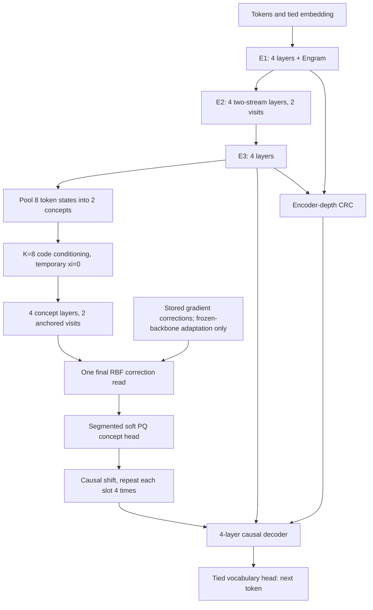

# V10_10M

**Audit update (11 October):** the active run is operational, but math data contains serialized byte wrappers and routine math generation covers only one module. Read [the deep audit](audit/REPORT.md) before interpreting losses. The [live dashboard](http://127.0.0.1:8766/#live) uses the preferred V3 training-page design; its [telemetry contract](telemetry/README.md) documents the underlying read-only API.

An executable width-128 implementation of the user's V10 architecture with **5,465,890 dense parameters + 20,000,320 learned Engram table parameters**. It is prepared for a 24-hour training run on the 16 GB Apple M2 MacBook Air. Training outcomes are not established by implementation tests.



Read [ARCHITECTURE.md](ARCHITECTURE.md) for the source-to-code mapping, gradient/timing rules and explicit choices left open by the proposals. Read [DATASETS.md](DATASETS.md) for selection rationale, provenance, limitations and independent success metrics. Source documents and earlier experiments are untouched.

## Run on this Mac

Commands below run from `/Users/shubhankankrishna/Desktop/EncoderConceptDecoder`. The existing `/opt/anaconda3/bin/python` has PyTorch 2.10 and working MPS; no system environment was replaced.

```bash
# Frozen active corpus: do not rebuild it during this run.
# A separate clean-corpus preparation entry point is documented in audit/REPORT.md.
/opt/anaconda3/bin/python -m v10_10M.audit_data

# Contract tests, then the detached 24-hour run.
/opt/anaconda3/bin/python -m v10_10M.tests --device cpu
/opt/anaconda3/bin/python -m v10_10M.tests --device mps
/opt/anaconda3/bin/python -m v10_10M.launch
```

The launch command refuses to overwrite an existing checkpoint. The supervisor holds an OS lock and snapshots source files; `caffeinate` prevents idle sleep while the trainer lives. Closing a laptop lid can still suspend work. The 24-hour deadline uses wall time and is preserved on explicit resume; it is not reset after interruptions.

Default run directory: `runs/pretrain_24h/`. `status.json` reports state, PID, step, tokens, timing, memory and recent losses. `process.log` and `train.jsonl` retain output. `latest.pt` is atomically replaced every ten minutes and on a graceful exit. No RBF memory is written during pretraining. Every 30 minutes, bounded development checks log token losses, concept ablation, spread/code usage and small complete-answer generation samples.

```bash
cat v10_10M/runs/pretrain_24h/status.json

# Graceful stop: read the trainer PID from status.json, then send SIGTERM.
# Resume the exact source/data/settings and the original deadline:
/opt/anaconda3/bin/python -m v10_10M.launch --resume

# Larger development evaluation after training:
/opt/anaconda3/bin/python -m v10_10M.evaluate \
  v10_10M/runs/pretrain_24h/latest.pt \
  --output v10_10M/runs/pretrain_24h/development_full.json

# Optional, separate frozen-backbone memory pilot on training feedback:
/opt/anaconda3/bin/python -m v10_10M.adapt \
  v10_10M/runs/pretrain_24h/latest.pt \
  --family math --episodes 32 --output v10_10M/runs/memory_pilot
```

Adaptation is not automatically run or mixed into pretraining. It needs a qualified checkpoint before its results have scientific meaning. No MCTS/RL training or test-time GradCuit search is included in this pretraining task; the temporary-offset input and differentiable memory read are available for later experiments.

## Runtime choices

Batch 8, context up to 384, one microbatch per optimizer update, FP32 MPS neural computation, CPU sparse Engram lookup/update, four CPU threads. Dense AdamW starts with a 200-step warmup to 3e-4 and follows a wall-time cosine schedule to 10% of peak; sparse Engram LR is 5× that value. There is no unsupported mixed-precision or `torch.compile` claim. Memory allocation retains a conservative Metal process limit; it never disables the high-watermark safeguard.

`research/benchmark_mps.json` and `benchmark_cpu.json` record real forward/backward/optimizer timings across all data families and batch sizes. At batch 8 the short MPS benchmark measured median ~4,169 text tokens/sec versus ~3,132 on CPU, with ~4.2 GiB peak Metal driver allocation and CPU process RSS logged separately. Apple unified-memory counters overlap; do not add them as independent VRAM/RAM usage. These are short measurements, not a guaranteed sustained or 24-hour token count.

The finite corpus can be revisited; training does not claim every processed token is unique. Dataset exposure is logged by family. A fanless laptop may throttle. The run budget includes initialization, evaluation and checkpoint overhead, and finishes at the next safe update boundary after its deadline.

## Verification artifacts

* `research/contracts_cpu.json`, `contracts_mps.json`: causal perturbation/prefix equivalence, padding/batch isolation, partial groups, exact shift, branch-history equivalence, actual recurrence calls, retained state, gradients, empty memory/first write, stale feedback rejection and strict Sudoku verification.
* `research/data_audit.json`: counts/hashes, zero identity overlap, token and answer lengths, valid complete Sudoku solutions.
* `research/training_smoke.log` and `runs/validation_*`: short real-data updates/checkpoint checks. These are engineering checks, not research results.
* `research/source_documents.json`: hashes of the canonical designs, Engram paper and inspected V9 evidence.

All 24-hour progress and results belong to this new directory. The current source documents were proposals: an executable implementation cannot make their hoped-for improvements true without measuring them.
