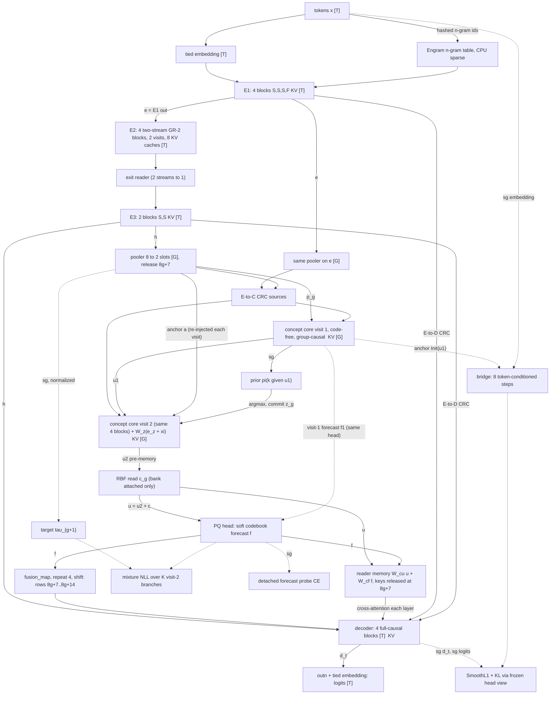

# V11 RCDL — architecture proposal

**Status: complete draft, 12 October 2026; advisor review of §6–§8 in progress. Not implemented and not trained.** Successor to V10.3 (`V10_3_RCDL_Architecture.md`, `V10_3_tiny_REPORT.md`). Written in response to `V11_Architecture_Design_Prompt.md` (which names the output `V11_RCDL_Architecture.md`; the owner asked for `v11.md`).

## 1. Recommendation

**Primary architecture.** V11 keeps V10.3's deployed graph unchanged:
- E1 → two-stream recurrent E2 → E3;
- an 8 → 2 pooler;
- a two-visit completed-group-causal concept core;
- a PQ forecast;
- a decoder reading an aligned forecast plus released concept history;
- the three CRC directions, the Engram, and observed-history inference.

The deployed dense count is identical: 5,416,100 at the reference and 474,364 tiny. V11 changes **what the concept state is trained to be and where its strategy variable enters**:
1. **Latent next-concept objective.** The concept state predicts the next group's *normalized, stopped pooled encoder state* (NCP Eq. 22 in Gaussian form). V10.3's token-space forecast objective is dropped.
   - Visit 1 is code-free and supervised at every eligible group.
   - Visit 2 takes the committed strategy code and is trained by an explorative K-mixture likelihood on `S/G = 1/16` boundaries every step.
2. **Concept-anchored NextLat bridge (training-only).** From `u_g^(1)` and the actual next tokens, a small token-conditioned transition must reproduce the decoder's residual state and next-token distribution for up to eight rows, without re-grounding. The bridge is dropped at inference.
3. **Adaptation and retention.**
   - RBF bank: calibrated per family, with a write-RMS/read-cap parameterization and explicit ID sets.
   - Gates: read the frozen base.
   - Sleep: replay anchored to frozen models protects related skills that gates cannot separate.

**The V10.3 failures each change addresses** (observed in `V10_3_tiny_REPORT.md`):

| V10.3 failure | V11 change |
|---|---|
| X8 trailed C0 on text and math in both seeds while relying on its concept path (V10.3 report §5, §9) | token-space concept objective that reached the trunk removed; latent objective + bridge (§4.1) |
| Forecast a *worse* linear predictor of the next group than its own input (math FVU 0.694 vs 0.637) | target is the next pooled state in normalized units; FVU against `ridge(P3)` is gate G3 |
| Second visit inert (≤ 0.011 nats) | visit roles split: visit 1 belief (code-free), visit 2 hypothesis-conditioned; visit-2 gain measured, visit 2 dropped if it does not earn its compute |
| Codes produced no different futures (main effect 0.1–6%; mixture ≈ committed within 0.002) | code injected at the visit that the mixture trains, from a prior over the code-free belief; K = 8 must pass an adoption rule, otherwise K = 1 |
| Exploration logged as zeros between candidate steps | candidates every step; absent metrics `null` |
| RBF calibration token-weighted (97% text); ID reuse in the final rewrite | per-family harm constraint over every family and accepted phase; persisted disjoint ID sets |
| Related-skill forgetting (add/sub +0.46 after consolidation); gate overlap 63–85% at every site | replay anchored to frozen models, chosen where gates open |
| Smoother started at 0; Sudoku fixed layout; 24-token generation limit | `s_0 = d_0`; random-prefix training + all-offset evaluation; answer length + 64 |

| Retained (inherited, unchanged) | Changed | Optional (labelled ablation, §7.2) | Rejected |
|---|---|---|---|
| E1/E2/E3 4/4/2; E2 = GR with `n_r = 2`, two visits | concept objective: token CE → latent Gaussian NLL to stopped normalized pooled target | K = 8 exploration (adoption rule) | mHC (§3.7) |
| Engram after E1 block 1 | visit 1 code-free; code at visit 2; prior reads `sg[u^(1)]` | Delta Block additive depth routing | NCP IRC (§3.7) |
| 8 → 2 pooler, both slots released at `8g+7` | candidate mixture every step on sampled boundaries; no separate committed MSE | re-grounded NextLat; constant-anchor bridge | GR `n_r = 4` everywhere |
| completed-group-causal core, 2 visits, anchor re-injection | concept-anchored bridge (training-only) | target alternatives: EMA teacher, unnormalized, discrete CE | hard best-of-K and reverse XM (§4.2) |
| PQ soft codebook, no weight decay | EMA normalization buffers (era-hashed) | trained visits = 1 | predicted concepts fed back at inference (§3.9) |
| aligned `fusion_map` forecast; concept-history reader with release mask | forecast readout → detached probe | allocation arms (§6.4); Engram off | token-space concept objectives reaching the trunk (MTP-like) |
| E→C and E→D CRC | RBF: `ρ_w`/`ρ_r` replace `η`; per-family calibration; capacity rule; ID sets | NCP VQ-interface adaptation | gating on the concept state (measured overlap) |
| observed-history inference with KV caches | gates: base-only features, OOD floor, per-family `Φneg`, first-decision smoother | half-row KL; top-m RBF writing; delayed schedule | group-rate hindsight transition as a standalone objective (§4.4) |
| RBF bank (code-partitioned, era-bound); gated LoRA; sleep | sleep: replay with frozen anchors; bank-gain floor; retry | meta-control discovery on the frozen model (staged) | co-trained controller (comparison only); EMA teacher copy in the primary |
| `ξ = 0` in pretraining | random-prefix training; offset evaluation; generation limit | — | K hypotheses on the bridge |

**What the evidence supports today.** The concept path is supported as a **training auxiliary and an adaptation interface**, not as a deployed world model or controller.
- **Adaptation interface:** the frozen-weight RBF bank cut newmath loss by 1.55 nats through the concept routes alone (V10.3 §8).
- **Deployed concept path:** it has never beaten its concept-free control. V10 10M concept-off was +0.000725 with an interval including zero; V10.3-tiny X8 lost to C0.

V11 keeps the deployed ECD path as the research design and makes its usefulness a gate (§7.2 G2, G3, G5), not an assumption.

## 2. Source and evidence ledger

Labels: **[S]** source claim (a paper's statement), **[O]** observed in this project, **[I]** inference, **[P]** untested proposal.

| Source | What V11 takes from it | Location | Label |
|---|---|---|---|
| NCP-ArchPreview Technical Report (attached) | encoder/concept/decoder with PQ heads; Eq. 21 VQ fitting to stopped targets; Eq. 22 MSE to stopped continuous next concept; CRC with normalized weights and diagonal scale (Eqs. 19–20); single hidden stream per module; IRC-only −0.0273 loss (Table 3); VQ adaptation (+4.27 math, +0.39 general); predicted concepts fed back at inference (§2.3, which V11 departs from) | §2–3, pp. 4–9; Table 3 | [S] |
| Next-Latent Prediction Transformer, arXiv:2511.05963v4 (attached) | token-conditioned transition; SmoothL1 to stopped states + KL through a frozen head view (Algorithm 1, p. 25); stop-gradient ablation; token-space auxiliaries degrade NTP while NextLat preserves it (Fig. 8, p. 10); belief-state theorem 3.2 and its ideal assumptions; λ = 1 settings (Table 5) | §3, pp. 4–6, 10, 25 | [S] |
| Hierarchical Latent Prediction, arXiv:2608.05806v1 (attached) | abstract latent predicted without future tokens; `glu_cross` transition (App. D); combined head and its detach ambiguity; auxiliaries removed at inference; throughput 65% vs NextLat 83% | §2, Algorithm 1, pp. 1–2, 7; App. D | [S] |
| Explorative Modeling, arXiv:2607.27372v1 (attached) | smooth mixture form as maximum likelihood; forward-XM cost; reverse XM's hard case; AR LMs gain least | §3.2, fn. 6; App. F.2; §6–7, p. 18 | [S] |
| Emergent temporal abstractions, arXiv:2512.20605v2 (attached) | metacontroller discovered over a **frozen** model with a non-causal posterior and switching gate; co-trained variant and β = 1 fail; mid-depth control best | pp. 5–7, App. D | [S] |
| Qwen3.8-Next architecture report (attached as `v11_Papers/Qwen 4_tech_report.pdf`; title "On the Design of Qwen3.8-Next Architecture", 2026-08-26) | Gated Residual (GR) Eqs. 29–34: per-branch norm, elementwise read gate, per-branch write, no `H_res`; `n_r = 4`; Table 5. **Naming resolved:** GR is a depth-residual widening; it is distinct from gated attention outputs (Qiu et al., cited there) and from gated linear attention (GDN) | §2.2, Fig. 7, Table 5 | [S] |
| Kimi Attention Residuals, arXiv:2603.15031 (downloaded PDF) | zero-init pseudo-query; block AttnRes with `N ≈ 8`; I/O table; 1.25× compute equivalence; ablations (input-dependent helps; sigmoid, multi-head hurt) | §3, §5.1, Tables 1, 4; Eq. 8 | [S] |
| Delta Attention Residual (attached `v11_Papers/DeltaAttentionResidual.pdf`) | additive routing over block deltas with null source, identity at init; replacement AttnRes degrades at 1B–8B | §2.3; Tables 1–3 | [S] |
| DeepSeek mHC, arXiv:2512.24880 (HTML v2) | `n = 4` streams; doubly stochastic `H_res` (Sinkhorn, 20 iterations); 6.7% overhead; gain ~1.6 vs HC's ~3,000 | §3–4 | [S] |
| V-JEPA 2, arXiv:2506.09985v1 | L1 to a stopped EMA-encoder target; AC variant with a frozen encoder and teacher-forced + rollout losses. V11 uses the *online* stopped target and keeps the EMA target as Tier 2.6 | §2.1, §3 | [S] |
| Anthropic global workspace (summary and technical article) | an empirically identified subspace inside an existing model (the brief's "J-space"), not an ECD architecture. Motivates the shared-access tests of §7.4 (one concept state read by every decoder layer; shuffle vs zero). It proves nothing about ECD | research summary | [S] |
| Local Support Learning (attached in the project root) | GMM support gates on sub-layer inputs; V11 departs by fitting on the frozen base | — | [S] |
| `V10_3_tiny_REPORT.md`, `comparison.json`, `REPORT_TABLES.md`, `sleep.json` | every V10.3 number quoted in §1, §4, §7 | §5–§11 | [O] |
| `v10_2_review.md` §4.3 | V10.1 route probe: ~⅔ of an apparent route effect was router renormalization; text concept effect +0.006 value-zero | §4.3 | [O] |
| `v10_1/VALIDATION_REPORT.md` | V10 10M concept-off +0.000725 [−0.000133, +0.001480]; 180,249,114 tokens in 12.988 active hours | lines 9–11 | [O] |
| `V10_3_RCDL_Architecture.md` §1, `v10_3_design_evidence/` | pooled-target variance drift; gate overlap 63–85%; smoother cuts group-rate hit rate; per-visit separability | §1.1, §1.4 | [O] |
| `v5_tiny/REPORT.md`; `review_v9.md` | predicted-history inference +0.217 nats (V5); +0.048 / +0.891 (V9 review) | — | [O] |
| `v8_tiny_12h/REPORT.md` | LSL phases 2–3 lost the standard task (0/2048 sealed) | — | [O] |
| `v41_tiny/REPORT.md` | frozen-oracle C-offset repaired 25/52 errors; norm-matched random fixed none | line 192 | [O] |
| `v11_design_evidence/2026-10-12/*.py, *.json` | release table (99 checks), parameter counts, MACs, allocation arms, scaling arithmetic | — | [O] computed, not trained |
| This document's mechanisms, predictions and gates | — | §3–§7 | [P] / [I] as marked |

**Unavailable or unverified.** The Qwen3.8 GitHub repository and the Qwen3-Next blog were not needed once the attached report gave the equations. Dataset licences are listed from memory of the cards and must be confirmed (§7.1).

## 3. Computational specification

Everything in this section that is inherited is quoted from the code it comes from (`v10_10M/model.py`, `v10_1/model.py`, `v10_2/model.py`, `v10_3_tiny/model.py`). Everything new is marked **[new]**. The release table (§3.5) and the parameter counts (§6) are generated by scripts in `v11_design_evidence/2026-10-12/`, not typed.

### 3.1 Clocks and symbols

- Positions are zero-based. Decoder row `t` has observed `x_0 … x_t` and predicts `x_{t+1}`. `x_0` is BOS; it is an observed token and belongs to group 0.
- **Group** `g` is positions `8g … 8g+7`. It is complete when `8g+7 < length`. `G = ⌊length/8⌋` groups are formed; an incomplete tail forms no group.
- **Release time** `r_g = 8g+7`. Both slots of group `g` depend on all eight positions (each pooling query attends to all eight), so **both slots are released together at `r_g`**. Slot `s ∈ {0,1}` differs only in its anchor, the mean of half-group `s` (positions `8g+4s … 8g+4s+3`).
- Three rates: token rate (`T` rows), group rate (`G` groups, `2G` slot rows), and the bridge's within-group step `j ∈ {0,…,8}` (training only).

| Symbol | Per-document shape | Rate | First available | Meaning |
|---|---|---|---|---|
| `h_t`, `e_t` | `d` | token | row `t` | final encoder state (E3 output); early state (E1 output) |
| `p_g`, `p^e_g` | `2×d` | group | `r_g` | pooled observed slots from `h` and from `e` (same pooler) |
| `u_g^(1)` | `2×d` | group | `r_g` | concept state after visit 1; **code-free** [new placement] |
| `π_g` | `K` | group | `r_g` | prefix-only prior over strategy codes, from `sg[u_g^(1)]` |
| `z_g` | scalar in `1…K` | group | `r_g` | committed strategy code (not a PQ segment index) |
| `ξ_g` | `c_w` | group | `r_g` | temporary GradCuit offset; **identically zero in pretraining** |
| `u_g^(2)` | `2×d` | group | `r_g` | concept state after visit 2, code-conditioned, pre-memory |
| `c_g` | `2×d` | group | `r_g` | RBF correction **after** the read-time cap (§4.7); zero unless a bank is attached; `u_g = u_g^(2) + c_g` |
| `q_g` | `2d` | group | `r_g` | RBF address, `flatten(u_g^(2)) / √(2d)` (inherited) |
| `f_{g+1|g}` | `2×d` | group | `r_g` | forecast of the next group's normalized pooled slots |
| `τ_g` | `2×d` | group | `r_g` | normalized pooled target, `(p_g − μ) / √max(v, v_min)` |
| `b_t` | `d` + memory | token | row `t` | concept signal delivered to row `t`: aligned forecast plus the released concept history |
| `d_t` | `d` | token | row `t` | decoder residual stream before `outn` |
| `β_{g,j}` | `d` | within group | row `r_g + j` | bridge state [new, training only] |

`d` is the width, `K` the number of strategy codes, `c_w` the code width. Symbols with a superscript visit index never mean anything other than the output of that visit.

Three kinds of state are kept distinct throughout:
- **Observed:** `p_g`, built from encoder states of a complete group.
- **Prospective:** `f_{g+1|g}`, computed with no token of group `g+1`.
- **Hindsight reconstruction:** `β_{g,8}`, after the bridge has consumed all eight tokens of group `g+1`.

Only observed and prospective states reach the deployed path.

### 3.2 Computational graph

Solid arrows are deployed computation. Dashed arrows are training-only. `sg` marks a stop-gradient. `[T]` is token rate, `[G]` group rate. `KV` marks a cache used in incremental generation.



### 3.3 Module equations

**E1** (4 ordinary pre-norm blocks, inherited). `x ← x + Attn(RMSNorm x)`, `x ← x + FFN(RMSNorm x)`, FFN = `Linear(d,4d) → GELU → Linear(4d,d)`. The Engram read follows block 1: `x ← x + g⊙v + SiLU(conv₃(RMSNorm v))`, with `g = σ(⟨RMSNorm x, RMSNorm k⟩/√d)`; `k, v` are projections of four hashed rows (orders 2 and 3, two hashes each), and `conv₃` is a causal dilation-3 depthwise convolution over lags 0, 3, 6, 9.

**E2: two gated residual streams** (inherited `TwoStreamBlock`). Streams are initialized once at E2 entry, `r_0 = r_1 = e`, and carried through every block and both visits. For each sub-layer `F ∈ {Attn, FFN}` of each block:

```
n_i   = RMSNorm_i(r_i)                                   i = 0, 1   (per-stream norm)
a     = σ(W_up · SiLU(W_down · [n_0 ; n_1]) + b_up)      a = (a_0, a_1) ∈ (0,1)^{2d}; W_up = 0, b_up = 2 at init
x     = (a_0 ⊙ n_0 + a_1 ⊙ n_1) / 2                      gated read; replaces the block's pre-norm
y     = F(x)
β     = σ(W_w · [n_0 ; n_1] + b_w)                       β ∈ (0,1)^2 per token; W_w = 0, b_w = (−0.5, +0.5) at init
r_i  ← r_i + β_i · y                                     per-stream scalar write
```

E3 receives `ExitReader(r_0, r_1)`, the same read without a write. The two streams have the same functional form and the same initial value; the only designed asymmetry is the write bias (initial write rates 0.38 and 0.62). Their roles are therefore **emergent and measured, not assigned**: per-stream write rate `β̄_i` per visit, read share `‖a_i⊙n_i‖ / Σ_k ‖a_k⊙n_k‖`, and how much E1 content each stream still carries after visit 2 (ridge readout of `e` from `r_i`). The predeclared hypothesis, from the Qwen3.8-Next branch analysis (Qwen PDF §2.2, Fig. 7), is that one stream becomes a slow carrier of early content and the other a working stream. §3.7 classifies this block.

**Encoder attention schedule.** The inherited rule is "block index `i` (counting E1, E2, E3 consecutively) is full-history causal if `i mod 4 = 3`, otherwise causal sliding window 64." With 4/4/2 this gives E1 = S,S,S,F; E2 = S,S,S,F, the same masks on both visits because the masks belong to unique blocks; E3 = S,S. Executed: 14 block applications, 11 sliding and 3 full (3.7 : 1).

Under this rule, `h` comes from two sliding blocks after E2's last full block. Global reach for the decoder comes from its own full-causal attention and from the E→D CRC on `e` and `h`. The 4/4/4 allocation arm (§6.4) restores a full block in E3.

**Pooler** (inherited, 8 → 2). For group `g`, `X = h_{8g:8g+8} ∈ R^{8×d}`, `A_s = mean(X_{4s:4s+4})`, `M = RMSNorm(X) + P_pos`. Both slot queries `Q_s = W_q(RMSNorm A_s + σ_s)` attend to all eight rows of `M` (4 heads). Then `Z_s = A_s + α · W_o(MHA)`, with `α = 0.1` at init, and `p_{g,s} = RMSNorm(Z_s + FFN(RMSNorm Z_s))`. The same pooler applied to `e` gives `p^e_g`.

**Encoder→Concept CRC** (inherited `EncoderConceptCRC`, applied at both visits). Sources `S_1 = W_1 RMSNorm(p^e_g)` and `S_2 = W_2 RMSNorm(p_g)`, per slot. At each visit, `s ← s + λ ⊙ Σ_j softmax(W_r RMSNorm s)_j S_j`, with `W_r = 0` at init (uniform weights) and `λ ∈ R^d` initialized to 0.1.

**Concept core** (4 shared blocks, exactly two visits). Slot rows are ordered `(g, s)` → `2g+s`, with RoPE over the slot index. The mask is **completed-group causal**: row `2g+s` attends to row `2g'+s'` iff `g' ≤ g`. This differs from a strict triangular mask over slots (`2g'+s' ≤ 2g+s`) only in letting slot 0 see slot 1 of its own group. That is legal because both slots are released at the same `r_g` from the same eight observed positions. The core never attends to a later group.

```
a_g        = RMSNorm_anchor(p_g)                                         code-free anchor  [changed: V10 normalized p_g + W_z e_z]
visit 1:   s = a + α_a a;  s = ECCRC(s);  s = Blocks(s);  u^(1) = RMSNorm_exit(s)          α_a = 0.25 at init [inherited]
prior:     π_g = softmax(W_π RMSNorm(flatten sg[u_g^(1)]))                               [changed: V10 read p_g]
commit:    z_g = argmax_k π_g,k                                                         deterministic; cached; never revised
visit 2:   s = u^(1) + α_a a + W_z(E_code[z_g] + ξ_g) (same vector added to both slots of g)
           s = ECCRC(s);  s = Blocks(s);  u^(2) = RMSNorm_exit(s)                         [new injection point]
```

The re-injection is inherited exactly from `ConceptCore.forward` (`v10_10M/model.py:221–228`): `state = a`, then at each visit `state = state + anchor_scale·a`, the blocks, and `exit_norm`. Visit 1 therefore receives `(1 + α_a)·a`, as in V10. The only change is where the code enters. V10 put `W_z e_z` inside the anchor, so it reached both visits through `a`; V11 adds it once, at the visit-2 input, after the anchor norm.

Visit 1 computes a belief over the observed history with no strategy variable. Visit 2 refines it under hypothesis `z_g`. The K = 1 control has no code, no prior and no `W_z` term, so visit 2 is a deterministic refinement. `ξ_g ∈ R^{c_w}` is added to the code embedding before `W_z` exactly as in the inherited `(e_k + ξ) W_z` contract. It is a per-sequence, per-group tensor that exists only during a test-time steering call, is not a parameter, is never checkpointed, and raises an error if non-zero while `training` is true.

**PQ forecast head** (inherited `PQHead`, codebook exempt from weight decay as in V10.3). Per slot: `P = softmax_n(W_pq u_{g,s})` reshaped to `S_seg × N` (per-segment softmax), then `f_{g+1|g,s} = concat_seg Σ_n P_{seg,n} C_{seg,n}` with `C ∈ R^{S_seg×N×(d/S_seg)}`. The forecast lives in the **normalized target space** of §4.2. The same head applied to `u^(1)` gives the visit-1 forecast `f^(1)` used only for supervision and measurement (§4.2).

**Normalization buffers** [new]. `μ, v ∈ R^{2×d}` are persistent buffers holding the EMA mean and variance of valid pooled slots. They are initialized from the first batch, updated after each loss computation with momentum 0.99, and floored at `v_min = 0.01`. The pooler's output RMSNorm gives per-coordinate variance near 1, so the floor is two orders of magnitude below it. They are model state: saved, restored, and hashed into the memory era.

**Freeze rule:**
- **When they update:** only in `training` mode, from complete groups of the committed pass, after the loss is computed.
- **Never from:** variant rows or padded groups.
- **Frozen whenever the base is frozen:** adaptation, calibration, evaluation and generation.

A frozen model therefore keeps a constant era hash.

**Decoder** (inherited `Decoder103`: 4 full-causal blocks).

```
x_t = h_t + A_t                       A_t = fusion_map(f_{g(t)+1|g(t)})[slot(t)] for t ≥ 7, else 0;  fusion_map = Linear(d,d), 0.1·I at init
for layer ℓ = 1..4:
    w   = softmax(W_route,ℓ RMSNorm x)                  over the two E→D sources
    x  += λ_ℓ ⊙ (w_1 P_1 RMSNorm(e_t) + w_2 P_2 RMSNorm(h_t))       E→D CRC, λ_ℓ = 0.1 at init
    x  += Attn_ℓ(RMSNorm x)                              full causal self-attention
    x  += Reader_ℓ(x; M, release mask)                   C→D CRC, cross-attention over released concept history
    x  += FFN_ℓ(RMSNorm x)
d_t = x;   logits_t = RMSNorm_out(d_t) · Eᵀ               tied embedding
```

Here `g(t) = ⌊(t−7)/8⌋` and `slot(t) = ⌊((t−7) mod 8)/4⌋`. Reader memory holds `M_{k,s} = W_cu u_{k,s} + W_cf f_{k+1|k,s}`, with key RoPE position `r_k`. Row `t` may read `(k,s)` iff `r_k ≤ t` and `r_k < length`. A zero sentinel key/value is used only when no key is legal (rows 0–6, and every row of a document shorter than 8 tokens). The reader's output projection is initialized with gain 0.1.

**Bridge** [new, training only; dropped at inference]. For each complete group `g` with at least one later token:

```
β_{g,0} = W_init · flatten(u_g^(1)) + b_init                                   anchor at row r_g
for j = 1..8 (while r_g + j < length):
    ε_j     = sg[E[x_{r_g+j}]]                                                  token embedding, stopped
    c_j     = (W_h β_{g,j−1}) ⊙ σ(W_e ε_j)                                      glu_cross input combination (HiLP App. D)
    β_{g,j} = β_{g,j−1} + W_down GELU(W_up RMSNorm c_j)                         4d hidden, residual update
    prediction for row t = r_g + j:   β̂_t = β_{g,j}
```

**Why anchor on visit 1 when the decoder reads visit 2.** Everything the decoder receives from the concept path at rows of group `g+1` is a deterministic function of `u_g^(1)`. The committed code is `z_g = argmax π(sg[u_g^(1)])`, and `u_g^(2) = F(u_g^(1), z_g, a_g)`, where `a_g` is computed from `p_g`, which feeds `u_g^(1)`. So `u_g^(1)` is a sufficient anchor for the concept signal; anchoring on it keeps the belief code-free. This would not hold under a sampled commit, but the bridge never runs in the sampled diversity mode.

The bridge sees the history before `r_g` only through `u_g^(1)`, and the tokens after `r_g` only through `ε`. It is never re-grounded to a true decoder state inside a group. Every row `t ≥ 8` is predicted exactly once, by the bridge of `g = ⌊(t−8)/8⌋` at step `j = t − r_g ∈ {1,…,8}`. Step `j = 8` lands on `r_{g+1}`, whose decoder state already reads `u_{g+1}`. That step is the chunk-conditioned hindsight transition of the prompt's group-rate option, so this design contains it (§4.4).

**Detached forecast probe** (V10.2's `ForecastReadout`, kept as a diagnostic only). It reads `sg[f_{g+1|g}]` at `S` sampled boundaries per document and is trained by cross-entropy on the next eight tokens. Its gradient reaches only its own parameters. It replaces V10.3's forecast-only token objective, whose gradient reached the trunk (§4.1).

### 3.4 Tensor shapes

`B` batch, `T` context, `G = T/8`, `d` width, `K` codes, `c_w` code width, `S_seg × N` PQ segments × words, `S` sampled boundaries per document, `R` bank rows.

| Tensor | Shape | Tiny (B 16, T 256, d 56) | 10M reference (B 8, T 384, d 128) |
|---|---|---|---|
| ids, targets | `B×T` | 16×256 | 8×384 |
| `e`, `h`, `r_0`, `r_1`, `d` | `B×T×d` | 16×256×56 | 8×384×128 |
| Engram rows gathered | `B×T×4×d_eg` | 16×256×4×16 | 8×384×4×32 |
| `p`, `p^e`, `u^(1)`, `u^(2)`, `f`, `τ` | `B×G×2×d` | 16×32×2×56 | 8×48×2×128 |
| E→C sources | `B×G×2×2×d` | 16×32×2×2×56 | 8×48×2×2×128 |
| prior logits `π` | `B×G×K` | 16×32×8 | 8×48×8 |
| code embedding, `ξ` | `B×G×c_w` | 16×32×16 | 8×48×32 |
| PQ probabilities | `B×G×2×S_seg×N` | 16×32×2×4×16 | 8×48×2×8×32 |
| `μ`, `v` buffers | `2×d` | 2×56 | 2×128 |
| aligned guidance `A` | `B×T×d` | 16×256×56 | 8×384×128 |
| reader memory / mask | `B×2G×d` / `B×1×T×(2G+1)` | 16×64×56 / 16×1×256×65 | 8×96×128 / 8×1×384×97 |
| logits | `B×T×V` | 16×256×1024 | 8×384×8192 |
| bridge states `β` (training) | `B×G×9×d` | 16×32×9×56 | 8×48×9×128 |
| bridge student logits (training) | `B×T×V` (valid rows) | 16×256×1024 | 8×384×8192 |
| mixture variants (training) | `B×S×K×2×d` | 16×2×8×2×56 | 8×3×8×2×128 |
| RBF query / keys / values | `B×G×2d` / `R×2d` / `R×2d` | 16×32×112 / R×112 | 8×48×256 / R×256 |

### 3.5 Release and shift table (rows 0–17)

Generated from `Decoder.align` and `history_geometry` by `alignment_table.py`. Every row was checked for two properties: the source group of any forecast or reader key is released by that row (`8k+7 ≤ t`), and forecast slot `s` lands only on rows that predict half-group `s` of the next group. All 99 checks pass (`alignment_table.json`).

| Rows | Predict | Target group, half | Aligned forecast `A_t` | Reader keys visible | Sentinel |
|---|---|---|---|---|---|
| 0–2 | `x_1…x_3` | 0, half 0 | none (zero) | none | yes |
| 3–6 | `x_4…x_7` | 0, half 1 | none (zero) | none | yes |
| 7–10 | `x_8…x_11` | 1, half 0 | slot 0 of `f_{1|0}` | group 0 | no |
| 11–14 | `x_12…x_15` | 1, half 1 | slot 1 of `f_{1|0}` | group 0 | no |
| 15–17 | `x_16…x_18` | 2, half 0 | slot 0 of `f_{2|1}` | groups 0, 1 | no |

- **Row 7** is the first row with any concept signal. It has observed `x_0…x_7` (group 0 complete) and predicts `x_8`.
- **Slot correspondence.** Slot `s` of `f_{g+1|g}` is delivered to the four rows that predict half-group `s` of group `g+1`. This is the same split the pooler uses for slot anchors.
- **Empty prefix** (length 1, BOS only): no group forms; row 0 uses the sentinel and zero guidance.
- **Incomplete tail** (length 19): groups 0 and 1 form; positions 16–18 never form group 2. Rows 15–18 read `f_{2|1}` slot 0, and no loss is computed on `f_{2|1}` because `τ_2` does not exist.
- **Padding** (length 12 in a 20-row batch): padded rows may carry guidance values but see no reader keys. They are excluded from every loss, and causality guarantees they cannot affect valid rows.
- **Raw-state Concept→Decoder audit.** The reader keys and values are the raw concept states `u_k` together with the forecasts, not only the predicted forecast. They become visible at `r_k`, the same time as the aligned forecast, so the raw path is causal for the same reason. E→C CRC uses only group `g`'s own pooled states at `r_g`. E→D CRC uses `e_t` and `h_t` at row `t`. The pooler is bidirectional *within* a group, which is legal only because nothing it produces is read before `r_g`.

### 3.6 Cross-module routes (three directions, four paths)

| Route | Sources | Alignment | Normalization and weights | Gate / scale (init) | Release |
|---|---|---|---|---|---|
| Encoder→Concept CRC | `p^e_g`, `p_g` (pooled E1 and E3 outputs) | same slot axis | RMSNorm + projection per source; softmax over 2 sources per slot | `λ ∈ R^d` = 0.1; router zero-init (uniform) | `r_g`; both visits |
| Encoder→Decoder CRC | `e_t`, `h_t` | token rate, none needed | RMSNorm + projection per source, computed once; softmax over 2 per decoder layer | per-layer `λ_ℓ ∈ R^d` = 0.1 | row `t` |
| Concept→Decoder, aligned forecast | `f_{g+1|g}` | repeat each slot 4×, shift so the first legal row is 7 | full `fusion_map` (V10.3) | `0.1·I` | `r_g` |
| Concept→Decoder, reader (concept history) | `W_cu u_k + W_cf f_{k+1|k}`, all `k ≤ g(t)` | cross-attention, key RoPE at `r_k` | per-layer attention with zero sentinel | output projection gain 0.1 | `r_k` |

These are the same form as NCP's CRC (normalized source weights plus a learned diagonal scale, NCP Eqs. 19–20) with two sources per route. Route use is judged by equal-magnitude interventions, never by router weights: the V10.2 review found that about two-thirds of an apparent route effect was router renormalization (§7.4).

### 3.7 Residual topology

**Classification of the inherited E2 block.** Equation by equation, E2 is the Qwen3.8-Next **Gated Residual with `n_r = 2`** (Qwen PDF §2.2, Eqs. 30–34):
- per-branch RMSNorm (Eq. 30);
- an elementwise sigmoid read gate from a low-rank bottleneck over all branches (Eq. 31), with gated averaging (Eq. 32) that replaces pre-norm;
- a per-branch scalar write (Eqs. 33–34);
- no branch-mixing operator, so it is not HC or mHC.

It differs from GR in three ways: two branches instead of four, write range (0,1) instead of (0,2), and bottleneck rank `gate_rank` (16 tiny, 32 reference) instead of `d/8`. E2's read gate gates the residual *read*. It is not the attention-output gate of gated attention (Qiu et al., cited in the Qwen report), and V11's primary has no attention-output gate and no depth attention.

**Answer to "multiple information paths, multiple residual streams, or both?" Both, in different places:**
- **Inside E2:** two simultaneously maintained residual streams on the same token axis and width.
- **Across modules:** the main pooled route and the three CRCs are *information paths* into a single residual stream per module, following NCP's convention (NCP §2.5: "retaining a single hidden stream in each module"). The token route has `T` rows; the pooled route has `2G = T/4` slot rows. `Align` (repeat 4, shift 7) and the reader are path operators between these axes, not an identification of the two state spaces.
- **Concept core:** the anchor re-injection `s + α_a a` at each visit is a fixed-coefficient depth path from the module input.
- **mHC:** not instantiated anywhere. No module carries an `n×C` state with a mixing matrix.

**Primary intra-module mechanism: ordinary pre-norm residuals, plus the inherited GR-2 in E2.** Every module executes at most eight block applications. The measured depth-mixing gains are at 12–56 sub-layers:
- NCP IRC: −0.027 loss at 1B (NCP Table 3);
- Kimi AttnRes: 1.25× compute-equivalent (AttnRes §5.1);
- Delta AttnRes: −1.7 to −8.2% perplexity (Delta Tables 1–3);
- Qwen GR: −0.027 loss at 25B-A3B (Qwen Table 5).

Adding one of these would also confound the objective test that §7 runs first.

**The single residual ablation, scheduled after the objective test, is Delta Block additive routing** within each module: `h ← h̃ + Σ_i α_i v_i` over block deltas plus a zero null source, with a zero-initialized pseudo-query. Reasons:
- it is an exact identity at initialization (Delta §2.3);
- additive routing over deltas improved at every tested scale, while replacement AttnRes degraded at depth (+6.9% at 1.0B and +6.6% at 7.6B over the baseline, Delta Tables 1 and 3);
- Kimi's own ablation requires a zero-initialized query and finds sigmoid and multi-head variants worse (AttnRes Table 4).

Under shared weights, depth sources are block *applications*: visit 2 may route to visit-1 deltas, which is causal in computation order, and generation caches deltas per application.

**Rejected:**
- **mHC:** it needs `H_res` with Sinkhorn projection (20 iterations), costs 6.7% time at `n = 4`, and its I/O is 34d per layer against 5.5d for Block AttnRes (AttnRes Table 1). Qwen found `H_res` adds little once the read is expressive (Table 5 discussion).
- **NCP IRC:** NCP measured IRC alone at −0.0273 loss for +0.024% FLOPs (Table 3), so it is a real candidate. It is not chosen because its coefficients are signed and unnormalized over O(L) in-module sources, with no stability constraint and no identity-at-init guarantee comparable to Delta's null source.
- **GR with `n_r = 4` everywhere:** a capacity and memory-traffic change rather than a routing change; it would be its own arm if ever tested.

**Bound for 200 unique blocks.** With Delta Block (or Block AttnRes) at `N ≈ 8` block summaries per module:
- per-module retained sources are `N·T·d` instead of `L·T·d`;
- amortized I/O is about `(N/S_b + 5)·d` per layer, where `S_b` is the block length (AttnRes Table 1);
- cross-stage transfer is `N·d` per token (with cross-stage caching, AttnRes Eq. 8);
- gradient storage is unchanged in plain training because block outputs are retained anyway, and changes only under activation checkpointing (AttnRes §3.1).

Depth mixing costs `O(N·d)` per token. It is **not** token cross-attention of cost `O(T·C)`.

### 3.8 RBF insertion point

- **Insertion:** the correction is read once per group, after visit 2: `u_g = u_g^(2) + c_g` with `c_g = clip_{ρ_r}(Σ_i k(q_g, κ_i) v_i)`. Here `clip_{ρ_r}` rescales the summed kernel read to RMS at most `ρ_r` (§4.7).
- **Consumers:** `u_g` feeds the PQ head (hence the aligned forecast through `fusion_map` and the reader's `W_cf f` term) and `W_cu u` in the reader memory. The write derivative is exact autograd with respect to the clipped `c_g` through all of these routes.
- **Not consumers:**
  - later groups' core states: the correction is added after visit 2, so there is no recurrent feedback;
  - the prior, which reads `sg[u^(1)]`;
  - the bridge, which anchors on `u^(1)` and does not run during adaptation;
  - the probe.

### 3.9 Generation and caches

**Policy.** The deployed path always consumes **observed** concept history. Every emitted token is appended to the causal encoder (incremental, KV-cached; "re-encode" here never means recomputing the prefix). At each group completion, the pooler and both visits run on the real encoder states. Predicted forecasts are never fed back as concept history. The reasons:
- V5 measured NCP's predicted-history protocol at +0.217 nats on text against refresh (`v5_tiny/REPORT.md` §2);
- the V9 review confirmed +0.048 and +0.891 for the NCP and alpha-zero foundations;
- NCP's own text says predicted concepts are fed back at inference (NCP §2.3), so V11 departs from it here on measured grounds.

Teacher-forced training therefore matches deployment for the concept path, and the core never sees its own predictions as inputs.

**Order of operations at a boundary row `t = 8g+7`:**
1. Encode `x_t` through E1 (Engram lookup for the n-grams ending at `t`), E2 visit 1 and visit 2, the exit reader and E3, appending one key/value row to each cache. This gives `e_t` and `h_t`.
2. Pool `h_{8g:8g+8}` and `e_{8g:8g+8}` from the cached last eight rows, giving `p_g`, `p^e_g` and the E→C sources.
3. Core visit 1 for the two new slot rows, attending to the cached visit-1 keys/values of groups `< g` and to each other. This gives `u_g^(1)`.
4. Prior `π_g`, then commit `z_g` (argmax; a sampled commit, used only in diversity studies, is seeded by `hash(run_seed, doc_id, g)`).
5. Core visit 2 with `u^(1) + α_a a + W_z E_code[z_g]`, attending to the cached visit-2 keys/values. This gives `u_g^(2)`.
6. RBF read on a fixed bank snapshot, if attached. Banks are never written during generation.
7. PQ head, giving `f_{g+1|g}`. Append the reader memory row (key position `r_g`) and write the aligned-guidance buffer for rows `8g+7 … 8g+14` once.
8. Decoder row `t`, which predicts `x_{t+1}`.

**Invariant:** nothing computed for rows `< 8g+7` is modified. Reader memory is append-only, guidance is write-once per group, codes are never revised, and visit-1 keys/values never depend on any code. Incremental and full-sequence logits agree because no visit-1 or encoder output at position `t` depends on a later position (test in §7.6).

**Cache inventory** (10M reference, per sequence):

| Cache | Contents | Size per element |
|---|---|---|
| E1 | 4 self-attention KV caches; the 3 sliding blocks keep the last 64 rows, block 4 keeps all | `2·d` per row |
| E2 | **8** KV caches (4 blocks × 2 visits: same weights, different inputs), plus `r_0, r_1` per token per block boundary | `2·d` per row |
| E3 | 2 sliding-window KV caches (last 64 rows) | `2·d` per row |
| Engram | ring of the last 3 token ids (hashing) and a 9-row ring of `RMSNorm v` (dilated convolution); one CPU table gather and one host-to-device copy **per token** | 4 rows × 32 |
| Concept core | visit-1 KV (code-free) and visit-2 KV (committed code) per layer, 2 slot rows per group | `2·d` per slot row |
| Decoder | 4 full-causal self-attention KV caches; per-layer reader K/V at group rate | `2·d` per row |

The core's cost per boundary is `O(g)`, so its total over a sequence is `O(G²)`. Full completed-group attention stays quadratic in concept length, at a quarter of the token length.

**Limits and formats.** Packing is unsupported: one document per row, right padding, and a loader assertion. Generation for evaluation allows answer length + 64 tokens and reports truncation separately from wrong answers.

## 4. Objective specification

### 4.0 Masks and reductions used by every loss

| Mask | Definition |
|---|---|
| `valid_tok(t)` | `t + 1 < length` and the data pipeline scores `x_{t+1}` (`target_mask`) |
| `complete(g)` | `8g + 7 < length` |
| `eligible(g)` | `complete(g+1)`, so `τ_{g+1}` exists |
| `bridge_row(g, j)` | `complete(g)`, `1 ≤ j ≤ 8`, and `r_g + j < length` |
| `𝔅_S` | per document, `S` eligible boundaries sampled uniformly without replacement (fewer if fewer exist), by a generator seeded from `(run_seed, step)`; the same set for every K and every arm |

`D = 2d` is the dimension of one group target. All reductions are means over the stated set, never over padded positions. A loss that did not execute on a step is logged as `null`, never as 0 (§7.7).

### 4.1 What changes from V10.3, and why

V10.3 trained the concept path with a **forecast-only token cross-entropy**: a readout of `f` predicted the next eight tokens with no token input, and its gradient reached the trunk. Its candidate mixture was also defined on that cross-entropy. Two pieces of evidence say this kind of objective is the wrong one for a small model:

- In NextLat's TinyStories probes, every token-space auxiliary (BST, MTP, JTP) degraded next-token prediction, while latent-space NextLat matched it (NextLat p. 10, Fig. 8). Gloeckle et al. report MTP worse than NTP at small sizes (cited in `v10_2_review.md` §1).
- In V10.3-tiny, X8 trailed C0 on text and math in both seeds while relying on the concept path (`V10_3_tiny_REPORT.md` §7, §9). Under that objective its forecast was a *worse* linear predictor of the next group than its own input (ridge FVU on math: forecast 0.694, input 0.637). V10.1's forecast, trained toward the pooled state, beat its input (0.835 against 0.907). The core's failure to add information was therefore objective-dependent.

V11 removes every token-space concept objective that reaches the trunk. The concept system is trained by:
- **(a)** a next-concept forecast in latent space (§4.2–4.3);
- **(b)** a concept-anchored NextLat bridge (§4.4).

The token readout survives only as a detached probe (§4.5). The V10.3 recipe is kept as an explicit arm (§7.2), so the change is isolated.

### 4.2 Next-concept prediction (segment concept prediction, two visits)

**Target.** `τ_{g+1} = sg[(p_{g+1} − μ) / √max(v, v_min)] ∈ R^D`, the stopped, normalized pooled slots of the next group.
- **Why this target, rather than a learned one:** it is grounded in the NTP-trained encoder, and it is the target of NCP Eq. 22, up to the normalization.
- **Why normalization:** the V10.3 design measured that the pooled target's variance roughly doubled during V10.1 training (0.21–0.57 → 0.57–0.81), so raw MSE could rise while prediction improved (`V10_3_RCDL_Architecture.md` §1.1). Normalized units make the loss read like FVU.

**Visit-1 forecast** (all eligible groups; NCP Eq. 22, Gaussian form):

```
f^(1)_g = PQHead(u_g^(1))
L_v1    = (1 / |E|) Σ_{(b,g) : eligible(g)}  [ ‖τ_{g+1} − f^(1)_g‖² / (2 D σ_1²) + ½ log(2π σ_1²) ]
```

Here `σ_1² = exp(s_1)` is a learned scalar (init `s_1 = 0`, floor `log 0.01`). The encoder, pooler, E→C CRC and the shared core (through its visit-1 application) receive this gradient **through the context side only**. The target is stopped, exactly as in NCP §3.3.

**Visit-2 forecast: the explorative mixture** (on `𝔅_S`). For each sampled boundary, K variants of visit 2 are computed:
- each variant uses code `k` on the two slot rows of group `g`;
- each attends to the committed visit-2 keys/values of earlier groups, but never to another variant;
- all inputs taken from the committed pass are stopped: `sg[u_g^(1)]`, `sg[a_g]`, `sg[E→C sources]` and `sg[committed KV]`.

```
f_{g,k}  = PQHead(u^(2)_{g,k})                                   k = 1..K
log π_g  = log_softmax(W_π RMSNorm(flatten sg[u_g^(1)]))
ℓ_{g,k}  = −‖τ_{g+1} − f_{g,k}‖² / (2σ²) − (D/2) log(2πσ²)      isotropic Gaussian kernel, σ² = exp(s), init 0, floor log 0.01
L_mix    = (1 / |𝔅_S|) Σ_{(b,g) ∈ 𝔅_S}  −(1/D) · logsumexp_k ( log π_{g,k} + ℓ_{g,k} )
```

- **Gradients.** With responsibilities `ρ_{g,k} = softmax_k(log π_{g,k} + ℓ_{g,k})`:
  - every branch gets `∂L/∂f_{g,k} = ρ_{g,k}(f_{g,k} − τ_{g+1}) / (D σ²)`, so all K branches are trained;
  - the prior logits get `∂L/∂logit_{g,k} = (π_{g,k} − ρ_{g,k}) / D`;
  - the kernel width is fitted by the same maximum likelihood.
- **This is a calibrated likelihood, not a relabelled score.** It is the soft (maximum-likelihood) form of forward exploration (Explorative Modeling §3.2 and footnote 6; Appendix F.2), with a learned prefix-only prior in place of the uniform `1/K`.
- **K = 1 reduces exactly to normalized MSE plus a constant:** `L = ‖τ − f‖² / (2Dσ²) + ½ log(2πσ²)`. The K = 1 control therefore changes only `K`.
- **Rejected alternatives:**
  - **Hard best-of-K (forward XM, Eq. 1):** it gives a biased gradient to one branch and carries no prior.
  - **Reverse XM:** our target is continuously conditioned, which XM names as its hard case (§6, "Scaling Reverse XMs").

**Why there is no separate committed-branch MSE.** A per-group MSE on the committed branch would be a second, conflicting objective. It would pull the most probable mode toward the conditional mean and undo specialization. The committed branch at unsampled groups is trained by NTP alone, and through the shared weights. The supervision rate of the visit-2 forecast is `S/G` per document (§6.2): 1/16 at both scales (reference `S = 3`, `G = 48`; tiny test bed `S = 2`, `G = 32`). The visit-1 forecast covers every eligible group.

**What prevents collapse.** The pooler emits both the context and the target, and a stop-gradient is not by itself an anti-collapse guarantee. Three things act here:
1. NTP reaches the pooler through the concept routes the decoder reads.
2. The bridge needs `u^(1)`, and therefore `p_{≤g}`, to carry history the decoder uses.
3. Normalization removes the "shrink" direction: a pooled state that loses variance is rescaled back to unit variance, so `L_v1` cannot fall by shrinking.

Normalization does not remove a "constant direction" (pooled states that vary only in a few coordinates). That is monitored:
- **Monitors:** per-coordinate variance of the *unnormalized* `p` and the participation ratio `(Σλ)² / Σλ²` of the normalized `p` covariance, per family, on the fixed dev panel at every evaluation.
- **Alarm:** a participation ratio below `0.1·D`, or a median per-coordinate variance below `10·v_min`.

**Visit-2 gain** is measured on the fixed dev panel as `NLL(f^(1)) − NLL_mix(visit 2)`. Each NLL is reported under its own fitted `σ`, together with the coordinate-averaged FVU of each forecast, which does not depend on `σ` or on the buffers (§7.3).

**Where the uncertainty is** (prompt §7):

| Prediction | Conditioning | Uncertainty | Treatment |
|---|---|---|---|
| Forecast `f_{g+1|g}` | prefix through `r_g`; no token of group `g+1` | aleatoric and multimodal: eight future tokens on text carry about 8 × 3.4 ≈ 27 nats | K-mixture with learned prior |
| Bridge `β_{g,j}` | `u_g^(1)` plus the actual tokens since `r_g` | target `d_t` is a deterministic function of the observed prefix; only model error remains (NextLat §3.2, "Dirac") | single prediction; **no K ever** |

Capacity cannot fix averaging. Under squared error, the Bayes-optimal point prediction is the conditional mean at every model size, and the conditional mean of a multimodal target lies between the modes. The mixture changes the estimand, from a point to a density (XM §3.2, "What Forward and Reverse XM Optimize").

**What the evidence predicts about exploration.** Explorative Modeling says autoregressive LMs were the hardest family to improve, "less bottlenecked by generative expressivity" (XM §7, p. 18). V10.3 measured mixture-minus-committed gains of 0.002 nats/token or less. The prior on the effect size is therefore small, and §7.3 makes K = 8 earn its place.

### 4.3 Codebook fitting and the quantization contract

`L_VQ = (1 / (|E| · S_seg)) Σ_{eligible} Σ_seg ‖sg(τ^seg_{g+1}) − C_{seg, n*}‖²`, with `n*` the nearest codeword (NCP Eq. 21; inherited `PQHead.fitting_loss`). Weight `λ_vq = 0.01`. It updates the codebook only, which stays in the no-decay group. The contract:
- Both forecast losses supervise the **codebook-constrained soft prediction** (NCP Eqs. 8–10).
- There is no separate unconstrained continuous head.
- The codebook is fitted to the same normalized target.

PQ segment words (`S_seg × N`) quantize the target space. The K strategy codes index hypotheses at visit 2. They are different variables with different gradients.

**Soft-codeword averaging** (V10.1's forecast shrank to 3–14% of target variance under broad per-segment mixtures) is monitored, not regularized. The logs record:
- per-segment entropy;
- the variance ratio `var(f)/var(τ)`, which is now meaningful because both are in the same space;
- the mixture's per-branch variance ratio.

**Alternatives kept as labelled ablations:**
- (i) discrete-label cross-entropy on the target's nearest-codeword indices;
- (ii) an unconstrained regression head in normalized space.

### 4.4 Additional latent objective: the concept-anchored NextLat bridge

For every `bridge_row(g, j)`, with `t = r_g + j` and `β̂_t = β_{g,j}` from §3.3:

```
n(z)  = z / rms(z)                                                       no gain
L_h   = (1 / N_br) Σ_{bridge rows} (1/d) Σ_i SmoothL1_{β=1}( n(β̂_t)_i − sg[n(d_t)]_i )
ℓ̂_t   = RMSNorm_{sg[w_out]}(β̂_t) · sg[E]ᵀ                                frozen view of outn + tied embedding
L_KL  = (1 / N_br) Σ_{bridge rows} KL( softmax(sg[ℓ_t]) ‖ softmax(ℓ̂_t) )   forward KL, as NextLat Eq. 4
L_NL  = λ_h L_h + λ_KL L_KL
```

**Contract:**
- The target `d_t` is the decoder residual **before** `outn`, compared after RMS normalization. The head is scale-invariant, so nothing it uses is lost.
- The KL teacher logits are the main model's logits, stopped.
- The vocabulary head used for the student is a **detached parameter view**: `outn`'s gain and the tied embedding enter as constants. Gradient still flows through `β̂_t` into the bridge, `u^(1)`, the shared core (visit 1), the E→C CRC, the pooler, the encoder, the Engram and the embedding-as-encoder-input. It reaches neither `outn` nor the embedding-as-head nor the decoder.
- `requires_grad = False` on the tied embedding would be wrong, because it would also freeze the embedding as an encoder input.
- The token input `sg[E[x]]` enters through the bridge's own `W_e`, so NTP alone governs the embedding table.
- The bridge runs only on the committed pass, never on candidate variants. `N_br` is the number of valid bridge rows, and the step weight is uniform (1/8 of a complete group's rows).

**Information before and after `x_{t+1}`:**

| Quantity at row `t = r_g + j` | Exists before `x_{t+1}` is sampled | Needs `x_{t+1}` | Feeds the deployed path? |
|---|---|---|---|
| `d_t`, logits for `x_{t+1}` | yes | — | it is the deployed path |
| `f_{g+1|g}` (prospective) | yes, since `r_g` | — | yes |
| `β_{g,j}` | yes: it used tokens through `x_t` | — | **no** (training only) |
| `β_{g,j+1}` (hindsight for row `t+1`) | — | yes | **no** |

The bridge's state never reaches the decoder, so there is no algebraic loop. At inference the bridge is discarded, as in NextLat §3.2 and HiLP §2.

**Why this is NextLat at the concept level, and where the theory stops.**
- **The theorem.** NextLat's Theorem 3.2 says next-token consistency plus transition consistency make `h_t` a belief state.
- **What the bridge enforces.** Here, the bridge plus the frozen head must reproduce the decoder's next-token distribution from `(u_g^(1), x_{r_g+1..t})`, and its last step lands on the next boundary's state. If both held exactly, `u_g^(1)` would be sufficient at group boundaries for the decoder's predictions over the next group.
- **What ECD breaks.** The decoder also reads the encoder history directly through `h` and the E→D CRC. Nothing forces the *decoder* to rely on `u`; the theorem constrains the concept pathway, not the deployed predictor.
- **Two consequences.** (i) Belief-ness of `u` can help only through the decoder's concept reads or through the gradients the bridge sends into the shared encoder. (ii) A decoder that routes around the concept path is still possible, which is why the controls below exist.
- **Other assumptions that cease to hold:** the slots are compressed (two of width `d` per eight tokens), training is finite, and the transition is a small MLP. None of NextLat's ideal consistency conditions is guaranteed.

**Controls that make "it trains the concept module" falsifiable** (§7.2):
1. **Re-grounded control:** standard NextLat `d = 1` on the decoder state, starting from the true `d_{t−1}` with no concept anchor. If it gives the same gain, the gain is "NextLat on an ECD trunk", not "concept state as a belief carrier".
2. **Constant-anchor control:** `Init` from a learned constant. The bridge-loss gap against the real anchor is the history dependence the concept must supply.
3. **Gradient share:** the fraction of `‖∇L_NL‖` landing in the core, pooler and encoder, against the bridge's own parameters.

**The two adaptations, compared (prompt §5):**

| | Chosen: token-rate bridge anchored on the concept | Group-rate hindsight transition |
|---|---|---|
| Form | `(u_g^(1), x_{r_g+1..t}) → d_t`, 1–8 steps | `T(u_g, a_{g+1}) → sg[u_{g+1}]` |
| Target | decoder state, grounded by NTP; KL in vocabulary space | a learned concept state |
| Collapse | impossible while NTP holds: the target predicts tokens | stop-gradient alone does not prevent `u` from becoming trivially predictable |
| Bottleneck | explicit: history only through `u_g^(1)` | non-trivial only if `a_{g+1}` is history-free (token embeddings); `p_{g+1}` already carries the prefix |
| Relation | its step `j = 8` *is* the hindsight transition, with a grounded target | — |
| Cost | one MLP step per token and one extra vocabulary projection (§6.2) | group rate, cheap |
| Precedent | NextLat recipe (SmoothL1 + KL via a frozen head, stopped target), with NTP preserved in its probes | none at this rate |

**Difference from original NextLat:** the anchor is a group-rate compressed state rather than the same network's previous state; rollouts are up to 8 steps without re-grounding; and the target is a *different module's* state.

**Difference from HiLP:**
- HiLP's abstract latent is an overlapping sliding window recomputed at every token, and its upper predictor maps `u_t → u_{t+k}` (HiLP Eq. D, Algorithm 1).
- V11's groups are non-overlapping and released only at `r_g`. The upper prediction is the forecast `f_{g+1|g}` (k = 8 tokens) toward the next *pooled encoder* state.
- HiLP drops its combined head at inference. V11's decoder is the combined head, and it is deployed: the concept hierarchy at inference is our extension (HiLP §1, contribution 3).
- In HiLP's terms, V11's decoder has two branches:
  - **direct token-state branch:** `h_t` together with the E→D CRC on `e_t, h_t`;
  - **abstract-state branch:** the aligned forecast `A_t`, plus the reader over released `u_k` and `f`.
- HiLP's detach ambiguity does not arise. There is one NTP loss, which trains the whole deployed path, including both branches. The concept inputs to the decoder are not stopped, and no second "combined" cross-entropy competes for the encoder.

**Stop-gradient inventory (every `sg` in the primary design, and what it protects):**

| `sg` on | Where | What it protects |
|---|---|---|
| `τ_{g+1}` (normalized pooled target) | `L_v1`, `L_mix`, `L_VQ` | target cannot move toward the prediction; the encoder is trained only through the context (NCP §3.3) |
| `u_g^(1)` at the prior's input | prior | the prior is trained by `L_mix` only; it does not reshape the belief |
| `u_g^(1)`, `a_g`, E→C sources, committed visit-2 KV | variant rows | `L_mix` cannot double-supervise the encoder or visit 1 |
| `d_t` | `L_h` | the decoder is never pulled toward the bridge |
| main logits `ℓ_t` | `L_KL` teacher | the teacher distribution is fixed |
| `outn` gain and tied embedding, as a parameter view | `L_KL` student head | the head is governed by NTP; the derivative through `β̂_t` is intact |
| token embedding at the bridge input | bridge | the embedding table is governed by NTP |
| `f_{g+1|g}` at the probe input | probe | the token-space probe cannot reach the trunk |
| EMA buffers | everywhere | updated by rule, never by gradient |

### 4.5 Detached forecast probe

`L_probe = (1/|𝔅_S|) Σ_{𝔅_S} Σ_{o=1..8} w_o CE(x_{8(g+1)+o−1} | Probe(sg[f_{g+1|g}]))_o / Σ_o w_o`, with `w_o = o^{−1/2}`, the inherited `future_ce` weighting. It trains the probe's parameters only. It exists so that the token-space FVU and offset diagnostics of V10.3 remain comparable.

### 4.6 Total pretraining objective, weights and schedule

```
L = L_NTP + λ_c ( ⅓ L_v1 + ⅔ L_mix ) + λ_vq L_VQ + λ_h L_h + λ_KL L_KL + L_probe
```

| Term | Denominator | Units | Weight | Schedule |
|---|---|---|---|---|
| `L_NTP` | scored tokens | nats/token | 1 | every step |
| `L_v1` | eligible groups × D | nats/dimension (Gaussian NLL) | `λ_c/3 = 0.033` | every step |
| `L_mix` | `|𝔅_S|` × D | nats/dimension | `2λ_c/3 = 0.067` | every step, on `𝔅_S` |
| `L_VQ` | eligible groups × segments | squared distance per segment | 0.01 | every step |
| `L_h` | bridge rows × d | SmoothL1 per coordinate | 1.0 | every step |
| `L_KL` | bridge rows | nats/row | 1.0 | every step |
| `L_probe` | `|𝔅_S|` (offset-weighted) | nats/token | 1 (probe only) | every step |

**Where the weights come from:**
- `λ_c = 0.1` and the ⅓ : ⅔ split are V10's inherited concept weight and V10.2's deep-supervision split.
- `λ_h = λ_KL = 1` are NextLat's FineWeb setting (NextLat Table 5).
- All auxiliary weights ramp linearly from 0 to their value over the learning-rate warmup. V8's 12-hour pilot found a *delayed* NCP foundation better than an undelayed one on its task, so the delayed schedule is a labelled ablation, not the default.
- Weights are not tuned on equal magnitudes. The tiny screen tries `λ_h, λ_KL ∈ {0.3, 1}` and `λ_c ∈ {0.03, 0.1}` and chooses on the decoder's dev NLL, not on auxiliary loss.
- Optimizer (inherited, `v10_3_tiny/train.py`): AdamW (0.9, 0.95), weight decay 0.1 on matrices and 0 on norms, biases and the codebook; warmup 200 updates, then cosine to 10%; dense gradient-norm clip 1.0; CPU SparseAdam for the Engram table at 5× the dense LR, betas (0.9, 0.99).
- The shared concept stack receives up to K-fold more visit-2 gradient on `𝔅_S` rows than a K = 1 arm. So per-loss gradient norms on the core are logged, and `λ_c` is reread from them (§7.7).

### 4.7 Adaptation objectives

**RBF write** (frozen model, era-bound). For a labelled episode, the write objective is the token NLL only: no forecast, VQ, bridge or prior term, as inherited (`write_objective = token_loss`). The gradient `γ_i = ∂L/∂c_{g_i}` is computed through every consuming route (§3.8). Each written row `i` stores:

```
key   κ_i  = q_{g_i}                              (2d)
value v_i  = −ρ_w · √(2d) · γ_i / max_j ‖γ_j‖     largest row of the episode has RMS exactly ρ_w
code  z_i  = committed code of that group
```

In V10.3, once `η ≥ 10`, the per-row cap and not `η` set the step (`V10_3_tiny_REPORT.md` §8). So `η` is retired, and the calibrated write hyperparameter is `ρ_w`. Rows with `‖γ_i‖ < 10⁻³ max_j ‖γ_j‖` are skipped.

**Capacity.** One row is written per complete group: 48 per 384-token text document at the reference and 32 per 256-token tiny document. The bank holds `R` rows (§6.3), so a phase can write at most `R / rows-per-document` episodes.
- At 90% occupancy, `learn_episode` sets `trigger_sleep`. Sleep runs after the current episode batch.
- Writes that would exceed capacity are refused with `bank_full` and counted. There is no eviction within a phase.
- Episodes of a phase beyond capacity are not written and are reported as `over_capacity`. Top-m writing (only the m groups with the largest `‖γ‖`) is the labelled alternative.

**RBF read:** `c_g = clip_{ρ_r}( Σ_i 1[z_i = z_g] exp(−‖q_g − κ_i‖² / (2σ_b²)) v_i )`, with `clip_{ρ}(c) = c · min(1, ρ / rms(c))`. The kernel sum is unnormalized, so without `ρ_r` the accumulation would be unbounded. Far queries get kernel weights near zero and fall back to the base model's behaviour. The K = 1 arm has a single code partition.

**Episode ID sets.** Four sets are used:
- `W`: write episodes.
- `C_new`: new-phase calibration.
- `C_old,f`: calibration per retained family.
- `D`: dev, for reporting only.

They are pairwise disjoint, asserted in code, and written to the run manifest. The final bank rewrite after calibration uses exactly the same `W`. In V10.3 a fresh random draw for the final 512-episode rewrite reused two calibration IDs; explicit exclusion replaces seed-based disjointness.

**Calibration** chooses `(σ_b, ρ_w)` on a grid. `ρ_r = 3ρ_w` is a declared default, screened in the tiny test bed. The selection maximizes new-phase gain on `C_new` subject to `max_f harm_f ≤ 0.01` nats/token, where `harm_f` is the document-mean NLL increase on `C_old,f`. The families `f` are every pretraining family and every accepted phase. The constraint is applied per family; the token-weighted screen of V10.3, which was 97% text, is removed.

**Labelled adapters.** Plain LoRA: `W' = W + BA`, rank 4, `A` random, `B = 0`, on every attention and FFN matrix of E2, the core and the decoder. Gated LoRA: `W' = W + 1[open(x)]·BA`, with the gate of §4.8. Objective: token NLL on the new phase's train documents. Replay-supported arms add the replay term of §4.9.

### 4.8 Gate contract (Local Support Learning)

- **Gate features:** every gate reads its site's input from **one adapters-off pass of the frozen pretrained base**, shared by all phases.
  - This departs from LSL, which fits on the adapted model.
  - Reasons: it keeps the gate feature space fixed across phases (era stability), it is cacheable, and evaluating P stacked phases costs O(1) extra passes instead of P.
  - The extra forward pass of E2, the core and the decoder is counted (§6.2).
- **`Φpos`:** a diagonal GMM with 4 components, fitted on at most 4,000 new-phase train rows per site. Its IDs are disjoint from the write, calibration and dev sets.
- **`Φneg`:** a diagonal GMM with 4 components, fitted on at most 1,500 rows per retained family *and per accepted phase*, extended at every phase. Sample IDs are listed in the run manifest. V10.3's design probe found that a text-only reference opens on 37–99% of unseen Sudoku, against 0–7% for a reference covering every family.
- **Per visit:** E2 and core sites have separate GMMs per visit, because visit-1 and visit-2 inputs of a shared block are separable (57–95% in the V10.3 probe).
- **Decision:** `d = 1[log Φpos(x) > log Φneg(x)]`.
  - **OOD floor:** close if `log Φpos(x)` is below the 1st percentile of `Φpos` on its own fitting rows. Whichever GMM is broader otherwise captures unseen data.
  - **Overlap:** the newer phase wins, and replay protects older phases.
- **Smoother at token-rate sites:** `s_0 = d_0` (the first decision, not 0), `s_t = 0.9 s_{t−1} + 0.1 d_t`, open iff `s_t > 0.5`. Group-rate (core) sites use raw decisions: smoothing cut their hit rate from 1.00 to 0.24–0.29 (V10.3 design §1.4). The smoother state is part of the generation cache and of exact resume.
- **What gating cannot fix (measured):** algebra and add/subtract gates open on each other's inputs 63–85% of the time *at every site group, including the concept core* (`v10_3_design_evidence/2026-10-12/probe_gmm_modules.json`). Gating on the concept state instead is rejected by measurement. Related-skill retention is handled by replay (§4.9).

### 4.9 Sleep: consolidation into gated adapters

- **Teacher:** the frozen base, plus accepted adapters, plus the current bank (era-bound). It is not a copy of the weights; the same frozen weights run with the bank attached.
- **Student:** the same frozen model plus a fresh set of gated adapters for this phase.

```
L_sleep = E_{x ∈ W ∪ U}  KL( p_T(·|x) ‖ p_S(·|x) )                         scored tokens; W = written episodes, U = unwritten new-phase train docs
        + λ_rep Σ_{f ∈ R} E_{x ∈ R_f} KL( p_{A_f}(·|x) ‖ p_S(·|x) )           replay
```

**Anchors.** For a pretraining family, `A_f` is the base with every adapter off. For a family learned in phase `k`, `A_f` is the base with adapters `≤ k` on and the rest off. Both are recomputed by gate-masked forward passes, so no logits are stored.
- **Why these anchors (the V8 lesson):** they keep any family's drift from its anchor within one ε after every later sleep, not Σε. V8's 12-hour pilot lost its standard task completely after two LSL phases (0/2048 sealed; `v8_tiny_12h/REPORT.md`).

**Replay set.**
- **Which families:** `R` is chosen by the gates, not by guess. After fitting the phase's gates, a retained family enters `R` if its reference sample opens the gate on more than 25% of rows at any site group.
- **Why replay is cheap:** on families where the gate stays closed, the adapter is inert, so the student equals the anchor and the replay KL is 0. The replay term therefore acts exactly where gates fail.
- **Buffer contents:** `R_f` holds token IDs only, 256 train documents per family, disjoint from every calibration and dev set.

**Bank-gain floor.** If the bank's own calibration gain on `C_new` is below 0.05 nats/token, sleep is skipped and the phase is recorded as `bank_insufficient`. Without this, "50% of the bank's gain" is undefined.

**Acceptance (on calibration sets):** new-phase gain of at least 50% of the bank's gain **and** `max_f harm_f ≤ 0.01` nats/token against each family's anchor.
- **Accept:** the adapters and gates join the model, the era changes and the bank is reset.
- **Reject:** the adapters and gates are discarded and the **bank is kept**, since the base is unchanged and the era still valid. Sleep is retried once with `λ_rep × 3`, and the attempt is recorded.

`λ_rep = 1`; the tiny test bed screens {0.3, 1, 3}.

### 4.10 Gradient-recipient table

✓ = receives gradient from that loss; ✗ = does not; — = not present in that stage. "Core (v1)" and "core (v2)" are the same four shared blocks, credited by which application carries the gradient.

| Loss | Embedding (as input) | Engram | E1/E2/E3 | Pooler | E→C CRC | Core (v1) | Core (v2) | Codes, `W_z` | Prior | PQ logits | Codebook | `fusion_map`, readers, decoder | `outn`, embedding as head | Bridge | `σ`, `σ_1` | Probe | EMA `μ, v` | RBF values | Adapters |
|---|---|---|---|---|---|---|---|---|---|---|---|---|---|---|---|---|---|---|---|
| `L_NTP` | ✓ | ✓ | ✓ | ✓ | ✓ | ✓ | ✓ | committed code only | ✗ (argmax) | ✓ | ✓ | ✓ | ✓ | ✗ | ✗ | ✗ | ✗ (rule) | — | — |
| `L_v1` | ✓ | ✓ | ✓ | ✓ | ✓ | ✓ | ✗ | ✗ | ✗ | ✓ | ✓ | ✗ | ✗ | ✗ | `σ_1` | ✗ | ✗ | — | — |
| `L_mix` | ✗ | ✗ | ✗ | ✗ | router, `λ` | ✗ | ✓ | all K | ✓ | ✓ | ✓ | ✗ | ✗ | ✗ | `σ` | ✗ | ✗ | — | — |
| `L_VQ` | ✗ | ✗ | ✗ | ✗ | ✗ | ✗ | ✗ | ✗ | ✗ | ✗ | ✓ | ✗ | ✗ | ✗ | ✗ | ✗ | ✗ | — | — |
| `L_h`, `L_KL` | ✓ | ✓ | ✓ | ✓ | ✓ | ✓ | ✗ | ✗ | ✗ | ✗ | ✗ | ✗ | ✗ (detached view) | ✓ | ✗ | ✗ | ✗ | — | — |
| `L_probe` | ✗ | ✗ | ✗ | ✗ | ✗ | ✗ | ✗ | ✗ | ✗ | ✗ | ✗ | ✗ | ✗ | ✗ | ✗ | ✓ | ✗ | — | — |
| RBF write | — | — | frozen | frozen | frozen | frozen | frozen | frozen | frozen | frozen | frozen | frozen | frozen | — | — | — | frozen | values from `∂L/∂c` (no optimizer) | — |
| Adapter / sleep | — | — | frozen | frozen | frozen | frozen | frozen | frozen | frozen | frozen | frozen | frozen | frozen | — | — | — | frozen | read only (teacher) | new phase only |

There is no EMA teacher and no weight copy anywhere in the primary design. `ξ` is zero and not a parameter. Gates are fitted, not trained. Under `L_mix`, the "core (v2)" column means the four shared blocks get gradient through the variant rows' visit-2 application only, because every input from the committed pass is stopped.

### 4.11 Training versus inference

| Component | Pretraining | Ordinary inference and evaluation | Adaptation and sleep |
|---|---|---|---|
| Concept history | observed `p_g` | observed `p_g` (re-encoded) | observed |
| Code `z_g` | argmax of the prior, on the committed pass; K variants on `𝔅_S` | argmax of the prior | argmax of the prior |
| Mixture variants | yes (`𝔅_S`) | no | no |
| Bridge, KL head, probe | yes | **removed** | no |
| `ξ` | 0 (error otherwise) | 0 | 0; non-zero only in a later steering study |
| RBF bank | absent | absent unless an adaptation era is active | read; written only by `learn_episode` |
| Gates and adapters | absent | absent until a phase is accepted | per §4.8–4.9 |
| EMA buffers | updated by rule | frozen | frozen |
| Hindsight oracle (best code) | logged on `𝔅_S` as an upper bound | never used | never used |

## 5. Pseudocode

PyTorch-style; `.detach()` is written wherever §4 says `sg`. Names match §3. Shapes are per batch (`B`, `T`, `G = T // 8`). These are specifications, not code in the repository.

### 5.1 One ordinary training step (every step also runs the candidate routine of §5.2)

```python
def training_step(model, batch, step, opt, lam):
    ids, lengths, targets, tmask = batch              # one document per row; right padding; loader asserts no packing
    assert model.training and model.xi is None        # GradCuit offset is identically zero in pretraining

    # ---- encoder (token rate) ----
    e, h = model.encode(ids, lengths)                 # E1(+Engram after block 1) -> E2 (2 streams, 2 visits) -> exit reader -> E3

    # ---- pooling and concept core (group rate) ----
    p, pe = model.pool(h), model.pool(e)              # [B,G,2,d]; both slots released at r_g = 8g+7
    complete = groups_complete(lengths)               # [B,G]  8g+7 < length
    src = model.ec_crc.sources(pe, p)                 # [B,G,2,2,d]
    a = model.core.anchor_norm(p)                     # code-free anchor
    u1, kv1 = model.core.visit(a + model.core.alpha * a, src, mask=group_causal(complete))       # visit 1
    if model.K > 1:
        prior_logits = model.prior(u1.detach())       # [B,G,K]
        z = prior_logits.argmax(-1)                   # committed codes, deterministic
        v2_in = u1 + model.core.alpha * a + model.W_z(model.codes(z)).unsqueeze(-2)          # same vector on both slots
    else:                                             # K = 1 arm: no prior, no codes, no W_z
        prior_logits, z = None, None
        v2_in = u1 + model.core.alpha * a
    u2, kv2 = model.core.visit(v2_in, src, mask=group_causal(complete))                       # visit 2 (same 4 blocks)
    u = u2                                            # no bank in pretraining: c_g = 0
    f, pq_probs = model.pq_head(u)                    # forecast of next group, normalized space  [B,G,2,d]
    f1, _ = model.pq_head(u1)                         # visit-1 forecast (supervision and measurement only)

    # ---- decoder (token rate) ----
    d_res, logits = model.decode(e, h, f, u, lengths) # aligned fusion_map(f) at rows >= 7; reader over released (u, f); pre-outn d_res

    # ---- losses ----
    L_ntp = token_nll(logits, targets, tmask)
    tau = model.norm_target(p).detach()               # (p - mu) / sqrt(max(v, v_min)), buffers read, not updated here
    elig = complete[:, 1:]                            # eligible(g) = complete(g+1)
    L_v1 = gaussian_nll(f1[:, :-1], tau[:, 1:], model.log_sigma1, elig)             # per dimension (divided by D), all eligible groups
    boundaries = sample_boundaries(elig, S=lam.S, seed=(lam.run_seed, step))         # same set for every K and arm
    L_mix, mix_stats = candidate_variants(model, u1, a, src, kv2, prior_logits, tau, boundaries)   # §5.2
    L_vq = model.pq_head.fitting_loss(tau[:, 1:], elig)
    L_h, L_kl = bridge_losses(model, u1, ids, lengths, d_res.detach(), logits.detach())          # §5.3
    L_probe = probe_ce(model.probe, f.detach(), ids, boundaries)                     # trains the probe only

    ramp = min(1.0, step / lam.warmup)                # all auxiliary weights ramp over the LR warmup
    loss = (L_ntp + ramp * (lam.c * (L_v1 / 3 + 2 * L_mix / 3) + lam.vq * L_vq
                            + lam.h * L_h + lam.kl * L_kl) + L_probe)
    opt.zero_grad(); loss.backward()
    log_grad_norms_by_module(model, pre_clip=True)    # total norm per module every step; per-loss norms every 100 steps (§7.7)
    clip_grad_norm_(model.parameters(), 1.0); opt.step()     # global clip 1.0 (§4.6)
    with torch.no_grad():
        model.update_target_buffers(p.detach(), complete)   # EMA mu, v from committed-pass complete groups, after backward
    return dict(ntp=L_ntp, v1=L_v1, mix=L_mix, vq=L_vq, h=L_h, kl=L_kl, probe=L_probe, **mix_stats)
```

### 5.2 One candidate (mixture-variant) step: every training step, on the sampled boundaries

V10.3 ran candidates on every fourth update and logged zeros in between. In V11 they run on every update, on `S` boundaries per document. Nothing is skipped, so nothing is logged as 0.

```python
def candidate_variants(model, u1, a, src, kv2_committed, prior_logits, tau, boundaries):
    # boundaries: list of (b, g) with eligible(g); K variants of visit 2 for the two slot rows of group g.
    K = model.K
    b, g = boundaries.unbind(-1)                                        # [N]
    rows_in = (u1[b, g].detach() + model.core.alpha * a[b, g].detach())          # [N,2,d]   stopped committed inputs
    if K > 1:
        rows_in = rows_in.unsqueeze(1) + model.W_z(model.codes.weight)[None, :, None, :]   # [N,K,2,d]
    else:
        rows_in = rows_in.unsqueeze(1)                                  # [N,1,2,d]
    # Each variant's 2 query rows attend to (i) committed visit-2 K/V of groups < g of document b, detached
    # (EXCLUSIVE of g: the committed rows of g are what the variants replace), and (ii) its own 2 rows.
    # Variants never attend to each other. Visit-1 K/V is never code-dependent.
    mask = variant_mask(kv2_committed.lengths[b], g, K)                  # [N*K, 2, 2g+2]
    u2_var = model.core.visit_rows(rows_in.flatten(0, 1),
                                   src[b, g].detach().repeat_interleave(K, 0),
                                   past_kv=kv2_committed.select(b, before=g).detach().repeat_interleave(K, 0),
                                   mask=mask).view(len(b), K, 2, -1)
    f_var, _ = model.pq_head(u2_var)                                    # [N,K,2,d]
    target = tau[b, g + 1].flatten(-2)                                  # [N,D], already detached
    D = target.shape[-1]
    sq = (f_var.flatten(-2) - target[:, None]).square().sum(-1)         # [N,K]
    s = model.log_sigma.clamp_min(math.log(0.01))
    ll = -sq / (2 * s.exp()) - 0.5 * D * (math.log(2 * math.pi) + s)    # isotropic Gaussian log-density
    log_pi = F.log_softmax(prior_logits[b, g], -1) if K > 1 else ll.new_zeros(len(b), 1)
    joint = log_pi + ll
    L_mix = -(torch.logsumexp(joint, -1) / D).mean()
    with torch.no_grad():                                               # telemetry only (§7.3); null-valued when K == 1
        resp = joint.softmax(-1)
        stats = dict(committed_nll=-(ll.gather(1, prior_logits[b, g].argmax(-1, keepdim=True)) / D).mean() if K > 1 else None,
                     uniform_nll=-((torch.logsumexp(ll, -1) - math.log(K)) / D).mean() if K > 1 else None,
                     prior_sampled_nll=-(ll.gather(1, torch.multinomial(log_pi.exp(), 1)) / D).mean() if K > 1 else None,
                     oracle_nll=-(ll.max(-1).values / D).mean(),        # hindsight upper bound; never deployed
                     resp_entropy=entropy(resp) if K > 1 else None, prior_entropy=entropy(log_pi.exp()) if K > 1 else None,
                     sigma2=float(s.exp()), n_boundaries=len(b), candidate_executed=True)
    return L_mix, stats
```

### 5.3 Bridge losses (training only)

```python
def bridge_losses(model, u1, ids, lengths, d_res_sg, logits_sg):
    head = frozen_view(model.decoder.outn, model.embedding)  # detached parameter view: outn gain and tied embedding as constants
    B, G = u1.shape[:2]
    beta = model.bridge.init(u1.flatten(-2))                 # [B,G,d]   anchor at r_g; NOT detached (trains u1 and below)
    Lh, Lkl, n = 0., 0., 0
    for j in range(1, 9):
        t = 8 * torch.arange(G) + 7 + j                      # row r_g + j for every group
        ok = (t[None, :] < lengths[:, None]) & groups_complete(lengths)          # bridge_row(g, j)
        if not ok.any():
            break
        tok = model.embedding(ids.gather(1, t.clamp_max(ids.shape[1] - 1).expand(B, -1))).detach()   # sg[E[x_{r_g+j}]]
        c = model.bridge.wh(beta) * torch.sigmoid(model.bridge.we(tok))           # glu_cross
        beta = beta + model.bridge.down(F.gelu(model.bridge.up(model.bridge.norm(c))))
        tgt = d_res_sg.gather(1, t.clamp_max(ids.shape[1] - 1)[None, :, None].expand(B, -1, beta.shape[-1]))
        Lh += (F.smooth_l1_loss(rmsn(beta), rmsn(tgt), reduction='none').mean(-1) * ok).sum()
        teacher = logits_sg.gather(1, t.clamp_max(ids.shape[1] - 1)[None, :, None].expand(B, -1, logits_sg.shape[-1]))
        student = head(beta)                                                     # gradient flows into beta only
        Lkl += (kl_div(teacher.log_softmax(-1), student.log_softmax(-1)) * ok).sum()   # KL(teacher || student)
        n += ok.sum()
    return Lh / max(n, 1), Lkl / max(n, 1)
```

### 5.4 Incremental generation across a group boundary

```python
@torch.no_grad()
def generate_step(model, state, x_t, t, bank=None, run_seed=0, doc_id=0, sample_commit=False):
    # state holds named caches: enc_kv (E1: 4, E2: 8 = 4 blocks x 2 visits, E3: 2), streams, engram_ring,
    # last8_e, last8_h, core_kv1, core_kv2, committed (codes), reader_mem (append-only),
    # guidance (write-once per group), dec_kv, and gate_smoother (only once an adapter phase is accepted).
    e_t, h_t = model.encode_step(x_t, t, state)                     # 1. incremental encoder, Engram CPU gather + copy
    state.last8_e.push(e_t); state.last8_h.push(h_t)
    if t % 8 == 7:                                                  # t = r_g: group g complete
        g = t // 8
        p_g, pe_g = model.pool(state.last8_h.stack()), model.pool(state.last8_e.stack())   # 2. pool; E->C sources
        src_g = model.ec_crc.sources(pe_g, p_g)
        a_g = model.core.anchor_norm(p_g)
        u1_g = model.core.visit_rows(a_g + model.core.alpha * a_g, src_g, past_kv=state.core_kv1, append=True)   # 3. visit 1
        if model.K > 1:
            logits_pi = model.prior(u1_g)                           # 4. prior
            z_g = (sample(logits_pi, seed=hash((run_seed, doc_id, g))) if sample_commit else logits_pi.argmax(-1))
            v2 = u1_g + model.core.alpha * a_g + model.W_z(model.codes(z_g))
        else:
            z_g, v2 = 0, u1_g + model.core.alpha * a_g             #    K = 1: single partition, no code
        state.committed.append(z_g)                                 #    committed; never revised
        u2_g = model.core.visit_rows(v2, src_g, past_kv=state.core_kv2, append=True)   # 5. visit 2
        c_g = bank.read(flatten(u2_g) / sqrt(2 * model.d), z_g, era=model.memory_era) if bank is not None else 0
                                                                    # 6. RBF read on a fixed snapshot; read() asserts the era
        u_g = u2_g + c_g
        f_g, _ = model.pq_head(u_g)                                 # 7. forecast; reader memory; guidance written once
        state.reader_mem.append(key_pos=t, value=model.decoder.memory(u_g, f_g))
        state.guidance.write(rows=range(t, t + 8), value=model.decoder.fusion_map(f_g).repeat_interleave(4, 0))
    A_t = state.guidance.get(t)                                     # zero for t < 7
    logits_t = model.decode_step(e_t, h_t, A_t, t, state)           # 8. decoder row t predicts x_{t+1}
    return logits_t                                                 # nothing for rows < t was modified
```

### 5.5 One RBF update (frozen model, one labelled episode)

```python
def learn_episode(model, bank, episode, ids_sets, rho_w, era):
    assert not model.training and not any(p.requires_grad for p in model.parameters())
    assert bank.era == era == model.memory_era and episode.id in ids_sets.W
    assert episode.id not in ids_sets.C_new | ids_sets.C_old_all | ids_sets.D
    snap = bank.snapshot()
    with torch.no_grad():
        pre = model(episode.ids, episode.lengths, bank=snap)        # prequential score before writing
    # write_pass: the frozen model injects c = clip(read).detach().requires_grad_() after visit 2, so the
    # derivative below is taken w.r.t. the CLIPPED correction even though every parameter is frozen.
    replay = model(episode.ids, episode.lengths, codes=pre['codes'], bank=snap, write_pass=True)
    loss = token_nll(replay['logits'], episode.targets, episode.tmask)       # token-only write objective
    gamma = torch.autograd.grad(loss, replay['correction'])[0]              # w.r.t. the CLIPPED c_g, all routes
    valid = replay['complete_groups']
    g = gamma[valid]
    keep = g.norm(dim=-1) >= 1e-3 * g.norm(dim=-1).max()
    values = -rho_w * math.sqrt(g.shape[-1]) * g[keep] / g.norm(dim=-1).max()  # largest row RMS == rho_w
    report = bank.commit(snap, keys=replay['queries'][valid][keep], codes=replay['codes'][valid][keep],
                         values=values, event_id=episode.id)            # rejects stale snapshot, wrong era, duplicate event
    report.update(prewrite_nll=float(token_nll(pre['logits'], episode.targets, episode.tmask)), rows=int(keep.sum()))
    if bank.rows >= 0.9 * bank.capacity:                         # §4.7 capacity rule
        report['trigger_sleep'] = True
    return report
```

### 5.6 One sleep and consolidation cycle

```python
def sleep_cycle(model, bank, phase, ids_sets, lam_rep=1.0, retry=True):
    bank_gain = calib_gain(model, bank, ids_sets.C_new)
    if bank_gain < 0.05:                                                            # checked before any gate fitting
        return dict(status='bank_insufficient', bank_gain=bank_gain)
    feats = base_only_features(model, phase.pos_rows, ids_sets.reference_rows)     # ONE adapters-off pass of the frozen base
    gates = fit_gates(feats.pos, feats.neg, components=4, per_visit=True, ood_percentile=1)
    open_rate = {f: gates.open_rate(feats.reference[f]) for f in model.retained_families()}
    R = [f for f, r in open_rate.items() if max(r.values()) > 0.25]                 # replay where the gates fail
    # Fresh gated adapters, B = 0. Where gates of several phases open at one site, only the NEWEST
    # open phase's adapter applies (§4.8); older phases are protected by replay, not by summation.
    student = model.with_new_gated_adapters(rank=4, gates=gates)
    for step, (new_batch, replay_batches) in enumerate(sleep_stream(ids_sets.W | phase.unwritten, R)):
        with torch.no_grad():
            p_teacher = model(new_batch, bank=bank.snapshot()).probs                # frozen base + accepted adapters + bank
            anchors = {f: model.with_adapter_mask(upto=phase_of(f))(rb).probs for f, rb in replay_batches.items()}
        loss = kl(p_teacher, student(new_batch).probs, new_batch.tmask)
        loss = loss + lam_rep * sum(kl(anchors[f], student(rb).probs, rb.tmask) for f, rb in replay_batches.items())
        student.adapter_opt.zero_grad(); loss.backward(); student.adapter_opt.step()
    gain = calib_gain(student, None, ids_sets.C_new)
    harm = {f: calib_harm(student, f, ids_sets.C_old[f], anchor=phase_of(f)) for f in model.retained_families()}
    if gain >= 0.5 * bank_gain and max(harm.values()) <= 0.01:
        model.accept(student.adapters, gates)                                       # new memory era
        bank.reset(new_era=model.fingerprint())
        return dict(status='accepted', gain=gain, harm=harm, replay=R)
    student.discard()                                                               # base unchanged; bank kept
    if retry:
        return sleep_cycle(model, bank, phase, ids_sets, lam_rep=3 * lam_rep, retry=False)
    return dict(status='rejected', gain=gain, harm=harm, replay=R)
```

## 6. Configurations and cost

Every count in this section comes from a script in `v11_design_evidence/2026-10-12/` and names the JSON key it comes from:
- `param_budget.py` instantiates the inherited classes and counts the new modules;
- `allocation_arms.py` covers the allocation arms;
- `scaling_path.py` produces the assumption-based scaling rungs.

Nothing was trained. "Dense" excludes the sparse Engram table, which is counted separately (the inherited convention).

### 6.1 Configurations and parameter arithmetic

| | Tiny test bed (V10.3 shape) | 10M reference |
|---|---|---|
| Width / heads / vocabulary / context | 56 / 4 / 1,024 / 256 | 128 / 4 / 8,192 / 384 (inherited `v10_10M/train.py` default) |
| E1 / E2 (×2 visits) / E3 | 2 / 1 / 1 | 4 / 4 / 2 |
| Concept core (×2 visits) / decoder | 2 / 2 | 4 / 4 |
| Codes K / code width / gate rank | 8 / 16 / 16 | 8 / 32 / 32 |
| PQ segments × words | 4 × 16 | 8 × 32 |
| Engram rows / dim | 4 × ~16.4k / 16 | 4 × ~156k / 32 |
| Sampled boundaries `S` per document (`S/G`) | 2 (1/16) | 3 (1/16) |
| Batch | 16 | 8 |

**Module counts** (`param_budget.json`, keys `<config>.modules` and `<config>.v11`):

| Module | Tiny | 10M reference |
|---|---:|---:|
| Tied embedding / head | 57,344 | 1,048,576 |
| Engram (dense part) | 7,560 | 33,664 |
| E1 | 76,048 | 790,016 |
| E2 (two-stream gated, counted once) | 45,980 | 928,272 |
| Exit reader | 3,808 | 16,896 |
| E3 | 38,024 | 395,008 |
| Pooler | 38,697 | 199,041 |
| E→C CRC | 6,610 | 33,538 |
| Concept core (blocks, codes, `W_z`, prior, norms) | 78,201 | 796,937 |
| PQ head (logits + codebook) | 4,544 | 37,120 |
| Decoder (blocks, E→D CRC, `fusion_map`, readers, `outn`) | 117,548 | 1,137,032 |
| **Deployed dense** | **474,364** | **5,416,100** |
| Training-only: detached probe | 29,064 | 149,376 |
| Training-only: bridge | 38,024 | 197,504 |
| Training-only: `log σ²`, `log σ_1²` | 2 | 2 |
| **Dense including training-only** | **541,454** | **5,762,982** |
| Engram table (sparse, CPU) | 1,050,080 | 20,000,320 |
| Limit | < 600k ✓ | < 10M ✓ |
| `μ, v` buffers (not parameters) | 224 floats | 512 floats |

- **Deployed size is unchanged from V10.3.** The deployed dense count equals V10.3's exactly (474,364 tiny; the prompt's X8 had 503,428 including its 29,064-parameter readout). V11 moves the code to a different place and changes the prior's input. Neither change adds parameters.
- **Bridge size.** The bridge has exactly one ordinary block's parameter count (38,024 tiny; 197,504 reference). That is a coincidence of its shapes (`2d·d + 2d² + 8d²` plus biases and a norm), and it doubles as a check on the count.
- **C0** (`c0_same_backbone`): same E1/E2/E3, Engram, decoder blocks and E→D CRC; no pooler, core, head, readers or fusion. It has 311,704 dense parameters (tiny) and 4,037,656 (reference). It is the simpler control, not a parameter match.
- **Ordinary transformers** (`ordinary_transformer`; 4× FFN, tied head, no Engram):
  - parameter-matched: **11 layers** tiny (475,664) and **22 layers** reference (5,393,792);
  - compute-matched by analytic MACs (§6.2): **9 layers** tiny and **21 layers** reference.

  The two controls disagree because E2 is counted once but executed twice, and concept blocks run at a quarter of the row rate.
- **Rejected tiny alternative.** The reference depths at width 56 come to 971,214 dense (`tiny_reference_depths`), which breaks the 600k tiny rule. The tiny test bed keeps the V10.3 shape. That keeps `v10_3_tiny/data`, the dev panels and the step-based stream, so a V11-tiny arm is a direct objective comparison against C0 and X8.

### 6.2 Compute

Analytic multiply-accumulates per token (`param_budget.json` → `compute.<config>.macs`).
- **Conventions:** sliding blocks use context `W = 64`, and full blocks use the mean causal context `T/2`. Group-rate work is divided by 8; E2 and concept blocks are counted per execution.
- **Training FLOPs:** about 6× MACs for trained weights. The frozen-view KL head costs about 4× (forward plus input gradient, no weight gradient).

| MACs per token | Tiny (T 256, S 2) | Reference (T 384, S 3) |
|---|---:|---:|
| Deployed V11 | 525,392 | 6,305,792 |
| C0 | 424,704 | 5,464,064 |
| Deployed / C0 | 1.24 | 1.15 |
| Training-only: bridge | 32,144 | 167,936 |
| Training-only: KL vocabulary projection | 57,344 | 1,048,576 |
| Training-only: probe on `𝔅_S` | 5,348 | 74,752 |
| Training-only: K = 8 visit-2 variants on `𝔅_S` | 10,752 | 108,544 |
| **Training total** | 630,980 | 7,705,600 |
| Training overhead over deployed | +20.1% | +22.2% |

- **The headline:** deployed cost is C0 plus about 15% (reference), and training adds about 22% for the auxiliaries.
- **The KL projection is three-quarters of the training overhead.** If the pilot shows it is the bottleneck, the labelled cheaper variant computes `L_KL` on a random half of the bridge rows. It must be reported as such; the objective is never dropped silently.
- **Candidate work is small:** `K·S·2` = 48 slot rows per document at the reference, against 384 token rows; each slot row runs 4 core blocks against at most 96 keys.

**What the analytic count misses on Metal.** At these widths the GPU is launch-bound, not MAC-bound. V10.3-tiny measured X8 at 0.261 s/step against C0's 0.160 (1.63×), for an analytic deployed ratio near 1.24. The bridge adds 8 small sequential steps (vectorized over groups). These are the reasons the pilot benchmark decides, not the table.

**Benchmarks to run before any long run** (Metal, 200-update smokes per item; median and p95 step time):
- **Components, timed separately:**
  - pooling;
  - group-causal and release masks;
  - batched candidate variants;
  - the bridge loop;
  - the KL projection;
  - the CPU Engram gather and host-to-device copy;
  - `torch.mps.synchronize` points;
  - telemetry writes;
  - evaluation;
  - checkpoint save and load.
- **Throughput:** ordinary-step and amortized throughput, counting **useful scored tokens per second**. Candidate rows and padding are not ordinary data.
- **Resources:** peak driver memory and swap, and thermal drift over a 30-minute run (step time in the first vs the last 5 minutes).

**Throughput prior** (observed): V10's 10M run trained 180,249,114 input tokens in 12.988 active hours, which is 3,855 tokens/s on this Air (`v10_1/VALIDATION_REPORT.md`). V11's per-token training cost is higher, so 3,855 tokens/s is an *upper bound* for V11, not an estimate. At that rate a 16-hour pilot sees at most about 222M tokens, about 41 tokens per deployed parameter.
- **Why the reference stays near 5.8M:** filling the 10M cap would roughly halve throughput and give about 11 tokens per parameter in the same window. The tokens-per-parameter rate, not the cap, is the binding constraint on the Air.
- **What the headroom is for:** the ~4.2M of headroom is reserved for labelled allocation arms (§6.4), not for a larger reference.

**Adaptation-time compute.** Gate features need one adapters-off forward pass of E2, the core and the decoder over the adaptation and reference rows. It runs once per phase and is cached. Sleep distillation needs one teacher pass and one anchor pass per replay family per batch. Both are counted in the sleep budget, not in pretraining throughput.

### 6.3 Memory

All values are fp32 at the reference batch (B 8, T 384) unless stated. These are estimates to be replaced by the benchmark.

| Item | Size | Where |
|---|---|---|
| Dense parameters + gradients + AdamW `m, v` | 5,762,982 × 16 B ≈ 92 MB | device |
| Engram table + SparseAdam `m, v` | 20,000,320 × 12 B ≈ 240 MB | **host**; per step ≈ 2.1 MB of gathered rows moved each way, which is bytes moved, not accelerator memory |
| Main logits `B×T×V` | 101 MB per copy; about 3 live copies (logits, log-softmax, gradient) | device |
| Bridge student logits and teacher softmax | 101 MB each; computed in row chunks of 1/4 so that only one extra copy is live | device |
| Block activations | ≈ 25 MB of `d`- and `4d`-wide tensors per token-rate application, plus ≈ 19 MB of attention probabilities when masks are dense; 18 applications ≈ 0.8 GB; E2 keeps 2 streams | device |
| Concept core, variants, bridge states | < 10 MB (`B×G×2×d`, `B×S×K×2×d`, `B×G×9×d`) | device |
| `μ, v` buffers | 512 floats | device |
| **Estimated training peak** | ≈ 2–3 GB (V10.3-tiny measured 1.7 GB of driver memory at tiny scale) | to be measured |
| Generation caches per sequence, T 384 | E1 576 rows, E2 1,152 rows (8 caches), E3 128, decoder 1,536, core 768 slot rows, reader 384 → 4,544 rows ≈ 4.7 MB at 2·d·4 B per row | device |
| RBF bank | `R` = 65,536 rows × (256 key + 256 value) × 4 B = 128 MiB, plus 1 B code per row | device |
| Gates per phase | 80 GMMs, 287,360 floats ≈ 1.1 MB for `Φpos` and `Φneg` (`compute.reference_10M.gates`) | device |
| LoRA per phase | 98,304 parameters (E2, core and decoder attention and FFN matrices; readers, pooler and CRCs excluded) + AdamW ≈ 1.6 MB | device |
| Replay buffer | token IDs only, 256 documents × 384 × 2 B ≈ 0.2 MB per family | host |
| Teacher copies | **none**: the sleep teacher is the frozen weights plus the bank; anchors are gate-masked passes of the same weights | — |
| Activation checkpointing | not needed at the reference; the switch exists for the allocation arms, and depth-mixing sources (if the Delta ablation runs) change memory only under checkpointing (§3.7) | — |

**Bank size.** One row per complete group means 48 rows per full-length text document at the reference. `R = 65,536` holds about 1,365 written episodes per phase. The tiny test bed uses `R = 16,384` (32 rows per document, 512 episodes, 14 MiB).

### 6.4 Allocation arms and the 120/60/20 stress case

The arms are instantiated (`allocation_arms.json`). Each is scheduled only after the objective test of §6.6 has a winner, and each is compared at equal updates, equal analytic FLOPs and equal active wall time. A comparison that cannot be afforded is labelled.

| Arm (E1/E2/E3, core, decoder) | Dense incl. training-only | Deployed | Deployed MACs/token | Compute-matched ordinary layers |
|---|---:|---:|---:|---:|
| Reference, balanced (4/4/2, 4, 4) | 5,762,982 | 5,416,100 | 6.31M | 21 |
| Historical E3 = 4 (4/4/4, 4, 4) | 6,157,990 | 5,811,108 | 6.76M | 23 |
| Decoder-heavy (4/4/2, 4, 8) | 6,817,710 | 6,470,828 | 7.53M | 26 |
| Concept-heavy (4/4/2, 8, 4) | 6,552,998 | 6,206,116 | 6.72M | 23 |
| 120/60/20 ratio, parameter-matched (4/4/3, 5, 2) | 5,630,626 | 5,283,744 | 6.01M | 20 |
| 120/60/20 ratio, at a larger budget (6/6/3, 7, 2) | 6,884,778 | 6,537,896 | 7.70M | 27 |

- **Concept depth is cheap per parameter.** Four more concept blocks add 0.79M parameters but only 0.42M MACs per token, because they run on `T/4` slot rows. This is the cheap direction that NCP exploits (a 16/8/16 layout at chunk 4, NCP §4).
- **The 120/60/20 ratio, parameter-matched, is *cheaper* per token than the reference.** It shrinks the full-attention decoder.

**The literal 120/60/20 cannot be built under 10M.** At width 128, 200 unique blocks are about 40.4M dense. It is analyzed as a ratio (`stress_120_60_20_symbolic`). With `E` encoder blocks, of which `b` are recurrent E2 (run twice), `C` concept blocks (two visits on `T/4` rows) and `D` decoder blocks:

```
unique blocks                     = E + C + D
executed token-block equivalents  = (E − b) + 2b + D + 2C/4 = E + b + D + C/2
```

| `b` (E2 blocks of the 120) | 0 | 24 | 40 | 48 (reference share, 40%) | 60 | 120 |
|---|---:|---:|---:|---:|---:|---:|
| Executed equivalents | 170 | 194 | 210 | 218 | 230 | 290 |
| vs a 200-layer ordinary model | 0.85× | 0.97× | 1.05× | 1.09× | 1.15× | 1.45× |

- **Which blocks are recurrent decides the compute.** Specifying `b` is part of the allocation.
- **Hypothesis for the encoder-heavy split** (untested proposal): it pays only if the concept path makes the decoder's job small enough that 20 decoder blocks suffice. The decoder-heavy and ratio arms test that direction at matched budget before any larger build.

### 6.5 Scaling path (conditional; assumption-based)

Each rung is built only after the previous rung passes its gate in §7. The arithmetic is `scaling_path.py`. Its assumptions:
- 4× dense FFN;
- SwiGLU experts for MoE;
- tied head;
- the inherited rule of one full-attention block in four;
- bf16 serving with grouped KV (1/8) at the hypothetical rungs;
- training tokens sized by a 20-tokens-per-active-parameter heuristic, which is an external assumption used only to size FLOPs.

No hardware is specified beyond the Air, so the larger rungs give quantities, not times.

| Rung | Width | Unique E (E2) / C / D | Total params | Active executed params / token | Training FLOPs (assumed tokens) | Serving KV / token | MoE all-to-all / token |
|---|---:|---|---:|---:|---:|---:|---:|
| R1 reference (Air) | 128 | 10 (4) / 4 / 4 | 5.4M deployed (instantiated) | ≈ 5M | 3.0e15 | 5.8 kB (T 384) | — |
| R2 dense | 384 | 15 (6) / 6 / 4 | 57M | 62M | 4.6e17 | 20 kB (T 4k) | — |
| R3 dense | 1,024 | 24 (10) / 10 / 6 | 0.54B | 0.60B | 4.3e19 | 86 kB (T 8k) | — |
| R4 dense | 2,048 | 34 (14) / 16 / 8 | 3.1B | 3.4B | 1.4e21 | 248 kB (T 16k) | — |
| R5 MoE (64 experts, top-4) | 2,048 | as R4 | 24.5B | 2.8B | 9.6e20 | 248 kB | 2.1 MB |
| H1 1T, 120/60/20, E2 = 48, d 7168 | 7,168 | 120 (48) / 60 / 20 | 1.00T | 123B | 1.8e24 | 386 kB (T 32k) | 50 MB |
| H1n 1T, narrower | 4,096 | 120 (48) / 60 / 20 | 1.00T | 48B | 2.8e23 | 221 kB | 29 MB |
| H3n 3T, narrower | 5,120 | 120 (48) / 60 / 20 | 3.00T | 66B | 5.2e23 | 276 kB | 36 MB |

**What the arithmetic says** (inference, not prediction):
1. **Depth is expensive at frontier width.** At width 7,168, the 120/60/20 layout executes 218 block-equivalents per token, so attention alone is about 45B active parameters per token. A trillion-total design with this layout would need a narrower width (H1n) to keep active compute in a plausible range.
2. **Recurrence multiplies communication.** E2's recurrence and the two concept visits multiply MoE all-to-all traffic, because every *execution* of an MoE block dispatches. Making E2 dense while keeping the rest MoE is the first communication lever.
3. **Concept attention grows quadratically.** It is `O(G²)` with `G = T/8`; at T = 32k, `2G` = 8,192 slot rows. Sliding or sparse concept attention would become a new design variable at R4 and above.
4. **Model size is not an explanation.** Every rung inherits §7's gates: a mechanism that fails at R1 with a discriminating test is not carried upward on the hope that scale fixes it.

### 6.6 The smallest worthwhile experiment

**Objective test, tiny test bed, one device, step-based.** Six arms × 2 seeds × 6,000 updates, on the V10.3-tiny data, stream and dev panel. All runs are on Metal; the V10.3 seed-1 arms were split across CPU and Metal.

| Arm | What it isolates |
|---|---|
| C0 | the concept-free control on the same backbone |
| Ordinary transformer, 11 layers (parameter-matched, §6.1) | whether ECD beats a plain model of the same size; V7–V9 ordinary models had lower text NLL |
| X8 (V10.3 recipe, re-run on the same device) | the inherited objective |
| V11 topology, no auxiliary loss (`λ_c = λ_vq = λ_h = λ_KL = 0`; K = 1) | topology versus auxiliary-gradient interference; the ablation V10.3 named and did not run |
| V11-K1 without the bridge | the latent next-concept objective alone (visit 1 code-free; `L_v1` + K = 1 `L_mix`) |
| V11-K1 | the latent objective plus the concept-anchored bridge |

- **Cost:** V10.3-tiny step times were 0.16 s (C0) and 0.26 s (X8). That gives about 16–35 minutes per run, so about 5–6 hours for the 12 runs, plus the evaluations of §7.
- **K = 8 comes second.** It is one more pair of runs, only if V11-K1 passes, because the exploration effect is expected to be small (§4.2).
- **What the test decides** (gates in §7.2):
  1. whether the concept path now carries information the decoder uses: concept-path-off Δ, and the FVU of the forecast against `ridge(P3)`;
  2. whether the latent objective removes the NTP cost relative to C0 that X8 showed;
  3. whether the topology alone already costs (the no-auxiliary arm);
  4. whether the bridge adds anything over the latent forecast alone.

## 7. Evaluation and telemetry

### 7.1 Datasets and data-bias controls

**Families** (inherited; `v10_10M/prepare_data.py`, `v10_3_tiny/prepare_data.py`, `v10_3_tiny/data/manifest.json`):

| Family | Source | Licence (to confirm against the card before release) | Tiny train / dev records | Role |
|---|---|---|---|---|
| Text | FineWeb-Edu, provenance-preserved local cache (`v7_tiny/data/fineweb_edu.jsonl.gz`) | ODC-By 1.0 | 26,998 / 1,500 | principal language evidence |
| Math | DeepMind `math_dataset` modules `arithmetic__add_sub_multiple`, `arithmetic__mul`, `comparison__sort` | Apache-2.0 | 179,913 / 3,002 | symbolic evidence, reported **per module** |
| Newmath (phase P1) | `algebra__linear_1d`, removed from pretraining | Apache-2.0 | 59,991 / 1,035 | held-out module for adaptation |
| Sudoku easy / hard | `sapientinc/sudoku-extreme` (pinned revision) | per dataset card | 12,802 + 37,198 / 292 + 722 | **stress test only**, not principal evidence |

- **Splits:** the official math and Sudoku test sets were divided deterministically into dev and sealed test before training. V11 uses dev only, and the sealed test is never sampled.
- **Tokenizers:** a 1,024-token BPE for tiny and an 8,192-token BPE for the reference, both fitted on train only.
- **Inherited audits:** no normalized train/dev collisions, and no symbolic answer truncated.
- **Not proven:** semantic and Sudoku-isomorphism deduplication. This is a stated limitation.
- **Comparability:** every comparison uses one tokenizer and scores nats per scored token. NLL is never compared across tokenizers.

**Data-bias controls** (the V9 lesson: GraphNav's designed four-token steps matched V9's four-token concepts, `review_v9.md:113`):
1. **No task format matches the group length.** The inherited audit (`v10_3_tiny/audit_data.py`) is rerun on every new family and phase. It checks answer-start residues mod 8 (χ², df 7; reject above the p = 0.001 cutoff of 24.3), the mod-8 residues of frequent tokens, the answer-length distribution, and padding. A family with fixed-period structure that divides 8 or 4 is excluded, or used only with control 2.
2. **Random-prefix training [new].** Every symbolic training record is preceded by `r ~ U{0,…,7}` tokens taken from a random train-split text span, then the record's own BOS-free start. Group boundaries therefore fall at uniformly random offsets of the symbolic content *during training*, not only in an OOD evaluation. Text is already cropped at a uniform random offset (97% of documents).
3. **Matched held-out alignment evaluation.** Every symbolic dev record is scored at all 8 prefix offsets `r = 0…7`.
   - **Alignment sensitivity:** the max − min document-mean NLL across offsets, per arm.
   - **Gate:** a concept arm may not be more alignment-sensitive than C0 by more than 0.01 nats/token.
   - **Sudoku** keeps the +4 and +8 header shifts of V10.3 as an extra stress check.
4. **Answer lengths:** math p50 is 8–10 tokens and p90 20–22 (`data_audit.json`); sorting is the longest. Generation allows answer length + 64 tokens, which fixes the old 24-token limit that truncated sorting. Truncation is reported separately from wrong answers.
5. **Batch mixture:** 65% text, 20% math, 15% Sudoku by batch (inherited). Supervised-token exposure per family is logged, because batch shares are not token shares.

**Adaptation phases** [new]:
- **P1:** `algebra__linear_1d`, the held-out module.
- **P2:** a related arithmetic skill with a format change, `arithmetic__add_or_sub_in_base`. It is chosen to stress the add/subtract retention failure V10.3 left open.
- **P3:** a dissimilar module, `probability__swr_p_sequence`, which has word-problem format.
- **Reversed order:** P3 → P2 → P1.
- **Admission rule:**
  - P2 is used only if, before any training, the frozen base's gate probe shows its inputs overlap add/subtract inputs by more than 50% (V10.3 measured 63–85% for algebra).
  - P3 is used only if overlap with every pretraining family is below 10%.
  - Otherwise the next module in the same source is tried and the substitution is recorded.

**Meta-control probe task** (only if §7.2 Tier 4 runs): a procedural task whose segment lengths are drawn so that none is a multiple of 8. It tests initiation and termination of controller segments independently of the group clock.

### 7.2 Prioritized experiment matrix, margins and gates

**Uncertainty rules:**
- **Two sources of uncertainty.** Example-sampling uncertainty comes from a paired document bootstrap (2,000 resamples, same documents for both arms). Run-to-run variation comes from seed replication.
- **Screening and promotion.** Screening needs 2 seeds; a promotion claim needs a third.
- **A gate passes** only if its condition holds in every seed with the bootstrap 95% interval on the stated side of the margin. One seed's interval is never the basis for promotion.
- **Why the margins are not tighter.** V10.3's same-device seed variance in text NLL was 0.026 for X8, and the X8 − C0 text gap moved from +0.018 to +0.005 between seeds. Margins below about 0.01 on text cannot be resolved with two seeds, so none is set.
- **Accuracy gates** apply only where the reference arm reaches at least 10% exact match. Otherwise the gate is on NLL; two near-zero accuracies never pass a gate.
- **Three equalities.** Every result is reported at equal updates (primary), equal analytic FLOPs (C0 and the ordinary model get more updates) and equal active wall time. A missing comparison is labelled.

**Tier 0: correctness** (§7.6). All tests pass before any training run.

**Tier 1: objective test** (the §6.6 matrix: 6 arms × 2 seeds, tiny).

| Gate | Condition (dev, document-mean nats/token, paired, every seed) | Fails → |
|---|---|---|
| **G1** the latent objective beats the V10.3 recipe | V11-K1 − X8 ≤ −0.02 on math (aggregate and on ≥ 2 of 3 modules), and ≤ +0.01 on text | the V11 objective is not the fix; stop and report |
| **G2** non-inferior to C0 | V11-K1 − C0 ≤ +0.01 on text and ≤ +0.02 on every math module | the concept path still costs; check the no-auxiliary arm |
| **G2b** topology versus gradients | report (no-aux − C0) and (V11-K1 − no-aux) | read-only: says whether any cost is topology or objectives |
| **G3** the concept state carries used information | concept-path-off Δ ≥ +0.02 on math, **and** FVU(forecast) ≤ FVU(`ridge(P3)`) − 0.02 on math | the core adds nothing the input lacks; the bridge alone is the result |
| **G4** the bridge earns its place | V11-K1 − (V11-K1 without bridge) ≤ −0.005 on text or ≤ −0.01 on math, with NTP not worse on any family by more than 0.005 | drop the bridge |
| **G5** better than a plain model | V11-K1 − ordinary(11 layers) ≤ +0.01 on text at equal updates; report equal FLOPs and wall time | ECD is not yet competitive at this size; any promotion must say so |

**Predicted pattern** (untested proposal; the falsifiable part of the design):
- The latent forecast should beat `ridge(P3)` on **math but not on text**.
- Any text gain should come **through the bridge** (G4), not the forecast.
- This follows from the V10.1 and V10.3 FVU tables: text FVU is near 0.95 for every readout, so the next pooled text state is close to unpredictable from a linear view of the prefix.

**Promotion to the 10M pilot needs:**
- G1, G2 and G3, plus G4 *or* a stated reason to carry the bridge;
- a third seed of V11-K1 and C0;
- the Metal benchmark of §6.2.

G5 failing does not block the pilot, but it is reported in the pilot plan.

**Tier 2: mechanism controls** (tiny, 2 seeds, run only after Tier 1 has a winner; one change per arm):

| # | Arm | Question |
|---|---|---|
| 2.1 | Bridge only (`λ_c = 0`, bridge on) | the NextLat adaptation vs the HiLP-style next-concept forecast (Tier 1's "without bridge" arm), each alone, same everything else; the combined recipe is the primary only if 2.1 and Tier 1 both justify it |
| 2.2 | Re-grounded NextLat (d = 1 on the decoder state, no concept anchor) | is the gain "concept as belief carrier" or "NextLat on an ECD trunk"? If it gets ≥ 80% of the bridge gain, the second |
| 2.3 | Constant-anchor bridge | the history dependence that `u^(1)` must supply (bridge-loss gap) |
| 2.4 | K = 8 (adoption rule below) | exploration |
| 2.5 | Trained visits = 1, K = 1 | does visit 2 earn its compute? (plus the inference-time `u^(1)` read on every arm) |
| 2.6 | Target alternatives: (a) EMA-teacher pooled target (V-JEPA-style, momentum 0.996); (b) unnormalized target; (c) discrete nearest-codeword CE | is the stopped normalized pooled target the right one? |
| 2.7 | V10.3's forecast token CE added back to V11-K1 | confirms the MTP-like objective is the harm, not the absence of a token signal |
| 2.8 | Delayed auxiliary schedule (V8's delayed foundation) | schedule sensitivity |

**K = 8 adoption rule:** adopt K = 8 only if decoder NLL is non-inferior to K = 1 (≤ +0.005 on every family) **and** the mixture NLL beats both K = 1 and the uniform prior with intervals excluding zero. Otherwise K = 1, and exploration moves to adaptation time, where V10.3 measured 4–5× larger code spread on the unseen module.

**Tier 3: capacity and allocation** (after Tiers 1–2; reference and tiny as affordable):
- Engram on/off, including the throughput benchmark V10.3 did not run.
- Decoder 2 / 4 / 8.
- The §6.4 allocation arms.
- The ordinary transformer at 22 layers (parameter-matched) and at 21 layers (compute-matched) for the reference.
- Delta Block additive routing (§3.7), as the single residual ablation.

**Tier 4: adaptation and control** (frozen pretrained winner):
- the multi-phase memory and consolidation study (§7.5);
- then the meta-control authority gate. A norm-matched random `ξ` and an oracle `ξ` at visit 2 must change answers (V4.1's frozen-oracle offset repaired 25/52 errors) before any controller discovery is attempted.

### 7.3 Concept, forecast and exploration metrics

All are computed on fixed dev panels per family, under `eval()`, with frozen buffers.

| Metric | Definition | Baselines / reading |
|---|---|---|
| Forecast FVU | `Σ‖τ_{g+1} − f‖² / Σ‖τ_{g+1} − τ̄‖²` in normalized space (no refit) | **mean** (1.0 by construction); **persistence** `τ_g`; **ridge(P3)** from `p_g`; **ridge(U)** from `u_g`; ridge fitted on a disjoint calibration panel |
| Visit-2 gain | `NLL(f^(1)) − NLL_mix(visit 2)`, each under its own `σ`; also the FVU difference | must be > 0 with CI excluding 0, or visit 2 is dropped (Tier 2.5) |
| Mixture likelihoods | committed, mixture, uniform prior, prior-sampled, K = 1 arm, oracle (hindsight best; an upper bound only) | the prior is useful only if mixture < uniform; the oracle gap bounds what a better prior could give |
| Calibration | PIT histogram of the per-coordinate Gaussian predictive; 90% interval coverage | coverage outside 85–95% means `σ` is mis-fitted |
| Code use | effective code count `exp H(π̄)`; code main-effect share of decoder NLL variance; responsibility vs prior entropy | winner accuracy is **not** a success metric (V10.3 §7) |
| Decoder use of codes | decoder NLL with committed vs prior-sampled vs oracle code (oracle chosen by decoder NLL over the next group) | prior-vs-oracle candidate utility |
| Collapse | participation ratio of normalized `p`; median per-coordinate variance of raw `p` | alarms in §4.2 |
| PQ use | per-segment entropy and perplexity of codeword use; `var(f)/var(τ)`; codebook RMS | soft-codeword averaging |
| Long horizon | decoder NLL by row offset 0–7 after release, concept arm minus C0; forecast probe CE per offset 1–8 | does the forecast help later rows of the group? |
| Bridge | `L_h`, `L_KL` per step `j`; real vs constant anchor gap; gradient share into core, pooler and encoder | history dependence |
| E2 streams | per-stream write rate `β̄_i` per visit; read share; ridge FVU of `e` from `r_i` after visit 2 | emergent roles (§3.3) |
| Probe-based claims | every ridge probe reports accessible *linear* information under that probe, not all information | — |

Lower auxiliary loss without better decoder NLL or generation is recorded as **unresolved**, never as success.

### 7.4 Route interventions

Each concept route is intervened on at inference, on the frozen checkpoint. Results are paired ΔNLL per family with bootstrap CIs.

| Route | Value-zero | Mean substitution | Shuffle (same norm, other document) |
|---|---|---|---|
| Whole concept path (aligned + reader) | ✓ | ✓ | ✓ |
| Aligned forecast `A_t` | ✓ | ✓ | ✓ |
| Reader, state term `W_cu u` | ✓ | ✓ | ✓ |
| Reader, forecast term `W_cf f` | ✓ | ✓ | ✓ |
| E→C CRC, each source | ✓ | ✓ | — |
| E→D CRC, each source | ✓ | ✓ | — |
| Visit 2 → visit 1 (`u^(1)` in place of `u^(2)`) | — | — | — |

- **Router renormalization.** For CRCs with a softmax router, zeroing a source *renormalizes* the other weights. So the effect is reported twice: with the router weights frozen at their unintervened values (the pure value effect) and with them recomputed. The V10.2 review found about two-thirds of an apparent route effect was renormalization.
- **Content vs presence.** Mean substitution and shuffle separate the two. A route whose shuffle costs as much as its zeroing carries document-specific content.

### 7.5 Memory, sleep and multi-phase evaluation

- **Sequence:** P1 → P2 → P3, and the reverse order, from the frozen Tier-1 winner.
- **Arms, per phase:** plain LoRA; gated LoRA; gated LoRA + replay; plain LoRA + replay; RBF bank only; consolidation without and with replay. Optional: NCP-style VQ-interface adaptation, i.e. adapting only the codebook and PQ logits (NCP reports +4.27 math at +0.39 general).
- **After every phase:** the full retention matrix (rows: arm × phase; columns: text, each math module, newmath, each later phase, Sudoku easy and hard), as document-mean ΔNLL against each family's anchor with bootstrap CIs.
- **Summaries:** new-phase gain, `max_f harm_f`, the acceptance outcome, gate open rates per site group, and RBF writes, reads, support and caps.
- **Prediction** (untested proposal): replay cuts add/subtract forgetting by ≥ 50% relative to consolidation without replay, at ≤ 20% loss of new-phase gain.
- **Falsifier:** if gated LoRA + replay does not beat the bank-only arm on `max_f harm_f` after three phases, consolidation is not yet worth its cost.
- **ID sets** are persisted per phase (§4.7), and every number is on `D`, never on `C`.

### 7.6 Correctness tests (all must pass before Tier 1)

| # | Test | Pass criterion |
|---|---|---|
| 1 | Future-token perturbation: change `x_{c..}` for cuts `c ∈ {1,7,8,9,15,16,17,33}`, all arms, every family | logits for rows `< c` unchanged: 0.0 on CPU fp32, ≤ 10⁻⁶ on Metal |
| 2 | Release table: regenerate `alignment_table.json` for every length 1–33 and the padded/tail cases | identical to the committed file; all checks pass |
| 3 | Packing isolation: a batch row containing two documents | loader raises (packing unsupported) |
| 4 | Cache parity: incremental `generate_step` vs full forward, lengths 7, 8, 9, 15, 16, 17, 33, with and without a bank and an accepted gate | max logit difference ≤ 10⁻⁵ (CPU fp32); covers E1/E2/E3 KV, E2 streams, Engram rings, both core caches, reader append, write-once guidance and the gate smoother |
| 5 | Teacher forcing vs free generation | the concept states produced during generation equal a full forward pass over the generated sequence (≤ 10⁻⁵) |
| 6 | Stop-gradient contracts, one test per row of the §4.4 inventory | e.g. `∂L_h/∂decoder = 0`; `∂L_KL/∂outn = 0` and `∂L_KL/∂E(as head) = 0` while `∂L_KL/∂E(as encoder input) ≠ 0`; `∂L_mix/∂encoder = 0`; `∂L_probe/∂trunk = 0`; the prior input is detached; buffers carry no gradient |
| 7 | Candidate gradients | float64 finite differences of `L_mix` through prior, codes, `W_z`, visit-2 rows, PQ and `σ` (relative error ≤ 10⁻⁵); all K codes receive gradient; K = 1 equals Gaussian NLL exactly; the variant with the committed code equals the committed visit-2 forecast (≤ 10⁻⁶); perturbing variant k's code leaves variant j unchanged |
| 8 | Visit-1 code-free | changing every code embedding leaves `u^(1)` and the visit-1 KV unchanged (exactly) |
| 9 | RBF write derivative | float64 finite difference through every consuming route w.r.t. the clipped `c_g` (≤ 10⁻⁶); OOD query gives zero correction; wrong era raises; stale snapshot rejected; ID-set overlap raises |
| 10 | First-token gate behaviour | `s_0 = d_0`; a 1-token sequence; cached vs full-sequence decisions identical |
| 11 | Exact resume: N steps, save, resume, M steps vs N + M uninterrupted | identical losses on CPU (≤ 10⁻⁶ Metal). State covers AdamW and SparseAdam, the scheduler, Python/NumPy/torch/Metal RNGs, data position, boundary-sampler seed, `μ, v`, the Engram table, bank, adapters, gates and smoother |
| 12 | `ξ` contract | a non-zero `ξ` in training raises |
| 13 | Bridge removal | logits with the bridge module deleted are identical; the bridge never runs on variant rows |
| 14 | Parameter budget | instantiated counts equal `param_budget.json` |
| 15 | Generation limits | answer length + 64; truncations counted separately |

These certify contracts, not usefulness (prompt §2).

### 7.7 Telemetry schema

JSONL, schema `v11.telemetry/1`. Every record carries `schema`, `run_id`, `record_type`, `step`, `active_wall_s` and `checkpoint_sha256` (when tied to a checkpoint). Record types:

| Record | Fields |
|---|---|
| `run_header` | config hash, code hash (per file), data manifest hash, tokenizer hash, ID-set hashes, device, torch version, seeds, memory era |
| `step` (every step) | family counts and **scored-token denominators** per family; every raw loss and its weight (`null` when not executed); `candidate_executed`, `n_boundaries`, `bridge_rows`, rollout horizon; LR; dense and Engram gradient norms pre/post clip; per-module update/param RMS; step time split (data, forward, backward, optimizer, Engram transfer, sync); peak driver memory, swap |
| `step_sampled` (every 100 steps) | per-loss gradient norms on the core, pooler and encoder; pairwise cosines between loss gradients; target scale, participation ratio and drift of `μ, v`; PQ entropy; prior/responsibility entropy; `σ²`, `σ_1²`; E2 stream write rates |
| `eval` (asynchronous, tied to a checkpoint hash) | per family: NLL with CI, exact match, truncations, alignment sensitivity; §7.3 metrics; §7.4 interventions |
| `memory_event` | write: episode ID, rows written, skipped, cap hits, prewrite NLL, era; read summaries: support fraction, mean kernel mass, `ρ_r` clip rate, OOD-zero rate |
| `sleep_event` | gate fit sizes, open rates per site group, replay families `R`, bank gain, new-phase gain, per-family harm, acceptance outcome, retry |
| `checkpoint` | path, SHA-256, step, optimizer/RNG/data-position presence flags, bank and adapter hashes |

- **Rules:**
  - absent or not-executed metrics are `null` with an `executed: false` flag, never 0;
  - evaluation records name the checkpoint they read;
  - telemetry costs at most 2% of median step time (measured in the §6.2 benchmark);
  - the 100-step sampled gradient diagnostics are excluded from throughput numbers.
- **Latency categories:** data, Engram gather and copy, encoder, concept (visit 1, prior, visit 2), candidate variants, bridge, decoder, KL head, backward, optimizer, telemetry, evaluation and checkpoint. Each is reported as p50 and p95.

## 8. Adversarial review and revision

The attacks below were raised against drafts of this document, by self-review and by the advisor reviews logged in the session advisor log. Each is answered by a specification change (with its location) or listed as an unresolved risk.

### 8.1 Attacks and resolutions

| Class | Attack | Resolution |
|---|---|---|
| Causal | The pooler is bidirectional within a group; slot 0 of group `g` attends to slot 1 in the core | Both slots depend on all 8 positions and are released together at `r_g`; nothing reads them earlier (§3.1, §3.5); 99 generated checks plus test 1 at cuts 7/8/9/15/16/17/33 |
| Causal | The aligned forecast reaches row `8g+7`, which is still inside group `g` | Row `8g+7` has observed `x_0…x_{8g+7}` and predicts `x_{8g+8}`; group `g` is complete there (§3.5) |
| Causal | EMA buffers computed from the batch could leak batch statistics | Buffers are updated *after* the loss from previous steps' state and frozen at inference; the current batch's targets never use its own statistics (§3.3) |
| Causal | Incremental generation could disagree with the full forward through the two E2 visits or the two core caches | Visit-1 KV never depends on a code, guidance is write-once, reader append-only; cache parity is test 4 |
| Gradient | The KL student head trains the vocabulary head, or freezing it freezes the embedding as an input | Detached *parameter view* of `outn` and the tied embedding; test 6 checks both directions (§4.4) |
| Gradient | The mixture trains the encoder twice (through visit 1 and the variants) | Variant inputs are stopped; `L_mix` reaches only the core's visit-2 application, codes, prior, PQ and `σ` (§4.10) |
| Gradient | K-fold visit-2 gradient on sampled rows swamps the core | Per-loss gradient norms on the core every 100 steps; `λ_c` reread from them (§4.6) |
| Gradient | One PQ head serves two input distributions (`u^(1)`, `u^(2)`) | **Unresolved risk**; a separate visit-1 head (+37,120 parameters) is the fallback if visit-2 gain is negative while `L_v1` is fine |
| Collapse | The pooler produces both context and target; a stop-gradient is not an anti-collapse guarantee | NTP through the concept routes, the bridge's need for history, and normalization; participation-ratio and variance alarms (§4.2) |
| Collapse | The prior collapses to one code; argmax commit never explores | Effective code count logged; K = 8 must pass its adoption rule or K = 1 is used (§7.2) |
| Bypass | The decoder reads `h` and the E→D CRC directly and can ignore the concept path (V10.3 text +0.004) | Not preventable by design without removing information; measured by G3 and §7.4 interventions. The bridge's theorem constrains the concept pathway, not the deployed predictor (§4.4) |
| Bypass | Any bridge gain could be plain NextLat on the trunk, not a better concept state | Re-grounded and constant-anchor controls (Tier 2.2, 2.3) and the gradient-share measurement |
| Candidate selection | The mixture rewards one lucky branch per boundary (best-of-K bias) | The soft MLE form trains every branch by responsibility; no winner selection; winner accuracy is not a metric (§4.2, §7.3) |
| Candidate selection | The committed branch at unsampled groups never sees the mixture | By design: one forecast objective. The committed variant equals the committed forecast (test 7), so sampled boundaries do train it, through stopped inputs |
| Memory drift | Bank rows go stale when the base changes | Era hash covers weights, buffers, `ρ_w`, `ρ_r`, capacity, code count, adapters and gates; the bank resets at consolidation; re-keying only as a fresh write pass (§4.7) |
| Memory drift | Repeated sleeps accumulate drift on old families (V8 lost the standard task) | Every acceptance checks each family against its fixed anchor (base, or adapters `≤ k`), so the bound is one ε per family, not Σε (§4.9) |
| Memory drift | Gates drift as phases are added | Gate features come from one adapters-off pass of the frozen base and never change (§4.8) |
| Calibration leakage | Calibration and write sets overlap | Persisted disjoint ID sets with assertions; the final rewrite uses the same `W` (§4.7) |
| Scaling | Concept attention is quadratic in `G` | Stated (§3.9, §6.5); sliding or sparse concept attention is a design variable from R4 |
| Scaling | Recurrence multiplies MoE all-to-all | Quantified (§6.5); dense E2 is the first lever |
| Scaling | The 120/60/20 layout at frontier width executes 218 block-equivalents | Quantified (§6.4–6.5); the narrower rungs show the trade-off; no rung is built without the previous gate |
| Data bias | Formats aligned to 8 favour the architecture (the V9 lesson) | Audit, random-prefix training, all-offset evaluation with an alignment-sensitivity gate (§7.1) |
| Evaluation | Small fixed panels misled V10.1 in both directions | Full dev panels, paired bootstrap, two seeds for screening, third for promotion; accuracy gates only above 10% (§7.2) |

### 8.2 Revisions made during review

- **Graph:** visit-1 forecast and anchor edges added; Engram addressed by token ids.
- **Definitions:**
  - `c_g` defined once as the clipped correction (§3.1, §3.8);
  - the freeze rule for the normalization buffers was added;
  - the NCP IRC rejection reason was corrected (IRC-only *was* measured).
- **Supervision rate:** a single `S/G = 1/16` at both scales. The reference context was corrected to the inherited 384 tokens, and every shape, MAC and memory figure was regenerated.
- **New paragraphs:** anti-collapse, stop-gradient inventory, ID-set contract, bank-gain floor, capacity rule, gate-overlap rule, and the `write_pass` leaf contract.
- **Pseudocode:** K = 1 guards; exclusive committed KV for variants; a prior-sampled NLL; the bank-gain check before gate fitting.
- **Counts:** the two `log σ²` scalars moved to the training-only column.
- **Smallest experiment:** the no-auxiliary-loss arm and the parameter-matched ordinary transformer were added (§6.6).

### 8.3 Unresolved risks (consequential uncertainties)

1. **The effect may be too small to resolve.** Text margins below about 0.01 nats/token cannot be resolved with two seeds at the tiny scale.
2. **The concept path may stay unused on text.** The text FVU of every V10 readout is near 0.95. If the next pooled text state is close to unpredictable, the forecast has little to give, and any text gain must come from the bridge.
3. **The shared PQ head across visits** (§8.1).
4. **Exploration may never earn its cost in pretraining.** The evidence favours K = 1 plus adaptation-time exploration. K = 8 is kept only as a gated arm.
5. **Throughput on Metal.** Launch-bound kernels (the bridge loop, candidate batching, the KL projection) could make V11's wall-time ratio to C0 much worse than its 1.15× MAC ratio. The §6.2 benchmark decides.
6. **The related-skill retention fix is untested.** Replay is predicted to work, but no V10.3 method protected add/subtract.

## Three answers

**Why should this concept state become more useful than V10.3's?**
- **V10.3's objective was the problem.** V10.3 trained its concept path with a token-space forecast that behaves like multi-token prediction. That is the class of objective NextLat measured as harmful to next-token prediction at small scale [S]. Under it, X8's forecast became a worse predictor of the next group than its own input [O].
- **The V11 state is trained toward two things the decoder needs:**
  - a calibrated density over the next group's pooled encoder state, which V10.1's latent-trained forecast predicted better than its input on math [O];
  - through the bridge, sufficiency: from `u_g^(1)` and the actual tokens alone, a small transition must reproduce the decoder's state and next-token distribution over the next group [P].
- **Visit 2 gets a job.** Visit 1 is the code-free belief and visit 2 is the hypothesis-conditioned refinement, so visit 2 has a distinct role and a measured gain instead of being a copy [P].
- **The predicted signature:** gains on math through the forecast, and on text, if anywhere, through the bridge [I].

**What result would falsify that explanation?** In the tiny objective test (§6.6, two seeds, paired), any of these falsifies it:
- **G3 fails:** V11-K1's forecast does not beat `ridge(P3)` on math by 0.02 FVU, and switching the concept path off costs less than 0.02 nats on math. The latent objective then did not put new, used information in the concept state.
- **G1 fails:** V11-K1 is not better than X8 on math by 0.02. Then the objective change is not the fix.
- **The no-auxiliary arm matches V11-K1.** Then the objectives do nothing beyond the topology.
- **For the bridge specifically:** the re-grounded NextLat control reproduces ≥ 80% of its gain. That keeps the gain but falsifies "the concept state became a belief carrier"; it would be NextLat on an ECD trunk.

**What is the cheapest experiment before a 16-hour run?**
1. Tier 0 correctness tests (§7.6).
2. The §6.6 tiny objective test: C0, a parameter-matched ordinary transformer, X8 re-run, V11 topology without auxiliary losses, V11-K1 without the bridge, and V11-K1. That is 2 seeds × 6,000 updates on the existing V10.3-tiny data on one device, about 5–6 hours on the Air.
3. A 200-update Metal benchmark of the 10M reference (§6.2), so the pilot's tokens-per-second is measured rather than assumed.

The 16-hour run is justified only if G1–G3 pass.

**What the evidence supports.** At present it supports the concept path as a **training auxiliary and an adaptation interface**, not as a deployed world model or controller. Nothing yet shows that the deployed concept path beats its concept-free control. V11 keeps the deployed ECD design as the research hypothesis and makes that question a gate (G2, G3, G5) rather than an assumption.
