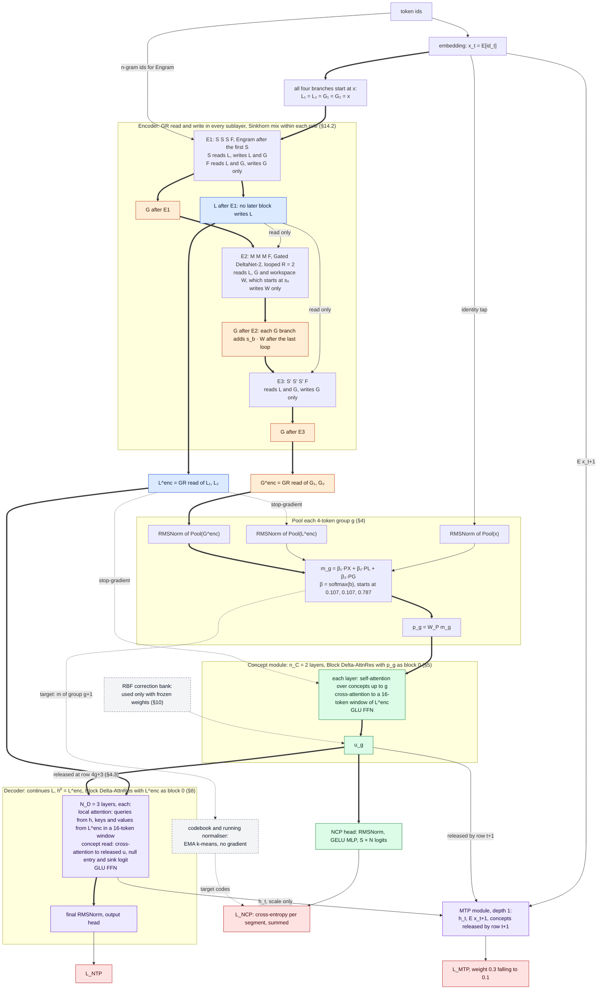
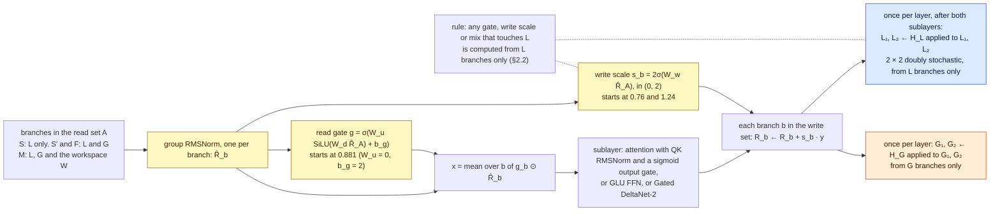
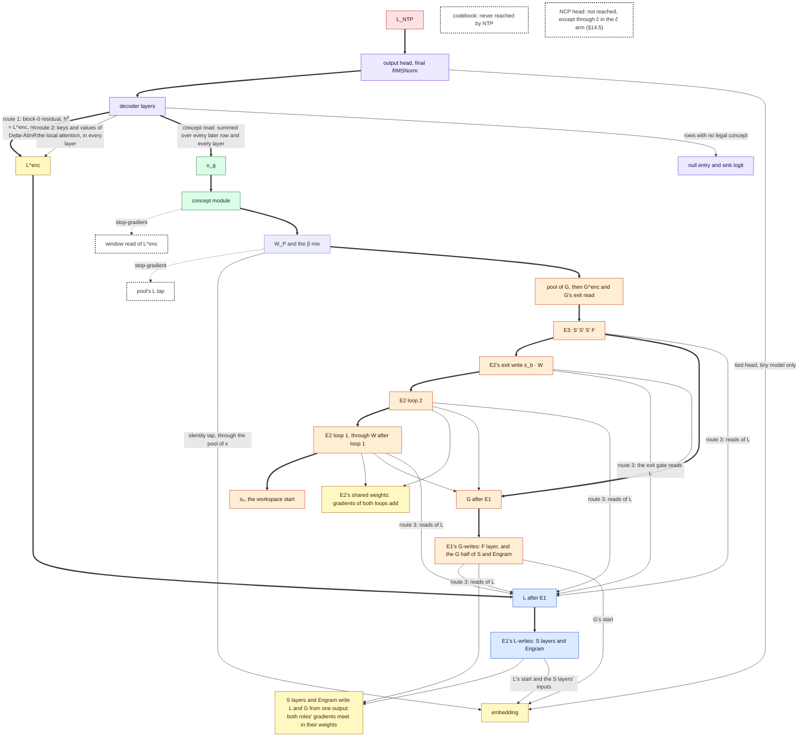
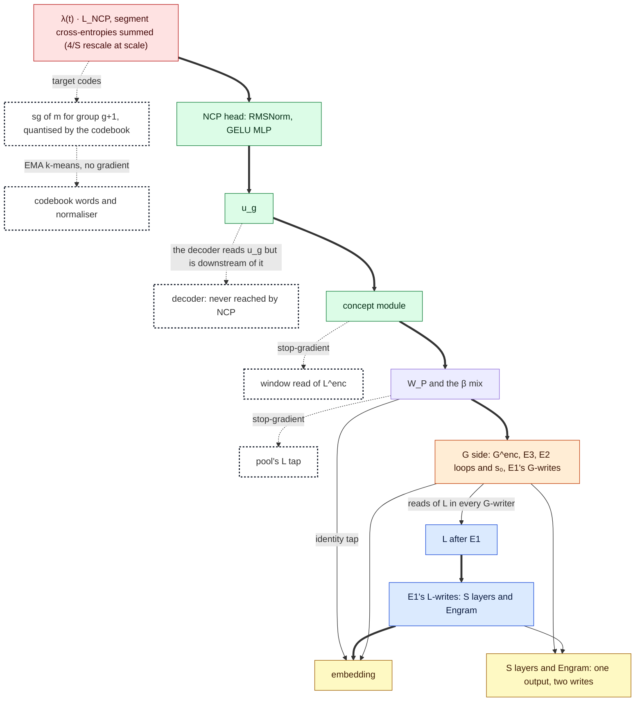
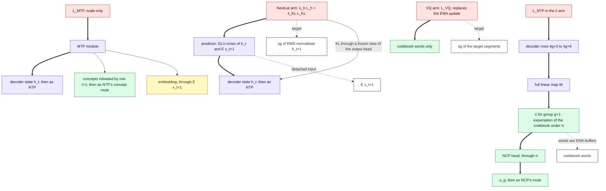
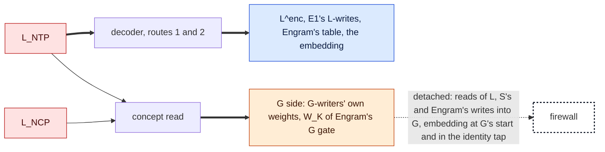
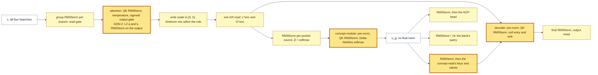

# V13 — Notes: a two-stream Encoder · Concept · Decoder

**Status: design document, 13–14 Oct 2026. Nothing in it is implemented or trained.** Every mechanism below carries
one of three labels: **measured here** (a result from this repository, cited by file), **measured elsewhere** (a
published result, cited by paper), or **untested** (a design choice with no evidence yet for this composition).
Advisor consultations are logged in [`v13_design/ADVISOR_LOG.md`](v13_design/ADVISOR_LOG.md).

The starting point is the user's proposal (quoted in §2.0). Each section takes one stage of the forward pass, states
the first-principles job of that stage, weighs the options against the repository's own measurements and the
literature, and ends with a decision and the check that would show the decision wrong.

## 0. Summary

**What V13 is.** A 12-layer encoder carries two roles of residual stream from the embedding onward: L, whose reach is
bounded, and G, which sees the whole prefix. Each role is two branches wide.
- E1 is [S, S, S, F] with Engram after the first S layer.
- E2 is a [M, M, M, F] block of Gated DeltaNet-2 that loops twice over a workspace and writes it into G.
- E3 is [S′, S′, S′, F] and writes G only.

Every 4 tokens, three sources (the embedding, which §4.2 calls the identity tap; sg[L]; and G) are each pooled by a
per-channel softmax and mixed into one concept input. A concept module turns these into states u_g. It uses gated attention, Block Delta-AttnRes over depth
and a 16-token cross-attention window onto sg[L]. A head on u_g predicts the next group's product-quantised code (NCP,
cross-entropy). The decoder continues L. Its local attention reads L^enc in a window, and its only long-range input
is cross-attention to the released concept states. Continual learning is V10.3's: an RBF correction bank at the concept
module's output while the weights are frozen, then consolidation into gated LoRA adapters.

**The central invariant.** Every coefficient that touches L is computed from L only, so information moves from L to G
and never back (§2.2). The decoder's direct reach is therefore bounded: R_D = 71 tokens in the tiny model and 327 at
scale (D-confined). *Information from further back reaches the next-token logits only through the concept module*
(§2.3). This is the guarantee V12 lacked; its NTP-only model barely used C (C1).

**What happened to each part of the proposal.**

| The proposal | V13 | Why | § |
|---|---|---|---|
| Two residual streams, L and G, from the embedding to the encoder's end | Kept: two roles, each widened to two branches | — | §2 |
| mHC with Qwen3.8's gated residual | GR read and write in every sublayer; mHC's Sinkhorn mix only *within* a role (an ablation, since Qwen3.8 found the mix adds nothing once read and write are expressive); every coefficient touching L computed from L | mHC's doubly stochastic mix would carry G's full-attention writes into L inside the encoder, and the concept path would become optional (C1) | §2.1, §3.4 |
| 3 SWA : 1 full gated attention, gated FFNs | E1 [S, S, S, F]: G1-gated attention, SwiGLU; F layers write G only; at scale F is gated MLA without position encoding (K3) | an unbounded layer that wrote L would break the invariant | §3.2–§3.3 |
| E2: recurrence of 2 (at most 3) over an empty workspace with gated linear attention, "state 1 → next state" | GDN-2 [M, M, M, F] looped R = 2 over a learned workspace s₀; W⁽¹⁾ and W⁽²⁾ are the two states; MoE experts at scale | every loop measured here was inert (C4); in published work looping pays only with MoE, so the tiny test does not gate on it | §3.6 |
| Engram in the encoder | After E1's first S layer, one gate per branch; about 20% of the inactive parameters at scale | Engram's allocation optimum | §3.5 |
| E3 with mHC | [S′, S′, S′, F] with the within-G mix; writes G only | an E3 that wrote L would add to the decoder's reach | §3.7 |
| G → chunk pooling (average or attention), optional compression FFN | A per-channel softmax over each 4-token group, initialised to the exact mean, on three sources; no FFN | DeepSeek-V4's compressor; NCP-Arch used the plain mean | §4 |
| Concept module: gated attention and FFN, optional recurrence, CRC-style cross-attention to L, RDL correction, gated LoRA | No loop; Block Delta-AttnRes; cross-attention from each concept to a 16-token window of sg[L]; RBF bank at its output; LoRA sites | loops and depth routers were inert here (C4); a content-based read over positions replaces CRC's read over depths | §5 |
| Concept head → N^S codebook → VQ → soft PQ | PQ codebook (4 × 32 tiny, 56 × 128 at 2.8T) moved by EMA k-means; NCP as cross-entropy per segment; VQ loss weight 0 (an arm); the soft-PQ forecast ĉ is derived | squared-error regression predicts the conditional mean (C2); a weight-decayed codebook shrank (V10.3 N3) | §6 |
| Shift and repetition of concepts into the decoder by cross-attention | Row t reads concepts up to j*(t) = ⌊(t+1)/4⌋ − 1, the forecast of the group it is writing; every decoder layer reads the released history; the decoder reads u, and ĉ injection is an arm | in V10.1 a forecast fed through a gain shrank toward a constant; ĉ is a function of u | §7 |
| RDL correction and gated LoRA in the decoder (optional) | Gated LoRA, yes; RBF read, no | corrections then act only on what the decoder reads from the concept path | §8 |
| L → NTP or MTP; G → HiLP or NextLat, a hindsight view for the concept module | NTP (and MTP at scale) on the decoder. HiLP's upper level becomes NCP on the concept path. NextLat on the decoder's final state is an arm, and so is a decoder-side "hindsight" NCP target | HiLP's own upper loss is a regression (C2); NextLat's theory concerns the state the output head reads | §9.1 |
| NTP + HiLP or NextLat + NCP + VQ, all weighted | L_NTP + w_MTP·L_MTP + λ(t)·L_NCP, with λ ramping 0 → 0.1 over the first 10% of steps; NextLat and VQ as arms | NCP cost V12 +0.28 nats on text (C3) | §9.2 |
| Scale like Kimi K3 (2.8T) | 2.78T stored, 115B active, 213B FLOPs per token, 768 experts, a 550B Engram table, 11.1 GB of cache per 1M-token sequence | every part is measured somewhere; the composition is not | §11 |
| V10.3's continual learning | Inherited with V10.3's corrections: σ and η calibrated together, Φ_neg covering every phase, no smoothing at concept rate | V10.3's gate G4 passed | §10 |

**Two decisions are the user's.**
1. **The decoder's local attention** (§8.2). Everything else is the same under all three options.

   | Option | R_D at 2.8T | ρ at K3's 8K start | ρ at V4's 4K start |
   |---|---:|---:|---:|
   | D-confined (default): keys and values from L^enc in a window | 327 | 0.04 | 0.08 |
   | D-mixed: confined except the top two layers | 357 | 0.04 | 0.09 |
   | D-own-SWA (DeepSeek-V4's shape): windows over the decoder's own states | 7,312 | 0.89 | 1.79 |

   Under own-SWA the guarantee is absent until the 64K phase, and NCP alone forces the concept path's use there.
   **Recommendation:** decide from §12's R5. If the confined decoder is within the noise floor of own-SWA, keep it at
   scale.
2. **Whether to run the L-firewall arm** (§4.2, stage 2). By default NCP's gradients reach L's layers through every
   G-writer that reads L. The arm detaches everything G takes from L, so that L is trained by NTP's local read alone.
   It measures whether NCP's shaping of L costs NTP.

**Evidence.** §13.1 lists 19 mechanisms under the document's three labels; a mechanism counts under a label when its
cell in that column is not "—". 14 are *measured here* and 15 *measured elsewhere* (11 both). One, NCP and NTP
gradients both shaping L, is neither. 16 of the 19 have an *untested* part in this composition; only Engram in E1, the
pooling operator and the decoder reading u have none. All V12 evidence comes from one training seed per arm. V10.3's sleep
results come from one tiny base, and its gate findings from frozen V10.1 checkpoints.

**What the tiny test decides (§12).** Six runs on the M2 in three pairs:
- V13-confined with the λ ramp, and with λ = 0;
- TF-confined (V13 without the concept path, at the same reach), and TF-full;
- V13-own-SWA, and a second seed of V13-confined.

Every arm is compared at step 8,000; pair 1 runs on to 12,000. The reads that matter most:
- **R1, the thesis.** With λ = 0, removing the concepts' example-specific content must cost something on text and
  pinpad, under both the training-mean substitution and a shuffle across rows (intervals excluding 0). This replaces
  V12's pre-registered bar, ≥ 0.02 nats when the concept read is zeroed: V4.1's and V12's own reads show that each
  switch-off has its own false positive, so the two must agree. The 0.02 is still reported.
- **R2, long range, read twice.** *Transport:* recall beyond 71 tokens is above chance (1/32) and falls to chance when
  the concepts are mean-substituted. *Binding:* on a one-query panel, recall is above 1/4, the score of a model that
  knows which values occur in the row but not which key each belongs to. V1's 0.403 showed transport but not binding;
  a model carrying only the value set could have scored about 0.5 on V1's task.
- R3 prices NCP; R4 (gated on base competence, G1) tests whether C computes rather than aggregates; R5 prices
  confinement against own-SWA; R6 measures what C buys at fixed reach; R7 applies §2.3's check on Option A against
  TF-full.

**Single seed.** Only V13-confined is run twice. A difference against a comparator that survives V13's second seed is
reported as "replicated on the V13 side only"; any other difference is "observed, seed-unreplicated".

**Main risks** (§13.2): the concept path may not carry precise facts in a mixed corpus; the confined decoder may cost
too much on text; NCP's price may persist.

**Forward and backward, drawn (§14).** Seven mermaid diagrams trace the forward pass and each objective's gradient back
through the decoder, the concept module and the encoder. A table shows where gradients meet, and a map shows every
norm. The analysis added two norm sites to the design: RMSNorm on queries and keys, with a per-head temperature, in
every softmax attention (§3.3); and RMSNorm on u_g before the decoder's concept read (§7.1). It also found that GDN-2's
erase step is not norm-bounded: its spectral norm reaches 2/√3, by V13's own derivation, since the paper gives no
bound. Its state norm is now logged, with the KDA tie as the fallback (§3.6).

**Next physical action.** Nothing is implemented yet.
1. Write the model and pass G0, the float64 unit tests:
   - reach(L) = 56, and R_D exactly 71 for the confined arms and TF-confined and 101 for own-SWA;
   - no leakage across packed documents;
   - concept g readable from row 4g+3 only;
   - GDN-2 state reset and Engram boundary ids.
2. Run the 200-step smoke test of every arm alone, recording seconds per step and peak MPS memory. These set the
   pairing and decide the R = 1 fallback.
3. Start pair 1.

**Process.** This document had 29 advisor consultations, each logged as it happened in
[`v13_design/ADVISOR_LOG.md`](v13_design/ADVISOR_LOG.md). Consultations 1–21 built and reviewed §1–§13, 22–23 reviewed
§0 and the whole document, and 24–28 planned and reviewed §14 (plan, forward, backward, stability, final). The 29th,
an assessment after completion, found that §2.3's check on Option A had no row in §12.5; it is now R7. The request
was for more than 40; the log is not padded to reach that number.

## 1. What the design has to satisfy

V1–V12 produced a small number of hard-won facts. Each is a constraint on V13, not a suggestion.

| # | Constraint | Evidence | Consequence for V13 |
|---|---|---|---|
| C1 | **A decoder that can reach distant tokens without the concept path will route around it.** | Original encoder spec, harness F6: when the decoder reads G, about 63% of its skill survives with the core switched off ([HRM_THINKER_ENCODER_v1_SPEC.md](Encoder%20Design/HRM_THINKER_ENCODER_v1_SPEC.md) §15). V12 (one training seed per arm): the NTP-only ECD barely used C. At step 8,000, zeroing the concept route cost +0.002 nats per pinpad action, +0.002 on math and +0.024 on text, against +0.415 and +0.185 with NCP ([RESULTS.md](v12_tiny/RESULTS.md)). On held-out newmath zeroing cost +0.187, but shuffling concepts across rows cost only +0.014, so little of that was use of the right content: V12 found newmath "usage" to be largely an artefact of zeroing (`v12_tiny/runs/ECD_s1/usage_ckpt_8000.json`). | Either a structural guarantee (nothing with unbounded reach reaches the decoder except through C) or an objective that forces use (NCP). V12 had only the objective and paid for it (C3). |
| C2 | **Regressing the next concept with squared error predicts the conditional mean.** | V10.1 → V11: the soft-PQ forecast carried 3–14% of its target's variance; the decoder scaled it down further ([V10_3_RCDL_Architecture.md](V10_3_RCDL_Architecture.md) §1.2). V12 switched to cross-entropy over segment codes, and that is what made C informative: on pinpad, u beats its input by 7.7 points on next-segment codes (one training seed). | NCP is a classification over codes. The soft-PQ expectation is a derived quantity, not the training target. |
| C3 | **NCP has a price.** | V12 at matched step 8k (one training seed per arm): +0.28 nats text and +0.27 math against the same topology without NCP; C's gradient 1.3–2.5× NCP-dominated; 37–64% of codes reassign between 4k and 8k ([v12_Architecture.md](v12_Architecture.md) §6, D2–D3). | λ is scheduled, not fixed; a late slow-down or freeze of the codebook is a pre-registered arm (§6.1, §12.3); the codebook is never weight-decayed (V10.3 N3; in V13 it is not a parameter at all). |
| C4 | **Every loop measured in this repository has been inert.** | V10.3: visit-2 and visit-1 forecasts differ by ≤ 0.004 FVU. V12 D7. Literature: looping pays under a matched budget only with sparse (MoE) FFNs (SMELT, 6.8–18% FLOPs saved, up to 54B; "Sparse Layers are Critical to Scaling Looped LMs": dense looped models do not scale). | E2's recurrence must be justified at the scale where it is MoE. The tiny test may not depend on it for its verdict. |
| C5 | **A recurrent workspace must start at full scale, and its input must be read-only.** | Concept-module review A1: a learned scratchpad s₀ with ‖s₀‖ ≈ √d, input stream read-only, raised 6-hop accuracy at R = 8 from 49% to 92% (mean of two seeds) and cut the pass-1 : pass-4 gradient ratio from 25–49× to 1.8–12× ([HRM_THINKER_Concept_Module.md](Concept%20Design/HRM_THINKER_Concept_Module.md) §13.7). | E2's workspace and any concept-module scratchpad use this initialisation. |
| C6 | **Continual-learning gates protect only what their reference covers, and only dissimilar skills.** | V10.3's gate probes on frozen V10.1 10M checkpoints: a text-only Φneg let a math gate open on 37–99% of unseen Sudoku; a reference covering every family cut this to 0–7%. Temporal smoothing cut group-rate hit rates from 1.00 to 0.24–0.29. V10.3's sleep test (one tiny base, X8 seed 1): related add/subtract forgot +0.26 to +0.46 under every method ([V10_3_RCDL_Architecture.md](V10_3_RCDL_Architecture.md) §1.4, N7, N9; [V10_3_tiny_REPORT.md](V10_3_tiny_REPORT.md) §8). | Inherit these corrections verbatim (§10). |
| C7 | **Mechanisms measured on an incompetent base are uninformative.** | V12 bases completed some pretraining task on only 16–28% of closed-loop rollouts (`rollout.py`, judge = any), against the paper's ~80%; every downstream null was first a statement about that. | The tiny test's first gate is base competence against a matched plain transformer (§12). |
| C8 | **A widened residual stream specialises on its own, but not by guarantee.** | Qwen3.8-Next Gated Residual (n = 4): in five checkpoints, exactly one branch carries long-range paths (typical skip 10.9 layers against 3.4–3.9 for the rest); the n × n mixing operator adds nothing once read and write are expressive (loss 1.590 GR vs 1.594 mHC-dynamic vs 1.617 pre-norm, 25B-A3B, 560B tokens). | The L/G split the user wants is the specialisation these models discover; V13 makes it structural (§2). |
| C9 | **Long-range attention at 1M context must be compressed.** | DeepSeek-V4 (§2.3, §4.2.1): in V4-Pro every attention layer is a 128-token sliding-window branch plus compressed KV (V4-Flash's first two layers are sliding-window only). CSA compresses m = 4 tokens into one entry and attends to the top 512 (Flash) or 1,024 (Pro) entries chosen by a lightweight indexer; HCA compresses m′ = 128 tokens per entry. KV cache ≈ 2% of a GQA-8 baseline at 1M. Kimi K3: 3 KDA : 1 MLA. | Any token-level full attention in V13 is a scaling liability; the concept path is the natural place for long-range access (§7, §11). |

## 2. The stream topology: two roles, one rule

### 2.0 The proposal

The user's pipeline, in order:

> tokens → embedding → initialise L and G → E1 (gated SWA : full attention 3:1, gated FFNs) → mHC + Qwen3.8-Next gated
> residual → E2 (recurrence of 2, at most 3, over an empty workspace updated by gated linear attention: Kimi Delta
> Attention or NVIDIA Gated DeltaNet-2) → E3 (mHC) → encoder outputs L and G. G → chunk pooling → concept module (gated
> full attention, gated FFN, an RCDL correction, gated LoRA, cross-attention to L "CRC but better") → concept head →
> S segments × N codes (N^S combinations), soft-softmax PQ as in NCP-Arch → shift and repeat → decoder, where L is the
> main stream and the concepts arrive by cross-attention. L trains NTP (or MTP); G trains HiLP or NextLat. Objective:
> NTP + HiLP/NextLat + NCP + VQ, weighted. L and G never interact after the encoder.

### 2.1 The conflict inside the proposal

mHC's residual operator H_res is doubly stochastic: every output branch is a convex combination of *every* input
branch. If L and G are two branches of one mHC stream, each full-attention write to G is mixed into L at the next
layer. L then carries unbounded-reach information into the decoder, which is C1's failure: the decoder reads distant
context directly and the concept path becomes optional. The proposal's own rule ("L and G never interact after the
encoder") does not prevent this, because the leak happens *inside* the encoder.

The original encoder spec saw this and wrote it down as its scaling note ([spec](Encoder%20Design/HRM_THINKER_ENCODER_v1_SPEC.md),
"streams" row): *2 local + 2 global; gated residual within a role, masks across roles (mHC's doubly stochastic mixing
cannot express one-way flow between roles).* V13 takes that note as the starting design.

### 2.2 Two options

**Option A — role-masked widened streams (recommended).** The residual state is a set of branches with fixed roles,
L₁ … L_{n_L} and G₁ … G_{n_G}. Each sublayer has a declared read set and write set:

| Sublayer | Reach of its own computation | Reads | Writes |
|---|---|---|---|
| S: sliding-window attention, and the FFN after it | bounded (window w) | L | L and G |
| F: full or compressed global attention, and the FFN after it | unbounded | L and G | G only |
| M: gated linear attention (E2) | unbounded (recurrent state over the whole prefix) | L, G, workspace W | W only; W enters G at E2's exit |
| N: Engram n-gram read | bounded: 2 tokens of n-gram span plus 9 of its causal convolution (kernel 4, dilation 3) | token ids; gate query per branch, from that branch only | L and G |
| S′: sliding-window attention in E3, and its FFN | bounded (window w) over an unbounded input | L and G | G only |
| Decoder local attention, D-confined (§8.2) | bounded (w_D) | queries: own row's state; keys/values: L^enc in the window | the decoder stream |
| Decoder local attention, D-own-SWA (§8.2) | bounded per layer, compounding over depth | own state in the window | the decoder stream |
| Decoder concept cross-attention (§7) | unbounded, but only through the concept path | released concepts U_t | the decoder stream |

**E2 rule.** E2 contains no sublayer that writes L. Its M and F sublayers and their FFNs write the workspace W, and W
enters G (only) at E2's exit. No sublayer that reads W may write L, so the looped block cannot open a hole in the
invariant.

The last three rows extend the table to the decoder, which continues the L stream: its only unbounded-reach input is
the concept read, so the invariant is a whole-model statement.

**Invariant.** Every sublayer that writes L reads only L (or token ids) and has bounded look-back. The last operation
that produces L, the encoder's exit read (§3.8), is a gated read over the L branches only. Hence L's reach is
bounded by the sum of the S windows and Engram's span (n-gram plus convolution), and G alone carries unbounded context.
The proof is the original spec's induction over sublayers. One detail matters and is easy to get wrong: **every
coefficient that touches L must be computed from L only.** That covers the gate of a read that feeds an L-writing
sublayer, the scale of a write into L, and the within-role mixing matrix of the L branches. A coefficient computed from
all branches (Qwen GR's default gate, or a data-dependent mHC matrix predicted from the whole stream) would carry G's
content into L through its value.

Within a role, the proposal's mixing machinery applies unchanged:
- **read:** Qwen3.8's GR read: group RMSNorm per branch, an elementwise sigmoid gate predicted from the branches in
  the sublayer's read set, average of the gated branches;
- **write:** a data-dependent scalar per branch, 2σ(·), as in GR and mHC;
- **mix:** mHC's doubly stochastic H_res *within* each role (an n_L × n_L and an n_G × n_G Sinkhorn block). Across
  roles H_res is block diagonal. Information crosses from L to G through every G-writer that reads L (S, F, M, S′) and
never back.

With one branch per role, mHC degenerates to the identity (a 1 × 1 doubly stochastic matrix is 1). The within-role
mix therefore exists only with n_L, n_G ≥ 2. Qwen3.8 measured that H_res adds nothing once the read and write are
expressive, so the within-role mix is an ablation, not a commitment.

**Option B — symmetric mHC, roles assigned at the exit.** Four branches mixed by an unconstrained-role mHC; branches
1–2 are labelled L and 3–4 G when the encoder ends. This is the proposal read literally. Qwen3.8 suggests one branch
would specialise towards long range, but nothing prevents distant content reaching L, so C1 applies in full and the
concept path would need NCP to be used at all, with C3's cost.

### 2.3 Decision

**Option A.** It is the only option under which the concept path is necessary by construction, which V12 showed it is
not otherwise. Its decoder shape is not exotic at scale. V4's attention is a sliding window plus compressed long-range
entries in every layer, the same shape A gives the decoder (§7.2). What A adds beyond V4 is the confinement of the
local branch, whose price §8.2 states and §12 measures.

The decoder completes the guarantee. In the default decoder (D-confined, §8.2) local attention takes its keys and
values from L^enc within a window, and its only long-range input is the concept read. The **central invariant of
V13**: *information from more than R_D tokens back reaches the next-token logits only through the concept module*,
where R_D is the decoder's total local reach (formula in §3.8; the decoder options compared in §8.2).

What A gives up: the decoder cannot copy a token verbatim from far back unless the concept path carries it. With k = 4
tokens per concept and d ≥ 128 per concept, the capacity is there; whether training puts it there is the first
risk of §12.

**Check that would show A wrong** (pre-registered in §12.5 as R7). At matched parameters and tokens, V13-confined loses by
more than the noise floor to TF-full on text NLL *and* on the recall curve, *and* to V13-own-SWA (read R5). Then the
guarantee costs more than it buys, and the fallback is Option B's regime: the decoder attends over its own states, and
NCP forces the concept path's use.

### 2.4 The reach budget: the guarantee only bites if R_D is small against the training context

The invariant says nothing about distances shorter than R_D. If R_D is close to the sequence length the model trains
on, the decoder never *needs* the concept path during pretraining, C1 returns, and NCP is back to doing all the
forcing. A stack of 60 local layers with 2K windows, each attending over its own states, would have R_D ≈ 120K
tokens: the guarantee would be vacuous below that length.

So the windows are chosen for reach, not borrowed from models that chose them for something else. The budget is a
ratio:

  **ρ = R_D / T_train,min ≤ 1/8**, where T_train,min is the shortest sequence length used in pretraining
  (DeepSeek-V4 starts at 4K and extends to 16K, 64K and 1M).

R_D is the sum of three terms (exact formula in §3.8): L's reach at the encoder exit, the decoder's own local reach, and
the n-gram and convolution spans. Two levers keep it small:

1. **Windows.** DeepSeek-V4's local branch is 128 tokens in every layer of a 1.6T model, so a window of 64–128 is
   not a capacity sacrifice at scale; it is what a frontier model already uses beside its compressed long-range path.
2. **Which layers grow L's reach.** A local layer whose keys and values come from a *fixed* L (the encoder's exit
   state) adds its window once, not once per layer. The original confined decoder used this to hold its reach at 70
   tokens across depth ([HRM_THINKER_DECODER_v1_SPEC.md](Decoder%20Design/HRM_THINKER_DECODER_v1_SPEC.md)).

If no setting keeps ρ ≤ 1/8 at some scale tier, the document says so in §11 and states that at that tier the
guarantee is replaced by NCP (Option B's regime). When short documents are packed into rows, the relevant length is the
document's, not the row's: a 30-token math problem sits wholly inside any reach. §12.2's table of where the guarantee
bites is the operational form of ρ.

## 3. The encoder

Job: turn tokens into two representations with different reach. L is a strong *local* representation of each token
(bounded look-back, consumed by the decoder). G is a *global* representation (unbounded look-back, consumed only by
chunk pooling and the concept module). The encoder is where the proposal's residual machinery (mHC, gated residual,
recurrence) lives; after the encoder each role collapses to one stream and the two never meet again except through
the concept path.

Notation: d is the model width; n_L = n_G = 2 branches per role (the minimum at which within-role mixing exists);
R_b is branch b of the residual state; a "layer" is one attention sublayer followed by one FFN sublayer.

### 3.1 Embedding and stream initialisation

x_t = E[id_t] (tied with the output head in the tiny model; untied at scale, as in DeepSeek-V4, which lists the embedding and the prediction head as separate modules). Every branch of both
roles starts at x_t: L₁ = L₂ = G₁ = G₂ = x_t. G must carry token identity into the pooled concept (the original spec
kept an explicit identity tap for this reason), so it does not start empty; the *empty* workspace belongs to E2 (§3.6).

Branches within a role are identical at initialisation, and so are their read gates: the read's up-projection
starts at zero with bias 2, so every gate starts at σ(2) = 0.881 (V1's and V10's initialisation). Symmetry is broken
by per-branch write biases of −0.5 / +0.5, so the two write scales start at 0.76 and 1.24
([v10_10M/ARCHITECTURE.md](v10_10M/ARCHITECTURE.md); Qwen3.8 reports that GR itself needs no special initialisation).
The roles separate from the first F write onwards, because only G receives it.

### 3.2 E1: three local layers to one global layer

E1 is one or more blocks of [S, S, S, F]: three sliding-window layers, then one global layer, with the role masks of
§2.2 (S reads L, writes L and G; F reads L and G, writes G).

**Why 3 : 1, and why SWA rather than linear attention for the local layers.** Both Kimi K3 (69 KDA + 24 MLA, 3:1 with
a final global layer) and Qwen3.8-Next (3 GDN : 1 full) settled on one global layer in four. Qwen3.8 found the GDN
hybrid better than the SWA hybrid at the same ratio (benchmark average 53.81 vs 51.15). V13 nevertheless uses SWA for
E1's local layers, for a reason specific to this design: a linear-attention state has *unbounded* reach, so under the
invariant it could not write L. GDN-2 belongs where unbounded reach is allowed, which is E2 (§3.6).

**Window.** w_E is set by the reach budget of §2.4, not borrowed. 64–128 at scale (DeepSeek-V4's local branch is 128);
16 in the tiny model (§12). Only E1's S layers grow L's reach, each by w_E − 1 tokens; E3's S′ layers write G only
(§3.7).

**Positions.** S layers use RoPE (partial, on the first quarter of each head's dimensions, the measured-here default
of the original encoder). F layers use no positional encoding (NoPE) with a learned per-head temperature: Kimi K3 uses
NoPE on all its global layers and extrapolates to 1M without rescaling; the original V1 encoder used the same split.
Qwen3.8 kept RoPE because NoPE raised the rate of endless generation after post-training. In V13 the F layers write only
G, and termination is decided by the decoder, whose positions come from RoPE in its local attention. So the Qwen failure
mode should not transfer; this is **untested** and has a check: the endless-generation rate after SFT, NoPE-F versus
RoPE-F, at the first scale tier that is post-trained.

**At scale the F layer is not token-level full attention.** It becomes MLA (Kimi K3) or CSA/HCA (DeepSeek-V4); §11.

### 3.3 Gated attention and gated FFN

**Attention gate.** Every attention sublayer (S, F, and the concept module's and decoder's attention) applies the
gate the Gated Attention paper found best among 30 variants (15B MoE and 1.7B dense, 3.5T tokens): an elementwise,
head-specific sigmoid gate on the SDPA output, computed from the sublayer's input, before the output projection,

  o = W_O [ SDPA(q, k, v) ⊙ σ(x W_θ) ].

It removed attention sinks and massive activations, tolerated larger learning rates and improved RULER length
generalisation by more than 10 points. Qwen3-Next and Qwen3.8 use it; Kimi K3 uses the same form on MLA and KDA with a
full-rank W_θ. **Measured elsewhere.**

**Query and key normalisation.** Every softmax attention applies RMSNorm to each query head and to each key head (to
the shared key-value entry in V4-style compressed attention, and after the latent up-projection in the MLA F layers at
scale) just before the scores. That covers E1's and E3's S and F layers, the concept
module's self-attention and its window read of L, the decoder's local attention and its concept read. DeepSeek-V4 does
exactly this in CSA and HCA: "This normalization avoids exploding attention logits". It is also why V4 trains with
Muon without the QK-Clip technique it cites (Liu et al., 2025). The original encoder spec normalised queries and keys
too; V13's draft had dropped the norm until the gradient analysis of §14.7 caught the gap. Gated DeltaNet-2 already
L2-normalises its queries and keys (§3.6).

The norm fixes the logit scale, so each head also needs a learned temperature: q_h ← τ_h q_h, τ_h = exp(log τ_h),
log τ_h initialised to 0, no weight decay. The F layers already have it (§3.2); with the norm it is needed in every
attention. The original spec's check: with normalised heads the largest logit is √d_h, and putting probability p on one
key among N needs a logit gap of ln N + ln(p/(1−p)), which is 9.1 for N = 1,024 and p = 0.9. At the tiny head width,
√32 ≈ 5.7 falls short; at scale √128 ≈ 11.3 clears it only narrowly. **Measured elsewhere** (V4 at 1.6T); carried by
the original encoder; untested in this composition.

**FFN.** "Gated FFN" means a GLU. SwiGLU is used in the tiny model. At scale the experts use Kimi K3's SiTU-GLU,
gate β₁ tanh(x/β₁) σ(x), up β₂ tanh(x/β₂), β₁ = 4, β₂ = 25, which bounds |f| ≤ 100 and was introduced because
unbounded SwiGLU produced exploding activations in K3's routed path. **Measured elsewhere** (K3 at 2.8T).

### 3.4 The residual operator: gated read, scalar write, within-role mix

For a sublayer with read set A and write set W (§2.2), and R̂_b = RMSNorm(R_b; γ_b) normalised per branch:

- **read** (Qwen3.8 GR, restricted to A):
  x = (1/|A|) Σ_{b∈A} g_b ⊙ R̂_b, with g = σ(W_u SiLU(W_d · vec(R̂_A)/|A|) + b_g) ∈ (0,1)^{|A|×d}, bottleneck rank d/8.
  The gate is predicted from the branches in A only (§2.2: a gate computed from G must never feed an L-writing
  sublayer). The read replaces the sublayer's pre-norm. Initialisation: W_u = 0 and b_g = 2, so g = 0.881 at step 0
  (§3.1). As with LoRA's zero factor, W_d receives no gradient until W_u has moved; V1 and V10 trained through this.
- **compute** y = F(x).
- **write** R_b ← R_b + s_b · y for b ∈ W, with s = 2σ(W_w · vec(R̂_A)/|A|), one scalar per written branch.
- **mix** (once per layer, encoder only): R_L ← H^L R_L and R_G ← H^G R_G, each H a Sinkhorn projection (t_max = 20)
  onto the doubly stochastic matrices, predicted from that role's own branches. H is block diagonal across roles.

With n_L = n_G = 2, each H is [[a, 1−a], [1−a, a]]: one number per role per layer. The mix is what the proposal calls
mHC. Qwen3.8 measured that once the read and write are expressive the mix adds nothing (GR 1.590 vs mHC-dynamic 1.594 vs
pre-norm 1.617 loss), while mHC itself improved a 27B model by 0.021 loss over a plain residual. **Default: mix on**
(the user's choice, and cheap at n = 2); **ablation: mix off** (pure GR). Neither combination has been measured with
role masks.

**Alternative depth operator: Attention Residuals.** Kimi K3 uses Block AttnRes (8 blocks of 12 layers, the last one partial): each layer
reads a softmax over earlier block outputs with a learned pseudo-query. In Qwen3.8's comparison (its Table 6, 28 layers),
full AttnRes tied GR (1.762 vs 1.762) and block AttnRes was 0.008–0.011 worse. GR there includes Qwen's GatedNorm, and
adding GatedNorm to AttnRes lowered every AttnRes loss by 0.004–0.005. At 48 layers block AttnRes trailed GR by 0.004. Delta AttnRes (attending to each sublayer's
*change*, not the cumulative state) reports 1.7–8.2% lower validation perplexity than both standard residuals and
AttnRes at 220M–7.6B. Under role masks an
AttnRes read must attend only over earlier outputs that were written into its read set. V13 uses GR in the encoder
(where the widened stream already provides depth routing) and **Block Delta-AttnRes in the single-stream concept module
and decoder** (§5, §8), where the proposal asks for "residual attention" and no widened stream exists.

### 3.5 Engram: conditional memory inside E1

**Job.** Take static local patterns (names, idioms, multi-token words) off the backbone so its early layers do not
spend depth reconstructing them. Engram's own analysis: the module "relieves the backbone's early layers from static
reconstruction" and, by handling local dependencies, freed attention for long context (multi-query NIAH 84.2 → 97.0).
At 27B (iso-parameter, iso-FLOPs against MoE) it gained MMLU +3.4, BBH +5.0, MATH +2.4. **Measured elsewhere.** The
user singled it out as the part of the old encoder worth keeping; V1–V3 carried it, and V10's trainer kept the table on
the CPU with gathered rows retaining autograd (measured here, operationally).

**Placement: one module, in E1, after the first S layer.** Qwen3.8 (Table 7) found a single n-gram layer sufficient
and the first two layers as good as any (loss 1.541 at layers 1 and 2). In its words, distributing the same budget
across multiple layers "yields no consistent benefit". It places the module at layer 2 and prefetches the tables from
host memory. Engram's own ablation points the other way: splitting a 1.6B memory over layers 2 and 6 was slightly
better (validation loss 1.768), and Engram-27B used layers 2 and 15. V13 takes the single module, as the simpler
choice; a second module is a scale-tier option.

**Keys.** Suffix 2- and 3-grams of canonicalised token ids (NFKC, lower-casing: a 23% vocabulary reduction for a 128K
tokenizer), K = 8 hash heads per order, prime-sized tables, multiplicative-XOR hashing. 4-grams were slightly worse
under a fixed budget in Engram's ablation.

**One table, a gate per branch.** Engram §2.4 already solves the multi-branch case: one table and one value
projection W_V shared by all branches, a separate key projection W_K⁽ᵇ⁾ per branch, and a gate per branch,

  α_t⁽ᵇ⁾ = σ( RMSNorm(h_t⁽ᵇ⁾)ᵀ RMSNorm(W_K⁽ᵇ⁾ e_t) / √d ),  u_t⁽ᵇ⁾ = α_t⁽ᵇ⁾ · W_V e_t,

followed by the short causal convolution (kernel 4, dilation 3, zero-initialised) and a residual write into branch b.
The convolution runs separately in each branch, over that branch's own gated value α⁽ᵇ⁾ ⊙ W_V e, with no taps across
branches. A convolution over the concatenated branches would mix G's gated value into L's write.
Because the gate query h⁽ᵇ⁾ is branch b's own state, the L branches' gates are computed from L only: the module
satisfies the role rule of §2.2 by construction. Engram's ablation names branch-specific fusion in a multi-branch
backbone, context-aware gating and tokenizer compression as its three most important components.

**Optimiser and initialisation.** The table uses Adam with 5× the base learning rate and no weight decay (Engram-27B).
The convolution starts at zero (Engram-27B), which makes the convolution branch an identity, so at step 0 the module
writes the gated value α ⊙ W_V e itself, not zero. The table is initialised N(0, 0.02²), never zero. The V1 encoder
found that zeroing both the table and W_V means neither ever receives a gradient (V1 spec, pitfall 5).

**Size.** Every tier uses 16 tables (orders 2 and 3 × 8 hash heads), whose retrieved rows are concatenated into
e_t ∈ R^{d_mem}. Tiny: 8,191 rows × 8 dims per table, so d_mem = 128 = d and the table holds 1.05M parameters. A dense
model has no inactive budget, so the tiny table is sized to its vocabulary of 1,090 tokens, not by the law below.
Engram's sparsity-allocation law is U-shaped: with total and active parameters fixed, moving 20–25% of the
*inactive* parameter budget from routed experts into Engram slots was optimal at both compute budgets tested (validation
loss 1.7248 → 1.7109 at ~10B). Qwen3.8 found a similar loss optimum at a 10× n-gram vocabulary (25% of parameters) but
no clear downstream gain from it, and monotone loss gains from larger tables with saturating benchmarks. V13 sizes
Engram at about 20% of the inactive budget (§11) and treats larger tables as a separate, loss-only lever.

### 3.6 E2: a looped workspace updated by gated linear attention

**Job.** Give G extra sequential depth at a cost that does not grow the parameter count, in the place the literature
finds it pays: the middle of the network (SMELT loops the middle half; Hyperloop loops a middle block; T²MLR finds
recurrence over ~20% of the middle layers beats recurrence over all layers).

**State.**
- One workspace branch W, initialised to a learned vector s₀ with ‖s₀‖ ≈ √d and no weight decay (C5). s₀ carries no
  information about the input, so everything in W that depends on the text was computed by E2.
- L and G are read-only inside E2 (C5's "question stream").

**Block.** [M, M, M, F]: three gated-linear-attention layers to one gated global layer (the K3 / Qwen3.8 ratio), each
followed by an FFN. As in E1, the F sublayer is token-level full attention only in the tiny model; at scale it is
MLA or CSA (§11), because a quadratic layer inside a looped block is paid R times. Every sublayer reads {L, G, W} through the GR read of §3.4 and writes W only (E2 rule, §2.2).

**Loop.** W⁽⁰⁾ = s₀; for r = 1 … R: W⁽ʳ⁾ = Block(W⁽ʳ⁻¹⁾ + e_r ; L, G), with shared weights and a learned per-loop
embedding e_r (V12's visit embedding). R = 2 by default, 3 at most. Each loop rescans the sequence from t = 1 with a
fresh linear-attention state (the SMELT / Hyperloop form). Loop 2 at position t reads W⁽¹⁾ at positions ≤ t only, so
the loop is shared-weight depth and causal by construction. In the proposal's words: "state 1" is W⁽¹⁾, "the next
state" is W⁽²⁾.

**Exit.** G_b ← G_b + s_b · W⁽ᴿ⁾ for each G branch b, with s = 2σ(·) predicted from {L, G, W} (L may inform a write
into G; the invariant forbids only the reverse). W is then discarded.

**The M sublayer: Gated DeltaNet-2.** Per head, with q_t, k_t ∈ R^{d_k} (L2-normalised after SiLU(ShortConv(·))),
v_t ∈ R^{d_v}, and state S_t ∈ R^{d_k × d_v}:

  S_t = (I − k_t (b_t ⊙ k_t)ᵀ) Diag(α_t) S_{t−1} + k_t (w_t ⊙ v_t)ᵀ,  o_t = S_tᵀ q_t,
  b_t = σ(W_b x_t) ∈ [0,1]^{d_k} (erase), w_t = σ(W_w x_t) ∈ [0,1]^{d_v} (write), α_t = exp(g_t) channel-wise over d_k.

Setting b_t = w_t = β_t·1 recovers Kimi Delta Attention; additionally making α_t a scalar recovers Gated DeltaNet. The
output is W_O[σ(W_g x_t) ⊙ RMSNorm(o_t)]: GDN-2 uses a SiLU output gate, Qwen3.8 measured the bounded sigmoid as
better, and K3 uses a full-rank sigmoid; V13 takes the sigmoid. At scale the decay uses K3's lower-bounded form
g_t = g_min σ(e^A z_t), g_min = −5, which lets every chunkwise tile run on tensor cores; the tiny model uses GDN-2's
own softplus form. **Measured elsewhere:** at 1.3B / 100B tokens, GDN-2 beat KDA and GDN in both recurrent and hybrid
settings (hybrid WikiText perplexity 15.62 vs 16.01 KDA and 16.00 GDN; MK-NIAH-1 at 4K 48.0 vs 40.4 and 44.8). One paper,
one scale; KDA is the fallback, and it is the special case, so the choice is reversible by tying two gates.

**A stability property that changes when the gates are decoupled** (V13's own derivation, §14.7). With L2-normalised
keys, KDA's erase factor I − β k kᵀ has spectral norm 1, so one step can never enlarge the state. GDN-2's factor
I − k (b ⊙ k)ᵀ is asymmetric, which the paper notes (its §D.2). Its eigenvalues still lie in [0, 1], but its spectral
norm reaches 2/√3 ≈ 1.155, at binary b with erased key mass 1/3. The decay cannot restore the bound unless every
α ≤ √3/2. So a single step is non-expansive in eigenvalue but not in norm, and products over time can grow
transiently. The paper stores the state in fp32 and gives no norm bound. V13 logs the state norm and each loop's
gradient norm (§12.7), with the KDA tie as the fallback.

**Where the loop is expected to pay, and where it is not.** Every loop measured in this repository was inert (C4).
The external evidence for looping under a matched budget is MoE-only: SMELT's gains were measured on MoE models, and
"Sparse Layers are Critical" traces looped-MoE's advantage to routing that differs between passes through the same
weights. So at scale E2's FFNs are MoE experts and the router sees the loop index. The tiny E2 is dense, and its loop
verdict is uninformative by C4; **the tiny test does not gate on E2** (§12 runs R ∈ {0, 1, 2} as a reported arm only).

**Untested alternatives, recorded with their costs.**
- *Cross-loop state read.* Loop 2's M sublayer also queries loop 1's linear-attention state at the start of its
  chunk, o_t += S⁽¹⁾_{[c(t)]}ᵀ q_t. Causal (the chunk-start state depends only on earlier tokens) and nearly free,
  because the chunkwise algorithm already materialises chunk-start states. This is the most literal reading of "state 1
  → next state". It adds a second state store per loop.
- *Temporal recurrence (T²MLR).* Fuse the previous token's middle-layer output into the current token's input. It is a
  time recurrence, so training is not token-parallel: T²MLR approximates it with 16 forward Jacobi iterations of the
  middle block (backpropagating through 4) per step. Its gains were measured at ≤ 1.7B. Too expensive to be the default.

### 3.7 E3: refine G after the workspace

E3 is one [S′, S′, S′, F] block with the mHC mix within G. The S′ layers are sliding-window layers that read {L, G}
and write **G only**; F reads {L, G} and writes G. E3 therefore never touches L.

Why E3 does not write L: the reach budget (§2.4). Every L-writing local layer adds w_E − 1 to R_D. L's job is local
token features for the decoder; E1 plus Engram give it those, and the decoder adds depth on top. E3's job is to fold
E2's workspace into a G that pooling can use.

### 3.8 The encoder exit and the reach of L

Each role collapses to one d-dimensional stream with one more GR read over its own branches:
L^enc = GRread(L₁, L₂), G^enc = GRread(G₁, G₂). From here on there is one L stream and one G stream, as the proposal
specifies (mHC in the encoder only).

**Reach of L.** Only E1's S layers and the Engram module write L:

  R_L ≤ n_S,E1 · (w_E − 1) + (n_max − 1) + (κ − 1)·δ,

where n_S,E1 is the number of S layers in E1, n_max = 3 is Engram's largest n-gram, and κ = 4, δ = 3 are the kernel and
dilation of Engram's causal convolution (Engram §2.3). It is an upper bound: the terms add whatever Engram's
position among the S layers. The decoder's local reach adds to this. With the default decoder (D-confined, §8.2),
whose local attention reads keys and values from the fixed L^enc,

  R_D = R_L + (w_D − 1);

with the alternative D-own-SWA, each of the N_D decoder layers adds its window: R_D = R_L + N_D · (w_D − 1).

| Tier | n_S,E1 | w_E | R_L | w_D | R_D | T_train,min | ρ = R_D / T_train,min |
|---|---:|---:|---:|---:|---:|---:|---:|
| Tiny (§12) | 3 | 16 | 56 | 16 | 71 | 1,024 | 0.07 |
| Scale (§11) | 3 | 64 | 200 | 128 | 327 | 4,096 | 0.08 |

Both tiers meet ρ ≤ 1/8 only because E3 writes G only and the decoder's local attention is confined. If either choice
is reversed, the table must be recomputed.

## 4. Chunk pooling: from G to concept inputs

**Job.** Turn each completed group of k tokens into one concept input p_g, without losing what the concept module
needs and without letting the pooled vector see a token it should not.

**What the repository already knows, and what it implies.** The pooler has never been the bottleneck. In V10.1, a
linear readout of the concept core's *output* beat one of its *input* by only 0.011–0.042 FVU: the objective, not the
input, limited what the core computed (V10.3 §1.2). So pooling is kept simple and the effort goes into §6's objective.

| Question | Evidence | Decision |
|---|---|---|
| Group size | Fixed k = 4 in V12 and NCP-Arch (8.9B); DeepSeek-V4 compresses KV at m = 4 in a 1.6T model. Fixed k mis-aligned with period-8 structure in V10.3/V11 (Sudoku); learned segmentation is V12's untested item 2. | **k = 4 fixed.** Learned boundaries are a scale question (§11), untested. |
| Slots per group | V10 pooled 8 tokens into 2 slots; no ablation of the slot count exists in the repository. | **One concept per group** (V12's choice; simpler, and no measured benefit for more). |
| Operator | V4 tiny: an attention pooler initialised to the mean selects by content (toy: 0.975 of the weight on a marked token; copy error 0.001 vs 0.339 for a linear pool); on language, poolers tied (+0.017 ± 0.018 paired). DeepSeek-V4's compressor is a per-channel softmax over the block's tokens with a learned positional bias. NCP-Arch's concept input at 8.9B is a plain mean over each 4-token group (its Algorithm 1, `MeanPool_k`). | **A channel-wise softmax pool, initialised to the exact mean** (below). A superset of the mean, scale-proven as a KV compressor, cheaper than a 4-head attention pooler. |
| Pooler FFN | V4 tiny: it wrote (gain 0.56–0.71) but changed nothing (Δ ≈ 0); V4.1 removed it, saving 294,913 parameters. | **No pooler FFN.** The concept module's first FFN does that work. |

### 4.1 The pool

For group g covering tokens 4g … 4g+3, and a source stream H (one of the three below):

  z_i = H_i W_Z + B_{i−4g},  a = softmax over the 4 positions, per channel,  Pool(H)_g = Σ_i a_i ⊙ (H_i W_C),

with W_Z = 0 and B = 0 at initialisation (so a is uniform and the pool is the exact mean of H_i W_C), W_C initialised
to the identity. H is one of x, L^enc and G^enc, and each source has its own W_Z, B and W_C. So each source's pooling
weights are computed from that source alone, and the identity tap is never pooled with weights derived from G. This is
HCA's compressor at m′ = 4 without CSA's overlap. The overlap would let group g's entry read
group g−1's tokens, which is causal but would make the NCP target of group g+1 partly a copy of group g.

### 4.2 Three sources, one concept input

The concept input mixes three pooled sources:

  m_g = β₁ RMSNorm(Pool(x)_g) + β₂ RMSNorm(sg[Pool(L^enc)_g]) + β₃ RMSNorm(Pool(G^enc)_g),  p_g = W_P m_g,
  β = softmax(b), b initialised so β = (0.107, 0.107, 0.787).

Each source is normalised before the mix (NCP-Arch's cross-module connection normalises each source the same way,
its Eq. 19), so the weights compare like with like and the initial mix means what it meant in the original encoder.

- **G^enc** is the main source: it is the only stream with unbounded reach, and it carries E2's workspace.
- **x (the embedding)** is the identity tap: token identity stays linearly available in the concept, which a
  long-range copy through the concept path needs (§2.3's risk).
- **L^enc** is the local tap. In the original encoder this three-way mix moved during training from its initial
  (0.107, 0.107, 0.787) to about 0.08–0.15 identity, 0.11–0.20 local and 0.66–0.81 global: the identity and local taps
  carried about a quarter of the concept input, so they were used (encoder spec, run results). **Measured here.**

**sg on the L tap, and what it does not do.** Reading L into the concept path does not threaten the invariant (that
forbids flow *into* L). Whether NCP's gradient should reach L is a separate question, and the role split does not answer
it: **the split restricts information, not gradients.** Every sublayer that writes G reads L (S, F, M and S′, and the
E2 exit gate; §2.2). So NCP's gradient, and NTP's gradient through the concept read, reach L's values through all of
those reads, and from there every upstream L-writer. They also reach the S layers' and Engram's weights directly,
because those write L and G from one output.

The stop-gradient here, and the one on §5's cross-attention to L, remove only the two routes where the concept path
copies L through a single matrix: the most direct pulls on L toward the concept targets. That matters because V12
measured NCP's gradient on its encoder at up to 0.64× NTP's (pinpad, step 4,000, the only checkpoint measured) and NCP's cost on text at +0.28 nats (C3). It does
not make L "NTP-only".

**Two pre-registered arms** (§12, stage 2):
- **Unstopped taps** measures the two direct routes.
- **L firewall** makes the property true. Everything the G side takes from the L side is detached where it crosses:
  L in every G-writer's read, the S layers' and Engram's writes into G, and the embedding where G starts and in the
  identity tap. In Engram's G branch the lookup e and W_V e are detached but the G gate's key projection W_K⁽ᴳ⁾ still
  trains, so the arm does not also remove Engram from G. L, Engram's table and the embedding are then trained only by NTP through the decoder's local read. The
  cost: the token side can never be tuned to help the concept path.

**What the codebook quantises (fixed here so §6 cannot drift).** The NCP target for group g+1 is sg[m_{g+1}]: the
normalised three-source mix before W_P, i.e. exactly what the concept module consumes for that group (V12's
encoder-target choice, and NCP-Arch's, whose target is the pooled encoder state the module reads). Because the identity
tap is part of m, the target includes the normalised mean of the next four token embeddings. That is the handcrafted
"bag of future tokens" summary of Future Summary Prediction, which improved over NTP and MTP at 3B and 8B (Mahajan et
al., 2025). This supports a pooled-future target; it says nothing about the loss form, which §6 settles.

### 4.3 Release

Group g is complete after token 4g+3. Its concept, and anything computed from it, may be read by the decoder row that
predicts token 4g+4, which is row t = 4g+3 (V12's release rule, `release_mask`: t ≥ 4g + 3). The latest group a row
t may read is ⌊(t+1)/4⌋ − 1. The concept module itself is group-causal: concept g attends to groups ≤ g.

## 5. The concept module

**Job.** Turn the sequence of concept inputs p_1 … p_g into states u_1 … u_g such that u_g carries what the decoder
will need for the next group and beyond, at one quarter of the token rate.

### 5.1 Structure

n_C layers (tiny: 2; scale: §11), one stream, each layer

  [ gated causal self-attention over concepts ≤ g ] → [ gated cross-attention to a window of sg[L^enc] ] → [ gated FFN ],

with Block AttnRes (K3's block form) over sublayer deltas (Delta AttnRes, Luo et al.) as the depth operator (§3.4):
each sublayer reads a softmax over earlier sublayer changes within C, with p_g as the block-0 source. The softmax
scores RMS-normalised sources against a learned query, and each sublayer then applies its own input RMSNorm to the
mixed result (pre-norm), as in the AttnRes reference code. The block rule,
for C and for the decoder alike, is K3's: about 8 blocks recover most of the benefit. Below 8 layers there are no
blocks, and Delta AttnRes runs over every sublayer (the tiny C, 2 layers, and the tiny decoder, 3 layers). At the
2.8T class, C's 16 layers form blocks of 2 and the decoder's 56 layers blocks of 7. At scale the FFN
is MoE, and the self-attention keeps one 512-dimensional shared key-value entry per concept, as in DeepSeek-V4's
compressed attention (§11.3).

**No recurrence in C.** The proposal leaves it open. Every measured second pass over the concept core was inert
(V10.3: ≤ 0.004 FVU; V12's ECDL2e was never run), and the external case for looping is MoE-only (C4). The loop lives in
E2, where the workspace form (C5) applies. Without a loop there is no pass-to-pass bypass to guard against, so C uses
an ordinary residual stream and no scratchpad.

**Positions.** Inside C, RoPE on the group index g. The decoder's cross-attention (§8) places concept g at token
position 4g+3, its release row, so relative position against the reading row t is measured in tokens (V12's
convention). At scale both concept attentions (C's self-attention and the decoder's concept read) use DeepSeek-V4's
partial RoPE: the last 64 of the 512 entry dimensions are rotated, and so is the output, by the query's negative
position (§7.2). C does not use K3's NoPE. K3's global layers can drop positions because its KDA layers supply them,
and C has no recurrent or local layer of its own to do that.

### 5.2 "CRC, but better": a windowed cross-attention from concepts to L

The original cross-module connection (and NCP-Arch's CRC, Eq. 19) mixes *depths* of the source module with a
softmax router. Depth routers were measured inert in this repository: the original decoder's routers changed loss by
+0.0005 to +0.008 nats, and V4.1 deferred them for that reason (draft_v4_1 §3 C12). What the pooled input cannot do is
select *tokens*: pooling averages the four tokens of a group and never sees the tokens just before it.

So the "better CRC" is content-based over positions, not depths. Concept g's query attends to sg[L^enc] at token
positions [4g+3 − w_C + 1, 4g+3], with w_C = 16 (its own group and the three before it). Keys and values come from L
through a stop-gradient (§4.2). It is causal: every key position is ≤ 4g+3, the row at which concept g is released.
Positions follow §7.1's convention in reverse: the query carries RoPE at 4g+3, its release row, and each key carries
RoPE at its own token position, so the scores see token offsets 0–15.

**Why it might be redundant, and how that is checked.** G^enc already read L in every F layer, and m_g already contains
a pooled L tap. The cross-attention earns its place only if token-level selection inside a short window adds what
pooling removed: within-group order, and the identity of a specific token. **Default on** (the proposal asks for it);
**pre-registered ablation:** off, at matched parameters. Untested.

### 5.3 The control point

For a later frozen-base metacontroller (V12 §2.7), the control point is mid-C, between layers ⌊n_C/2⌋ and
⌊n_C/2⌋+1. V12 found mid-C the weakest of four controlled points on an incompetent base (V12 D4); the choice is
re-measured, not assumed (§12). The metacontroller is otherwise outside this document; V12 D6's ordering stands (test
it first on a frozen open model).

### 5.4 Two continual-learning hooks (mechanics in §10)

- **The RCDL correction bank is read once, after C's last layer:** u_g = u_g^pre + Σ_i k_σ(q_g, k_i)·[π_i = π_g]·v_i,
  with q_g = RMSNorm(u_g^pre)/√d (unit norm, the scale of V10.2's query, so V10.3's σ calibration transfers), k_σ an
  RBF kernel exp(−‖q − k_i‖²/2σ²), and π a partition key. V10.2 partitioned by its exploration (strategy) code, which V13 does not have.
  The replacement is the segment-1 PQ code of the group's own input m_g, known when the group completes. It is
  well-defined: m_g is the same kind of vector as the NCP targets m_{g+1} that the codebook is fitted to (§4.2), so the
  same codebook and normaliser quantise it. A partition
  key is a codebook lookup, so a bank is valid only under one codebook state: the era fingerprint covers the codebook
  buffers (V10.2's `model_era` hashes the whole state dict, which includes them). With N = 32 segment-1 codes, the
  tiny bank's capacity of 8,192 rows is about 256 rows per partition. Ablation: no partition (σ alone). The bank is
  written only with frozen weights (§10). A correction changes only what the decoder reads from the concept path; the
  local path from L^enc to the decoder is untouched by it. In V10.3 this placement gave
  −1.55 nats on an unseen module with frozen weights.
- **Gated LoRA sites:** the self-attention (qkv, out), the cross-attention (q, kv, out) and the FFN (up, down) of every
  concept layer. Gates are computed on an adapter-off pass of the frozen model, without temporal smoothing at concept
  rate (C6: smoothing cut group-rate hit rates from 1.00 to 0.24–0.29).

## 6. The concept head: product codebook, next-concept prediction, soft PQ

**Job.** Give the concept module a target it cannot satisfy by copying its input or by predicting an average: the
discrete identity of the *next* group, in a codebook that tracks the distribution of concept inputs.

### 6.1 The codebook

- **Product quantisation.** The target vector is split into S segments of width d_s = d/S; segment s has its own
  codebook of N words. One concept is one word per segment, so the codebook names N^S distinct concepts with S·N
  stored words (the proposal's "N^S combinations"). Tiny: S = 4, N = 32, d_s = 32 (V12), so 32⁴ ≈ 1.05M names from 128
  words. NCP-Arch at 8.9B: S = 32, N = 128, d_s = 128. At scale V13 keeps d_s = 128 and sets S = d/128 (§11).
- **What is quantised:** sg[m_{g+1}] (§4.2), normalised by running per-coordinate mean and variance (EMA 0.99).
- **How the words move: EMA k-means, never by gradient** (V12's `PQCodebook`). Each step assigns every target segment
  to its nearest word and moves each used word toward the mean of its assigned segments (decay 0.99).
- **Dead-code reset, with V12's fix.** A word whose EMA usage falls below 2% of uniform is replaced by a random current
  target segment. The threshold compares two EMAs, the word's count and the EMA of rows per step. An earlier version
  compared against the batch count and repeatedly reset the words of minority families in the shared codebook (V12
  advisor #6). **Measured here.**
- **One codebook and one normaliser across all data families**, as NCP at scale requires. Per-family code perplexity is
  logged; a family whose perplexity falls toward 1 is collapsing.

**The proposal's "VQ codebook loss".** NCP-Arch trains its words with a loss (its Eq. 21): the mean over groups and
segments of ‖sg(c) − d‖², where c is a target segment and d its nearest word. So its codebook is a trained parameter. In this repository a codebook trained as a parameter shrank from RMS 0.89 to 0.48 under
weight decay 0.1 (V10.3 N3), dragging the forecast toward zero. EMA k-means has no parameters, so it has no decay
problem, and it is what V12 measured. **Default: the VQ term's weight is 0; the EMA update does its job.** L_VQ is
kept as an arm, with the words in the no-decay group if it runs.

**Drift.** For fixed inputs, 37–64% of V12's codes were reassigned between steps 4k and 8k: the head chases a moving
target. Untested candidate (V12 D3): raise the EMA decay to 0.999 after warm-up and freeze the words and the normaliser
for the last quarter of training. The bank of §5.4 is keyed by codes, so a frozen codebook is also what keeps a
correction-bank era valid for long.

### 6.2 Next-concept prediction as classification

A head on u_g (RMSNorm → width-2d GELU MLP → S × N logits; V12's `NCPHead`) predicts the next group's code in every
segment, and the loss sums the segment cross-entropies:

  L_NCP = mean over valid g of Σ_s CE( logits_s(u_g), idx_s(sg[m_{g+1}]) ).

This is V12's reduction (`ncp_ce`: summed over segments, averaged over groups), so at S = 4 the weight λ = 0.1 means
what it meant in V12. A sum grows with S, and the 2.8T class has S = 56, so at scale the sum is rescaled to
(4/S) Σ_s. That keeps NCP's weight per group independent of the segment count; the gradient-share log of §12.7 checks
it. The rescale is V13's own: NCP-Arch's NCP loss is a mean squared error over the whole concatenated vector (its
Eq. 22), with no per-segment structure to copy.

Why classification and not regression: the minimiser of a squared error is the conditional mean, which is not a
concept when the future is multimodal (C2). Per-segment CE keeps each segment's mode. The joint over segments is
treated as a product of independent categoricals given u_g, so correlations between segments are not modelled; an
autoregressive head over segments would model them and is **untested**.

**Gradient route.** L_NCP trains the head, the concept module and every encoder parameter on the G side: E2, E3, the F
layers and the pool of G. Through the G-writers' reads of L, and through the S layers and Engram (which write L and G
from one output), it also reaches L's layers and the embedding (§4.2). The two stop-gradient taps remove only the direct
copies of L. It does not reach the decoder.

**Why keep NCP when Option A already forces the concept path to be used.** In V12, NCP was what made C used at all; its
benefit and its forcing role could not be separated. Under Option A the decoder depends on C by construction, so the
ablation λ = 0 becomes a clean measurement of what NCP adds as a *shaping* objective. Two things are expected from it:
a state that predicts the next group better than its input (V12: +7.7 points), and discrete codes that later
search and control can act on (V9's concept search, the XM code bank). A structural expectation, **untested**: with D
depending on C, NTP's gradient through D's concept read is a stronger force against code collapse than in V12, where it
was the only counter-force and was weak.

**Weight λ: scheduled, not fixed.** At step 8k (one training seed per arm), V12's λ = 0.1 cost +0.03 nats per pinpad action, +0.28 on text and
+0.27 on math (V12 advisor #18), and C's gradient was 1.3–2.5× NCP-dominated. The cost was smallest on pinpad, where
NCP's usage was largest, so the cost read (R3) gates on text and reports all three families. **Default:** λ ramps from
0 to 0.1 over the first 10% of the scheduled steps (1,200 of 12,000 in the tiny test, so arms stopped at 8,000 share the
ramp with pair 1). **Untested candidate:** a
cap on NCP's gradient share on C at 1× NTP's, measured every 500 steps on one held batch (it needs two backward passes,
as V12's `grad_share.py` did offline), halving λ after two consecutive readings above 1, with a floor of λ_max/8. This
cap is a new rule: V12 pre-registered ≤ 1× on E and C, then amended its acceptance to E only after C measured 1.3–2.5×
(V12 advisor #12). **Pre-registered cost read** (V12 advisor #17's thresholds), against the λ = 0 arm at steps 8,000
and 12,000 (§12.5, R3): a text-NLL cost ≤ 0.02 nats is acceptable; > 0.1 nats still present at 12,000 means the schedule
failed.

**Acceptance test that C computes rather than aggregates** (V12 Decision 3.4's information test, with the MLP probe
class V12 later made primary): an MLP probe on u_g predicts the next group's codes at least 5 points better than an
MLP probe on its own input p_g, on the data family with a ground-truth latent. V12 reached 7.7. The 5-point threshold
is V13's, set just above V12's 2–4-point probe-class noise floor. Pre-registered for §12.

### 6.3 The soft-PQ forecast ĉ

The proposal's "soft softmax PQ" is the expectation of the codebook under the head's distribution:

  π_s = softmax(logits_s(u_g)),  ĉ_{g+1} = μ + σ ⊙ ⊕_s Σ_n π_{s,n} e_{s,n},

de-normalised by the running statistics. It is a *derived* quantity: L_NCP trains π, and ĉ follows.

**Does the decoder read ĉ, u, or both?** Two measured facts decide the default.
- In V10.1, ĉ reached the decoder through a per-coordinate gain that *fell* during training (RMS 0.106 → 0.073), until
  the route could be replaced by a constant at little cost (V10.3 §1.2). The forecast had shrunk to 3–14% of its
  target's variance, and the decoder scaled it down further.
- V12's usage result came from the decoder reading u by cross-attention, and ĉ_{g+1} is a function of u_g (the head is a
  readout of u_g), so a decoder that reads u can compute the forecast itself.

**Default: the decoder reads u (§8).** **Pre-registered arm: ĉ injection** in NCP-Arch's shift-and-repeat form, through a
full learned linear map (V10.3 N2, never a per-coordinate gain): decoder rows t ∈ [4g+3, 4g+6], which predict the
tokens of group g+1, receive ĉ_{g+1}. As in NCP-Arch, ĉ is injected unstopped, so NTP also trains the head and C
through ĉ. V10.1's falling gain was measured under that same unstopped form; the arm tests whether a full linear map
changes the outcome. The ratio var(injected)/var(target) is logged. The user's intuition is the reason
for the arm: ĉ_{g+1} is the forecast of exactly the group being decoded, the one genuinely predictive thing NCP
produces. Whether the decoder extracts it from u or needs it handed over is what the arm measures.

Beyond the decoder, ĉ is the natural interface for speculative drafting: NCP-Arch injected concept representations into
a DFlash2 drafter and raised the mean accepted length by 4.17%. **Measured elsewhere.**

## 7. What the decoder reads from the concept path: shift, repeat, and attend

**Job.** Deliver the concept path's content to every token row that may legally see it, and nothing earlier.

### 7.1 The read

Every decoder layer has a cross-attention sublayer over the released concept history U_t = { u_g : 4g+3 ≤ t }:
query from the decoder state at row t (RoPE position t), keys and values projected from RMSNorm(u_g) (RoPE position
4g+3), with the G1 output gate and the query and key norms of §3.3. The concept module ends without a norm of its own,
so each reader of u_g normalises its copy: this read, the NCP head (§6.2) and the bank's query (§5.4). Two separate devices handle rows with nothing useful to read:
- a **null key/value** (V1's null plan, a learned entry) is always present, so rows with no legal concept (t < 3, and
  the first three rows of each document) attend to it instead of V12's NaN-to-zero;
- a per-head **sink logit** in the softmax denominator (DeepSeek-V4's attention sink) lets every row put near-zero total
  weight on concepts when they are irrelevant.

Neither device carries information from any position. The V1 encoder forbade sinks (V1 spec, pitfall 2), but the sinks
it meant are real early tokens that every row attends to, which would carry the start of the document into L. A sink
logit has no value, and the null entry is a learned constant.

**Documents.** Concept keys are masked to the row's own document (V1 rule R6): a packed sequence never lets a document
read another document's concepts. Pooling groups never straddle a document boundary; the group clock restarts at each
document (V10's convention). The same holds in every other mixer of a packed row, and each is a silent leak if missed:
- every attention is masked to the document;
- every short convolution (Engram's, and GDN-2's on q, k and v) is cut at the boundary (V1 pitfall 1 measured a 25.0
  change in the next document when one was not);
- Engram's n-gram keys use a boundary id rather than tokens of the previous document (V1 pitfall 4);
- GDN-2's state is reset to zero at each document start, in both loops.

This *is* the proposal's "shift and repetition of the concept vectors". Repetition is implicit (every row of group g+1
reads the same released set), and the shift is the release rule (§4.3): row t's newest legal concept is
j*(t) = ⌊(t+1)/4⌋ − 1, whose NCP head forecasts the group containing token t+1. The newest concept a row can read is
always about the group that row is writing (V1 decoder spec §4: "the shift is not a convention; it is the latest legal
read, and it happens to be perfectly aligned with the target").

**Reading many concepts, not one.** The original decoder read one plan per row and forbade combining plans (its rule
R7), to keep the concept core's recurrence in use (failure F7). V13's concept module has no loop to protect, and a
decoder that must retrieve a specific distant fact needs to address more than the newest concept. So V13 reads the
whole released history (V12's form; NCP-Arch injects at every decoder layer).

### 7.2 At scale the read is DeepSeek-V4's compressed attention, with C as the compressor

Reading all T/4 concepts from every row costs O(T²/4): at 1M tokens that is still quadratic. But the concept history
*is* a 4× compressed KV sequence, the same ratio as DeepSeek-V4's CSA (m = 4). So V13's decoder layer has exactly V4's
per-layer composition: a local window over tokens (§8.1) plus attention over compressed entries. The difference is
that V13's compressor is a trained concept module with its own objective, where V4's is a softmax over each block.

- **CSA over concepts:** a lightning indexer (low-rank queries from the row state, ReLU-scored against compressed
  indexer keys of u_g) selects the top 512–1,024 concept entries per row. **V13 adds** that the newest 32 concepts
  (128 tokens) are always included. V4 selects purely by indexer score and covers recency with its token-level
  sliding window. V13's newest concepts are the forecasts of the group a row is writing (§7.1), and its local branch
  over L^enc does not see concepts, so recency at concept level has to be guaranteed separately.
- **HCA over concepts** in alternate layers: concepts pooled again in blocks of 32 (m′ = 128 tokens, V4's value).
- **Training schedule (V4's):** dense concept attention first. V4-Flash trained dense for the first 1T tokens and
  introduced sparse attention at the 64K sequence-length phase, after a short indexer warm-up; V4-Pro kept a longer
  dense stage.
- **Positions at scale:** full RoPE at 4g+3 over 250K concept entries is not what any 1M model does. V13 follows V4's
  compressed-attention form: RoPE on the last 64 dimensions of queries and concept keys, with the output rotated by the
  query's negative position so the result carries relative position. Full RoPE stays on the local branch only.

V4 shows that a frontier model can have *no* token-level full attention, only a local branch plus compressed entries
(V4-Pro, 1.6T). V13 inherits that existence proof for its decoder. **Measured elsewhere** (for V4's compressor;
untested for a concept-module compressor).

### 7.3 The ĉ arm and the correction bank

The ĉ-injection arm of §6.3 adds W ĉ_{g+1} to decoder rows 4g+3 … 4g+6. The RCDL correction of §5.4 changes u_g, so it
reaches the decoder through this read, and in the ĉ arm also through ĉ, which is computed from the corrected u_g.

## 8. The decoder

**Job.** Produce the next-token distribution from the local stream L and the concept read, with all long-range
information arriving through §7.

### 8.1 Layer

The decoder continues the L stream: h⁽⁰⁾ = L^enc. Each of N_D layers is

  [ local self-attention ] → [ concept cross-attention (§7) ] → [ FFN ],

one stream, Block Delta-AttnRes as the depth operator with L^enc as block 0 (each sublayer pre-normed, as in §5.1),
the G1 gate and the query and key norms of §3.3 on both attentions, RoPE on the local attention, SwiGLU (tiny) or SiTU-GLU MoE (scale) FFNs. The output head reads the final state (untied at
scale). No RBF read in the decoder: corrections change only what the decoder reads from the concept path (§5.4).

### 8.2 The local attention: a decision for the user

Everything in §2–§7 is the same under both options below. They differ only in where the decoder's local attention
gets its keys and values, and that decides whether the invariant holds during early pretraining.

**D-confined (default).** Keys and values are per-layer projections of the fixed L^enc within a window of w_D tokens;
queries come from the decoder's own state. No row reads another row's decoder state.
- Reach: R_D = R_L + w_D − 1, whatever the depth. Tiny 71 (ρ = 0.07 at 1K); scale 327 (ρ = 0.08 at 4K).
- Measured here: the original whole model at 25M (`run_m2_25M`: 25.05M compute parameters, a confined decoder with
  4 layers and w = 8) passed exact tests for reach 63 (L) and 70 (decoder). The V1 decoder's unit tests show the reach
  does not grow with depth (depths 1, 2 and 6).
- The only direct price measurement, measured here: in that 25M model's 265-step screen, the confined decoder was
  0.011 nats *better* than a stack decoder on language validation (4.341 vs 4.352; D-031; single seed, 8.7M tokens,
  inside the ±0.02 gate). It is early and unreplicated, but it is the number §12's R5 must improve on.
- Both sides of the price, measured here in V4.1 (`v41_tiny/ASSESSMENT.md`, three pinpad seeds):
  - *Against confinement:* V4.1 replaced one confined decoder layer with a full-causal retrieval layer R, whose queries
    came from the decoder state and whose keys and values came from the encoder's token stream over the whole
    document. R raised held-out action accuracy by 5.55 points, closing about 42% of the gap to a transformer.
  - *For confinement:* R gave the decoder unbounded reach, and the concept path went nearly idle. Replacing the plans
    with one training mean cost 1.61 pair-second points with R, against 11.28 without it: C1 reproduced. In the same
    study a stack (own-state) decoder lowered action accuracy by 3.27 points against the private, confined one.
- What confinement removes. A confined row can chain reads of L^enc through its own layers, but it never reads another
  row's decoder state. So composition across positions inside the window is limited to what E1 computed into L, and
  across groups it goes through C. That is the design's thesis, and also its cost.
- Untested beyond 25M, and never trained for long against a matched alternative. At scale this decoder holds most of
  the model's depth with no row-to-row exchange of its own state.
- **How deep its keys are.** With E1 = one [S, S, S, F] block, L^enc has three local layers of depth plus Engram (the F
  layer and its FFN write G only). D-confined's keys and values are never deeper than that, at any decoder depth. The
  original L had six S layers. The lever is a trade inside a fixed reach budget: R_L ≈ n_S,E1 · (w_E − 1), so the
  same ≈ 190 tokens buy 3 layers at w_E = 64, 6 at 32 or 12 at 16. More, shallower-window L layers deepen the decoder's
  keys at no cost in ρ; whether a 16-token window per layer is enough local context is the question the tiny arms answer.

**D-own-SWA (DeepSeek-V4-shaped).** Ordinary sliding-window self-attention over the decoder's own states, window 128 in
every layer.
- Reach: R_D = R_L + N_D · (w_D − 1). Tiny, N_D = 3, w_D = 16: 101 (ρ = 0.10 at 1K, inside the budget). 2.8T class
  (§11), N_D = 56: R_D = 7,312, so ρ ≈ 1.8 at 4K, 0.45 at 16K, and 0.11 only from the 64K phase (DeepSeek-V4's
  length schedule; under K3's, 0.89 at its 8K start and 0.11 at 64K).
- So at scale the guarantee is absent for the early pretraining phases, and NCP carries the forcing there (§2.4's
  fallback; Option B's regime until 64K).

**D-mixed (a middle ground, untested).** Confined attention in all layers except the top two, which use own-state SWA
with a 16-token window: R_D = R_L + (w_D − 1) + 2·15. Scale: 357 (ρ = 0.09 at 4K). It allows a little row-to-row
exchange of decoder state near the output, where V4.1's retrieval layer helped. Unlike R, its extra reach is bounded
(30 tokens), so it cannot recreate R's bypass.

**What the tiny test runs (pre-registered, §12.3):**
- V13 with D-confined, and V13 with D-own-SWA;
- TF-confined: V13 with the concept path deleted, at the same reach;
- TF-full: a plain full-attention transformer.

V13 vs TF-full says whether the design beats a transformer. V13-confined vs TF-confined says what the concept path buys
at fixed reach. Confined vs own-SWA prices the guarantee. **Recommendation:** decide from those arms. If the confined
decoder is within the noise floor of own-SWA, keep it at scale.

### 8.3 Heads and continual-learning sites

- **NTP head** on the final state.
- **MTP:** one DeepSeek-style MTP module on the decoder's final state, as in DeepSeek-V4 and Kimi K3 (depth 1). V4
  weighted it 0.3, falling to 0.1 when the learning rate decays. Because K3's MTP layer mirrors a backbone block, V13's
  contains a concept cross-attention; at row t it may read U_{t+1} (concepts released by row t+1), which is legal
  because the module conditions on the teacher-forced x_{t+1}. Scale only; the tiny test trains NTP alone.
- **Gated-LoRA sites:** local attention (qkv, out), cross-attention (q, kv, out), FFN (up, down). At scale the concept
  read's key/value projection is computed once per block of decoder layers (§11.3), so its adapter is per block too.
  Gates are token-rate,
  so the LSL smoother applies, with its state initialised to the first decision rather than 0. V10.3's probes on V10.1's
  frozen checkpoints found that a zero start never reaches the threshold on a short document (V10.3 N9, §1.4).

## 9. Objectives

### 9.1 Where each objective lives, and two reassignments

The proposal: *L trains NTP (or MTP); G trains HiLP or NextLat; NCP at the concept module; a VQ loss; all weighted.*
Two of those placements change, for reasons the papers themselves give.

**HiLP's upper level becomes NCP-CE on the concept stream.** HiLP has three parts: an abstract latent u_t computed by
sliding-window attention over the last k lower latents, an upper dynamics model that predicts u_{t+k} from u_t, and a
combined head that conditions next-token prediction on both levels. In V13 those parts already exist: pooling over
k = 4 tokens is the abstract latent, the concept module plus NCP head is the upper dynamics model, and the decoder,
which conditions on concepts, is the combined head. What V13 does *not* take from HiLP is its upper-level loss, which is
a SmoothL1 *regression* to sg[u_{t+k}] (HiLP Eq. D). That is next-concept regression, the form C2 rules out. So "HiLP on
G" is realised as NCP-CE on G's concept path, exactly V12's decision ("HiLP applies only at the concept level"). One
real difference from HiLP remains: HiLP drops its combined head at inference and keeps the token path pure (with a
stop-gradient inside its window); V13's concept path is needed at inference by design.

**NextLat stays at token rate, on the decoder.** NextLat's theory is about the state the output head reads: it trains
h_t to be a belief state by predicting h_{t+1} from (h_t, x_{t+1}). In V13 that state is the decoder's final residual,
on the L path, not G. G is an internal encoder stream that no head reads. So NextLat's site is the decoder's final
state (V12's choice, §2.4 there).

**The "hindsight view" for the concept module is a separate arm.** The proposal's phrase, G "giving a hindsight view to
the concept module", has a precise version: use the *decoder's* realised states for group g+1 (pooled, stopped) as the
NCP target instead of the encoder-side m_{g+1}. That is V12's ECDd arm, which never ran. Its risk: the decoder reads
concepts, so C can make its own target predictable by steering D. V12's shortcut monitor applies: compute the target
also with every concept replaced by the training-mean concept and log the accuracy gap (V12's
`acc_vs_concept_off_target` zeroed the read instead; §12.5 explains why substitution is the safer read). **Untested
arm.**

### 9.2 The total objective

  L = L_NTP + w_MTP · L_MTP + λ(t) · L_NCP + w_VQ · L_VQ  [ + λ_h · L_h + λ_KL · L_KL  in the NextLat arm ]
      [ + scale-only: MoE balance ]

| Term | Weight | Where | Status |
|---|---|---|---|
| L_NTP | 1. Scoring by family as in V12 (`pinpad.py`, `data.py`): pinpad actions and END 1, observed positions 0.1, header unscored; text every token; math the answer tokens and EOS | decoder head | measured here |
| L_MTP | 0.3, falling to 0.1 at learning-rate decay (DeepSeek-V4); scale only | MTP module (§8.3) | measured elsewhere |
| L_NCP | λ ramps 0 → 0.1 over the first 10% of the scheduled steps; at scale the segment sum is rescaled by 4/S; optional gradient-share cap (§6.2) | NCP head on u_g | measured here (V12, fixed λ); schedule untested |
| L_VQ | 0 (EMA k-means replaces it). In the VQ arm the loss *replaces* the EMA update (NCP-Arch's form), with the words in the no-decay group, so one mechanism moves the words in each arm | codebook | default measured here (V12) |
| L_h, L_KL (NextLat) | λ_h = 10 and λ_KL = 0.1 (the values in HiLP's table for its NextLat level; V12 configured 1 and 1 but never ran the arm), d = 1 | decoder final state | secondary arm; measured elsewhere |

**NextLat, with HiLP's combiner and V12's two corrections** (both corrections found in V12, neither yet exercised by
a run):
- the predictor p_ψ takes (h_t, sg[E x_{t+1}]) and uses HiLP's GLU-cross combination W_h h_t ⊙ σ(W_e e), which HiLP
  measured as both cheaper (14D² vs 40D²) and better (NTP loss 3.942 vs 4.113) than concatenation;
- L_h (SmoothL1 to sg[h_{t+1}] after RMS normalisation) runs on *all* real positions, and only the KL (through a frozen
  view of the output head) is masked to scored targets (V12 advisor #7);
- the predictor reads the embedding as a detached tensor and never registers it as one of its own parameters. In V12
  the shared embedding sat in both the model's and the auxiliary optimiser for the NextLat arms
  ([repository review, 13 Oct 2026](repo_review_2026-10-13/README.md), §11, item 1).

### 9.3 Gradient routes

| Objective → module | E1 L-writes, Engram L gates | E1/E3 G-writes, E2, pool | Concept module | NCP head | Codebook | Decoder | Embedding |
|---|---|---|---|---|---|---|---|
| NTP | ✓ (three routes, §14.3: the decoder's block-0 residual h⁰ = L^enc, its local attention's keys and values in every layer, and the concept read via the G-writers' reads of L) | ✓ (through the concept read) | ✓ | ✗ (✓ in the ĉ arm) | ✗ | ✓ | ✓ |
| NCP | ✓ (indirectly: through the G-writers' reads of L and the S layers' shared output; the two direct copies are stopped) | ✓ | ✓ | ✓ | ✗ | ✗ | ✓ (via G, the identity tap and L) |
| MTP (scale) | as NTP | as NTP | as NTP | ✗ | ✗ | ✓ | ✓ |
| NextLat (arm) | as NTP | as NTP | as NTP | ✗ | ✗ | ✓ | ✓ through the backbone (the predictor's own input E x_{t+1} is detached) |
| VQ (arm) | ✗ | ✗ | ✗ | ✗ | ✓ | ✗ | ✗ |
| EMA update (default; the VQ arm replaces it) | — | — | — | — | moves words, no gradient | — | — |

The routes are drawn in §14.3–§14.5.

**What the table says about the role split.** Forward, information moves one way, L → G. Backward, every objective
reaches nearly every module: the only ✗ entries come from the decoder's position (NCP never reaches it), the head and
the codebook. The two stop-gradient taps of §4.2 change no ✓ into ✗. They remove the two direct one-matrix routes from
the concept path into L. A run in which L is trained by NTP's local read alone is the **L-firewall arm** of §4.2, which
detaches everything the G side takes from the L side. Between the two, an untested middle option scales instead of
stops (×0.1 on those crossings).

### 9.4 Scale-only terms and the optimiser split

- **MoE balance.** DeepSeek-V4: auxiliary-loss-free bias balancing (bias speed 0.001) plus a sequence-level balance loss
  of weight 10⁻⁴. Kimi K3 replaces the bias rule with Quantile Balancing because balancing "nearly 10³ experts exceeds
  the regime in which existing auxiliary-loss-free bias updates remain well behaved". V13 follows V4 below a few
  hundred experts and K3 above.
- **Optimiser split** (DeepSeek-V4, Kimi K3, Qwen3.8 together):
  - Muon for matrix weights: attention q/k/v (orthogonalised per head, as K3) and output projections, GDN-2's q/k/v
    and output projections, expert and shared FFNs, Engram key/value projections. Fused matrices (qkv, GLU fc1, the
    GDN input projection) are split before Newton–Schulz. Qwen3.8 found that orthogonalising them fused is wrong in two
    ways: it mixes singular directions across unrelated sub-blocks, and it scales the update by the concatenated shape.
  - AdamW: embeddings, output head, MoE router, the low-rank GR projections (Qwen3.8: better on AdamW because of their
    elongated shape), norms. Also the output gates (G1 on attention, GDN-2's gate), where Qwen3.8 found AdamW on par
    with or slightly better than Muon. Qwen3.8 also keeps its GDN decay and β on AdamW because they give one scalar
    per head. V13's GDN-2 gates are per channel instead (§3.6), so they are matrices. V13 puts the decay's low-rank pair
    (K3's W↑, W↓) on AdamW under the elongated-shape rule, and the erase and write gates with the output gates on
    AdamW. That last placement is by analogy and untested.
  - Adam with 5× learning rate and no decay: the Engram table.
  - No weight decay: s₀, attention temperatures, null keys and values, sink logits. Codebook words are buffers.
- **EMA codebook under data parallelism.** Per-step code counts, code sums and normaliser statistics are all-reduced
  across data-parallel ranks before the EMA update; otherwise each rank's codebook drifts apart. V12 was single-device.

## 10. Continual learning: correction now, consolidation later

V13 inherits V10.3's sleep layer, which passed its pre-registered gate (G4), and carries every correction V10.3's
report made to it. V10.3's results come from two bases:
- its sleep test (calibration, the bank, G4, consolidation) used one tiny pretrained base (X8, seed 1), with 95%
  document-bootstrap intervals, which measure evaluation noise, not seed variance;
- its gate-behaviour findings (N7, N8, N9 and the loop-separation test) are open rates measured on frozen V10.1 10M
  checkpoints (`v10_1/runs/pretrain_16h`, steps 3,171 and 61,384), with no training and no intervals. Nothing here is new machinery; what is new is where it sits relative to the role split.

### 10.1 Three memories, three time-scales

| Memory | Changes when | What it stores | Where in V13 |
|---|---|---|---|
| Engram table | pretraining only | static local n-gram patterns | E1 (§3.5) |
| RCDL correction bank | at use time, weights frozen | key–value corrections to the concept state | after C's last layer (§5.4) |
| Gated LoRA adapters | in a consolidation ("sleep") phase | a phase's skill, active only on that phase's inputs | E2, C, decoder (§5.4, §8.3) |

Under Option A, every long-range effect passes through the concept path. A correction at C's output therefore acts on
what the decoder reads from that path, which carries all long-range information. It does not change L or the decoder's
local read; changing those needs adapters.

### 10.2 The RCDL correction bank

**The idea (Retrieval-Centric Deep Learning).** A linear layer trained by gradient descent is exactly a linear
attention over its training history (Irie et al.'s dual form, which RCDL builds on): W_T q = W₀q + Σ_t v_t (x_tᵀ q), with keys x_t (the layer's inputs) and values
v_t = −η ∇_{y_t} L (its error signals). Replacing the linear kernel with an RBF kernel gives a layer that *grows* a
key–value database instead of compressing it into a fixed matrix, and for a positive-definite kernel the same key and
value choice is still gradient descent, now in the kernel's feature space (RCDL §3.1). In RCDL's experiments the growing
RBF and weighted-softmax layers reduced training loss much faster than parametric training and were the most efficient
learners in a single pass over CIFAR-10. **Measured elsewhere** (small vision and teacher–student tasks; RCDL names
integration into language models as future work).

**V13's form (V10.2's `learn_episode`, measured here).** With the model frozen:
1. snapshot the bank; run the episode once to score it;
2. rerun it with the correction as a leaf tensor; take the gradient of the token loss with respect to the correction at
   every valid group;
3. commit one row per valid group with a nonzero gradient: key = the unit-norm query q_g, value = −η · gradient,
   partition = the group's segment-1 code (taken from the scoring pass); shrink the step so the largest written row
   has RMS at most 0.1;
4. reject stale snapshots, wrong eras, repeated event ids and capacity overflow; a zero-gradient event still consumes
   its id and advances the version.

The era fingerprint (V10.2's `model_era`) hashes the full state dict, so the weights and every buffer including the
codebook, together with the configuration, the source files, the tokenizer, the preprocessing, σ and the query and
write-loss semantics. Any change to these starts a new, empty bank.

**Calibration, with V10.3's corrections.**
- σ is set on unit-norm queries. σ = 1 is too broad there: every key got kernel weight 0.14–1 and old-task harm exceeded
  the limit.
- Once η ≥ 10 the per-write value cap, not η, sets the step; V10's default η = 0.1 wrote values of RMS ~8×10⁻⁴ and
  gained only −0.04 nats. Calibrate (η, σ) together.
- Screen old-task harm per family and per module, never token-weighted: V10.3's token-weighted screen was about 97% text
  and passed a bank that forgot +0.088 on math (+0.262 on add/subtract).

**Result to beat (V10.3, frozen weights):** −1.55 nats on an unseen algebra module (88% of plain LoRA's gain), text
and Sudoku unchanged, sorting +0.031, multiplication +0.135 and add/subtract +0.262 forgetting, against +1.342 and
+0.390 for gated LoRA.

**Untested RCDL extensions, recorded for later.**
- *Bounded growth.* RCDL's hybrid rule trains the stored keys and values as ordinary parameters (Adam or AdamW) and
  adds a new row only when its key's squared distance to every stored key exceeds τ (RCDL §3.3; sublinear memory with
  little loss on CIFAR-10). Training stored keys moves which queries they answer, so in V13 it would need its own
  harm screen. This is the
  natural replacement for V10.2's hard capacity with no eviction.
- *Weighted-softmax kernel.* RCDL's second growing layer normalises like attention. Its per-row weights can turn
  negative under the update rule and need clipping or the gauge-shift trick (RCDL §3.2.1).

### 10.3 Gated LoRA (Local Support Learning)

**The idea.** Forgetting is geometric: a weight update ΔW changes the output for *every* input not orthogonal to the
training inputs. LSL restricts each update to the region of input space its training data occupies. Each weight matrix
gets an adapter and a gate open(x) = [log Φ_pos(x) > log Φ_neg(x)], where Φ_pos is a GMM of that matrix's inputs on the
new phase and Φ_neg a GMM of a small generic reference. A Gaussian's density falls off fast away from its data, so the
gate tends to stay closed on prior-phase inputs it has never seen. LSL worked at every size tested (1.5–7B) and was
robust to learning rate, rank and batch size. In its ablation the GMM gate raised retention of pretrained performance
from 76.6% to 96.6%, and temporal smoothing raised it to 98.8%, while new tasks were learned as well as with LoRA.
**Measured elsewhere.**

**V13's form, with V10.3's corrections.**
- Adapters on attention (qkv, out; cross-attention q, kv, out) and FFN (up, down) matrices of E2, the concept module and
  the decoder (V10.3's sites, extended to the new cross-attentions). Rank 4 in the tiny model; 128 at scale (LSL used
  128–512 per task and 128 in its multi-phase runs).
- Diagonal-covariance GMMs (LSL found diagonal sufficient), with inputs projected to 256 dimensions by a
  Johnson–Lindenstrauss map at scale. K = 4 components tiny (V10.3); at scale 16 for Φ_pos and 32 for Φ_neg (LSL's
  multi-phase runs). One gate shared by matrices
  that read the same input (q, k, v): LSL measured 43% fewer gates.
- **Gates read the frozen model's own sublayer inputs on an adapter-off pass** (V10.3's form). By construction, an
  upstream adapter then cannot move a downstream gate. The price is one extra forward pass at inference, which at the
  2.8T class roughly doubles inference compute. LSL's own form has no extra pass: Φ_pos is fitted on the adapted
  model's inputs (its Alg. 1) and the gate reads the same live input as its module (Alg. 2). **Default:** V10.3's form
  at tiny scale, where it was tested. LSL's live-input form is the scale candidate (§11.6). Its screen is whether a
  gate's open rate on earlier phases changes as later adapters are added, which this repository has not measured.
- **Φ_neg covers every family and phase already learned, and is extended at each phase** (C6; V10.3 N7: a text-only reference
  let a math gate open on 37–99% of unseen Sudoku; a full reference cut that to 0–7%).
- **Smoothing at token rate only, initialised to the first decision; none at concept rate** (V10.3 N9: smoothing cut
  concept-rate hit rates from 1.00 to 0.24–0.29).
- **Per-loop gates in E2:** on V10.1's frozen checkpoints, V10.3's probes found that a GMM told loop-1 from loop-2
  inputs of the same block with 57–95% accuracy (chance 50%), so each loop gets its own Φ_pos. That is the form V10.3 tested; a single pooled Φ_pos was not tested.
- During adapter training the gate is held open (LSL Alg. 4); Φ_pos is fitted afterwards.

**Result to beat (V10.3):** gated LoRA learned the held-out module as well as plain LoRA (−1.762 vs −1.760) and forgot
far less where inputs differ (text +0.004 vs +0.127; sorting 0.000 vs +0.352; multiplication +1.34 vs +2.24).

**Known cost.** Adapters cannot be merged into the base weights, so inference cost grows linearly with the number of
phases (LSL's own limitation). Phases, not tasks: many tasks can share a phase.

### 10.4 Sleep: from correction to consolidation

1. **Wake.** Use the bank for fast corrections with frozen weights.
2. **Sleep.** Distil the bank-corrected frozen model into fresh gated adapters on the same episodes (KL to the
   teacher's distribution on scored tokens), then reset the bank. Because the adapters change u, the query semantics
   change: the next bank starts a new era.
3. **Result to beat (V10.3):** after the bank reset, the consolidated model kept −1.58 nats on the new module (90% of
   plain LoRA's gain) with zero forgetting on text, Sudoku and sorting, and multiplication +0.18 against plain LoRA's
   +2.24.

**Untested (V12 §7 item 10):** consolidating from self-generated "dreams" instead of the labelled stream, which is what
would make sleep work without stored data.

**A third lever, measured elsewhere.** NCP-Arch adapted its 8.9B model to new domains by updating only its 17M-parameter
VQ module, the codebook through which concepts are named. In V13 the codebook is not a parameter (EMA k-means, §6.1). The
analogous lever is a short EMA re-fit on the new domain. Re-fitting it changes the codes, so it would need its own era.

### 10.5 The open problem

No tested method protects a *closely related* skill. Add/subtract forgot +0.26 to +0.46 under plain LoRA, gated LoRA,
the bank and consolidation alike (V10.3 §8). The gate measures input-distribution distance, and arithmetic answers look
alike: V10.3's algebra and add/subtract gates opened on each other's inputs 63–85% of the time (V10.3 N8). V10.3's
report named two candidates it did not run. One is to gate on the concept state rather than on sublayer inputs. V13's
version of it is to **gate on the concept code** (the segment codes of m_g), a representation trained to name *what
kind* of group this is. Anchored replay of old-task rows during distillation is the other candidate. Both
are untested.

## 11. Scaling to the 2.8T class

All numbers in this section are computed by [`v13_design/accounting.py`](v13_design/accounting.py) (output:
[`accounting_output.txt`](v13_design/accounting_output.txt), [`accounting.json`](v13_design/accounting.json)) from the
module definitions in §3–§9. It counts weight matrices and ignores norms, biases and scalar gates. FLOPs per token are
2 × matrix parameters executed per token: concept-rate layers count ¼, looped layers count R times, and embedding
lookups, the Engram lookup, attention scores and the linear-attention recurrence are excluded.

### 11.1 The anchor

Kimi K3 (Table 1 of its report): 2.78T total, 104.2B activated, 93 layers (69 KDA + 24 gated MLA, NoPE), width 7,168,
96 heads, LatentMoE with 896 routed experts (16 active, latent width 3,584, expert hidden 3,072) and 2 shared experts,
Block AttnRes over 8 blocks of 12 layers (the last one partial), one dense layer, one MTP layer, 160K vocabulary, and a
context grown from 8K to 64K during pretraining and from 256K to 1M in the cooldown. DeepSeek-V4-Pro: 1.6T / 49B, 61 layers (the first two HCA, then CSA and HCA interleaved),
CSA with m = 4, a 64-head × 128-dim lightning indexer and top-1,024; HCA with m′ = 128; both as shared-KV MQA with
512-dimensional entries and 128 query heads; a 128-token local branch in every layer; mHC with n = 4; one MTP layer;
33T tokens (Flash: 32T). "Kimi K3 2.8T" is therefore a real published configuration, not only the user's description.

### 11.2 Three tiers

| | Tiny (M2, §12) | 7B-A1.4B (first scale tier) | 2.8T class |
|---|---|---|---|
| width d / heads × head dim | 128 / 4 × 32 | 1,536 / 12 × 128 | 7,168 / 96 × 128 |
| E1 | [S, S, S, F], Engram after layer 1 | same | same |
| E2 (looped R = 2) | [M, M, M, F] | [M, M, M, F] | [M, M, M, F] |
| E3 | [S′, S′, S′, F] | same | same |
| concept module / decoder layers | 2 / 3 | 6 / 16 | 16 / 56 |
| local windows w_E / w_D | 16 / 16 | 64 / 128 | 64 / 128 |
| encoder global layers (F) | full attention, NoPE | gated MLA, NoPE (K3) | gated MLA, NoPE (K3) |
| concept self-attention and decoder concept read | full attention, RoPE on 4g+3 | 256-dim shared-KV entries, partial RoPE (V4) | 512-dim shared-KV entries, partial RoPE (V4) |
| FFN | dense SwiGLU, hidden 256 | MoE: 56 experts, 6 active, 1 shared, hidden 512 | LatentMoE: 768 experts, 16 active, 2 shared, latent 3,584, hidden 3,072, SiTU-GLU |
| PQ codebook S × N (d_s) | 4 × 32 (32) | 12 × 128 (128) | 56 × 128 (128) |
| Engram: 16 tables (orders 2–3 × 8 heads), row width, d_mem | 8,191 rows × 8, d_mem 128 | 1.19M rows × 64, d_mem 1,024 | 269M rows × 128, d_mem 2,048 |
| Engram table parameters (share of inactive) | 1.05M (dense model: no inactive budget) | 1.22B (22%) | 550B (21%) |
| **stored parameters** | 5.54M (4.35M excluding embedding and table) | 6.84B | **2.78T** |
| **activated parameters** | 4.49M | 1.39B | **115B** |
| **FLOPs per token** | 10.1M | 2.75B | **213B** |
| R_L / R_D (confined) / ρ at T_train,min | 56 / 71 / 0.07 at 1K | 200 / 327 / 0.08 at 4K | 200 / 327 / 0.08 at 4K |
| R_D (own-SWA) / ρ | 101 / 0.10 | 2,232 / 0.55 | 7,312 / 1.79 |

ρ in the two scale columns is taken at 4K, the first phase of DeepSeek-V4's length schedule (4K → 16K → 64K → 1M).
K3's schedule starts at 8K instead; there the 2.8T values are 0.04 (confined) and 0.89 (own-SWA), and the reading is the
same: the guarantee holds from the start for the confined decoder and is absent early for own-SWA.

**Reading the 2.8T column against K3.** The column was fitted, not derived: with the layer plan fixed, the Engram table
was set to ≈ 20% of the inactive parameters (Engram's allocation optimum, §3.5) and the routed-expert count (768, against
K3's 896) was chosen so the total lands on K3's 2.78T. V13 has 84 MoE FFN sublayers (E1 4, E2 4, E3 4, concept module 16,
decoder 56) plus the MTP block, against K3's 92. FLOPs per token, 213B, sit near 2 × K3's 104.2B activated (208B; K3 does
not state its FLOP convention, so this comparison is approximate). "Activated" is higher, 115B vs 104B, because the
concept module's parameters are all used by every group but run once per four tokens, so per token they cost a quarter of
their size in FLOPs. The largest items are the decoder's 56 layers: 40B active FFN parameters and 37B attention
parameters, the concept cross-attention among them in the low-rank shared-KV form of DeepSeek-V4's compressed attention.

### 11.3 Attention at the 2.8T class, layer by layer

| Where | Mechanism | Cache per sequence at 1M tokens (bf16) |
|---|---|---|
| E1, E3 local layers; decoder local attention | SWA, w_E = 64 / w_D = 128 (decoder: confined to L^enc), RoPE | 0.37 GB (windows only) |
| E1 and E3 global layers; E2's global layer (one cache per loop) | gated MLA, NoPE as in K3; a 512-dim latent per token (K2's MLA latent; NoPE drops the 64 RoPE dims) | 4.1 GB |
| E2 M layers (×2 loops) | GDN-2, K3's lower-bounded decay | 0.02 GB (fixed state) |
| Concept module self-attention | gated attention at concept rate over 250K entries; V4's 512-dim shared-KV entries with partial RoPE | 4.1 GB |
| Decoder concept read | CSA over concepts (top-1,024 + newest 32), HCA in alternate layers; one 512-dim entry + one 128-dim indexer key per concept for each of the 8 Block-AttnRes blocks (7 layers each, §5.1's block rule) | 2.6 GB |
| **Total** | | **11.1 GB** |

**Concept entries are computed once per concept, per block of decoder layers, not per layer.** Every decoder layer
reads the same u_g, so a per-layer entry is only another linear projection of one vector. Projecting the 1,024 selected
concepts afresh in each of 56 layers would cost 56 × 1,024 × 7,168 × 512 × 2 ≈ 0.42 TFLOPs per token, twice the rest of
the model. Storing
per-layer entries would take 18 GB. V13 computes one entry per Block-AttnRes block (7 layers) when the concept is
released; those 7 layers differ in their queries and output projections. One entry shared by all 56 layers (0.3 GB) is
the cheaper, untested option.

**For comparison**, under the same arithmetic:
- Kimi K3's 24 MLA layers hold 24 × 512 × 1M × 2 bytes ≈ 24.6 GB, assuming K2's 512-dimensional latent (the report gives
  no latent width).
- DeepSeek-V4-Pro reports ≈ 2% of a BF16 GQA-8 baseline with head dimension 128. At 61 layers that baseline is ≈ 250 GB,
  so V4-Pro holds ≈ 5 GB.

V13 sits between them. The levers if it must be smaller:
- make the encoder's global layers V4's CSA (4.1 → ≈ 1.3 GB);
- run the concept module's self-attention as 3 GDN-2 : 1 global at concept rate (K3's ratio);
- share the decoder's concept entries more widely.

The lightning indexer's scoring (O(T/4) per token and indexer) is excluded from the FLOPs above, as V4 also counts it
separately; V4 runs that path in FP4.

### 11.4 Systems notes

- **Engram at 550B** lives in host memory and is prefetched while E1's first layer runs: the ids are known from the
  tokens alone. Engram measured < 3% overhead for a 100B table offloaded to host; V13's table is 5.5 times that, which
  is untested.
- **The concept module runs once per four tokens at decode time.** Per generated token V13 executes E1 (4 layers), E2
  (8 executed), E3 (4) and the decoder (56); every fourth token adds the concept module (16). That is 72 layer
  executions per token plus 4 amortised, against K3's 93, but with a periodic latency step every fourth token.
- **EMA codebook statistics are all-reduced** across data-parallel ranks every step (§9.4).
- **E2's MoE router sees the loop index**, so each pass can route differently (the mechanism "Sparse Layers are
  Critical" credits for looped-MoE scaling).
- **Optimiser split** as in §9.4.

### 11.5 What the scale tiers must establish before the next one

The order is set by which claims are cheapest to falsify, not by size.

1. **Tiny (§12):** the guarantee works (concept path necessary, long-range probes pass beyond R_D), NCP's cost under the
   λ schedule, D-confined vs D-own-SWA against TF-confined and TF-full, C computes rather than aggregates.
2. **7B-A1.4B, ~300B tokens:** the same comparisons at a scale where MoE looping can pay; Engram on/off; the endless-
   generation check for NoPE in F layers after SFT (§3.2); the sleep layer on an unseen domain (§10).
3. **2.8T class:** only after 2 shows the guarantee costing ≤ the noise floor against an own-SWA decoder at matched
   FLOPs.

Separately, and earlier than any of these (V12 D6): the metacontroller on a frozen open model, which needs no V13
pretraining at all.

### 11.6 Untested at scale, by item

- **Fixed k = 4 as a concept unit.** DeepSeek-V4 shows k = 4 works as a *KV compressor* at 1.6T. As a *prediction
  unit* (NCP) it has been measured at 8.9B (NCP-Arch), not beyond. Learned segmentation (H-Net-style dynamic chunking)
  remains V12's untested item 2.
- **Role masks with widened streams.** mHC was measured at 27B with n = 4 and no roles. GR was ablated at 25B-A3B (560B
  tokens) and deployed in Qwen3.8-Flash-Next (125B-A6B). Neither was tested with role masks.
- **A confined decoder** beyond 25M (§8.2).
- **GDN-2** beyond 1.3B; KDA (its special case) is K3's choice at 2.8T and is the fallback.
- **Continual learning:** LSL to 7B; the RCDL bank only at tiny scale in this repository.
- **Gate inputs.** V10.3's adapter-off gate pass (§10.3) roughly doubles inference compute at this size. LSL's
  live-input gates need no extra pass, but whether later adapters move earlier phases' gates has not been measured.

## 12. The tiny test (M2 Air): what it can decide, and how

Design only: nothing here has been run. The arm parameters, FLOPs and reach below come from
[`v13_design/tiny_arms.py`](v13_design/tiny_arms.py) ([output](v13_design/tiny_arms_output.txt)).

### 12.1 What a 4M-parameter run can and cannot decide

It can falsify the claims that do not depend on scale:
1. **The guarantee holds in training.** Information beyond R_D reaches the predictions only through the concept path.
   With every concept replaced by the training-mean concept (§12.5), every long-range skill falls to chance.
2. **The structure forces use where V12's objective did.** V12's NTP-only model barely used C (C1). Under D-confined,
   V13 with λ = 0 must use it, measured by the cost of mean substitution and of shuffling, which must agree (§12.5).
3. **The price of the guarantee.** V13-confined vs V13-own-SWA vs a model with the concept path deleted (TF-confined)
   vs a full-attention transformer (TF-full).
4. **NCP's cost under the λ schedule** (§6.2's pre-registered read) and whether C computes rather than aggregates (the
   info test).

It cannot decide anything that needs MoE or scale. That covers whether E2's loop pays (C4: the external evidence is
MoE-only; §3.6), Engram's allocation, and the long-context machinery of §7.2. Those are reported, not gated.

### 12.2 Data: four families in fixed 1,024-token rows

**One change from V12, and why.** V12 trained at 256 tokens. With R_D = 71, that gives ρ = 0.28, so most of every
row would sit inside the decoder's own reach and the guarantee would barely bite (§2.4). V13-tiny trains on fixed
1,024-token rows (ρ = 0.07). Fixed shapes also keep MPS from recompiling. Short documents are packed into rows under the
document rules of §7.1: masked attention, cut convolutions, n-gram boundary ids, GDN-2 state reset, and the group clock
restarting at each document.

| Family | Source | Share | Unit | Scored targets |
|---|---|---:|---|---|
| pinpad | V12 (`v12_tiny/data`), 500K episodes, median 94 tokens (header 26) | 0.50 | ~10 episodes per row | actions and END 1, observed positions 0.1, header unscored |
| text | V10.3-tiny BPE, 27K documents, median 1,169 tokens (56% ≥ 1,024) | 0.25 | one 1,024-token crop, or packed short documents | every token |
| math | V10.3-tiny, 180K problems, median 32 tokens | 0.15 | ~30 problems per row | answer tokens and EOS |
| recall | new; V1 harness task, re-built (below) | 0.10 | one row = one document | answers 2.0; filler as text; facts and query keys unscored (random draws) |
| newmath | V10.3-tiny, held out | 0 | — | the sleep test only (§12.6) |

V12's mix was 0.6 / 0.25 / 0.15. The recall share comes out of pinpad, and Sudoku stays excluded for the same reason
(its fixed 171-token layout aligns with the group clock).

**The recall family** turns the long-range claim into a curve. It follows V1's harness task (§15 of the V1 encoder
spec, where the two-stream arm reached 0.403 answer accuracy and fell to 0.032 with the core off). That result shows
*transport*: the answers travelled only through the concept route. It does not show *binding*, for the reason given
below: V1's four queries sat at the end of the row, and a model carrying only the set of values could have scored about
0.5. V13 makes three changes:
- **Natural filler.** Text crops replace the Markov chain, so the model has to keep modelling text while it carries
  the facts.
- **Distances on both sides of every reach.** Each fact's query sits at a distance drawn per item from
  {48, 96, 192, 384, 768} tokens.
- **No alignment with the group clock.** In half the rows each fact starts 1–3 tokens off a group boundary. V1 put
  every fact in one group, and a model that recalls only aligned facts would be exploiting the pooling clock.

Layout (one document per row; the facts must not be cut off by the §7.1 document rules):
- `[BOS P P P]`, then four facts `F k v S`. In aligned rows each fact fills one group. In offset rows, 1–3 extra `P`
  tokens shift every fact across a group boundary.
- The filler is one continuous crop from a single text document of at least 1,024 tokens, trimmed to fit and scored as
  text.
- One to four queries `Q k P P P P P v` (the number drawn uniformly per row) are placed so each answer v lies at its
  sampled distance from its fact. Distance is counted from the fact's value token to the answer token. Placements that
  collide are resampled.

Keys and values are **reserved ids**, 32 of each, so chance is 1/32 and natural filler can never contain them (V1's
choice). With the four markers (F, S, Q, P), that adds 68 ids and the vocabulary becomes 1,158 for every arm. Keys and
values are both drawn without replacement within a row (V1 drew values with replacement).

**Transport and binding are read separately.** Queries are teacher-forced, so the answers to earlier queries are in
the input of later ones. A model that carries only the set of four values through the concept path, and removes the
values already answered, scores 1/4, 1/3, 1/2 and 1 on queries 1–4 without binding any key to its value. Accuracy
over all queries therefore measures transport, against chance 1/32. Binding is read on a separate dev panel with one
query per row, its distance drawn per row from the same five values. There a model without binding scores at most
1/4, the **value-set baseline**. Training rows carry one to four queries so that a lone query is in distribution at
every distance. With four queries in every row, a lone query at 768 tokens would occur in training only when all four
queries drew 768 ((1/5)⁴ ≈ 0.2%), and the panel would test an unfamiliar context. The variable count keeps 2.5
queries per row on average.

**Where the guarantee bites** (computed by [`v13_design/guarantee_coverage.py`](v13_design/guarantee_coverage.py),
[output](v13_design/guarantee_coverage_output.txt), over the training splits). The table gives the score-weighted
fraction of targets whose row t is more than R tokens into its document, so some of the document lies beyond the
decoder's direct reach:

| Family | R = 71 (D-confined, TF-confined) | R = 101 (D-own-SWA) | R = 360 (TF-SWA-360) |
|---|---:|---:|---:|
| text | 91.5% | 87.9% | 57.8% |
| pinpad (score-weighted) | 33.7% | 5.1% | 0% |
| math (longest problem 75 tokens) | 0.0% | 0% | 0% |
| recall answers (fact beyond R) | 80% (all distances but 48) | 60% (192 and above) | 40% (384, 768) |

For recall the row gives a different quantity: the fraction of answers whose fact lies beyond R, which is what decides
whether an arm can answer it locally.

Pre-registered reading:
- **Math** is entirely inside every arm's reach, so its differences measure *composition within reach*, not long-range
  value. Prediction: TF-full ≈ V13-own-SWA, whose decoders compose over their own states; TF-confined trails them,
  because its 21 decoder layers only ever see keys three S layers deep (the full cost of confinement, §8.2). Where
  V13-confined falls between them prices what C and E2 add as within-reach composition.
- **Pinpad** separates the decoder options. For a third of its score weight, part of the 26-token header lies beyond
  71 tokens; beyond 101, almost none.
- **Text and recall** carry the long-range claim.

### 12.3 Arms

**Stage 1: six runs in three pairs**, ordered by what each pair can falsify. The M2 runs at most two GPU processes at
a time (V12's rule after its out-of-memory failure), so the two arms of a pair run together and the pairs run one after
another.

| Pair | Arm | What it is | Params (non-emb., non-table) | FLOPs/token (matmul + scores at T = 1,024) | Reach |
|---|---|---|---:|---:|---:|
| 1 | **V13-confined** | the design: D-confined, λ ramp 0 → 0.1 | 4.35M | 10.1M + 1.4M | 71 |
| 1 | **V13-confined, λ = 0** | NCP off: does the structure alone force C to be used? Also the comparator for §6.2's cost read | 4.35M | 10.1M + 1.4M | 71 |
| 2 | **TF-confined** | V13 with the concept path deleted: E1's three S layers + Engram as L, then 21 confined decoder layers. Same reach and local machinery, no C | 4.44M | 9.2M + 0.2M | 71 |
| 2 | **TF-full** | a plain gated-attention transformer, 24 layers, Engram after layer 1 | 4.36M | 9.0M + 6.3M | unbounded |
| 3 | **V13-own-SWA** | D-own-SWA (§8.2) | 4.35M | 10.1M + 1.4M | 101 |
| 3 | **V13-confined, seed 2** | the design arm's replicate. Its numbers reach §0, so its seed variance is measured (§12.4's rule); other arms stay seed-unreplicated unless the budget allows | 4.35M | 10.1M + 1.4M | 71 |

All arms share the embedding, Engram, gated attention with the query and key norms and temperatures of §3.3, SwiGLU
(hidden 256), tokenizer, data stream and schedule. The norms were added after the arms were sized; `accounting.py`
counts no norm or temperature, so the arm numbers are unchanged.
Baselines are matched on non-embedding, non-table parameters by depth. V13 executes more FLOPs per parameter
because E2 runs twice. The arms are not matched on attention-score FLOPs: at T = 1,024, TF-full spends 6.3M per token
on scores against V13's 1.4M and TF-confined's 0.2M. That favours TF-full, and it is the price of its unbounded
reach.

**Stage 2: conditional on stage 1,** each a one-change arm against V13-confined:
- *TF-SWA-360:* the 24-layer transformer with own-state windows of 16. It is the efficient V4-shaped transformer, and
  at R = 360 it is not a long-range-ablated control.
- *Gradient routes (§4.2):* unstopped taps; L firewall.
- *Decoder inputs:* ĉ injection (§6.3); D-mixed (§8.2); CRC off (§5.2).
- *Residual machinery (§3.4):* within-role mix off.
- *E2 loop:* R ∈ {0, 1} against the default R = 2. Reported, not gated (§3.6).
- *Codebook (§6.1):* the VQ-loss arm; the codebook freeze (D3).
- *Objectives (§9):* the NextLat arm; the decoder-target hindsight arm with its shortcut monitor.

### 12.4 Compute plan

- **Smoke test before any arm is committed.** Run 200 updates of every arm alone on the GPU. Record the median
  seconds per step and peak MPS memory, as V10.3 did. The unfused GDN-2 on MPS is the unknown in step time; the 24-layer
  TF-full at T = 1,024 is the memory risk. Pairs are formed so their peak memory sums to under ~11 GB of the 16 GB.
- **Pre-registered fallback.** If V13's step time exceeds 2× TF-full's, stage 1 runs at E2 R = 1, and R = 2 moves to
  stage 2. This costs no claim, since the tiny test does not gate on E2 (§3.6).
- **Batch:** one family per step, on a shared seed, so every arm sees identical data (hash logged).
  - Pinpad steps carry 14 rows (14,336 tokens). By step 8,000 every arm has then seen ≈ 57M pinpad tokens. V12's TF7
    had seen ≈ 58M by its step 8,000 (0.6 × 8,000 × 128 episodes × 95 tokens), so G1's floor compares like with like.
  - Other families' steps carry 8 rows (8,192 tokens).
  - If memory does not allow 14 rows, pinpad steps accumulate two micro-batches of 7, which keeps shapes fixed.
- **Schedule (V12's):** AdamW (0.9, 0.95), learning rate 1e-3, 200 warm-up steps, cosine to 10% over 12,000 steps.
  Weight decay 0.03 on matrices and none on the Engram table, s₀, temperatures or codebook buffers. The trunk is
  clipped at 1.0, with auxiliary heads clipped separately. **Every arm is compared at step 8,000.** Pair 1 alone
  continues to 12,000. It carries the λ = 0 thesis and the NCP cost read, and §6.2's "persistent" needs a later point.
- **Divergence rule.** If any arm's smoke run produces a NaN or a loss spike at learning rate 1e-3, the learning rate is
  halved for *every* arm. The 24-layer baselines at d = 128 are the likely trigger.
- **Noise floor:** a paired bootstrap over fixed dev batches drawn from the shared-seed stream, as in V12. A difference
  counts only if its 95% interval excludes zero. That interval measures *evaluation* noise, not training-seed variance,
  which V12 never measured. **Rule:** a stage-1 difference enters §0 or §13 as "measured here" only once a second seed
  reproduces it. With one seed it is reported as "observed, seed-unreplicated". Only V13-confined gets a second seed
  in stage 1, so this is half a replication: it measures the design arm's seed variance, not the comparator's. A
  difference against TF-full, TF-confined or own-SWA that survives V13's second seed is labelled "replicated on the
  V13 side only". Second seeds of the comparators run if the smoke test leaves room in the budget.
- **Estimated wall time.** V12's whole-run averages (`train.jsonl`) were 0.83 and 1.41 s/step for TF7 and ECDe, which
  ran concurrently, and 0.68 s/step for ECD, which ran after them. Those models had ~1.07M parameters (~2M FLOPs per
  token) and saw ~10K real tokens per step. V13-tiny executes 5–6× the FLOPs per token (10.1M matmul + 1.4M scores)
  at ~11K tokens per step (pinpad steps 14 rows, others 8), about 6× the FLOPs per step. If step time scaled with
  FLOPs, a pair sharing the GPU would run at ~5–8.5 s/step. Larger matrices usually use the GPU better, so this is
  more likely an upper bound. At that rate pair 1 (12,000 steps) takes 17–28 hours, and pairs 2 and 3 (8,000 steps)
  11–19 hours each, so stage 1 is at most about 39–66 hours of wall time. The smoke test replaces this estimate with
  a measurement.

### 12.5 Gates and reads, in order

| Step | What | Pass condition (pre-registered) | If it fails |
|---|---|---|---|
| **G0** correctness, before training | Unit tests in float64, as V1's were: reach(L) = 56, and R_D exactly 71 for the confined arms and TF-confined and 101 for own-SWA (an edit more than R_D tokens back leaves the logits bit-identical with the concept read held fixed); no leakage across packed documents; concept g readable from row 4g+3 only; GDN-2 state reset; Engram boundary ids | all exact | do not train |
| **Leak detector**, during training | Recall accuracy on facts beyond the arm's reach: TF-confined at distances 96–768; each V13 arm with every concept replaced by the training-mean concept, at 96–768 (confined, reach 71) or 192–768 (own-SWA, reach 101). Distance 48 is a within-reach control for every arm | at chance (interval includes 1/32) | stop every run and debug the reach: above chance means the structure leaks |
| **G1** competence (C7) | Pinpad closed-loop completion (`rollout.py`, judge = any: the visited sequence completes some pretraining task) and per-family dev NLL at 8,000. The post-training metric, judge = task, is reported separately, as V12 did | TF-full ≥ 0.28, V12's TF7 under the same judge at the same ≈ 58M pinpad tokens (§12.4): a regression floor, not a target | blocks **R4 and stage 3** only (an incompetent base makes mechanism probes uninformative, C7). R1–R3 and R5–R7 compare arms and stay readable at any competence |
| **R1** usage, the thesis | λ = 0 arm: cost of replacing every concept with the training-mean concept, and of shuffling u across rows; zeroing reported beside them | on text and on pinpad (per action), both the mean-substitution and the shuffle cost have intervals excluding 0. The sizes are reported against 0.02 nats, V12's pre-registered usage bar (its Decision 2.1), which V12 applied to a zeroing read. A pass shows use, not that use is large; R6 prices what it buys | the structural forcing claim fails; V13 then rests on NCP, as V12 did |
| **R2** long range | Recall accuracy vs distance, all arms | **Primary (a pattern):** at every distance above 71, V13-confined's interval excludes chance and exceeds TF-confined's; with every concept mean-substituted it falls to chance; report V13 as a fraction of TF-full per distance (V1 at a matched 2,000 steps: two-stream 0.171 vs bypass 0.540; the two-stream arm reached 0.403 by 3,000 steps; all are transport reads). **Secondary, binding:** on the one-query panel at 192, the interval lies above the value-set baseline 1/4 (§12.2) | the concept path does not carry facts. Check the info route: probe the fact concepts for their values, as V1 did (0.999). Above 1/32 but not above 1/4: values arrive unbound (§13.3) |
| **R3** NCP's cost | Text NLL, λ ramp − λ = 0, at 8,000 and 12,000 | ≤ 0.02 nats: acceptable. 0.02–0.1: report. > 0.1 still at 12,000: the schedule failed | try the stage-2 codebook freeze and the gradient-share cap (§6.2) |
| **R4** C computes (gated by G1) | MLP probe on u vs MLP probe on p, next-group codes, pinpad, three probe seeds | u beats p by ≥ 5 points (V12: 7.7; probe-class noise 2–4) | C aggregates; the concept module needs its objective or capacity revisited |
| **R5** price of the guarantee | V13-confined vs V13-own-SWA on text and pinpad | inside the noise floor → keep D-confined at scale (§8.2) | outside it: the user's decision in §8.2 is made with that number |
| **R6** value of C at fixed reach | V13-confined vs TF-confined, per family | text and recall carry the claim; math is composition (§12.2) | — |
| **R7** the check on Option A (§2.3) | V13-confined vs TF-full on text NLL and on the recall curve (distances above 71), read together with R5 | A is shown wrong only if all three hold: V13-confined trails TF-full beyond the noise floor on text NLL, trails it on recall, and trails V13-own-SWA in R5 | the guarantee costs more than it buys: fall back to Option B's regime, a decoder over its own states with NCP forcing the concept path's use (§2.2) |

Every read is taken at step 8,000 (and at 12,000 for pair 1). The single-seed rule of §12.4 applies to every row.

**Why switch-offs substitute rather than zero, and why R1 needs two reads.** V4.1's assessment found that a null or
zero switch-off produces false positives for route use. A model trained without reading any concept content still
dropped sharply when the null was inserted, because the null is an input the model has never seen
(`v41_tiny/ASSESSMENT.md`). V12's own reads at step 8,000 (`usage_ckpt_8000.json` in `v12_tiny/runs/ECD_s1/`, the
NTP-only arm, and `v12_tiny/runs/ECDe_s1/`, the arm with NCP) show that every switch-off has a false positive of its
own:
- *Zeroing:* on held-out newmath it cost +0.17 to +0.19 nats in both arms, while shuffling cost +0.014 (NTP-only) and
  −0.036 (with NCP).
- *The training mean:* on held-out newmath it is itself a shift, costing +0.107 in the NTP-only arm against shuffling's
  +0.014.
- *Shuffling:* wrong content can mislead a decoder that gains nothing from the right content. The NTP-only arm lost
  +0.080 per pinpad action under shuffling, but +0.002 under zeroing or the mean.

Under D-confined every V13 arm depends on the concept read by construction, so there is no NTP-only control to
calibrate any one read against. R1 therefore counts use only where the mean substitution and the shuffle agree. The
leak detector and R2's concept-off curve use the mean, which removes example-specific content without supplying wrong
facts. Zeroing is reported beside both.

### 12.6 Stage 3: the sleep test (gated by G1)

Run on V13-confined at step 12,000 (V13-own-SWA at 8,000 instead, if R5 chooses it), with V10.3's protocol (§10):
- **New task:** newmath (`algebra__linear_1d`), never seen in pretraining.
- **Methods:** plain LoRA; gated LoRA; the RBF bank with frozen weights; the bank consolidated into gated adapters and
  then reset.
- **Retention sets:** text; pinpad (action NLL and closed-loop completion); math per module (sort, multiply); recall.
  The related skill, add/subtract, is reported separately (V10.3 N8).
- **Harm screen:** per family and per module, never token-weighted (§10.2).
- **Rule (V10.3's G4):** gated LoRA beats plain LoRA on every retention set by at least 0.01 nats while matching it on
  the new task. As in V10.3, the rule is testable only where plain LoRA forgets at least 0.01, and it excludes the
  related skill, which no method has protected.

Two arms are new relative to V10.3:
- the **no-partition bank** (§5.4's ablation of the code-partition key);
- the **concept-code gate** (§10.5's candidate for the related-skill problem). Add/subtract is the related skill to
  watch.

The base differs from V10.3's, so results are compared with V10.3's in pattern, not in magnitude.

### 12.7 Instrumentation (what every run logs)

The mechanisms of §3–§9 promised these logs, and §12 is where they are kept.

| Log | Cadence | Why (section) |
|---|---|---|
| NCP vs NTP gradient share on C, on E's G side, and on L's layers (`grad_share.py`) | every checkpoint (1,000 steps) | the λ cap (§6.2); the gradient-route arms (§4.2) |
| Code perplexity per family; fraction of codes reassigned between checkpoints | every checkpoint | collapse monitor and drift (§6.1, C3) |
| Codebook RMS against target RMS | every checkpoint | shrinkage (V10.3 N3) |
| β of the three-source mix | every 100 steps | use of the identity and local taps (§4.2) |
| GR read-gate and write-scale means per branch, per role | every checkpoint | do the two branches of a role specialise (C8) |
| Engram gate means per branch | every checkpoint | Engram used on L and on G (§3.5) |
| Concept-off cost per family: mean-substituted, shuffled, zeroed | 4,000 and 8,000 (12,000 for pair 1) | usage (R1: mean and shuffle must agree); each read alone has a false positive (V4.1, V12) |
| Recall accuracy by distance, by query index (1–4) and by aligned vs offset rows; one-query panel by distance | every checkpoint | R2 transport and binding; the group-clock confound |
| var(injected)/var(target) | every checkpoint, ĉ arm only | shrinkage of the forecast (§6.3) |
| Per-step loss by family, gradient norm, learning rate, seconds per step, peak MPS memory | every step / every 100 steps | health and budget (§12.4) |
| Gradient norm of each objective on the trunk (encoder, concept module, decoder), by a separate backward pass per objective as `grad_share.py` did | every 500 steps | the direction mix; whether a codebook reset spike shrinks NTP's step through the shared clip (§14.7) |
| GDN-2 state norm per loop, and E2's gradient norm per loop | every 100 steps | the erase step's missing norm bound (§3.6) |
| Per-head temperature τ_h and the largest attention logit per layer | every checkpoint | logit growth under the query and key norms (§3.3) |

## 13. Evidence ledger, risks, and what would change the design

### 13.1 Every mechanism, by the evidence behind it

| Mechanism (section) | Measured here | Measured elsewhere | Untested in this composition |
|---|---|---|---|
| Two roles, L bounded and G global, with the decoder reading L (§2) | V1 harness at 2.7M: 100% of long-range recall through the concept route (transport); the bypass kept 63% without it | — | widened streams with role masks |
| GR read and write (§3.4) | — | Qwen3.8: 25B-A3B ablation on 560B tokens (loss 1.590 vs 1.594 mHC-dynamic vs 1.617 pre-norm), deployed at 125B-A6B | with role masks |
| Sinkhorn mix within a role (§3.4) | — | mHC at 27B, n = 4, no roles | with roles, n = 2 |
| E1 3:1 local : global, gated attention, NoPE F layers (§3.2–§3.3) | V1 used the same L/G position split | Qwen3.8 hybrids; Gated Attention G1; K3's NoPE to 1M | NoPE's endless-generation rate after SFT |
| QK RMSNorm and a per-head temperature in every softmax attention (§3.3) | the original encoder carried both (operationally) | DeepSeek-V4 at 1.6T, which needs no QK-Clip under Muon because of the norm | in this composition |
| Engram in E1, one gate per branch (§3.5) | V1–V3 and V10 carried it (operationally) | Engram-27B (multi-branch form with mHC); Qwen3.8's single layer | — |
| E2 loop over a GDN-2 workspace (§3.6) | loops inert at tiny scale (C4); the s₀ scratchpad init (C5) | GDN-2 at 1.3B; looped MoE (SMELT, Sparse Layers) | the loop's value in V13 (not gated at tiny scale); GDN-2's erase step is not norm-bounded (spectral norm up to 2/√3, §3.6) |
| Pooling: channel-wise softmax, mean-initialised; three-source mix (§4) | V4 pooler; V1's mix moved and its taps were used | HCA's compressor (V4) | — |
| Concept module: no loop, Block Delta-AttnRes, windowed cross-attention to L (§5) | depth routers inert (+0.0005 to +0.008) | Block AttnRes (K3); Delta AttnRes (Luo et al.) | the windowed cross-attention ("CRC, but better") |
| PQ codebook by EMA k-means; NCP as cross-entropy (§6) | V12: C used and informative (+7.7 points), but +0.28/+0.27 nats of cost | NCP-Arch at 8.9B (MSE form) | λ schedule; codebook freeze; gradient-share cap; the (4/S) segment rescale at scale |
| Decoder reads u, not ĉ (§6.3, §7) | V12's usage came from reading u; V10.1's ĉ gain fell 0.106 → 0.073 | NCP-Arch injects ĉ | — |
| D-confined decoder (§8.2) | reach 70 by exact test at 25M (`run_m2_25M`) and independent of depth; 265-step screen: confined − stack = −0.011 nats (single seed); V4.1 (3 seeds): a stack decoder lost 3.27 action points to a private one, and an unbounded-reach layer left the concept path nearly idle | — | beyond 25M; its cost over a full run at matched parameters (§12, R5, R6) |
| Concept read as CSA/HCA at scale (§7.2) | — | V4's compressed attention at 1.6T | a trained concept module as the compressor; always including the newest 32 concepts |
| NCP + NTP gradients both shaping L (§4.2, §9.3) | — | — | whether this costs NTP (L-firewall arm) |
| RBF correction bank (§10.2) | V10.3: −1.55 nats on newmath with frozen weights, little related-skill harm | RCDL (vision, small) | with code partitions on V13's codebook |
| Gated LoRA (§10.3) | V10.3 G4 passed | LSL at 1.5–7B | concept-code gates for related skills; LSL's live-input gates at scale |
| Sleep consolidation (§10.4) | V10.3: −1.58 kept after bank reset | — | consolidation from self-generated data |
| Optimiser split (§9.4) | V12's AdamW schedule (tiny) | Muon with split fused matrices and GR, router and output gates on AdamW (Qwen3.8); per-head Muon (K3) | GDN-2's per-channel erase and write gates on AdamW |
| The 2.8T configuration (§11) | — | each part separately (K3, V4, Engram, Qwen3.8) | the composition |

### 13.2 Risks, most likely first

1. **The concept path may not carry precise facts in a mixed corpus.** V1's 0.403 came from a dedicated task, and it
   is below what a model carrying only the value set could score there (about 0.5): V1 showed transport, not binding.
   If R2 fails, the identity tap, the recall share and the ĉ arm are the first places to look.
2. **The confined decoder may cost too much on text.** Its keys are three S layers deep (§8.2). Watch R5 and R6. The
   levers are the window-for-depth trade (§8.2) and D-mixed.
3. **NCP's price may persist** (C3): drift, collapse, or a text cost above 0.1 nats at 12,000 steps. The levers are
   the codebook freeze and the gradient-share cap.
4. **Gradient interference through L.** Both objectives shape the token side (§4.2, corrected after review). The
   L-firewall arm measures it.
5. **Throughput on the M2.** GDN-2 is unfused on MPS. The smoke test and the R = 1 fallback (§12.4) cover it. GDN-2's
   erase step is also not norm-bounded (§3.6), so its state norm is logged (§12.7), with the KDA tie as the fallback.
6. **Composition risk at scale.** Every part is measured somewhere, but no two of the role masks, GR, the within-role
   mix, the GDN-2 loop, per-branch Engram, Block Delta-AttnRes and concept-level CSA have been measured together. The
   7B tier must reproduce the tiny results with ablations before the 2.8T tier (§11.5).
7. **Decode latency.** The concept module runs every fourth token (§11.4).
8. **Continual learning.** Related-skill forgetting is unsolved (§10.5), and adapters grow inference cost linearly
   with the number of phases (LSL).
9. **Single seed.** Stage-1 differences may not replicate (§12.4's rule).

### 13.3 What each outcome changes

| Outcome | Design change |
|---|---|
| R1 fails: with λ = 0, C is not used under D-confined | the structural forcing claim is false at this scale; V13 rests on NCP as V12 did, and Option B is as good as A |
| R2 fails, R1 passes | C is used but does not carry facts: revisit the concept capacity (k, the identity tap, ĉ injection) before scaling |
| R2 transport passes, binding does not (one-query panel above 1/32 but not above 1/4) | values reach the decoder but unbound to their keys: probe the fact concepts for their keys (V1: only 0.766 linearly readable) and the decoder's read for key matching before changing capacity |
| R5 outside the noise floor | the user's decision in §8.2 is made with the measured price: D-confined, D-mixed, or D-own-SWA |
| R7 shows A wrong: V13-confined trails TF-full on text NLL and on recall, and trails own-SWA | Option B's regime (§2.2): the decoder attends over its own states, and NCP alone forces the concept path's use |
| R3 > 0.1 at 12,000 | NCP's schedule fails: run the freeze and cap arms; consider a lower λ_max |
| G1 fails (TF-full < 0.28) | the tiny setting is too weak: raise the width or the steps before reading R4 or running stage 3 |
| Stage 3 fails V10.3's G4 rule | the sleep layer is not admitted on this base; the bank alone remains |
| All reads pass | the 7B tier (§11.5) |

## 14. The forward and backward passes, drawn

This section draws §2–§9 as diagrams, to show where each objective's gradient goes and where scale is controlled. It
adds no mechanism of its own. What the analysis changed is stated in the body: two norm sites (query and key norms
with a temperature, §3.3; RMSNorm before the concept read, §7.1), the pre-norm statements of §5.1 and §8.1, and the
GDN-2 instrumentation of §3.6. §14.7 lists them. The diagrams
are checked by [`v13_design/check_mermaid.mjs`](v13_design/check_mermaid.mjs) (mermaid's own parser).

**Conventions, used in every diagram.**
- `==>` thick: the main streams (L, G, the concept states, the decoder state).
- `-->` plain: an ordinary input, through which gradient flows.
- `-.->` dotted: **no gradient** crosses it (a stop-gradient tap, a target, the EMA codebook, or a use-time-only path).
- Colours: blue = L role, orange = G role, green = concept path, violet = decoder, red = loss, grey = no gradient,
  yellow = a normalisation or bounded gate.

### 14.1 Forward

Sizes are the tiny model's where they matter; §11 gives the 2.8T values.

What the diagram shows:
- **L is final after E1.** E2 and E3 read it but never write it, so L^enc's reach is E1's (56 tokens in the tiny model,
  §3.8). Every arrow out of an L node goes to a G-writer, to L's exit read, to the decoder, or through a
  stop-gradient.
- **The decoder has two inputs, L^enc and the released concepts.** Under D-confined nothing else reaches it, which is
  the central invariant (§2.3).
- **Three things never carry gradient**: the L taps into the pool and into the concept module, the NCP target with its
  codebook, and the correction bank.

### 14.2 One residual sublayer

Every encoder sublayer (S, F, M, S′) runs the same operator (§3.4); Engram uses its own per-branch gate instead
(§3.5). This is where the encoder's normalisation lives, and where the L-only rule for coefficients is enforced.

The L mix runs only in E1, the only block that writes L. E3 mixes G, and E2 writes only its single workspace branch,
so it has nothing to mix. Three properties keep this operator well-scaled in both directions:
- **The sublayer never sees a raw branch.** Each branch is RMS-normalised before the gate and the sublayer read it, so
  the sublayer's input has unit scale however large the branches grow, and the Jacobian of the norm removes the
  radial part of the gradient.
- **Every write is bounded.** s_b = 2σ(·) lies in (0, 2), so no single sublayer can multiply a branch's update by more
  than 2.
- **The mix cannot amplify.** A 2 × 2 doubly stochastic matrix [[a, 1−a], [1−a, a]] has spectral norm 1, so products
  of mixes over depth stay bounded, forward and backward. That is mHC's reason for the Sinkhorn projection. In its 27B
  model, unconstrained hyper-connections reached composite gains near 3,000, and mHC held them to about 1.6. The
  bound is not exactly 1 because 20 Sinkhorn iterations only approximate the doubly stochastic set (mHC, Figs. 3
  and 7).

### 14.3 Backward: next-token prediction

Arrows now run from the loss toward the parameters, the direction the gradient travels. A white box with a dashed
border is a **barrier**: the route ends there.

**Three routes into L^enc.** Routes 1 and 2 are the decoder's own reads of L^enc. Route 3 is NTP's gradient through the
concept read, which reaches L only where a G-writer reads L, E2's exit gate included. The two stop-gradients cut the
two places where the concept path copies L through a single matrix, and nothing else (§4.2). Route 2 is the D-confined
form. Under D-own-SWA the local attention reads the decoder's own states, so L^enc enters the decoder through route 1
alone, and §14.6's fan-in changes with the user's §8.2 decision.

**Fan-in.** u_g's gradient is a sum over every later row that attends to it, in every decoder layer (at scale, over the
8 per-block entries, §11.3), so early concepts collect gradient from more rows than late ones. Rows that have no legal
concept (the first three rows of each document) send their gradient only to the null entry and the sink logit.

**The E2 loop.** W after loop 1 receives gradient through loop 2, s₀ receives it through both loops, and E2's shared
weights receive the sum of both loops' gradients. This is the path C5's full-scale s₀ and read-only inputs keep
balanced: they cut the pass-1 : pass-4 gradient ratio from 25–49× to 1.8–12× in the concept-module review.

**The embedding** is a junction of up to five routes: L's start and G's start (all four branches begin at x), the
identity tap, the tied output head (tiny model only) and MTP's E x_{t+1} (scale). NextLat adds none, because its
E x_{t+1} is detached.

### 14.4 Backward: next-concept prediction

NCP's gradient takes NTP's third route and no other route into L: it reaches L's values only through the G-writers'
reads, and L-writing weights directly only through the S layers and Engram, whose single output feeds both roles. It
never reaches the decoder, the codebook or its own target.

### 14.5 Backward: the arms and the scale-only terms

| Objective | What it adds to NTP's or NCP's routes | Where it stops |
|---|---|---|
| MTP (scale) | the MTP module itself; otherwise NTP's routes, entered at h_t and at the concepts released by t+1 | as NTP |
| NextLat (arm) | the predictor; NTP's routes, entered at h_t | its targets h_{t+1} and E x_{t+1} |
| VQ (arm) | the codebook words, and nothing else | its target segments |
| ĉ injection (arm) | NTP reaches the NCP head through π, and from there NCP's route | the codebook words, which are buffers |
| MoE balance (scale) | V4's bias rule is not a gradient; the sequence-level balance loss (weight 10⁻⁴) reaches the routers and, weakly, the states they read | — |

**The L-firewall arm** changes the encoder, not an objective. Everything the G side takes from the L side is detached
where it crosses (§4.2): L in every G-writer's read, the S layers' and Engram's writes into G, and the embedding where
G starts and in the identity tap. Engram's G gate keeps its key projection W_K⁽ᴳ⁾ trainable, so Engram still serves G.

Under the firewall, L, Engram's table and the embedding are trained by NTP's local routes alone. The arm prices
whether NCP's shaping of the token side helps or hurts NTP.

### 14.6 Where gradients meet

| Junction | Gradient arrives from | Size, and what keeps it in range |
|---|---|---|
| **L^enc** | NTP route 1 (the block-0 residual and every Delta-AttnRes read of it); NTP route 2 (the local attention's keys and values in every decoder layer, D-confined only); route 3 (NTP and NCP through every G-writer's read of L) | The widest fan-in in the model: at the 2.8T class, 56 per-layer key and value reads plus the residual. L^enc is the output of a GR read, a gated mean of RMS-normalised branches, so its scale is bounded and needs no further norm before those reads. |
| **G^enc** | only the pool's G source, through β₃ and W_P, then the concept module | One mixing weight and one matrix wide. While λ(t) is near 0, its only source is NTP through the concept read. |
| **u_g** | NTP's concept read, summed over every later row and every decoder layer (8 per-block entries at scale); the NCP head; MTP's concept read (scale); ĉ (arm) | Early concepts collect gradient from more rows than late ones. Each reader normalises its own copy of u_g (§7.1). |
| **Embedding** | L's start, G's start, the identity tap, the tied head (tiny model), MTP's E x_{t+1} (scale) | AdamW, per coordinate. |
| **S layers' and Engram's weights** | the L write (routes 1 and 2) and the G write (route 3) of one output | The L side dominates while λ(t) is small; §12.7 logs the shares. |
| **E2's shared weights** | both loops | C5's full-scale s₀ and read-only inputs keep the two loops' gradients comparable. |
| **Concept module** | NTP through the concept read, NCP through the head | V12: 1.3–2.5× NCP-dominated at a fixed λ = 0.1; hence the ramp and the candidate cap (§6.2). |

The decoder reads its two inputs with very different fan-in. At the 2.8T class L^enc feeds 56 per-layer key and value
projections, while each concept feeds 8 per-block entries (§11.3), a ratio of 7.

### 14.7 Normalisation and stability

Stability has two halves. **Forward**, every place where a vector's scale could drift is reset by a norm or bounded by
a gate. **Backward**, the optimisers normalise the size of each step, so the objective weights decide the *mix of
directions*, not how far a step moves. A thick border marks a site that carries a norm this analysis added: the
query and key norms with their temperatures, in every softmax attention, and the RMSNorm before the concept read.

**Forward: every norm and bound, and what it protects.**

| Site | Norm or bound | Protects | Source |
|---|---|---|---|
| Each encoder sublayer's read | group RMSNorm per branch, sigmoid gate | the sublayer's input scale, however large the streams grow | Qwen3.8 GR (§3.4) |
| Each encoder write | s = 2σ(·) in (0, 2) | per-sublayer gain at most 2 | GR, mHC |
| Within-role mix | 2 × 2 Sinkhorn projection | composite gain over depth: about 1.6 under mHC against about 3,000 unconstrained | mHC |
| Every softmax attention | QK RMSNorm and a per-head temperature (**added**); sigmoid output gate; sink logit on the concept read | logits cannot explode under Muon; no massive activations | DeepSeek-V4, original encoder spec, Gated Attention |
| Gated DeltaNet-2 | L2-normalised q and k, RMSNorm on the recurrent output, fp32 state, decay bounded below at scale (g_min = −5) | the state's scale and the chunkwise numerics. The erase step itself is *not* norm-bounded (§3.6) | GDN-2 paper, Kimi K3 |
| FFN | SwiGLU (tiny), SiTU-GLU bounded at \|f\| ≤ 100 (scale) | exploding activations in the routed path | Kimi K3 |
| Encoder exit | one GR read per role | L^enc and G^enc enter the rest of the model at bounded scale | §3.8 |
| Pool | RMSNorm per source, β = softmax | the three taps compared like with like | NCP-Arch Eq. 19 |
| Concept module and decoder | pre-norm on each sublayer; Block Delta-AttnRes, a softmax over RMS-normalised earlier deltas | depth mixing with bounded weights; Kimi's AttnRes reported more uniform output magnitudes and gradients across depth (48B-A3B, 1.4T tokens) | Kimi AttnRes and K3, Luo et al. |
| u_g's three readers | RMSNorm before the concept read's keys and values (**added**), before the NCP head, and RMSNorm/√d for the bank's query | each reader sees u_g at unit scale | §7.1, §6.2, §5.4 |
| NCP target | running mean and variance per coordinate, EMA 0.99 | the codebook quantises a fixed-scale target | V12 |
| Workspace | ‖s₀‖ ≈ √d, inputs read-only | comparable gradients across loops | C5 |
| Decoder output; NextLat | final RMSNorm; L_h on RMS-normalised states | logit scale; the target's scale | standard; NextLat |

**Backward: what controls the gradient.**
- **Stop-gradients** remove routes: the two L taps, every target, and the codebook (§14.3–§14.5).
- **Optimisers set step size.** Muon orthogonalises each matrix update and AdamW scales each coordinate, so a larger
  gradient from one objective does not make the step longer. It makes that objective's direction dominate the sum.
  λ(t), the 4/S rescale, the MTP schedule (0.3 → 0.1) and NextLat's λ_h = 10, λ_KL = 0.1 are therefore controls on the
  direction mix, and the gradient-share log of §12.7 is the instrument that reads them.
- **Clipping guards spikes only.** The trunk is clipped at 1.0 as one group and the auxiliary heads separately (§12.4).
  A spike in NCP's trunk gradient, for example after a dead-code reset reassigns codes, is clipped together with NTP's
  gradient. What that does depends on the optimiser:
  - *Muon (matrices at scale):* Newton–Schulz is scale-free, so clipping never changes the length of a matrix step. It
    limits how far one spiking step can tilt the momentum's direction toward NCP.
  - *AdamW (the tiny model, and embeddings, norms and gates at scale):* the clip scales the whole new gradient, NTP's
    part included. The new gradient is about 10% of the momentum at β₁ = 0.9, so one clipped step moves NTP's
    coordinates up to about 10% less; persistent clipping compounds.

  V13 logs each objective's trunk norm every 500 steps (§12.7) rather than changing the clip.
- **Initialisation** starts every gate and mix near a known operating point: read gates 0.881, write scales 0.76 and
  1.24, a uniform pool (W_Z = 0, B = 0, W_C = I), β = (0.107, 0.107, 0.787), log τ_h = 0, Engram's convolution branch at
  the identity (§3).

**What the analysis found.**
1. **No query and key norm (fixed).** V13 uses Muon at scale and had no QK norm. DeepSeek-V4 avoids exploding logits
   under Muon with exactly that norm. §3.3 now applies it to every softmax attention, with a per-head temperature
   because the norm caps the logit at √d_h.
2. **u_g reached the concept read unnormalised (fixed).** The concept module has no final norm, and two of u_g's three
   readers normalised their copy; the decoder's concept read did not. §7.1 now projects its keys and values from
   RMSNorm(u_g).
3. **GDN-2's erase step is not norm-bounded (instrumented).** Its spectral norm reaches 2/√3, against KDA's 1 (§3.6).
   Eigenvalues stay in [0, 1], so the risk is transient growth over time, not divergence. The state norm and per-loop
   gradient norm are logged, and the KDA tie is the fallback.
4. **The G side starts with a small gradient (monitored).** λ(t) ramps from 0 over the first 1,200 steps, so early on
   E2, E3 and the F layers learn mostly from NTP through the concept read, one matrix wide (§14.6). No norm fixes a small gradient;
   the share log of §12.7 shows whether the G side is training, and the identity tap means the concept carries token
   identity from step 0.
5. **The fan-in is asymmetric.** L^enc collects gradient from every decoder layer, and the concepts from 8 per-block
   entries at scale. This is not an instability, since L^enc arrives at bounded scale and every reading layer
   normalises. But it is why the L side dominates the shared S and Engram weights early, and the share log reads it.
