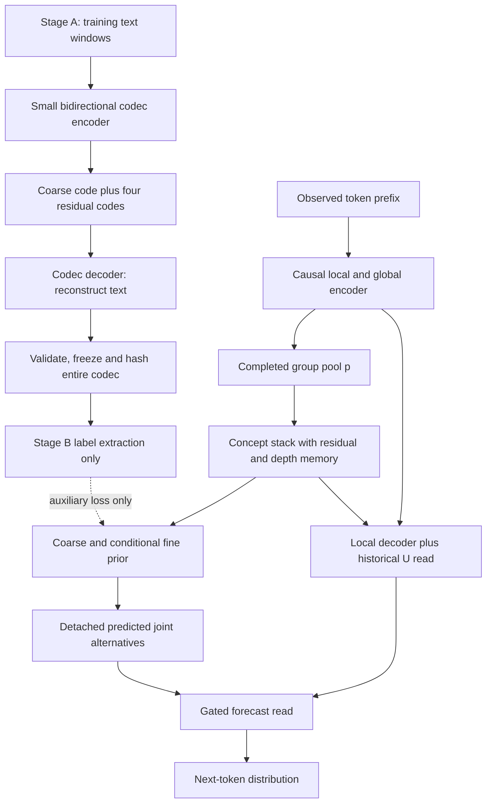

# V15 — Predictive plans with memory across concept depth

**Status:** proposed architecture, reviewed analytically; not implemented, trained, or demonstrated to outperform v14. Revised **16 October 2026, IST**, using completed v14 base, diagnostic, and continual evaluations. “Better” is the hypothesis to test, with explicit criteria below.

**Design in one sentence:** use **two-stage pretraining** to first learn and freeze a small hierarchical text codec, then train v14-tiny's causal local/global backbone to predict its future-span codes and consult those predictions, while testing a residual-preserving depth memory inside the concept stack.

The primary research candidate is **V15-Δ**: a delta-rule memory only inside the concept stack. **V15-RLS** substitutes the Depth Memory paper's exact regression update as an ablation. The large RLS module is not installed throughout the token backbone merely because its paper reports a win at a different scale.

This document specifies a new model and its evaluation. It changes no running v14 process. Companion evidence and analytical checks live in `v15_design/`; the final self-review is §16.

## 0. Reader guide, evidence boundary, and terminology

This document is intended to be understandable without this conversation or access to the author's computer. §A explains the earlier architectures and their results; §B audits completed v14; §C explains the two papers with public references. §§1–15 derive and specify v15, including two-stage training, controls, and failure criteria. §16 records a fresh self-review. Repository-relative links are audit trails; the substantive findings are reproduced here. Public paper links work independently of this repository.

**The decision:** retain v14's useful long-range concept route, replace its drifting target system, and test whether explicit forecasts and retrieval across depth each improve real tasks. Do not conclude that v14 “failed”: it improved the registered reasoning score and text loss. Do not conclude that it proved the whole concept hypothesis: the concept stack's incremental contribution, stable target coordinates, hard generalization, and efficient continual learning remain unresolved.

| Term | Meaning in this document |
|---|---|
| E / C / D | Encoder of observed tokens / concept computation / token decoder |
| L / G | Local encoder stream / global encoder stream; information may flow L→G but not G→L |
| p / U | Pooled input to C / output after C; U can be useful even if C adds little beyond p |
| NTP / NCP | Next-token prediction / auxiliary next-concept prediction; NCP names several different historical targets |
| Codec / VQ / PQ | Encoder–discrete-code–decoder system / nearest-code vector quantization / independently quantized vector segments |
| CE or NLL | Cross-entropy or negative log-likelihood, in nats unless stated; smaller is better |
| Perplexity | exp(NLL) for the same distribution/tokenization; different perplexity protocols are not interchangeable |
| ID / challenge / rung | In-distribution evaluation / held-out structural or length challenge / increasing task difficulty |
| Reasoning | Registered mean over four families of 0.75×ID above-floor area + 0.25×challenge above-floor area; **not raw accuracy** |
| EMA / stop-gradient (sg) | Exponential moving average / forward value whose gradient is blocked |
| AttnRes / delta / RLS | Attention over earlier depth contributions / error-correcting associative write / recursive least-squares write |
| LoRA / replay | Low-rank trainable weight updates / revisiting stored old examples during adaptation |

**Evidence priority:** implemented code and saved configurations establish architecture; final result JSON establishes outcomes; generated tables aid reading; preregistration and prose reports establish intended tests, not completion. Old reports sometimes still say “not run.” Smoke tests and plumbing outputs are not final experiments. The historical numbers below have different datasets, tokenizers, budgets, and seeds; there is no valid single V1→V14 loss leaderboard.

The first version of this proposal captured v14 at 01:16 IST, before final results existed. That version and its checks are preserved in `v15_design/archive/pre_completed_v14_revision/`. This is an explicit **post-results revision**, not a claim that these choices were preregistered before seeing v14. The completed artifacts now include `runs/eval/base/results.json`, `runs/eval/diag/diagnostics_v14.json`, `runs/eval/cl/cl_results.json`, and `runs/post/ALL_DONE`; the report was generated at about 05:55 IST. Final base checkpoint: **step 12,977, 101,816,716 processed tokens, 11.0 training hours**. The report header's step 12,950 / 101,605,696 tokens is the last periodic log, not the final checkpoint.

## A. Earlier architectures: mechanisms, results, and lessons

### A.1 V1–V3: establish a useful concept route before making it expensive

**V1:** a local/global encoder compressed observed tokens into concepts; a recurrent concept core with writable scratch state produced continuous representations and quantized forecasts for a locally confined decoder. The class name `ConceptCoreV2` in this older implementation does not mean the whole experiment was architecture V2. In the preserved final evaluation, TinyStories NLL was **1.9768**, Wiki NLL **3.629**, recall **97.07%**, carry **58.01%**, and multiplication **8.20%**. Disabling the core reduced recall to **0.39%** and carry/multiplication to zero. That is evidence the trained model relied on the route. Increasing recurrence from one to four passes barely changed TinyStories NLL, **1.9780→1.9768**: route dependence did not establish useful extra computation per pass.

**V2:** enlarged recurrent/MoE computation while weakening the encoder/decoder. The audit counted roughly 40 average repeated block applications versus 2.5 in the older recipe, a **52.7% reduction** in encoder/decoder non-embedding capacity, and a detach after pass four that could disconnect early projections from final token supervision. Prefix-ordered expert capacity also biased later rows. At the matched **13.55-hour checkpoint**, V1 loss was **2.8816** versus V2 **3.3952**, and recall **94.53% versus 0.78%**. These are checkpoint-matched audit readings, not the final V1 test numbers above. At fixed weights, R=1→6 improved loss by about **0.064 nats**, but R=6→12 only another **0.00188**. More latent computation can be both costly and mostly redundant; the result does not prove recurrence is always useless.

**V3:** repaired gradient flow and resource balance while retaining the observed-history concept route. The actual final run `run_v3_19M` at step **15,588**, R=3, reached TinyStories **1.74499**, Wiki **3.30007**, recall **100%**, carry **96.68%**, multiplication **83.01%**, hop **16.99%**, and bind **6.05%** on their saved legacy panels. Core-off damage was **+0.7362/+0.5933 nats** on the two text sets; replacing R=3 with R=1 cost only **+0.00777/+0.00609**. Basic algorithmic competence improved substantially, yet harder binding remained weak and extra recurrence again contributed little. The old `proposed_v3.md` is a proposal, not an authoritative description of every final model dimension.

**V15 consequence:** keep a strong encoder and decoder, keep a legal history route, and require a trained bypass control for C. Neither a large core-off effect nor more unrolled steps proves that the intermediate computation earns its cost.

Sources: [V2 audit](v2_underperformance_review_2026-09-28/REPORT.md), [V3 design audit](v3_design_review_2026-09-29/RESULTS.md), [V3 final evaluation](run_v3_19M/runs/v3_48h/eval_final.json).

### A.2 V4–V4.1: confinement and intervention traps

**V4-tiny:** width 64, vocabulary 8,192, context 480, approximately **1,257,475 parameters** in the k=6 configuration. Its encoder used local/global stages and Engram lookup features, content-based pooling, a repeated concept core, coarse/PQ representations, and a confined four-block decoder. Fifteen structural tests caught thirteen deliberately broken implementations. Core removal increased text NLL by roughly **0.12–0.25**. Decoder Engram helped memorized cases by **0.47–0.70** but hurt unseen cases by **0.14–0.17** in the reported comparisons. Retrieval stayed near chance in 5–7M-token pilots, where pooling, filler, and limited training were confounds.

**V4.1:** added a private token-fact retrieval route to D, bypassing compression for details that concepts need not preserve. Across three pinpad seeds, action performance improved **5.55 percentage points** and second-item performance **16.67 points** over V4, but the transformer reference remained ahead **7.76/12.28 points**. Dropping a repeated encoder pass was estimated to save about **18% FLOPs**. A mean-plan substitution changed second-item performance by only **1.61 points**, versus **11.28** in V4. Crucially, a header/null intervention produced apparent “core dependence” even when trained without concept content. A post-hoc plan-off training arm improved action **6.74 points** and second-item **11.17** for seed 0.

**V15 consequence:** interventions can perturb an unfamiliar activation distribution instead of removing useful semantics. Use trained auxiliary-only/plan-off controls, matched donor interventions, and restored-input controls. Preserve facts through history; do not force every token detail through a tiny discrete bottleneck.

Sources: [V4 report](v4_tiny/REPORT.md), [V4.1 assessment](v41_tiny/ASSESSMENT.md), [V4.1 report](v41_tiny/REPORT.md).

### A.3 V5–V6: latent search cannot compensate for a weak or mismatched base

**V5:** the five-phase design trained a foundation, froze E/D for stochastic recurrent-core learning, transplanted the learned core, then explored internal reinforcement learning and GradCuit repair. Latent Z had prior/posterior paths; epsilon and optional external memory XM were meant to support persistent internal actions. The approximately **2.022M-parameter foundation** processed about **221M tokens in 85 minutes**, with text loss **1.813**, graph-walk loss **0.113**, and standard GraphNav greedy success about **0.893**. In that recipe, matched no-NCP success was **0.1953**, versus **0.8926** with NCP. Removing XM caused prior loss damage of roughly **+0.345/+0.339**, whereas the XM-equipped variant reduced that mismatch to **+0.025/+0.017**. Holding a latent for four steps did not demonstrate learned persistent actions; epsilon-only effects were tiny. A deterministic core with best-of-11 sampling reached hard-goal **0.6426** versus single-sample **0.3730**, so elaborate search had a strong simple competitor. The top-level report contains stale progress sections; it does not establish all proposed RL phases succeeded.

**V6:** about **2.064M parameters**, nineteen passing structural contracts, and a redesigned controlled pipeline. Here a matched 9,000-step comparison went in the opposite direction: prefix-NCP got **0/64 standard and 0/128 hard**, while no-NCP got **51/64 (79.69%) and 37/128 (28.91%)**. Text losses were almost identical, **1.95674/1.95799**, while graph loss was **0.61158/0.12441**. Under the primary equal-time comparison, GradCuit repair minus simple retry was **−3.12 points** standard, 95% interval **[−8.20,+1.95]**, and **−0.39** hard, **[−2.73,+1.96]**. An equal-attempt improvement did not establish an equal-time advantage.

**V15 consequence:** an auxiliary objective can help one training recipe and damage another. Do not inherit “NCP works” as a universal fact. First establish competent base generation, then test additional computation against retry and against its full time cost. No latent RL/search layer is added to v15's default.

Sources: [five-phase architecture](NCP_GRAM_Z_Five_Phase_Architecture.md), [V5 report](v5_tiny/REPORT.md), [V6 report](v6_tiny/REPORT.md), [V7 retrospective specification](v7_tiny/spec/draft_v7.md).

### A.4 V7–V9: competence gates, continual failures, and budget confounds

**V7:** approximately **5.366M parameters**; three foundation seeds, 25M scored targets each, followed by proposed recurrence/latent refits, search, and acquisition stages. All recorded foundation arms had **zero strict standard and hard development success**. Later rows also showed zero. The preserved report's queue status was not a clean final completion record. These data establish a failed competence gate, not an identifiable failure of any single search mechanism.

**V8 had two distinct experiments.** The early 6,000-step hierarchy pilot ended `completed_gate_failed`, with zero GraphNav success. The separate **V8 12-hour pilot** used about **2.449M parameters**, one seed, 24,000 updates and 576,000 GraphNav examples per foundation arm. On the sealed standard panel, delayed NCP reached **1,646/2,048 (80.37%)**, alpha-zero **1,567/2,048 (76.51%)**, and flat **1,510/2,048 (73.73%)**. This is a meaningful controlled improvement for that recipe. Dense/recurrent refits did not pass retention qualification. Lifelong sequence learning reached **1,659/2,048** after phase 1, then **0/2,048** after phases 2 and 3. Intermediate development competence therefore did not establish durable acquisition. A compiled-generation parity failure required eager recovery; it was not another independent seed.

**V9 Q5:** the reduced 12-hour report used development seed 921 and unequal training exposure. Reference standard/hard-10 success was **83.20%/33.98%**, expert iteration **85.16%/33.01%**, and GRPO **0%/0%**. This does not establish MCTS superiority or completion of the full proposed Q5 program. GraphNav's four-token action serialization also aligned unusually well with four-token concepts, limiting transfer claims.

**V15 consequence:** separate smoke tests, completed sealed evaluation, and exploratory development results. Test boundary and layout shifts. Report acquisition and retention jointly; zero forgetting after learning little is not success.

Sources: [V7 report](v7_tiny/REPORT.md), [V8 early report](v8_tiny/REPORT.md), [V8 full pilot](v8_tiny_12h/REPORT.md), [V9 reduced report](v9_tiny/runs_q5_12h/REPORT.md), [V9 review](review_v9.md).

### A.5 V10–V10.3: repairing tokenization and objectives did not prove concept advantage

**V10:** width 128; encoder stages E1/E2/E3 with four blocks each; E2 repeated twice; a repeated four-block C; a four-block D; 8→2 pooling and K=8 concept candidates. Soft PQ, a direct continuous encoder route, and an initially empty post-C RBF correction bank coexisted. The “10M” directory name did not describe total parameters: roughly **5.466M dense plus 20.000M Engram-table parameters**. The run stopped at step **84,778**, about **180.25M input tokens / 12.988 hours**. Byte-heavy math wrappers inflated token accuracy: **71.875% token accuracy could coexist with 0/8 exact solutions**. A fresh balanced test near step 83,665 gave **3/64 math**, **0/16** on each Sudoku panel; core-off text damage was only **+0.000725 nats**, interval **[−0.000133,+0.001480]**. Format prediction and bypass routes could hide poor reasoning.

**V10.1:** repaired serialization, tokenizer/data construction, and supervision. It kept a continuous route for token prediction while adding a PQ-only chunk objective and winner recomputation, with roughly **5.731M dense + 20.000M table parameters**. Nineteen CPU/MPS contracts passed. Those contracts validate plumbing, not a final quality win; the validation report is not a completed matched benchmark. Changed tokenization also prevents direct raw-NLL comparison with V10.

**V10.2 RF:** roughly **5.944M dense**, including **149,376 training-only** parameters, plus the large table. PQ-only eight-future-token supervision and a historical reader of completed concepts attempted to make forecasts more useful; 8→2 groups released at row 7. The combined RF configuration was executed, but a complete A/R/F/RF causal comparison is not established by its configuration or smoke artifacts.

**V10.3-tiny:** deliberately reduced to width 56, four heads, vocabulary 1,024 and context 256. E1 had two blocks, E2 one repeated twice, E3 one, C two repeated twice, D two. Controls included C0 (no proposed concept objective), A (the V10.1-style loss), and X8 (revised mixture/full-map objective and historical read). Dense counts: **311,704 C0**, **484,782 A**, **503,428 X8 training / 474,364 deployment**, plus **1,050,080 Engram parameters**. Two 6,000-update seeds were compared; seed 1 crossed devices, seed 2 was CPU-matched.

X8 improved on A by **−0.010 text NLL**, interval **[−0.015,−0.006]**, and roughly **−0.209 math**, confirming the repair helped a weak objective. Against C0, however, X8 was worse: text **+0.018/+0.005** and math **+0.029/+0.119** for seeds 1/2. It used about **60% more dense parameters** and **1.6× step time**. Forecasts were not better than input representations; the second visit helped at most **0.011 nats**; committed and mixture decoding differed by at most **0.002**. A Sudoku advantage failed a layout shift and the second seed. Passing structural G1 and a narrow G2 margin did not rescue the failed G3 benefit test.

Its continual experiments were more informative than a single final score. Gated LoRA and plain LoRA improved new-math NLL similarly (**−1.762/−1.760**), while gated adaptation reduced text forgetting (**+0.004 versus +0.127**) and sort forgetting (**0 versus +0.352**). Related multiplication and addition/subtraction still suffered. A calibrated RBF bank and consolidation retained a roughly **−1.55/−1.581** new-math NLL improvement, yet exact new-math solving remained **0/64**. Better likelihood is useful, but it is not equivalent to solving the task.

**V15 consequence:** keep an ordinary strong baseline, table-capacity controls, answer-level success, serialization shifts, and related-skill retention. Improving a damaged auxiliary objective is not evidence of beating no auxiliary objective.

Sources: [V10 architecture](v10_10M/ARCHITECTURE.md), [V10 audit](v10_10M/audit/REPORT.md), [V10.1 validation](v10_1/VALIDATION_REPORT.md), [V10.2 implementation notes](v10_2/README.md), [V10.3 architecture](v10_3_tiny/ARCHITECTURE.md), [V10.3 report](V10_3_tiny_REPORT.md), [V10.3 tables](v10_3_tiny/REPORT_TABLES.md).

### A.6 V11–V12: fixed targets must earn their gradients and decoding route

**V11:** removed discrete codebook dependence and tried Gaussian next-latent prediction with a NextLat bridge in the width-56 two-visit setup. Seventeen runs covered two seeds and diagnostic arms at 6,000 updates. K1 failed all four preregistered gates. An ordinary transformer without Engram was an unfair reference; the table-matched ORDE comparison left K1 worse by approximately **+0.039 text / +0.056 math NLL** on seed 1. The latent bridge itself cost roughly **+0.015 text / +0.41 math**. Pool participation rank was around six, and auxiliary gradients on C were **2.6–2.9×** token gradients. Including auxiliary-only parameters in a common clipping norm could shrink useful trunk updates. Separating clipping corrected that confound, but repaired no-aux/latent arms only approached C0, with text gaps around **+0.005–0.011**, not a demonstrated win.

**V12:** combined an encoder–concept–decoder foundation, EMA discrete NCP, two-pass concept computation, variational Z actions and a metacontroller, with later RL gated on competence. A direct global encoder route let the token objective ignore C. NCP made C more influential but hurt the main task. At 8,000 updates on seed-1 development panels:

| V12 arm | Text NLL | Math NLL | Pinpad NLL |
|---|---:|---:|---:|
| ECD | 3.615 | 0.846 | 0.551 |
| ECDe, NCP-equipped comparison | 3.893 | 1.120 | 0.579 |
| TF7 transformer | 3.555 | 0.817 | 0.538 |

NCP's difference was **+0.278 text / +0.274 math**. A pinpad probe nevertheless improved from **49.9% at C input to 57.6% at C output**, showing that a representation may help a specific diagnostic while harming aggregate generation. Code churn was **37–64%**, and C's auxiliary gradients were roughly **1.3–2.5×** the token objective. Even a privileged controller failed the post-12 color task; a meaningful learned switching/RL benefit was not established.

**V15 consequence:** fixed targets address drift, not gradient competition. Clip auxiliary-only heads separately, monitor shared-trunk conflict, require auxiliary-off and bridge-off comparisons, and do not add a metacontroller before basic generation wins.

Sources: [V11 report](v11_tiny/REPORT.md), [V11 comparison](v11_tiny/COMPARISON.md), [V12 architecture](v12_Architecture.md), [V12 results](v12_tiny/RESULTS.md).

### A.7 V13: causal role separation succeeded more than predictive abstraction

V13 made the roles explicit: two local and two global encoder branches, only L→G mixing, stride-four source pooling, concept computation, and a locally confined decoder that could read completed concepts. The actual width-128 model used E1 `[S,S,S,F]` twice, E2 R=2, four E3 layers, four C blocks and six D blocks. Its Engram used 16 hashed heads over token orders two/three. C combined causal concept attention, a short token read and SwiGLU; C and D already used **Delta-AttnRes**, attention over depth contributions. A moving pooled target was encoded with four 32-entry PQ segments. The decoder read continuous U, not the NCP forecast.

After about 11 hours, **7,744,181 parameters**, step **12,474**, **97,858,328 tokens**, Reasoning was **0.2829** and text NLL **2.8004**. High NCP accuracies, often **76–97%**, coexisted with persistence shortcuts and per-family code collapse; pooled utilization hid planning perplexity around **3.78**, versus roughly 7.6–10.7 for other families. Code reassignment was **92.36%** in the registered 10%→50% comparison. The extra C probe gain over its own input was only **0.06, 1.22, 0.49, 3.18 percentage points** for grid/program/state/plan, all below five points. A second loop changed answer NLL by at most about **0.0005**, with no exact-answer changes in that diagnostic.

V14 therefore attempted harder, less copyable targets and a smaller model rather than simply increasing recurrence. The completed outcome is the next section.

Sources: [V13 notes](v13_NOTES.md), [V13 actual configuration](v13_tiny/runs/base/config.json), [V13 model](v13_tiny/model.py), [V13 final results](v13_tiny/runs/eval/base/results.json), [V13 tables](v13_tiny/REPORT_TABLES.md).

## B. Completed v14: what improved, what remains unproven

### B.1 Architecture and the exact comparison

Implemented v14-tiny retained d=128, four heads, FFN=256, vocabulary 2,048, stride four, the local/global split, Engram and Delta-AttnRes. It reduced E2 to **one pass**, E3 to **two layers**, and D to **four blocks**, while retaining **four C blocks**. Pooled sources combine token embeddings, stopped-gradient local features and global features; a learned projection produces p. C reads historical concepts and a short local window, then produces U. D combines fixed local evidence with released historical U.

Its NCP targets changed substantially. A stopped-gradient EMA encoder twin produced local-change and global-residual target components; family-conditioned linear residualization removed locally predictable components, trainable projectors and SIGReg shaped distributions, and online PQ produced future code labels. This attacked V13's copying/collapse shortcuts, but introduced multiple moving coordinate systems. **NCP remained auxiliary: D did not directly consume the head's predicted code distribution.**

| Completed base outcome | V13 | V14 | Interpretation |
|---|---:|---:|---|
| Model parameters | 7,744,181 | 6,807,755 | 12.09% fewer in v14; not a size-matched causal study |
| Processed tokens | 97,858,328 | 101,816,716 | About 4.05% more exposure in similar training time |
| Reasoning | 0.2829 | **0.3725** | +0.0896 absolute, about +31.7% relative; not 37.25% raw accuracy |
| Text NLL | 2.8004 | **2.6861** | −0.1143 nats/token; derived perplexity about 16.45→14.67 |
| Grid family score | −0.0079 | 0.0682 | Improved, still weak |
| Program family score | 0.3444 | 0.4302 | Improved |
| State family score | 0.4701 | 0.5443 | Strongest aggregate family |
| Planning family score | 0.3252 | 0.4475 | Improved on trained levels; hard extension still fails |

This is one historical paired-seed comparison (seed 1301), with model size, target design and training exposure changing together. It supports “the v14 recipe did better here,” not “residual NCP caused the entire improvement” or “concept models beat ordinary transformers.”

Raw mean ID task success was approximately grid1 **15.5%**, grid2 **7.3%**, arithmetic **29.6%**, list **71.2%**, register **51.5%**, graph **56.1%**, state **68.3%**, planning **59.7%**. At held-out difficulty rungs 8/9, grid and planning were **0/0**; arithmetic **7.03%/3.91%**, list **43.75%/44.53%**, register **18.75%/19.53%**, graph **34.38%/32.81%**, state **61.72%/57.81%**. Learned competence is real but uneven, and length/compositional generalization is not solved.

Evaluation detail matters: base evaluation uses all-answer-token exact matching, including EOS, for unique-answer tasks, and actual greedy generation with a verifier for multi-valid-output graph/planning tasks. In a deterministic causal model with identical caches/termination, **all-token teacher-forced exact correctness on a unique reference is equivalent to greedy exact correctness**, by induction on the prefix. Average teacher-forced token accuracy is not equivalent. Canonical-reference exact matching is also not a substitute for a verifier when several answers are valid. Continual and intervention panels use their own teacher-forced canonical-answer protocol and must be labeled accordingly.

### B.2 Five diagnostics and the stability guard

Here V1–V5 are **diagnostic names**, not architecture versions V1–V5.

| Diagnostic | Completed result | What it supports; what it does not |
|---|---|---|
| V1: global future-code head beats copy and marginal | Pass in all four reasoning families; margins over the stronger baseline **40.83, 14.45, 20.15, 20.90 points** | Nontrivial predictive signal under this target; not yet downstream benefit from reading forecasts |
| V2: U probe beats local-row probe | Pass; margins **17.40, 3.91, 12.09, 9.44 points** | The concept route contains nonlocal predictive information under this probe |
| V3: U beats actual C input p by ≥5 points | **No family passes**; margins **+3.32, −1.08, −0.88, +0.25 points** | Extra C computation is not established by this diagnostic; it does not prove C computes nothing |
| V4: target variation exceeds threshold | Pass; global χ roughly **0.964–0.999** in reasoning | The designed residual target varies; high variation is partly engineered, not semantic proof |
| V5: reassignment lower than v13 | Technical pass: **86.22% versus 92.36%** pooled | Relative improvement, but absolute target churn remains very high |
| Teacher/online target agreement guard | Local **86.48%**, global **40.96%**, required ≥80% both: **fail** | The global coordinate system is inconsistent between teacher and online representations |

V5's pooled value hides global reassignment of about **96.36%**, local **76.08%**, from 10% to 50% of training. Even later 30%→70% reassignment was roughly **90.37% global / 51.6% local**. Freezing codebook centroids alone did not freeze the encoder/projector/residualization coordinate system. An era refit took about **215 seconds**, changed local/global labels by **10.35%/21.61%**, and raised one global head diagnostic from **0.2111→0.2294**; that is not a retrained base-model task improvement.

The saved V2/V3 probes randomly split individual groups 80/20, so correlated windows from one document may cross fit/evaluation boundaries. Their estimates are useful diagnostics, with optimistic-generalization risk; v15 must split by document/semantic instance. A linear probe's failure can reflect decodability or fitting choices. A deterministic C cannot create new information absent its complete input history, but can make information cheaper to use. Trained U=p controls and task outcomes are therefore required alongside probes.

### B.3 Dependence on U is established; the best way to compute it is not

On development interventions, normal→zero U reduced list exact success **0.7070→0.1289** and planning **0.5391→0.0078**; text NLL rose **2.6930→2.9411**. Shuffling U reduced planning to zero and raised text NLL to **3.2633**. These are strong signs that the trained decoder uses the concept route. They do not isolate C from p, nor prove the NCP head's predictions help: the decoder did not read those predictions. V4.1's intervention trap remains relevant.

### B.4 Continual learning trades acquisition for retention

The completed phase stream compared a frozen base, sequential adaptation, replay and v14's specialized wake/sleep/bank method. These numbers follow the saved continual scoring protocol, not the base Reasoning scalar.

| Method | Final average | Reported forgetting | Old S0 before revisit | Mean new-phase acquisition |
|---|---:|---:|---:|---:|
| Frozen | 0.2900 | — | — | — |
| Sequential | 0.3239 | 0.0384 | 0.3229 | 0.14583 |
| Replay | **0.3341** | 0.0287 | 0.4000 | 0.11363 |
| V14 specialized | 0.3033 | **0.0174** | **0.4105** | **0.05945** |

V14 minus replay final average was **−0.0307**, paired interval **[−0.0386,−0.0236]**. Its old-S0 advantage over replay was only **+0.0105**, interval **[−0.0091,+0.0287]**. Against sequential adaptation it retained S0 better, **+0.0876 [0.0668,0.1072]**, but ended **−0.0205 [−0.0273,−0.0140]** lower overall. Paired estimates are taken from the saved paired evaluation, so the last decimal can differ from subtracting rounded table entries. Acquisition was less than half sequential acquisition. Low forgetting partly reflects learning less; it is not a sufficient success criterion.

The specialized O6 choice followed a fallback because the prerequisite v13 matrix was unavailable at the decision point; it was not an outcome-tuned winner. Equal incoming rows did not imply equal wall time. At continual phase 6, reported peak MPS driver allocation was about **17.01** versus **4.34** for replay/sequential. Thus v15 defaults to bounded LoRA plus replay and earns any more elaborate memory/consolidation mechanism separately.

### B.5 Systems findings and the design decision map

Base peak MPS driver allocation was reported as **13.39 GB**; the underlying metric uses powers of two, so treat the report label cautiously and record bytes/GiB explicitly in v15. Driver allocation is not identical to physical resident RAM. Growth correlated with costly gradient-share diagnostic events and eager/checkpoint execution; a maintenance restart at step 8,434 recovered allocation. This observation motivates isolated diagnostics and a long soak, not a proof that all growth was one particular leak or that a new memory module will fix it. One update was skipped in the base run.

| Evidence | First-principles requirement | V15 response | Control that can reject it |
|---|---|---|---|
| Useful nonlocal U, better base scores | Preserve access to observed distant facts | Keep causal L/G split and historical U reads | Strong ordinary/Engram-matched baseline |
| Global teacher agreement 40.96%, high churn | Target identity must stay fixed while predictor learns | Stage A codec; freeze every target-producing parameter | Assignment replay/hash checks; fixed-target prior-only arm |
| NCP beats copy but D never reads forecasts | Prediction must have a measurable route to task benefit | Detached predicted-plan bridge | Trained TP versus T and generic prefix bridge |
| C barely improves p probes | Extra depth must earn its compute | Residual + depth retrieval hypothesis | AttnRes, plain residual C, and trained U=p bypass |
| Hard grid/planning fail | Do not equate auxiliary accuracy with generalization | Preserve hard ladders and layout/composition shifts | Sealed exact-success evaluation |
| Specialized continual worse than replay | Retention must not be purchased by failing to learn | Bounded adapter/replay default | Acquisition-matched retention comparisons |
| Large memory growth | Measure full-system cost, including diagnostics | Microbatching, bounded caches, isolated audits, soak | Equal-time and peak-memory gates |

Sources: [actual model](v14_tiny/model.py), [configuration](v14_tiny/runs/base/config.json), [deviations](v14_tiny/DEVIATIONS.md), [final base results](v14_tiny/runs/eval/base/results.json), [diagnostics](v14_tiny/runs/eval/diag/diagnostics_v14.json), [continual results](v14_tiny/runs/eval/cl/cl_results.json), [generated tables](v14_tiny/REPORT_TABLES.md), [dataset contract](Dataset_v13.md).

## C. The two papers: mechanisms, evidence, and limits

### C.1 Searchable references and versions

1. **Hermann Kumbong, Ishan S. Khare, Iddah Mlauzi, Andrew Woen, Charles Ding, E. Kelly Buchanan, Simran Arora, Azalia Mirhoseini, Christopher Ré. _Next-Concept Modeling: Fast, Parallel Coarse-to-Fine Text Generation._ arXiv:2610.14162, first submitted 9 October 2026.** [Version 1 abstract](https://arxiv.org/abs/2610.14162v1), [PDF](https://arxiv.org/pdf/2610.14162), [DOI](https://doi.org/10.48550/arXiv.2610.14162), [official code](https://github.com/HazyResearch/ncm). Code audit pinned to `c70274273f489abc73832b2b98584a8483b6b203`.
2. **David González-Martínez, Philipp Nazari, T. Konstantin Rusch, Shiwei Liu. _Depth Memory._ arXiv:2610.18809, first submitted 13 October 2026.** [Version 1 abstract](https://arxiv.org/abs/2610.18809v1), [PDF](https://arxiv.org/pdf/2610.18809), [DOI](https://doi.org/10.48550/arXiv.2610.18809), [official code](https://github.com/davidgonmar/depth-memory). Code audit pinned to `9a6865feeb43a153a4501cc9a6457e047ffef3c3`.

These are recent preprints, not established replications of this repository's model. The summaries below are based on the supplied full PDFs, including appendices, with public metadata/code checked on 16 October 2026. Paper tables are results at their own scales and protocols; v15's numerical configuration is a new proposal. Detailed local audits: [NCM review](paper_reviews/next_concept_modeling_first_principles.md), [Depth Memory review](paper_reviews/depth_memory_first_principles.md).

### C.2 NCM from first principles

Ordinary autoregressive generation makes one token depend on earlier tokens. That is expressive but introduces a long sequential chain. Naively predicting many tokens independently removes the chain while losing their coordination. NCM asks whether a shorter chain of **shared coarse-to-fine latent levels** can supply enough coordination for parallel prediction inside each level.

**Stage 1 — learn a hierarchy that reconstructs text.** Encode a sequence into continuous features. Quantize a coarse, downsampled representation; upsample it, subtract it from the remaining features, and quantize the residual at progressively finer resolutions. A decoder reconstructs text from the accumulated code embeddings. Nested dropout sometimes removes fine levels, forcing coarse levels to be useful on their own. This is an engineered rate–distortion tradeoff: coarse codes must spend limited bits on patterns that help reconstruction. It does not guarantee human-readable concepts or that those patterns are predictable from a prefix. Some released/paper configurations use a very shallow codec, including zero transformer encoder blocks in Table 5; the method is not evidence that a deep semantic encoder is necessary.

**Stage 2 — freeze the codec and learn its code distribution.** The generator predicts one resolution level conditioned on coarser ones. Codes at a level are generated in parallel; later levels refine earlier ones; the final token decoder produces the sequence in parallel. Schematically,

`p(z_1,…,z_K | condition) = product_k product_i p(z_(k,i) | z_<k, condition)`.

The independence inside a level is a modeling assumption. A shared coarse state can coordinate fine outputs, but any dependence left after conditioning is approximation error. From a first-principles perspective there are two losses to manage: information discarded by the codec and residual dependence the parallel predictor cannot represent. More levels/bits can reduce one bottleneck while increasing compute or making future codes harder to predict.

More precisely, if C_k is the resized summary of earlier codes supplied to the predictor, the ideal independent predictor's excess code length relative to a full joint predictor is

`sum_i H(Z_(k,i)|C_k) − H(Z_k|Z_<k)`

`= [sum_i H(Z_(k,i)|C_k) − H(Z_k|C_k)] + I(Z_k; Z_<k | C_k)`.

The first nonnegative term is dependence remaining within the parallel level; the second is information lost by the conditioning summary. This is our interpretation under ideal predictors and deterministic summaries, not a new empirical result from the paper. Finite-capacity predictors add further error. Attention over shared conditioning does not let independently sampled current-level outputs inspect one another's newly sampled values.

The paper's Appendix A also gives a latent-variable lower bound: for the deterministic selected hierarchy z*(x), `log p_decoder(x|z*) + log p_generator(z*) ≤ log p(x)`. Clean code CE with equal per-code weighting optimizes the generator part after freezing the codec. Corruption, unequal level weights, nested-dropout codec training and final-token argmax are additional practical choices, not all justified by this same bound. V15's balanced auxiliary CE is not claimed to optimize that NCM text-likelihood bound.

**Exposure mismatch matters.** Training fine levels on perfect coarse codes and using generated coarse codes at inference creates a distribution shift. The paper corrupts coarse inputs to improve robustness. Moderate corruption is useful; excessive corruption is harmful. An appendix TinyStories ablation improves generative perplexity roughly **49→19** with suitable corruption. Giving coarse CE more weight improves that auxiliary loss without reliably improving final generation. These findings directly support testing prediction errors and final output, rather than selecting v15 by code accuracy alone. Our root-dependent residual retargeting in §7.2 is a distinct proposal, not the paper's exact corruption procedure.

| NCM reported comparison | Quality | Sequential evaluations (NFE) | Interpretation |
|---|---|---|---|
| LM1B | NCM generative perplexity **93.05**, DUO **97.30** | **12 vs 128** | Strong quality/step tradeoff against this parallel baseline |
| OpenWebText | NCM **83.12**, DUO **77.69**, sampled AR **35.45** | NCM **32**, DUO **1,024** | Fewer steps, but quality gap remains |
| TinyStories | NCM **15.41**, FMLM+ **15.43**, sampled AR **8.89** | **12 vs 128** for first pair | Matches a parallel baseline; not AR quality parity |
| XSum | ROUGE-L **28.0**, Aurora **26.6** | **8 vs 128** | Summary overlap improves, not a factuality guarantee |
| WMT14 | NCM BLEU **22.6**, AR **25.2** | **11 vs 64** | NCM+MBR reaches **25.2**, but at **132** evaluations |
| Sudoku, 25M NCM | Easy/medium/hard solved **99.5/96.5/86.1%** | **12** | Hard exceeds FMLM+ **81.3% at 16** in that setup |

NFE counts are not wall-clock time. Reported approximately **21× LM1B, 10× OpenWebText, 31× XSum** speedups use specified H100/batch-16 systems comparisons, not this M2 and not a universal autoregressive baseline. External-evaluator generative perplexity is also not the model's own held-out NLL and can reward low-diversity samples. Near-perfect token reconstruction is not near-perfect sequence reconstruction: even 99.99% token accuracy implies 0.1024 expected errors in 1,024 tokens, and only about 90.3% exact sequences under an illustrative independent-error assumption. That calculation is not a measured paper sequence score. Summary examples also show why named entities/dates need separate fidelity tests.

**What v15 adopts:** explicit two-stage preparation, frozen coordinates, useful coarse-only reconstruction, root-conditioned fine prediction, and error-exposure checks. **What requires a separate fork:** a full NCM level-parallel text generator. Our primary v15 still emits tokens autoregressively and uses a forecast about a future span; this is a task-aligned adaptation, not an NCM reproduction or a parallel-speedup claim. See NCM §§3–4 and PDF pp. 5–7, 10, 26–29, 32–34 for the underlying mechanism and ablations.

Two cost details prevent misleading transfer. NCM reports both codec/generator exposure, about **13.36B positions on LM1B and 127.22B on OpenWebText**; these are exposure counts, not equal-FLOP guarantees. The LM1B codec adds **111.40M parameters** beside a **97.07M generator**. Its full hierarchy need not be bit-compressed: a released TinyStories schedule has 641 code positions for 128 tokens, so its 4,096-way fixed-width code capacity is 7,692 bits versus 1,664 token bits with an 8,192-token vocabulary. Early levels are bottlenecks; the full representation may be redundant. V15's 25-bit future summary is therefore a much stronger, separately unvalidated bottleneck.

Reproduction caveat: the pinned OpenWebText release specifies a 16-layer/width-1,024 generator and 8,192-entry books, while PDF tables specify 12 layers/width 768 and 4,096 entries. The released quantizer also aggregates VQ penalties differently from the sampled-cutoff reading of Equation 9. These are discrepancies to resolve before reproducing exact reported costs, not evidence that the results are false. V15 specifies its own codec objective and update order in §5 instead of silently mixing PDF and release settings.

### C.3 Depth Memory from first principles

In a residual network, `x_(l+1)=x_l+delta_l`. Earlier layer contributions remain in their sum, but their identities can be difficult to retrieve. Attention over all earlier contributions stores them explicitly. Depth Memory instead maintains a small learned association from a layer-dependent key to its contribution, allowing later layers to query relevant earlier computations.

The paper's memory is **across network depth at a token position**, not a database of previous conversations, a longer temporal context, or a continual-learning mechanism. A residual stream remains alongside the associative matrix. Readouts enrich the next sublayer's input; the permanent residual stream receives the new sublayer delta. Writes store that delta rather than repeatedly storing the accumulated residual, avoiding redundant values. Initial embedding writes and a final read are part of the method, not optional accounting details.

For produced key/value observations, weighted regularized least squares fits a memory matrix M so that `M k_i` approximates `v_i`. With inverse covariance P, observation weight ω and forgetting λ, let `kw=sqrt(ω)k`, `vw=sqrt(ω)v`. Then:

`gain = P kw / (λ + kwᵀ P kw)`

`M_new = M + (vw − M kw) gainᵀ`

`P_new = (P − gain kwᵀ P) / λ`.

This is an exact recursive solution to the corresponding discounted ridge problem in exact arithmetic with appropriate initialization. It does not prove the learned neural keys/values are useful, the whole network is stable, or every layer's contribution is recoverable. Low address rank creates an interference/capacity tradeoff. The simpler delta rule makes an error-correcting write without maintaining P. V15 tests that simpler state first.

| Depth Memory Table 2 | PreLN | Block AttnRes | mHC | LDM |
|---|---:|---:|---:|---:|
| 400M validation perplexity | 12.73 | 12.12 | 12.23 | **12.08** |
| 400M average accuracy | 49.05 | **50.61** | 49.55 | 50.46 |
| 1.5B validation perplexity | 9.48 | 9.26 | 9.25 | **9.15** |
| 1.5B average accuracy | 58.41 | 59.42 | 59.68 | **59.71** |

These models trained for approximately 50B/100B tokens with about 1% extra parameters. The advantage over ordinary PreLN is clearer than over the strongest depth-mixing baseline; at 1.5B the reported average-accuracy lead over mHC is only **0.03 points**, and at 400M Block AttnRes is ahead on that average. Do not infer a robust multi-seed ranking from these point estimates. Quality evidence extends to roughly 1.6B scale; 14B results are systems benchmarks, not proof of superior 14B language quality.

The most design-relevant ablation is Table 8 (400M, 15B tokens): PreLN CE **2.6554**, RLS **2.5987**, delta **2.6028**, outer-product **2.6037**, storing accumulated values **2.6227**, memory-only **2.7296**, and removing the post-residual path **2.6611**. Delta preserves about **93%** of the PreLN→RLS loss improvement descriptively. That ratio is not a causal attribution, but it argues for testing the residual pathway and basic retrieval before paying for an exact solver.

Systems savings require implementation work: windowed updates and specialized backward/unwinding. “Fixed-size memory across depth” does not mean ordinary autograd stores constant total activations. Table 6's 1.7B configuration reports **peak allocated memory**, all in GiB: training **80.2→94.0**, prefill **7.8→14.7**, and decoding **19.4→21.2** for PreLN→LDM. Training uses eight GPUs/2K sequences; inference uses one GPU, batch 64 and 2K prompt/context. These are memory figures, not latency measurements. Reduced parameter overhead does not imply lower peak memory; throughput must be measured separately. The public optimized path does not establish an MPS speedup.

**What v15 adopts:** preserve ordinary residual additions, store sublayer deltas, use content-addressed reads, and explicitly account for state. Test at concept rate, four times slower than token rate, against v14's existing AttnRes and a plain residual C. RLS is a later matched solver arm. No persistent-memory or long-context claim follows. See Depth Memory §§3–4, Tables 2/8 and PDF pp. 5–9, 22, 28–34; [pinned reference implementation](https://github.com/davidgonmar/depth-memory/blob/9a6865feeb43a153a4501cc9a6457e047ffef3c3/pretrain/OLMo-core/src/olmo_core/nn/ldm/backends/reference.py).

### C.4 Why the composition is plausible, and why it might fail

The papers address different bottlenecks. NCM supplies a way to define stable coarse/fine targets and generate coordinated alternatives. Depth Memory supplies a way to retrieve earlier contributions during a forward computation. Neither solves the other's problem. Their composition is justified only as a testable chain:

`useful frozen target → predictable future codes → useful decoder consultation`, and separately `better access to depth contributions → better U at acceptable cost`.

If the codec preserves mostly unpredictable spelling, the first chain fails. If U already exposes everything a tiny predictor needs, additional C memory adds overhead. If the continuous history route makes forecasts redundant, the bridge is unnecessary. If training the codec consumes the quality gain's time budget, the complete system loses. The experiment matrix below permits each conclusion and chooses the simpler winner.

## 1. Step 1 — Define the problem before choosing modules

The model must predict the next token from the available prefix. Let X be that prefix, Y its future, L the information available through the local path, and U the concept state. A useful concept computation must preserve information about Y that is hard to extract from L alone and make that information usable by the decoder.

Three distinct requirements follow:

1. **Content:** a target must retain something relevant about Y. A high-entropy target can be pure noise.
2. **Predictability:** the retained information must be inferable from X. Random future input cannot become predictable because a latent changes rapidly.
3. **Use:** exploiting the prediction must improve held-out token or task performance at an acceptable cost. A better auxiliary loss alone does not establish this.

V14 supplies useful diagnostics for these requirements, but its default decoder reads U and never reads the NCP prediction. Its target projectors are trained by distributional regularization; a well-spread projection need not retain task-relevant content. Subtracting a local linear prediction from a global change removes one shortcut but may also leave noise or remove useful predictable information. Completed results show real predictive signal beyond copying, alongside severe global target drift and weak incremental C probe gains (§B). Thus the redesign preserves prediction as a hypothesis while changing target identity and testing operational use.

**V15's response:** make target content reconstructively grounded and fixed; predict it conditionally; provide a measured path from that prediction to the decoder. Keep an independent path for observed history because uncertain forecasts cannot replace facts already read.

There is no information-theoretic free gain. A forecast Z computed from X satisfies I(Y;Z | X)=0. Its value is a different computational organization, inductive bias, and supervision. Parameter-matched and auxiliary-only controls are therefore mandatory.

## 2. Step 2 — Separate the three axes

| Axis | Role in v15 | Dependency |
|---|---|---|
| Token time | Ordinary autoregressive text generation | A row predicts the next token using only its prefix |
| Representation detail | One coarse code for a future 16-token span, four residual codes for its four groups | Refinement is conditioned on a coarse code |
| Network depth | Recall earlier sublayer contributions inside the concept module | A sublayer reads memory written by earlier sublayers at that concept position |

“Next concept” in NCM means next *detail level*. In v14 it means a future *position*. V15 uses both indices explicitly: a coarse/fine level and a future-group horizon h∈{1,2,3,4}. Depth-memory index l is neither of these.

A shared coarse variable can coordinate correlated alternatives. For example, a prior over `(singular, is)` and `(plural, are)` should not independently mix `(singular, are)`. Conditional code prediction addresses this at the coarse/fine interface. It does not prove that all four future groups become independent, so v15 replans from realized tokens instead of rolling out a four-group plan as if it were certain.

## 3. Step 3 — Decide what survives from v14

The reference is the **implemented shrunk v14-tiny**, not the larger unimplemented settings in the root specification.

| Component | V15 decision | Reason |
|---|---|---|
| Vocabulary, tokenizer, d=128, four token heads, FFN=256 | Keep | Isolate the new representation and depth mechanisms |
| E1, Engram, E2 R=1, E3 with two layers, exits | Keep | No evidence from these papers justifies replacing the whole encoder |
| Two local and two global branches; L→G allowed, G→L forbidden | Keep | Preserve the interpretation of long-range information flow |
| Group stride k=4; source pools; learned source mixture | Keep | Maintain the release schedule and a comparable input to C |
| Concept block sequence: self-attention, local read, SwiGLU; four blocks | Keep operators, replace depth aggregation | Test retrieval across depth without adding loops |
| C's Delta-AttnRes aggregation | Replace by residual + grouped delta memory in V15-Δ | Direct test of the Depth Memory hypothesis against an existing depth mixer |
| Decoder: four blocks, fixed local K/V, historical concept read | Keep | Retain ordinary generation and access to observed history |
| EMA backbone twin, family residue maps, online target projectors, SIGReg, moving PQ | Remove from the v15 target path | Replace their coupled moving coordinate system with a separately trained frozen codec |
| Factorized four-segment NCP head | Replace | Predict a coarse code and conditional refinements, with explicit uncertainty |
| Forecast-to-decoder route | Add one gated read after the existing decoder stack | Make predicted codes operational without adding a full decoder pass |
| Correction bank and per-phase density-gated adapter growth | Not in default continual method | Completed specialized v14 adaptation lost to replay in final average and acquisition, with much higher peak allocation; use bounded replay (§12) |

The new model is a **joint redesign**, not a one-variable v14 experiment. Factorial controls in §13 separate its components. A historical v14 comparison cannot attribute an improvement to either paper individually.

### 3.1 Backbone contract, in sufficient detail to interpret the design

Each token begins with a shared 128-dimensional embedding and four role branches, two local and two global. E1 has two `[S,S,S,F]` blocks. S uses causal sliding-window attention of width eight, reads local branches and writes local/global branches; F uses full document-causal attention, reads local/global branches and writes global branches only. Role mixing is within L or within G, never G→L. Engram is inserted after the first S: hashed token bigram/trigram lookup features, eight heads per order (sixteen total), feature dimension eight, with learned gating/projection and short document-masked convolution. It has **1,124,560 parameters**, including its table and small transforms; it is not a free external memory.

E2 performs one `[M,M,M,F]` pass in a workspace. M is the inherited Gated DeltaNet-2 temporal recurrence with exact document resets, chunk size 16. E2 reads L/G/workspace but writes only workspace; its gated exit adds to G. E3 is `[S',F]`, reading L/G and updating G; S' has a sixteen-token window. Learned gated reads combine the two L branches into L_enc and the two G branches into G_enc. Token local attention uses the inherited partial RoPE/QK normalization; full encoder attention uses the inherited NoPE/temperature rule. Use the actual model and causal tests, not stale docstring examples of larger layer counts or reach.

For every completed four-token group, three channel-wise attention pools summarize embeddings x, stopped-gradient L_enc, and G_enc. Normalize the source summaries, mix with learned softmax source weights β, and project: `m_g=sum_s β_s Norm(pool_s)`, `p_g=W_p m_g`. C has four blocks, each containing causal self-attention over released concepts, a cross-read of the sixteen-token stopped-gradient local window ending at that group's release, and a SwiGLU FFN. Width remains 128, heads four, FFN 256. The primary design changes C's depth aggregation only; it does not add recurrent passes.

D has four blocks, each with a local read whose K/V are always L_enc (window sixteen), a read of same-document released historical U with a null/sink path, and SwiGLU. D retains its existing Delta-AttnRes aggregation. The final norm and vocabulary head are tied to the student embedding, with the inherited logit scaling. Fixed local K/V matter: adding decoder blocks cannot silently grow the purely local receptive field through repeated decoder-state attention. Tested maximum look-back distances are **51 tokens for L_enc and 66 for the local-only decoder**, rather than the outdated 53/68 comments in the source header. These distances must be rechecked after implementation.

### 3.2 Two-stage architecture at a glance



The dotted connection is supervision, not a forward input. Stage A's decoder is discarded from generation; Stage B's token decoder is a different network. At deployment only the student and frozen codebooks are required. Depth memory resets at each concept position; historical context is carried by the ordinary causal pathways.

## 4. Step 4 — Fix causality, shapes, and release before writing losses

Use zero-based document-relative token positions. Model row t consumes x_t and predicts x_{t+1}. Group g contains x_{4g:4g+4}; its release row is e_g=4g+3. At row t, the newest released group is

`g(t) = floor((t+1)/4) - 1`.

If g(t)<0, the historical read uses its existing null path and the new plan read returns zero. For t=e_g,…,e_g+3, the forecast issued at e_g can guide the next four predictions. At t=e_g+4 the next completed group issues a new forecast. Example: u_0 first becomes legal at row 3 and can help predict token 4; it cannot affect row 2's prediction of token 3.

For a released group g, the **training-only target window** is

`Y_g = x[e_g+1 : e_g+17]`, restricted to the same document.

The student input is only `x[:e_g+1]`. The target encoder may inspect all of Y_g because it supplies labels, not forward inputs. No target-derived code, vector, length, mask, or validity flag enters the plan bank consumed by the language model.

Packed documents retain v14's alignment contract: starts are aligned to groups of four and padding has a separate invalid identity. Attention, convolutions, GDN states, pools, historical reads and forecast selection are masked/reset by document identity. A group is released only when its four input slots are valid real tokens of that document. Partial terminal groups need not produce a subsequent forecast.

For targets near an end: EOS is a real token; right padding after EOS is masked. A root target is valid if Y_g has at least one real token. Fine target h is valid if its four-slot portion has at least one real token. Empty fine slots produce no label loss. The codec pools over valid positions only, including a masked mean for a partial group. It never pools another document. **Inference always predicts every horizon and never receives these future-validity masks.** Generation stops using emitted EOS, not a true future length.

At tiny scale, with microbatch B=2 and T=1,024:

| Tensor | Shape |
|---|---|
| L_enc, G_enc, decoder state | B×T×128 |
| p, U | B×G×128, G=T/4 |
| Target window | B×G×16, labels only |
| Codec group vectors | B×G×4×64 |
| Coarse logits | B×G×32 |
| Fine logits at one supplied root | B×G×4×32 |
| Horizon-1 joint table | B×G×32×32 |
| Selected plan vectors | B×G×4×128 |
| Concept depth memory | B×G×4×32×4 |

Depth-memory states are indexed by concept position and group of channels. They are never carried from concept g to g+1. Temporal information still travels through C's masked self-attention and the inherited encoder.

Invalid input groups have zeroed concept outputs and skip depth-memory writes. Attention implementations must provide a finite null path rather than softmax over an entirely masked row. Entirely invalid target windows are excluded from codec execution/loss; their label placeholders cannot introduce NaNs into a masked reduction.

## 5. Step 5 — Train a small, ordered, frozen target codec

### 5.1 What it must preserve

The target is the observed future span itself, in order. It is not a family-conditioned residual of a changing student. Preserving future token information can require distant context to predict even when the target encoder only sees the future span. Whether that happens on this dataset is a measured property, not something declared by calling a target “global.”

The codec receives **only Y**, with no student state, prefix, family ID, task label, or privileged simulator state. It has its own embedding table, independent of the student's evolving embedding. It is bidirectional inside this target window; such bidirectionality is legal only on the label side.

Configuration: vocabulary 2,048; width 64; two PreLN bidirectional encoder blocks; four heads; SwiGLU width 128; learned 16-position encoder embeddings. Pool each four-token portion after encoding, project with a bias-free 64×64 map, and apply learned RMSNorm to obtain z_h. Mask all invalid slots. Use a separate one-block bidirectional decoder, its own 16-position embeddings, final RMSNorm, and an output head tied to the codec token embedding. All attention/FFN matrices are bias-free; norm gains are learned.

### 5.2 Two levels of residual codes

There are **two codebooks**, E0 and E1, each 32×64. E1 is shared across the four fine positions; position is supplied to the codec decoder and predictor separately.

```
z_bar = masked_mean(z_1, ..., z_4)
c*    = nearest(E0, z_bar)
r*_h  = nearest(E1, z_h - E0[c*])
z_hat_h = E0[c*] + E1[r*_h]
```

The codec decoder repeats z_hat_h into the four token slots of group h, adds its position embeddings, and reconstructs the 16-token window. With coarse-only input it repeats E0[c*] at every valid slot. **There is no skip connection from encoder features or original token embeddings into the reconstruction decoder.** This is essential: otherwise reconstruction can succeed while codes carry nothing.

The full hierarchy has at most `5 log2(32) = 25` fixed-width code bits for 16 tokens. It cannot be a lossless codec for arbitrary spans. Exact reconstruction is not the goal. This bottleneck is a deliberate, unvalidated choice for useful predictable structure; a 64-entry capacity arm is separate and changes the registered model.

### 5.3 Codec objective and update order

On each training span choose coarse-only reconstruction with probability 0.25 and full reconstruction with probability 0.75. The loss is mean cross-entropy over its valid tokens plus commitment penalties with coefficient 0.25. Average across valid spans under the original family mixture. No Gaussian-shape or uniform-usage objective is used.

For commitment, penalize `||z_bar - sg(E0[c*])||²` at the coarse level; for full reconstructions also penalize the masked mean of `||z_h - sg(E0[c*]) - sg(E1[r*_h])||²`. MSE is a mean over coordinates. Root-only decoding uses a straight-through root (`z_bar + sg(E0[c*]-z_bar)`); full decoding uses `z_h + sg(z_hat_h-z_h)`. Codebook vectors are updated by EMA cluster means, not gradient. The encoder and reconstruction decoder receive reconstruction gradients.

Assignments and losses use the **pre-update** codebook. After the optimizer step, update codebook counts/sums with decay 0.99: E0 uses saved detached z_bar assigned to each root, while E1 uses saved detached residuals `z_h - E0_pre[c*]` assigned to each fine entry. Do not recompute residuals with the newly updated E0. Update both books from valid assignments on every codec batch, including coarse-only reconstruction batches. Initialize root centroids from distinct valid training z_bar vectors, then initialize fine centroids from distinct residual vectors under those roots; initialize counts at uniform expected usage. Check dead entries every 100 codec updates; an entry below 1% of uniform EMA usage on two consecutive checks is reseeded from a distinct high-error training vector in its own root or residual space. Every reset is logged. Freeze and hash encoder, decoder, embeddings, norms, codebooks and all preprocessing together at the end of codec training. No subsequent reset or normalization update is permitted.

This implementation contract deliberately resolves the NCM paper/release discrepancy about which levels receive VQ penalties: the formula above is the v15 rule. EMA update order and frozen state are checkpointed explicitly.

### 5.4 Readiness checks and limitations

Before the student uses the codec, compare held-out reconstruction with a phase-position-only unigram predictor fitted on training data. Proposed engineering gates: coarse-only CE improves by at least 0.05 nats/token in the equal-family mean; adding fine codes improves coarse-only CE by at least 0.05; both changes are positive in at least three of five families. These thresholds are design choices, not literature constants. Record loss and token accuracy on entities, numbers, delimiters and task answers separately.

Also report root/fine entropy, within-document diversity, exact replay of code assignments, and reconstruction under code swaps. Low utilization alone does not fail a genuinely low-entropy family. If the reconstruction gates fail within the budget, report the candidate as not ready; do not silently grow the codebook, extend training, or call a constant code a concept.

A successful codec still may emphasize unpredictable lexical detail. Predictability and decoder-use tests remain required. Its frozen state removes target drift during student training, but its content can still be poor.

## 6. Step 6 — Preserve computation while making earlier contributions retrievable

The four C blocks retain their three sublayers, twelve in total. Replace `Stack` aggregation **only for C**. Decoder depth aggregation and encoder role mixing remain unchanged in the primary candidate.

For each concept position independently, keep residual x∈R^128 and four memories M_j∈R^(32×4). Use G_m=4 groups, address dimension d_k=4, and hidden address width H_a=16. Start x=p_g and M=0; write p_g once as the initial value. All memory operations use FP32 on MPS.

At each sublayer l:

```
q, read_gate = ReadAddress_l(x)
r = concat_j[ gamma_lj * read_gate_j * M_j q_j ]
delta = F_l(PreNorm_l(x + r))
x_new = x + delta
k, beta = WriteAddress_l(x_new)
M_j = M_j + beta_j * (delta_j - M_j k_j) k_j^T
x = x_new
```

After the twelfth sublayer, perform one final read and return `u_g=x+r_out`. Do not permanently add each read r into the running residual before the sublayer update; the permanent update is delta. Store delta rather than the repeatedly accumulated x.

Each address network is learned RMSNorm(128) → affine 128→16 → SiLU, followed by separate affine outputs for four length-4 addresses and four gates. Normalize each address to L2 norm at most one using `v / max(||v||, 1e-6)`. Read gates are `2 sigmoid(a)` (initially 1); write beta is `sigmoid(b)` (initially 0.5). Read gain is `gamma=0.5 tanh(s)` per group, initialized to 0.1. Queries and keys are dynamic; all address sites have separate weights. The initial embedding write has its own write address; the final read has its own read address. There are thirteen read and thirteen write sites.

The homogeneous part of a write is `M(I-beta k k^T)`. For `||k||≤1` and `0≤beta≤1`, its spectral norm is at most one. This bounds amplification by that linear state transition. It **does not** bound the full neural network, cumulative writes, derivatives through address networks, or memory norms. Log those and apply the disjoint gradient-clipping groups in §9.

### 6.1 Why delta is the default

Depth Memory Table 8 reports losses 2.5987 (RLS), 2.6028 (delta), and 2.6554 (PreLN) in its 400M ablation. Preserving the residual path matters far more there than the solver-specific increment. V15 chooses the simpler state first, at one-quarter token rate, and measures against the existing AttnRes—not merely against PreLN. The proposed gate range and grouping are v15 settings, not a claim to reproduce the paper's delta variant.

At this shallow depth, a matrix memory can use **more** activation storage than the existing explicit depth cache. Fixed size across depth is not a promise of lower memory at twelve sublayers. No custom reversible backward is part of the initial MPS implementation; ordinary autograd is the reference.

### 6.2 RLS comparison, fully specified

Keep the same reads, stored deltas and address networks. Treat beta as an observation weight omega; set lambda=1 and alpha=1. For each group initialize P=I and use weighted key/value `kw=sqrt(omega) k`, `vw=sqrt(omega) delta`:

```
gain = P kw / (1 + kw^T P kw)
error = vw - M kw
M_new = M + error gain^T
P_new = P - gain kw^T P
```

P is a second per-position state, not a learned parameter or a cross-token cache. Accumulate in FP32; verify against a CPU FP64 ridge solve, test symmetry/positive definiteness and gradient parity. For this fixed-lambda comparison, RLS exactly solves a ridge regression over produced observations in exact arithmetic. A learned forgetting factor, windowed writes, or custom unwinding is a later independently validated optimization, not silently added to this experiment.

## 7. Step 7 — Predict coherent alternatives from the prefix

Let `v_g=RMSNorm(u_g)` with a learned norm. The coarse prior is an affine 128→128, GELU, affine 128→32 followed by softmax: q0(c|u_g).

The fine predictor is shared across horizons and roots:

```
a_h = W_u v_g + b_u + horizon[h]       # 64 dimensions
fine_logits(h,c) = W_f GELU(a_h + root_address[c]) + b_f
q_h(r | u_g,c) = softmax(fine_logits(h,c))
```

`root_address` is a learned 32×64 table owned by the prior, distinct from the frozen E0. Horizon embeddings are 4×64. This conditional head is small and avoids a full transformer pass for every root alternative.

The clean auxiliary likelihood is

`q(c,r_1:4 | u) = q0(c|u) product_h q_h(r_h|u,c)`.

The four refinements remain independent conditional on u,c. The model can represent shared coarse alternatives but not every possible joint dependency between future groups. It consumes only horizon 1 as an immediate forecast and observes actual tokens before issuing another, limiting reliance on that approximation.

### 7.1 Exact loss convention

For a valid anchor, use root CE and the weighted mean of valid fine CEs with w=(0.4,0.3,0.2,0.1), renormalized over its valid horizons. Then

`L_prior_clean = mean_valid_anchors[0.5 CE_root + 0.5 CE_fine_mean]`.

This is a balanced auxiliary objective, not the unweighted joint negative log-likelihood or the NCM ELBO. Its coefficient is not numerically comparable to v14's sum over four PQ segments. Report per-component unweighted CE as well.

### 7.2 Incorrect coarse predictions

There is a mismatch if the fine predictor only sees true roots during training and predicted roots during use. V15 adds a small robustness term without sending true roots to the decoder.

For each anchor draw one alternative root c' from `sg(q0(.|u))`. Recompute that root's residual labels using the frozen codec features:

`r_h(c') = nearest(E1, sg(z_h) - E0[c'])`.

Apply fine CE to these labels under c', weighted across valid horizons as above. Define `L_prior = L_prior_clean + 0.1 L_fine_alt`. Sampling and labels are detached. The coefficient 0.1 is proposed, not a measured optimum. A zero-weight control is mandatory in calibration.

This differs intentionally from NCM's corruption recipe, which keeps clean fine labels: here residual code meaning depends explicitly on the root, so changing a root while retaining a residual label would no longer describe the same target decomposition. Alternative-root residuals may lie outside the fine codebook's well-fitted region; log their distortion separately. Do not update the frozen codebook to make these labels easier. This new robustness term is a hypothesis and may be removed in a named ablation if it fails.

### 7.3 Baselines and uncertainty

Evaluate root CE, fine CE under true and predicted roots, and joint horizon-1 CE. Compare with training-fitted marginal distributions, a smoothed previous-realized-window predictor, a capacity-matched predictor on the recent local view, and one on p_g. Exact baseline definitions and data splits must be recorded before scoring.

The previous realized window is the **past** 16 tokens ending at e_g, encoded with the same frozen codec. Never use Y_(g-1)'s training label as a copy baseline: that future window overlaps Y_g and is not fully observed at e_g. This fixes a subtle lookahead shortcut introduced by overlapping future targets.

Target windows overlap in training, so probe splits and uncertainty estimates group all windows from one document/semantic instance. Do not randomly split adjacent windows. Code predictability on random newly sampled prompt content is intrinsically limited; report prompt, execution and answer regions separately without filtering the training distribution to manufacture success.

## 8. Step 8 — Let the decoder consult forecasts it can actually obtain

For horizon 1, evaluate q1 for all 32 roots, in parallel or root-chunked, and form the exact 32×32 joint table

`J_g[c,r] = q0(c|u_g) q1(r|u_g,c)`.

Select the four largest **joint pairs**, with lexicographic tie breaking, not independent top roots and top refinements. Let their unnormalized probabilities be pi_i, retained mass m=sum pi_i, and tail mass 1-m. Use frozen paired vectors

`b_i = concat(E0[c_i]/s0, E1[r_i]/s1)`,

where s0 and s1 are scalar RMS values over all entries/coordinates of each frozen codebook, floored at 1e-4 and frozen with it. Use a common scale per book, **not per-code normalization**, which could erase distinctions carried by codeword magnitude. Apply two learned 64-dimensional gains at the bridge input, one for each half. Keeping the halves separate avoids losing identity through cancellation in an early sum. Detach the entire predicted-bank package before the bridge: selected pairs, codebook vectors, probabilities, log masses, retained mass and root entropy. Thus even gate metadata cannot carry NTP gradients into the prior. The bridge still learns its projections and gates.

Append one learned null key/value with base mass `max(1-m,1e-6)`. The four candidate entries keep masses pi_i; do not renormalize away the tail. This is attention metadata, not an exact marginal text likelihood. The null is an unmodeled-alternatives channel; its value does not claim to be the expectation of all omitted plans.

With a uniform 32×32 joint prior, four entries retain only **4/1,024 = 0.390625%** mass. Early plans may therefore contribute almost nothing; that is a real risk of the chosen capacity, not evidence that the gate is broken. Record retained mass and true-pair recall before interpreting a negative bridge result. Enlarging the bank or changing its mass treatment is a separately costed variant.

At row t with a legal released forecast, take the output h_t of the existing four-layer decoder. A single four-head plan attention reads the four vectors plus null, with log base mass added to its attention scores. Queries use learned RMSNorm(h_t) and a learned embedding for offset `t-e_g ∈ {0,1,2,3}`; keys/queries are L2 normalized per head, with one learned positive temperature, initialized at 1. Q,K,V,O are bias-free 128×128 matrices. The null has one 128-dimensional key and value. No token position from a future target is an input.

```
a_t = PlanAttention(h_t, predicted_bank_g, log_masses, offset)
gate_t = sigmoid(w^T [RMSNorm(h_t); m; H(q0)/log(32); onehot(offset)] + b)
h'_t = h_t + ramp * gate_t * a_t
logits_t = final_norm(h'_t) E_student^T / sqrt(128)
```

Initialize gate weights to zero and bias to logit(0.1). The ramp is specified in §9. There is no teacher-code injection at any phase of decoder training. Candidate selection is a discrete forward operation; decoder loss does not backpropagate through it or change the code dictionary.

Historical U reads remain. A forecast is uncertain and cannot replace observed long-range facts. This means a bypass exists and plan use is not guaranteed. V15 earns the claim that plans help only by outperforming its auxiliary-only control and passing interventions with U held fixed (§13).

A bank of alternatives is still combined by soft attention; it can blend incompatible candidates. Keeping separate entries permits selection but does not guarantee logically consistent mode commitment. Exact latent marginalization or sampling one persistent block plan would require another model and cost analysis. They are not claimed here.

## 9. Step 9 — Two-stage pretraining as the default

The primary comparable tiny budget is **11 device-hours total per base trajectory**, including codec training, codec readiness evaluation, student training and blocking in-training checks. Final registered evaluation and continual learning have a separate declared budget. This does not authorize launching a run in the current task.

This is explicitly a **two-stage training pipeline**, following NCM's separation between learning a representation and learning its distribution. It is allowed by the user's requested scope; no one-stage constraint is assumed. Within Stage B, loss ramps are optimization schedules, not additional separately pretrained models. Jointly updating the codec and student is outside the primary design because it would reintroduce moving target identities.

**Stage A, first 20% of total budget:** train and validate the codec, at most **2.2 hours**. This allocation is a proposed engineering choice, not a paper-derived optimum. Use only the permitted training stream and a disjoint calibration split. Pick the lowest full reconstruction CE checkpoint among those passing the coarse/full readiness checks, without looking at test results. Freeze it. If none passes, stop this candidate and report the failure; a revised codec is a newly versioned design. Start with 256 valid windows per codec update, bounded microbatches of 64 and four accumulation steps; shorten the microbatch and increase accumulation if measured memory requires it. No held-out target labels enter codec fitting.

The codec uses the existing training-family proportions (text 0.10; each of the four reasoning families 0.225), and traverses the *training* curriculum from 0 to 1 within Stage A. It never reads evaluation grammars/instances. The student traverses that curriculum from 0 to 1 within Stage B. Report both streams' example IDs/token counts, including repeated exposures. This is additional permitted training exposure whose compute is charged, not pretrained external knowledge. Initialization buffers are bounded training buffers and count toward Stage A.

**Stage B, remaining 80%:** train the student from scratch for at most **8.8 hours**. Let s∈[0,1] be progress through this allowance. For s<0.1, train only the inherited next-token/task objective, with the chosen C depth mechanism. Ramp lambda from 0 to 0.05 over s=0.1…0.2, then keep it at 0.05. Enable the plan read with a linear ramp from 0 to 1 over s=0.3…0.4. The schedule is fixed; no oracle plan curriculum is used. Stage B label extraction, cache filling and blocking checks consume this allowance. Do not present 2.2+11 hours as an 11-hour comparison. A longer-budget experiment may be registered separately with every control given that same total budget.

`L_student = L_NTP + lambda(s) L_prior`.

L_NTP preserves v14's actual scoring weights: all text tokens; the registered reasoning answer-token normalization. The plan objectives use valid groups across the permitted stream. Codec reconstruction used to define targets is not an extra student loss. There is no student SIGReg, learned residualization map, target EMA or moving normalization statistic.

AdamW inherits v14's peak learning rate 1e-3, 200-update linear warmup, cosine decay to 10% of peak over the allotted student time, betas=(0.9,0.95), epsilon 1e-8 and weight decay 0.03 for applicable matrices. Engram's table retains **5× learning rate and zero weight decay**. New biases, norm gains, read gains and horizon embeddings receive no weight decay. The codec uses AdamW peak 3e-4, the same betas/epsilon, matrix weight decay 0.01, 200-update warmup/cosine to 10% over its stage and clip 1.0; codebooks use EMA, not an optimizer. Report if a tiny calibration ends before warmup.

**Deliberate change from a single global clip:** clip the auxiliary-only prior (including its input norm, root/horizon tables and both heads) to norm 1.0 separately from all other student parameters, which have their own norm-1.0 clip after accumulating the combined objective. This prevents a large prior-head gradient from shrinking an otherwise useful trunk update, the V11 confound. It does not prevent auxiliary gradients inside the shared encoder/C from competing with token gradients. Log both unclipped/clipped norms, fractions of clipped updates, and offline shared-trunk gradient ratios/cosines. Do not change lambda adaptively after observing test outcomes; a revised lambda/schedule is a named calibration arm.

Use microbatch B=2, T=1,024 with four gradient accumulation steps to retain eight rows per update. Accumulate weighted NTP sums and their denominators before division; similarly weight auxiliary anchor sums by valid counts. Do not average four microbatch means with different numbers of valid targets. Any fixed-step secondary comparison uses token-based versions of the same stage fractions, locked before that comparison.

The two student gradient-group norms are logged in the ordinary backward pass. Expensive per-objective gradient audits run on saved checkpoints in a separate process after releasing the training device, and their time is charged if they block the budget. No repeated retained-graph eager diagnostic is inserted into the compiled training loop. V14's observed allocator growth around such reads motivates this systems choice; it does not prove every eager diagnostic leaks.

### 9.1 Gradient contract

| Signal | Online encoder/pools | C and its depth memory | Prior heads | Plan bridge/decoder | Frozen codec |
|---|---|---|---|---|---|
| NTP | Yes through existing legal routes | Yes through historical U | No through detached plans | Yes | No |
| Prior clean/alternative | Yes through p and U | Yes | Yes | No | No |
| Codec reconstruction, Stage A only | No student exists yet | No | No | Codec decoder only | Codec is trainable only in this stage |

“Frozen codec” includes its token embeddings, encoder, all position and norm parameters, decoder and codebooks. Shared weights with the student are forbidden. Dropout is disabled for label extraction, or zero throughout the codec configuration. Labels are deterministic for a fixed window and codec hash.

## 10. Step 10 — Specify actual generation

1. Process the current observed/generated token through the causal encoder and local decoder caches.
2. When a complete four-token group is available, compute p_g and the four-block C step, including its within-depth memory. Each new concept position starts from a fresh depth-memory state; previous positions remain available only through legal temporal caches.
3. Predict q0 and all root-conditioned horizon-1 refinements; keep the four joint pairs and their masses. Cache this small bank for the next four output predictions.
4. Decode the next token using local evidence, released historical concepts and the forecast bank. Use emitted tokens to advance the model. No sampled code is substituted for an observation in the encoder.
5. Reset temporal caches, forecast cache and document-relative counters at a document boundary. Stop at emitted EOS or the preregistered task cap.

The output distribution is an ordinary normalized token softmax. V15 does **not** inherit NCM's parallel text-generation algorithm or its 10–31× speedups. Its only new sequential forecast work is two small head stages per completed group; conditional refinements can be batched over roots. Whether removing the EMA target offsets new costs during training is an empirical timing question.

With both historical concepts and plan banks replaced by fixed nulls, the decoder's maximum non-concept look-back remains the inherited 66 tokens: its K/V are always L_enc, and no new layer mixes decoder states across time. With either route enabled, long-range information must originate through C. Depth-memory reads are position-wise and cannot independently widen L's receptive field. These statements require implementation reach and suffix-invariance tests before any run.

For this reach test, disabling the plan branch means returning exactly zero from the entire bridge, including its probability metadata and gate. Zeroing candidate vectors while leaving prefix-dependent probabilities or entropy in a learned null gate would leave a hidden concept route and is not a valid local-only test.

## 11. Step 11 — Account for parameters, memory, and time

### 11.1 Tiny parameter ledger

These are formula counts under the exact bias/norm settings above, not counts from an implemented v15 model. Verify with an instantiated model before acceptance.

| Change from implemented v14-tiny | Trainable scalar count |
|---|---:|
| Starting model | 6,807,755 |
| Remove NCP norm, horizon embeddings, old NCP MLP, two target projectors | −91,136 |
| Remove C's twelve depth-attention query vectors | −1,536 |
| Add thirteen read + thirteen write address sites | +65,884 |
| Add coarse/fine prior, including its norm | +33,408 |
| Add forecast bridge | +66,696 |
| **V15-Δ student** | **6,881,071** |

Address-site accounting: a write has `d + H_a(d+1) + (G_m d_k)(H_a+1) + G_m(H_a+1) = 2,532` scalars. A read adds four learned gains, giving 2,536. Thirteen of each gives 65,884. Existing twelve sublayer norms remain and are not counted twice.

Prior accounting: coarse head plus norm 20,768; fine context projection, horizon embeddings, root-address table and output layer 12,640. Bridge accounting: four 128×128 projections 65,536; query norm 128; two code-half gains 128; four offset embeddings 512; null key/value 256; temperature 1; scalar gate with 134 inputs and bias 135.

The standalone codec has **260,608 trainable scalars during Stage A**, plus **4,096 EMA codebook scalars**. It is frozen during student training. Student plus the full frozen codec stores approximately **7,145,775 model scalars**, excluding optimizer states and nonparameter buffers. Deployment needs the student and the two codebooks (approximately 6,885,167 scalars); it need not run or store the codec encoder/decoder unless retrospective encoding is explicitly requested. Preserve the complete codec artifact separately to reproduce labels and train later stages.

V15-RLS has the same learned parameter count as V15-Δ in the specified fixed-alpha/fixed-lambda arm. Its extra inverse covariances are activation state, not weights.

### 11.2 Working-state accounting

For B=2, T=1,024, G=256, d=128, G_m=4, d_k=4, FP32:

| Object | Element count | Size |
|---|---:|---:|
| One C memory M | B G d d_k = 262,144 | 1 MiB |
| One RLS inverse covariance P, optional | B G G_m d_k² = 32,768 | 0.125 MiB |
| Thirteen saved M states, naive reference | 3,407,872 | 13 MiB |
| Horizon-1 joint table | B G 32² = 524,288 | 2 MiB |
| Fine-head hidden vectors for all roots at h=1 | B G 32×64 = 1,048,576 | 4 MiB |
| Four plan vectors per anchor | B G 4×128 = 262,144 | 1 MiB |

These are component sizes, **not peak training-memory predictions**. Gradients, address activations, masks, attention, optimizer states, compiler caches, allocator fragmentation and temporary tensors are additional. The old explicit C source cache at this shape can be smaller than thirteen M matrices. Removing a full EMA encoder and its target machinery may offset costs, but must be timed and measured.

Target windows overlap: extracting one 16-token target per four-token anchor processes up to four times the original token positions through the small frozen codec. Include this cost. Cache fixed-row labels by `(codec hash, tokenizer hash, document ID, span start, actual token hash)`. The alternative-root term also needs frozen z_h; do not assume cached primary code IDs suffice. Bound cache size and report disk/RAM use. New synthetic examples still require encoding. No cache is keyed only by a sequence index whose underlying data can change.

### 11.3 M2 launch gates for a future implementation

Use a single heavy device job. Never run v15 smokes concurrently with v14 evaluation or continual learning. The first implementation must complete:

1. CPU correctness checks and a small deterministic backward pass.
2. MPS forward/backward checks beyond every scheduled event, including codec freeze and plan activation; fp64 conversions occur on CPU only.
3. A warm steady-state timing run and at least 1,500 student updates covering snapshot/telemetry events. Inspect live tensor memory and driver allocation separately.
4. A measured training peak target ≤8 GiB driver allocation with no sustained pressure-induced swap growth. Persistent >9 GiB or rising post-cleanup live allocation fails the launch gate. These are headroom policies for this 16 GB machine, not universal architectural constants.

If B=2 fails, test B=1 with accumulation eight under the same global loss normalization and report the throughput change. Do not quietly shorten the context or remove difficult examples. Checkpointing and bounded cache cleanup may change execution, but forward/gradient parity is required. No background evaluator should repeatedly load full checkpoints while a run is near its memory limit.

## 12. Step 12 — Keep continual learning a separate claim

The depth matrix is a temporary computational state. It is reset for each new concept position and cannot remember a previous session. Stable codec IDs also do not by themselves prevent forgetting: the mapping from inputs to those IDs and the token decoder can still change.

The completed v14 specialized method finished at **0.3033** versus replay **0.3341**, with lower acquisition and substantially larger driver allocation (§B.4). This is the evidence for simplifying the default; the lower forgetting number alone is not a reason to carry the whole bank/consolidation system forward.

The default continual comparison uses **one bounded rank-4 LoRA adapter plus 20% uniform replay from a 1,000-row reservoir**, keeping the base weights frozen. Reuse Dataset_v13's exact phase stream, exposure, scoring and reference panels. Adapt the C self-attention/local-read/FFN matrices and the existing decoder projection/FFN matrices; optionally making other matrices trainable is a separately named arm. The forecast bridge, prior, depth-address networks, embeddings and codec stay frozen. Gradients can pass through the frozen prior into adapted C.

Use incoming/replay NTP plus the same 0.05 prior auxiliary on their fixed codec targets. Compare against exactly the same LoRA/replay method with that auxiliary off, and against sequential LoRA without replay. Freeze the entire coordinate-system artifact for all phases. Do not fit a new codec or reset codewords when a new family arrives.

This conservative choice may restrict plasticity. Record acquisition, retention and code distortion on new primitives. If the fixed target vocabulary or frozen head becomes a bottleneck, report the deficit and test a named trainable-prior or versioned-codec arm. A new codec version invalidates cached labels and code-indexed banks; it requires explicit re-encoding/migration, not reuse of old integer IDs.

The correction bank, wake/sleep consolidation, code gates and adapters added per phase remain separate experiments. Their cost and efficacy cannot be justified by the Depth Memory result. For persistent fact updates, keep Dataset_v13's exact-dictionary baseline and separate revised facts from stable-skill forgetting.

A continual advantage requires the existing dataset's criteria: within 3 points of replay's acquisition and at least 5 points better retained old-task accuracy, with paired uncertainty and related-skill checks. This architecture has not yet met them.

## 13. Step 13 — Design experiments that can reject v15

### 13.1 Required controls

| ID | Target/forecast | C depth aggregation | Purpose |
|---|---|---|---|
| R14 | Implemented v14 recipe | Existing AttnRes | Historical reference; rerun for a controlled comparison when possible |
| B | No old/new auxiliary, no forecast bridge | Existing AttnRes | Clean NTP shell with the same inherited backbone |
| T | Frozen codec prior auxiliary, bridge off | Existing AttnRes | Does fixed hierarchical prediction help by itself? |
| TP | Same auxiliary plus predicted-plan read | Existing AttnRes | Does operational use add benefit beyond T? |
| D | No codec auxiliary or forecast read | Proposed residual + delta memory | Does memory help independently? |
| TPD | Same targets and forecast as TP | Proposed residual + delta memory | **V15-Δ primary candidate** |
| TPR | Same targets and forecast as TP | Residual + RLS memory | Is the exact solver worth its cost? |
| TP0 | Same targets and forecast as TP | Plain PreLN residual C, no depth read/write state | Separate the benefit of residual organization from associative memory |
| TP-bypass | Same targets and forecast as TP | U=p; C operators removed and model trained in this form | Does C earn its computation beyond its pooled input? |

`B, TP, D, TPD` form the primary two-factor comparison: forecast package versus no package, and memory versus existing depth attention. `T` separates prediction supervision from forecast use. TP0 is required before attributing a gain to memory rather than residual reorganization. TP-bypass is trained from scratch, not obtained by deleting C at evaluation; it directly addresses v14's failed V3 diagnostic. It has fewer parameters, so report an additional cost-matched reallocation control if that size difference could explain a loss. TPR is a later solver comparison. Also include ordinary causal transformers with and without Engram, and, for the plan read, a generic prefix-MLP feature bridge with comparable added parameters and no codec objective. The latter controls for adding another nonlinear transformation of the same prefix.

Variants using the codec may share one trained codec for low-noise scientific comparisons, but publish both amortized and **full per-system cost**. Charge the entire codec preparation to each codec-based system in an 11-hour end-to-end claim. B and D may use their full allowance for student training. An equal-student-token comparison that ignores codec cost is a secondary sample-efficiency analysis.

Share the codec only within a paired-seed comparison. A second *full-pipeline* replication retrains the codec as well as the student with its paired seed; multiple students on one fixed codec measure student variance conditional on that codec and must be labeled accordingly.

A concrete ordinary-transformer size control is vocabulary 2,048, d=192, fourteen PreLN blocks, six heads, SwiGLU width 544, bias-free attention/FFN matrices, RoPE, learned RMSNorms and a tied token head: **6,849,984 parameters**, about 0.45% below V15-Δ. It uses full document-causal attention and the same data, scoring, sequence length and total budget.

The required **Engram-matched ordinary control** instead uses d=128, twenty-four PreLN blocks, four heads and SwiGLU width 424, with the same bias-free/tied-head conventions: **5,748,864 dense + 1,124,560 inherited Engram = 6,873,424 parameters**. After its first block, duplicate the hidden state into four temporary branches, apply the unchanged v14 Engram module with the same hashes/document cuts, then average its four outputs back to one stream. This preserves the table and its learned transforms without adding weights; it is a table-capacity control, not an assertion that the surrounding architectures match. Its greater depth means FLOPs and speed still differ. Verify these formula counts against instantiated modules. Use an already registered baseline unchanged if one is in progress; label new controls separately. Matching parameter count does not match active FLOPs or time, so report all three and give each baseline an equal calibration opportunity.

For the generic-prefix bridge, retain the same bridge/query/null/gate structure. Let `v=RMSNorm(U)` and generate candidate i as `affine_96→128(GELU(affine_128→96(v+candidate_embedding_i)))`, with four learned 128-dimensional candidate embeddings and shared affine weights. Predict four masses plus a null mass using affine 128→5/softmax on v. This replaces the prior/codec with **26,085 trainable scalars** and uses only the prefix. Set retained mass to the sum of the four candidate probabilities and substitute the normalized entropy of this five-way distribution for root entropy in the gate. Candidate vectors go directly to the existing half-gains/projections; no frozen-code normalization is needed. Train by NTP, with no oracle codes or detach. With delta C, its total is **6,873,748**, within 0.11% of the full model. It controls a useful alternative computation rather than duplicating every gradient property of the detached-prior candidate. If it wins, claim a prefix-computation benefit, not a discrete-concept benefit.

Do not claim to have isolated both mechanisms after training only R14 and TPD. A complete factorial and replication require multiple runs; they cannot honestly fit in one 11-hour trajectory or an arbitrary single day.

Publish the total research budget separately from the per-system comparison: all calibration trials, failed codecs, hardware checks, repeated seeds and final/continual evaluations cost time even when they are outside an individual base trajectory. Fix a common calibration allowance and search space for controls before running them. Shared data preprocessing may be excluded only symmetrically and disclosed; learned codec preparation is always charged to a codec-based system. No total-time advantage is claimed from reusing a codec trained for free elsewhere.

### 13.2 Primary outcome and promotion rule

Use Dataset_v13's frozen Reasoning scalar and ladders, exact generated task success, valid-output rate, and text NLL. Actual greedy single-output generation is the reference implementation. For unique-answer tasks, all-token teacher-forced exact matching including EOS may be used only after establishing cached/full parity and its equivalence to greedy exact matching on that protocol. Report average token accuracy separately. For multi-valid-output graph/planning tasks, generate and run the task verifier; canonical-reference exact matching would reject valid alternatives. Preserve all generator caps, semantic splits and task weights. Never compare continual canonical-answer averages directly to base Reasoning.

Proposed tiny promotion thresholds, to lock before new comparison results:

- At equal total device time, TPD improves Reasoning by at least **0.02 absolute** over the strongest completed matched control, with a paired 95% evaluation interval above zero.
- Text NLL is no more than **0.02 nats/token worse**; no reasoning family drops by more than **0.03 absolute**. Report both point estimates and intervals rather than hiding tradeoffs behind one scalar.
- Pass the memory/causality gates and publish training throughput, total examples, codec time, prefill, decode and first-token latency.
- Repeat the primary pair with at least two paired training seeds before calling it repeatable; challenge/generalization claims require three, as Dataset_v13 specifies. Bootstrap intervals over evaluation items do not estimate training-seed variation.

These are proposed practical margins, not guarantees or optimized thresholds. If no control is competent on the registered working rungs, first report failed competence; mechanism interpretations remain inconclusive. If only a matched-token result wins, call it sample efficiency, not end-to-end efficiency.

Lock the primary comparison and calibration-selected hyperparameters before opening the sealed test results. Report every registered control. If claiming superiority to the strongest member of several test-scored controls, use simultaneous or multiplicity-adjusted paired intervals; a nominal interval after selecting a favorable comparison is insufficient. Publish per-seed values as well as grouped item intervals.

### 13.3 Test each mechanism separately

**Codec content:** coarse/full reconstruction gates, order-sensitive controls, entity/number fidelity, code stability on fixed windows. Swap coarse codes across matched spans and quantify both intended and unintended changes. High utilization is insufficient.

**Predictability:** on fixed targets, the U predictor should reduce joint horizon-1 CE relative to marginal and the legally observed-window baseline. For a claim of non-local prediction, require at least 0.05 nats/anchor reduction against a capacity-matched local predictor in at least two reasoning families, with document-grouped intervals above zero. Report root/fine losses separately; the threshold is exploratory until preregistered. A global U-versus-local difference does not isolate C's computation: also compare with p_g.

**Operational use:** compare TP with T at equal budget. On the same trained TP/TPD checkpoint, hold historical U and local states fixed and replace only the forecast bank with (a) its null branch, (b) a same-family, same-position, similar-entropy donor bank, and (c) a matched marginal bank. Restore the original bank as a recovery control. A proposed supporting signal is ≥0.01 nats/scored-token degradation or ≥1 point exact-success loss under the donor swap on two reasoning families, with intervals above zero. This alone does not prove semantic abstraction: donor states can still be off distribution, and the bridge might use a prefix fingerprint. The trained TP-versus-T and generic-bridge comparisons remain essential.

**Oracle ceiling, diagnostic only:** on held-out examples substitute actual target codes, clearly labeling the read as privileged and excluding it from primary scores. If an oracle helps but predictions do not, prediction/exposure is the bottleneck. If even an oracle provides no benefit, either the codec/bridge is poor or the continuous route already supplies everything needed. Never train the primary decoder on this oracle input or use its score to select test hyperparameters.

**Depth memory:** compare TP/TP0/TPD/TPR; ablate read gates at inference, preserve the residual path, measure memory read magnitude and reconstruction of earlier deltas. Gate magnitude alone is not utility. Compare with trained TP-bypass to test whether the whole C stack earns its cost. LDM's published PreLN advantage does not establish an advantage over v14's existing AttnRes.

**Uncertainty:** report joint NLL, Brier score, retained top-four mass, true-pair recall@4, calibration by confidence bins, null attention and task performance by mass bin. Do not interpret root entropy as a calibrated probability of correctness. If top-four mass is persistently small, the defined model appropriately exposes uncertainty; enlarging K is a new costed arm, not a post-hoc repair.

**Counterfactual robustness:** compare zero and 0.1 alternative-root loss. Report reconstruction distortion of alternative-root code pairs and fine CE under predicted roots. A gain must survive final task and equal-time checks; reducing that auxiliary loss alone is insufficient.

## 14. Step 14 — Make telemetry explain the mechanism

Retain v14's per-family training and system observability. Add a small fixed-schema event stream with model/codec/dataset hashes, phase and immutable configuration. Separate current minibatch observations from fixed held-out evaluation. Pending evaluation must show “pending,” never zero.

| View | Required measurements | Interpretation |
|---|---|---|
| Overall progress | Codec vs student stage, elapsed device time, tokens, effective batch, skipped updates | Whether a quality comparison has the same budget |
| Target quality | Coarse/full CE, distortion, code entropy by family, label hash/replay checks | What the fixed vocabulary preserves |
| Forecasts | Root/fine/joint CE, observed-window and marginal baselines, per-horizon masks/counts | Whether the future is being predicted rather than a shortcut |
| Forecast use | Top-four mass, null attention, bridge gate/read norm, fixed intervention results | Whether the decoder benefits from the prediction |
| Depth computation | Per-site read/write norms, gate distributions, M norms, RLS P diagnostics when used | Whether retrieval is stable and active |
| Real tasks | Generated exact success, text NLL, ID/challenge ladders, per-family uncertainty | Whether the architecture actually improves behavior |
| Cost | Codec/label-extraction/student/diagnostic time, live tensors, driver allocation, RSS, swap trend | Whether a gain survives the machine's constraints |
| Continual | Full A[i,j] matrix, acquisition/retention, adapter/replay size, codec-era ID | Whether stable coordinates translate into retention |

Log aggregate floats detached from autograd, not tensors or graphs. Do not expose large intermediate arrays through the web dashboard. Fixed diagnostic sets use document/semantic IDs; window-level counts are not treated as independent examples. The telemetry system may remain local/LAN as in v14; this design task does not alter its running service.

## 15. Step 15 — Implementation gates and scale discipline

The implementation order is deliberate:

1. Freeze the input manifests and baseline configuration; implement codec extraction and boundary tests first.
2. Train/validate the codec under Stage A's cap, then prove label immutability.
3. Implement prior-only T on the unchanged AttnRes shell. Check all losses and denominators on tiny hand-computed examples.
4. Add the predicted-plan bridge; verify that arbitrary changes to targets do not change logits when student prefix and frozen model state are fixed.
5. Implement C's residual + delta memory; verify its gradients and checkpointed/full execution equivalence before introducing compilation.
6. Run CPU and MPS integrity checks, then the bounded hardware gate. Run registered comparisons only after those pass.
7. Add RLS only as the named comparison. Validate its reference and any later optimized backward independently.
8. Complete free-running final evaluation before continual learning and preserve all checkpoints/results, including failed candidates.

Mandatory implementation assertions:

- Suffix changes after t cannot affect row t logits; changing another packed document cannot affect this document.
- g is released at e_g, never e_g−1; target labels and future-validity masks have no forward dependency into the student.
- Turning off both historical and plan reads restores the inherited exact local reach; finite-difference tests check the boundary and one token beyond it.
- Full-sequence teacher-forced execution equals incremental cached execution on the same realized prefix, including incomplete groups and document resets.
- Frozen codec assignments are bitwise repeatable on the same device and unchanged by student optimizer steps. Cross-device ties use deterministic index tie-breaking and are reported if numerical boundaries differ.
- The joint root/fine table sums to one; the top-four plus tail masses sum to one before attention flooring; independent marginal pairing is not used.
- NTP gives no gradients to the detached prior/codec branch; prior loss gives no gradients to the bridge or token decoder; existing indirect encoder routes remain legal.
- Delta/RLS state is separate for every concept position; no hidden state survives a new position or document through this mechanism.
- RLS agrees with a direct ridge solve on small FP64 cases; its denominator is positive; checkpoint/unwind implementations, if later introduced, pass forward and gradient parity.
- Resume restores data order, optimizer/RNG state, stage counters, codec hash, training budget, and codebook freeze status. No checkpoint loads a v14 moving-code artifact as a v15 codec.

The first scale tier is a controlled larger dense model, after a tiny benefit repeats. Keep the two mechanisms separately ablatable. Revisit code capacity, forecast span and memory address dimension with measured quality-versus-cost curves rather than scaling them blindly with width. Existing full token/global and concept attention still has quadratic components; **this proposal makes no million-token or trillion-parameter scalability claim**. Compressed temporal attention, MoE, parallel decoding and speculative verification require separate specifications. The papers do not establish these properties for the proposed composition.

## 16. First-principles self-review, step by step

This is the author's adversarial self-review, not an independent external review. After revising the proposal, the review restarted from the actual prediction problem, then checked evidence, information flow, representation objectives, depth computation, gradient ownership, costs and falsifiability. It did not assume the first draft or either paper's module should survive. Each row records a potential flaw and the resulting specification decision. A separate review record is saved in `v15_design/review_from_scratch.md`.

| Review question | Finding and correction | Remaining falsifier |
|---|---|---|
| R1. Is “concept” being defined by high entropy? | No. Replace distribution-shaping-only targets with reconstructively grounded fixed codes; retain content/predictability/use as separate tests (§§1,5,13). | Codec learns syntax, frequency or noise without useful downstream structure. |
| R2. Does a fixed codec solve relevance? | It solves coordinate drift only. No semantic or anti-collapse theorem is claimed. Reconstruction and predictive usefulness both gate interpretation. | Strong reconstruction but weak conditional predictability or no task gain. |
| R3. Is future information leaking through plans? | Forecast bank is built from q(U) only in training and inference. Ground-truth codes and target masks are label-only; first-group behavior is explicit (§§4,8). | Suffix or mask perturbation changes an earlier prediction. |
| R4. Is the copy baseline legal with overlapping targets? | Initially tempting previous-target copying would reveal future tokens. Replaced by encoding the last *observed* 16-token window (§7.3). | Baseline implementation touches tokens after e_g. |
| R5. Are coarse and fine alternatives independently mixed? | Use an exact conditional joint table and joint top-four selection. This removes independent-pair selection, while acknowledging remaining cross-horizon independence and soft-attention blending (§§7,8). | Low true-pair coverage, incompatible plan blending, poor calibration. |
| R6. Does corruption preserve residual meaning? | Fine labels under a changed root are re-encoded against that root, using the frozen residual dictionary. This is a new, explicit v15 hypothesis rather than an asserted NCM reproduction (§7.2). | Alternative-root distortion or the extra loss harms final quality. |
| R7. Can the decoder ignore plans? | Yes. Preserve the bypass for observed facts and require TP-versus-T, generic-bridge, and held-U interventions. Do not force use with hidden oracle information (§13.3). | No equal-time gain from the bridge. |
| R8. Does memory already exist in v14? | Yes: C and D already use explicit depth attention. Compare against it, replace only C aggregation, and retain residual additions (§§3,6). | TPD fails to beat TP; memory is dropped from the next named candidate. |
| R9. Is RLS justified as the default? | Its paper's incremental gain over delta is small. Default to bounded delta updates; preserve an exactly specified RLS comparison, including extra state (§6). | Delta fails and RLS wins sufficiently at equal time; revise after evidence. |
| R10. Does a nonexpansive write make the network stable? | Only the homogeneous linear M transition has that bound. Inputs, gates, address derivatives and backbone still require monitoring (§6). | M/read/gradient norms or nonfinite updates fail the gate. |
| R11. Is there free compute from the codec? | No. Include Stage A, fourfold overlapping span exposure, label extraction, cache storage and all student overhead (§§9,11). | An apparent matched-token win disappears at equal total time. |
| R12. Is the codec capacity sufficient? | Twenty-five bits cannot preserve arbitrary 16-token spans exactly. Define a useful bottleneck and gate it; no near-lossless claim (§5). | Root/fine reconstruction gains fail or important details disappear. |
| R13. Is depth memory persistent knowledge? | No. Separate transient depth state from continual adapters/replay and preserve versioned target artifacts (§12). | Continual acquisition/retention is worse than replay. |
| R14. Are v14 conclusions being invented or stale? | Replaced the earlier pending snapshot with completed base/diagnostic/continual results; archived the earlier version. V1/V2/V4 pass, V3 fails, V5 is only a relative pass, and target agreement fails (§B). | Replication or stronger matched baselines reverse the historical comparison. |
| R15. Are causal claims identifiable? | Use the factorial, auxiliary-only, generic-feature, and parameter/time-matched controls. One combined v15-versus-v14 run is insufficient (§13). | No isolated contribution or only a parameter-count effect. |
| R16. Is the document a validated implementation? | No. Analytical accounting and toy checks are separate from required model, gradient, cached-generation and MPS tests (§15). | Any required implementation gate fails. |
| R17. Can normalization or a null ablation erase/hide information? | Replaced per-code RMS normalization with a single frozen scale per codebook, preserving magnitude differences. A local-only test bypasses all plan metadata, not just candidate values (§§8,10). | Collinear-code information is lost, or a supposedly disabled branch still depends on U. |
| R18. Is two-stage pretraining merely mentioned or executable? | Defined codec architecture, optimizer, sampling, EMA updates, readiness selection, complete freeze, student schedule and **2.2+8.8=11 hours**. Both stages count (§§5,9). | No codec passes readiness inside its allowance, or the full pipeline loses at equal time. |
| R19. Does adopting NCM imply parallel v15 generation? | No. NCM's next-detail-level generation is distinguished from v15's future-time prediction. Token-AR generation stays explicit (§§2,C.2,10). | A later parallel fork needs its own dependency graph and measured quality/latency. |
| R20. Can probes establish generalization using overlapping windows? | No. V14's group-random split is called out; v15 splits/bootstrap units are whole documents or semantic instances (§§B.2,7.3). | A diagnostic advantage disappears under grouped held-out evaluation. |
| R21. Could a memory gain actually come from changing residual organization? | Added required TP0 plain residual C and trained TP-bypass controls, alongside existing AttnRes (§13). | Memory fails to beat TP0, or bypass wins after fair cost accounting. |
| R22. Do auxiliary heads distort shared gradient clipping? | Prior-only parameters clip separately from the combined-gradient student trunk. Shared-gradient competition remains measurable, not declared solved (§9). | Prior supervision reduces task quality despite stable labels. |
| R23. Is an ordinary transformer without Engram a fair sole baseline? | No. Added an explicit 6,873,424-parameter Engram-matched ordinary model; parameter equality still does not equal FLOP equality (§13). | V15 loses against table-matched or equal-time ordinary training. |
| R24. Does teacher forcing always invalidate exact success? | Corrected the overbroad claim: unique-reference all-token exact matching can equal deterministic greedy exact matching. Multi-valid tasks require generation/verifiers; token averages remain distinct (§§B.1,13.2). | Cached/full execution or termination differs, invalidating equivalence. |
| R25. Does low continual forgetting prove better memory? | No. V14's lower acquisition and inferior final average are explicit; compare retention at adequate acquisition and equal resources (§§B.4,12). | The new method retains by failing to acquire new skills. |
| R26. Are historical results truly comparable? | Label different tokenizers, sealed/dev panels, one-seed pilots, incomplete queues and architectural proposals. No cross-version NLL leaderboard (§A). | Reproduced sources or protocol audit contradict the stated scope. |
| R27. Can another reader identify both papers without local files? | Added exact titles/authors, arXiv IDs/version links, DOIs, official repositories and pinned source revisions (§C). | A later revision changes a claim; re-audit against the pinned version. |
| R28. Are parameter counts and memory units correct? | Recomputed ordinary/Engram/generic-bridge counts; fixed the generic head's missing norm count. Clarified that paper prefill/decode figures are GiB, not latency (§§C.3,11,13). | Instantiated modules or measured peak allocation disagree with formula assumptions. |
| R29. Does a bidirectional future codec secretly inform the forward pass? | Only labels and auxiliary losses use it; the student sees predicted distributions and no true future-validity/length metadata (§§4,8). | Target perturbations change same-prefix logits before an optimizer update. |
| R30. Is there a predefined way to reject the combined design? | Use the component selection rule below; report negative results and retain simpler winners. A version name does not imply superiority. | No candidate clears registered quality, generalization and cost gates. |

**Analytical verification:** the machine-readable report `v15_design/review_checks.json` covers parameter accounting, component-state memory, group-release timing and the legal copy baseline, partial-target counts, correlated alternatives, joint top-four/tail probabilities, the homogeneous delta transition, RLS versus a direct ridge solve, document integrity, completed v14 arithmetic/diagnostic/continual evidence, two-stage budgeting and references. The FP64 ridge toy differs by less than 1e-11 (the stricter observed result is recorded in the report). These checks validate formulas, evidence transcription and bookkeeping only; they do not establish implemented model causality, gradient correctness, peak MPS memory, training stability or improved task performance. Those remain the gates above.

**Review disposition:** coherent enough to implement as a falsifiable research candidate. The unresolved empirical risks are codec relevance/capacity, prediction uncertainty, ignored or blended plans, a shallow-depth memory that may lose to AttnRes, and cost on MPS. No claim that these have been solved is made by naming the version v15.

**Selection rule after experiments:** if TP wins and TPD does not, retain predicted plans with existing depth attention as a separately named V15-P. If TPD wins but TP does not, inspect the D control before crediting concepts. If only D wins, adopt the memory-only result and reject the forecast hypothesis. If no variant beats the matched baselines, retain the best baseline and report that v15 did not improve it. If a frozen codec fails on new continual tasks, do not conceal the failure by changing its IDs mid-evaluation.

## Sources and reproducibility artifacts

- [V14 architecture](v14_Architecture.md), [implemented deviations](v14_tiny/DEVIATIONS.md), [actual configuration](v14_tiny/runs/base/config.json), [model](v14_tiny/model.py), [boundary tests](v14_tiny/tests_g0.py), [dataset contract](Dataset_v13.md).
- User-provided [Next-Concept Modeling paper](</Users/shubhankankrishna/Desktop/RL/Papers Direct/Next-Concept Modeling.pdf>), especially §§3–4 and Appendices A,F,H; [detailed review](paper_reviews/next_concept_modeling_first_principles.md).
- User-provided [Depth Memory paper](</Users/shubhankankrishna/Desktop/RL/Papers Direct/DEPTH MEMORY.pdf>), especially §§3–4 and Appendices C–F; [detailed review](paper_reviews/depth_memory_first_principles.md).
- NCM source audit pinned to `c70274273f489abc73832b2b98584a8483b6b203`; Depth Memory source audit pinned to `9a6865feeb43a153a4501cc9a6457e047ffef3c3`. The design follows the explicit rules in this document where they differ from either release.
- [Source manifest and evidence snapshot](v15_design/evidence_manifest.json), [analytical check results](v15_design/review_checks.json), [check implementation](v15_design/check_design.py), [fresh review record](v15_design/review_from_scratch.md). These checks support bookkeeping and the toy mathematical claims; they are not tests of an implemented v15 model. Public paper links and summaries are in §C; detailed historical source links are adjacent to each result in §§A–B.
